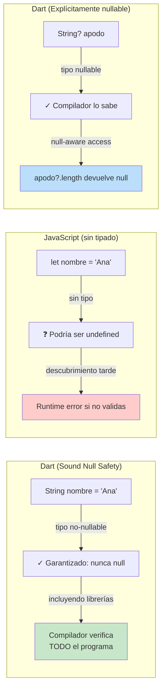
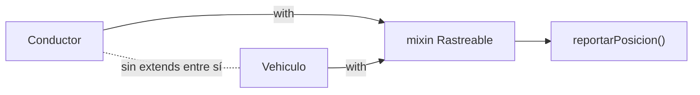
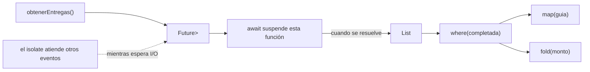
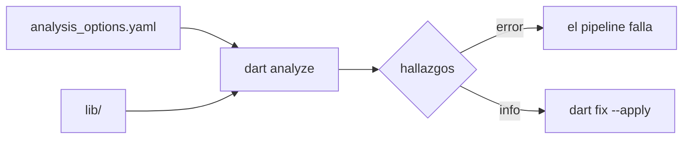
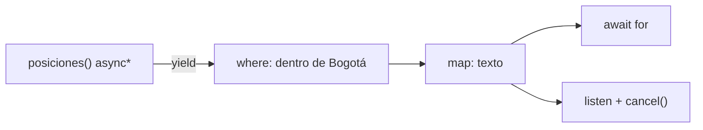
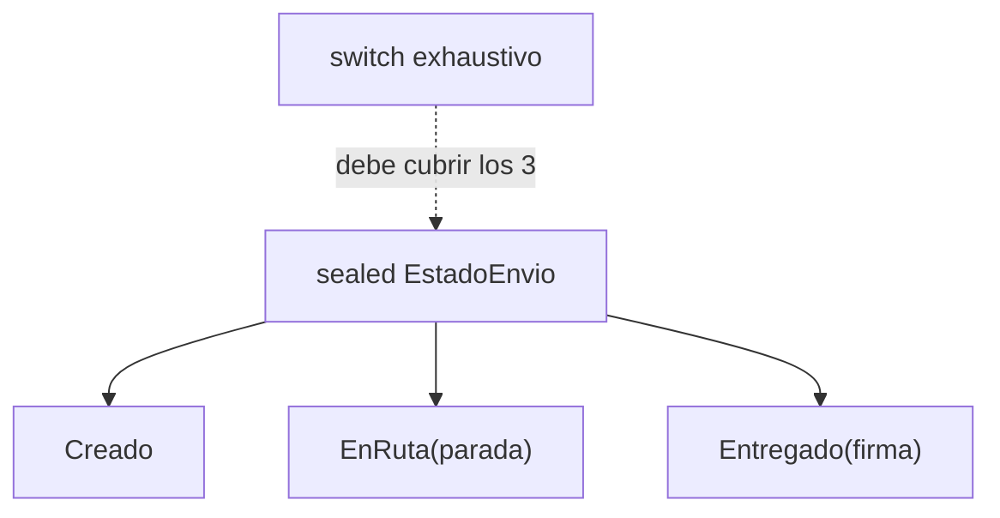
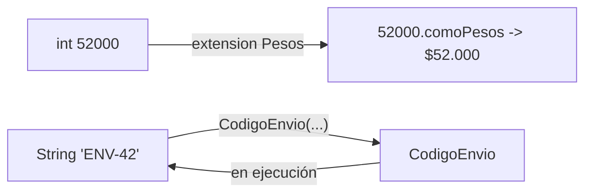

# Módulo 0: Fundamentos de Dart


## Antes de comenzar: instala Flutter y valida todo

Flutter incluye Dart. Descarga el SDK estable desde [docs.flutter.dev/get-started/install](https://docs.flutter.dev/get-started/install), descomprímelo en una ruta permanente sin espacios y agrega `flutter/bin` al `PATH`. Instala Git, VS Code con las extensiones Flutter/Dart y Android Studio para obtener el Android SDK.

| Sistema | Preparación adicional |
|---|---|
| Windows | Activa Developer Mode para enlaces simbólicos; evita `Program Files` para el SDK |
| macOS | Instala Xcode para iOS y ejecuta `sudo xcodebuild -license`; instala CocoaPods si `flutter doctor` lo pide |
| Linux | Instala las librerías indicadas por Flutter y configura KVM para acelerar el emulador Android |

Ejecuta `flutter doctor -v` y resuelve cada marca roja; las advertencias de una plataforma que no usarás todavía pueden esperar. Acepta licencias Android con `flutter doctor --android-licenses`. Después:

```bash
flutter create mi_primera_app
cd mi_primera_app
flutter devices
flutter run
```

Selecciona Chrome o un emulador si hay varios dispositivos. Cambia el texto en `lib/main.dart` y usa hot reload (`r` en la terminal). Si `flutter` no se reconoce, el problema es `PATH`; si no aparecen dispositivos, el SDK funciona pero falta configurar un destino.

> **Aviso de versión (Flutter 3.50, 11-11-2026).** Los módulos 0 a 14 importan `package:flutter/material.dart`. Desde Flutter 3.50 esa librería, y `package:flutter/cupertino.dart`, están formalmente obsoletas (*deprecated*, no eliminadas): siguen compilando, pero el analizador te mostrará avisos. Su reemplazo son los paquetes `material_ui` y `cupertino_ui` (`import 'package:material_ui/material_ui.dart';`). Puedes seguir los ejemplos tal como están y migrar después con `dart fix --apply --code=migrate_design_widgets`, como enseña el Tema 7 del Módulo 15. Fuente: https://docs.flutter.dev/release/breaking-changes/material-ui-and-cupertino-ui.

## Mapa de la ruta

«Flutter» tiene 23 módulos en 4 etapas. Cada etapa se apoya en la anterior; usa la tabla para saltar a un módulo concreto.


| Módulo | Etapa | Qué aprendes |
|---|---|---|
| 0 | Fundamentos | [Fundamentos de Dart](/curso/flutter/0) |
| 1 | Fundamentos | [Widgets: stateless vs stateful](/curso/flutter/1) |
| 2 | Fundamentos | [Layout y diseño responsive](/curso/flutter/2) |
| 3 | Aplicación | [Navegación y rutas](/curso/flutter/3) |
| 4 | Aplicación | [Gestión de estado](/curso/flutter/4) |
| 5 | Aplicación | [Networking](/curso/flutter/5) |
| 6 | Integración | [Persistencia local](/curso/flutter/6) |
| 7 | Integración | [Integración con plataformas nativas](/curso/flutter/7) |
| 8 | Experto | [Animaciones y rendimiento](/curso/flutter/8) |
| 9 | Experto | [Testing en Flutter](/curso/flutter/9) |
| 10 | Experto | [Theming, accesibilidad y Material/Cupertino](/curso/flutter/10) |
| 11 | Experto | [Publicación en App Store y Google Play](/curso/flutter/11) |
| 12 | Experto | [Proyecto integrador: app Flutter completa](/curso/flutter/12) |
| 13 | Experto | [Flutter en producción: seguridad, isolates y operación](/curso/flutter/13) |
| 14 | Experto | [Flutter para entregas: mapas, GPS y tiempo real](/curso/flutter/14) |
| 15 | Experto | [Flutter Master: calidad, arquitectura y despliegue](/curso/flutter/15) |
| 16 | Experto | [Flutter FFI: Dart con código nativo](/curso/flutter/16) |
| 17 | Experto | [Dart avanzado: generación, AST y paquetes](/curso/flutter/17) |
| 18 | Experto | [Flutter en producción: secretos, calidad y rendimiento](/curso/flutter/18) |
| 19 | Experto | [Flutter para entregas: mapa, conexión y trabajo offline](/curso/flutter/19) |
| 20 | Experto | [Flutter Master: pruebas, arquitectura y release](/curso/flutter/20) |
| 21 | Experto | [Flutter IAP: compras y suscripciones](/curso/flutter/21) |
| 22 | Experto | [Flutter Ads: anuncios, mediación y privacidad](/curso/flutter/22) |

## Aprende construyendo

### Tema 1: Sound null safety · Básico · 35 min

#### Paso 1 · Objetivo y preparación
Al finalizar vas a modelar una entrega con campos que pueden faltar (`conductor`, `fotoConfirmacion`) usando tipos nullable explícitos, y a provocar y corregir el error del analizador cuando se accede a uno sin verificar. Prerrequisitos: Flutter SDK y Dart instalados; verifica `flutter --version` y `dart --version`.

#### Paso 2 · Contexto y caso real
Una entrega recién creada en RutaFlow todavía no tiene conductor asignado ni foto de confirmación — tratar esos campos como si siempre tuvieran valor haría que el código compile hoy y falle en producción el día que de verdad falten.

#### Paso 3 · Teoría, modelo mental y analogía
Dart distingue en el sistema de tipos entre `String` (garantizado no-null) y `String?` (explícitamente nullable); el analizador rechaza en tiempo de análisis cualquier uso de un `String?` como si fuera `String` sin verificar primero. La analogía: una etiqueta de paquete que declara explícitamente si el campo puede llegar vacío, en vez de asumir que siempre hay contenido.

**Diagrama: Null Safety en Dart vs JavaScript**



**Conceptos clave:** garantía verificada en todo el programa, no solo advertencias parciales.

Modelar `Delivery` con campos nullable explícitos es exactamente el hábito que aplicarás en el proyecto integrador (app Flutter completa, Módulo 12): cada dato que puede faltar (una entrega sin conductor asignado, una foto de confirmación aún no subida) se declara `?` desde el modelo, no se descubre en tiempo de ejecución.

**Cuándo no usarlo:** forzar unwrap (`!`) en un valor nullable solo es aceptable cuando el flujo del programa garantiza matemáticamente que ese valor no puede ser `null` en ese punto exacto (por ejemplo, justo después de un `if (valor != null)`); fuera de ese caso, usar `!` reintroduce exactamente el riesgo de crash que null safety existe para prevenir.

```dart
String nombre = "Ana";       // nunca null
String? apodo;                  // explícitamente nullable

print(apodo?.length);           // null-aware: null si apodo es null
print(apodo ?? "Sin apodo");    // valor por defecto
```

Dart distingue en el sistema de tipos entre `String` (que el compilador garantiza que nunca contendrá `null`) y `String?` (explícitamente nullable), de forma directamente análoga a los optionals de Swift (Módulo 0 del track de iOS): intentar usar un `String?` donde se espera un `String` sin verificar primero produce un error del analizador estático, no un crash en tiempo de ejecución. La calificación "sound" (sólida) es específica y significativa: Dart garantiza esta propiedad de forma consistente en **todo** el programa, incluyendo código de librerías externas ya migradas a null safety, no solo en advertencias parciales o heurísticas que podrían tener excepciones; esto contrasta con el manejo de `null`/`undefined` en JavaScript (Módulo 0 del track de JavaScript), donde no existe ninguna garantía estructural equivalente verificada por el sistema de tipos, y acceder a una propiedad de un valor inesperadamente `undefined` simplemente falla en tiempo de ejecución sin ninguna advertencia previa del lenguaje.

El operador `?.` (null-aware access) accede a una propiedad o método solo si el receptor no es `null`, devolviendo `null` en caso contrario en vez de lanzar una excepción; `??` (nil coalescing, el mismo operador presente en Swift) provee un valor por defecto cuando la expresión de la izquierda es `null`.

**Analogía:** sound null safety es como un sistema de inspección de calidad que garantiza, verificado de punta a punta en toda la línea de producción (incluyendo componentes de proveedores externos ya certificados), que ningún paquete etiquetado como "contenido garantizado" pueda llegar vacío, en vez de una política de "generalmente debería tener contenido" sin verificación estructural completa.

**¿Por qué es importante?** El sound null safety de Dart garantiza, verificado en todo el programa incluyendo librerías externas, que un valor no-nullable nunca será `null`, una garantía estructural que JavaScript no ofrece por defecto en su sistema de tipos.

**Código del ejemplo:**

```dart
String nombre = "Ana";     // garantizado no-null en TODO el programa
String? apodo;              // explícitamente nullable
print(apodo?.length);       // null-aware access
print(apodo ?? "Sin apodo"); // valor por defecto
```

#### Paso 4 · Demostración guiada desde cero
Parte de una carpeta vacía:
```bash
mkdir ejemplo-flutter-m0
cd ejemplo-flutter-m0
flutter create app
cd app
```

Crea `lib/delivery.dart`:

```dart
class Delivery {
  final String guia;
  final String? conductor;        // puede no estar asignado todavía
  final String? fotoConfirmacion; // puede no haberse subido todavía

  Delivery(this.guia, {this.conductor, this.fotoConfirmacion});

  String etiquetaConductor() => conductor ?? "Sin conductor asignado";
}

void main() {
  final entrega = Delivery("RF-4471");
  print(entrega.etiquetaConductor());
}
```

Ejecuta `dart lib/delivery.dart`. **Resultado esperado:** `Sin conductor asignado` — el acceso nullable con `??` nunca falla aunque `conductor` sea `null`.

**Fallo deliberado:** cambiá `etiquetaConductor` para que devuelva `conductor!` directamente en vez de `conductor ?? "..."`. El analizador no se queja en tiempo de análisis (el tipo sigue siendo válido), pero ejecutar `dart lib/delivery.dart` lanza una excepción en runtime porque `conductor` es efectivamente `null` para esta entrega.

#### Paso 5 · Práctica guiada
Pista: con el `!` forzado del Paso 4 todavía puesto, ejecutá el programa y leé el stack trace completo — identificá la línea exacta donde Dart reporta el acceso nulo, y confirmá que el error aparece en tiempo de ejecución, no al analizar el código.

#### Paso 6 · Práctica independiente
Corregí el Paso 5 restaurando `conductor ?? "Sin conductor asignado"`, y agregá una lista de `Delivery` con al menos una entrega con conductor y otra sin él; escribí una función que imprima la etiqueta de cada una sin que ninguna lance una excepción.

#### Paso 7 · Cierre
Entregá el modelo `Delivery` con campos nullable del Paso 4, el crash reproducido por el `!` forzado del Paso 5, y la lista con ambos casos del Paso 6; explicá por qué declarar `conductor` como `String?` desde el modelo es mejor que descubrir su ausencia en tiempo de ejecución. Siguiente paso: estudia clases y mixins. Errores comunes: usar `!` por comodidad en vez de `??`/`?.`; declarar un campo como no-nullable cuando en la práctica puede faltar. Fuentes oficiales: https://docs.flutter.dev/get-started/install y https://dart.dev/language.
**Implicación práctica:** Declarar explícitamente qué campos pueden faltar desde el modelo evita descubrir esa ausencia como un crash en producción, en vez de como un error detectado durante el desarrollo.

### Tema 2: Clases y mixins · Intermedio · 35 min

#### Paso 1 · Objetivo y preparación
Al finalizar vas a compartir comportamiento (`rastrear()`) entre dos clases que no comparten una jerarquía de herencia natural usando un mixin, y a confirmar con el analizador qué pasa si falta el contrato que ese mixin exige. Prerrequisitos: Tema 1 de este módulo.

#### Paso 2 · Contexto y caso real
Tanto un `Conductor` como un `Vehiculo` de RutaFlow necesitan reportar su posición GPS — pero no tiene sentido que `Vehiculo` herede de `Conductor` ni viceversa, son conceptos de dominio no relacionados que comparten solo esa capacidad puntual.

#### Paso 3 · Teoría, modelo mental y analogía
Dart no permite herencia múltiple directa; un mixin aplica comportamiento compartido con `with` a clases que no tienen relación de herencia entre sí. La analogía: una habilidad certificada que se añade a la formación de cualquier profesional, sin alterar su especialización principal.
**Conceptos clave:** comportamiento reutilizable sin herencia múltiple tradicional.

Un mixin como este es el mecanismo que usarás en el proyecto integrador (app Flutter completa, Módulo 12) para compartir comportamiento transversal entre widgets no relacionados por herencia (por ejemplo, lógica de validación de formularios reutilizada entre pantallas distintas).

**Cuándo no usarlo:** si el comportamiento compartido solo lo necesita una única clase y no hay ninguna otra clase no relacionada que vaya a reutilizarlo, un mixin agrega indirección sin beneficio; resérvalo para comportamiento genuinamente transversal a jerarquías de herencia distintas.

#### `extends`, `implements`, `with` y `@override` no significan lo mismo

`extends` hereda implementación y establece una relación «es un» con una sola superclase; `implements` obliga a satisfacer el contrato público de uno o varios tipos, pero no hereda sus implementaciones; `with` aplica el comportamiento de un mixin compatible. `@override` es una anotación de Dart que comunica al analizador que el miembro pretende reemplazar uno heredado o exigido por un contrato. No realiza el reemplazo: la firma y la jerarquía son las que lo determinan.

Usar `@override` hace visible un error frecuente. Si se escribe mal `build` o cambia la firma, el analizador avisa que no existe ningún miembro compatible para sobrescribir; sin la anotación, el método mal escrito podría quedar como un método nuevo y el framework seguiría llamando al original. En widgets, `build` debe limitarse a describir UI: puede ejecutarse muchas veces y no es el lugar para peticiones HTTP o escrituras persistentes.

```dart
class Ave extends Animal with Volador implements Rastreable {
  @override
  String obtenerId() => 'ave-01';
}
```

```dart
mixin Volador {
  void volar() => print("Volando");
}

class Pajaro extends Animal with Volador {}
```

Dart, como la mayoría de los lenguajes orientados a objetos modernos, no permite herencia múltiple directa (una clase no puede `extends` de dos clases distintas simultáneamente); un mixin resuelve la necesidad de compartir comportamiento entre clases que no comparten una relación de herencia natural, permitiendo que `Pajaro` herede de `Animal` (su relación de herencia principal) **y** obtenga adicionalmente el comportamiento de `Volador` (un comportamiento transversal que también podría aplicarse a otras clases no relacionadas con `Animal`, como un `Avion` o un `Superheroe`), sin necesidad de que `Volador` participe en la jerarquía de herencia principal de `Pajaro`.

Este patrón de composición de comportamiento transversal es conceptualmente similar a los protocolos con extensiones en Swift (Módulo 0 del track de iOS) o a las interfaces con implementación por defecto en Java/Kotlin, todos resolviendo el mismo problema de "compartir comportamiento entre tipos no relacionados por una jerarquía de herencia única", aunque cada lenguaje lo resuelve con una sintaxis y semántica ligeramente distinta.

**Analogía:** un mixin es como una habilidad certificada que se puede añadir a la formación de cualquier profesional independientemente de su especialización principal (un médico y un ingeniero pueden ambos certificarse en primeros auxilios avanzados), sin que esa habilidad transversal altere ni dependa de su especialización de base.

**¿Por qué es importante?** Un mixin permite compartir comportamiento reutilizable entre clases sin depender de herencia múltiple tradicional (no soportada en Dart), resolviendo el mismo problema que protocolos con extensiones en Swift o interfaces con implementación por defecto en otros lenguajes orientados a objetos.

**Diagrama de composición:** ambas clases reciben el mismo comportamiento, pero ninguna hereda de la otra.



#### Paso 4 · Demostración guiada desde cero
Parte de una carpeta vacía:
```bash
mkdir ejemplo-flutter-mixins
cd ejemplo-flutter-mixins
```

**Ejecuta el ejemplo** (crea un proyecto Flutter desde cero, pega el widget en `lib/main.dart` y arráncalo en un emulador o dispositivo):

```bash
flutter create demo_flutter
cd demo_flutter
flutter run
```
Para las pruebas de widget: `flutter test`.

Crea `lib/rastreo.dart`:

```dart
mixin Rastreable {
  double? latitud;
  double? longitud;
  String reportarPosicion() =>
      latitud == null ? "Sin posición" : "Lat: $latitud, Lon: $longitud";
}

class Conductor with Rastreable {
  final String nombre;
  Conductor(this.nombre);
}

class Vehiculo with Rastreable {
  final String placa;
  Vehiculo(this.placa);
}

void main() {
  final conductor = Conductor("Ana")..latitud = 4.6..longitud = -74.1;
  print(conductor.reportarPosicion());
}
```

Ejecuta `dart lib/rastreo.dart`. **Resultado esperado:** `Lat: 4.6, Lon: -74.1` — tanto `Conductor` como `Vehiculo` obtienen `reportarPosicion()` sin que ninguno herede del otro.

**Fallo deliberado:** quitá `with Rastreable` de `Vehiculo` pero dejá una llamada a `vehiculo.reportarPosicion()` en `main`. El analizador reporta que `Vehiculo` no tiene ningún miembro `reportarPosicion`, exactamente el error que confirma que el mixin no se aplicó.

#### Paso 5 · Práctica guiada
Pista: restaura `with Rastreable` en `Vehiculo`, y ahora intenta declarar `class Vehiculo extends Conductor with Rastreable` — el analizador lo rechaza con `The superclass 'Conductor' doesn't have a zero argument constructor.` (`no_default_super_constructor`): el constructor `Vehiculo(this.placa)` llama implícitamente a `super()`, y `Conductor` solo tiene `Conductor(this.nombre)`. El analizador no razona sobre si un vehículo «es» un conductor; eso lo decides tú. Documenta por qué forzar una relación `extends` (y tener que inventar un `nombre` para un vehículo solo para que compile) para obtener un comportamiento compartido es la decisión equivocada.

#### Paso 6 · Práctica independiente
Corregí el Paso 5 volviendo a `class Vehiculo with Rastreable` (sin `extends`), y agregá una tercera clase `Paquete` que también use `with Rastreable` para reportar la posición de un paquete en tránsito, confirmando que las tres clases no relacionadas comparten el mismo comportamiento sin ninguna jerarquía común.

#### Paso 7 · Cierre
Entregá `Conductor` y `Vehiculo` compartiendo `Rastreable` del Paso 4, el error del analizador al quitar `with` del Paso 4/5, y la tercera clase `Paquete` del Paso 6; explicá por qué un mixin resuelve esto mejor que forzar una relación `extends` artificial. Siguiente paso: estudia Futures y async/await. Errores comunes: usar `extends` para obtener comportamiento compartido cuando no hay relación «es un» real; mixins sin un contrato claro de qué esperan de la clase que los usa. Fuentes oficiales: https://docs.flutter.dev/get-started/install y https://dart.dev/language.
**Implicación práctica:** Un mixin comparte comportamiento entre clases sin forzar una relación de herencia que no existe conceptualmente, evitando jerarquías artificiales solo para reutilizar código.

### Tema 3: Futures, async/await y colecciones funcionales · Intermedio · 40 min

#### Paso 1 · Objetivo y preparación
Al finalizar vas a simular con `Future.delayed` la consulta de entregas de un conductor, y a filtrar/transformar esa lista con `where`/`map`/`fold` en vez de un bucle imperativo. Prerrequisitos: Tema 2 de este módulo.

#### Paso 2 · Contexto y caso real
Consultar las entregas pendientes de un conductor tarda un tiempo real (una llamada de red); mientras se espera esa respuesta, el programa no debe bloquearse, y una vez que llega, sumar los montos a cobrar a mano con un bucle mutable es más propenso a errores que encadenar operaciones declarativas.

#### Paso 3 · Teoría, modelo mental y analogía
Un `Future<T>` representa un valor que estará disponible más adelante, no inmediatamente; `await` suspende la función actual sin bloquear el isolate ni crear otro hilo. `where`/`map`/`fold` transforman una colección en pasos declarativos encadenados. La analogía: un recibo de pedido que garantiza la entrega después, y una línea de ensamblaje con estaciones sucesivas para transformar datos.

**Conceptos clave:** operación asíncrona representada como un valor futuro, transformación declarativa de colecciones.

Cada llamada de red del proyecto integrador (app Flutter completa, Módulo 12) — obtener la lista de entregas, confirmar una recepción — será un `Future` como este, consumido con `FutureBuilder` para mostrar los estados loading/error/datos en la UI.

**Cuándo no usarlo:** para una secuencia de valores que llegan repetidamente en el tiempo (actualizaciones de ubicación en vivo, mensajes de un socket), un `Future` no alcanza porque solo resuelve una vez; ahí corresponde un `Stream`, no un `Future`.

```dart
Future<Usuario> obtenerUsuario() async {
  await Future.delayed(Duration(seconds: 1));
  return Usuario("Ana");
}

void main() async {
  final usuario = await obtenerUsuario();
  print(usuario.nombre);
}
```

Un `Future<T>` representa un valor de tipo `T` que estará disponible más adelante. Dentro de una función `async`, `await` suspende esa función mientras el `Future` está pendiente; no bloquea el isolate ni crea un hilo paralelo. Mientras espera una operación asíncrona, el isolate puede procesar otros eventos, pero una operación síncrona que consuma CPU todavía lo bloquea. El código puede leerse de forma lineal, como `async`/`await` en Swift o `suspend` en Kotlin, aunque cada lenguaje tenga sus propios detalles de ejecución.

```dart
final nombres = personas.where((p) => p.edad >= 18).map((p) => p.nombre).toList();
final total = pedidos.fold<double>(0, (acumulado, p) => acumulado + p.monto);
```

`where` (filtrar según un predicado), `map` (transformar cada elemento), y `fold`/`reduce` (acumular una colección a un único valor) son las operaciones funcionales fundamentales para transformar colecciones de forma declarativa, encadenables entre sí para expresar transformaciones complejas como una secuencia legible de pasos simples, en vez de un bucle imperativo con una variable acumuladora mutable gestionada manualmente paso a paso.

**Analogía:** un `Future` es como un recibo de un pedido que garantiza la entrega en algún momento posterior, aunque no inmediatamente: se puede seguir haciendo otras cosas mientras se espera, y `await` es simplemente el momento de recoger el pedido cuando efectivamente está listo; encadenar `where`/`map`/`fold` es como una línea de ensamblaje con estaciones sucesivas, cada una aplicando una transformación simple y bien definida, produciendo en conjunto un resultado complejo a partir de pasos individuales fáciles de entender por separado.

**¿Por qué es importante?** `Future` con `async`/`await` permite código asíncrono legible de forma lineal, el mismo modelo convergente que otros lenguajes modernos; encadenar operaciones funcionales sobre colecciones expresa transformaciones complejas de forma declarativa y legible, sin bucles imperativos con estado mutable manual.

**Flujo de espera y transformación:** la función se reanuda cuando llega el resultado; después, el pipeline filtra y proyecta los datos, mientras `fold` calcula un total.



---

#### Paso 4 · Demostración guiada desde cero
Parte de una carpeta vacía:
```bash
mkdir ejemplo-flutter-futures
cd ejemplo-flutter-futures
```

**Ejecuta el ejemplo** (crea un proyecto Flutter desde cero, pega el widget en `lib/main.dart` y arráncalo en un emulador o dispositivo):

```bash
flutter create demo_flutter
cd demo_flutter
flutter run
```
Para las pruebas de widget: `flutter test`.

Crea `lib/entregas.dart`:

```dart
class Entrega {
  final String guia;
  final double monto;
  final bool completada;
  Entrega(this.guia, this.monto, this.completada);
}

Future<List<Entrega>> obtenerEntregas() async {
  await Future.delayed(Duration(seconds: 1)); // simula la llamada de red
  return [Entrega("RF-1", 20.0, true), Entrega("RF-2", 15.0, false), Entrega("RF-3", 30.0, true)];
}

void main() async {
  final entregas = await obtenerEntregas();
  final totalCompletadas = entregas
      .where((e) => e.completada)
      .fold<double>(0, (acumulado, e) => acumulado + e.monto);
  print("Total completadas: \$${totalCompletadas}");
}
```

Ejecuta `dart lib/entregas.dart`. **Resultado esperado:** tras ~1 segundo de espera, `Total completadas: $50.0` (RF-1 + RF-3, excluyendo la no completada).

**Fallo deliberado:** quitá `await` antes de `obtenerEntregas()` en `main`. El analizador marca que `entregas` es un `Future<List<Entrega>>`, no una `List<Entrega>`, y `.where(...)` no existe sobre ese tipo — el error aparece en tiempo de análisis, antes de ejecutar nada.

#### Paso 5 · Práctica guiada
Pista: con el `await` restaurado, cambiá `.where((e) => e.completada)` por ninguna condición (sumá todas las entregas, completadas o no) y confirmá que el total cambia a `$65.0` — documentá por qué mezclar entregas sin completar en un total "a cobrar" sería un error de negocio, no de tipos.

#### Paso 6 · Práctica independiente
Corregí el Paso 5 restaurando el filtro `where((e) => e.completada)`, y agregá una segunda transformación que use `.map((e) => e.guia)` para imprimir solo las guías de las entregas completadas, confirmando que `where`, `map` y `fold` se encadenan sin variables intermedias mutables.

#### Paso 7 · Cierre
Entregá la consulta asíncrona con `await` del Paso 4, el error de tipos al quitar `await` del Paso 4, y las transformaciones encadenadas del Paso 6; explicá por qué el analizador detecta el `await` faltante antes de ejecutar el programa, no como un crash en producción. Siguiente paso: estudia widgets. Errores comunes: olvidar `await` sobre un `Future`; sumar colecciones con un bucle mutable en vez de `fold`. Fuentes oficiales: https://docs.flutter.dev/get-started/install, [async](https://dart.dev/language/async) y [concurrencia/isolate](https://dart.dev/language/concurrency).
**Implicación práctica:** `await` suspende sin bloquear mientras se espera un resultado futuro, y encadenar `where`/`map`/`fold` expresa transformaciones de colecciones como pasos declarativos legibles, sin una variable acumuladora mutable gestionada a mano.

### Tema 4: Lints y estilo con analysis_options.yaml · Intermedio · 35 min

#### Paso 1 · Objetivo y preparación
Al finalizar podrás configurar el analizador estático de Dart con `flutter_lints`, endurecerlo con modos estrictos, subir la severidad de una regla y usar `dart fix` para corregir automáticamente. Prerrequisitos: Temas 1 a 3 de este módulo.

#### Paso 2 · Contexto y caso real
En el equipo de la app del repartidor cada persona escribía con su propio estilo, y un `print` con datos del destinatario llegó a los logs de producción. Un analizador configurado en el repositorio y ejecutado en CI es el caso real que unifica estilo y detecta errores antes de la revisión de código.

#### Paso 3 · Teoría, modelo mental y analogía
`dart analyze` revisa el código sin ejecutarlo usando `analysis_options.yaml`. `flutter create` ya incluye `flutter_lints`, un conjunto recomendado de reglas. Sobre él puedes activar **modos estrictos** del lenguaje (`strict-casts` prohíbe usar un `dynamic` como si fuera otro tipo sin conversión explícita), agregar reglas y cambiar su **severidad** (`info`, `warning`, `error`). `dart fix --dry-run` lista las correcciones automáticas y `dart fix --apply` las aplica.

**Analogía:** es el corrector ortográfico del equipo, configurado una sola vez con las reglas de la casa.

**Diagrama:**



**¿Por qué es importante?** porque un analizador compartido evita discusiones de estilo, encuentra errores reales (futures sin esperar, casts inseguros) y protege datos en los logs.
**Fuente oficial:** [Dart: Customizing static analysis](https://dart.dev/tools/analysis), [Dart: Linter rules](https://dart.dev/tools/linter-rules).
**Conceptos clave:** `dart analyze`, `analysis_options.yaml`, `flutter_lints`, `strict-casts`, severidad de reglas, `dart fix`, `--fatal-infos`.
**Cuándo no usarlo:** no actives todas las reglas existentes de golpe en un proyecto grande: empieza con el conjunto recomendado y agrega reglas acordadas por el equipo, una a una.

**Transferencia al proyecto integrador «Aplicación móvil del repartidor»:** agrega el análisis estático estricto al repositorio de la app del repartidor y hazlo obligatorio en CI.
Como **siguiente** paso, aplica lo aprendido en el proyecto integrador del track y compara el resultado con lo que esperabas.
**Errores comunes:** subir la severidad de una regla a `error` en `analysis_options.yaml` y confiar en que ya está aplicada sin correr `dart analyze` localmente — el editor puede seguir mostrando el código en verde si no recargó la configuración, y el equipo recién descubre el `error` cuando el pipeline de CI lo bloquea.

#### Paso 4 · Demostración guiada desde cero
**Ejemplo independiente (desde cero):** este tema se reproduce en una **carpeta vacía**, como **proyecto nuevo**, sin estado de otros temas.

```bash
mkdir lints && cd lints
flutter create repartidor_lints
cd repartidor_lints
```

Crea `lib/tarifa.dart`:

```dart
// lib/tarifa.dart
import 'dart:developer' as developer;

int tarifa({required String ciudad, required double kilos}) {
  final base = ciudad == 'Bogotá' ? 5000 : 9000;
  final total = base + (kilos.ceil() * 1200);
  developer.log('tarifa $ciudad $kilos kg = $total', name: 'tarifas');
  return total;
}
```

Crea `analysis_options.yaml`:

```yaml
include: package:flutter_lints/flutter.yaml

analyzer:
  language:
    strict-casts: true        # prohíbe conversiones implícitas desde dynamic
    strict-raw-types: true
  errors:
    avoid_print: error        # en este proyecto un print es un error, no un aviso

linter:
  rules:
    - prefer_final_locals
    - always_declare_return_types
    - prefer_single_quotes
    - require_trailing_commas
```

**Ejecuta el ejemplo:**

```bash
dart analyze
dart fix --dry-run
```

**Resultado esperado:**

```text
Analyzing repartidor_lints...
No issues found!
Nothing to fix!
```

`tarifa.dart` usa `dart:developer` en lugar de `print`, por eso pasa. El archivo generado por `flutter create` puede mostrar algunos avisos de estilo con las reglas nuevas (por ejemplo, comas finales); corrígelos con `dart fix --apply`.

**Fallo deliberado:** Agrega `print('tarifa calculada: $total');` antes del `return`. `dart analyze` reporta `error - lib/tarifa.dart:... - Don't invoke 'print' in production code. ... - avoid_print` y termina con código de salida distinto de cero. Como la severidad se subió a `error`, el pipeline se detiene en vez de dejar pasar un aviso.

#### Paso 5 · Práctica guiada
Activa la regla `unawaited_futures` y escribe una función que llame a un `Future` sin `await` para verla en acción. **Pista:** agrega la regla bajo `linter: rules:`; el aviso desaparece con `await` o, si es intencional, con `unawaited(...)` de `dart:async`.

#### Paso 6 · Práctica independiente
Agrega un paso `dart analyze --fatal-infos` al pipeline de CI del Módulo 11 y documenta qué reglas decidió el equipo y por qué.

#### Paso 7 · Cierre
Antes de seguir, confirma estas cuatro evidencias:

- [ ] `dart analyze` termina con `No issues found!` con tu `analysis_options.yaml`.
- [ ] El `print` del fallo deliberado produce un `error` de `avoid_print` y un código de salida distinto de cero.
- [ ] La regla `unawaited_futures` del Paso 5 señala tu `Future` sin `await` y el aviso desaparece con `await` o `unawaited(...)`.
- [ ] Documentaste, tras el Paso 6, qué reglas eligió el equipo y por qué.

Fuentes oficiales: https://dart.dev/tools/analysis y https://dart.dev/tools/linter-rules.

### Tema 5: Streams en Dart: secuencias de eventos asíncronos con await for y StreamController · Intermedio · 40 min

**Prerrequisito:** tema «Futures, async/await y colecciones funcionales» de este módulo.

**Al finalizar podrás:** crear un `Stream` con una función `async*`, transformarlo con `where` y `map`, consumirlo con `await for` y con `listen`, y cancelar la suscripción para no dejar fugas.

**¿Por qué es importante?** Un `Future` entrega un valor una vez; un `Stream` entrega muchos a lo largo del tiempo: posiciones GPS, mensajes de un socket, cambios de una base. En Flutter, `StreamBuilder` y casi todo el estado en vivo se basan en streams.

#### Paso 1 · Objetivo y preparación

Instala el SDK de Dart (o Flutter, que lo incluye) y crea un proyecto de consola con `dart create -t console streams_rutaflow`. Escribirás en `bin/streams_rutaflow.dart`.

#### Paso 2 · Contexto y caso real

La app de RutaFlow recibe la posición del mensajero cada pocos segundos. La primera versión hacía una petición cada vez con `Timer`, y al salir de la pantalla el temporizador seguía corriendo. Con un stream y su suscripción cancelada al salir, el problema desaparece.

#### Paso 3 · Teoría, modelo mental y analogía

**Conceptos clave:** `Stream`, `async*`, `yield`, `await for`, `listen`, `StreamSubscription`, `StreamController`, stream de una suscripción y de difusión (*broadcast*).

Hay dos formas de crear un stream:

- Una función **`async*`** que hace `yield` de cada valor. Es la más simple cuando tú produces los valores.
- Un **`StreamController`** cuando los valores llegan desde afuera (callbacks): llamas `add` y al final `close`.

Para consumirlo:

- `await for (final x in stream)` dentro de una función `async`: lee en orden y espera a que termine.
- `stream.listen(...)` devuelve una **`StreamSubscription`**; guárdala y llama `cancel()` cuando ya no la necesites.

Un stream normal admite **un solo** oyente. Si necesitas varios, usa `asBroadcastStream()` o `StreamController.broadcast()`.

**Analogía:** un stream es una cinta de equipaje: las maletas llegan de a una y tú las recoges. `await for` es esperar junto a la cinta hasta que llegue la última; `listen` es dejar a alguien encargado y avisarle cuándo irse (`cancel`). La analogía falla en que una cinta normal solo admite una persona recogiendo.

**Límite de uso:** no uses `await for` con un stream que nunca termina dentro de código que debe seguir: se queda esperando para siempre. Cancela siempre las suscripciones en `dispose` de los widgets.



#### Paso 4 · Demostración guiada desde cero

Archivo `streams_rutaflow/bin/streams_rutaflow.dart`:

```dart
import 'dart:async';

// Productor: emite una posición cada 100 ms.
Stream<double> posiciones() async* {
  var lat = 4.55;
  for (var i = 0; i < 6; i++) {
    await Future.delayed(const Duration(milliseconds: 100));
    lat += 0.02;
    yield lat;
  }
}

Future<void> main() async {
  // 1) Transformar y leer hasta el final con await for.
  final enBogota = posiciones().where((lat) => lat < 4.64).map((lat) => 'lat ${lat.toStringAsFixed(2)}');
  await for (final texto in enBogota) {
    print('await for: $texto');
  }

  // 2) listen y cancelar a mitad de camino.
  late final StreamSubscription<double> suscripcion;
  var recibidas = 0;
  suscripcion = posiciones().listen((lat) {
    recibidas++;
    if (recibidas == 2) {
      suscripcion.cancel(); // como salir de la pantalla
      print('listen: cancelado después de $recibidas posiciones');
    }
  });
  await Future.delayed(const Duration(milliseconds: 800));
  print('fin');
}
```

Ejecútalo:

```bash
cd streams_rutaflow
dart run
```

**Explicación por bloques:** `posiciones` es una función `async*`: cada `yield` entrega un valor y la función continúa en la siguiente vuelta. En la primera parte, `where` deja pasar solo latitudes menores a 4.64 (con decimales binarios, 4.65 se guarda como 4.6499…, por eso el límite no es 4.65) y `map` las convierte en texto; `await for` las imprime y termina cuando el stream termina. En la segunda parte, `listen` recibe valores hasta la segunda posición y cancela la suscripción: el productor deja de generar. La espera final solo da tiempo a que se vea que no llegan más valores.

**Resultado esperado:**

```text
await for: lat 4.57
await for: lat 4.59
await for: lat 4.61
await for: lat 4.63
listen: cancelado después de 2 posiciones
fin
```

**Fallo deliberado:** llama dos veces `listen` sobre el mismo stream: `final s = posiciones(); s.listen(print); s.listen(print);`. **Error esperado:** `Bad state: Stream has already been listened to.` **Diagnóstico:** un stream normal admite un solo oyente. Crea dos streams o usa `asBroadcastStream()`.

#### Paso 5 · Práctica guiada

1. **Reproducción:** ejecuta el programa y explica por qué no aparece 4.65 ni 4.67.
2. **Variación:** agrega `.take(2)` antes de `await for` y observa que el bucle termina antes.
3. **Diagnóstico:** reproduce el fallo deliberado de doble suscripción.
4. **Integración:** reescribe el productor con un `StreamController` y un `Timer.periodic`, cerrándolo con `close()` y deteniendo el timer en `onCancel`.
5. **Diseño:** en una pantalla de Flutter, consume el stream con `StreamBuilder` y explica quién cancela la suscripción.

**Pista:** si un stream «no termina», revisa si el productor llega a cerrar o a salir del bucle.

#### Paso 6 · Práctica independiente

Escribe `Stream<int> contarEntregas(Stream<String> eventos)` que emita el total acumulado cada vez que llega un evento `ENTREGADO`, usando `where` y `scan` manual con una variable.

#### Paso 7 · Cierre

- [ ] Explicas la diferencia entre `Future` y `Stream`.
- [ ] El programa imprime las seis líneas esperadas.
- [ ] Reprodujiste el error de doble suscripción.
- [ ] Cancelas las suscripciones que abres.

Si fallas dos o más, vuelve al Paso 3. **Errores comunes:** olvidar `cancel()`, escuchar dos veces un stream normal y usar `await for` con streams infinitos donde el código debe seguir. **Siguiente paso:** el tema siguiente usa records y patterns para devolver y desarmar varios valores a la vez.

**Transferencia al proyecto integrador «RutaFlow»:** expón la posición del mensajero de RutaFlow como `Stream<Posicion>` y cancela la suscripción en el `dispose` de la pantalla de ruta.

**Fuente oficial:** [Dart — Asynchronous programming: Streams](https://dart.dev/libraries/async/using-streams) y [Dart — Creating streams](https://dart.dev/libraries/async/creating-streams).

### Tema 6: Records y patterns en Dart: varios valores sin clases y switch exhaustivo · Intermedio · 40 min

**Prerrequisito:** tema «Clases y mixins» de este módulo.

**Al finalizar podrás:** devolver varios valores con un record, desarmarlos con patterns y escribir un `switch` exhaustivo sobre una clase `sealed` que el analizador comprueba.

**¿Por qué es importante?** Antes, devolver dos valores obligaba a crear una clase o usar una lista sin tipos. Los records y los patterns de Dart 3 dan resultados tipados y `switch` que el compilador revisa: si agregas un estado nuevo, te avisa dónde falta manejarlo.

#### Paso 1 · Objetivo y preparación

Usa Dart 3.0 o superior (`dart --version`). Crea `dart create -t console patrones_rutaflow` y escribe en `bin/patrones_rutaflow.dart`.

#### Paso 2 · Contexto y caso real

En RutaFlow, una función calculaba la tarifa y el tiempo estimado y devolvía `List<dynamic>`. Alguien invirtió el orden y la app mostró «1240 minutos». Con un record con nombres, ese error no compila.

#### Paso 3 · Teoría, modelo mental y analogía

**Conceptos clave:** record, campo posicional y con nombre, pattern de desestructuración, `sealed class`, `switch` exhaustivo, guarda `when`.

- Un **record** agrupa valores sin declarar una clase: `(int, String)` o con nombres `({int centavos, int minutos})`. Es inmutable y se compara por valor.
- Un **pattern** desarma un valor: `final (:centavos, :minutos) = cotizar(2);` crea dos variables.
- Una **`sealed class`** tiene un conjunto cerrado de subclases (todas en el mismo archivo). Un `switch` sobre ella es **exhaustivo**: el analizador comprueba que manejaste todos los casos.
- En un `switch`, los patterns pueden pedir datos de cada caso y una **guarda** `when` agrega condiciones.

**Analogía:** un record es una caja con compartimentos rotulados; el pattern es abrir la caja y sacar cada cosa por su rótulo. La `sealed class` es una lista cerrada de tipos de paquete: el inspector (analizador) revisa que tengas una regla para cada uno.

**Límite de uso:** no uses records para modelos con comportamiento o que viajan por toda la app: para eso una clase con nombre documenta mejor. Un `switch` con un caso `_` (comodín) pierde la comprobación exhaustiva.



#### Paso 4 · Demostración guiada desde cero

Archivo `patrones_rutaflow/bin/patrones_rutaflow.dart`:

```dart
// Record con nombres: el orden ya no puede confundirse.
({int centavos, int minutos}) cotizar(int kilos) =>
    (centavos: 1000 + kilos * 120, minutos: 30 + kilos * 5);

sealed class EstadoEnvio {}
class Creado extends EstadoEnvio {}
class EnRuta extends EstadoEnvio { EnRuta(this.parada); final int parada; }
class Entregado extends EstadoEnvio { Entregado(this.firma); final String? firma; }

String describir(EstadoEnvio estado) => switch (estado) {
      Creado() => 'esperando recogida',
      EnRuta(parada: 1) => 'saliendo de bodega',
      EnRuta(:final parada) => 'en ruta, parada $parada',
      Entregado(firma: null) => 'entregado sin firma: revisar',
      Entregado(:final firma?) => 'entregado, firmó $firma',
    };

void main() {
  final (:centavos, :minutos) = cotizar(2); // pattern de desestructuración
  print('tarifa $centavos centavos, $minutos minutos');

  for (final e in [Creado(), EnRuta(1), EnRuta(4), Entregado(null), Entregado('Ana')]) {
    print(describir(e));
  }

  final json = {'codigo': 'ENV-42', 'kilos': 2};
  if (json case {'codigo': String codigo, 'kilos': int kilos} when kilos > 0) {
    print('JSON válido: $codigo con $kilos kg');
  }
}
```

Ejecútalo:

```bash
cd patrones_rutaflow
dart run
```

**Explicación por bloques:** `cotizar` devuelve un record con nombres; en `main`, `final (:centavos, :minutos)` crea dos variables con esos nombres. `EstadoEnvio` es `sealed`, así que `describir` puede usar un `switch` sin comodín y el analizador comprueba que cubre los tres tipos. Los patterns también miran los datos: `EnRuta(parada: 1)` es un caso particular y `Entregado(:final firma?)` solo coincide si la firma no es nula. Al final, `if case` valida la forma de un mapa JSON y extrae sus campos tipados en una sola línea.

**Resultado esperado:**

```text
tarifa 1240 centavos, 40 minutos
esperando recogida
saliendo de bodega
en ruta, parada 4
entregado sin firma: revisar
entregado, firmó Ana
JSON válido: ENV-42 con 2 kg
```

**Fallo deliberado:** agrega `class Devuelto extends EstadoEnvio {}` sin tocar `describir`. **Error esperado:** `dart analyze` y la compilación fallan con «The type 'EstadoEnvio' is not exhaustively matched by the switch cases since it doesn't match 'Devuelto()'». **Diagnóstico:** el compilador encontró el caso olvidado. Agrega `Devuelto() => 'devuelto a bodega'`.

#### Paso 5 · Práctica guiada

1. **Reproducción:** ejecuta el programa y relaciona cada línea con su caso del `switch`.
2. **Variación:** cambia el record por uno posicional `(int, int)` y observa qué se pierde al leerlo.
3. **Diagnóstico:** reproduce el fallo deliberado con `Devuelto`.
4. **Integración:** agrega una guarda `EnRuta(:final parada) when parada > 10 => ...` y colócala en el orden correcto.
5. **Diseño:** busca en tu código una función que devuelva `List` o `Map` para varios valores y conviértela en record.

**Pista:** el orden de los casos importa: el primero que coincide gana, así que los casos particulares van antes que los generales.

#### Paso 6 · Práctica independiente

Modela el resultado de una petición como `sealed class Resultado<T>` con `Exito(T valor)` y `Fallo(String mensaje)`, y escribe un `switch` que lo convierta en texto para la pantalla.

#### Paso 7 · Cierre

- [ ] Explicas record, pattern y `sealed`.
- [ ] El programa imprime las siete líneas esperadas.
- [ ] Reprodujiste el error de `switch` no exhaustivo.
- [ ] Ordenas los casos de particular a general.

Si fallas dos o más, vuelve al Paso 3. **Errores comunes:** usar `_` y perder la exhaustividad, poner casos generales antes que los particulares y usar records para modelos grandes. **Siguiente paso:** el tema siguiente agrega métodos a tipos existentes con extensiones.

**Transferencia al proyecto integrador «RutaFlow»:** en RutaFlow, modela los estados del envío como `sealed class` y conviértelos en texto con un `switch` exhaustivo en la pantalla de seguimiento.

**Fuente oficial:** [Dart — Records](https://dart.dev/language/records) y [Dart — Patterns](https://dart.dev/language/patterns).

### Tema 7: Extension methods y extension types: agregar comportamiento sin heredar · Intermedio · 35 min

**Prerrequisito:** tema «Records y patterns en Dart» de este módulo.

**Al finalizar podrás:** agregar métodos a tipos que no son tuyos con `extension`, y crear un tipo `CodigoEnvio` con `extension type` que no cuesta nada en ejecución pero impide mezclarlo con cualquier `String`.

**¿Por qué es importante?** Las utilidades sueltas (`formatearPrecio(x)`) se pierden en archivos de ayuda. Las extensiones las ponen donde se esperan (`x.comoPesos`). Y un `extension type` evita pasar un nombre de cliente donde iba un código de envío, sin crear clases.

#### Paso 1 · Objetivo y preparación

Usa Dart 3.3 o superior (necesario para `extension type`). Crea `dart create -t console extensiones_rutaflow`.

#### Paso 2 · Contexto y caso real

En RutaFlow, una función recibía `(String codigo, String cliente)` y alguien la llamó con los argumentos al revés. Con un tipo `CodigoEnvio`, esa llamada no compila.

#### Paso 3 · Teoría, modelo mental y analogía

**Conceptos clave:** extensión (`extension ... on`), resolución estática, `extension type`, representación, tipo envoltorio sin costo.

Una **extensión** agrega métodos, getters u operadores a un tipo existente: `extension Pesos on int { String get comoPesos => ... }`. Se resuelve **en tiempo de compilación** según el tipo estático: no funciona sobre una variable `dynamic`.

Un **`extension type`** envuelve un valor (su **representación**) en un tipo nuevo para el compilador. En ejecución es exactamente el valor original: no crea objetos. Sirve para:

- distinguir valores con el mismo tipo base (`CodigoEnvio` frente a `String`);
- exponer solo las operaciones válidas;
- validar al construir.

**Analogía:** una extensión es una navaja que se acopla a una herramienta que ya tienes; un `extension type` es una etiqueta de color en un cable: el cable es el mismo, pero ya no lo confundes con otro. La analogía falla en que la etiqueta desaparece en ejecución: si conviertes a `dynamic`, se pierde.

**Límite de uso:** las extensiones no reemplazan a los métodos de una clase propia que controlas. Un `extension type` no protege si haces `as String` a propósito; es una ayuda del compilador, no una barrera en ejecución.



#### Paso 4 · Demostración guiada desde cero

Archivo `extensiones_rutaflow/bin/extensiones_rutaflow.dart`:

```dart
extension Pesos on int {
  // 52000 -> "$52.000"
  String get comoPesos => '\$${toString().replaceAllMapped(RegExp(r'\B(?=(\d{3})+$)'), (_) => '.')}';
}

extension type CodigoEnvio._(String valor) {
  // Constructor con validación: solo códigos con el formato correcto.
  factory CodigoEnvio(String texto) {
    if (!RegExp(r'^ENV-\d+$').hasMatch(texto)) throw FormatException('código inválido: $texto');
    return CodigoEnvio._(texto);
  }
  int get numero => int.parse(valor.substring(4));
}

String etiqueta(CodigoEnvio codigo, String cliente) => '${codigo.valor} para $cliente';

void main() {
  print(52000.comoPesos);

  final codigo = CodigoEnvio('ENV-42');
  print(etiqueta(codigo, 'Ana'));
  print('número: ${codigo.numero}');
  // etiqueta('Ana', codigo); // ❌ no compila: los tipos no coinciden

  try {
    CodigoEnvio('42');
  } on FormatException catch (e) {
    print(e.message);
  }
}
```

Ejecútalo:

```bash
cd extensiones_rutaflow
dart run
```

**Explicación por bloques:** `Pesos` agrega a `int` un getter que inserta puntos cada tres cifras desde la derecha. `CodigoEnvio` es un `extension type` sobre `String`: el constructor privado `_` guarda el valor y el `factory` público valida el formato antes. `numero` solo existe para códigos. La función `etiqueta` pide un `CodigoEnvio` y un `String`: pasarlos al revés no compila. En ejecución, `codigo` sigue siendo el texto `'ENV-42'`, sin objeto extra.

**Resultado esperado:**

```text
$52.000
ENV-42 para Ana
número: 42
código inválido: 42
```

**Fallo deliberado:** descomenta `etiqueta('Ana', codigo);`. **Error esperado:** «The argument type 'String' can't be assigned to the parameter type 'CodigoEnvio'». **Diagnóstico:** el compilador distingue el código de un texto cualquiera, justo el error que antes llegaba a producción.

#### Paso 5 · Práctica guiada

1. **Reproducción:** ejecuta el programa y prueba `1000000.comoPesos`.
2. **Variación:** agrega a `CodigoEnvio` un getter `esUrgente` para números mayores que 9000.
3. **Diagnóstico:** reproduce el fallo deliberado.
4. **Integración:** guarda el código en una variable `dynamic` y llama `.numero`: explica por qué falla.
5. **Diseño:** lista tres tipos de RutaFlow que hoy son `String` y deberían ser `extension type`.

**Pista:** las extensiones se eligen por el tipo estático: si la variable es `dynamic`, el compilador no sabe qué extensión usar.

#### Paso 6 · Práctica independiente

Crea `extension type Kilos(double valor)` con validación (mayor que cero y menor que 1000) y úsalo en una función `cotizar(Kilos kilos)`.

#### Paso 7 · Cierre

- [ ] Explicas la diferencia entre extensión y `extension type`.
- [ ] El programa imprime las cuatro líneas esperadas.
- [ ] Reprodujiste el error de tipos al invertir argumentos.
- [ ] Sabes por qué no funciona con `dynamic`.

Si fallas dos o más, vuelve al Paso 3. **Errores comunes:** usar extensiones sobre `dynamic`, esperar que un `extension type` valide en ejecución tras un `as` y crear extensiones para tipos propios que podrías modificar. **Siguiente paso:** el tema «Lints y estilo con analysis_options.yaml» hace que el analizador también vigile el uso de estos tipos.

**Transferencia al proyecto integrador «RutaFlow»:** en RutaFlow, reemplaza los `String` de códigos de envío por `CodigoEnvio` y agrega la extensión `comoPesos` para los precios.

**Fuente oficial:** [Dart — Extension methods](https://dart.dev/language/extension-methods) y [Dart — Extension types](https://dart.dev/language/extension-types).

## Ruta de proyecto progresivo desde carpeta vacía

No crees un proyecto desechable por módulo. Conserva un único repositorio que evoluciona durante todo el track y etiqueta cada hito (`git tag modulo-N`). Empieza con `flutter create academia_flutter && cd academia_flutter && git init`. Ejecuta el comando paso a paso, inspecciona los archivos generados y registra versiones y precondiciones en el README.

| Hito | Evolución acumulativa | Antes de avanzar |
|---|---|---|
| Base | widgets, layout y navegación. | Arranque reproducible, commit limpio y prueba mínima. |
| Aplicación | estado, red y persistencia. | Casos normales, límite y error automatizados. |
| Integración | Conecta capas y reemplaza dobles por infraestructura controlada. | Diagrama, contratos y prueba de integración. |
| Experto | profiling, seguridad y doble release. | Perfil o threat model, telemetría y runbook de recuperación. |

Al iniciar cada laboratorio crea una rama `modulo-N`, implementa el incremento, verifica el criterio de éxito y fusiona solo con pruebas verdes. Si un módulo necesita un experimento aislado, colócalo en `experiments/modulo-N/`; el producto acumulativo permanece ejecutable. Al terminar, otra persona debe poder clonar el repositorio y reproducir el último hito siguiendo únicamente el README.


## Laboratorio práctico

**Objetivo del laboratorio:** construir un programa de consola en Dart con manejo asíncrono y null safety estricta.

**Requisitos previos:** Dart SDK instalado (incluido con Flutter).

| Paso | Acción | Código | Explicación |
|---|---|---|---|
| 1 | Declarar una variable nullable y usarla sin verificar | Ver Tema 1 | Observa el error del analizador |
| 2 | Crear una jerarquía de clases con un mixin | Ver Tema 2 | Herencia + comportamiento transversal |
| 3 | Escribir una función `async` con `Future.delayed` | Ver Tema 3 | Esperarla con `await` |
| 4 | Encadenar `map`, `where` y `reduce` | Ver Tema 3 | Sobre una lista de objetos |
| 5 | Ejecutar `dart analyze` | `dart analyze` | Corregir advertencias de null safety |

**Verificación:** el laboratorio se considera exitoso si `dart analyze` no reporta ninguna advertencia de null safety, y si el programa maneja correctamente el flujo asíncrono simulado con `Future.delayed`.

**Errores comunes y soluciones**

- **Usar el operador de aserción `!` por comodidad sin verificar realmente la ausencia de null.** Arriesga una excepción en runtime; prefiere `?.` o `??` cuando sea posible.
- **Usar herencia múltiple simulada de forma incorrecta en vez de un mixin.** Dart no soporta herencia múltiple directa; usa mixins para comportamiento transversal.
- **Bloquear código síncrono esperando un `Future` sin `async`/`await`.** Usa el modificador `async` en la función que necesita esperar el resultado.

---
