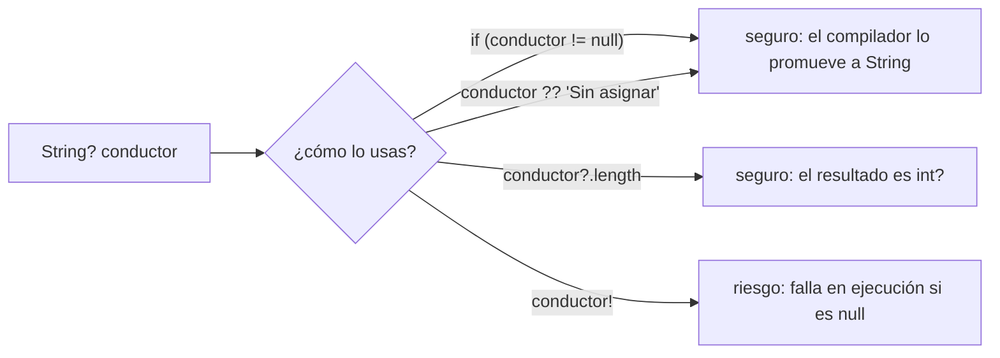
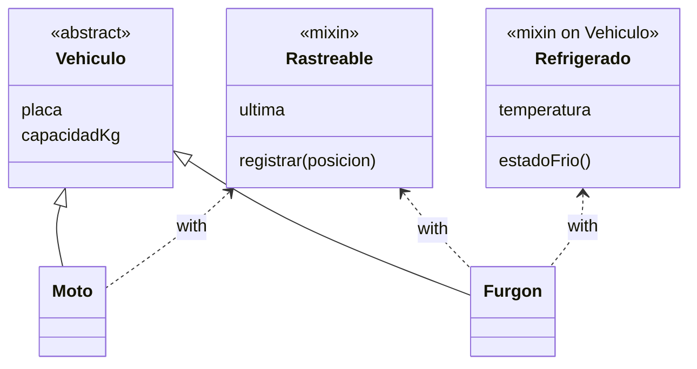
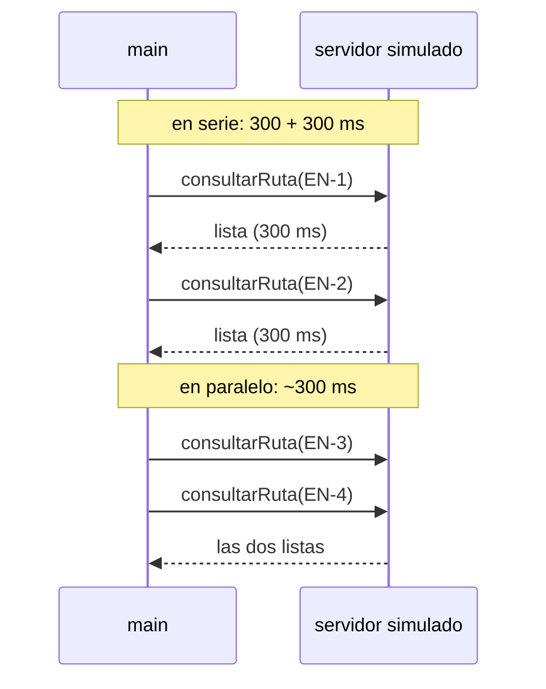
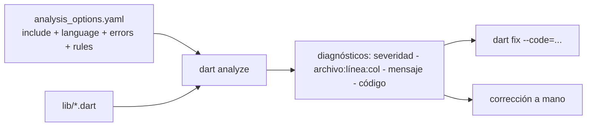
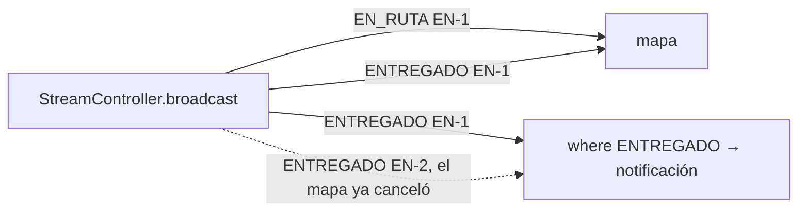
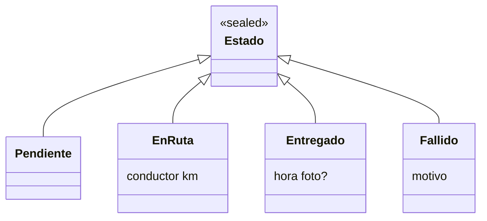
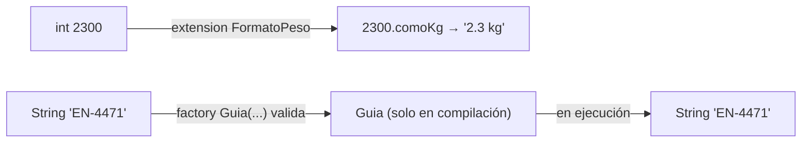

# Módulo 0: Fundamentos de Dart para Flutter

**Entorno comprobado para esta edición (2026-11-24):** Flutter 3.50.1 (canal estable) con Dart 3.14.0 en Linux
x86_64. Todos los programas se ejecutaron con `dart run` y todos los análisis con `dart analyze` ese día, como el
usuario sin privilegios `estudiante`, en `/home/estudiante/labs/flutter/m0` (tu `~/labs/flutter/m0`). Las salidas son
literales; en tu equipo cambian solo las rutas de los archivos en las trazas de error y los tiempos medidos, que el
Tema 3 redondea a centenas de milisegundos.

Flutter se programa en **Dart**. Antes de dibujar una sola pantalla conviene dominar las seis ideas de Dart que
aparecen en cada archivo de Flutter: valores que pueden faltar (null safety), clases con varios tipos de constructor,
mixins, código asíncrono, flujos de eventos y modelos de datos con records, patrones y clases selladas. Si vienes del
curso de Java, muchas ideas te sonarán; este módulo se concentra en lo que Dart hace distinto y en los errores que
esas diferencias producen.

**Al terminar este módulo podrás:**
- declarar qué valores pueden faltar y leerlos con `?.`, `??` y `??=` sin que el programa se caiga;
- escribir constructores `const`, con nombre, de fábrica y con lista de inicialización, y reutilizar comportamiento con mixins;
- esperar operaciones asíncronas en serie o en paralelo, con manejo de errores y tiempo límite;
- configurar el analizador con reglas estrictas y aplicar correcciones automáticas con criterio;
- consumir, transformar y cancelar un `Stream`;
- modelar estados con clases selladas y tratarlos con un `switch` que el compilador obliga a completar;
- agregar métodos a tipos existentes con extensiones y crear tipos seguros sin costo con *extension types*.

**Esquema del módulo:** Tema 1 (null safety) → Tema 2 (clases y mixins) → Tema 3 (asincronía y colecciones) → Tema 4
(analizador y lints) → Tema 5 (streams) → Tema 6 (records, patrones y clases selladas) → Tema 7 (extensiones).

**Qué necesitas saber antes:** de Fundamentos, variables, tipos y funciones (Módulo 1, Temas 2 y 4), clases, objetos,
herencia y clases abstractas (Módulo 1, Temas 6 y 7), **excepción** (Módulo 1, Tema 1) y la terminal (Módulo 0). Del
curso de Java ayudan los records (Módulo 1, Tema 5) y las interfaces `sealed` (Módulo 7, Tema 1), pero no son
obligatorios.

**Prepara el entorno una vez.** Instala Flutter siguiendo la guía oficial (docs.flutter.dev, sección *Get started*) y
agrega `flutter/bin` al `PATH`. Flutter trae Dart incluido. Comprueba:

```text
$ flutter --version
Flutter 3.50.1 • channel stable • https://github.com/flutter/flutter.git
Framework • revision ae9b586f34 (6 days ago) • 2026-11-18 17:01:07 -0800
Engine • hash 51379e6df48ea8ee7205623b90fe66491cad8df3 (revision 4d35714800) (6 days ago) • 2026-11-18 01:50:07.000Z
Tools • Dart 3.14.0 • DevTools 2.61.0
```

Los programas de este módulo son archivos sueltos: crea `mkdir -p ~/labs/flutter/m0/tema1` (y así para cada tema),
guarda el archivo y ejecútalo con `dart run archivo.dart`. El Tema 4 es la excepción: necesita un proyecto con
`pubspec.yaml`.


## Aprende construyendo


### Tema 1: Null safety: valores que pueden faltar sin que la app se caiga · Básico · 45 min

<details open>
<summary><strong>Capa 1 — Lectura</strong></summary>

#### Objetivos
Al terminar este tema podrás:
- distinguir un tipo que admite `null` (`String?`) de uno que no (`String`) y elegir el correcto para cada dato;
- leer valores opcionales con `?.`, `??` y `??=`;
- aprovechar la promoción de tipos y reconocer cuándo el compilador no puede hacerla;
- explicar por qué `!` y `late` mueven el error del compilador a la ejecución.

**Conceptos clave:** null safety, tipo anulable, acceso condicional, valor por defecto, promoción de tipos, operador de aserción `!`, `late`

#### El problema
En la app de entregas, la guía existe desde que se crea el pedido, pero el conductor se asigna minutos después y la
foto de confirmación solo existe al entregar. Si la pantalla trata de mostrar el nombre del conductor antes de que
exista, en muchos lenguajes la app se cierra con una excepción de referencia nula. ¿Cómo le dices al compilador qué
datos pueden faltar, para que te obligue a tratarlos antes de ejecutar?

Este tema usa **variable**, **tipo** y **función** (Fundamentos, Módulo 1, Temas 2 y 4) y **excepción** (Fundamentos,
Módulo 1, Tema 1).

#### Glosario del tema

**null safety (seguridad frente a nulos)**
- **Definición técnica:** sistema de tipos de Dart en el que un tipo `T` nunca contiene `null`; para admitirlo hay que escribir `T?`, y el compilador rechaza los usos que podrían fallar con un valor nulo.
- **En palabras sencillas:** cada casilla del formulario dice si se puede dejar en blanco, y el compilador revisa que nadie lea en voz alta una casilla vacía.
- **Dónde se rompe la comparación:** en un formulario te das cuenta al leer; en Dart el aviso llega antes, cuando compilas.
- **Ejemplo:** `final String guia;` no puede ser nula; `final String? conductor;` sí.
- **Error típico:** marcar todo como `?` «por si acaso»: el código se llena de comprobaciones y nadie sabe qué datos son obligatorios.

**tipo anulable**
- **Definición técnica:** tipo `T?`, cuyos valores son los de `T` más `null`.
- **En palabras sencillas:** «un texto, o nada».
- **Dónde se rompe la comparación:** «nada» no es un texto vacío: `''` es un texto; `null` es la ausencia de texto.
- **Ejemplo:** `String? foto;` empieza en `null` sin que tengas que inicializarla.
- **Error típico:** usar `''` o `0` para decir «no hay»: el resto del código no puede distinguir «no hay» de «hay un valor vacío».

**acceso condicional (`?.`)**
- **Definición técnica:** operador que evalúa el miembro solo si el receptor no es `null`; si lo es, toda la expresión vale `null`.
- **En palabras sencillas:** «si hay foto, dime su largo; si no, no me digas nada».
- **Dónde se rompe la comparación:** el resultado también es anulable: `foto?.length` es `int?`, no `int`.
- **Ejemplo:** `int? largoFoto() => foto?.length;` en la línea 11 de `entrega.dart`.
- **Error típico:** encadenar `?.` y luego usar el resultado como si nunca pudiera ser `null`.

**valor por defecto (`??` y `??=`)**
- **Definición técnica:** `a ?? b` vale `a` si no es `null` y `b` en caso contrario; `x ??= b` asigna `b` a `x` solo si `x` es `null`.
- **En palabras sencillas:** «el conductor, o si no hay, el texto “Sin conductor asignado”».
- **Dónde se rompe la comparación:** el valor por defecto debe tener sentido para quien lo lee; un `?? 0` en un precio puede esconder un error.
- **Ejemplo:** `conductor ?? 'Sin conductor asignado'` y `e.foto ??= 'pendiente.png'`.
- **Error típico:** poner un valor por defecto que parece dato real (`?? 'Ana'`), con lo que la pantalla muestra información falsa.

**promoción de tipos**
- **Definición técnica:** análisis de flujo por el que el compilador trata una variable local `T?` como `T` después de una comprobación que descarta `null` en ese camino.
- **En palabras sencillas:** «ya revisé que no está en blanco; desde aquí trátalo como lleno».
- **Dónde se rompe la comparación:** solo funciona con variables locales, parámetros y campos privados `final`; un campo público podría cambiar entre la comprobación y el uso.
- **Ejemplo:** después de `if (foto == null) return ...;`, `foto.toUpperCase()` compila.
- **Error típico:** comprobar `e.foto != null` en un campo público y esperar la promoción; el compilador responde `couldn't be promoted`.

**operador de aserción (`!`)**
- **Definición técnica:** operador que convierte `T?` en `T` sin comprobación del compilador; si el valor es `null` en ejecución, lanza un error.
- **En palabras sencillas:** «te prometo que no está vacío»; si la promesa falla, la app se cae.
- **Dónde se rompe la comparación:** una promesa humana se puede renegociar; `!` falla en el instante, sin aviso previo.
- **Ejemplo:** `conductor!.toUpperCase()` con `conductor` nulo termina en `Null check operator used on a null value`.
- **Error típico:** usar `!` para «callar» al compilador: el error vuelve en producción.

**`late`**
- **Definición técnica:** modificador que permite declarar una variable no anulable sin inicializarla, prometiendo asignarla antes del primer uso; si se lee antes, lanza `LateInitializationError`.
- **En palabras sencillas:** «la casilla se llena antes de que alguien la lea; confía en mí».
- **Dónde se rompe la comparación:** como con `!`, el compilador deja de revisar y el error aparece al ejecutar.
- **Ejemplo:** `late String token;` leído antes de asignarlo.
- **Error típico:** usar `late` para datos que de verdad pueden no llegar; para eso existe `T?`.

#### ► CÓMO FUNCIONA

##### 1. La idea en lenguaje sencillo
Piensa en la planilla de un mensajero. Algunas casillas nunca quedan en blanco, como la dirección. Otras se llenan
más tarde, como la firma de quien recibe. Si alguien lee la firma antes de la entrega, encuentra un hueco.

En un programa, ese hueco es `null`: la ausencia de valor. Muchos lenguajes dejan que cualquier variable esté
vacía, y el fallo aparece cuando la app ya está en el teléfono del usuario. Dart cambia el momento del aviso.

En la app de entregas, la guía existe siempre, pero el conductor y la foto llegan después. Con null safety tú
marcas cuáles casillas pueden quedar en blanco. A partir de ahí, el compilador revisa cada lectura y te obliga a
decidir qué hacer cuando el dato falta, antes de ejecutar.

##### 2. Definición formal y vocabulario
La documentación de Dart llama a este sistema **sound null safety** (seguridad frente a nulos «sólida»). «Sólida»
significa que el compilador garantiza la regla: si una expresión tiene tipo `String`, en ejecución nunca valdrá
`null`. Esa garantía permite además que el compilador quite comprobaciones y genere código más pequeño.

Todo tipo tiene dos versiones. `String` no admite `null`. El **tipo anulable** `String?` admite los valores de
`String` más `null`. Un valor de `String` se puede guardar en una variable `String?`, pero no al revés sin una
comprobación previa.

Para trabajar con un `T?` tienes herramientas de distinta seguridad. El **acceso condicional** `?.` propaga la
ausencia. El **valor por defecto** `??` la reemplaza, y `??=` asigna solo si falta. La **promoción de tipos**
convierte `T?` en `T` después de comprobar. El **operador de aserción `!`** y el modificador **`late`** apagan la
revisión del compilador y trasladan el riesgo a la ejecución.

##### 3. Cómo funciona por dentro, paso a paso
El analizador de Dart recorre cada función como si fuera un mapa de caminos. Este análisis se llama **análisis de
flujo** (*flow analysis*): sigue cada rama, cada `return` y cada asignación para saber qué es seguro en cada línea.

1. Cuando declaras `String? conductor`, el compilador anota que esa variable puede contener `null`.
2. Si escribes `conductor.length`, rechaza la línea: el receptor podría ser `null`. El mensaje es el que ves en
   `campo_sin_promocion.dart`: `can't be unconditionally accessed because the receiver can be 'null'`.
3. Si antes escribes `if (conductor == null) return ...;`, el análisis sabe que en el resto del camino no es `null`.
   Desde esa línea trata la variable como `String`. Eso es la promoción.
4. Si eliges `?.`, el compilador genera una comprobación en tiempo de ejecución y el resultado pasa a ser anulable.
5. Si eliges `!`, el compilador inserta una comprobación que lanza un error cuando el valor es `null`.



El acceso condicional tiene una propiedad útil llamada **cortocircuito de nulos** (*null-shorting*). Si el primer
`?.` encuentra `null`, Dart salta el resto de la cadena entera. Por eso no necesitas repetir `?.` en cada paso.

```dart
String? c;
print(c?.toUpperCase().length);   // imprime null; .length no se evalúa
```

Aquí `toUpperCase()` devuelve `String`, no `String?`. Aun así, `.length` nunca se ejecuta sobre `null`: la cadena
se detuvo en `c?.`. El tipo de toda la expresión es `int?`.

La promoción también funciona con parámetros, como en `promocion.dart`:

```dart
int contar(String? guia) {
  if (guia == null) return 0;
  return guia.length;    // guia ya es String en esta línea
}
```

El `return` temprano corta el camino donde `guia` es `null`. En la línea siguiente solo queda el camino donde tiene
valor, y el compilador acepta `guia.length` sin `!`.

##### 4. Reglas, variantes y casos límite
La promoción tiene límites precisos. Funciona con variables locales y parámetros. Desde Dart 3.2 también funciona
con campos **privados** y `final` de la misma biblioteca. Un campo público no se promueve: una subclase podría
reemplazarlo por un *getter* (método de lectura) que devuelva algo distinto en la segunda lectura.

Una variable local no anulable puede declararse sin valor inicial. El compilador exige entonces que se le asigne
en todos los caminos antes de leerla. Esa regla se llama **asignación definitiva** (*definite assignment*).

```dart
String nombre;
if (DateTime.now().year > 2000) { nombre = 'Ana'; } else { nombre = 'Luis'; }
print(nombre);   // compila: ambos caminos asignan
```

Las variables globales y los campos estáticos no anulables necesitan un inicializador. `late` cubre los casos en
que no puedes dárselo al declararlos. Tiene dos usos. Sin inicializador, promete una asignación posterior; si lees
antes, aparece `LateInitializationError`, como en `tarde.dart`. Con inicializador (`late final x = calcular();`),
el cálculo se aplaza hasta la primera lectura.

El `!` sobre `null` termina el programa con `Null check operator used on a null value`, el mensaje de `signo.dart`.
En las colecciones existen variantes: `...?lista` expande una lista solo si no es `null`. Desde Dart 3.8, el
elemento `?valor` dentro de un literal lo incluye solo si no es `null`.

En cuanto a versiones: la null safety llegó como opción en Dart 2.12. Desde Dart 3.0 es obligatoria y sólida en
todo programa. Con Dart 3.14 ya no existe código sin ella; un paquete antiguo sin migrar no compila.

##### 5. Relación con lo que ya sabes y lo que viene
En Fundamentos (Módulo 1, Tema 2) viste que un tipo dice qué operaciones admite un valor. La null safety añade una
pregunta más a cada tipo: «¿puede faltar?». La **excepción** de Fundamentos (Módulo 1, Tema 1) es justamente lo
que `!` y `late` pueden provocar si los usas mal.

Si vienes de Java, compara con `Optional`. `Optional` es una clase que envuelve el valor y que tú decides usar. En
Dart, la anulabilidad forma parte del tipo y el compilador la revisa siempre, sin envoltorios.

Lo que viene usa esta base sin pausa. En el Tema 2 los constructores reciben parámetros con nombre que pueden ser
anulables u obligatorios con `required`. En el Tema 6, los patrones de `switch` también promueven tipos. En el
Módulo 1, Tema 4, verás `late` en campos que se inicializan en `initState`.

#### Problema resuelto 1.1
Modela una entrega con guía obligatoria, conductor opcional y foto opcional, y muestra cada dato sin que el programa
falle.

**Razonamiento:**
1. `guia` es `String`: una entrega sin guía no tiene sentido. `conductor` y `foto` son `String?`.
2. Para mostrar el conductor se usa `??` con un texto que el usuario entiende.
3. Para el largo de la foto se usa `?.`: si no hay foto, tampoco hay largo.
4. `??=` asigna la foto provisional solo si todavía no hay ninguna.

```dart
// entrega.dart — una entrega cuyo conductor y foto pueden no existir todavía
class Entrega {
  final String guia;          // siempre existe: no admite null
  final String? conductor;    // se asigna después: puede ser null
  String? foto;               // se toma al entregar: puede ser null

  Entrega(this.guia, {this.conductor});

  String etiquetaConductor() => conductor ?? 'Sin conductor asignado';

  int? largoFoto() => foto?.length;          // si foto es null, el resultado es null
}

void main() {
  final e = Entrega('EN-4471');
  print('guía: ${e.guia}');
  print('conductor: ${e.conductor}');
  print('etiqueta: ${e.etiquetaConductor()}');
  print('largo de la foto: ${e.largoFoto()}');

  e.foto ??= 'pendiente.png';                // asigna solo si es null
  print('foto: ${e.foto}, largo ${e.largoFoto()}');

  final asignada = Entrega('EN-4472', conductor: 'Ana');
  print('etiqueta: ${asignada.etiquetaConductor()}');
}
```

```text
$ dart run entrega.dart
guía: EN-4471
conductor: null
etiqueta: Sin conductor asignado
largo de la foto: null
foto: pendiente.png, largo 13
etiqueta: Ana
```

**Explicación por partes.**
- Líneas 3–5: el tipo de cada campo documenta qué puede faltar. `foto` no necesita valor inicial porque `null` es
  válido para `String?`.
- Línea 7: `{this.conductor}` es un parámetro con nombre opcional; si no se pasa, vale `null`.
- Línea 9: `??` elige el texto de respaldo; la salida muestra `Sin conductor asignado` para `EN-4471` y `Ana` para
  `EN-4472`.
- Línea 11: `foto?.length` devuelve `null` mientras no hay foto, y `13` después de la línea 21.
- Imprimir `null` directamente (segunda línea de la salida) no es un error, pero en una pantalla sería un mal texto:
  por eso existe `etiquetaConductor`.

#### Problema resuelto 1.2
Usa la promoción de tipos en una función, y provoca los tres errores típicos: un campo que no se promueve, un `!`
sobre `null` y una variable `late` sin asignar.

**Razonamiento:**
1. En la función, el parámetro `foto` es local: después del `return` temprano el compilador lo trata como `String`.
2. Un campo público no se promueve, porque un getter o una subclase podría devolver otra cosa en la segunda lectura;
   el error se ve con `dart analyze`, antes de ejecutar.
3. `!` y `late` compilan sin quejas: sus errores solo aparecen al ejecutar.

```dart
// promocion.dart — el compilador «promueve» String? a String después de comprobar null
String resumen(String? foto) {
  if (foto == null) {
    return 'Sin foto de confirmación';
  }
  return 'Foto: ${foto.toUpperCase()} (${foto.length} caracteres)';  // aquí foto ya es String
}

void main() {
  print(resumen(null));
  print(resumen('firma-4471.png'));
}
```

```text
$ dart run promocion.dart
Sin foto de confirmación
Foto: FIRMA-4471.PNG (14 caracteres)
```

```dart
// campo_sin_promocion.dart — un campo que no es final no se promueve
class Entrega {
  String? foto;
}

void main() {
  final e = Entrega()..foto = 'firma.png';
  if (e.foto != null) {
    print(e.foto.length);   // error: otro código podría cambiar e.foto entre la comprobación y el uso
  }
}
```

```text
$ dart analyze campo_sin_promocion.dart
Analyzing campo_sin_promocion.dart...

  error - campo_sin_promocion.dart:9:18 - The property 'length' can't be unconditionally accessed because the receiver can be 'null'. Try making the access conditional (using '?.') or adding a null check to the target ('!'). - unchecked_use_of_nullable_value
           - 'foto' refers to a public property so it couldn't be promoted.  See https://dart.dev/go/non-promo-public-field at campo_sin_promocion.dart:3:11.

1 issue found.
[código de salida: 3]
```

```dart
// signo.dart — el operador ! promete que no es null; si la promesa falla, el programa se cae
void main() {
  String? conductor;
  print('antes del !');
  print(conductor!.toUpperCase());
}
```

```text
$ dart run signo.dart
antes del !
Unhandled exception:
Null check operator used on a null value
#0      main (file:///home/estudiante/labs/flutter/m0/tema1/signo.dart:5:18)
#1      _delayEntrypointInvocation.<anonymous closure> (dart:isolate-patch/isolate_patch.dart:313:19)
#2      _RawReceivePort._handleMessage (dart:isolate-patch/isolate_patch.dart:192:12)
[código de salida: 255]
```

```dart
// tarde.dart — late: «lo asigno antes de usarlo, confía en mí»
late String token;

void main() {
  print('arranca');
  print(token);
}
```

```text
$ dart run tarde.dart
arranca
Unhandled exception:
LateInitializationError: Field 'token' has not been initialized.
#0      token (file:///home/estudiante/labs/flutter/m0/tema1/tarde.dart)
#1      main (file:///home/estudiante/labs/flutter/m0/tema1/tarde.dart:6:9)
#2      _delayEntrypointInvocation.<anonymous closure> (dart:isolate-patch/isolate_patch.dart:313:19)
#3      _RawReceivePort._handleMessage (dart:isolate-patch/isolate_patch.dart:192:12)
[código de salida: 255]
```

**Explicación por partes.**
- `promocion.dart`, línea 3: el `if` con `return` deja a `foto` como `String` en el resto de la función; no hace falta
  `!`.
- `campo_sin_promocion.dart`: el analizador explica la causa con su propio enlace: `'foto' refers to a public
  property so it couldn't be promoted`. La solución es copiar el campo a una variable local
  (`final foto = e.foto; if (foto != null) ...`).
- `signo.dart`: la traza señala la línea 5, columna 18, donde está el `!`. El código de salida 255 indica que el
  programa terminó por una excepción no capturada.
- `tarde.dart`: `LateInitializationError` nombra la variable (`token`), lo que facilita encontrarla.

> **Error común.** Responder a cada aviso del analizador con `!`. El aviso existía porque el valor puede faltar;
> `!` no lo arregla, lo esconde hasta que un usuario llega a ese caso. Usa `??`, `?.` o una comprobación.

> **Error común.** Confundir `late` con «opcional». `late` sigue siendo no anulable: obliga a asignar antes de leer.
> En Flutter, `late` es útil para campos que se inicializan en `initState` y siempre antes del primer `build`.

> **Buena práctica.** Haz que los datos obligatorios del dominio sean no anulables y valídalos donde se crean (en el
> constructor o al leer la API). Así el `?` queda solo donde la ausencia es un estado real.

> **Prevenir errores.** Copia un campo a una variable local antes de comprobarlo (`final foto = e.foto;`): obtienes la
> promoción y evitas leer dos veces un valor que podría cambiar.

#### Checkpoint 1.1
¿De qué tipo es `e.conductor?.length` si `conductor` es `String?`?

Respuesta: `int?`. El acceso condicional propaga la ausencia: si no hay conductor, no hay largo.

</details>

<details>
<summary><strong>Capa 2 — Construcción</strong></summary>

#### Paso 1 · Prepara la carpeta
Crea `mkdir -p ~/labs/flutter/m0/tema1 && cd ~/labs/flutter/m0/tema1` y guarda los cinco archivos del tema.

#### Paso 2 · Ejecuta el modelo
Ejecuta `dart run entrega.dart` y comprueba `etiqueta: Sin conductor asignado` y `foto: pendiente.png, largo 13`.

#### Paso 3 · Mira el error del analizador
Ejecuta `dart analyze campo_sin_promocion.dart`. Corrígelo copiando el campo a una variable local y comprueba
`No issues found!`.

#### Paso 4 · Provoca los errores en ejecución
Ejecuta `dart run signo.dart` y `dart run tarde.dart` y anota la línea que señala cada traza.

#### Paso 5 · Corrige sin `!`
Cambia `signo.dart` para imprimir `conductor?.toUpperCase() ?? 'SIN CONDUCTOR'` y comprueba que termina sin error.

#### Resumen
- Con **null safety**, `T` nunca es `null`; un **tipo anulable** `T?` sí puede serlo.
- El **acceso condicional** `?.` propaga la ausencia; el **valor por defecto** `??` la reemplaza; `??=` asigna si falta.
- La **promoción de tipos** convierte `T?` en `T` después de una comprobación, solo en variables locales, parámetros y
  campos privados `final`.
- El **operador `!`** y **`late`** mueven el error del compilador a la ejecución.

#### Ejercicio verificable 1
Básico. ¿Qué imprime `print(Entrega('EN-1').foto?.toUpperCase() ?? 'sin foto');`?

Respuesta esperada: `sin foto`. `foto` es `null`, `?.` da `null` y `??` lo reemplaza.

#### Ejercicio verificable 2
Intermedio. En `campo_sin_promocion.dart`, cambia `String? foto;` por `final String? _foto;` con un constructor que la
reciba, y usa `_foto` dentro de la misma biblioteca. ¿Compila el `if (e._foto != null) print(e._foto.length);`?

Respuesta esperada: sí. Desde Dart 3.2, los campos privados `final` se promueven, porque ningún código de otra
biblioteca puede sobrescribirlos con un getter.

#### Ejercicio verificable 3
Reto. Un compañero propone declarar `late String foto;` en `Entrega` «para no lidiar con null». Describe qué pasaría
en la pantalla de una entrega en ruta.

Respuesta esperada: al mostrar la foto antes de entregar, la app lanzaría `LateInitializationError: Field 'foto' has
not been initialized.` y la pantalla fallaría. La foto puede no existir: su tipo correcto es `String?`.

#### En el trabajo
En Flutter, la mayoría de los cierres inesperados en producción que reportan las herramientas de errores son
`Null check operator used on a null value`. En una revisión de código, cada `!` y cada `late` necesitan una razón
escrita; los equipos suelen activar reglas del analizador que los vigilan.

</details>

### Tema 2: Clases, constructores y mixins · Intermedio · 50 min

<details open>
<summary><strong>Capa 1 — Lectura</strong></summary>

#### Objetivos
Al terminar este tema podrás:
- escribir constructores posicionales, con parámetros con nombre (`required` y con valor por defecto), `const`, con
  nombre y de fábrica;
- validar datos en la lista de inicialización y en el cuerpo del constructor, y saber cuándo se ejecuta un `assert`;
- reutilizar comportamiento con mixins y restringirlos con `on`.

**Conceptos clave:** constructor generativo, parámetro con nombre, `required`, constructor `const`, constructor con nombre, lista de inicialización, constructor de fábrica, `assert`, mixin, restricción `on`

#### El problema
La app necesita crear entregas desde el código, desde el JSON de la API y desde un texto `"lat,lng"` que escribe el
operador. Además, motos y furgones comparten el rastreo GPS, pero solo los furgones tienen refrigeración. En Java
resolverías lo primero con sobrecarga de constructores y lo segundo con interfaces y código repetido. Dart tiene otras
herramientas: ¿cuáles, y qué errores evitan?

Este tema usa **clase**, **objeto**, **constructor**, **herencia** y **clase abstracta** (Fundamentos, Módulo 1,
Temas 6 y 7) y el **tipo anulable** (Tema 1).

#### Glosario del tema

**constructor generativo**
- **Definición técnica:** constructor que crea una instancia nueva de la clase e inicializa sus campos; la forma `this.campo` en los parámetros asigna directamente.
- **En palabras sencillas:** la receta para armar un objeto nuevo.
- **Dónde se rompe la comparación:** a diferencia de Java, Dart no permite dos constructores con el mismo nombre y distintos parámetros; se usan nombres o parámetros opcionales.
- **Ejemplo:** `const Coordenada(this.lat, this.lng);`.
- **Error típico:** escribir el cuerpo `{ this.lat = lat; }` para un campo `final`: debe asignarse antes, en los parámetros o en la lista de inicialización.

**parámetro con nombre y `required`**
- **Definición técnica:** parámetro entre llaves que se pasa como `nombre: valor`; es opcional salvo que se marque `required` o no admita `null` y no tenga valor por defecto.
- **En palabras sencillas:** las casillas del formulario con su etiqueta: no importa el orden en que las llenes.
- **Dónde se rompe la comparación:** una casilla obligatoria sin llenar no deja compilar.
- **Ejemplo:** `Entrega({required this.guia, required this.destino, this.pesoGramos = 500})`.
- **Error típico:** usar parámetros posicionales para tres valores del mismo tipo: `Entrega('EN-1', 'Ana', 'Norte')` se lee mal y se cruza fácil.

**constructor `const`**
- **Definición técnica:** constructor de una clase con todos sus campos `final` que permite crear instancias en tiempo de compilación; dos expresiones `const` con los mismos argumentos producen la misma instancia.
- **En palabras sencillas:** un sello: cada vez que lo usas sale la misma figura, sin fabricar otra.
- **Dónde se rompe la comparación:** solo funciona si todos los argumentos son constantes también.
- **Ejemplo:** `identical(const Coordenada(1, 2), const Coordenada(1, 2))` es `true`.
- **Error típico:** olvidar `const` en widgets fijos de Flutter: cada reconstrucción crea objetos nuevos que se podrían reutilizar.

**constructor con nombre**
- **Definición técnica:** constructor adicional identificado como `Clase.nombre(...)`, que permite varias formas de construir sin sobrecarga.
- **En palabras sencillas:** varias recetas con su título: «desde texto», «desde mapa».
- **Dónde se rompe la comparación:** el nombre documenta de dónde vienen los datos; en Java la sobrecarga solo lo deja ver por los tipos.
- **Ejemplo:** `Coordenada.desdeTexto('6.2442,-75.5812')`.
- **Error típico:** nombres vagos (`Coordenada.crear`) que no dicen la diferencia con el constructor principal.

**lista de inicialización**
- **Definición técnica:** sección después de `:` en un constructor, que asigna campos `final`, ejecuta `assert` y llama al superconstructor antes del cuerpo.
- **En palabras sencillas:** lo que se prepara antes de abrir la caja.
- **Dónde se rompe la comparación:** se ejecuta en orden de escritura; un `assert` puesto al final llega tarde si otra línea ya falló.
- **Ejemplo:** `: assert(texto.contains(',')), lat = double.parse(...), lng = ...`.
- **Error típico:** poner la validación después de las asignaciones que dependen de ella.

**constructor de fábrica (`factory`)**
- **Definición técnica:** constructor que no crea la instancia automáticamente: ejecuta código y devuelve una instancia, nueva o existente, de la clase o de una subclase.
- **En palabras sencillas:** la ventanilla que decide qué entregarte.
- **Dónde se rompe la comparación:** puede devolver un objeto ya creado; no siempre «fabrica» uno nuevo.
- **Ejemplo:** `factory Entrega.desdeMapa(Map<String, Object?> json)`.
- **Error típico:** usar `factory` cuando un constructor con nombre bastaba; `factory` no puede usar `this.campo` ni lista de inicialización.

**`assert`**
- **Definición técnica:** comprobación que lanza `AssertionError` si la condición es falsa, y que solo se evalúa cuando las aserciones están activadas.
- **En palabras sencillas:** una alarma que solo está conectada durante el desarrollo.
- **Dónde se rompe la comparación:** `dart run` las tiene apagadas por defecto; `flutter run` en modo debug y `flutter test` las tienen encendidas; en una app publicada no existen.
- **Ejemplo:** con `dart run --enable-asserts`, el mensaje dice `formato lat,lng: "4.6097"`.
- **Error típico:** validar con `assert` datos que vienen del usuario: en producción esa validación desaparece.

**mixin y restricción `on`**
- **Definición técnica:** un mixin es un conjunto de campos y métodos que se incorpora a una clase con `with`; `on Tipo` exige que la clase que lo usa sea un `Tipo`, y permite al mixin usar sus miembros.
- **En palabras sencillas:** un accesorio que se le pone a varios modelos; `on` dice «solo para vehículos».
- **Dónde se rompe la comparación:** el accesorio se vuelve parte de la clase: la clase pasa a ser también del tipo del mixin.
- **Ejemplo:** `class Furgon extends Vehiculo with Rastreable, Refrigerado`.
- **Error típico:** crear jerarquías profundas de herencia para compartir un método; un mixin lo comparte sin forzar un «es un».

#### ► CÓMO FUNCIONA

##### 1. La idea en lenguaje sencillo
Una misma pieza se puede armar a partir de materiales distintos. Una caja de envío se arma desde un molde, desde
las medidas que dicta el cliente o desde una caja usada que llega a la bodega. Cada forma necesita sus propios
pasos, pero el resultado siempre es una caja válida.

En la app pasa igual con una entrega. Unas veces la creas en el código, otras llega como JSON desde la API, y otras
el operador escribe `"lat,lng"`. Dart te deja dar a cada forma de construir su propio nombre y sus propias reglas.

La segunda idea es compartir habilidades. Motos y furgones se rastrean por GPS, pero solo los furgones enfrían la
carga. En vez de forzar una jerarquía de herencia, Dart te deja «enchufar» esas habilidades donde hacen falta.

##### 2. Definición formal y vocabulario
Un **constructor generativo** crea una instancia nueva e inicializa sus campos. Dart no admite sobrecarga: no
puede haber dos constructores con el mismo nombre y distintos parámetros. Por eso existen los **constructores con
nombre** (`Coordenada.desdeTexto`) y los **parámetros con nombre**, que se pasan como `guia: 'EN-1'`.

Un parámetro con nombre es opcional por defecto. Si su tipo no admite `null` y no tiene valor por defecto, debes
marcarlo **`required`**. Ahí se conecta con el Tema 1: el compilador sabe que el campo nunca quedará vacío.

La **lista de inicialización** es la sección que sigue a `:` en un constructor. Asigna campos `final`, evalúa
**`assert`** y llama al constructor de la superclase. Un **constructor `const`** crea objetos inmutables en tiempo
de compilación. Un **constructor de fábrica** (`factory`) ejecuta código libre y devuelve una instancia, que puede
ser nueva, reutilizada o de una subclase.

Un **mixin** es un conjunto de campos y métodos que una clase incorpora con `with`. La **restricción `on`** limita
qué clases pueden usarlo y le da acceso a los miembros de ese tipo.

##### 3. Cómo funciona por dentro, paso a paso
Cuando escribes `Entrega(guia: 'EN-1', destino: bodega)`, el runtime de Dart sigue un orden fijo:

1. Reserva memoria para el objeto y ejecuta los inicializadores escritos junto a los campos.
2. Asigna los **parámetros de inicialización** (`this.guia`, `this.destino`). Si falta un `pesoGramos`, usa `500`.
3. Ejecuta la lista de inicialización de izquierda a derecha, incluidos los `assert` si las aserciones están activas.
4. Llama al constructor de la superclase. Si no nombras ninguno, usa el constructor sin nombre y sin argumentos.
5. Ejecuta el cuerpo `{ ... }`. Aquí ya existe `this`, y puedes validar y lanzar excepciones.

Este orden explica una regla que parece caprichosa. Un campo `final` debe tener valor antes del cuerpo, porque
en el paso 5 el objeto ya está completo. Por eso calculas en la lista de inicialización:

```dart
class Guia {
  final String codigo;
  Guia(String texto) : codigo = texto.trim().toUpperCase() {
    print('cuerpo: $codigo');
  }
}
```

Con `Guia('  en-9 ')` el programa imprime `cuerpo: EN-9`. El campo ya estaba normalizado al llegar al cuerpo.

Un `factory` se salta los pasos 1 a 5 para sí mismo. No tiene `this`; en su lugar llama a otro constructor y
devuelve lo que obtiene. Eso hace `Entrega.desdeMapa`: convierte tipos con `as` y delega en el constructor normal.

Con `const`, el trabajo ocurre antes de ejecutar. El compilador evalúa la expresión y guarda una sola instancia
por combinación de argumentos. Este proceso se llama **canonicalización** (*canonicalization*): misma receta y
mismos datos dan el mismo objeto. Por eso `identical(...)` devuelve `true` en `clases.dart`.

Los mixins se resuelven al compilar mediante **linealización**. `class Furgon extends Vehiculo with Rastreable,
Refrigerado` crea una cadena: `Vehiculo`, luego `Vehiculo` con `Rastreable`, luego ese resultado con
`Refrigerado`. Cada mixin queda «encima» del anterior.



Si dos mixins definen el mismo método, gana el último escrito, porque queda más arriba en la cadena:

```dart
mixin A { String nombre() => 'A'; }
mixin B { String nombre() => 'B'; }
class Furgon with A, B {}
// Furgon().nombre() devuelve 'B'
```

Al ejecutarlo con `print(Furgon().nombre());` la salida es `B`. Cambiar el orden a `with B, A` cambia el resultado.

##### 4. Reglas, variantes y casos límite
Un constructor `const` exige que todos los campos de la clase sean `final`. Además, cada argumento debe ser una
constante en el punto de uso. `const Coordenada(lat, lng)` con variables normales no compila.

Las aserciones dependen de cómo ejecutes. `dart run` las deja apagadas, salvo con `--enable-asserts`. `flutter run`
en modo *debug* y `flutter test` las encienden. En una compilación de publicación (*release*) desaparecen del código.
Por eso `asserts.dart` muestra un `RangeError` sin la opción y un `Failed assertion` con ella.

Un `factory` no puede usar `this.campo` ni lista de inicialización. A cambio, puede devolver un objeto guardado en
caché o una subclase. Existe también el **constructor redirigido**, `Clase.otro() : this(...)`, que solo delega.

Desde Dart 2.17 puedes escribir **parámetros de superclase** (`super.placa`). Pasan el argumento al constructor
padre sin repetir su nombre. Desde Dart 3.0, una clase normal ya no puede usarse con `with`. Solo se mezclan las
declaraciones `mixin` o `mixin class`; si no, el analizador responde `can't be used as a mixin because it's neither
a mixin class nor a mixin`.

Un mixin no tiene constructores generativos propios. Su estado se inicializa con valores junto a cada campo, como
`double temperatura = 4;` en `Refrigerado`.

##### 5. Relación con lo que ya sabes y lo que viene
En Fundamentos (Módulo 1, Temas 6 y 7) aprendiste clases, herencia y clases abstractas. `Vehiculo` es una clase
abstracta que define *getters* sin implementar, y `Moto` los completa con `@override`.

Si vienes de Java, el mixin se parece a una interfaz con métodos `default`. La diferencia es que el mixin también
guarda estado, como la lista `_posiciones`. Una interfaz de Java no tiene campos de instancia.

El constructor `const` es la base de todo Flutter. En el Módulo 1, Tema 1 escribirás `const Text(...)` y entenderás
por qué Flutter reutiliza esos widgets sin reconstruirlos. Los parámetros con nombre y `required` aparecen en cada
widget. En el Tema 7, un `factory` con constructor privado garantiza que no exista una `Guia` sin validar.

#### Problema resuelto 2.1
Escribe `Coordenada` y `Entrega` con cada tipo de constructor y valida el peso.

**Razonamiento:**
1. `Coordenada` es inmutable: campos `final` y constructor `const`.
2. Para leer `"lat,lng"` hace falta partir el texto; eso va en un constructor con nombre con lista de inicialización,
   con el `assert` **primero**.
3. `Entrega` usa parámetros con nombre: guía y destino obligatorios, peso con valor por defecto.
4. Leer el JSON de la API necesita convertir tipos y decidir valores por defecto: es trabajo de un `factory`.

```dart
// clases.dart — constructores de Dart: posicional, con nombre, const, de fábrica y lista de inicialización
class Coordenada {
  final double lat;
  final double lng;

  const Coordenada(this.lat, this.lng);                    // const: valores fijos en compilación

  Coordenada.desdeTexto(String texto)                       // constructor con nombre + lista de inicialización
      : assert(texto.contains(','), 'formato lat,lng: "$texto"'),
        lat = double.parse(texto.split(',')[0]),
        lng = double.parse(texto.split(',')[1]);

  @override
  String toString() => '($lat, $lng)';
}

class Entrega {
  final String guia;
  final Coordenada destino;
  final int pesoGramos;

  Entrega({required this.guia, required this.destino, this.pesoGramos = 500}) {
    if (pesoGramos <= 0) throw ArgumentError.value(pesoGramos, 'pesoGramos', 'debe ser positivo');
  }

  factory Entrega.desdeMapa(Map<String, Object?> json) {   // fábrica: decide cómo construir
    return Entrega(
      guia: json['guia'] as String,
      destino: Coordenada.desdeTexto(json['destino'] as String),
      pesoGramos: (json['peso'] as int?) ?? 500,
    );
  }

  @override
  String toString() => 'Entrega($guia → $destino, $pesoGramos g)';
}

void main() {
  const bodega = Coordenada(4.6097, -74.0817);
  print('bodega $bodega');
  print(Entrega(guia: 'EN-1', destino: bodega));
  print(Entrega.desdeMapa({'guia': 'EN-2', 'destino': '6.2442,-75.5812', 'peso': 2300}));
  print(identical(const Coordenada(1, 2), const Coordenada(1, 2)) ? 'const comparte la instancia' : 'distintas');
  try {
    Entrega(guia: 'EN-3', destino: bodega, pesoGramos: 0);
  } on ArgumentError catch (e) {
    print('rechazada: ${e.message}: ${e.invalidValue}');
  }
}
```

```text
$ dart run clases.dart
bodega (4.6097, -74.0817)
Entrega(EN-1 → (4.6097, -74.0817), 500 g)
Entrega(EN-2 → (6.2442, -75.5812), 2300 g)
const comparte la instancia
rechazada: debe ser positivo: 0
```

Ahora prueba el constructor desde texto con un dato sin coma, con las aserciones apagadas y encendidas:

```dart
// asserts.dart — los assert solo se evalúan si se activan
import 'clases.dart';

void main() {
  print(Coordenada.desdeTexto('4.6097'));
}
```

```text
$ dart run asserts.dart
Unhandled exception:
RangeError (length): Invalid value: Only valid value is 0: 1
#0      List.[] (dart:core-patch/growable_array.dart)
#1      new Coordenada.desdeTexto (file:///home/estudiante/labs/flutter/m0/tema2/clases.dart:11:44)
#2      main (file:///home/estudiante/labs/flutter/m0/tema2/asserts.dart:5:20)
#3      _delayEntrypointInvocation.<anonymous closure> (dart:isolate-patch/isolate_patch.dart:313:19)
#4      _RawReceivePort._handleMessage (dart:isolate-patch/isolate_patch.dart:192:12)
[código de salida: 255]
```

```text
$ dart run --enable-asserts asserts.dart
Unhandled exception:
'file:///home/estudiante/labs/flutter/m0/tema2/clases.dart': Failed assertion: line 9 pos 16: 'texto.contains(',')': formato lat,lng: "4.6097"
#0      _AssertionError._doThrowNew (dart:core-patch/errors_patch.dart:67:4)
#1      _AssertionError._throwNew (dart:core-patch/errors_patch.dart:49:5)
#2      new Coordenada.desdeTexto (file:///home/estudiante/labs/flutter/m0/tema2/clases.dart:9:16)
#3      main (file:///home/estudiante/labs/flutter/m0/tema2/asserts.dart:5:20)
#4      _delayEntrypointInvocation.<anonymous closure> (dart:isolate-patch/isolate_patch.dart:313:19)
#5      _RawReceivePort._handleMessage (dart:isolate-patch/isolate_patch.dart:192:12)
[código de salida: 255]
```

**Explicación por partes.**
- Línea 6: `const Coordenada(...)`: la bodega de la línea 39 se crea en compilación.
- Líneas 8–11: el `assert` va antes de las asignaciones. Sin `--enable-asserts`, el error es un `RangeError` en la
  línea 11 (`split(',')[1]` no existe), menos claro; con aserciones, el mensaje dice exactamente qué formato se
  esperaba.
- Líneas 22–24: el cuerpo del constructor valida el peso con una excepción normal, que sí funciona en producción.
- Líneas 26–32: el `factory` convierte el mapa con `as` y usa `??` para el peso que puede faltar.
- Línea 43: dos `const` iguales son el mismo objeto en memoria: la salida lo confirma.

#### Problema resuelto 2.2
Comparte el rastreo entre motos y furgones con un mixin, y la refrigeración solo con furgones.

**Razonamiento:**
1. `Rastreable` no depende de nada: cualquier clase puede usarlo.
2. `Refrigerado` necesita la placa y la capacidad: se restringe con `on Vehiculo`.
3. El operador `..` (cascada) llama varios métodos sobre el mismo objeto sin repetir su nombre.

```dart
// mixins.dart — comportamiento reutilizable que se «mezcla» en varias clases sin herencia múltiple
abstract class Vehiculo {
  String get placa;
  int get capacidadKg;
}

mixin Rastreable {                       // cualquier clase puede rastrearse
  final List<String> _posiciones = [];
  void registrar(String posicion) => _posiciones.add(posicion);
  String get ultima => _posiciones.isEmpty ? 'sin posición' : _posiciones.last;
}

mixin Refrigerado on Vehiculo {          // solo para vehículos: puede usar placa y capacidadKg
  double temperatura = 4;
  String estadoFrio() => '$placa a $temperatura °C (capacidad $capacidadKg kg)';
}

class Moto extends Vehiculo with Rastreable {
  @override
  final String placa;
  Moto(this.placa);
  @override
  int get capacidadKg => 20;
}

class Furgon extends Vehiculo with Rastreable, Refrigerado {
  @override
  final String placa;
  Furgon(this.placa);
  @override
  int get capacidadKg => 800;
}

void main() {
  final moto = Moto('ABC12D')..registrar('Calle 26 #68');
  final furgon = Furgon('XYZ987')
    ..registrar('Autopista Norte km 4')
    ..temperatura = 3.5;
  print('${moto.placa}: ${moto.ultima}');
  print('${furgon.placa}: ${furgon.ultima}');
  print(furgon.estadoFrio());
  print('¿la moto es Rastreable? ${moto is Rastreable}; ¿Refrigerado? ${moto is Refrigerado}');
}
```

```text
$ dart run mixins.dart
ABC12D: Calle 26 #68
XYZ987: Autopista Norte km 4
XYZ987 a 3.5 °C (capacidad 800 kg)
¿la moto es Rastreable? true; ¿Refrigerado? false
```

Si intentas aplicar `Refrigerado` a algo que no es vehículo:

```dart
// mixin_mal.dart — un mixin «on Vehiculo» no se puede aplicar a algo que no es vehículo
mixin Refrigerado on Vehiculo {
  double temperatura = 4;
}

abstract class Vehiculo {}

class Nevera with Refrigerado {}

void main() => print(Nevera());
```

```text
$ dart analyze mixin_mal.dart
Analyzing mixin_mal.dart...

  error - mixin_mal.dart:8:19 - 'Refrigerado' can't be mixed onto 'Object' because 'Object' doesn't implement 'Vehiculo'. Try extending the class 'Refrigerado'. - mixin_application_not_implemented_interface

1 issue found.
[código de salida: 3]
```

**Explicación por partes.**
- Líneas 7–11: el mixin tiene estado propio (`_posiciones`); cada objeto que lo usa tiene su lista.
- Línea 13: `on Vehiculo` permite a `estadoFrio` usar `placa` y `capacidadKg`.
- Línea 26: `with Rastreable, Refrigerado` aplica los dos mixins; la moto solo tiene uno, y la última línea de la
  salida lo confirma con `is`.
- `mixin_mal.dart`: el analizador rechaza `Nevera with Refrigerado` porque `Nevera` no es un `Vehiculo`.

> **Error común.** Confiar en `assert` para validar el JSON de la API. En la app publicada las aserciones no existen:
> la entrega con peso 0 entraría. Valida con excepciones, como el cuerpo del constructor de `Entrega`.

> **Error común.** Mezclar dos mixins que definen el mismo miembro sin saberlo. Gana el último de la lista `with`,
> sin error. Si dos mixins chocan, cambia los nombres o restringe con `on`.

> **Buena práctica.** Prefiere parámetros con nombre en constructores con más de dos argumentos: el código que crea el
> objeto se lee sin abrir la clase.

> **Prevenir errores.** Marca `const` todo lo que pueda serlo; en el Tema 4, la regla `prefer_const_constructors`
> lo vigila por ti.

#### Checkpoint 2.1
¿Puede `Moto` llamar a `estadoFrio()`?

Respuesta: no. `Moto` no aplica el mixin `Refrigerado`, así que no tiene ese método; el compilador lo rechaza antes de
ejecutar.

</details>

<details>
<summary><strong>Capa 2 — Construcción</strong></summary>

#### Paso 1 · Prepara la carpeta
Crea `~/labs/flutter/m0/tema2` y guarda `clases.dart`, `asserts.dart`, `mixins.dart` y `mixin_mal.dart`.

#### Paso 2 · Ejecuta los constructores
Ejecuta `dart run clases.dart` y comprueba `const comparte la instancia` y `rechazada: debe ser positivo: 0`.

#### Paso 3 · Compara las aserciones
Ejecuta `asserts.dart` sin y con `--enable-asserts` y compara los dos mensajes.

#### Paso 4 · Ejecuta los mixins
Ejecuta `dart run mixins.dart` y comprueba la línea `¿Refrigerado? false`.

#### Paso 5 · Provoca el error del mixin
Ejecuta `dart analyze mixin_mal.dart`. Corrígelo haciendo que `Nevera` extienda `Vehiculo` e implemente sus dos
getters.

#### Resumen
- El **constructor generativo** con `this.campo` inicializa campos; los **parámetros con nombre** con `required`
  vuelven legible la creación.
- Un **constructor `const`** reutiliza instancias idénticas.
- Los **constructores con nombre** reemplazan la sobrecarga; el **`factory`** decide qué devolver.
- La **lista de inicialización** prepara campos `final` antes del cuerpo; el **`assert`** solo corre con aserciones
  activas.
- Un **mixin** comparte comportamiento; **`on`** lo restringe a un tipo.

#### Ejercicio verificable 1
Básico. ¿Qué imprime `print(Entrega(guia: 'EN-7', destino: const Coordenada(0, 0)));`?

Respuesta esperada: `Entrega(EN-7 → (0.0, 0.0), 500 g)`: el peso toma su valor por defecto y los `int` literales se
guardan como `double` porque los campos son `double`.

#### Ejercicio verificable 2
Intermedio. Agrega a `Coordenada` un `factory Coordenada.bodega()` que devuelva siempre `const Coordenada(4.6097,
-74.0817)`. ¿`identical(Coordenada.bodega(), Coordenada.bodega())` es `true`?

Respuesta esperada: sí: el `factory` devuelve la misma instancia constante cada vez. Es una ventaja de `factory` sobre
un constructor generativo, que siempre crea una nueva.

#### Ejercicio verificable 3
Reto. Crea un mixin `Auditable` con un método `registrarCambio(String)` que guarde una lista de textos con la hora, y
aplícalo a `Moto` y `Furgon`. ¿Qué pasa si `Furgon` usa `with Refrigerado, Rastreable` en lugar del orden original?

Respuesta esperada: funciona igual, porque los dos mixins no comparten miembros. El orden solo importa cuando dos
mixins definen el mismo miembro: gana el último aplicado.

#### En el trabajo
En Flutter verás constructores `const` en casi todos los widgets (`const Text('Hola')`), `factory fromJson` en todos los
modelos que leen de una API y mixins del framework como `SingleTickerProviderStateMixin` para las animaciones. En una
revisión se pregunta: «¿este modelo valida al construirse, o depende de un `assert`?».

</details>

### Tema 3: Asincronía y colecciones: Future, async/await, en serie o en paralelo · Intermedio · 50 min

<details open>
<summary><strong>Capa 1 — Lectura</strong></summary>

#### Objetivos
Al terminar este tema podrás:
- escribir funciones `async` que devuelven `Future` y esperarlas con `await`;
- comparar dos esperas en serie con `Future.wait` en paralelo y medir la diferencia;
- capturar errores asíncronos con `try`/`catch` y poner un tiempo límite con `timeout`;
- filtrar, transformar y resumir listas con `where`, `map` y `fold`, y armar listas con `if` y `for` dentro de la lista.

**Conceptos clave:** Future, async/await, bucle de eventos, Future.wait, timeout, iterable perezoso, where/map/fold, elementos de colección `if` y `for`

#### El problema
La pantalla del conductor muestra la ruta de sus entregas. Consultar cada ruta en el servidor tarda 300 ms. Con dos
entregas, la pantalla tarda 600 ms en aparecer; con diez, tres segundos. Además, si una consulta falla o el servidor
no responde, la pantalla se queda en blanco. ¿Cómo esperas varias respuestas a la vez y te defiendes de las que fallan
o tardan?

Este tema usa **función** (Fundamentos, Módulo 1, Tema 4), **excepción** (Fundamentos, Módulo 1, Tema 1) y el
**timeout** como plazo máximo de espera.

#### Glosario del tema

**Future**
- **Definición técnica:** objeto que representa un valor (o un error) que estará disponible más adelante; se completa una sola vez.
- **En palabras sencillas:** el turno que te dan en la ventanilla: todavía no tienes el trámite, pero tienes la promesa.
- **Dónde se rompe la comparación:** un `Future` puede completarse con error; el turno también puede terminar en «no se pudo».
- **Ejemplo:** `Future<String> consultarRuta(String guia, int ms)`.
- **Error típico:** imprimir un `Future` sin esperarlo: se ve `Instance of 'Future<String>'` en lugar del texto.

**async/await**
- **Definición técnica:** `async` marca una función que devuelve un `Future`; `await` suspende esa función hasta que el `Future` se complete, sin bloquear el hilo.
- **En palabras sencillas:** «sigue atendiendo a otros; avísame cuando esté lo mío».
- **Dónde se rompe la comparación:** mientras esperas, el resto de la app sigue funcionando: la pantalla no se congela.
- **Ejemplo:** `print(await consultarRuta('EN-1', 300));`.
- **Error típico:** olvidar `await` delante de una llamada que lanza: el error no llega al `try` que la rodea.

**bucle de eventos**
- **Definición técnica:** mecanismo con el que Dart ejecuta tareas una a la vez en un solo hilo por *isolate*, tomando de una cola los eventos y las continuaciones de los `Future` completados.
- **En palabras sencillas:** un cajero que atiende una persona a la vez, pero no se queda esperando a quien fue a buscar un papel.
- **Dónde se rompe la comparación:** si una tarea hace un cálculo largo sin `await`, el cajero queda ocupado y la app se congela.
- **Ejemplo:** mientras `Future.delayed` espera, el bucle está libre para otras tareas.
- **Error típico:** hacer cálculos pesados en el hilo principal de Flutter; para eso existen los *isolates* (Módulo 13).

**`Future.wait`**
- **Definición técnica:** función que recibe varios `Future` y devuelve uno que se completa con la lista de resultados cuando terminan todos, o con el primer error.
- **En palabras sencillas:** pedir los tres trámites a la vez y esperar a que estén los tres.
- **Dónde se rompe la comparación:** si uno falla, el resultado completo falla, aunque los demás hayan terminado bien.
- **Ejemplo:** dos consultas de 300 ms terminan en unos 300 ms en lugar de 600.
- **Error típico:** escribir `await a(); await b();` cuando `b` no depende de `a`.

**`timeout`**
- **Definición técnica:** método de `Future` que devuelve otro `Future` que falla con `TimeoutException` si el original no se completa en el plazo dado.
- **En palabras sencillas:** «si en medio segundo no tienes respuesta, no esperes más».
- **Dónde se rompe la comparación:** la operación original sigue corriendo; `timeout` solo deja de esperarla.
- **Ejemplo:** `consultarRuta('EN-5', 2000).timeout(const Duration(milliseconds: 500))`.
- **Error típico:** no poner plazo a llamadas de red: un servidor lento deja la pantalla cargando para siempre.

**iterable perezoso**
- **Definición técnica:** el resultado de `where` y `map` es un `Iterable` que no calcula nada hasta que se recorre, y vuelve a calcular cada vez que se recorre.
- **En palabras sencillas:** una receta, no el plato servido.
- **Dónde se rompe la comparación:** si lo recorres dos veces, cocinas dos veces.
- **Ejemplo:** `first` sobre `where` evalúa solo hasta encontrar el primero: la salida muestra `EN-1`, `EN-2` y `EN-3`, y no `EN-4`.
- **Error típico:** recorrer varias veces un `where` costoso; usa `.toList()` si lo necesitas más de una vez.

**`where`/`map`/`fold`**
- **Definición técnica:** `where` conserva los elementos que cumplen una condición; `map` transforma cada elemento; `fold` combina todos en un solo valor partiendo de un inicial.
- **En palabras sencillas:** filtrar, convertir y sumar.
- **Dónde se rompe la comparación:** `fold` necesita el tipo del acumulador cuando no se puede deducir: `fold<int>(0, ...)`.
- **Ejemplo:** los kilos del Norte: `where(zona == 'Norte').fold<int>(0, suma + peso) / 1000`.
- **Error típico:** usar `forEach` con una variable externa para sumar; `fold` expresa la intención y no muta nada.

**elementos de colección `if` y `for`**
- **Definición técnica:** sintaxis de Dart para incluir elementos condicionales o generados dentro de un literal de lista, conjunto o mapa.
- **En palabras sencillas:** armar la lista escribiendo dentro de ella las reglas de qué entra.
- **Dónde se rompe la comparación:** en Flutter es la forma habitual de construir listas de widgets.
- **Ejemplo:** `[for (final p in pendientes) '${p.guia}', if (urgente) '¡ruta urgente!']`.
- **Error típico:** construir la lista con `add` en un bucle aparte cuando una sola expresión lo dice.

#### ► CÓMO FUNCIONA

##### 1. La idea en lenguaje sencillo
En una oficina de envíos, el empleado de ventanilla no se queda congelado mientras la bodega busca un paquete.
Te entrega un turno, atiende al siguiente cliente y te llama cuando tu paquete aparece. Así nadie espera sin razón.

La app del conductor funciona igual. Pedir una ruta al servidor tarda 300 ms. Si la app se detuviera a esperar,
la pantalla dejaría de responder al dedo. Dart te entrega un «turno» por cada operación lenta y sigue atendiendo.

El tema tiene una segunda mitad: las colecciones. Cuando llegan las entregas, hay que filtrarlas, convertirlas y
sumarlas. Dart describe esas operaciones como recetas que se aplican a la lista, sin bucles con contadores.

##### 2. Definición formal y vocabulario
Un **Future** es un objeto que representa un valor o un error que estará disponible más adelante. Está pendiente
mientras la operación corre y se completa una sola vez, con valor o con error. `Future<String>` promete un texto.

**async/await** es la sintaxis para trabajar con esos objetos como si fueran código en línea recta. Una función
marcada `async` siempre devuelve un `Future`. Dentro de ella, `await` suspende la función hasta que el `Future`
esperado se complete, pero no bloquea el hilo.

Quien reparte el trabajo es el **bucle de eventos** (*event loop*). Es el ciclo que ejecuta, de una en una, las
tareas pendientes del programa. **`Future.wait`** combina varios `Future` en uno y **`timeout`** fija un plazo.

En las colecciones, `where`, `map` y `fold` filtran, transforman y combinan. Las dos primeras devuelven un
**iterable perezoso**. Los **elementos de colección `if` y `for`** construyen listas escribiendo las reglas dentro
del propio literal.

##### 3. Cómo funciona por dentro, paso a paso
Cada programa de Dart corre dentro de un **isolate**: un espacio con su propia memoria y un solo hilo de ejecución.
Ese hilo tiene dos colas. La **cola de microtareas** guarda trabajo urgente y pequeño. La **cola de eventos** guarda
temporizadores, respuestas de red y toques en pantalla.

1. El hilo ejecuta `main` completo, de forma síncrona, de principio a fin.
2. Al llamar una función `async`, su cuerpo corre de inmediato hasta el primer `await`.
3. En ese `await`, la función devuelve un `Future` pendiente a quien la llamó y queda suspendida.
4. Cuando `main` termina, el bucle vacía primero toda la cola de microtareas.
5. Después toma un evento de la cola de eventos, lo ejecuta y vuelve a vaciar las microtareas.
6. Cuando el `Future` esperado se completa, la función suspendida continúa en la línea siguiente al `await`.

Este programa deja ver ese orden. Las etiquetas numeradas siguen el orden real de la salida:

```dart
Future<void> avisar() async {
  print('2. avisar empieza');
  await Future.delayed(Duration.zero);
  print('5. avisar continúa');
}
void main() {
  print('1. main');
  avisar();
  scheduleMicrotask(() => print('4. microtarea'));
  print('3. main termina');
}
```

Con `import 'dart:async';` al inicio, la salida es `1`, `2`, `3`, `4` y `5`, en ese orden. `avisar` corre hasta su
`await` y cede el turno. `main` termina, la microtarea pasa antes y el temporizador llega al final, como evento.

Esto explica la diferencia entre serie y paralelo. En serie, el segundo `consultarRuta` ni siquiera se crea hasta
que termina el primero. En paralelo, los dos `Future` se crean dentro de la lista, sus temporizadores corren a la
vez y `Future.wait` espera a ambos.



«Paralelo» aquí significa **concurrente**: las esperas se superponen, pero el código Dart sigue en un solo hilo.
Funciona porque la espera ocurre fuera de Dart, en la red o en el reloj del sistema. Un cálculo pesado no se
superpone: ocupa el hilo y congela todo lo demás.

Con las colecciones ocurre algo parecido a una espera aplazada. `where` no filtra cuando lo llamas; guarda la
condición. El trabajo se hace al recorrer, y solo hasta donde hace falta. Por eso `first` evalúa `EN-1`, `EN-2` y
`EN-3` y se detiene, como muestra la salida de `colecciones.dart`.

##### 4. Reglas, variantes y casos límite
Un `throw` dentro de una función `async` no sale como excepción directa. Se convierte en un `Future` que se
completa con error. El `try` que lo rodea solo lo captura si esperas ese `Future` con `await`.

`Future.wait` tiene un detalle poco conocido. Por defecto espera a que terminen **todos** los `Future` y luego
falla con el primer error. Si pasas `eagerError: true`, falla en cuanto aparece el error. Con una consulta de 300
ms y otra que falla a los 100 ms, se observó esto:

```dart
await Future.wait([consultarRuta('EN-3', 300), consultarRuta('EN-ERR', 100)]);
// error a los ~300 ms
await Future.wait([consultarRuta('EN-3', 300), consultarRuta('EN-ERR', 100)], eagerError: true);
// error a los ~100 ms
```

`timeout` no cancela la operación original: solo deja de esperarla. La consulta de 2 s sigue su curso aunque tu
código ya recibió `TimeoutException`. En Dart no existe una cancelación general de `Future`.

Desde Dart 3.0 también puedes esperar un record de `Future` de distinto tipo con `.wait`, como `(a, b).wait`. Esto
conserva el tipo de cada resultado, cosa que la lista de `Future.wait` pierde si los tipos difieren.

En `fold`, indica el tipo del acumulador cuando Dart no puede deducirlo: `fold<int>(0, ...)`. Un iterable
perezoso se recalcula en cada recorrido; si lo usarás varias veces, conviértelo con `toList()`.

##### 5. Relación con lo que ya sabes y lo que viene
De Fundamentos (Módulo 1, Tema 4) ya sabes que una función recibe datos y devuelve un resultado. Una función
`async` hace lo mismo, pero el resultado llega envuelto en un `Future`. La **excepción** (Módulo 1, Tema 1) sigue
existiendo; solo viaja por otro camino.

Si vienes de Java, `Future` se parece a `CompletableFuture`. La diferencia está en el modelo: Java usa varios
hilos que comparten memoria, y Dart usa un hilo por isolate con un bucle de eventos.

En el Tema 4, la regla `unawaited_futures` señala los `Future` que olvidaste esperar. En el Tema 5 verás el
**Stream**, que es a varios valores lo que el `Future` es a uno solo. En el Módulo 5, `FutureBuilder` dibuja la
pantalla según el estado de un `Future`.

#### Problema resuelto 3.1
Mide dos consultas en serie y en paralelo, captura un error y aplica un tiempo límite.

**Razonamiento:**
1. `Future.delayed` simula la latencia de la red sin depender de un servidor.
2. `Stopwatch` mide el tiempo real; se redondea a centenas para que tu salida coincida.
3. `on StateError catch (e)` captura solo ese tipo de error; `catch (e)` sin tipo, cualquiera.

```dart
// asincronia.dart — Future, async/await, en serie frente a en paralelo, y errores
Future<String> consultarRuta(String guia, int ms) async {
  await Future.delayed(Duration(milliseconds: ms));   // simula una llamada de red
  if (guia == 'EN-ERR') throw StateError('la guía $guia no existe');
  return '$guia: ruta lista en $ms ms';
}

Future<void> main() async {
  final reloj = Stopwatch()..start();
  print(await consultarRuta('EN-1', 300));
  print(await consultarRuta('EN-2', 300));
  print('en serie: ~${(reloj.elapsedMilliseconds / 100).round() * 100} ms');

  reloj.reset();
  final juntas = await Future.wait([consultarRuta('EN-3', 300), consultarRuta('EN-4', 300)]);
  print(juntas);
  print('en paralelo: ~${(reloj.elapsedMilliseconds / 100).round() * 100} ms');

  try {
    await consultarRuta('EN-ERR', 50);
  } on StateError catch (e) {
    print('error capturado: ${e.message}');
  }

  try {
    await consultarRuta('EN-5', 2000).timeout(const Duration(milliseconds: 500));
  } catch (e) {
    print('tiempo agotado: ${e.runtimeType}');
  }
}
```

```text
$ dart run asincronia.dart
EN-1: ruta lista en 300 ms
EN-2: ruta lista en 300 ms
en serie: ~600 ms
[EN-3: ruta lista en 300 ms, EN-4: ruta lista en 300 ms]
en paralelo: ~300 ms
error capturado: la guía EN-ERR no existe
tiempo agotado: TimeoutException
```

**Explicación por partes.**
- Líneas 2–6: `async` permite usar `await` y convierte el `throw` en un `Future` que falla.
- Líneas 9–12: dos `await` seguidos: unos 600 ms.
- Líneas 14–17: los dos `Future` se crean dentro de la lista antes de esperar: unos 300 ms.
- El error de `EN-ERR` llega al `catch` porque se esperó con `await` dentro del `try`.
- `timeout` corta a los 500 ms una consulta de 2 s y lanza `TimeoutException`.

#### Problema resuelto 3.2
Resume una lista de paquetes: pendientes, kilos por zona, conteo por zona y etiquetas para una pantalla.

**Razonamiento:**
1. Cada pregunta se responde con una cadena de `where`, `map` y `fold`, sin variables mutables globales.
2. Para contar por zona, `Map.update` con `ifAbsent` suma uno o crea la entrada.
3. La lista de etiquetas se arma con `for` e `if` dentro del literal, como se hace con widgets en Flutter.
4. La última línea demuestra que `where` es perezoso.

```dart
// colecciones.dart — where, map, fold, expand y el operador de colección if/for
class Paquete {
  final String guia;
  final String zona;
  final int pesoGramos;
  final bool entregado;
  const Paquete(this.guia, this.zona, this.pesoGramos, {this.entregado = false});
}

void main() {
  const paquetes = [
    Paquete('EN-1', 'Norte', 1200),
    Paquete('EN-2', 'Sur', 800, entregado: true),
    Paquete('EN-3', 'Norte', 3100),
    Paquete('EN-4', 'Centro', 450),
    Paquete('EN-5', 'Norte', 2200, entregado: true),
  ];

  final pendientes = paquetes.where((p) => !p.entregado);
  print('pendientes: ${pendientes.map((p) => p.guia).toList()}');

  final kgNorte = paquetes.where((p) => p.zona == 'Norte').fold<int>(0, (suma, p) => suma + p.pesoGramos) / 1000;
  print('kg en el Norte: $kgNorte');

  final porZona = <String, int>{};
  for (final p in paquetes) {
    porZona.update(p.zona, (n) => n + 1, ifAbsent: () => 1);
  }
  print('por zona: $porZona');

  const urgente = true;
  final etiquetas = [
    for (final p in pendientes) '${p.guia} (${p.pesoGramos} g)',
    if (urgente) '¡ruta urgente!',
  ];
  print(etiquetas);

  print('perezoso: ${paquetes.where((p) { print('  evaluando ${p.guia}'); return p.pesoGramos > 3000; }).first.guia}');
}
```

```text
$ dart run colecciones.dart
pendientes: [EN-1, EN-3, EN-4]
kg en el Norte: 6.5
por zona: {Norte: 3, Sur: 1, Centro: 1}
[EN-1 (1200 g), EN-3 (3100 g), EN-4 (450 g), ¡ruta urgente!]
  evaluando EN-1
  evaluando EN-2
  evaluando EN-3
perezoso: EN-3
```

**Explicación por partes.**
- `const paquetes`: una lista constante de objetos `const`; no se puede modificar.
- `fold<int>(0, ...)` suma 1200 + 3100 + 2200 = 6500 g, que se dividen entre 1000.
- La lista `etiquetas` mezcla elementos generados y uno condicional.
- La sección «perezoso» imprime tres evaluaciones: `first` se detuvo en el primer paquete de más de 3 kg.

> **Error común.** Lanzar un `Future` sin `await` ni manejo: si falla, el error aparece como «no capturado» lejos de
> donde se originó. Activa la regla `unawaited_futures` (Tema 4) para que el analizador lo señale.

> **Error común.** Usar `Future.wait` cuando una consulta depende del resultado de otra. Si la ruta necesita el
> conductor asignado, primero se espera el conductor.

> **Buena práctica.** Pon `timeout` a toda llamada de red y decide qué ve el usuario cuando se vence: un mensaje y un
> botón de reintentar, no una pantalla vacía.

> **Prevenir errores.** Convierte a lista (`toList()`) los iterables que vas a recorrer más de una vez o que dependen
> de datos que pueden cambiar.

#### Checkpoint 3.1
Con tres consultas de 300 ms, ¿cuánto tarda cada estilo, aproximadamente?

Respuesta: en serie, unos 900 ms; con `Future.wait`, unos 300 ms, el tiempo de la más lenta.

</details>

<details>
<summary><strong>Capa 2 — Construcción</strong></summary>

#### Paso 1 · Prepara la carpeta
Crea `~/labs/flutter/m0/tema3` con `asincronia.dart` y `colecciones.dart`.

#### Paso 2 · Mide
Ejecuta `dart run asincronia.dart` y compara `en serie` con `en paralelo`.

#### Paso 3 · Quita un `await`
Quita el `await` de la consulta `EN-ERR` dentro del `try` y ejecuta. Observa que el error ya no se captura.

#### Paso 4 · Resume la lista
Ejecuta `dart run colecciones.dart` y comprueba `kg en el Norte: 6.5`.

#### Paso 5 · Agrega una pregunta
Agrega una línea que imprima la guía del paquete más pesado con `reduce`.

#### Resumen
- Un **Future** representa un resultado que llegará; **async/await** lo espera sin bloquear.
- El **bucle de eventos** atiende una tarea a la vez en un hilo.
- **`Future.wait`** superpone esperas independientes; **`timeout`** limita la espera.
- `where` y `map` dan **iterables perezosos**; `fold` combina en un valor.
- Los **elementos de colección `if` y `for`** arman listas declarativas.

#### Ejercicio verificable 1
Básico. ¿Qué imprime `print(consultarRuta('EN-1', 10));` sin `await`?

Respuesta esperada: `Instance of 'Future<String>'`. El texto llega después; hace falta `await` o `then`.

#### Ejercicio verificable 2
Intermedio. Cambia `Future.wait([consultarRuta('EN-3', 300), consultarRuta('EN-ERR', 100)])` dentro de un `try`. ¿Qué
recibes?

Respuesta esperada: el `StateError` de `EN-ERR`, pero a los ~300 ms, no a los 100: por defecto `Future.wait` espera a
que terminen todos y luego falla con el primer error. La lista de resultados no llega. Con `eagerError: true` el error
llega a los ~100 ms.

#### Ejercicio verificable 3
Reto. Escribe con `fold` un mapa `zona → kilos` en una sola expresión.

Respuesta esperada: `paquetes.fold<Map<String, double>>({}, (m, p) => m..update(p.zona, (kg) => kg + p.pesoGramos / 1000, ifAbsent: () => p.pesoGramos / 1000))`, que da `{Norte: 6.5, Sur: 0.8, Centro: 0.45}`.

#### En el trabajo
En Flutter, toda llamada a una API, a la base local o al GPS es un `Future` o un `Stream`, y el widget `FutureBuilder`
dibuja la pantalla según su estado (Módulo 5). Las revisiones de rendimiento empiezan buscando esperas en serie que
podrían ser en paralelo.

</details>

### Tema 4: El analizador y los lints: reglas del equipo que se comprueban solas · Intermedio · 45 min

<details open>
<summary><strong>Capa 1 — Lectura</strong></summary>

#### Objetivos
Al terminar este tema podrás:
- configurar `analysis_options.yaml` con un conjunto base de reglas, modos estrictos del lenguaje y reglas propias;
- leer la salida de `dart analyze` por severidad, ubicación y código de regla;
- aplicar correcciones automáticas con `dart fix` por código de regla y revisar el resultado;
- corregir a mano lo que no tiene arreglo automático, en especial los valores `dynamic`.

**Conceptos clave:** análisis estático, lint, `analysis_options.yaml`, severidad, `strict-casts`, `dynamic`, `dart fix`

#### El problema
Cada persona del equipo escribe distinto: unos declaran tipos, otros no; unos usan `const`, otros lo olvidan; alguien
dejó un `import` sin usar. Peor: una función recibe un `Map` sin tipos, toma `datos['peso']` como `int` y en
producción llega `"2"` como texto. Ninguna prueba lo detectó. ¿Cómo haces que esas reglas se revisen solas antes de
cada commit?

Este tema usa el **código de salida** (Fundamentos, Módulo 0, Tema 4), la **calidad estática** y la **revisión de
código** (Fundamentos, Módulo 4, Tema 4).

#### Glosario del tema

**análisis estático**
- **Definición técnica:** revisión del código sin ejecutarlo, que detecta errores de tipos, código muerto y patrones riesgosos a partir del árbol de sintaxis y del sistema de tipos.
- **En palabras sencillas:** un corrector que lee el texto antes de imprimirlo.
- **Dónde se rompe la comparación:** el corrector no sabe qué datos llegarán; un valor `dynamic` lo deja a ciegas.
- **Ejemplo:** `dart analyze` en la carpeta del proyecto.
- **Error típico:** ignorar los avisos de nivel `info` hasta que son cientos y nadie los lee.

**lint**
- **Definición técnica:** regla opcional del analizador sobre estilo o buenas prácticas, identificada por un nombre (por ejemplo `prefer_final_locals`) y activada en la configuración.
- **En palabras sencillas:** una regla de la casa, escrita para que la revise una máquina.
- **Dónde se rompe la comparación:** las reglas de la casa se discuten; un lint no: o está activado o no.
- **Ejemplo:** `prefer_const_constructors` pide `const` donde se puede.
- **Error típico:** activar cientos de reglas de golpe en un proyecto existente: el equipo las desactiva todas.

**`analysis_options.yaml`**
- **Definición técnica:** archivo en la raíz del paquete que configura el analizador: qué conjunto de reglas incluye, qué modos estrictos del lenguaje activa, qué reglas agrega y qué severidad tiene cada diagnóstico.
- **En palabras sencillas:** el reglamento del proyecto.
- **Dónde se rompe la comparación:** vive en el repositorio y se revisa como el código: cambiarlo es un cambio de reglas para todos.
- **Ejemplo:** `include: package:lints/recommended.yaml` más cuatro reglas propias.
- **Error típico:** copiar la configuración de otro proyecto sin entender cada regla.

**severidad**
- **Definición técnica:** nivel de un diagnóstico: `error` (impide compilar o, configurado así, hace fallar el análisis), `warning` e `info`; se puede subir o bajar por código en `analyzer: errors:`.
- **En palabras sencillas:** multa grave, multa leve o recordatorio.
- **Dónde se rompe la comparación:** `dart analyze` termina con código distinto de 0 si hay errores o advertencias; con solo `info`, termina en 0 salvo que uses `--fatal-infos`.
- **Ejemplo:** `unused_import: error` convierte un import sin usar en un error que detiene el pipeline.
- **Error típico:** subir todo a `error` el primer día; empieza por lo que más daño hace.

**`strict-casts` y `dynamic`**
- **Definición técnica:** `dynamic` es el tipo que desactiva la comprobación estática; con `strict-casts: true`, el analizador prohíbe usar un valor `dynamic` como otro tipo sin un `as` explícito.
- **En palabras sencillas:** `dynamic` es «cualquier cosa, no revises»; `strict-casts` te obliga a decir qué esperas.
- **Dónde se rompe la comparación:** el `as` también puede fallar en ejecución, pero falla en la línea correcta y con un mensaje claro.
- **Ejemplo:** `final kg = datos['peso'] as int;` con `"2"` lanza `type 'String' is not a subtype of type 'int' in type cast` en la línea 9.
- **Error típico:** declarar `Map` sin tipos: sus valores son `dynamic` y el error se va lejos de donde se originó.

**`dart fix`**
- **Definición técnica:** herramienta que aplica las correcciones automáticas que el analizador propone para ciertos diagnósticos; `--dry-run` las lista sin cambiar archivos y `--code=` limita la corrección a una regla.
- **En palabras sencillas:** el corrector que además arregla.
- **Dónde se rompe la comparación:** cuando dos correcciones se pisan, el resultado puede ser código roto; hay que revisar el cambio como si lo hubiera escrito una persona.
- **Ejemplo:** `dart fix --apply --code=prefer_final_locals` cambia tres `var` por `final`.
- **Error típico:** aplicar `dart fix --apply` sin mirar el `diff`.

#### ► CÓMO FUNCIONA

##### 1. La idea en lenguaje sencillo
Una empresa de envíos tiene un manual de despacho: toda caja lleva guía, peso y dirección. Un supervisor que revisa
cada caja antes de cargarla ahorra devoluciones. Pero un supervisor humano se cansa y deja pasar cosas.

En el código ocurre lo mismo. El equipo acuerda reglas: declarar tipos, usar `const`, no dejar `import` sin usar.
Si dependen de la memoria de cada persona, se rompen. El analizador de Dart es un supervisor que nunca se cansa.

Lo valioso no es solo el estilo. En este tema, un `Map` sin tipos dejó pasar `"2"` donde se esperaba `int`. El
analizador, bien configurado, señala ese riesgo antes de ejecutar, y te obliga a decir qué tipo esperas.

##### 2. Definición formal y vocabulario
El **análisis estático** es la revisión del código sin ejecutarlo. Trabaja sobre la estructura del programa y su
sistema de tipos. «Estático» significa «sin correr el programa», al contrario de una prueba, que sí lo ejecuta.

Cada hallazgo se llama **diagnóstico** y tiene cuatro partes: **severidad**, ubicación, mensaje y código. Algunos
diagnósticos vienen del lenguaje, como `invalid_assignment`. Otros son **lints**: reglas opcionales con nombre, como
`prefer_final_locals`, que tú activas.

La configuración vive en **`analysis_options.yaml`**. Allí incluyes un conjunto base, activas modos estrictos del
lenguaje como **`strict-casts`**, agregas reglas y cambias severidades. **`dynamic`** es el tipo que apaga la
revisión de tipos, y los modos estrictos existen para acorralarlo. **`dart fix`** aplica las correcciones
automáticas que algunos diagnósticos traen.

##### 3. Cómo funciona por dentro, paso a paso
Cuando ejecutas `dart analyze` en la carpeta del proyecto, la herramienta sigue estos pasos:

1. Busca `analysis_options.yaml` en la carpeta del archivo y, si no lo hay, sube por las carpetas padre.
2. Resuelve el `include`. Aquí `package:lints/recommended.yaml` se encuentra gracias a `dart pub get`.
3. Lee cada archivo `.dart` y construye su **árbol de sintaxis** (AST): la estructura del código en forma de árbol.
4. Resuelve nombres y tipos: a qué clase se refiere `Tarifa` y qué tipo tiene `datos['peso']`.
5. Comprueba las reglas del lenguaje, con los modos estrictos activados. Así nacen los errores de tipos.
6. Recorre el árbol con cada lint activado y anota cada coincidencia.
7. Aplica los cambios de severidad de `analyzer: errors:` y escribe la lista ordenada por severidad.



Observa cómo se lee una línea de la salida del Problema resuelto 4.1:
`error - lib/reporte.dart:11:12 - A value of type 'dynamic' can't be assigned ... - invalid_assignment`. Primero
la severidad, después `archivo:línea:columna`, luego el mensaje y al final el código, que buscas en dart.dev.

El paso 4 explica el problema con `Map`. Un `Map` sin tipos es `Map<dynamic, dynamic>`, así que `datos['peso']`
es `dynamic`. Sin modos estrictos, Dart convierte un `dynamic` a `int` en silencio y lo comprueba al ejecutar. Con
`strict-casts`, el analizador exige que escribas la conversión:

```dart
int calcular(Map<String, Object?> datos) {
  final kg = datos['peso'] as int;   // la conversión queda escrita y localizada
  return 1500 * kg;
}
```

`Object?` acepta cualquier valor, pero no deja usarlo sin convertirlo antes. Esa es la diferencia con `dynamic`.

`dart fix` trabaja después del análisis. Cada diagnóstico con arreglo automático trae una edición de texto. La
herramienta junta todas las ediciones y las aplica al archivo. Si dos reglas editan la misma posición, se pisan,
como el `num num num...` del Problema resuelto 4.2.

##### 4. Reglas, variantes y casos límite
Hay tres severidades: `error`, `warning` e `info`. En `analyzer: errors:` puedes cambiar la de un código a
`error`, `warning`, `info` o `ignore`. Subir una regla a `error` hace que el análisis falle por ella.

El código de salida decide si el pipeline se detiene. Según lo observado con Dart 3.14, `dart analyze` termina en
3 con errores y en 2 con advertencias. Con solo `info` termina en 0, y con `--fatal-infos` termina en 1.

Existen tres modos estrictos en `analyzer: language:`. `strict-casts` prohíbe conversiones implícitas desde
`dynamic`. `strict-raw-types` prohíbe tipos genéricos sin argumentos, como `Map`. `strict-inference` avisa cuando
Dart no puede deducir un tipo y cae en `dynamic`.

Para conjuntos base, el paquete `lints` ofrece `core.yaml` y `recommended.yaml`, que incluye al primero. En
proyectos Flutter se usa `flutter_lints`, que agrega reglas propias de widgets. `flutter create` lo incluye por
defecto.

Puedes silenciar un diagnóstico en una línea con `// ignore: codigo` o en un archivo con
`// ignore_for_file: codigo`. Con `dart fix`, la opción `--dry-run` muestra sin tocar, y `--code=` limita a una
regla. Algunos diagnósticos no tienen arreglo automático: los de `dynamic` siempre los decides tú.

##### 5. Relación con lo que ya sabes y lo que viene
En Fundamentos (Módulo 0, Tema 4) viste que el código de salida le dice al sistema si un programa terminó bien. Aquí
ese número convierte el análisis en una puerta del pipeline. La revisión de código de Fundamentos (Módulo 4, Tema 4)
se descarga de discusiones de estilo, porque las revisa la máquina.

Si vienes de Java, el analizador cumple el papel de herramientas externas como Checkstyle o SpotBugs. En Dart viene
incluido en el SDK, usa el mismo motor que tu editor y se configura en un solo archivo.

Este tema conecta con los anteriores. El Tema 1 explicó por qué el compilador rechaza un `String?`; ahora sabes
dónde nace ese rechazo. La regla `unawaited_futures` vigila los `Future` del Tema 3. Desde el Módulo 1, cada
proyecto Flutter se analiza con estas mismas herramientas.

#### Problema resuelto 4.1
Configura el proyecto con reglas estrictas y analiza un archivo que tiene los defectos típicos.

**Razonamiento:**
1. El paquete `lints` trae el conjunto `recommended`; se declara en `dev_dependencies` porque solo se usa al
   desarrollar.
2. `strict-casts` y `strict-raw-types` cierran las puertas de `dynamic`.
3. Se agregan cuatro reglas que el equipo acordó y se sube `unused_import` a error.

```yaml
# pubspec.yaml
name: calidad_entregas
description: Laboratorio de lints del Módulo 0.
version: 1.0.0
publish_to: none

environment:
  sdk: ^3.14.0

dev_dependencies:
  lints: ^6.0.0
```

```yaml
# analysis_options.yaml
# analysis_options.yaml — reglas del equipo para todo el proyecto
include: package:lints/recommended.yaml

analyzer:
  language:
    strict-casts: true          # prohíbe convertir dynamic a otro tipo sin un cast explícito
    strict-raw-types: true      # prohíbe List o Map sin tipo de elementos
  errors:
    unused_import: error        # un import sin usar rompe la compilación del equipo

linter:
  rules:
    - prefer_final_locals
    - prefer_const_constructors
    - always_declare_return_types
    - avoid_dynamic_calls
```

```dart
// lib/reporte.dart (versión inicial)
import 'dart:math';

class Tarifa {
  final int base;
  const Tarifa(this.base);
}

calcular(Map datos) {
  var tarifa = Tarifa(1500);
  var peso = datos['peso'];
  int kg = peso;
  return tarifa.base * kg + datos['extra'].length;
}
```

```text
$ dart pub get
$ dart analyze
Analyzing tema4...

  error - lib/reporte.dart:1:8 - Unused import: 'dart:math'. Try removing the import directive. - unused_import
  error - lib/reporte.dart:11:12 - A value of type 'dynamic' can't be assigned to a variable of type 'int'. Try changing the type of the variable, or casting the right-hand type to 'int'. - invalid_assignment
  error - lib/reporte.dart:12:29 - The argument type 'dynamic' can't be assigned to the parameter type 'num'.  - argument_type_not_assignable
warning - lib/reporte.dart:8:10 - The generic type 'Map<dynamic, dynamic>' should have explicit type arguments but doesn't. Use explicit type arguments for 'Map<dynamic, dynamic>'. - strict_raw_type
   info - lib/reporte.dart:8:1 - Missing type annotation. Try adding a type annotation. - strict_top_level_inference
   info - lib/reporte.dart:8:1 - The function 'calcular' should have a return type but doesn't. Try adding a return type to the function. - always_declare_return_types
   info - lib/reporte.dart:9:3 - Local variables should be final. Try making the variable final. - prefer_final_locals
   info - lib/reporte.dart:9:16 - Use 'const' with the constructor to improve performance. Try adding the 'const' keyword to the constructor invocation. - prefer_const_constructors
   info - lib/reporte.dart:10:3 - Local variables should be final. Try making the variable final. - prefer_final_locals
   info - lib/reporte.dart:11:3 - Local variables should be final. Try making the variable final. - prefer_final_locals
   info - lib/reporte.dart:12:29 - Method invocation or property access on a 'dynamic' target. Try giving the target a type. - avoid_dynamic_calls

11 issues found.
[código de salida: 3]
```

**Explicación por partes.**
- Los tres `error`: el import sin usar (por la configuración), y dos usos de `dynamic` como `int` y como `num` que
  `strict-casts` ya no permite.
- El `warning`: `Map` sin tipos de elementos (`strict-raw-types`).
- Los `info`: falta el tipo de retorno, faltan `final` y `const`, y una llamada sobre un `dynamic`
  (`datos['extra'].length`).
- Cada línea termina con el código de la regla, que es lo que se usa para buscar su documentación o para corregirla.

#### Problema resuelto 4.2
Corrige con `dart fix`: primero en bloque, después por regla, y termina a mano.

**Razonamiento:**
1. `dart fix --dry-run` dice qué arreglaría sin tocar nada.
2. Se aplica en bloque para ver el resultado, y se revisa el archivo.
3. Si el resultado no sirve, se vuelve al original y se aplica por código de regla.
4. Los tipos los decide una persona: qué es `peso`, qué es `extra`, qué pasa si faltan.

```text
$ dart fix --dry-run
Computing fixes in tema4 (dry run)...

12 proposed fixes in 1 file.

lib/reporte.dart
  always_declare_return_types - 4 fixes
  prefer_const_constructors - 1 fix
  prefer_final_locals - 3 fixes
  strict_top_level_inference - 4 fixes

To fix an individual diagnostic, run one of:
  dart fix --apply --code=always_declare_return_types 
  dart fix --apply --code=prefer_const_constructors 
  dart fix --apply --code=prefer_final_locals 
  dart fix --apply --code=strict_top_level_inference 

To fix all diagnostics, run:
  dart fix --apply 
```

```text
$ dart fix --apply
Computing fixes in tema4...
Applying fixes...

lib/reporte.dart
  always_declare_return_types - 4 fixes
  prefer_const_constructors - 1 fix
  prefer_final_locals - 3 fixes
  strict_top_level_inference - 4 fixes

12 fixes made in 1 file.
```

El archivo quedó así: dos correcciones del tipo de retorno se aplicaron sobre la misma posición y se repitieron.

```dart
import 'dart:math';

class Tarifa {
  final int base;
  const Tarifa(this.base);
}

num num num num num num num num calcular(Map datos) {
  final tarifa = const Tarifa(1500);
  final peso = datos['peso'];
  final int kg = peso;
  return tarifa.base * kg + datos['extra'].length;
}
```

Se restaura el original y se aplica una regla a la vez:

```text
$ dart fix --apply --code=prefer_final_locals
Computing fixes in tema4...
Applying fixes...

lib/reporte.dart
  prefer_final_locals - 3 fixes

3 fixes made in 1 file.
```

```text
$ dart fix --apply --code=prefer_const_constructors
Computing fixes in tema4...
Applying fixes...

lib/reporte.dart
  prefer_const_constructors - 1 fix

1 fix made in 1 file.
```

Y se corrige a mano lo que exige criterio:

```dart
class Tarifa {
  final int base;
  const Tarifa(this.base);
}

/// Calcula el cobro de un envío a partir de los datos crudos que llegan de la API.
int calcular(Map<String, Object?> datos) {
  const tarifa = Tarifa(1500);
  final kg = datos['peso'] as int;                 // cast explícito: si no es int, falla aquí y se sabe por qué
  final extra = datos['extra'] as String? ?? '';
  return tarifa.base * kg + extra.length;
}
```

```text
$ dart analyze
Analyzing tema4...
No issues found!
```

Un programa que lo usa con un dato correcto, uno sin el campo opcional y uno con el tipo equivocado:

```dart
import 'package:calidad_entregas/reporte.dart';

void main() {
  print(calcular({'peso': 3, 'extra': 'frágil'}));
  print(calcular({'peso': 2}));
  print(calcular({'peso': '2'}));
}
```

```text
$ dart run bin/probar.dart
4506
3000
Unhandled exception:
type 'String' is not a subtype of type 'int' in type cast
#0      calcular (package:calidad_entregas/reporte.dart:9:28)
#1      main (file:///home/estudiante/labs/flutter/m0/tema4/bin/probar.dart:6:9)
#2      _delayEntrypointInvocation.<anonymous closure> (dart:isolate-patch/isolate_patch.dart:313:19)
#3      _RawReceivePort._handleMessage (dart:isolate-patch/isolate_patch.dart:192:12)
[código de salida: 255]
```

**Explicación por partes.**
- La aplicación en bloque produjo `num num num num num num num num calcular(...)`: el arreglo de
  `always_declare_return_types` y el de `strict_top_level_inference` insertaron el tipo en el mismo lugar, una y otra
  vez. No es un error tuyo: es lo que pasa cuando una herramienta aplica correcciones que se pisan. Por eso se revisa.
- Por regla, cada corrección es pequeña y fácil de revisar.
- La versión final: `Map<String, Object?>` obliga a convertir cada valor; `as int` dice qué se espera; el `extra`
  opcional se maneja con `as String?` y `??`.
- Con `'2'` como peso, el error aparece en la línea 9 de `reporte.dart`, la del `as`, y dice qué tipo llegó. Antes
  habría aparecido en una suma, lejos de la causa.

> **Error común.** Silenciar un diagnóstico con `// ignore: regla` sin explicación. Si de verdad hace falta, escribe
> al lado por qué, y revisa esos comentarios de vez en cuando.

> **Error común.** Correr el analizador solo en tu editor. Si no corre en el pipeline con código de salida, alguien
> lo saltará.

> **Buena práctica.** En proyectos Flutter, incluye `package:flutter_lints/flutter.yaml`, que agrega reglas propias de
> widgets, y súmale las del equipo.

> **Prevenir errores.** Agrega `dart analyze --fatal-infos` y `dart format --set-exit-if-changed .` al pipeline: los
> dos terminan con 1 si encuentran algo.

#### Checkpoint 4.1
¿Por qué `unused_import` sale como `error` si en el conjunto `recommended` es solo un aviso?

Respuesta: porque `analysis_options.yaml` lo subió con `analyzer: errors: unused_import: error`. La severidad es
configurable por proyecto.

</details>

<details>
<summary><strong>Capa 2 — Construcción</strong></summary>

#### Paso 1 · Prepara el proyecto
Crea `~/labs/flutter/m0/tema4/lib`, los dos `.yaml` y `lib/reporte.dart` en su versión inicial. Ejecuta `dart pub get`.

#### Paso 2 · Analiza
Ejecuta `dart analyze` y cuenta los diagnósticos por severidad.

#### Paso 3 · Corrige por regla
Ejecuta `dart fix --dry-run`, luego `dart fix --apply --code=prefer_final_locals` y
`dart fix --apply --code=prefer_const_constructors`.

#### Paso 4 · Corrige a mano
Escribe la versión final de `reporte.dart` y comprueba `No issues found!`.

#### Paso 5 · Prueba el cast
Crea `bin/probar.dart`, ejecútalo y lee en qué línea falla el tercer caso.

#### Resumen
- El **análisis estático** encuentra errores sin ejecutar; los **lints** son reglas opcionales con nombre.
- **`analysis_options.yaml`** guarda las reglas y la **severidad** de cada una.
- **`strict-casts`** prohíbe usar **`dynamic`** como otro tipo sin `as`.
- **`dart fix`** corrige automáticamente; se aplica por regla y se revisa el resultado.

#### Ejercicio verificable 1
Básico. Agrega `import 'dart:io';` al principio de `reporte.dart` y ejecuta `dart analyze`. ¿Con qué código termina?

Respuesta esperada: con 3, por `error - lib/reporte.dart:1:8 - Unused import: 'dart:io'`. La configuración lo
convirtió en error.

#### Ejercicio verificable 2
Intermedio. Quita `strict-casts: true` y vuelve a la versión inicial de `reporte.dart`. ¿Qué errores desaparecen?

Respuesta esperada: los dos de tipo `dynamic` (`invalid_assignment` y `argument_type_not_assignable`). Sin el modo
estricto, Dart convierte `dynamic` en silencio y el fallo llega en ejecución.

#### Ejercicio verificable 3
Reto. Agrega la regla `unawaited_futures` y una función `Future<void> guardar() async {}` que se llama sin `await`
desde otra función `async`. ¿Qué informa el analizador y cómo lo corriges si de verdad no quieres esperar?

Respuesta esperada: un `info` de `unawaited_futures` en la llamada. Si es intencional, se envuelve en
`unawaited(guardar())` de `dart:async`, que deja la decisión escrita.

#### En el trabajo
Todo proyecto Flutter serio tiene un `analysis_options.yaml` revisado por el equipo y un paso de análisis en el
pipeline que falla ante cualquier error o advertencia. Cuando el SDK depreca algo, como `package:flutter/material.dart`
en Flutter 3.50 (desde el Módulo 1 usarás `package:material_ui/material_ui.dart`), el analizador lo avisa y `dart fix`
suele traer la migración.

</details>

### Tema 5: Streams: secuencias de eventos en el tiempo · Intermedio · 45 min

<details open>
<summary><strong>Capa 1 — Lectura</strong></summary>

#### Objetivos
Al terminar este tema podrás:
- producir un `Stream` con una función `async*` y consumirlo con `await for`;
- filtrar y transformar un `Stream` con `where` y `map`;
- publicar eventos a varios oyentes con un `StreamController.broadcast` y cancelar una suscripción;
- explicar por qué un `Stream` simple admite un solo oyente.

**Conceptos clave:** Stream, generador asíncrono y `yield`, `await for`, suscripción, `StreamController`, stream de difusión, cancelación

#### El problema
Mientras el conductor se acerca, el GPS envía la distancia restante cada segundo. La pantalla del cliente debe mostrar
cada valor, pero la notificación solo debe saltar cuando falte menos de un kilómetro. Y cuando el cliente cierra el
mapa, la app debe dejar de procesar posiciones. Un `Future` entrega un solo valor: ¿cómo modelas una serie de valores
que llegan con el tiempo?

Este tema usa **Future** y **async/await** (Tema 3) y el **bucle de eventos** (Tema 3).

#### Glosario del tema

**Stream**
- **Definición técnica:** secuencia asíncrona de eventos (datos o errores) que termina, opcionalmente, con un evento de cierre.
- **En palabras sencillas:** una cinta transportadora: los paquetes llegan uno tras otro.
- **Dónde se rompe la comparación:** en la cinta ves qué viene; en un `Stream` solo ves cada evento cuando llega.
- **Ejemplo:** `Stream<double> distanciaRestante(double inicioKm)`.
- **Error típico:** convertir un `Stream` infinito en lista con `toList()`: espera para siempre.

**generador asíncrono y `yield`**
- **Definición técnica:** un generador asíncrono es una función marcada `async*`; una función `async*` devuelve un `Stream`; cada `yield valor` emite un evento y la función continúa cuando el oyente está listo.
- **En palabras sencillas:** una función que «va soltando» resultados.
- **Dónde se rompe la comparación:** la función no corre hasta que alguien escucha el `Stream`.
- **Ejemplo:** `yield km;` cada 100 ms.
- **Error típico:** usar `return valor` dentro de `async*` para emitir; `return` solo termina.

**`await for`**
- **Definición técnica:** bucle que espera cada evento de un `Stream` y termina cuando el `Stream` se cierra.
- **En palabras sencillas:** «por cada paquete que llegue, haz esto».
- **Dónde se rompe la comparación:** si el `Stream` no se cierra nunca, el bucle tampoco termina.
- **Ejemplo:** `await for (final km in distanciaRestante(2.0))`.
- **Error típico:** usar `await for` con un `Stream` sin fin en una función de la que esperas un resultado.

**suscripción**
- **Definición técnica:** objeto `StreamSubscription` que devuelve `listen`; permite pausar, reanudar y cancelar la escucha.
- **En palabras sencillas:** el contrato con la cinta: mientras exista, te llegan paquetes.
- **Dónde se rompe la comparación:** si no lo cancelas, sigue activo aunque ya no te interese, y consume memoria.
- **Ejemplo:** `final mapa = controlador.stream.listen(...)` y después `await mapa.cancel()`.
- **Error típico:** no cancelar en Flutter al cerrar una pantalla: el oyente sigue y llama a un widget que ya no existe.

**`StreamController`**
- **Definición técnica:** objeto que crea un `Stream` y permite agregarle eventos desde fuera con `add`, `addError` y `close`.
- **En palabras sencillas:** quien pone paquetes en la cinta.
- **Dónde se rompe la comparación:** hay que cerrarlo (`close`) cuando ya no habrá más eventos.
- **Ejemplo:** el controlador de estados de entrega.
- **Error típico:** olvidar `close`: los oyentes con `await for` quedan esperando.

**stream de difusión (broadcast)**
- **Definición técnica:** `Stream` que admite varios oyentes a la vez; cada oyente recibe los eventos emitidos mientras está suscrito.
- **En palabras sencillas:** una emisora de radio: todos los que sintonizan escuchan lo mismo.
- **Dónde se rompe la comparación:** quien sintoniza tarde no escucha lo anterior.
- **Ejemplo:** el mapa y la notificación escuchan el mismo controlador.
- **Error típico:** usar un `Stream` simple con dos oyentes: `StateError: Stream has already been listened to.`

**cancelación**
- **Definición técnica:** llamada a `cancel()` sobre la suscripción, que detiene la entrega de eventos a ese oyente y libera sus recursos.
- **En palabras sencillas:** apagar el radio.
- **Dónde se rompe la comparación:** apagar tu radio no apaga la emisora: los demás oyentes siguen.
- **Ejemplo:** después de cancelar el mapa, `ENTREGADO EN-2` solo llega a la notificación.
- **Error típico:** cerrar el controlador para «apagar un oyente»: apaga a todos.

#### ► CÓMO FUNCIONA

##### 1. La idea en lenguaje sencillo
Una llamada telefónica para preguntar «¿ya llegó mi paquete?» da una sola respuesta. Un rastreo en vivo es distinto:
el mapa recibe una posición, luego otra y otra, hasta que el paquete llega. No sabes cuántas vendrán ni cuándo.

El `Future` del Tema 3 modela la llamada: un valor, una vez. Para el rastreo necesitas otra herramienta. En la app,
el GPS envía la distancia restante cada segundo, y la pantalla debe reaccionar a cada valor mientras esté abierta.

Ese flujo de valores en el tiempo es un `Stream`. Lo puedes filtrar, transformar, repartir entre varias pantallas
y, cuando el cliente cierra el mapa, dejar de escuchar sin apagar a los demás.

##### 2. Definición formal y vocabulario
La documentación de Dart define un **Stream** como una fuente de eventos asíncronos. Hay tres clases de evento: un
dato, un error y el cierre (*done*), que indica que no vendrán más. Un `Stream<double>` emite datos de tipo `double`.

Para producir un `Stream` con código secuencial usas una función **`async*`**. Cada **`yield`** emite un dato. Para
consumirlo usas **`await for`**, que recorre los datos hasta el cierre, o `listen`, que devuelve una
**suscripción**: el objeto `StreamSubscription` con el que pausas, reanudas o haces la **cancelación**.

Un **`StreamController`** es el productor manual: agregas datos con `add`, errores con `addError` y cierras con
`close`. Un Stream puede ser de una sola suscripción o un **stream de difusión** (*broadcast*), que acepta varios
oyentes a la vez.

##### 3. Cómo funciona por dentro, paso a paso
Un `Stream` es perezoso, como los iterables del Tema 3. Crearlo no ejecuta nada. Todo empieza cuando alguien
escucha. Este programa lo deja ver:

```dart
Stream<int> contar() async* {
  try {
    for (var i = 1; i <= 5; i++) {
      print('  genera $i');
      yield i;
    }
  } finally {
    print('  generador cerrado');
  }
}
```

Si creas `contar()` y lo recorres con `await for`, cortando con `break` al recibir el `2`, ocurre esto:

1. `contar()` devuelve un `Stream` y no imprime nada: el cuerpo todavía no corre.
2. `await for` llama internamente a `listen`. Solo entonces arranca el cuerpo y se imprime `genera 1`.
3. `yield 1` entrega el dato al oyente, que imprime `recibe 1`. El generador continúa con el `2`.
4. El `break` sale del bucle y `await for` cancela la suscripción automáticamente.
5. La cancelación detiene el generador en su `yield` y ejecuta el `finally`: se imprime `generador cerrado`.

La salida real fue `genera 1`, `recibe 1`, `genera 2`, `recibe 2` y `generador cerrado`. Los valores 3, 4 y 5 nunca
se calcularon. La cancelación no solo calla al oyente: también detiene al productor.

Con un `StreamController` el recorrido es parecido, pero el productor eres tú. Por defecto, cada `add` no entrega
el evento en el acto. Lo programa para un momento posterior del bucle de eventos. Por eso `posiciones.dart` espera
`Duration.zero` antes de cancelar el mapa: así los dos primeros eventos alcanzan a llegar.



En el diagrama, el controlador de difusión reparte cada evento a los oyentes activos en ese momento. La flecha
punteada muestra el último evento: solo lo recibe la notificación, porque el mapa ya canceló su suscripción.

Los métodos `where` y `map` no consumen el `Stream` original. Devuelven un `Stream` nuevo que, al ser escuchado,
escucha al original y aplica la regla a cada evento. Es una cadena de cintas transportadoras conectadas.

##### 4. Reglas, variantes y casos límite
Un `Stream` de una sola suscripción admite un solo `listen` en toda su vida. El segundo intento lanza
`StateError: Stream has already been listened to.`, como muestra la salida. Esta regla existe porque ese tipo de
`Stream` entrega una secuencia completa y ordenada a un único consumidor.

Hay una diferencia importante con los eventos tempranos. Un controlador simple **guarda** los eventos agregados antes
de que llegue el oyente. En una prueba, dos `add` hechos antes del `listen` se entregaron después, en orden. Un
controlador de difusión no guarda nada: quien llega tarde pierde lo anterior.

Las reglas de cierre son estrictas. Después de `close`, un `add` lanza `StateError`. Si nunca llamas a `close`, un
`await for` sobre ese `Stream` queda esperando para siempre. Un `return` dentro de `async*` termina el `Stream`; no
emite un valor.

Los errores también viajan. Si el productor emite un error, `await for` lo lanza dentro de la función, y lo capturas
con `try`. Con `listen`, lo recibes en el parámetro `onError`. Con `cancelOnError: true`, el primer error termina la
suscripción.

Existen otras formas de crear un `Stream`. `Stream.fromIterable` emite los elementos de una lista. `Stream.periodic`
emite cada cierto tiempo. Dentro de `async*`, `yield*` reenvía todos los eventos de otro `Stream`.

##### 5. Relación con lo que ya sabes y lo que viene
El Tema 3 te dio el **Future** y el **bucle de eventos**. Un `Stream` es su pariente para muchos valores: cada evento
llega por la misma cola de eventos, y `await for` es el `await` repetido hasta el cierre.

Compara también con los iterables perezosos del Tema 3. Un `Iterable` te deja **pedir** el siguiente valor cuando
quieras. Un `Stream` te **avisa** cuando llega el siguiente. En el primero mandas tú; en el segundo manda la fuente.

En Flutter esta idea es constante. En el Módulo 1, Tema 4, `dispose()` cancela las suscripciones de una pantalla.
En el Módulo 14, `StreamBuilder` redibuja la pantalla con cada evento.

#### Problema resuelto 5.1
Emite la distancia restante, consúmela, transfórmala, reparte estados a dos oyentes y muestra el límite de un
`Stream` simple.

**Razonamiento:**
1. `distanciaRestante` resta 0.7 km cada 100 ms y emite 0 al final. `toStringAsFixed(1)` evita errores de redondeo como
   `0.6000000000000001`.
2. El segundo bloque crea un `Stream` nuevo con `where` y `map`, y lo consume con `forEach`.
3. Para que los eventos lleguen antes de cancelar, se espera un ciclo del bucle de eventos (`Duration.zero`).

```dart
// posiciones.dart — un Stream de posiciones GPS: consumir, transformar y cancelar
import 'dart:async';

Stream<double> distanciaRestante(double inicioKm) async* {   // async*: función que emite valores
  var km = inicioKm;
  while (km > 0) {
    await Future.delayed(const Duration(milliseconds: 100));
    yield km;
    km = double.parse((km - 0.7).toStringAsFixed(1));
  }
  yield 0;
}

Future<void> main() async {
  print('-- await for');
  await for (final km in distanciaRestante(2.0)) {
    print('faltan $km km');
  }

  print('-- transformado: solo los avisos de menos de 1.5 km');
  final avisos = distanciaRestante(3.0).where((km) => km < 1.5).map((km) => km == 0 ? '¡llegó!' : 'llegando: $km km');
  await avisos.forEach(print);

  print('-- StreamController de difusión con dos oyentes');
  final controlador = StreamController<String>.broadcast();
  final mapa = controlador.stream.listen((e) => print('  mapa recibe: $e'));
  controlador.stream.where((e) => e.startsWith('ENTREGADO')).listen((e) => print('  notificación: $e'));
  controlador.add('EN_RUTA EN-1');
  controlador.add('ENTREGADO EN-1');
  await Future<void>.delayed(Duration.zero);
  await mapa.cancel();                                 // el mapa se cierra: deja de escuchar
  controlador.add('ENTREGADO EN-2');
  await controlador.close();

  print('-- un Stream simple solo admite un oyente');
  final simple = StreamController<int>();
  simple.stream.listen((_) {});
  try {
    simple.stream.listen((_) {});
  } on StateError catch (e) {
    print('  StateError: ${e.message}');
  }
  await simple.close();
}
```

```text
$ dart run posiciones.dart
-- await for
faltan 2.0 km
faltan 1.3 km
faltan 0.6 km
faltan 0.0 km
-- transformado: solo los avisos de menos de 1.5 km
llegando: 0.9 km
llegando: 0.2 km
¡llegó!
-- StreamController de difusión con dos oyentes
  mapa recibe: EN_RUTA EN-1
  mapa recibe: ENTREGADO EN-1
  notificación: ENTREGADO EN-1
  notificación: ENTREGADO EN-2
-- un Stream simple solo admite un oyente
  StateError: Stream has already been listened to.
```

**Explicación por partes.**
- Líneas 4–12: `async*` y `yield`; la función se ejecuta mientras alguien escucha.
- Primer bloque: `await for` recibe cuatro valores y termina cuando la función acaba.
- Segundo bloque: de 3.0 km solo pasan los menores de 1.5; el 0 se traduce a `¡llegó!`.
- Líneas 25–31: dos oyentes del mismo controlador; tras `cancel` (línea 31), el mapa no recibe `ENTREGADO EN-2`.
- Último bloque: el segundo `listen` sobre un `Stream` simple lanza `StateError`.

> **Error común.** Olvidar cancelar suscripciones en Flutter. En el Módulo 1 verás `dispose()`: ahí se cancelan las
> suscripciones de la pantalla para que no sigan vivas al cerrarla.

> **Error común.** Emitir con `add` después de `close`: lanza `StateError: Cannot add new events after calling close`.

> **Buena práctica.** Expón `Stream` y no `StreamController` fuera de una clase: así nadie más puede agregar eventos ni
> cerrarlo.

> **Prevenir errores.** Para eventos de estado que una pantalla necesita al abrirse (el último valor), un `Stream`
> simple no basta: guarda también el último valor o usa la gestión de estado del Módulo 4.

#### Checkpoint 5.1
Si un tercer oyente se suscribe después de `ENTREGADO EN-1`, ¿recibe ese evento?

Respuesta: no. Un `Stream` de difusión solo entrega a cada oyente los eventos emitidos mientras está suscrito.

</details>

<details>
<summary><strong>Capa 2 — Construcción</strong></summary>

#### Paso 1 · Prepara la carpeta
Crea `~/labs/flutter/m0/tema5` con `posiciones.dart`.

#### Paso 2 · Ejecuta
Ejecuta `dart run posiciones.dart` y comprueba que el mapa no recibe `ENTREGADO EN-2`.

#### Paso 3 · Quita la cancelación
Comenta la línea 31 y ejecuta. Comprueba que ahora el mapa recibe tres eventos.

#### Paso 4 · Agrega un error
Antes de `close`, agrega `controlador.addError('GPS sin señal')` y un `onError` en el `listen` del mapa.

#### Paso 5 · Cambia el filtro
Haz que la notificación avise también los estados `FALLIDO`.

#### Resumen
- Un **Stream** emite eventos en el tiempo; **`async*`** y **`yield`** lo producen.
- **`await for`** consume hasta el cierre; `listen` devuelve una **suscripción**.
- Un **`StreamController`** agrega eventos; uno de **difusión** admite varios oyentes.
- La **cancelación** apaga un oyente sin afectar a los demás.

#### Ejercicio verificable 1
Básico. ¿Cuántos valores emite `distanciaRestante(1.0)`?

Respuesta esperada: tres: `1.0`, `0.3` y el `0` final (como `0.0` al imprimir un `double`).

#### Ejercicio verificable 2
Intermedio. Cambia `.where((km) => km < 1.5)` por `.take(2)`. ¿Qué imprime el segundo bloque?

Respuesta esperada: `llegando: 3.0 km` y `llegando: 2.3 km`. `take` toma los dos primeros eventos y cancela la fuente.

#### Ejercicio verificable 3
Reto. Escribe una función que reciba un `Stream<double>` de distancias y devuelva un `Stream<String>` que emita
`'cerca'` solo la primera vez que la distancia baje de 1 km.

Respuesta esperada: `stream.where((km) => km < 1).take(1).map((_) => 'cerca')`. `take(1)` garantiza un solo aviso.

#### En el trabajo
En Flutter, el GPS, la conexión de red, los cambios de una base local y los mensajes en tiempo real son `Stream`, y el
widget `StreamBuilder` dibuja cada evento (Módulo 14). Las fugas de memoria más comunes en apps son suscripciones que
nadie canceló.

</details>

### Tema 6: Records, patrones y clases selladas: modelar estados sin olvidar casos · Intermedio · 50 min

<details open>
<summary><strong>Capa 1 — Lectura</strong></summary>

#### Objetivos
Al terminar este tema podrás:
- devolver varios valores con un record, posicional o con nombres, y desestructurarlo;
- escribir una expresión `switch` con patrones de objeto, de variable, de constante y relacionales;
- modelar los estados de una entrega con una clase sellada y obtener un error de compilación si falta un caso.

**Conceptos clave:** record, desestructuración, patrón, expresión `switch`, clase sellada (`sealed class`), exhaustividad

#### El problema
Una entrega puede estar pendiente, en ruta (con conductor y distancia), entregada (con hora y, a veces, foto) o fallida
(con motivo). Si se modela con un `String estado` y campos opcionales para todo, la pantalla termina leyendo la
distancia de una entrega ya entregada. Y cuando el negocio agrega el estado «devuelto», nadie encuentra todos los
lugares que había que cambiar. ¿Cómo haces que el compilador encuentre esos lugares por ti?

Este tema usa **clase abstracta** y **herencia** (Fundamentos, Módulo 1, Tema 7), el **tipo anulable** (Tema 1) y los
**constructores** (Tema 2).

#### Glosario del tema

**record**
- **Definición técnica:** valor inmutable y anónimo que agrupa campos posicionales y con nombre, con igualdad por valor y tipo estructural, por ejemplo `(int, double)` o `({String guia, int prioridad})`.
- **En palabras sencillas:** un paquete de valores atado con una cinta, sin necesidad de inventar una clase.
- **Dónde se rompe la comparación:** no tiene métodos propios ni validación; para reglas del dominio sigue haciendo falta una clase.
- **Ejemplo:** `(int entregadas, double kmTotal) resumen(...)`.
- **Error típico:** usar records grandes y públicos en todo el código: los campos posicionales `$1`, `$2` no dicen qué son.

**desestructuración**
- **Definición técnica:** uso de un patrón al lado izquierdo de una declaración o en un bucle para extraer los campos de un valor en variables.
- **En palabras sencillas:** desatar el paquete y poner cada cosa en su caja.
- **Dónde se rompe la comparación:** si la forma no coincide, el compilador lo rechaza.
- **Ejemplo:** `final (entregadas, kmTotal) = resumen(...)` y `for (final (_, distancia) in tramos)`.
- **Error típico:** desestructurar y no usar una parte; `_` dice que se descarta a propósito.

**patrón**
- **Definición técnica:** forma que se compara contra un valor y, si coincide, puede extraer partes: de objeto (`EnRuta(:final km)`), relacional (`< 1`), constante (`null`), de variable (`final c`) o comodín (`_`).
- **En palabras sencillas:** una plantilla que se pone sobre el dato para ver si encaja.
- **Dónde se rompe la comparación:** el orden importa: gana el primer caso que encaja.
- **Ejemplo:** `EnRuta(conductor: final c, km: < 1)` encaja solo con distancias menores de 1 km.
- **Error típico:** poner primero el caso general (`EnRuta(:final km)`) y después el específico: el específico nunca se usa.

**expresión `switch`**
- **Definición técnica:** expresión que evalúa un valor contra una lista de patrones (`patrón => resultado`) y devuelve el resultado del primero que coincide.
- **En palabras sencillas:** una tabla de «si es así, di esto».
- **Dónde se rompe la comparación:** a diferencia del `switch` clásico, devuelve un valor y no tiene `break`.
- **Ejemplo:** `String mensaje(Estado e) => switch (e) { ... };`.
- **Error típico:** agregar un caso `_ =>` para callar al compilador: se pierde el aviso cuando aparece un estado nuevo.

**clase sellada (`sealed class`)**
- **Definición técnica:** clase abstracta cuyos subtipos directos solo pueden declararse en la misma biblioteca, de modo que el compilador conoce la lista completa.
- **En palabras sencillas:** un menú cerrado: solo existen estos platos.
- **Dónde se rompe la comparación:** el menú se puede ampliar, pero solo en el mismo archivo, y al hacerlo el compilador avisa a todos los que lo leen.
- **Ejemplo:** `sealed class Estado {}` con `Pendiente`, `EnRuta`, `Entregado` y `Fallido`.
- **Error típico:** usar un `enum` cuando cada estado necesita datos distintos; el `enum` sirve si todos tienen los mismos campos.

**exhaustividad**
- **Definición técnica:** propiedad de un `switch` que cubre todos los valores posibles de su tipo; con tipos sellados y `enum`, el compilador la comprueba.
- **En palabras sencillas:** la tabla tiene una fila para cada plato del menú.
- **Dónde se rompe la comparación:** solo vale si no usas el comodín `_`.
- **Ejemplo:** al agregar `Devuelto`, el analizador informa `non_exhaustive_switch_expression`.
- **Error típico:** usar `if`/`else if` con `is` en lugar de `switch`: no hay comprobación de exhaustividad.

#### ► CÓMO FUNCIONA

##### 1. La idea en lenguaje sencillo
En una bodega, cada paquete pasa por estaciones: recepción, despacho, entrega o devolución. En cada estación se
anotan datos distintos. En despacho importa el conductor; en la entrega, la hora y la firma. Nadie anota la firma
de un paquete que sigue en recepción.

Si la app guarda todo en una sola clase con un `String estado` y campos opcionales, esa regla se pierde. Nada
impide leer la distancia de una entrega ya entregada. Y cuando aparece un estado nuevo, nadie sabe dónde tocar.

Este tema te da tres herramientas. Los **records** agrupan valores sueltos sin crear una clase. Los **patrones**
reconocen la forma de un dato y extraen sus partes. Las **clases selladas** cierran la lista de estados, y el
compilador revisa que trates todos.

##### 2. Definición formal y vocabulario
Un **record** es un valor inmutable y anónimo que agrupa campos. Puede tener campos posicionales, como
`(String, double)`, o con nombre, como `({String guia, int prioridad})`. Su tipo es **estructural**: dos records
con la misma forma tienen el mismo tipo, sin declarar nada.

Un **patrón** es una forma que se compara con un valor. Si coincide, puede extraer partes del valor en variables.
Usar un patrón para extraer campos se llama **desestructuración**. La **expresión `switch`** prueba un valor contra
varios patrones y devuelve el resultado del primero que coincide.

Una **clase sellada** (`sealed class`) es abstracta, y todos sus subtipos directos deben declararse en la misma
biblioteca. Por eso el compilador conoce la lista completa. Con esa lista comprueba la **exhaustividad**: que un
`switch` cubra todos los casos posibles.

##### 3. Cómo funciona por dentro, paso a paso
Cuando Dart evalúa `mensaje(EnRuta('Luis', 0.4))`, la expresión `switch` sigue este orden:

1. Toma el valor y prueba el primer caso, `Pendiente()`. Es un **patrón de objeto**: comprueba el tipo. No coincide.
2. Prueba `EnRuta(conductor: final c, km: < 1)`. El tipo coincide, así que revisa los campos.
3. Lee el *getter* `conductor` y lo liga a la variable `c` con un **patrón de variable**.
4. Lee `km` y lo compara con el **patrón relacional** `< 1`. Como `0.4 < 1`, el caso entero coincide.
5. Evalúa `'$c está llegando'` y devuelve ese texto. Los casos siguientes ya no se prueban.

Si en el paso 4 la comparación fallara, Dart descartaría las variables ligadas y seguiría con el siguiente caso.
Por eso el orden importa: gana el primer caso que encaja, como confirma el Checkpoint 6.1.

La exhaustividad ocurre antes, al compilar. El analizador construye el conjunto de valores posibles de `Estado`.
Como es sellada, ese conjunto es exactamente `Pendiente`, `EnRuta`, `Entregado` y `Fallido`. Luego resta lo que
cubre cada caso. Si sobra algo, informa el caso que falta, como `Devuelto()` en el Problema resuelto 6.2.



El diagrama muestra la jerarquía cerrada. Cada subclase lleva solo sus propios campos, y `Estado` no tiene ninguno.

Los patrones no viven solo en `switch`. También aparecen en declaraciones, en bucles `for` y en `if-case`:

```dart
final Estado e = EnRuta('Ana', 0.4);
if (e case EnRuta(:final conductor)) print('conductor: $conductor');
final r = ('EN-1', 4.5);
print('${r.$1} ${r.$2}');
final (guia, km) = r;
```

Este fragmento imprime `conductor: Ana` y luego `EN-1 4.5`. El `if-case` prueba un solo patrón y, si coincide,
promueve el tipo dentro del bloque, igual que la promoción del Tema 1. Los campos posicionales de un record se leen
como `$1` y `$2`.

##### 4. Reglas, variantes y casos límite
Records, patrones y modificadores de clase como `sealed` llegaron juntos en Dart 3.0. Antes no existían, y el código
antiguo usaba clases con `==` escrito a mano o paquetes de generación de código.

Los records tienen **igualdad por valor**: dos records son iguales si tienen la misma forma y los mismos valores.
Las clases normales, en cambio, comparan identidad salvo que sobrescribas `==`. Un record no tiene métodos propios
ni validación: si el dato tiene reglas, necesita una clase.

Un caso puede añadir una **guarda** con `when`. La guarda es una condición booleana que se evalúa después de que el
patrón coincide:

```dart
String prioridad(Estado e) => switch (e) {
      EnRuta(:final km) when km < 1 => 'alta',
      EnRuta() => 'media',
      Pendiente() => 'baja',
    };
```

Con `EnRuta('Ana', 0.4)` devuelve `alta`. Para un `Estado` con solo esos dos subtipos, el analizador lo acepta.

El comodín `_` coincide con cualquier cosa. Es útil para descartar un campo, pero en el último caso de un `switch`
anula la exhaustividad. La comprobación de exhaustividad funciona con tipos sellados, `enum`, `bool` y tipos
anulables. Con una clase `abstract` normal no funciona, porque cualquiera podría crear un subtipo en otro archivo.

Desde Dart 3.0, el `switch` como sentencia tampoco necesita `break`: un caso con cuerpo no «cae» al siguiente.
Existen otros patrones que no usa este tema: de lista (`[a, b]`), de mapa, lógicos (`||`, `&&`) y de conversión
(`as`).

##### 5. Relación con lo que ya sabes y lo que viene
De Fundamentos (Módulo 1, Tema 7) conoces la clase abstracta y la herencia. Una clase sellada es una clase abstracta
con una regla más: su lista de hijos es cerrada. El patrón `foto: null` usa el **tipo anulable** del Tema 1, y las
subclases usan los constructores del Tema 2.

Compárala con un `enum`. Un `enum` también es una lista cerrada, pero todos sus valores tienen los mismos campos.
La clase sellada permite que cada estado traiga datos distintos. Si vienes de Java, equivale a una interfaz `sealed`
con `switch` por patrones.

En el Tema 7 seguirás usando el sistema de tipos para evitar errores, ahora con *extension types*. En Flutter, los
estados de carga, éxito y error de una pantalla se modelan así, y un `switch` exhaustivo decide qué dibujar.

#### Problema resuelto 6.1
Modela los estados con una clase sellada, genera un mensaje por estado y resume tramos con un record.

**Razonamiento:**
1. Cada subclase tiene solo sus campos; `Entregado.foto` es opcional porque puede faltar.
2. El `switch` ordena los casos de lo específico a lo general: «llegando» antes que «a X km», «sin foto» antes que
   «entregado».
3. El resumen devuelve dos valores sin crear una clase: un record con nombres en la firma.

```dart
// patrones.dart — records, desestructuración, sealed class y switch exhaustivo
sealed class Estado {}

class Pendiente extends Estado {}

class EnRuta extends Estado {
  final String conductor;
  final double km;
  EnRuta(this.conductor, this.km);
}

class Entregado extends Estado {
  final DateTime hora;
  final String? foto;
  Entregado(this.hora, {this.foto});
}

class Fallido extends Estado {
  final String motivo;
  Fallido(this.motivo);
}

String mensaje(Estado e) => switch (e) {
      Pendiente() => 'Esperando conductor',
      EnRuta(conductor: final c, km: < 1) => '$c está llegando',
      EnRuta(:final conductor, :final km) => '$conductor a $km km',
      Entregado(:final hora, foto: null) => 'Entregado a las ${hora.hour}:${hora.minute.toString().padLeft(2, '0')} sin foto',
      Entregado(:final hora) => 'Entregado a las ${hora.hour}:${hora.minute.toString().padLeft(2, '0')}',
      Fallido(:final motivo) => 'No se pudo: $motivo',
    };

(int entregadas, double kmTotal) resumen(List<(String, double)> tramos) {   // record como retorno
  var km = 0.0;
  for (final (_, distancia) in tramos) {                                     // desestructura y descarta la guía
    km += distancia;
  }
  return (tramos.length, km);
}

void main() {
  final estados = [
    Pendiente(),
    EnRuta('Ana', 3.2),
    EnRuta('Luis', 0.4),
    Entregado(DateTime(2026, 11, 24, 15, 7), foto: 'f.png'),
    Entregado(DateTime(2026, 11, 24, 16, 30)),
    Fallido('dirección incompleta'),
  ];
  for (final e in estados) {
    print(mensaje(e));
  }
  final (entregadas, kmTotal) = resumen([('EN-1', 4.5), ('EN-2', 2.25), ('EN-3', 7.0)]);
  print('entregadas: $entregadas, km: $kmTotal');
  final par = (guia: 'EN-9', prioridad: 1);
  print('record con nombres: $par; guía ${par.guia}; iguales por valor: ${par == (guia: 'EN-9', prioridad: 1)}');
}
```

```text
$ dart run patrones.dart
Esperando conductor
Ana a 3.2 km
Luis está llegando
Entregado a las 15:07
Entregado a las 16:30 sin foto
No se pudo: dirección incompleta
entregadas: 3, km: 13.75
record con nombres: (guia: EN-9, prioridad: 1); guía EN-9; iguales por valor: true
```

**Explicación por partes.**
- Línea 2: `sealed` hace que `Estado` no se pueda instanciar y que sus subtipos estén todos en este archivo.
- Línea 25: el patrón relacional `km: < 1` y el de variable `final c` en el mismo caso.
- Línea 26: `:final conductor` es la abreviatura de `conductor: final conductor`.
- Líneas 27–28: el patrón constante `foto: null` separa las entregas sin foto.
- Líneas 32–38: el record de retorno y la desestructuración con `_`.
- Línea 54: un record con nombres; la salida confirma que dos records con los mismos valores son iguales.

#### Problema resuelto 6.2
Agrega el estado `Devuelto` y comprueba que el compilador señala el `switch` que no lo trata.

```dart
// switch_incompleto.dart — se agrega un estado nuevo y el compilador señala cada switch que no lo trata
sealed class Estado {}

class Pendiente extends Estado {}

class Entregado extends Estado {}

class Devuelto extends Estado {}          // estado nuevo

String mensaje(Estado e) => switch (e) {
      Pendiente() => 'Esperando',
      Entregado() => 'Entregado',
    };

void main() => print(mensaje(Devuelto()));
```

```text
$ dart analyze switch_incompleto.dart
Analyzing switch_incompleto.dart...

  error - switch_incompleto.dart:10:29 - The type 'Estado' isn't exhaustively matched by the switch cases since it doesn't match the pattern 'Devuelto()'. Try adding a wildcard pattern or cases that match 'Devuelto()'. - non_exhaustive_switch_expression

1 issue found.
[código de salida: 3]
```

**Explicación por partes.**
- El error está en la línea 10, en el `switch`, y nombra el caso que falta: `Devuelto()`.
- En una app real hay decenas de `switch` sobre los estados; el analizador los lista todos con su ubicación.
- La corrección es agregar `Devuelto() => 'Devuelto al remitente'`, no un comodín.

> **Error común.** Agregar `_ => 'Desconocido'` para que compile. El próximo estado nuevo volverá a mostrar
> «Desconocido» en la pantalla sin que nadie lo note.

> **Error común.** Confundir la igualdad de records con la de clases: dos records con los mismos valores son iguales;
> dos objetos de una clase sin `==` propio, no.

> **Buena práctica.** Modela con clases selladas los resultados que pueden ser éxito o distintos errores (por ejemplo,
> `ResultadoLogin` con `Exito`, `ClaveIncorrecta`, `SinConexion`): la pantalla queda obligada a tratar cada caso.

> **Prevenir errores.** Ordena los casos de un `switch` de lo más específico a lo más general y cubre cada caso
> específico con una prueba: el analizador no siempre detecta un caso tapado por uno más general.

#### Checkpoint 6.1
Si inviertes el orden de las líneas 25 y 26, ¿qué imprime para `EnRuta('Luis', 0.4)`?

Respuesta: `Luis a 0.4 km`. El caso general encaja primero y el específico deja de usarse. `dart analyze` no lo
señala en este caso (responde `No issues found!`): el orden de los casos se revisa a mano y con pruebas.

</details>

<details>
<summary><strong>Capa 2 — Construcción</strong></summary>

#### Paso 1 · Prepara la carpeta
Crea `~/labs/flutter/m0/tema6` con `patrones.dart` y `switch_incompleto.dart`.

#### Paso 2 · Ejecuta
Ejecuta `dart run patrones.dart` y comprueba `Luis está llegando` y `entregadas: 3, km: 13.75`.

#### Paso 3 · Provoca la exhaustividad
Ejecuta `dart analyze switch_incompleto.dart` y corrígelo agregando el caso que falta.

#### Paso 4 · Invierte los casos
Intercambia las líneas 25 y 26 de `patrones.dart`, ejecuta el programa y comprueba que `Luis está llegando` desaparece,
aunque `dart analyze` no informa nada.

#### Paso 5 · Agrega datos a un estado
Agrega a `Fallido` un campo `intentos` y muestra `No se pudo tras 2 intentos: ...` cuando `intentos > 1`.

#### Resumen
- Un **record** agrupa valores sin clase; la **desestructuración** los separa.
- Los **patrones** reconocen formas y extraen datos; la **expresión `switch`** devuelve el primero que encaja.
- Una **`sealed class`** cierra la lista de subtipos y permite la **exhaustividad**.

#### Ejercicio verificable 1
Básico. ¿Qué imprime `print(mensaje(EnRuta('Ana', 1.0)));`?

Respuesta esperada: `Ana a 1.0 km`: `1.0` no es menor que 1, así que no encaja con el caso de «llegando».

#### Ejercicio verificable 2
Intermedio. ¿Qué tipo tiene `resumen([])` y qué valores?

Respuesta esperada: `(int, double)` con `(0, 0.0)`: cero tramos y cero kilómetros.

#### Ejercicio verificable 3
Reto. Cambia `Estado` de `sealed` a `abstract` y ejecuta `dart analyze patrones.dart`. ¿Qué pasa con el `switch`?

Respuesta esperada: aparece `non_exhaustive_switch_expression`: con una clase abstracta, alguien podría crear otro
subtipo en otro archivo, y el compilador ya no puede asegurar que los cuatro casos cubren todo.

#### En el trabajo
En Flutter, los estados de carga de una pantalla (cargando, con datos, vacío, error) se modelan casi siempre como una
clase sellada, y el `build` usa un `switch` exhaustivo para dibujar cada uno (Módulo 4). Cuando aparece un estado
nuevo, el compilador lista todas las pantallas que hay que actualizar.

</details>

### Tema 7: Extensiones y extension types: comportamiento nuevo sobre tipos que no son tuyos · Intermedio · 40 min

<details open>
<summary><strong>Capa 1 — Lectura</strong></summary>

#### Objetivos
Al terminar este tema podrás:
- agregar métodos y getters a tipos existentes (`int`, `String`) con extensiones;
- crear un *extension type* que envuelve un valor con validación y sin costo en ejecución;
- usar el sistema de tipos para que dos valores con la misma representación no se mezclen.

**Conceptos clave:** método de extensión, *extension type*, tipo representado, costo cero, tipo de dominio

#### El problema
En toda la app se repite `(peso / 1000).toStringAsFixed(1) + ' kg'` y la validación de guías con una expresión
regular. Además, una función que recibe centavos terminó cobrando gramos: los dos eran `int` y el compilador no podía
distinguirlos. No puedes modificar las clases `int` ni `String`. ¿Cómo les agregas comportamiento, y cómo creas tipos
distintos para cosas distintas sin pagar un objeto extra por cada valor?

Este tema usa la **clase** y el **constructor de fábrica** (Tema 2) y la **excepción** (Fundamentos, Módulo 1, Tema 1).

#### Glosario del tema

**método de extensión**
- **Definición técnica:** miembro declarado en un bloque `extension Nombre on Tipo` que se puede llamar sobre valores de ese tipo como si fuera propio, resuelto en compilación según el tipo estático.
- **En palabras sencillas:** un accesorio que le pones a una herramienta que no fabricaste.
- **Dónde se rompe la comparación:** el accesorio solo se ve donde importas el archivo de la extensión; sobre un `dynamic` no funciona.
- **Ejemplo:** `2300.comoKg` devuelve `2.3 kg`.
- **Error típico:** llenar `String` de extensiones genéricas que chocan con las de otro paquete.

**extension type**
- **Definición técnica:** tipo de Dart que envuelve un valor de otro tipo (el tipo representado) con una interfaz propia, que existe solo en compilación: en ejecución el valor sigue siendo el tipo representado.
- **En palabras sencillas:** una etiqueta que el compilador lee y luego despega.
- **Dónde se rompe la comparación:** como la etiqueta desaparece al ejecutar, `is Guia` no distingue una `Guia` de un `String`.
- **Ejemplo:** `extension type const Guia._(String valor)`; `g.runtimeType` es `String`.
- **Error típico:** usarlo como si fuera una clase con seguridad en ejecución; para eso hace falta una clase.

**tipo representado**
- **Definición técnica:** el tipo del único campo de un *extension type*, que es lo que existe en ejecución.
- **En palabras sencillas:** lo que hay dentro del sobre.
- **Dónde se rompe la comparación:** se puede leer con el campo (`valor`), pero no se puede tratar a cualquier `String` como `Guia` sin pasar por un constructor.
- **Ejemplo:** `String` para `Guia`, `int` para `Gramos`.
- **Error típico:** exponer el constructor sin validar: cualquiera crea una `Guia` inválida.

**costo cero**
- **Definición técnica:** un *extension type* no crea un objeto envoltorio en ejecución: sus métodos se compilan como funciones sobre el valor representado.
- **En palabras sencillas:** la seguridad de un tipo propio sin gastar memoria extra.
- **Dónde se rompe la comparación:** la validación del `factory` sí cuesta, como cualquier código.
- **Ejemplo:** millones de `Gramos` ocupan lo mismo que millones de `int`.
- **Error típico:** creer que «costo cero» significa «sin validación»; la validación se escribe igual.

**tipo de dominio**
- **Definición técnica:** tipo específico para un concepto del negocio (guía, gramos, centavos) que impide mezclarlo con otros del mismo tipo primitivo.
- **En palabras sencillas:** no sumar peras con manzanas, aunque las dos se cuenten con números.
- **Dónde se rompe la comparación:** convertir entre tipos de dominio debe ser explícito y tener sentido.
- **Ejemplo:** `cobrar(Centavos monto)` rechaza `Gramos` y rechaza un `int` suelto.
- **Error típico:** usar `int` para todo y descubrir en producción que se cobró el peso.

#### ► CÓMO FUNCIONA

##### 1. La idea en lenguaje sencillo
Un mensajero no puede rediseñar la báscula del almacén, pero sí pegarle una tabla de conversión al lado. La báscula
sigue igual; quien la usa gana una función nueva. Algo parecido haces cuando agregas métodos a `int` o a `String`.

La segunda idea es la etiqueta. Una caja con 2300 gramos y un recibo de 2300 centavos llevan el mismo número. Si no
tienen etiqueta, alguien termina cobrando el peso. En la app pasó justo eso: los dos valores eran `int`.

Dart ofrece dos herramientas para estos casos. Las **extensiones** agregan comportamiento a tipos que no son tuyos.
Los **extension types** ponen una etiqueta de tipo a un valor, que el compilador revisa y que no ocupa memoria.

##### 2. Definición formal y vocabulario
Un **método de extensión** es un miembro declarado en un bloque `extension Nombre on Tipo`. Se llama sobre los
valores de ese tipo como si fuera propio. El compilador lo resuelve según el **tipo estático**: el tipo que el
analizador conoce al leer el código, no el que tenga el valor al ejecutar.

Un **extension type** es un tipo que envuelve un valor de otro tipo con una interfaz propia. Ese tipo envuelto es
el **tipo representado**: `String` en `Guia`, `int` en `Gramos`. El envoltorio existe solo durante la compilación.

De ahí sale el **costo cero**: en ejecución no se crea ningún objeto extra. Lo que sí obtienes es un **tipo de
dominio**, un tipo con nombre del negocio que el compilador no deja mezclar con otro de igual representación.

##### 3. Cómo funciona por dentro, paso a paso
Observa qué hace el compilador con `print(2300.comoKg)`:

1. Busca `comoKg` entre los miembros propios de `int`. No lo encuentra.
2. Busca en las extensiones visibles en el archivo, es decir, declaradas allí o importadas, cuyo tipo `on` acepte un
   `int`. Encuentra `FormatoPeso`.
3. Reescribe la llamada como una función normal que recibe `2300` como `this`.
4. En ejecución no hay rastro de la extensión: solo una llamada a función. La salida es `2.3 kg`.

El paso 1 tiene una consecuencia. Si el tipo ya tiene un miembro con ese nombre, el miembro propio gana siempre. Una
extensión `Corta on String` con un getter `isEmpty` no cambia nada: `'EN'.isEmpty` sigue dando `false`.

Con un *extension type*, el proceso tiene dos momentos distintos:

1. Al compilar, `Guia` es un tipo como cualquier otro. El analizador revisa asignaciones, parámetros y métodos.
2. `cobrar(peso)` con `peso` de tipo `Gramos` falla, porque `Gramos` no es `Centavos`. Es el error del Problema
   resuelto 7.2.
3. Al generar el código, el compilador **borra** el tipo: cada `Guia` pasa a ser su `String`.
4. Los métodos de `Guia`, como `numero`, se convierten en funciones que reciben ese `String`.
5. En ejecución, `g.runtimeType` devuelve `String`, como muestra la salida de `extensiones.dart`.



El diagrama resume los dos caminos. Arriba, la extensión transforma una llamada. Abajo, el *extension type* valida
al crear y luego desaparece, dejando el `String` original.

El borrado explica un comportamiento que sorprende. Como en ejecución solo hay un `String`, una comprobación de tipo
no puede distinguir:

```dart
Object x = 'XX';
print(x is Guia);   // true: en ejecución Guia es String
```

La salida real es `true`, aunque `'XX'` nunca pasó por la validación. La protección de `Guia` está en el compilador.

##### 4. Reglas, variantes y casos límite
Los métodos de extensión llegaron en Dart 2.7. Los *extension types* llegaron en Dart 3.3. Ambos se resuelven de
forma estática, así que no funcionan sobre `dynamic`. Una llamada `d.comoKg` con `d` de tipo `dynamic` compila,
pero en ejecución lanza `NoSuchMethodError`.

Si dos extensiones visibles ofrecen el mismo miembro para el mismo tipo, la llamada es ambigua y no compila. Puedes
elegir una de forma explícita: `FormatoPeso(2300).comoKg` también imprime `2.3 kg`. Otra salida es ocultar una con
`hide` en el `import`. Una extensión sin nombre solo es visible en su propio archivo.

Un *extension type* tiene un solo campo, el representado, y no puede tener otros campos de instancia. Sus
constructores pueden ser `const`, con nombre o `factory`. El patrón de `Guia` combina un constructor privado `Guia._`
y un `factory` público que valida.

Por defecto, un *extension type* no expone los miembros de su tipo representado. Si declaras `implements int`, sí
los expone, y `Gramos(1200) + 800` vale `2000`. Úsalo con cuidado: abre de nuevo la puerta a mezclar valores.

Recuerda el límite de seguridad. Cualquier código puede escribir `x as Guia` y el programa no lo detendrá al
ejecutar. Si necesitas una garantía también en ejecución, usa una clase normal, que sí crea un objeto.

##### 5. Relación con lo que ya sabes y lo que viene
El Tema 2 te dio el constructor `factory` y el constructor con nombre; aquí se combinan para que no exista una
`Guia` sin validar. La `FormatException` es una **excepción** como las de Fundamentos (Módulo 1, Tema 1).

Compara un *extension type* con un `typedef`. Un `typedef Gramos = int;` solo da un apodo: `Gramos` e `int` siguen
siendo intercambiables. El *extension type* crea un tipo distinto que el compilador separa, con el mismo costo cero.

Las extensiones aparecen a menudo en Flutter. En el Módulo 10 verás atajos sobre `BuildContext`, como
`context.colors`. Los modelos de los módulos de datos usan tipos de dominio para identificadores que viajan entre
pantallas.

#### Problema resuelto 7.1
Agrega formato de peso a `int` y validación de guías a `String`, y crea los tipos `Guia` y `Gramos`.

**Razonamiento:**
1. `comoKg` y `esGuiaValida` son getters: no reciben parámetros.
2. `Guia` tiene un constructor privado (`Guia._`) y un `factory` público que valida; así no existe una `Guia` sin
   validar.
3. `Gramos` define `+` para sumar pesos sin salir del tipo.

```dart
// extensiones.dart — agregar métodos a tipos que no son tuyos, y tipos sin costo con extension type
extension FormatoPeso on int {
  String get comoKg => '${(this / 1000).toStringAsFixed(1)} kg';
}

extension TextoGuia on String {
  bool get esGuiaValida => RegExp(r'^EN-\d{1,6}$').hasMatch(this);
}

extension type const Guia._(String valor) {             // un String con reglas propias, sin objeto extra
  factory Guia(String valor) {
    if (!valor.esGuiaValida) throw FormatException('guía inválida', valor);
    return Guia._(valor);
  }
  String get numero => valor.substring(3);
}

extension type const Gramos(int valor) {
  Gramos operator +(Gramos otro) => Gramos(valor + otro.valor);
  String get texto => valor.comoKg;
}

void main() {
  print(2300.comoKg);
  print('EN-4471'.esGuiaValida);
  print('4471'.esGuiaValida);

  final g = Guia('EN-4471');
  print('número ${g.numero}');
  final total = const Gramos(1200) + const Gramos(800);
  print('total ${total.texto}');
  print('en ejecución, Guia es: ${g.runtimeType}');

  try {
    Guia('XX-1');
  } on FormatException catch (e) {
    print('rechazada: ${e.message}: ${e.source}');
  }
}
```

```text
$ dart run extensiones.dart
2.3 kg
true
false
número 4471
total 2.0 kg
en ejecución, Guia es: String
rechazada: guía inválida: XX-1
```

**Explicación por partes.**
- Líneas 2–8: dos extensiones sobre tipos del SDK.
- Líneas 10–16: `Guia` reutiliza la extensión `esGuiaValida` para validar y lanza `FormatException` si no cumple.
- Líneas 18–21: el operador `+` devuelve otro `Gramos`.
- Línea 32: en ejecución `g.runtimeType` es `String`: la envoltura no existe en memoria.

#### Problema resuelto 7.2
Comprueba que el compilador no deja mezclar gramos con centavos.

```dart
// tipos_mezclados.dart — un extension type no se confunde con su tipo representado
extension type const Gramos(int valor) {}

extension type const Centavos(int valor) {}

int cobrar(Centavos monto) => monto.valor;

void main() {
  const peso = Gramos(2300);
  print(cobrar(peso));        // error: Gramos no es Centavos, aunque los dos sean int por dentro
  print(cobrar(2300));        // error: un int suelto tampoco es Centavos
}
```

```text
$ dart analyze tipos_mezclados.dart
Analyzing tipos_mezclados.dart...

  error - tipos_mezclados.dart:10:16 - The argument type 'Gramos' can't be assigned to the parameter type 'Centavos'.  - argument_type_not_assignable
  error - tipos_mezclados.dart:11:16 - The argument type 'int' can't be assigned to the parameter type 'Centavos'.  - argument_type_not_assignable

2 issues found.
[código de salida: 3]
```

**Explicación por partes.**
- Línea 10: `Gramos` no se acepta donde se espera `Centavos`, aunque los dos envuelvan `int`.
- Línea 11: un `int` suelto tampoco: hay que decir explícitamente `Centavos(2300)`.
- Este error se detecta al compilar; en un programa con `int` para todo, el cobro equivocado llegaría a producción.

> **Error común.** Confiar en `is Guia` en ejecución. Como el tipo desaparece, `'XX' is Guia` es `true` para cualquier
> `String`. La seguridad del *extension type* está en el compilador.

> **Error común.** Declarar dos extensiones con el mismo miembro sobre el mismo tipo e importarlas juntas: el
> compilador marca la llamada como ambigua.

> **Buena práctica.** Usa *extension types* para identificadores y unidades (guías, IDs, gramos, centavos) en los
> modelos de la app. El costo es nulo y los errores de mezcla desaparecen.

> **Prevenir errores.** Haz privado el constructor directo y expón solo uno que valide, como `Guia._` y `factory
> Guia`.

#### Checkpoint 7.1
¿Qué imprime `print('EN-1234567'.esGuiaValida);`?

Respuesta: `false`. La expresión admite de 1 a 6 dígitos y la guía tiene 7.

</details>

<details>
<summary><strong>Capa 2 — Construcción</strong></summary>

#### Paso 1 · Prepara la carpeta
Crea `~/labs/flutter/m0/tema7` con `extensiones.dart` y `tipos_mezclados.dart`.

#### Paso 2 · Ejecuta
Ejecuta `dart run extensiones.dart` y comprueba `en ejecución, Guia es: String`.

#### Paso 3 · Mezcla tipos
Ejecuta `dart analyze tipos_mezclados.dart` y lee los dos errores.

#### Paso 4 · Convierte con intención
Agrega a `Gramos` un método `Centavos cobrar(int tarifaPorKg)` y úsalo para cobrar 2300 g a 1500 por kilo.

#### Paso 5 · Ordena las extensiones
Mueve las extensiones a `lib/formatos.dart` e impórtalas desde el programa.

#### Resumen
- Un **método de extensión** agrega comportamiento a un tipo existente.
- Un **extension type** crea un tipo nuevo sobre un **tipo representado**, con **costo cero** en ejecución.
- Los **tipos de dominio** evitan mezclar valores que comparten representación.

#### Ejercicio verificable 1
Básico. ¿Qué imprime `print(950.comoKg);`?

Respuesta esperada: `0.9 kg`: `toStringAsFixed(1)` redondea 0.95 hacia el valor representable más cercano, que en
binario queda apenas por debajo de 0.95.

#### Ejercicio verificable 2
Intermedio. ¿Qué pasa con `Guia('EN-12a')`?

Respuesta esperada: lanza `FormatException` con el mensaje `guía inválida` y la fuente `EN-12a`, porque `a` no es un
dígito.

#### Ejercicio verificable 3
Reto. Implementa el método del Paso 4 y responde: ¿cuánto cobra por 2300 g a 1500 por kilo, si se cobran kilos
completos hacia arriba?

Respuesta esperada: `Centavos(4500)`: 2300 g son 3 kilos completos hacia arriba (`(valor + 999) ~/ 1000`), por 1500.

#### En el trabajo
Los paquetes de Flutter usan extensiones para agregar atajos al `BuildContext` (por ejemplo, `context.colors` en el
Módulo 10) y los equipos usan *extension types* para los identificadores que viajan entre pantallas. En una revisión se
pregunta: «¿qué impide que este `int` se confunda con otro?».

</details>
