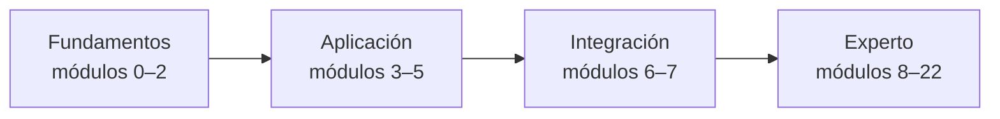
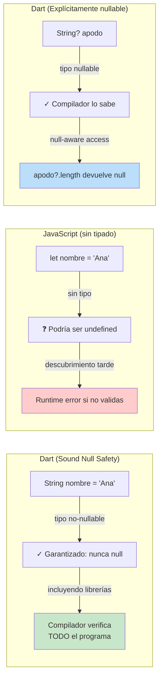
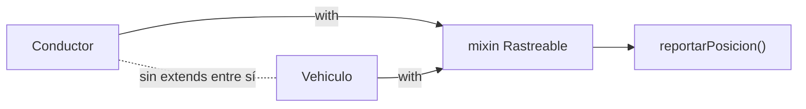
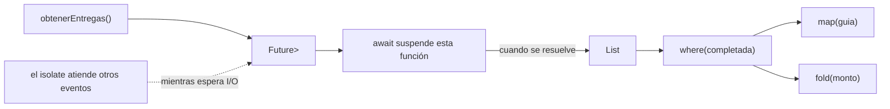
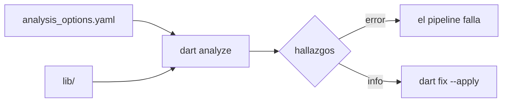
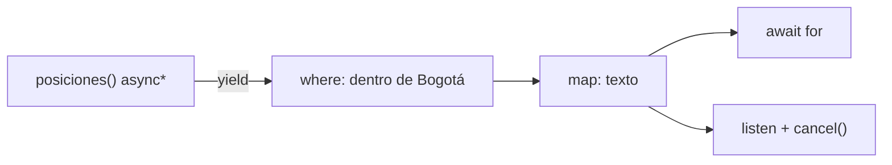
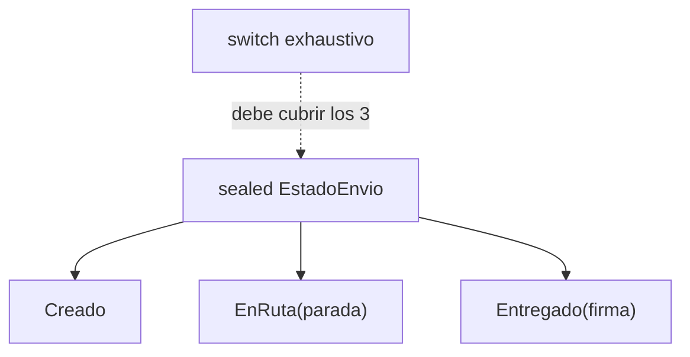
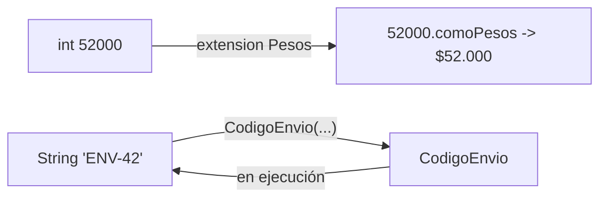

# Módulo 0: Fundamentos de Dart


## Antes de comenzar: instala Flutter y valida todo

Flutter incluye Dart. Descarga el SDK estable desde [docs.flutter.dev/get-started/install](https://docs.flutter.dev/get-started/install), descomprímelo en una ruta permanente sin espacios y agrega `flutter/bin` al `PATH`. Instala Git, VS Code con las extensiones Flutter/Dart y Android Studio para obtener el Android SDK.

| Sistema | Preparación adicional |
|---|---|
| Windows | Activa Developer Mode para enlaces simbólicos; evita `Program Files` para el SDK |
| macOS | Instala Xcode para iOS y ejecuta `sudo xcodebuild -license`; instala CocoaPods si `flutter doctor` lo pide |
| Linux | Instala las librerías indicadas por Flutter y configura KVM para acelerar el emulador Android |

Ejecuta `flutter doctor -v` y resuelve cada marca roja; las advertencias de una plataforma que no usarás todavía pueden esperar. Acepta licencias Android con `flutter doctor --android-licenses`. Después:

```bash
flutter create mi_primera_app
cd mi_primera_app
flutter devices
flutter run
```

Selecciona Chrome o un emulador si hay varios dispositivos. Cambia el texto en `lib/main.dart` y usa hot reload (`r` en la terminal). Si `flutter` no se reconoce, el problema es `PATH`; si no aparecen dispositivos, el SDK funciona pero falta configurar un destino.

> **Aviso de versión (Flutter 3.50, 11-11-2026).** Los módulos 0 a 14 importan `package:flutter/material.dart`. Desde Flutter 3.50 esa librería, y `package:flutter/cupertino.dart`, están formalmente obsoletas (*deprecated*, no eliminadas): siguen compilando, pero el analizador te mostrará avisos. Su reemplazo son los paquetes `material_ui` y `cupertino_ui` (`import 'package:material_ui/material_ui.dart';`). Puedes seguir los ejemplos tal como están y migrar después con `dart fix --apply --code=migrate_design_widgets`, como enseña el Tema 7 del Módulo 15. Fuente: https://docs.flutter.dev/release/breaking-changes/material-ui-and-cupertino-ui.

## Mapa de la ruta

«Flutter» tiene 23 módulos en 4 etapas. Cada etapa se apoya en la anterior; usa la tabla para saltar a un módulo concreto.



| Módulo | Etapa | Qué aprendes |
|---|---|---|
| 0 | Fundamentos | [Fundamentos de Dart](/curso/flutter/0) |
| 1 | Fundamentos | [Widgets: stateless vs stateful](/curso/flutter/1) |
| 2 | Fundamentos | [Layout y diseño responsive](/curso/flutter/2) |
| 3 | Aplicación | [Navegación y rutas](/curso/flutter/3) |
| 4 | Aplicación | [Gestión de estado](/curso/flutter/4) |
| 5 | Aplicación | [Networking](/curso/flutter/5) |
| 6 | Integración | [Persistencia local](/curso/flutter/6) |
| 7 | Integración | [Integración con plataformas nativas](/curso/flutter/7) |
| 8 | Experto | [Animaciones y rendimiento](/curso/flutter/8) |
| 9 | Experto | [Testing en Flutter](/curso/flutter/9) |
| 10 | Experto | [Theming, accesibilidad y Material/Cupertino](/curso/flutter/10) |
| 11 | Experto | [Publicación en App Store y Google Play](/curso/flutter/11) |
| 12 | Experto | [Proyecto integrador: app Flutter completa](/curso/flutter/12) |
| 13 | Experto | [Flutter en producción: seguridad, isolates y operación](/curso/flutter/13) |
| 14 | Experto | [Flutter para entregas: mapas, GPS y tiempo real](/curso/flutter/14) |
| 15 | Experto | [Flutter Master: calidad, arquitectura y despliegue](/curso/flutter/15) |
| 16 | Experto | [Flutter FFI: Dart con código nativo](/curso/flutter/16) |
| 17 | Experto | [Dart avanzado: generación, AST y paquetes](/curso/flutter/17) |
| 18 | Experto | [Flutter en producción: secretos, calidad y rendimiento](/curso/flutter/18) |
| 19 | Experto | [Flutter para entregas: mapa, conexión y trabajo offline](/curso/flutter/19) |
| 20 | Experto | [Flutter Master: pruebas, arquitectura y release](/curso/flutter/20) |
| 21 | Experto | [Flutter IAP: compras y suscripciones](/curso/flutter/21) |
| 22 | Experto | [Flutter Ads: anuncios, mediación y privacidad](/curso/flutter/22) |

## Aprende construyendo


### Tema 1: Sound null safety · Básico · 35 min

<details open>
<summary><strong>Capa 1 — Lectura</strong></summary>

#### ► DE QUÉ TRATA
Al finalizar vas a modelar una entrega con campos que pueden faltar (conductor, fotoConfirmacion) usando tipos nullable explícitos, y a provocar y corregir el error del analizador cuando se accede a uno sin verificar. Prerrequisitos: Flutter SDK y Dart instalados; verifica flutte…

#### ► LA IDEA EN UNA FRASE
**Al finalizar vas a modelar una entrega con campos que pueden faltar (conductor, fotoConfirmacion) usando tipos nullable explícitos, y a provocar y corregir el error del analizador cuando se accede a uno sin verificar.**

#### ► POR QUÉ EXISTE ESTO
Resuelve un problema real de diseño o implementación y evita decisiones a ciegas.

#### ► LA ANALOGÍA
Piensa en sound null safety como una herramienta de taller: útil cuando conoces su propósito y sus límites.
**Dónde se rompe la analogía:** en software, los efectos dependen del contexto, la escala y los trade-offs.

#### ► CÓMO FUNCIONA


#### ► LO QUE PUEDE SALIR MAL
| Síntoma | Causa probable | Arreglo |
|---|---|---|
| Sound null safety se aplica pero el resultado no mejora | Se usó sin medir el problema real | Mide antes y compara contra la alternativa simple |
| Aparece complejidad inesperada | Se adoptó la técnica sin comprender sus trade-offs | Vuelve a la sección de trade-offs y reduce el alcance |
| Falla en un caso límite | Se asumió un contexto que no se cumple | Prueba el caso límite y documenta cuándo NO usarlo |

#### ► TRADE-OFFS
| Opción | Cuándo usarla | Cuándo NO usarla |
|---|---|---|
| Usar Sound null safety | Cuando el problema coincide con su propósito y el beneficio es observable | Cuando agrega complejidad sin resolver un problema real |
| Alternativa más simple | Cuando el contexto es pequeño, estable o fácil de razonar | Cuando ya demostró no escalar o no cumplir el requisito |
| Postergar la decisión | Cuando falta evidencia del problema | Cuando el costo de esperar es mayor que el costo de probar |

#### ► CUÁNDO NO USAR ESTO
No uses sound null safety por defecto. Aplícalo cuando el problema lo justifique y puedas verificar el beneficio; si una alternativa más simple resuelve igual, prefiérela.

#### ► DE VUELTA A LA ANALOGÍA
Volviendo a la analogía: sound null safety funciona como el modelo inicial, pero recuerda dónde se rompe: en producción importan la evidencia, la escala y el costo de equivocarte.

#### ► LO QUE DEBES RECORDAR
- Sound null safety existe para resolver un problema específico.
- Mide antes de adoptar complejidad.
- Conoce el caso donde NO usarlo.
- Verifica con evidencia observable.

#### ► PREGUNTAS PARA PENSAR
1. ¿Qué problema concreto resuelve sound null safety en tu contexto?
2. ¿Cómo sabrías que sound null safety no está funcionando bien?
3. ¿Qué alternativa más simple considerarías antes de usar sound null safety?

</details>

<details>
<summary><strong>Capa 2 — Construcción</strong></summary>

#### Código y verificación


```dart
String nombre = "Ana";       // nunca null
String? apodo;                  // explícitamente nullable

print(apodo?.length);           // null-aware: null si apodo es null
print(apodo ?? "Sin apodo");    // valor por defecto
```

```dart
String nombre = "Ana";     // garantizado no-null en TODO el programa
String? apodo;              // explícitamente nullable
print(apodo?.length);       // null-aware access
print(apodo ?? "Sin apodo"); // valor por defecto
```

```bash
mkdir ejemplo-flutter-m0
cd ejemplo-flutter-m0
flutter create app
cd app
```

```dart
class Delivery {
  final String guia;
  final String? conductor;        // puede no estar asignado todavía
  final String? fotoConfirmacion; // puede no haberse subido todavía

  Delivery(this.guia, {this.conductor, this.fotoConfirmacion});

  String etiquetaConductor() => conductor ?? "Sin conductor asignado";
}

void main() {
  final entrega = Delivery("RF-4471");
  print(entrega.etiquetaConductor());
}
```

</details>

### Tema 2: Clases y mixins · Intermedio · 35 min

<details open>
<summary><strong>Capa 1 — Lectura</strong></summary>

#### ► DE QUÉ TRATA
Al finalizar vas a compartir comportamiento (rastrear()) entre dos clases que no comparten una jerarquía de herencia natural usando un mixin, y a confirmar con el analizador qué pasa si falta el contrato que ese mixin exige. Prerrequisitos: Tema 1 de este módulo.

#### ► LA IDEA EN UNA FRASE
**Al finalizar vas a compartir comportamiento (rastrear()) entre dos clases que no comparten una jerarquía de herencia natural usando un mixin, y a confirmar con el analizador qué pasa si falta el contrato que ese mixin exige.**

#### ► POR QUÉ EXISTE ESTO
Resuelve un problema real de diseño o implementación y evita decisiones a ciegas.

#### ► LA ANALOGÍA
Piensa en clases y mixins como una herramienta de taller: útil cuando conoces su propósito y sus límites.
**Dónde se rompe la analogía:** en software, los efectos dependen del contexto, la escala y los trade-offs.

#### ► CÓMO FUNCIONA


#### ► LO QUE PUEDE SALIR MAL
| Síntoma | Causa probable | Arreglo |
|---|---|---|
| Clases y mixins se aplica pero el resultado no mejora | Se usó sin medir el problema real | Mide antes y compara contra la alternativa simple |
| Aparece complejidad inesperada | Se adoptó la técnica sin comprender sus trade-offs | Vuelve a la sección de trade-offs y reduce el alcance |
| Falla en un caso límite | Se asumió un contexto que no se cumple | Prueba el caso límite y documenta cuándo NO usarlo |

#### ► TRADE-OFFS
| Opción | Cuándo usarla | Cuándo NO usarla |
|---|---|---|
| Usar Clases y mixins | Cuando el problema coincide con su propósito y el beneficio es observable | Cuando agrega complejidad sin resolver un problema real |
| Alternativa más simple | Cuando el contexto es pequeño, estable o fácil de razonar | Cuando ya demostró no escalar o no cumplir el requisito |
| Postergar la decisión | Cuando falta evidencia del problema | Cuando el costo de esperar es mayor que el costo de probar |

#### ► CUÁNDO NO USAR ESTO
No uses clases y mixins por defecto. Aplícalo cuando el problema lo justifique y puedas verificar el beneficio; si una alternativa más simple resuelve igual, prefiérela.

#### ► DE VUELTA A LA ANALOGÍA
Volviendo a la analogía: clases y mixins funciona como el modelo inicial, pero recuerda dónde se rompe: en producción importan la evidencia, la escala y el costo de equivocarte.

#### ► LO QUE DEBES RECORDAR
- Clases y mixins existe para resolver un problema específico.
- Mide antes de adoptar complejidad.
- Conoce el caso donde NO usarlo.
- Verifica con evidencia observable.

#### ► PREGUNTAS PARA PENSAR
1. ¿Qué problema concreto resuelve clases y mixins en tu contexto?
2. ¿Cómo sabrías que clases y mixins no está funcionando bien?
3. ¿Qué alternativa más simple considerarías antes de usar clases y mixins?

</details>

<details>
<summary><strong>Capa 2 — Construcción</strong></summary>

#### Código y verificación
```dart
class Ave extends Animal with Volador implements Rastreable {
  @override
  String obtenerId() => 'ave-01';
}
```

```dart
mixin Volador {
  void volar() => print("Volando");
}

class Pajaro extends Animal with Volador {}
```


```bash
mkdir ejemplo-flutter-mixins
cd ejemplo-flutter-mixins
```

```bash
flutter create demo_flutter
cd demo_flutter
flutter run
```

```dart
mixin Rastreable {
  double? latitud;
  double? longitud;
  String reportarPosicion() =>
      latitud == null ? "Sin posición" : "Lat: $latitud, Lon: $longitud";
}

class Conductor with Rastreable {
  final String nombre;
  Conductor(this.nombre);
}

class Vehiculo with Rastreable {
  final String placa;
  Vehiculo(this.placa);
}

void main() {
  final conductor = Conductor("Ana")..latitud = 4.6..longitud = -74.1;
  print(conductor.reportarPosicion());
}
```

</details>

### Tema 3: Futures, async/await y colecciones funcionales · Intermedio · 40 min

<details open>
<summary><strong>Capa 1 — Lectura</strong></summary>

#### ► DE QUÉ TRATA
Al finalizar vas a simular con Future.delayed la consulta de entregas de un conductor, y a filtrar/transformar esa lista con where/map/fold en vez de un bucle imperativo. Prerrequisitos: Tema 2 de este módulo.

#### ► LA IDEA EN UNA FRASE
**Al finalizar vas a simular con Future.delayed la consulta de entregas de un conductor, y a filtrar/transformar esa lista con where/map/fold en vez de un bucle imperativo.**

#### ► POR QUÉ EXISTE ESTO
Resuelve un problema real de diseño o implementación y evita decisiones a ciegas.

#### ► LA ANALOGÍA
Piensa en futures, async/await y colecciones funcionales como una herramienta de taller: útil cuando conoces su propósito y sus límites.
**Dónde se rompe la analogía:** en software, los efectos dependen del contexto, la escala y los trade-offs.

#### ► CÓMO FUNCIONA


#### ► LO QUE PUEDE SALIR MAL
| Síntoma | Causa probable | Arreglo |
|---|---|---|
| Futures, async/await y colecciones funcionales se aplica pero el resultado no mejora | Se usó sin medir el problema real | Mide antes y compara contra la alternativa simple |
| Aparece complejidad inesperada | Se adoptó la técnica sin comprender sus trade-offs | Vuelve a la sección de trade-offs y reduce el alcance |
| Falla en un caso límite | Se asumió un contexto que no se cumple | Prueba el caso límite y documenta cuándo NO usarlo |

#### ► TRADE-OFFS
| Opción | Cuándo usarla | Cuándo NO usarla |
|---|---|---|
| Usar Futures, async/await y colecciones funcionales | Cuando el problema coincide con su propósito y el beneficio es observable | Cuando agrega complejidad sin resolver un problema real |
| Alternativa más simple | Cuando el contexto es pequeño, estable o fácil de razonar | Cuando ya demostró no escalar o no cumplir el requisito |
| Postergar la decisión | Cuando falta evidencia del problema | Cuando el costo de esperar es mayor que el costo de probar |

#### ► CUÁNDO NO USAR ESTO
No uses futures, async/await y colecciones funcionales por defecto. Aplícalo cuando el problema lo justifique y puedas verificar el beneficio; si una alternativa más simple resuelve igual, prefiérela.

#### ► DE VUELTA A LA ANALOGÍA
Volviendo a la analogía: futures, async/await y colecciones funcionales funciona como el modelo inicial, pero recuerda dónde se rompe: en producción importan la evidencia, la escala y el costo de equivocarte.

#### ► LO QUE DEBES RECORDAR
- Futures, async/await y colecciones funcionales existe para resolver un problema específico.
- Mide antes de adoptar complejidad.
- Conoce el caso donde NO usarlo.
- Verifica con evidencia observable.

#### ► PREGUNTAS PARA PENSAR
1. ¿Qué problema concreto resuelve futures, async/await y colecciones funcionales en tu contexto?
2. ¿Cómo sabrías que futures, async/await y colecciones funcionales no está funcionando bien?
3. ¿Qué alternativa más simple considerarías antes de usar futures, async/await y colecciones funcionales?

</details>

<details>
<summary><strong>Capa 2 — Construcción</strong></summary>

#### Código y verificación
```dart
Future<Usuario> obtenerUsuario() async {
  await Future.delayed(Duration(seconds: 1));
  return Usuario("Ana");
}

void main() async {
  final usuario = await obtenerUsuario();
  print(usuario.nombre);
}
```

```dart
final nombres = personas.where((p) => p.edad >= 18).map((p) => p.nombre).toList();
final total = pedidos.fold<double>(0, (acumulado, p) => acumulado + p.monto);
```


```bash
mkdir ejemplo-flutter-futures
cd ejemplo-flutter-futures
```

```bash
flutter create demo_flutter
cd demo_flutter
flutter run
```

```dart
class Entrega {
  final String guia;
  final double monto;
  final bool completada;
  Entrega(this.guia, this.monto, this.completada);
}

Future<List<Entrega>> obtenerEntregas() async {
  await Future.delayed(Duration(seconds: 1)); // simula la llamada de red
  return [Entrega("RF-1", 20.0, true), Entrega("RF-2", 15.0, false), Entrega("RF-3", 30.0, true)];
}

void main() async {
  final entregas = await obtenerEntregas();
  final totalCompletadas = entregas
      .where((e) => e.completada)
      .fold<double>(0, (acumulado, e) => acumulado + e.monto);
  print("Total completadas: \$${totalCompletadas}");
}
```

</details>

### Tema 4: Lints y estilo con analysis_options.yaml · Intermedio · 35 min

<details open>
<summary><strong>Capa 1 — Lectura</strong></summary>

#### ► DE QUÉ TRATA
Al finalizar podrás configurar el analizador estático de Dart con flutter_lints, endurecerlo con modos estrictos, subir la severidad de una regla y usar dart fix para corregir automáticamente. Prerrequisitos: Temas 1 a 3 de este módulo.

#### ► LA IDEA EN UNA FRASE
**Al finalizar podrás configurar el analizador estático de Dart con flutter_lints, endurecerlo con modos estrictos, subir la severidad de una regla y usar dart fix para corregir automáticamente.**

#### ► POR QUÉ EXISTE ESTO
Resuelve un problema real de diseño o implementación y evita decisiones a ciegas.

#### ► LA ANALOGÍA
Piensa en lints y estilo con analysis_options.yaml como una herramienta de taller: útil cuando conoces su propósito y sus límites.
**Dónde se rompe la analogía:** en software, los efectos dependen del contexto, la escala y los trade-offs.

#### ► CÓMO FUNCIONA


#### ► LO QUE PUEDE SALIR MAL
| Síntoma | Causa probable | Arreglo |
|---|---|---|
| Lints y estilo con analysis_options.yaml se aplica pero el resultado no mejora | Se usó sin medir el problema real | Mide antes y compara contra la alternativa simple |
| Aparece complejidad inesperada | Se adoptó la técnica sin comprender sus trade-offs | Vuelve a la sección de trade-offs y reduce el alcance |
| Falla en un caso límite | Se asumió un contexto que no se cumple | Prueba el caso límite y documenta cuándo NO usarlo |

#### ► TRADE-OFFS
| Opción | Cuándo usarla | Cuándo NO usarla |
|---|---|---|
| Usar Lints y estilo con analysis_options.yaml | Cuando el problema coincide con su propósito y el beneficio es observable | Cuando agrega complejidad sin resolver un problema real |
| Alternativa más simple | Cuando el contexto es pequeño, estable o fácil de razonar | Cuando ya demostró no escalar o no cumplir el requisito |
| Postergar la decisión | Cuando falta evidencia del problema | Cuando el costo de esperar es mayor que el costo de probar |

#### ► CUÁNDO NO USAR ESTO
No uses lints y estilo con analysis_options.yaml por defecto. Aplícalo cuando el problema lo justifique y puedas verificar el beneficio; si una alternativa más simple resuelve igual, prefiérela.

#### ► DE VUELTA A LA ANALOGÍA
Volviendo a la analogía: lints y estilo con analysis_options.yaml funciona como el modelo inicial, pero recuerda dónde se rompe: en producción importan la evidencia, la escala y el costo de equivocarte.

#### ► LO QUE DEBES RECORDAR
- Lints y estilo con analysis_options.yaml existe para resolver un problema específico.
- Mide antes de adoptar complejidad.
- Conoce el caso donde NO usarlo.
- Verifica con evidencia observable.

#### ► PREGUNTAS PARA PENSAR
1. ¿Qué problema concreto resuelve lints y estilo con analysis_options.yaml en tu contexto?
2. ¿Cómo sabrías que lints y estilo con analysis_options.yaml no está funcionando bien?
3. ¿Qué alternativa más simple considerarías antes de usar lints y estilo con analysis_options.yaml?

</details>

<details>
<summary><strong>Capa 2 — Construcción</strong></summary>

#### Código y verificación


```bash
mkdir lints && cd lints
flutter create repartidor_lints
cd repartidor_lints
```

```dart
// lib/tarifa.dart
import 'dart:developer' as developer;

int tarifa({required String ciudad, required double kilos}) {
  final base = ciudad == 'Bogotá' ? 5000 : 9000;
  final total = base + (kilos.ceil() * 1200);
  developer.log('tarifa $ciudad $kilos kg = $total', name: 'tarifas');
  return total;
}
```

```yaml
include: package:flutter_lints/flutter.yaml

analyzer:
  language:
    strict-casts: true        # prohíbe conversiones implícitas desde dynamic
    strict-raw-types: true
  errors:
    avoid_print: error        # en este proyecto un print es un error, no un aviso

linter:
  rules:
    - prefer_final_locals
    - always_declare_return_types
    - prefer_single_quotes
    - require_trailing_commas
```

```bash
dart analyze
dart fix --dry-run
```

```text
Analyzing repartidor_lints...
No issues found!
Nothing to fix!
```

</details>

### Tema 5: Streams en Dart: secuencias de eventos asíncronos con await for y StreamController · Intermedio · 40 min

<details open>
<summary><strong>Capa 1 — Lectura</strong></summary>

#### ► DE QUÉ TRATA
Instala el SDK de Dart (o Flutter, que lo incluye) y crea un proyecto de consola con dart create -t console streams_rutaflow. Escribirás en bin/streams_rutaflow.dart.

#### ► LA IDEA EN UNA FRASE
**Instala el SDK de Dart (o Flutter, que lo incluye) y crea un proyecto de consola con dart create -t console streams_rutaflow.**

#### ► POR QUÉ EXISTE ESTO
Resuelve un problema real de diseño o implementación y evita decisiones a ciegas.

#### ► LA ANALOGÍA
Piensa en streams en dart: secuencias de eventos asíncronos con await for y streamcontroller como una herramienta de taller: útil cuando conoces su propósito y sus límites.
**Dónde se rompe la analogía:** en software, los efectos dependen del contexto, la escala y los trade-offs.

#### ► CÓMO FUNCIONA


#### ► LO QUE PUEDE SALIR MAL
| Síntoma | Causa probable | Arreglo |
|---|---|---|
| Streams en Dart: secuencias de eventos asíncronos con await for y StreamController se aplica pero el resultado no mejora | Se usó sin medir el problema real | Mide antes y compara contra la alternativa simple |
| Aparece complejidad inesperada | Se adoptó la técnica sin comprender sus trade-offs | Vuelve a la sección de trade-offs y reduce el alcance |
| Falla en un caso límite | Se asumió un contexto que no se cumple | Prueba el caso límite y documenta cuándo NO usarlo |

#### ► TRADE-OFFS
| Opción | Cuándo usarla | Cuándo NO usarla |
|---|---|---|
| Usar Streams en Dart: secuencias de eventos asíncronos con await for y StreamController | Cuando el problema coincide con su propósito y el beneficio es observable | Cuando agrega complejidad sin resolver un problema real |
| Alternativa más simple | Cuando el contexto es pequeño, estable o fácil de razonar | Cuando ya demostró no escalar o no cumplir el requisito |
| Postergar la decisión | Cuando falta evidencia del problema | Cuando el costo de esperar es mayor que el costo de probar |

#### ► CUÁNDO NO USAR ESTO
No uses streams en dart: secuencias de eventos asíncronos con await for y streamcontroller por defecto. Aplícalo cuando el problema lo justifique y puedas verificar el beneficio; si una alternativa más simple resuelve igual, prefiérela.

#### ► DE VUELTA A LA ANALOGÍA
Volviendo a la analogía: streams en dart: secuencias de eventos asíncronos con await for y streamcontroller funciona como el modelo inicial, pero recuerda dónde se rompe: en producción importan la evidencia, la escala y el costo de equivocarte.

#### ► LO QUE DEBES RECORDAR
- Streams en Dart: secuencias de eventos asíncronos con await for y StreamController existe para resolver un problema específico.
- Mide antes de adoptar complejidad.
- Conoce el caso donde NO usarlo.
- Verifica con evidencia observable.

#### ► PREGUNTAS PARA PENSAR
1. ¿Qué problema concreto resuelve streams en dart: secuencias de eventos asíncronos con await for y streamcontroller en tu contexto?
2. ¿Cómo sabrías que streams en dart: secuencias de eventos asíncronos con await for y streamcontroller no está funcionando bien?
3. ¿Qué alternativa más simple considerarías antes de usar streams en dart: secuencias de eventos asíncronos con await for y streamcontroller?

</details>

<details>
<summary><strong>Capa 2 — Construcción</strong></summary>

#### Código y verificación


```dart
import 'dart:async';

// Productor: emite una posición cada 100 ms.
Stream<double> posiciones() async* {
  var lat = 4.55;
  for (var i = 0; i < 6; i++) {
    await Future.delayed(const Duration(milliseconds: 100));
    lat += 0.02;
    yield lat;
  }
}

Future<void> main() async {
  // 1) Transformar y leer hasta el final con await for.
  final enBogota = posiciones().where((lat) => lat < 4.64).map((lat) => 'lat ${lat.toStringAsFixed(2)}');
  await for (final texto in enBogota) {
    print('await for: $texto');
  }

  // 2) listen y cancelar a mitad de camino.
  late final StreamSubscription<double> suscripcion;
  var recibidas = 0;
  suscripcion = posiciones().listen((lat) {
    recibidas++;
    if (recibidas == 2) {
      suscripcion.cancel(); // como salir de la pantalla
      print('listen: cancelado después de $recibidas posiciones');
    }
  });
  await Future.delayed(const Duration(milliseconds: 800));
  print('fin');
}
```

```bash
cd streams_rutaflow
dart run
```

```text
await for: lat 4.57
await for: lat 4.59
await for: lat 4.61
await for: lat 4.63
listen: cancelado después de 2 posiciones
fin
```

</details>

### Tema 6: Records y patterns en Dart: varios valores sin clases y switch exhaustivo · Intermedio · 40 min

<details open>
<summary><strong>Capa 1 — Lectura</strong></summary>

#### ► DE QUÉ TRATA
Usa Dart 3.0 o superior (dart --version). Crea dart create -t console patrones_rutaflow y escribe en bin/patrones_rutaflow.dart.

#### ► LA IDEA EN UNA FRASE
**Usa Dart 3.0 o superior (dart --version).**

#### ► POR QUÉ EXISTE ESTO
Resuelve un problema real de diseño o implementación y evita decisiones a ciegas.

#### ► LA ANALOGÍA
Piensa en records y patterns en dart: varios valores sin clases y switch exhaustivo como una herramienta de taller: útil cuando conoces su propósito y sus límites.
**Dónde se rompe la analogía:** en software, los efectos dependen del contexto, la escala y los trade-offs.

#### ► CÓMO FUNCIONA


#### ► LO QUE PUEDE SALIR MAL
| Síntoma | Causa probable | Arreglo |
|---|---|---|
| Records y patterns en Dart: varios valores sin clases y switch exhaustivo se aplica pero el resultado no mejora | Se usó sin medir el problema real | Mide antes y compara contra la alternativa simple |
| Aparece complejidad inesperada | Se adoptó la técnica sin comprender sus trade-offs | Vuelve a la sección de trade-offs y reduce el alcance |
| Falla en un caso límite | Se asumió un contexto que no se cumple | Prueba el caso límite y documenta cuándo NO usarlo |

#### ► TRADE-OFFS
| Opción | Cuándo usarla | Cuándo NO usarla |
|---|---|---|
| Usar Records y patterns en Dart: varios valores sin clases y switch exhaustivo | Cuando el problema coincide con su propósito y el beneficio es observable | Cuando agrega complejidad sin resolver un problema real |
| Alternativa más simple | Cuando el contexto es pequeño, estable o fácil de razonar | Cuando ya demostró no escalar o no cumplir el requisito |
| Postergar la decisión | Cuando falta evidencia del problema | Cuando el costo de esperar es mayor que el costo de probar |

#### ► CUÁNDO NO USAR ESTO
No uses records y patterns en dart: varios valores sin clases y switch exhaustivo por defecto. Aplícalo cuando el problema lo justifique y puedas verificar el beneficio; si una alternativa más simple resuelve igual, prefiérela.

#### ► DE VUELTA A LA ANALOGÍA
Volviendo a la analogía: records y patterns en dart: varios valores sin clases y switch exhaustivo funciona como el modelo inicial, pero recuerda dónde se rompe: en producción importan la evidencia, la escala y el costo de equivocarte.

#### ► LO QUE DEBES RECORDAR
- Records y patterns en Dart: varios valores sin clases y switch exhaustivo existe para resolver un problema específico.
- Mide antes de adoptar complejidad.
- Conoce el caso donde NO usarlo.
- Verifica con evidencia observable.

#### ► PREGUNTAS PARA PENSAR
1. ¿Qué problema concreto resuelve records y patterns en dart: varios valores sin clases y switch exhaustivo en tu contexto?
2. ¿Cómo sabrías que records y patterns en dart: varios valores sin clases y switch exhaustivo no está funcionando bien?
3. ¿Qué alternativa más simple considerarías antes de usar records y patterns en dart: varios valores sin clases y switch exhaustivo?

</details>

<details>
<summary><strong>Capa 2 — Construcción</strong></summary>

#### Código y verificación


```dart
// Record con nombres: el orden ya no puede confundirse.
({int centavos, int minutos}) cotizar(int kilos) =>
    (centavos: 1000 + kilos * 120, minutos: 30 + kilos * 5);

sealed class EstadoEnvio {}
class Creado extends EstadoEnvio {}
class EnRuta extends EstadoEnvio { EnRuta(this.parada); final int parada; }
class Entregado extends EstadoEnvio { Entregado(this.firma); final String? firma; }

String describir(EstadoEnvio estado) => switch (estado) {
      Creado() => 'esperando recogida',
      EnRuta(parada: 1) => 'saliendo de bodega',
      EnRuta(:final parada) => 'en ruta, parada $parada',
      Entregado(firma: null) => 'entregado sin firma: revisar',
      Entregado(:final firma?) => 'entregado, firmó $firma',
    };

void main() {
  final (:centavos, :minutos) = cotizar(2); // pattern de desestructuración
  print('tarifa $centavos centavos, $minutos minutos');

  for (final e in [Creado(), EnRuta(1), EnRuta(4), Entregado(null), Entregado('Ana')]) {
    print(describir(e));
  }

  final json = {'codigo': 'ENV-42', 'kilos': 2};
  if (json case {'codigo': String codigo, 'kilos': int kilos} when kilos > 0) {
    print('JSON válido: $codigo con $kilos kg');
  }
}
```

```bash
cd patrones_rutaflow
dart run
```

```text
tarifa 1240 centavos, 40 minutos
esperando recogida
saliendo de bodega
en ruta, parada 4
entregado sin firma: revisar
entregado, firmó Ana
JSON válido: ENV-42 con 2 kg
```

</details>

### Tema 7: Extension methods y extension types: agregar comportamiento sin heredar · Intermedio · 35 min

<details open>
<summary><strong>Capa 1 — Lectura</strong></summary>

#### ► DE QUÉ TRATA
Usa Dart 3.3 o superior (necesario para extension type). Crea dart create -t console extensiones_rutaflow.

#### ► LA IDEA EN UNA FRASE
**Usa Dart 3.3 o superior (necesario para extension type).**

#### ► POR QUÉ EXISTE ESTO
Resuelve un problema real de diseño o implementación y evita decisiones a ciegas.

#### ► LA ANALOGÍA
Piensa en extension methods y extension types: agregar comportamiento sin heredar como una herramienta de taller: útil cuando conoces su propósito y sus límites.
**Dónde se rompe la analogía:** en software, los efectos dependen del contexto, la escala y los trade-offs.

#### ► CÓMO FUNCIONA


#### ► LO QUE PUEDE SALIR MAL
| Síntoma | Causa probable | Arreglo |
|---|---|---|
| Extension methods y extension types: agregar comportamiento sin heredar se aplica pero el resultado no mejora | Se usó sin medir el problema real | Mide antes y compara contra la alternativa simple |
| Aparece complejidad inesperada | Se adoptó la técnica sin comprender sus trade-offs | Vuelve a la sección de trade-offs y reduce el alcance |
| Falla en un caso límite | Se asumió un contexto que no se cumple | Prueba el caso límite y documenta cuándo NO usarlo |

#### ► TRADE-OFFS
| Opción | Cuándo usarla | Cuándo NO usarla |
|---|---|---|
| Usar Extension methods y extension types: agregar comportamiento sin heredar | Cuando el problema coincide con su propósito y el beneficio es observable | Cuando agrega complejidad sin resolver un problema real |
| Alternativa más simple | Cuando el contexto es pequeño, estable o fácil de razonar | Cuando ya demostró no escalar o no cumplir el requisito |
| Postergar la decisión | Cuando falta evidencia del problema | Cuando el costo de esperar es mayor que el costo de probar |

#### ► CUÁNDO NO USAR ESTO
No uses extension methods y extension types: agregar comportamiento sin heredar por defecto. Aplícalo cuando el problema lo justifique y puedas verificar el beneficio; si una alternativa más simple resuelve igual, prefiérela.

#### ► DE VUELTA A LA ANALOGÍA
Volviendo a la analogía: extension methods y extension types: agregar comportamiento sin heredar funciona como el modelo inicial, pero recuerda dónde se rompe: en producción importan la evidencia, la escala y el costo de equivocarte.

#### ► LO QUE DEBES RECORDAR
- Extension methods y extension types: agregar comportamiento sin heredar existe para resolver un problema específico.
- Mide antes de adoptar complejidad.
- Conoce el caso donde NO usarlo.
- Verifica con evidencia observable.

#### ► PREGUNTAS PARA PENSAR
1. ¿Qué problema concreto resuelve extension methods y extension types: agregar comportamiento sin heredar en tu contexto?
2. ¿Cómo sabrías que extension methods y extension types: agregar comportamiento sin heredar no está funcionando bien?
3. ¿Qué alternativa más simple considerarías antes de usar extension methods y extension types: agregar comportamiento sin heredar?

</details>

<details>
<summary><strong>Capa 2 — Construcción</strong></summary>

#### Código y verificación


```dart
extension Pesos on int {
  // 52000 -> "$52.000"
  String get comoPesos => '\$${toString().replaceAllMapped(RegExp(r'\B(?=(\d{3})+$)'), (_) => '.')}';
}

extension type CodigoEnvio._(String valor) {
  // Constructor con validación: solo códigos con el formato correcto.
  factory CodigoEnvio(String texto) {
    if (!RegExp(r'^ENV-\d+$').hasMatch(texto)) throw FormatException('código inválido: $texto');
    return CodigoEnvio._(texto);
  }
  int get numero => int.parse(valor.substring(4));
}

String etiqueta(CodigoEnvio codigo, String cliente) => '${codigo.valor} para $cliente';

void main() {
  print(52000.comoPesos);

  final codigo = CodigoEnvio('ENV-42');
  print(etiqueta(codigo, 'Ana'));
  print('número: ${codigo.numero}');
  // etiqueta('Ana', codigo); // ❌ no compila: los tipos no coinciden

  try {
    CodigoEnvio('42');
  } on FormatException catch (e) {
    print(e.message);
  }
}
```

```bash
cd extensiones_rutaflow
dart run
```

```text
$52.000
ENV-42 para Ana
número: 42
código inválido: 42
```

</details>
