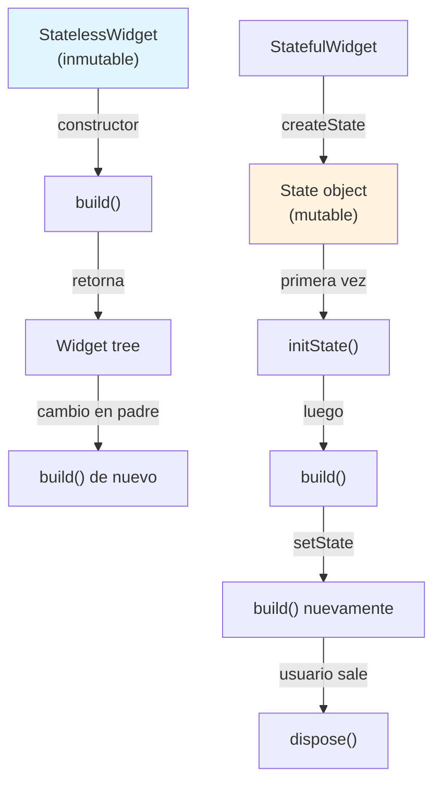
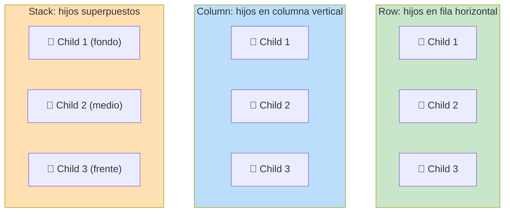
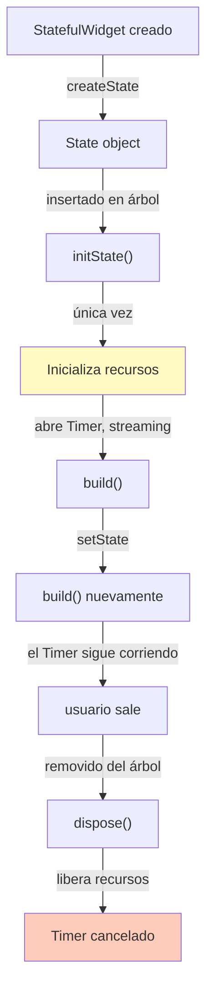
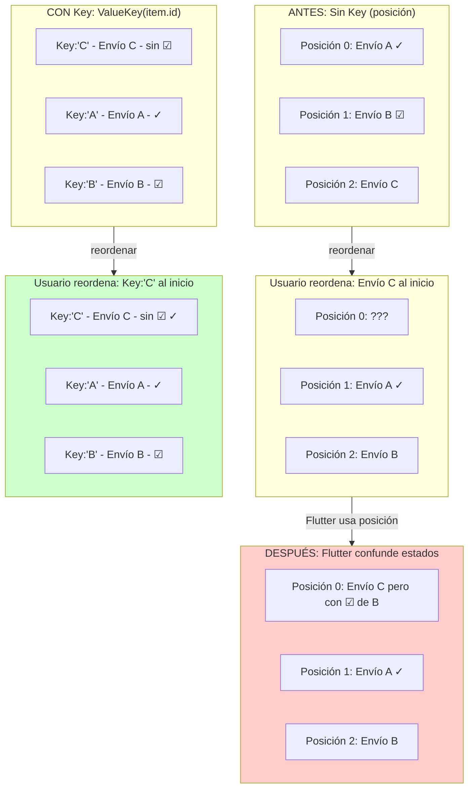
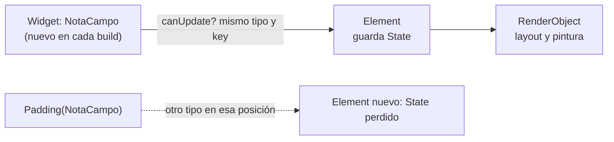
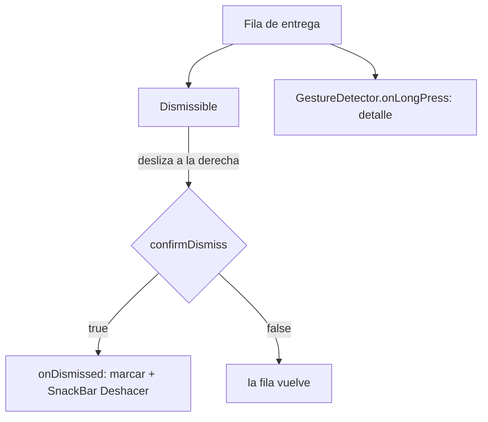

# Módulo 1: Widgets: stateless vs stateful


## Aprende construyendo

### Tema 1: StatelessWidget vs StatefulWidget

#### Paso 1 · Objetivo y preparación
Al finalizar vas a extraer `TarjetaEnvio` (guía y estado de un envío) como `StatelessWidget`, y a construir `ContadorIntentos` como `StatefulWidget` con un contador local. Prerrequisitos: Módulo 0 completo.

#### Paso 2 · Contexto y caso real
La lista de envíos de RutaFlow muestra decenas de tarjetas idénticas en estructura — cada una solo necesita los datos del envío que recibe, sin ningún estado propio que mantener entre reconstrucciones.

#### Paso 3 · Teoría, modelo mental y analogía
Un `StatelessWidget` describe su UI únicamente en función de los datos recibidos por constructor; un `StatefulWidget` separa la definición del widget de un `State` asociado que persiste entre reconstrucciones.

**Diagrama: Ciclo de vida StatelessWidget vs StatefulWidget**



**Conceptos clave:** widget sin estado propio frente a widget con estado mutable y ciclo de vida.

```dart
class TarjetaTarea extends StatelessWidget {
  final String titulo;
  const TarjetaTarea({required this.titulo, super.key});
  Widget build(BuildContext context) => Text(titulo);
}

class Contador extends StatefulWidget {
  State<Contador> createState() => _ContadorState();
}

class _ContadorState extends State<Contador> {
  int valor = 0;
  Widget build(BuildContext context) => ElevatedButton(
    onPressed: () => setState(() => valor++), // dispara la reconstrucción de este widget
    child: Text("$valor"),
  );
}
```

Un `StatelessWidget` describe su UI únicamente en función de los datos que recibe por constructor (`titulo` en `TarjetaTarea`), sin ningún estado mutable propio: si sus datos de entrada nunca cambian, ese widget nunca necesita reconstruirse por sí mismo, aunque sí puede reconstruirse si su padre lo hace con datos nuevos; un `StatefulWidget` separa la definición del widget (`Contador`, inmutable) de un objeto `State` asociado (`_ContadorState`) que sí mantiene estado mutable (`valor`) y persiste a través de reconstrucciones sucesivas del widget que lo contiene.

`setState()` es la señal explícita que le comunica a Flutter "el estado de este `State` cambió, por favor reconstruye este widget (y sus hijos) con los nuevos valores": Flutter compara eficientemente el nuevo árbol de widgets resultante contra el árbol anterior (un proceso llamado "reconciliación", conceptualmente análogo a la reconciliación del DOM virtual en React, Módulo 1 del track de React) y aplica al árbol de renderizado real únicamente los cambios efectivamente necesarios, no una reconstrucción completa desde cero de toda la interfaz visual subyacente.

**Analogía:** un `StatelessWidget` es como una fotografía impresa que muestra exactamente lo que se le entregó para imprimir, sin poder cambiar por sí misma; un `StatefulWidget` con su `State` asociado es como una pantalla digital que puede actualizar su contenido internamente en respuesta a nueva información, mientras mantiene su identidad como el mismo dispositivo físico a través de esas actualizaciones sucesivas.

**¿Por qué es importante?** La distinción entre `StatelessWidget` y `StatefulWidget` determina si un widget puede mantener estado mutable propio persistente entre reconstrucciones; `setState()` es el mecanismo explícito que dispara la reconstrucción eficiente del árbol de widgets tras un cambio de estado.

En el proyecto integrador RutaFlow, `TarjetaEnvio` vive en `lib/features/deliveries/presentation/tarjeta_envio.dart` y `ContadorIntentos` en `lib/features/deliveries/presentation/contador_intentos.dart`; practicá este mismo patrón extrayendo un widget propio en tu proyecto propio antes de seguir al próximo tema.

#### Paso 4 · Demostración guiada desde cero
```dart
import 'package:flutter/material.dart';

void main() => runApp(const MaterialApp(home: PantallaEnvio()));

class PantallaEnvio extends StatelessWidget {
  const PantallaEnvio({super.key});

  @override
  Widget build(BuildContext context) => Scaffold(
        appBar: AppBar(title: const Text('Envío del día')),
        body: const Column(
          children: [
            TarjetaEnvio(guia: 'RF-4471', estado: 'En ruta'),
            ContadorIntentos(),
          ],
        ),
      );
}

class TarjetaEnvio extends StatelessWidget {
  final String guia;
  final String estado;
  const TarjetaEnvio({required this.guia, required this.estado, super.key});

  @override
  Widget build(BuildContext context) => ListTile(title: Text(guia), subtitle: Text(estado));
}

class ContadorIntentos extends StatefulWidget {
  const ContadorIntentos({super.key});

  @override
  State<ContadorIntentos> createState() => _ContadorIntentosState();
}

class _ContadorIntentosState extends State<ContadorIntentos> {
  int intentos = 0;

  @override
  Widget build(BuildContext context) => ElevatedButton(
        onPressed: () => setState(() => intentos++),
        child: Text('Intentos: $intentos'),
      );
}
```

**Ejecuta el ejemplo** (crea un proyecto Flutter desde cero, reemplaza `lib/main.dart` por el archivo completo de arriba y arráncalo en un emulador o dispositivo):

```bash
flutter create demo_flutter
cd demo_flutter
flutter run
```
Si después ejecutas `flutter test`, borra antes `test/widget_test.dart`: prueba el contador de la plantilla, que ya no existe.

Resultado esperado: `TarjetaEnvio` nunca necesita reconstruirse por sí misma (no tiene ningún `setState`); `ContadorIntentos` incrementa visualmente su contador cada vez que se toca el botón, porque `setState()` dispara la reconstrucción de `_ContadorIntentosState`.

#### Paso 5 · Práctica guiada
Pista: agregá `int vecesConstruido = 0; vecesConstruido++;` directamente dentro del método `build` de `TarjetaEnvio`, esperando que cuente cuántas veces se reconstruyó — ese es el fallo deliberado: como `TarjetaEnvio` no tiene ningún `State` asociado, esa variable se reinicializa a 0 en cada reconstrucción, nunca acumula nada entre reconstrucciones.

#### Paso 6 · Práctica independiente
Corregí el Paso 5 explicando por qué un `StatelessWidget` no puede acumular ese contador, y convertí ese caso específico en un `StatefulWidget` con un campo `int vecesConstruido = 0;` dentro de su `State`, confirmando que ahora sí persiste y se incrementa correctamente.

#### Paso 7 · Cierre
Entregá `TarjetaEnvio` y `ContadorIntentos` del Paso 4, el contador que nunca acumula del Paso 5, y la conversión a StatefulWidget del Paso 6; explicá por qué una variable local dentro de `build()` nunca puede servir como memoria persistente, sin importar en qué tipo de widget se declare. Siguiente paso: estudia Row, Column, Stack y el ciclo de vida de un StatefulWidget. Errores comunes: intentar mantener estado mutable con una variable local de `build()`, convertir un widget a `StatefulWidget` cuando nunca necesita estado propio, y mutar un campo fuera de `setState()` esperando que la UI se actualice igual. Fuentes oficiales: https://docs.flutter.dev/ui/widgets y https://api.flutter.dev/flutter/widgets/StatefulWidget-class.html.
**Implicación práctica:** La distinción entre StatelessWidget y StatefulWidget determina si un widget puede mantener estado mutable propio persistente entre reconstrucciones; una variable local de `build()` nunca cumple ese rol.

### Tema 2: Layout con Row, Column y Stack, y ciclo de vida

#### Paso 1 · Objetivo y preparación
Al finalizar vas a componer `TarjetaEnvio` con `Row`/`Stack` para mostrar un ícono de "urgente" superpuesto, y a usar `initState`/`dispose` para gestionar un timer que refresca el tiempo relativo de la lista. Prerrequisitos: Tema 1 de este módulo.

#### Paso 2 · Contexto y caso real
`TarjetaEnvio` necesita mostrar la guía y el estado en una fila, con un ícono de "urgente" superpuesto en la esquina si corresponde; además, la pantalla de lista necesita refrescar el tiempo relativo ("hace 2 min") cada minuto mientras está visible.

#### Paso 3 · Teoría, modelo mental y analogía
`Row`, `Column` y `Stack` apilan hijos horizontalmente, verticalmente, y superpuestos; `initState()` inicializa recursos una sola vez, `dispose()` los libera al remover el `State` del árbol.

**Diagrama: Row, Column y Stack visualizados**



**Diagrama: Ciclo de vida con initState/dispose**



**Conceptos clave:** contenedores de layout combinables, hooks del ciclo de vida de un StatefulWidget.

```dart
Column(children: [
  Row(children: [Text("Izquierda"), Spacer(), Text("Derecha")]),
  Stack(children: [Image.asset("fondo.png"), Text("Superpuesto")]),
])
```

`Row`, `Column` y `Stack` son los tres contenedores de layout fundamentales de Flutter: apilan hijos horizontalmente, verticalmente, y superpuestos entre sí respectivamente, exactamente el mismo conjunto mínimo de primitivas de layout estudiado en Jetpack Compose (`Row`/`Column`/`Box`, Módulo 2 del track de Android) y en SwiftUI (`HStack`/`VStack`/`ZStack`, Módulo 1 del track de iOS), reflejando una convergencia consistente entre los frameworks de UI declarativa móvil más importantes hacia el mismo conjunto de primitivas combinables.

`initState()` se ejecuta una única vez cuando el `State` se inserta por primera vez en el árbol, apropiado para inicializar recursos (suscripciones, controladores de animación); `dispose()` se ejecuta cuando el `State` se remueve permanentemente del árbol, apropiado para liberar esos mismos recursos, evitando fugas de memoria; `didUpdateWidget()` se ejecuta cuando el widget se reconstruye con una nueva configuración (nuevos parámetros del constructor) pero el mismo objeto `State` persiste, permitiendo reaccionar a cambios de configuración sin perder el estado interno acumulado hasta ese momento. `Expanded` y `Flexible` distribuyen espacio disponible proporcionalmente entre hijos de un `Row`/`Column`; `SizedBox` fija dimensiones exactas; `AspectRatio` mantiene una proporción específica entre ancho y alto.

**Analogía:** `Row`, `Column` y `Stack` son como los tres tipos básicos de disposición de mobiliario en una habitación (en fila, apilado, superpuesto), combinables para construir cualquier distribución compleja; `initState()`/`dispose()` son como el protocolo de apertura y cierre de un local comercial (encender/apagar sistemas al inicio y fin de operación), mientras `didUpdateWidget()` es como ajustar la configuración interna del local ante un cambio de horario sin cerrar y reabrir el negocio por completo.

**¿Por qué es importante?** `Row`/`Column`/`Stack` son las primitivas combinables de cualquier layout Flutter, compartidas conceptualmente con Compose y SwiftUI; los hooks del ciclo de vida (`initState`, `dispose`, `didUpdateWidget`) son el mecanismo correcto para gestionar recursos y reaccionar a cambios de configuración sin fugas de memoria.

En el proyecto integrador RutaFlow, este layout y los hooks de ciclo de vida viven en `lib/features/deliveries/presentation/lista_envios.dart`; replicá el timer con `initState`/`dispose` en tu proyecto propio como práctica antes de avanzar.

#### Paso 4 · Demostración guiada desde cero
```dart
// lib/main.dart (archivo completo)
import 'dart:async';

import 'package:flutter/material.dart';

void main() => runApp(const MaterialApp(home: ListaEnvios()));

class ListaEnvios extends StatefulWidget {
  const ListaEnvios({super.key});

  @override
  State<ListaEnvios> createState() => _ListaEnviosState();
}

class _ListaEnviosState extends State<ListaEnvios> {
  static const guia = 'RF-4471';
  static const estado = 'En ruta';
  static const urgente = true;
  Timer? _timer;

  @override
  void initState() {
    super.initState();
    _timer = Timer.periodic(const Duration(minutes: 1), (_) => setState(() {}));
  }

  @override
  void dispose() {
    _timer?.cancel();
    super.dispose();
  }

  @override
  Widget build(BuildContext context) {
    return Scaffold(
      body: SafeArea(
        child: Stack(
          children: [
            const Row(children: [Text(guia), Spacer(), Text(estado)]),
            if (urgente)
              const Positioned(top: 0, right: 0, child: Icon(Icons.priority_high)),
          ],
        ),
      ),
    );
  }
}
```

**Ejecuta el ejemplo** (crea un proyecto Flutter desde cero, reemplaza `lib/main.dart` por el archivo anterior y arráncalo en un emulador o dispositivo):

```bash
flutter create demo_flutter
cd demo_flutter
flutter run
```
Para las pruebas de widget: `flutter test`.

Resultado esperado: el ícono de "urgente" aparece superpuesto en la esquina solo cuando corresponde, sin desplazar el `Row`; el `Timer` refresca la pantalla cada minuto mientras `ListaEnvios` está montada, y se cancela automáticamente al salir de esa pantalla.

#### Paso 5 · Práctica guiada
Pista: quitá `_timer?.cancel()` de `dispose()` — ese es el fallo deliberado: navegá fuera de `ListaEnvios` y volvé a entrar varias veces; cada entrada crea un nuevo `Timer` que nunca se cancela, acumulando varios timers corriendo simultáneamente, cada uno intentando llamar `setState()` sobre un `State` ya destruido.

#### Paso 6 · Práctica independiente
Corregí el Paso 5 restaurando `_timer?.cancel()` en `dispose()`, y agregá una verificación `if (!mounted) return;` antes de cualquier `setState()` que pueda dispararse después de que el widget ya se haya desmontado.

#### Paso 7 · Cierre
Entregá el layout con Stack del Paso 4, los timers acumulados sin cancelar del Paso 5, y la verificación de `mounted` del Paso 6; explicá por qué todo recurso iniciado en `initState()` debe liberarse explícitamente en `dispose()`, sin excepciones. Siguiente paso: estudia Keys para listas reordenables. Errores comunes: iniciar un recurso en `initState()` sin liberarlo en `dispose()`, llamar `setState()` después de que el widget se desmontó, y anidar `Column` dentro de `Column` sin límites de altura. Fuentes oficiales: https://api.flutter.dev/flutter/widgets/State-class.html y https://docs.flutter.dev/ui/widgets/layout.
**Implicación práctica:** Los hooks del ciclo de vida son el mecanismo correcto para gestionar recursos sin fugas de memoria; omitir `dispose()` acumula recursos que siguen corriendo después de que la pantalla ya no existe.

### Tema 3: Keys

#### Paso 1 · Objetivo y preparación
Al finalizar vas a corregir un bug de identidad en `ListaEnvios` reordenable, donde el estado de un checkbox "revisado" por fila se confunde al reordenar, usando `ValueKey` basada en el id del envío. Prerrequisitos: Tema 2 de este módulo.

#### Paso 2 · Contexto y caso real
El operador puede arrastrar envíos urgentes al principio de la lista; cada `TarjetaEnvio` tiene un checkbox interno "revisado" — sin una Key estable, reordenar la lista puede dejar ese checkbox marcado en la fila equivocada.

#### Paso 3 · Teoría, modelo mental y analogía
Sin una Key estable, Flutter identifica widgets por posición durante la reconciliación; una `ValueKey(item.id)` da una señal de identidad independiente de la posición.

**Diagrama: Problema de identidad sin Key vs con Key**



**Conceptos clave:** identidad estable de un widget a través de reconstrucciones, especialmente al reordenar.

```dart
ListView(children: items.map((item) => TarjetaTarea(key: ValueKey(item.id), titulo: item.titulo)).toList())
```

Sin una `Key` estable, Flutter identifica widgets del mismo tipo dentro de una lista principalmente por su posición en esa lista durante la reconciliación; si la lista se reordena (por ejemplo, el usuario arrastra un elemento a una nueva posición) y esos widgets mantienen estado interno propio (como el estado marcado/desmarcado de un checkbox dentro de cada elemento), Flutter puede confundir qué estado interno pertenece a qué elemento visual tras el reordenamiento, dado que sin una `Key` la única señal de identidad disponible es la posición, no el contenido lógico del elemento. Proveer una `ValueKey(item.id)` (basada en un identificador único y estable del dato subyacente) le da a Flutter una señal de identidad explícita e independiente de la posición, permitiendo reconciliar correctamente cada widget con su estado interno correspondiente sin importar en qué posición se encuentre tras un reordenamiento.

`ValueKey`, `ObjectKey`, `UniqueKey` y `GlobalKey` son las variantes especializadas: `ValueKey` compara por igualdad de un valor (típico para IDs primitivos), `ObjectKey` compara por identidad de un objeto completo, `UniqueKey` genera una identidad siempre distinta (forzando que Flutter nunca reconcilie ese widget con uno anterior), y `GlobalKey` permite acceder al estado de un widget específico desde cualquier lugar del árbol, útil para casos avanzados como validación de formularios distribuidos en múltiples widgets.

**Analogía:** una `Key` es como un número de identificación personal que acompaña a alguien independientemente del orden en que se forme una fila: sin ese identificador, un sistema que solo rastrea "la tercera persona de la fila" confundiría la identidad de las personas si la fila se reordena, mientras que con el identificador estable, el sistema reconoce correctamente a cada persona sin importar su posición actual.

**¿Por qué es importante?** Una `Key` estable es necesaria específicamente cuando se reordena una lista de widgets con estado interno propio, evitando que Flutter confunda qué estado pertenece a qué elemento tras el reordenamiento; sin reordenamiento ni estado interno relevante, una `Key` explícita suele ser innecesaria.

**Código del ejemplo:**

```dart
items.map((item) => TarjetaTarea(key: ValueKey(item.id), titulo: item.titulo)).toList()
// La Key vincula el widget a la IDENTIDAD del dato, no a su posición en la lista
```

En el proyecto integrador RutaFlow, la lista reordenable con `ValueKey` vive en `lib/features/deliveries/presentation/lista_envios.dart`. Límite de la decisión: no conviene agregar una Key explícita cuando la lista nunca se reordena ni mantiene estado interno propio por fila — en ese caso el costo de mantenerla supera el beneficio; usala específicamente frente a listas reordenables con estado por elemento.

---

#### Paso 4 · Demostración guiada desde cero
```dart
import 'package:flutter/material.dart';

void main() => runApp(const MaterialApp(home: ListaReordenable()));

class Envio {
  const Envio(this.id, this.guia, this.estado);
  final String id;
  final String guia;
  final String estado;
}

class ListaReordenable extends StatefulWidget {
  const ListaReordenable({super.key});

  @override
  State<ListaReordenable> createState() => _ListaReordenableState();
}

class _ListaReordenableState extends State<ListaReordenable> {
  final envios = [
    const Envio('e1', 'RF-4471', 'En ruta'),
    const Envio('e2', 'RF-5002', 'Asignado'),
    const Envio('e3', 'RF-5310', 'Urgente'),
  ];

  void mover(int desde, int hasta) {
    setState(() {
      final destino = hasta > desde ? hasta - 1 : hasta;
      envios.insert(destino, envios.removeAt(desde));
    });
  }

  @override
  Widget build(BuildContext context) => Scaffold(
        appBar: AppBar(title: const Text('Envíos')),
        body: ReorderableListView(
          onReorder: mover,
          children: envios
              .map((e) => TarjetaEnvio(key: ValueKey(e.id), guia: e.guia, estado: e.estado))
              .toList(),
        ),
      );
}

class TarjetaEnvio extends StatefulWidget {
  const TarjetaEnvio({required this.guia, required this.estado, super.key});
  final String guia;
  final String estado;

  @override
  State<TarjetaEnvio> createState() => _TarjetaEnvioState();
}

class _TarjetaEnvioState extends State<TarjetaEnvio> {
  bool revisado = false; // estado de la fila: debe seguir al envío al reordenar

  @override
  Widget build(BuildContext context) => CheckboxListTile(
        title: Text(widget.guia),
        subtitle: Text(widget.estado),
        value: revisado,
        onChanged: (valor) => setState(() => revisado = valor ?? false),
      );
}
```

**Ejecuta el ejemplo** (crea un proyecto Flutter desde cero, reemplaza `lib/main.dart` por el archivo completo de arriba y arráncalo en un emulador o dispositivo):

```bash
flutter create demo_flutter
cd demo_flutter
flutter run
```
Si después ejecutas `flutter test`, borra antes `test/widget_test.dart`: prueba el contador de la plantilla, que ya no existe.

Resultado esperado: al arrastrar un envío urgente al principio de la lista, el checkbox "revisado" de cada `TarjetaEnvio` sigue asociado al envío correcto (identificado por `e.id`), sin importar su nueva posición.

#### Paso 5 · Práctica guiada
Pista: cambiá `key: ValueKey(e.id)` por `key: ValueKey(indice)` usando el índice del `.map()` — ese es el fallo deliberado: marcá como "revisado" el primer envío de la lista, reordená arrastrando un envío urgente al principio, y el checkbox "revisado" aparece ahora en la fila que ocupa esa misma posición, no en el envío original que realmente marcaste.

#### Paso 6 · Práctica independiente
Corregí el Paso 5 devolviendo `key: ValueKey(e.id)`, y agregá una prueba de widget que reordene la lista programáticamente y confirme que el estado "revisado" sigue al envío correcto por su id, no por su posición.

#### Paso 7 · Cierre
Entregá la lista con Key estable del Paso 4, el bug de identidad provocado en el Paso 5, y la prueba de widget del Paso 6; explicá por qué el índice "funciona" en una lista que nunca se reordena, pero falla en cuanto eso deja de ser cierto. Siguiente paso: cerrá el módulo documentando rebuild vs re-render en tus propias palabras. Errores comunes: usar el índice como Key en listas reordenables, usar `UniqueKey()` innecesariamente, y omitir la Key por completo en listas con estado interno por fila. Fuentes oficiales: https://api.flutter.dev/flutter/foundation/Key-class.html y https://docs.flutter.dev/ui/widgets.
**Implicación práctica:** Una Key estable es necesaria cuando se reordena una lista de widgets con estado interno propio, evitando que Flutter confunda qué estado pertenece a qué elemento tras el reordenamiento.

### Tema 4: Los tres árboles de Flutter: Widget, Element y RenderObject · Avanzado · 45 min

**Prerrequisito:** temas «StatelessWidget vs StatefulWidget» y «Keys» de este módulo.

**Al finalizar podrás:** explicar qué guarda cada árbol, observar con un contador de `createState` y `build` cuándo Flutter reutiliza un Element y cuándo lo reemplaza, y relacionarlo con las Keys.

**¿Por qué es importante?** «Todo es un widget» es cierto pero incompleto. Los widgets son descripciones baratas que se crean en cada `build`; el estado vive en los Elements y el dibujo en los RenderObjects. Entender esto explica por qué el estado «salta» entre filas o se pierde al cambiar un tipo.

#### Paso 1 · Objetivo y preparación

Crea `flutter create tres_arboles` y reemplaza `lib/main.dart` con el código del tema. Ejecuta en cualquier dispositivo o en Chrome.

#### Paso 2 · Contexto y caso real

En la lista de RutaFlow, al envolver una fila en un `Padding` condicional, el campo de nota que el conductor estaba escribiendo se borraba. Nadie entendía por qué, hasta mirar el árbol de Elements en DevTools: el Element se había recreado.

#### Paso 3 · Teoría, modelo mental y analogía

**Conceptos clave:** Widget (configuración inmutable), Element (instancia en el árbol, guarda el State), RenderObject (layout y pintura), `canUpdate`, `runtimeType`, Key.

| Árbol | Qué es | Vida |
|---|---|---|
| **Widget** | descripción inmutable de una parte de la UI | se crea en cada `build` |
| **Element** | el lugar del widget en el árbol; guarda el `State` | sobrevive mientras el widget en esa posición sea compatible |
| **RenderObject** | calcula tamaños y pinta | lo crea y actualiza el Element |

En cada reconstrucción, Flutter compara el widget nuevo con el anterior en la misma posición usando `Widget.canUpdate`: si tienen **el mismo `runtimeType` y la misma `key`**, **actualiza** el Element existente (el `State` se conserva). Si no, **desmonta** el Element viejo (el `State` se pierde) y crea uno nuevo.

Por eso cambiar el tipo de un ancestro (envolver en un `Padding` solo a veces) o mover widgets sin `key` hace que el estado se pierda o se asigne a otra fila.

**Analogía:** el widget es el plano de una casa, el Element es la casa construida con sus habitantes (el State) y el RenderObject es la obra física. Si el nuevo plano es del mismo tipo, se remodela la casa con la gente adentro; si cambia el tipo, se demuele y los habitantes se van.

**Límite de uso:** no intentes «guardar» widgets para evitar reconstruirlos: crear widgets es barato. Las optimizaciones van en `const`, en dividir widgets y en las Keys, no en evitar `build`.



#### Paso 4 · Demostración guiada desde cero

Archivo `tres_arboles/lib/main.dart`:

```dart
import 'package:flutter/material.dart';

void main() => runApp(const MaterialApp(home: Demo()));

class Demo extends StatefulWidget {
  const Demo({super.key});
  @override
  State<Demo> createState() => _DemoState();
}

class _DemoState extends State<Demo> {
  bool conMargen = false;
  @override
  Widget build(BuildContext context) {
    const campo = NotaCampo();
    return Scaffold(
      body: Center(
        // Mismo lugar, distinto tipo según conMargen: el Element se reemplaza.
        child: conMargen ? const Padding(padding: EdgeInsets.all(16), child: campo) : campo,
      ),
      floatingActionButton: FloatingActionButton(
        onPressed: () => setState(() => conMargen = !conMargen),
        child: const Icon(Icons.swap_horiz),
      ),
    );
  }
}

class NotaCampo extends StatefulWidget {
  const NotaCampo({super.key});
  @override
  State<NotaCampo> createState() {
    debugPrint('createState: nuevo Element y nuevo State');
    return _NotaCampoState();
  }
}

class _NotaCampoState extends State<NotaCampo> {
  final controlador = TextEditingController();
  @override
  Widget build(BuildContext context) {
    debugPrint('build con texto "${controlador.text}"');
    return SizedBox(width: 240, child: TextField(controller: controlador));
  }
  @override
  void dispose() {
    debugPrint('dispose: el State se pierde');
    controlador.dispose();
    super.dispose();
  }
}
```

Ejecútalo:

```bash
cd tres_arboles
flutter run -d chrome
# escribe "portería" en el campo y pulsa el botón flotante
```

**Explicación por bloques:** `Demo` alterna entre poner `NotaCampo` directo en el `Center` o envuelto en un `Padding`. En la posición hija del `Center`, el tipo cambia de `NotaCampo` a `Padding`: `canUpdate` es falso, así que Flutter desmonta el Element con su `State` (se ve `dispose`) y crea uno nuevo (`createState`). El texto escrito se pierde. Los `debugPrint` muestran cada paso en la consola.

**Resultado esperado:**

```text
Al iniciar: createState: nuevo Element y nuevo State / build con texto ""
Tras escribir "portería" y pulsar el botón: dispose: el State se pierde / createState: nuevo Element y nuevo State / build con texto ""
El campo aparece vacío.
```

**Fallo deliberado:** da a `NotaCampo` una `GlobalKey` creada una vez en `_DemoState` (`final clave = GlobalKey();` y `NotaCampo(key: clave)`). **Resultado esperado:** al pulsar el botón ya no hay `dispose` ni `createState`, y el texto se conserva. **Diagnóstico:** una `GlobalKey` permite mover un Element entre posiciones del árbol. Úsala con moderación: es más costosa; la solución normal es mantener la misma estructura (por ejemplo, `Padding` con 0 de margen).

#### Paso 5 · Práctica guiada

1. **Reproducción:** ejecuta, escribe una nota y pulsa el botón; lee la consola.
2. **Variación:** cambia la ternaria por `Padding(padding: EdgeInsets.all(conMargen ? 16 : 0), child: campo)` y comprueba que el texto se conserva.
3. **Diagnóstico:** prueba la variante con `GlobalKey` del fallo deliberado.
4. **Integración:** abre Flutter DevTools > Widget Inspector y mira el árbol antes y después de pulsar.
5. **Diseño:** explica con los tres árboles el error de la lista de RutaFlow donde la nota «saltaba» de fila.

**Pista:** si un estado se pierde «sin razón», busca un ancestro que cambia de tipo o un hijo que se mueve sin key.

#### Paso 6 · Práctica independiente

Crea una lista de tres `NotaCampo` en un `Column`, reordénala con un botón y compara qué pasa sin keys, con `ValueKey(codigo)` y con `UniqueKey()`.

#### Paso 7 · Cierre

- [ ] Explicas qué guarda cada árbol.
- [ ] Reprodujiste la pérdida del estado al cambiar el tipo.
- [ ] Conservaste el estado manteniendo la estructura.
- [ ] Relacionas `canUpdate` con las Keys.

Si fallas dos o más, vuelve al Paso 3. **Errores comunes:** cambiar el tipo de un ancestro según una condición, mover widgets con estado sin key y usar `GlobalKey` para todo. **Siguiente paso:** el tema siguiente agrega gestos, que también viven en el árbol de render.

**Transferencia al proyecto integrador «RutaFlow»:** revisa la lista de entregas de RutaFlow, elimina los envoltorios condicionales que recrean filas y usa `ValueKey(codigo)` en cada fila.

**Fuente oficial:** [Flutter — Architectural overview](https://docs.flutter.dev/resources/architectural-overview) y [Flutter — Widget.canUpdate](https://api.flutter.dev/flutter/widgets/Widget/canUpdate.html).

### Tema 5: Gestos en Flutter: GestureDetector, Dismissible y la arena de gestos · Intermedio · 40 min

**Prerrequisito:** tema «Los tres árboles de Flutter» de este módulo.

**Al finalizar podrás:** detectar toques, pulsaciones largas y arrastres con `GestureDetector`, usar `Dismissible` para deslizar y marcar una entrega con opción de deshacer, y explicar qué gesto gana cuando varios compiten.

**¿Por qué es importante?** Deslizar para marcar, mantener presionado para ver detalles: los gestos aceleran las acciones repetidas. Mal configurados, compiten con el scroll o se activan sin querer.

#### Paso 1 · Objetivo y preparación

Continúa un proyecto Flutter (`flutter create gestos_rutaflow`). Escribe la lista en `lib/main.dart`.

#### Paso 2 · Contexto y caso real

Los conductores de RutaFlow marcaban entregas tocando cada fila y luego un botón. Al deslizar para marcar, la tarea es más rápida, pero un deslizamiento accidental marcó entregas que no estaban hechas. La opción «Deshacer» resolvió ese problema.

#### Paso 3 · Teoría, modelo mental y analogía

**Conceptos clave:** `GestureDetector`, `onTap`, `onLongPress`, `onHorizontalDragUpdate`, arena de gestos, `Dismissible`, `confirmDismiss`, `SnackBar` con deshacer, `Semantics`.

`GestureDetector` envuelve un widget y llama callbacks por tipo de gesto. Cuando varios detectores podrían reconocer el mismo movimiento (un arrastre horizontal en una fila dentro de una lista vertical), compiten en la **arena de gestos**: cada uno observa el movimiento y el primero que lo reconoce con seguridad gana; los demás se retiran.

`Dismissible` ya resuelve el deslizamiento para descartar: anima la fila, llama `confirmDismiss` (puedes cancelar) y luego `onDismissed`. Necesita una `key` única por fila.

Toda acción por gesto necesita una alternativa accesible: un `Semantics` con acción personalizada o un botón en el detalle.

**Analogía:** la arena de gestos es una competencia de adivinanzas: varios jugadores miran el mismo movimiento y el primero que está seguro grita la respuesta. La analogía falla en que un jugador también puede rendirse antes de que otro gane.

**Límite de uso:** no ocultes acciones importantes solo en gestos. Las acciones de deslizar irreversibles necesitan confirmación o deshacer. Áreas táctiles menores a 48×48 dp fallan con dedos grandes.



#### Paso 4 · Demostración guiada desde cero

Archivo `gestos_rutaflow/lib/main.dart`:

```dart
import 'package:flutter/material.dart';
import 'package:flutter/semantics.dart'; // CustomSemanticsAction

void main() => runApp(const MaterialApp(home: ListaEntregas()));

class ListaEntregas extends StatefulWidget {
  const ListaEntregas({super.key});
  @override
  State<ListaEntregas> createState() => _ListaEntregasState();
}

class _ListaEntregasState extends State<ListaEntregas> {
  final pendientes = ['ENV-41', 'ENV-42', 'ENV-43'];

  void marcar(String codigo, int indice) {
    setState(() => pendientes.removeAt(indice));
    ScaffoldMessenger.of(context).showSnackBar(SnackBar(
      content: Text('$codigo entregada'),
      action: SnackBarAction(
        label: 'Deshacer',
        onPressed: () => setState(() => pendientes.insert(indice, codigo)),
      ),
    ));
  }

  @override
  Widget build(BuildContext context) {
    return Scaffold(
      appBar: AppBar(title: Text('${pendientes.length} pendientes')),
      body: ListView.builder(
        itemCount: pendientes.length,
        itemBuilder: (context, i) {
          final codigo = pendientes[i];
          return Dismissible(
            key: ValueKey(codigo), // única por fila
            direction: DismissDirection.startToEnd,
            background: Container(color: Colors.green, alignment: Alignment.centerLeft,
                padding: const EdgeInsets.only(left: 24), child: const Icon(Icons.check, color: Colors.white)),
            onDismissed: (_) => marcar(codigo, i),
            child: Semantics(
              customSemanticsActions: {const CustomSemanticsAction(label: 'Marcar entregada'): () => marcar(codigo, i)},
              child: GestureDetector(
                onLongPress: () => showModalBottomSheet(context: context, builder: (_) => Text('Detalle de $codigo')),
                child: ListTile(title: Text(codigo), subtitle: const Text('Desliza para marcar')),
              ),
            ),
          );
        },
      ),
    );
  }
}
```

Ejecútalo:

```bash
cd gestos_rutaflow
flutter run
```

**Explicación por bloques:** Cada fila es un `Dismissible` con `ValueKey(codigo)`, que solo permite deslizar hacia la derecha y muestra un fondo verde. Al soltar, `onDismissed` quita la entrega y muestra un `SnackBar` con «Deshacer», que la vuelve a insertar en su posición. La pulsación larga del `GestureDetector` abre el detalle. El arrastre horizontal de la fila y el scroll vertical de la lista compiten en la arena: como van en direcciones distintas, cada uno gana su movimiento. `Semantics` ofrece la misma acción a los lectores de pantalla.

**Resultado esperado:**

```text
Deslizar ENV-42 a la derecha: la fila desaparece, el título cambia a «2 pendientes» y aparece «ENV-42 entregada» con «Deshacer».
Pulsar «Deshacer»: ENV-42 vuelve a su lugar y el título vuelve a «3 pendientes».
Mantener presionada una fila abre la hoja con su detalle.
```

**Fallo deliberado:** cambia la key por `ValueKey(i)` (el índice). **Error esperado:** después de deslizar una fila, a veces aparece la excepción «A dismissed Dismissible widget is still part of the tree» o se descarta la fila equivocada. **Diagnóstico:** el índice cambia al quitar elementos; la key debe identificar al dato, no su posición.

#### Paso 5 · Práctica guiada

1. **Reproducción:** desliza y deshace una entrega.
2. **Variación:** agrega `confirmDismiss` que pida confirmación solo para envíos con cobro.
3. **Diagnóstico:** reproduce el fallo deliberado con el índice como key.
4. **Integración:** activa TalkBack o VoiceOver y ejecuta «Marcar entregada» desde las acciones.
5. **Diseño:** decide qué acciones de la app del conductor pueden ir en gestos y cuáles necesitan botón.

**Pista:** si una fila «revive» o desaparece la equivocada, revisa la key.

#### Paso 6 · Práctica independiente

Agrega deslizar a la izquierda para «Reportar problema» con un fondo rojo distinto, usando `secondaryBackground` y `direction: DismissDirection.horizontal`.

#### Paso 7 · Cierre

- [ ] Explicas la arena de gestos.
- [ ] Deslizar marca la entrega y «Deshacer» la recupera.
- [ ] Reprodujiste el error de la key por índice.
- [ ] La acción existe también para lectores de pantalla.

Si fallas dos o más, vuelve al Paso 3. **Errores comunes:** usar el índice como key, no ofrecer deshacer y dejar acciones solo en gestos. **Siguiente paso:** el módulo 8 anima estos cambios con animaciones implícitas y explícitas.

**Transferencia al proyecto integrador «RutaFlow»:** en la lista de entregas de RutaFlow, marca con deslizamiento, ofrece «Deshacer» y expón la acción a lectores de pantalla.

**Fuente oficial:** [Flutter — Gestures](https://docs.flutter.dev/ui/interactivity/gestures) y [Flutter — Implement swipe to dismiss](https://docs.flutter.dev/cookbook/gestures/dismissible).

## Demo en DevTools

**Objetivo:** Observar en tiempo real cómo StatelessWidget y StatefulWidget se reconstruyen diferentemente.

**Setup:** parte de una carpeta vacía, genera tu propio proyecto y escribe en `lib/main.dart` el contador y la lista con estado de este módulo:
```bash
flutter create demo_flutter
cd demo_flutter
flutter run -d chrome  # o -d emulator-5554, -d iPad, etc
```

**En Flutter DevTools (se abre automáticamente):**
1. Abre la pestaña **Performance**
2. Presiona "Record" y toca el botón del contador varias veces
3. Detén la grabación y observa:
   - Frame timing (cada setState genera un frame)
   - Rebuild count por widget en la sección "Rebuild"

4. Abre la pestaña **Inspector**:
   - Busca `_DeliveryListTileState` en el árbol
   - Expande y ve que cada widget tiene su propio estado
   - Verifica que `isExpanded` persiste entre reconstrucciones

**Resultado esperado:**
- Contador incrementa visualmente después de cada tap
- En DevTools ves el rebuild solo del widget con estado (no toda la lista)
- Si reordenas sin Key, verás que el estado se confunde entre filas

---

## Laboratorio práctico

**Objetivo del laboratorio:** construir una pantalla compuesta por widgets propios reutilizables, con estado local mínimo.

**Requisitos previos:** Módulo 0 completado.

| Paso | Acción | Código | Explicación |
|---|---|---|---|
| 1 | Crear un `StatelessWidget` sin estado interno | Ver Tema 1 | Recibe datos por constructor |
| 2 | Crear un `StatefulWidget` con un contador local | Ver Tema 1 | Observa `setState()` |
| 3 | Combinar `Row`, `Column` y `Stack` | Ver Tema 2 | Layout completo |
| 4 | Reordenar una lista con estado sin `Key`, luego corregir | Ver Tema 3 | Observa el bug, corrígelo con `ValueKey` |
| 5 | Documentar rebuild vs re-render | Ver Tema 1 | En tus propias palabras |

**Verificación:** el laboratorio se considera exitoso si la lista con checkboxes mantiene correctamente el estado de cada elemento tras reordenarse, gracias a una `Key` apropiada, y si el `StatefulWidget` reconstruye correctamente su UI al invocar `setState()`.

**Errores comunes y soluciones**

- **Mantener lógica compleja o estado innecesario en un `StatelessWidget`.** Si necesita estado mutable propio, conviértelo en `StatefulWidget`.
- **Omitir una `Key` en una lista reordenable con widgets de estado interno.** Provoca confusión de estado entre elementos tras reordenar; usa `ValueKey` con un identificador estable.
- **Realizar inicialización costosa directamente en `build()` en vez de `initState()`.** `build()` puede ejecutarse múltiples veces; usa `initState()` para inicialización única.

---
