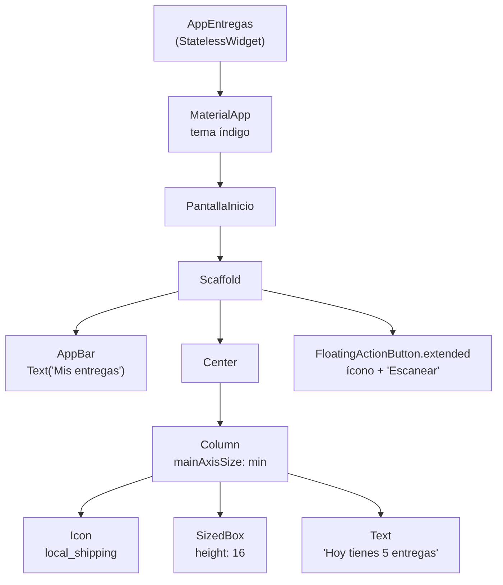
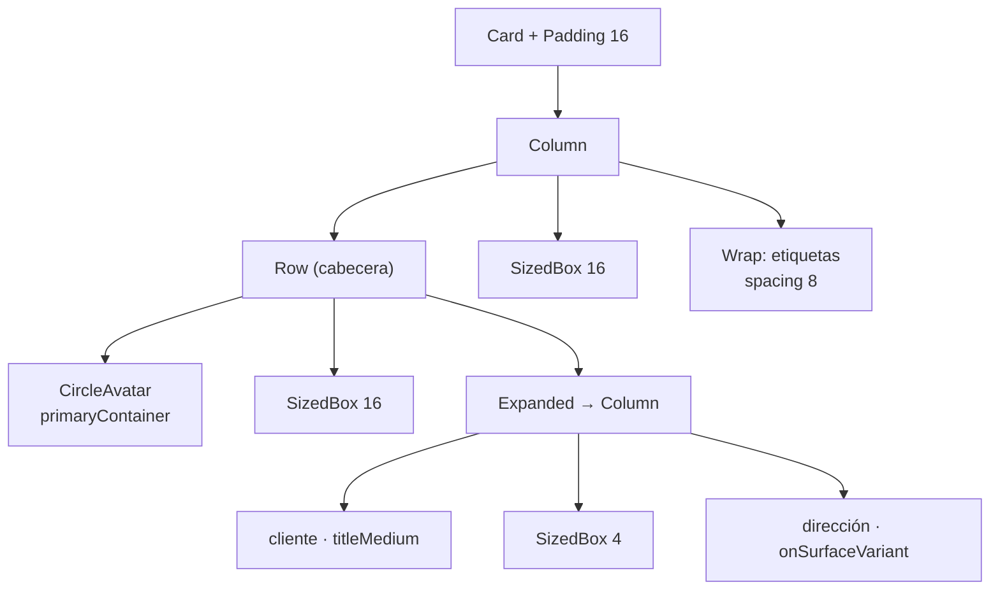
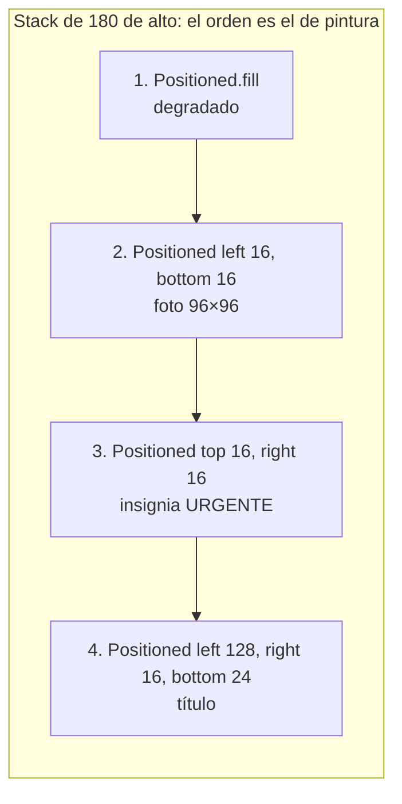
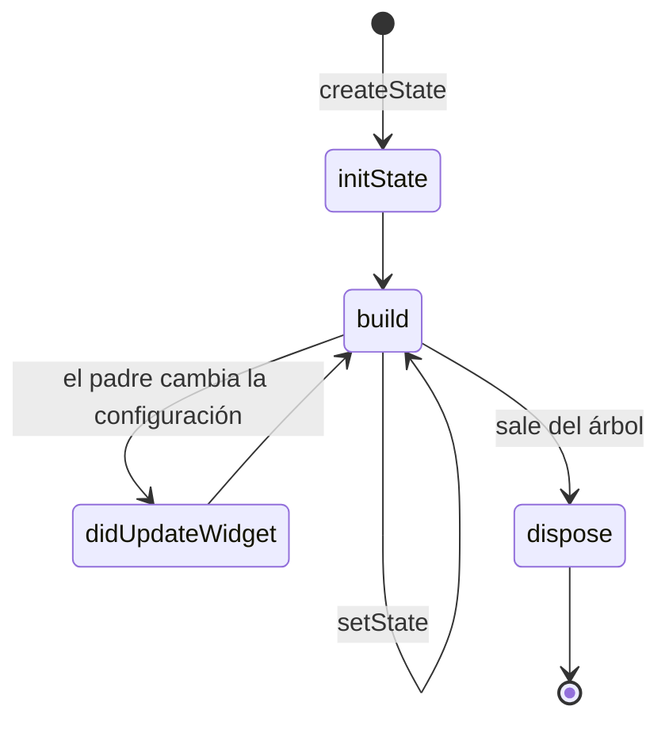
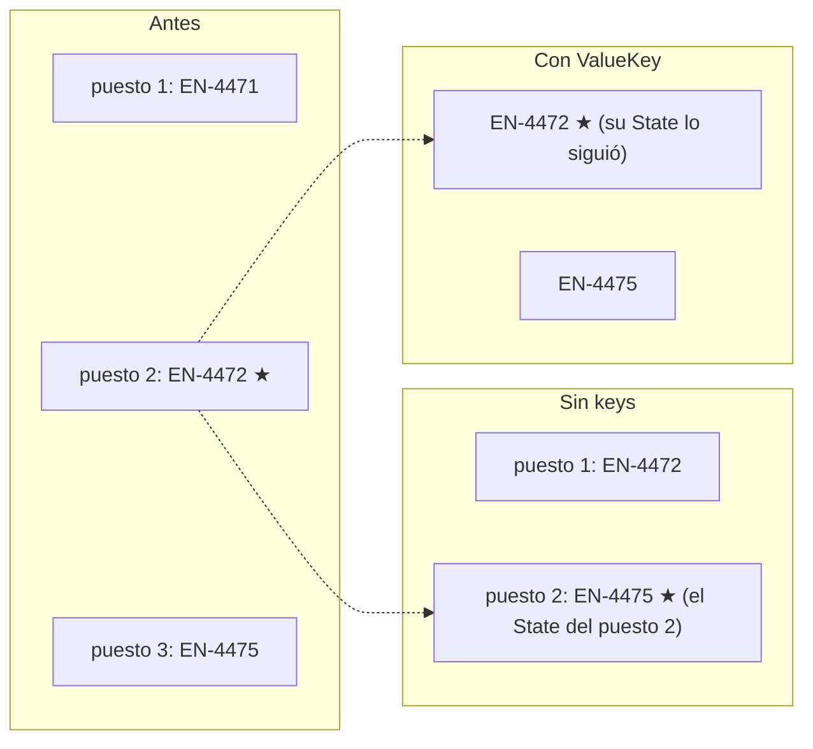
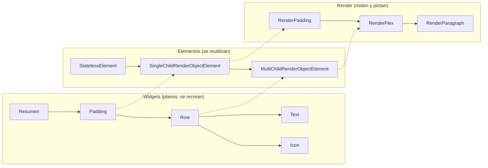
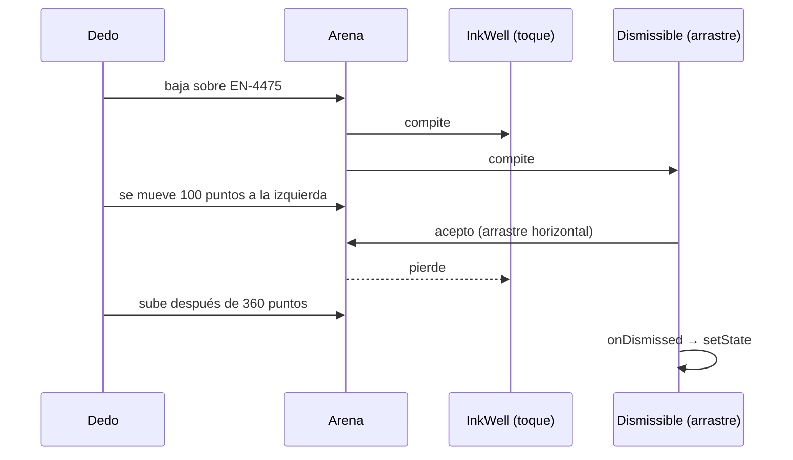

# Módulo 1: Widgets y maquetación: de la primera pantalla a listas con estado

**Entorno comprobado para esta edición (2026-11-24):** Flutter 3.50.1 (canal estable) con Dart 3.14.0 en Linux
x86_64, con el paquete `material_ui` 1.11.1, que reemplaza a `package:flutter/material.dart` desde Flutter 3.50. Todo
el código se analizó con `flutter analyze` (`No issues found!`) y se ejecutó con `flutter test` ese día, en
`/home/estudiante/labs/flutter/m1` (tu `~/labs/flutter/m1`). **Los pantallazos de este módulo los dibujó Flutter**:
cada uno sale de una prueba que arma la pantalla y la guarda como PNG, con la fuente Roboto y los íconos de Material
reales. Puedes generar los mismos en tu equipo con `flutter test --update-goldens`. Las salidas de texto son literales;
los tiempos (`00:01`) cambian en tu equipo.

Flutter dibuja **toda** la interfaz con widgets: un botón es un widget, el espacio entre dos textos es un widget, la
pantalla entera es un widget. Diseñar en Flutter es, entonces, aprender a combinar unas pocas piezas de maquetación
(filas, columnas, espacios, capas) y a decidir qué parte de la pantalla cambia cuando el usuario actúa. Este módulo
construye las pantallas de la app de entregas paso a paso, mostrando en cada paso cómo se ve el resultado y por qué se
ve así.

**Al terminar este módulo podrás:**
- crear una app con `MaterialApp`, `Scaffold` y `AppBar`, y leerla como un árbol de widgets;
- maquetar una tarjeta con `Row`, `Column`, `Expanded`, `Padding`, `SizedBox` y `Wrap`, con espacios regulares y
  jerarquía visual;
- superponer capas con `Stack` y `Positioned`, decorar con `BoxDecoration` y corregir un desborde;
- guardar estado en un `StatefulWidget`, actualizarlo con `setState` y limpiar recursos en `dispose`;
- mostrar listas largas con `ListView.builder` y usar keys para que el estado siga a su fila;
- explicar qué son los árboles de widgets, elementos y objetos de render;
- responder a toques, pulsaciones largas y deslizamientos.

**Esquema del módulo:** Tema 1 (primera pantalla) → Tema 2 (maquetar una tarjeta) → Tema 3 (capas, decoración y
desbordes) → Tema 4 (estado y ciclo de vida) → Tema 5 (listas y keys) → Tema 6 (los tres árboles) → Tema 7 (gestos).

**Qué necesitas saber antes:** todo el Módulo 0 de este curso, en especial **null safety** (Tema 1), **constructores
`const`** y **parámetros con nombre** (Tema 2) y **elementos de colección `if` y `for`** (Tema 3). De Fundamentos,
**HTML semántico** y **CSS** (Módulo 3, Temas 3 y 4) ayudan a comparar, pero no son obligatorios.

**Prepara el proyecto una vez.** Crea el proyecto con la plantilla vacía y comprueba que las pruebas corren:

```text
$ cd ~/labs/flutter
$ flutter create --org com.academia --platforms=web,linux --empty m1
$ cd m1
```

La plantilla de Flutter 3.50 ya importa `package:material_ui/material_ui.dart` y declara `material_ui: ^1.1.0` en
`pubspec.yaml`. Para ver la app en vivo mientras la cambias, ejecuta `flutter run -d chrome` y presiona `r` en la
terminal después de guardar un archivo (*hot reload*): la pantalla se actualiza sin perder su estado.

**La herramienta de pantallazos.** Copia este archivo en `test/pantallazo.dart`. No es parte de la app: es la
herramienta del laboratorio que carga las fuentes reales y guarda la pantalla como imagen. Cada prueba de este módulo
la usa.

```dart
// test/pantallazo.dart — herramienta del laboratorio: carga las fuentes reales y guarda un PNG de la pantalla
import 'dart:io';

import 'package:flutter/services.dart';
import 'package:flutter_test/flutter_test.dart';
import 'package:material_ui/material_ui.dart';

Future<void> cargarFuentes() async {
  final carpeta = '${Platform.environment['FLUTTER_ROOT']}/bin/cache/artifacts/material_fonts';
  final roboto = FontLoader('Roboto');
  for (final archivo in ['Roboto-Regular.ttf', 'Roboto-Medium.ttf', 'Roboto-Bold.ttf']) {
    roboto.addFont(Future.value(ByteData.sublistView(File('$carpeta/$archivo').readAsBytesSync())));
  }
  await roboto.load();
  final iconos = FontLoader('MaterialIcons')
    ..addFont(Future.value(ByteData.sublistView(File('$carpeta/MaterialIcons-Regular.otf').readAsBytesSync())));
  await iconos.load();
}

/// Ajusta el tamaño de la pantalla simulada (en puntos lógicos) y su densidad.
void tamanoPantalla(WidgetTester tester, {Size tamano = const Size(390, 760), double densidad = 2}) {
  tester.view.physicalSize = tamano * densidad;
  tester.view.devicePixelRatio = densidad;
  debugDisableShadows = false;                      // en las pruebas las sombras se apagan por defecto
  addTearDown(() {
    tester.view.reset();
    debugDisableShadows = true;
  });
}

/// Guarda lo que hay en pantalla como `test/pantallazos/<nombre>.png` (con --update-goldens).
Future<void> pantallazo(String nombre) async {
  await expectLater(find.byType(MaterialApp).first, matchesGoldenFile('pantallazos/$nombre.png'));
}
```

- `cargarFuentes` lee Roboto y los íconos de Material desde la caché del SDK (`FLUTTER_ROOT`); sin esto, las pruebas
  dibujan cada letra como un rectángulo.
- `tamanoPantalla` simula un teléfono de 390 × 760 puntos lógicos con densidad 2 (como muchos teléfonos actuales) y
  enciende las sombras, que en las pruebas vienen apagadas.
- `pantallazo` compara la pantalla con `test/pantallazos/<nombre>.png`; con `--update-goldens`, en lugar de comparar,
  guarda la imagen.


## Aprende construyendo


### Tema 1: La primera pantalla: MaterialApp, Scaffold y el árbol de widgets · Básico · 45 min

<details open>
<summary><strong>Capa 1 — Lectura</strong></summary>

#### Objetivos
Al terminar este tema podrás:
- crear una app con `MaterialApp`, un `Scaffold` con barra superior, contenido y botón flotante;
- escribir un `StatelessWidget` con su método `build`;
- leer la pantalla como un árbol de widgets anidados;
- comprobar con una prueba que la pantalla muestra lo que debe y obtener su pantallazo.

**Conceptos clave:** widget, `StatelessWidget`, método `build`, árbol de widgets, `MaterialApp`, `Scaffold`, `BuildContext`, prueba de widgets

#### El problema
El conductor abre la app por la mañana y necesita ver, de un vistazo, cuántas entregas tiene y un botón grande para
escanear el primer paquete. En HTML pondrías un encabezado, un párrafo y un botón, y luego CSS para ubicarlos. En
Flutter no hay HTML ni CSS: ¿con qué se describe esa pantalla, y cómo sabes que quedó bien sin abrir un teléfono?

Este tema usa **clase**, **constructor `const`** y **parámetros con nombre** (Módulo 0, Tema 2) y la idea de
**documento como árbol** del DOM (Fundamentos, Módulo 3, Tema 3).

#### Glosario del tema

**widget**
- **Definición técnica:** objeto inmutable que describe una parte de la interfaz y su configuración; Flutter lo usa para crear y actualizar lo que se dibuja.
- **En palabras sencillas:** una pieza de LEGO con instrucciones: «un texto que dice esto», «un espacio de 16 de alto».
- **Dónde se rompe la comparación:** la pieza no se modifica: si algo cambia, se arma una pieza nueva y Flutter compara.
- **Ejemplo:** `const Text('Hoy tienes 5 entregas')`, `const SizedBox(height: 16)`.
- **Error típico:** buscar «propiedades de estilo» sueltas como en CSS; en Flutter, el espacio, el centrado y el margen también son widgets.

**`StatelessWidget`**
- **Definición técnica:** widget cuya apariencia depende solo de su configuración (sus campos) y del contexto heredado; no guarda datos que cambien.
- **En palabras sencillas:** un cartel impreso: dice lo mismo hasta que imprimas otro.
- **Dónde se rompe la comparación:** si su padre le pasa datos nuevos, Flutter vuelve a llamar su `build` y el cartel «se reimprime» solo.
- **Ejemplo:** `PantallaInicio` y `AppEntregas`.
- **Error típico:** declarar campos que no son `final` en un `StatelessWidget`; el analizador lo marca (`must_be_immutable`).

**método `build`**
- **Definición técnica:** método que devuelve el árbol de widgets que representa a este widget en el contexto dado; Flutter lo llama cada vez que necesita la descripción actualizada.
- **En palabras sencillas:** la receta que dice de qué piezas está hecha esta parte.
- **Dónde se rompe la comparación:** se puede llamar muchas veces por segundo; debe ser rápido y no tener efectos secundarios.
- **Ejemplo:** `Widget build(BuildContext context) => Scaffold(...)`.
- **Error típico:** hacer una llamada de red o un cálculo pesado dentro de `build`.

**árbol de widgets**
- **Definición técnica:** estructura jerárquica formada por los widgets anidados de una app, donde cada widget es hijo del que lo contiene.
- **En palabras sencillas:** una caja que contiene cajas, que contienen cajas.
- **Dónde se rompe la comparación:** es parecido al DOM de HTML, pero aquí también los espacios y alineaciones son nodos.
- **Ejemplo:** `MaterialApp → Scaffold → Center → Column → [Icon, SizedBox, Text]`.
- **Error típico:** anidar diez niveles en un solo `build`; se extrae en widgets con nombre, como `PantallaInicio`.

**`MaterialApp`**
- **Definición técnica:** widget raíz que configura la navegación, el tema de Material Design, la localización y otros servicios para toda la app.
- **En palabras sencillas:** el edificio donde viven todas las pantallas.
- **Dónde se rompe la comparación:** casi siempre hay uno solo, en la raíz.
- **Ejemplo:** `MaterialApp(title: 'Entregas', theme: ThemeData(colorSchemeSeed: Colors.indigo), home: ...)`.
- **Error típico:** crear un `MaterialApp` dentro de otra pantalla: se pierden el tema y la navegación del de arriba.

**`Scaffold`**
- **Definición técnica:** widget que implementa la estructura visual básica de una pantalla de Material: barra superior, cuerpo, botón flotante, barra inferior y paneles.
- **En palabras sencillas:** el andamio de una pantalla: los lugares donde van las partes de siempre.
- **Dónde se rompe la comparación:** cada lugar es opcional; un `Scaffold` solo con `body` también es válido.
- **Ejemplo:** `Scaffold(appBar: ..., body: ..., floatingActionButton: ...)`.
- **Error típico:** ubicar a mano el botón flotante con márgenes; el `Scaffold` ya sabe dónde va.

**`BuildContext`**
- **Definición técnica:** referencia a la posición de un widget en el árbol, que permite consultar datos heredados de sus ancestros, como el tema (`Theme.of(context)`).
- **En palabras sencillas:** la dirección del widget dentro del edificio, para preguntar «¿qué colores se usan aquí?».
- **Dónde se rompe la comparación:** es la dirección de **este** widget; usar el contexto de otro da respuestas de otro lugar.
- **Ejemplo:** en el Tema 2, `Theme.of(context).textTheme` da los tamaños de letra del tema.
- **Error típico:** guardar un `BuildContext` en un campo y usarlo después de que la pantalla se cerró.

**prueba de widgets**
- **Definición técnica:** prueba de `flutter_test` que arma widgets en un entorno simulado, los busca con *finders* (`find.text`, `find.byIcon`) y comprueba lo que se dibuja, sin teléfono ni emulador.
- **En palabras sencillas:** un teléfono de mentira que abre la pantalla y la revisa en un segundo.
- **Dónde se rompe la comparación:** no prueba el teléfono real (cámara, GPS); prueba tu interfaz.
- **Ejemplo:** `expect(find.text('Hoy tienes 5 entregas'), findsOneWidget)`.
- **Error típico:** probar solo con los ojos en el emulador: el siguiente cambio puede romper la pantalla sin que nadie lo note.

#### ► CÓMO FUNCIONA
`runApp` recibe el widget raíz. `MaterialApp` prepara el tema y muestra `home`. El `Scaffold` reparte la pantalla: la
`AppBar` arriba, el `body` en el centro, el botón flotante abajo a la derecha. Dentro del cuerpo, `Center` centra a su
hijo y `Column` apila los suyos de arriba abajo. Cada widget solo sabe de sus hijos directos.



#### Problema resuelto 1.1
Construye la pantalla de inicio del conductor y comprueba con una prueba que muestra el título, el resumen y el botón.

**Razonamiento:**
1. Se separan dos widgets: `AppEntregas` (la app y su tema) y `PantallaInicio` (una pantalla). Así la pantalla se
   puede probar y reutilizar sola.
2. `colorSchemeSeed` genera toda la paleta de Material 3 a partir de un color.
3. La columna lleva `mainAxisSize: MainAxisSize.min` para ocupar solo su contenido; así `Center` la centra completa.
4. Todo lo que no cambia es `const`.

```dart
// lib/tema1/primera_pantalla.dart — la primera pantalla de la app de entregas
import 'package:material_ui/material_ui.dart';

class AppEntregas extends StatelessWidget {
  const AppEntregas({super.key});

  @override
  Widget build(BuildContext context) {
    return MaterialApp(
      title: 'Entregas',
      debugShowCheckedModeBanner: false,          // quita la cinta «DEBUG» de la esquina
      theme: ThemeData(colorSchemeSeed: Colors.indigo),
      home: const PantallaInicio(),
    );
  }
}

class PantallaInicio extends StatelessWidget {
  const PantallaInicio({super.key});

  @override
  Widget build(BuildContext context) {
    return Scaffold(
      appBar: AppBar(title: const Text('Mis entregas')),
      body: const Center(
        child: Column(
          mainAxisSize: MainAxisSize.min,          // la columna ocupa solo lo que necesitan sus hijos
          children: [
            Icon(Icons.local_shipping, size: 64),
            SizedBox(height: 16),
            Text('Hoy tienes 5 entregas'),
          ],
        ),
      ),
      floatingActionButton: FloatingActionButton.extended(
        onPressed: () {},
        icon: const Icon(Icons.qr_code_scanner),
        label: const Text('Escanear'),
      ),
    );
  }
}
```

```dart
import 'package:material_ui/material_ui.dart';

import 'tema1/primera_pantalla.dart';

void main() {
  runApp(const AppEntregas());
}
```

```dart
import 'package:flutter_test/flutter_test.dart';
import 'package:m1/tema1/primera_pantalla.dart';
import 'package:material_ui/material_ui.dart';

import 'pantallazo.dart';

void main() {
  setUpAll(cargarFuentes);

  testWidgets('la pantalla de inicio muestra el resumen y el botón', (tester) async {
    tamanoPantalla(tester);
    await tester.pumpWidget(const AppEntregas());
    expect(find.text('Mis entregas'), findsOneWidget);
    expect(find.text('Hoy tienes 5 entregas'), findsOneWidget);
    expect(find.byIcon(Icons.qr_code_scanner), findsOneWidget);
    await pantallazo('m1-t1-primera-pantalla');
  });
}
```

```text
$ flutter test --update-goldens test/tema1_test.dart   # la primera vez: guarda el pantallazo
$ flutter test test/tema1_test.dart                    # después: compara contra él
00:00 +0: loading /home/estudiante/labs/flutter/m1/test/tema1_test.dart
00:00 +0: (setUpAll)
00:00 +0: la pantalla de inicio muestra el resumen y el botón
00:00 +1: (tearDownAll)
00:00 +1: All tests passed!
```


**Explicación por partes.**
- Línea 4: `AppEntregas` hereda de `StatelessWidget`; su `build` devuelve el `MaterialApp`.
- Línea 10: `debugShowCheckedModeBanner: false` quita la cinta «DEBUG» que Flutter pone en la esquina durante el
  desarrollo.
- Línea 27: sin `mainAxisSize.min`, la columna ocuparía toda la altura y su contenido quedaría arriba.
- Líneas 35–39: `FloatingActionButton.extended` es el botón con ícono y texto; `onPressed: () {}` lo deja activo.
- La prueba busca cada texto e ícono, y el pantallazo muestra el resultado real.

> **Error común.** Olvidar `const` en widgets que no cambian. La app funciona igual, pero Flutter crea objetos nuevos
> en cada reconstrucción. El analizador con `flutter_lints` lo señala con `prefer_const_constructors`.

> **Error común.** Poner `onPressed: null` y preguntarse por qué el botón se ve gris y no responde: `null` es la forma
> de **deshabilitar** un botón en Flutter (Tema 4).

> **Buena práctica.** Un archivo por pantalla y un widget con nombre por cada parte reconocible. Los nombres
> (`PantallaInicio`, `TarjetaEntrega`) hacen que el árbol se lea como una descripción de la interfaz.

> **Prevenir errores.** Escribe la prueba de la pantalla junto con la pantalla. Una prueba de widgets tarda menos de un
> segundo y detecta textos o botones que desaparecieron por un cambio.

#### Checkpoint 1.1
Si quitas `Center` y dejas la `Column` como `body`, ¿dónde aparece el contenido?

Respuesta: arriba a la izquierda. Sin `Center`, la columna toma el ancho de su hijo más ancho (el texto) y centra el
ícono sobre ese ancho; el `Scaffold` coloca el cuerpo en la esquina superior izquierda. Una prueba lo confirma: el
texto empieza en `x = 0, y = 80` y el ícono queda encima, centrado respecto del texto. `Center` es lo que lleva el
bloque al medio de la pantalla.

</details>

<details>
<summary><strong>Capa 2 — Construcción</strong></summary>

#### Paso 1 · Crea el proyecto
Ejecuta las órdenes de «Prepara el proyecto» y copia `test/pantallazo.dart`.

#### Paso 2 · Escribe la pantalla
Crea `lib/tema1/primera_pantalla.dart` y reemplaza `lib/main.dart`.

#### Paso 3 · Ejecútala en vivo
Ejecuta `flutter run -d chrome`. Cambia el texto a `Hoy tienes 6 entregas`, guarda y presiona `r`.

#### Paso 4 · Prueba y saca el pantallazo
Crea `test/tema1_test.dart`, ejecuta `flutter test --update-goldens test/tema1_test.dart` y abre
`test/pantallazos/m1-t1-primera-pantalla.png`.

#### Paso 5 · Rompe la prueba
Cambia el título a `Entregas` y ejecuta `flutter test test/tema1_test.dart` (sin `--update-goldens`). Lee qué falla
primero y por qué.

#### Resumen
- Toda la interfaz son **widgets**; un **`StatelessWidget`** describe su parte en **`build`**.
- Los widgets anidados forman el **árbol de widgets**.
- **`MaterialApp`** configura la app; **`Scaffold`** reparte la pantalla.
- El **`BuildContext`** permite consultar lo heredado, como el tema.
- Una **prueba de widgets** revisa la pantalla sin teléfono y puede guardar su pantallazo.

#### Ejercicio verificable 1
Básico. Agrega a la columna, debajo del texto, `const Text('Primera parada: 8:00')`. ¿Cuántos hijos tiene la `Column`?

Respuesta esperada: cuatro (ícono, espacio, texto, texto). Si quieres que el nuevo texto no quede pegado al anterior,
agrega otro `SizedBox(height: 8)`: entonces son cinco.

#### Ejercicio verificable 2
Intermedio. Cambia `colorSchemeSeed: Colors.indigo` por `Colors.teal` y vuelve a ejecutar la prueba **sin**
`--update-goldens`. ¿Qué pasa?

Respuesta esperada: la prueba de textos pasa, pero `pantallazo` falla porque la imagen ya no coincide con la guardada:
cambiaron los colores del botón. La comparación de pantallazos detecta cambios visuales que las búsquedas de texto no
ven. Si el cambio es intencional, se vuelve a ejecutar con `--update-goldens`.

#### Ejercicio verificable 3
Reto. Escribe una prueba que compruebe que el botón flotante está en la mitad inferior de la pantalla, sin mirar el
pantallazo.

Respuesta esperada: `expect(tester.getCenter(find.byType(FloatingActionButton)).dy, greaterThan(380))`, porque la
pantalla simulada mide 760 puntos de alto. `getCenter` y `getRect` dan la posición real de un widget después de
maquetar.

#### En el trabajo
Las apps de Flutter se escriben como árboles de widgets pequeños con nombre, y los equipos guardan pantallazos de
referencia (*golden tests*) de las pantallas principales: una revisión de un cambio visual muestra el antes y el después.
`flutter run` con *hot reload* es la forma habitual de diseñar: se cambia un número y se ve el resultado en un segundo.

</details>

### Tema 2: Maquetar una tarjeta: filas, columnas, espacios y jerarquía visual · Básico · 60 min

<details open>
<summary><strong>Capa 1 — Lectura</strong></summary>

#### Objetivos
Al terminar este tema podrás:
- distribuir contenido en horizontal con `Row` y en vertical con `Column`, y controlar sus ejes;
- repartir el espacio sobrante con `Expanded` y separar con `Padding` y `SizedBox` siguiendo una escala de espacios;
- dar jerarquía a la información con los estilos de texto y los colores del tema;
- convertir datos sueltos en una tarjeta legible en tres pasos y comparar cada paso con su pantallazo.

**Conceptos clave:** `Row` y `Column`, eje principal y eje cruzado, `Expanded`, `Padding` y `SizedBox`, escala de espaciado, jerarquía visual, `TextTheme`, `ColorScheme`, `Card`, `Wrap`

#### El problema
La lista de la ruta muestra cada entrega con cinco datos: guía, cliente, dirección, franja horaria y peso. El primer
prototipo los apila centrados, uno debajo del otro. Funciona, pero el conductor, con el teléfono en el soporte del
vehículo, tarda en encontrar la dirección y confunde la guía con la hora. ¿Qué cambios de maquetación hacen que se
entienda de un vistazo?

Este tema usa el **árbol de widgets** y el **`BuildContext`** (Tema 1) y el modelo de caja de CSS (Fundamentos,
Módulo 3, Tema 4) como comparación.

#### Glosario del tema

**`Row` y `Column`**
- **Definición técnica:** widgets de maquetación flexible (*flex*) que colocan a sus hijos en una línea: `Row` en horizontal y `Column` en vertical.
- **En palabras sencillas:** una fila de cajas y una pila de cajas.
- **Dónde se rompe la comparación:** no hacen scroll: si los hijos no caben, desbordan (Tema 3).
- **Ejemplo:** en el paso 2, una `Row` con [ícono, textos, hora] y, dentro, una `Column` con los textos.
- **Error típico:** meter una lista larga en una `Column`; para eso existe `ListView` (Tema 5).

**eje principal y eje cruzado**
- **Definición técnica:** el eje principal es la dirección en que el flex coloca a sus hijos (horizontal en `Row`, vertical en `Column`); el cruzado es el perpendicular. `mainAxisAlignment` y `crossAxisAlignment` controlan la alineación en cada uno.
- **En palabras sencillas:** en una fila, «izquierda–derecha» es el principal y «arriba–abajo» el cruzado.
- **Dónde se rompe la comparación:** en una `Column` se invierten: el principal es vertical.
- **Ejemplo:** `crossAxisAlignment: CrossAxisAlignment.start` alinea los textos a la izquierda dentro de la columna.
- **Error típico:** usar `mainAxisAlignment` para alinear a la izquierda los textos de una `Column` (eso es el eje cruzado).

**`Expanded`**
- **Definición técnica:** widget que hace que un hijo de un `Row` o `Column` ocupe el espacio sobrante del eje principal, repartido según su `flex`.
- **En palabras sencillas:** «tú quédate con lo que sobre».
- **Dónde se rompe la comparación:** solo funciona como hijo directo de un flex (`Row`, `Column`, `Flex`).
- **Ejemplo:** los textos de la tarjeta van en un `Expanded`: así la hora queda pegada a la derecha.
- **Error típico:** poner `Expanded` dentro de un `Padding` dentro del `Row`; debe ser el hijo directo.

**`Padding` y `SizedBox`**
- **Definición técnica:** `Padding` agrega espacio alrededor de su hijo; `SizedBox` es una caja de tamaño fijo, que vacía sirve como separador.
- **En palabras sencillas:** el margen interno de una caja y un bloque espaciador.
- **Dónde se rompe la comparación:** a diferencia de CSS, no existe `margin` en cada widget: el espacio se agrega con estos widgets.
- **Ejemplo:** `Padding(padding: EdgeInsets.all(16))` y `SizedBox(width: 16)` entre el ícono y los textos.
- **Error típico:** valores de espacio al azar (7, 13, 22): la pantalla se ve desordenada sin que se sepa por qué.

**escala de espaciado**
- **Definición técnica:** conjunto pequeño de medidas de espacio que se repiten en toda la interfaz, normalmente múltiplos de 4 u 8 puntos.
- **En palabras sencillas:** usar siempre las mismas medidas, como una regla con pocas marcas.
- **Dónde se rompe la comparación:** la regla no decide por ti: 4 separa lo que va junto, 16 separa bloques.
- **Ejemplo:** 4 entre nombre y dirección, 8 entre etiquetas, 16 alrededor de la tarjeta y entre el avatar y el texto.
- **Error típico:** usar el mismo espacio entre todo; la cercanía es la que dice qué va junto.

**jerarquía visual**
- **Definición técnica:** organización de los elementos por importancia mediante tamaño, peso, color, posición y espacio, para guiar el orden en que se leen.
- **En palabras sencillas:** que lo más importante se vea primero.
- **Dónde se rompe la comparación:** «más grande» no siempre es «más importante»; a veces basta un color más suave para lo secundario.
- **Ejemplo:** el nombre del cliente en `titleMedium`; la dirección en color `onSurfaceVariant`; hora y peso como etiquetas.
- **Error típico:** todo en negrita: si todo resalta, nada resalta.

**`TextTheme` y `ColorScheme`**
- **Definición técnica:** partes del `ThemeData` con los estilos de texto con nombre (`titleMedium`, `bodyMedium`, `labelMedium`…) y los roles de color de Material 3 (`primary`, `primaryContainer`, `onSurfaceVariant`…).
- **En palabras sencillas:** la lista oficial de tamaños de letra y de colores de la app.
- **Dónde se rompe la comparación:** los colores se piden por su papel («el color de un texto secundario»), no por su nombre («gris»).
- **Ejemplo:** `Theme.of(context).textTheme.titleMedium` y `colorScheme.onSurfaceVariant`.
- **Error típico:** escribir `fontSize: 17` y `Colors.grey` en cada pantalla; el modo oscuro y los cambios de marca se rompen (Módulo 10).

**`Card` y `Wrap`**
- **Definición técnica:** `Card` es una superficie de Material con forma redondeada, color y elevación; `Wrap` coloca a sus hijos en línea y los pasa a la línea siguiente cuando no caben.
- **En palabras sencillas:** una ficha sobre la mesa, y una fila que sabe saltar de renglón.
- **Dónde se rompe la comparación:** `Wrap` no reparte espacio sobrante como `Row`; solo acomoda.
- **Ejemplo:** las tres etiquetas de la tarjeta van en un `Wrap`; la tercera bajó de línea en el pantallazo.
- **Error típico:** poner etiquetas en un `Row`: en un teléfono angosto desbordan.

#### ► CÓMO FUNCIONA
La maquetación se piensa como cajas: primero la estructura (qué va al lado de qué), después el espacio (cuánto separa
a cada cosa) y al final la jerarquía (qué resalta). En código, la estructura son `Row` y `Column`; el espacio,
`Padding` y `SizedBox` con una escala fija; la jerarquía, los estilos y colores del tema.



#### Problema resuelto 2.1
Convierte los cinco datos de una entrega en una tarjeta legible, en tres pasos, y compara los pantallazos.

**Razonamiento:**
1. **Paso 1, los datos:** una `Column` con cinco `Text`. Sirve para comprobar que los datos llegan.
2. **Paso 2, la estructura:** un ícono a la izquierda (qué es), los textos en el centro alineados al inicio (quién y
   dónde) y la hora a la derecha (cuándo). `Expanded` le da a los textos el espacio sobrante.
3. **Paso 3, la jerarquía:** el cliente con un estilo de título, la dirección con un color secundario, y los datos de
   control (hora, peso, guía) como etiquetas abajo. Todo dentro de una `Card` con espacios de 4, 8 y 16.

```dart
// lib/tema2/tarjetas.dart — la misma tarjeta de entrega en tres pasos de maquetación
import 'package:material_ui/material_ui.dart';

/// Datos de ejemplo que comparten las tres versiones.
class DatosEntrega {
  final String guia;
  final String cliente;
  final String direccion;
  final String hora;
  final int pesoGramos;
  const DatosEntrega(this.guia, this.cliente, this.direccion, this.hora, this.pesoGramos);
}

const ejemplo = DatosEntrega('EN-4471', 'Laura Gómez', 'Cra. 15 #93-47, apto 502', '10:30 – 11:00', 2300);

/// Paso 1: los datos, uno debajo del otro. Todo funciona, nada se entiende de un vistazo.
class TarjetaPaso1 extends StatelessWidget {
  final DatosEntrega e;
  const TarjetaPaso1(this.e, {super.key});

  @override
  Widget build(BuildContext context) {
    return Column(
      children: [
        Text(e.guia),
        Text(e.cliente),
        Text(e.direccion),
        Text(e.hora),
        Text('${e.pesoGramos} g'),
      ],
    );
  }
}

/// Paso 2: estructura. Ícono a la izquierda, textos alineados al inicio, hora a la derecha, espacios regulares.
class TarjetaPaso2 extends StatelessWidget {
  final DatosEntrega e;
  const TarjetaPaso2(this.e, {super.key});

  @override
  Widget build(BuildContext context) {
    return Padding(
      padding: const EdgeInsets.all(16),
      child: Row(
        crossAxisAlignment: CrossAxisAlignment.start,
        children: [
          const Icon(Icons.inventory_2_outlined),
          const SizedBox(width: 16),
          Expanded(                                   // los textos toman todo el ancho que sobra
            child: Column(
              crossAxisAlignment: CrossAxisAlignment.start,
              children: [
                Text(e.cliente),
                const SizedBox(height: 4),
                Text(e.direccion),
                const SizedBox(height: 4),
                Text('${e.guia} · ${(e.pesoGramos / 1000).toStringAsFixed(1)} kg'),
              ],
            ),
          ),
          const SizedBox(width: 16),
          Text(e.hora),
        ],
      ),
    );
  }
}

/// Paso 3: jerarquía visual. Tamaños y colores del tema, superficie con forma y datos secundarios como etiquetas.
class TarjetaPaso3 extends StatelessWidget {
  final DatosEntrega e;
  const TarjetaPaso3(this.e, {super.key});

  @override
  Widget build(BuildContext context) {
    final texto = Theme.of(context).textTheme;
    final colores = Theme.of(context).colorScheme;
    return Card(
      margin: const EdgeInsets.symmetric(horizontal: 16, vertical: 8),
      child: Padding(
        padding: const EdgeInsets.all(16),
        child: Column(
          crossAxisAlignment: CrossAxisAlignment.start,
          children: [
            Row(
              crossAxisAlignment: CrossAxisAlignment.start,
              children: [
                CircleAvatar(
                  backgroundColor: colores.primaryContainer,
                  foregroundColor: colores.onPrimaryContainer,
                  child: const Icon(Icons.inventory_2_outlined),
                ),
                const SizedBox(width: 16),
                Expanded(
                  child: Column(
                    crossAxisAlignment: CrossAxisAlignment.start,
                    children: [
                      Text(e.cliente, style: texto.titleMedium),
                      const SizedBox(height: 4),
                      Text(e.direccion, style: texto.bodyMedium?.copyWith(color: colores.onSurfaceVariant)),
                    ],
                  ),
                ),
              ],
            ),
            const SizedBox(height: 16),
            Wrap(                                        // las etiquetas bajan de línea si no caben
              spacing: 8,
              runSpacing: 8,
              children: [
                Chip(avatar: const Icon(Icons.schedule, size: 18), label: Text(e.hora)),
                Chip(avatar: const Icon(Icons.scale_outlined, size: 18), label: Text('${(e.pesoGramos / 1000).toStringAsFixed(1)} kg')),
                Chip(label: Text(e.guia, style: texto.labelLarge?.copyWith(color: colores.onSurfaceVariant))),
              ],
            ),
          ],
        ),
      ),
    );
  }
}
```

```dart
import 'package:flutter_test/flutter_test.dart';
import 'package:m1/tema2/tarjetas.dart';
import 'package:material_ui/material_ui.dart';

import 'pantallazo.dart';

Widget lienzo(Widget tarjeta) => MaterialApp(
      debugShowCheckedModeBanner: false,
      theme: ThemeData(colorSchemeSeed: Colors.indigo),
      home: Scaffold(appBar: AppBar(title: const Text('Ruta de hoy')), body: Column(children: [tarjeta])),
    );

void main() {
  setUpAll(cargarFuentes);
  const tamano = Size(390, 300);

  testWidgets('paso 1: sin maquetar', (tester) async {
    tamanoPantalla(tester, tamano: tamano);
    await tester.pumpWidget(lienzo(const TarjetaPaso1(ejemplo)));
    await pantallazo('m1-t2-paso1');
  });

  testWidgets('paso 2: estructura', (tester) async {
    tamanoPantalla(tester, tamano: tamano);
    await tester.pumpWidget(lienzo(const TarjetaPaso2(ejemplo)));
    await pantallazo('m1-t2-paso2');
  });

  testWidgets('paso 3: jerarquía', (tester) async {
    tamanoPantalla(tester, tamano: tamano);
    await tester.pumpWidget(lienzo(const TarjetaPaso3(ejemplo)));
    expect(find.byType(Card), findsOneWidget);
    await pantallazo('m1-t2-paso3');
  });
}
```

```text
$ flutter test test/tema2_test.dart
00:00 +0: loading /home/estudiante/labs/flutter/m1/test/tema2_test.dart
00:00 +0: (setUpAll)
00:00 +0: paso 1: sin maquetar
00:00 +1: paso 2: estructura
00:00 +2: paso 3: jerarquía
00:00 +3: (tearDownAll)
00:00 +3: All tests passed!
```


**Explicación por partes.**
- `TarjetaPaso1` (líneas 17–33): `Column` centra a sus hijos en el eje cruzado por defecto; por eso los textos
  quedan centrados y sin relación entre sí.
- `TarjetaPaso2`, línea 45: `crossAxisAlignment.start` alinea el ícono y la hora con la **primera** línea de texto, no
  con el centro del bloque.
- Línea 49: sin `Expanded`, la hora quedaría pegada a los textos; con él, los textos toman lo que sobra y la hora se
  va a la derecha.
- Líneas 48 y 61: 16 puntos entre bloques; 4 entre líneas del mismo bloque (líneas 54 y 56). La cercanía dice qué va
  junto.
- `TarjetaPaso3`, líneas 76–77: estilos y colores salen del tema. Si mañana cambia el color de marca o se activa el
  modo oscuro, la tarjeta se adapta sola.
- Línea 107: con tres etiquetas, `Wrap` pasó la guía al renglón siguiente porque no cabía; en un `Row` habría
  desbordado.
- Compara los pantallazos: los mismos datos, y el paso 3 se entiende en un segundo. Ese es el trabajo de maquetar.

> **Error común.** Alinear con espacios en blanco dentro del texto (`'Laura      10:30'`). Cambia con cada fuente y
> cada tamaño de pantalla. La alineación se hace con `Row`, `Expanded` y `crossAxisAlignment`.

> **Error común.** Usar `Container` para todo. `Container` combina relleno, color, tamaño y decoración; si solo
> necesitas espacio, `Padding` o `SizedBox` dicen exactamente lo que hacen y pueden ser `const`.

> **Buena práctica.** Diseña con datos reales y largos: un nombre de dos apellidos, una dirección con apartamento.
> Una tarjeta probada con «Ana» y «Calle 1» se rompe con el primer cliente real.

> **Prevenir errores.** Define la escala de espacios una sola vez (por ejemplo, constantes `espacio4`, `espacio8`,
> `espacio16`) y usa solo esas medidas. El Módulo 10 la lleva al tema de la app.

#### Checkpoint 2.1
En `TarjetaPaso2`, ¿qué pasa con la hora si quitas `Expanded` y la dirección es muy larga?

Respuesta: la fila desborda por la derecha: la columna de textos pide todo el ancho de su texto más largo y no queda
lugar para la hora. Es el error del Tema 3. `Expanded` limita la columna al espacio sobrante y obliga al texto a
partirse en líneas.

</details>

<details>
<summary><strong>Capa 2 — Construcción</strong></summary>

#### Paso 1 · Crea el archivo
Crea `lib/tema2/tarjetas.dart` con los datos de ejemplo y las tres tarjetas.

#### Paso 2 · Guarda los tres pantallazos
Crea `test/tema2_test.dart` y ejecuta `flutter test --update-goldens test/tema2_test.dart`.

#### Paso 3 · Compara
Abre las tres imágenes de `test/pantallazos` una al lado de la otra y anota qué cambio de un paso a otro hizo más
fácil encontrar la dirección.

#### Paso 4 · Prueba con datos largos
Cambia la dirección del ejemplo por `'Avenida Carrera 68 # 24B-10, bodega 3, interior 7, conjunto industrial'` y
vuelve a generar los pantallazos. Revisa que el paso 3 sigue legible.

#### Paso 5 · Ajusta la escala
Cambia el `SizedBox(height: 4)` del paso 3 por `16` y mira el resultado: el nombre y la dirección dejan de verse como
un bloque. Vuelve a 4.

#### Resumen
- **`Row`** y **`Column`** colocan hijos en un **eje principal** y los alinean en el **eje cruzado**.
- **`Expanded`** reparte el espacio sobrante; **`Padding`** y **`SizedBox`** separan según una **escala de
  espaciado**.
- La **jerarquía visual** se logra con los estilos del **`TextTheme`** y los roles del **`ColorScheme`**.
- **`Card`** da superficie; **`Wrap`** acomoda etiquetas que no caben en una línea.
- Maquetar en pasos (datos → estructura → jerarquía) y comparar pantallazos hace visibles las decisiones.

#### Ejercicio verificable 1
Básico. En `TarjetaPaso2`, cambia `crossAxisAlignment: CrossAxisAlignment.start` de la `Row` por `center`. ¿Qué cambia
en el pantallazo?

Respuesta esperada: el ícono y la hora bajan hasta el centro vertical del bloque de tres textos, en lugar de alinearse
con el nombre. En una tarjeta de lectura, alinear con la primera línea suele leerse mejor.

#### Ejercicio verificable 2
Intermedio. Agrega a `TarjetaPaso3` una cuarta etiqueta `Chip(label: Text('Frágil'))`. ¿Cuántos renglones de
etiquetas esperas en un teléfono de 390 puntos?

Respuesta esperada: dos. Hora y peso ocupan el primero; la guía y «Frágil» bajan al segundo. Con `Wrap` la tarjeta
crece hacia abajo en lugar de desbordar.

#### Ejercicio verificable 3
Reto. Haz que la tarjeta del paso 3 muestre el ícono `Icons.priority_high` en color `colores.error` junto al nombre
cuando el cliente tiene prioridad, sin desordenar la alineación.

Respuesta esperada: agrega un campo `prioritaria` a `DatosEntrega` y reemplaza el `Text` del nombre por un `Row` con
el texto en un `Expanded` y, si `prioritaria`, un `Icon(Icons.priority_high, size: 18, color: colores.error)` después.
El `Expanded` mantiene el ícono al final de la línea sin empujar la dirección.

#### En el trabajo
Los diseñadores entregan pantallas en Figma con medidas en múltiplos de 4 u 8 y estilos con nombre («Title Medium»),
que corresponden a los del `TextTheme` de Material 3. Traducir un diseño a Flutter es identificar filas, columnas,
espacios y estilos, como en este tema. En una revisión de diseño, la pregunta frecuente es: «¿esto sigue legible con
datos reales y con letra grande?» (Módulo 10).

</details>

### Tema 3: Capas, decoración y desbordes: Stack, BoxDecoration y Expanded · Intermedio · 50 min

<details open>
<summary><strong>Capa 1 — Lectura</strong></summary>

#### Objetivos
Al terminar este tema podrás:
- superponer widgets en capas con `Stack` y ubicarlos con `Positioned`;
- decorar una caja con color, degradado, bordes redondeados, borde y sombra usando `BoxDecoration`;
- reconocer el error de desborde, leer su mensaje y corregirlo con `Expanded` y `TextOverflow.ellipsis`.

**Conceptos clave:** `Stack`, `Positioned`, `BoxDecoration`, degradado, radio de borde, sombra, desborde (*overflow*), `TextOverflow.ellipsis`

#### El problema
El detalle de un pedido necesita un encabezado vistoso: un fondo de color, la foto del paquete apoyada sobre el borde
inferior y una insignia «URGENTE» arriba a la derecha. `Row` y `Column` no superponen nada. Y en la misma pantalla,
una dirección larga aparece con franjas amarillas y negras en el borde. ¿Cómo se ponen cosas encima de otras, y qué
significan esas franjas?

Este tema usa **`Row`**, **`Expanded`**, el **`ColorScheme`** (Tema 2) y `position: absolute` de CSS (Fundamentos,
Módulo 3, Tema 4) como comparación.

#### Glosario del tema

**`Stack`**
- **Definición técnica:** widget que coloca a sus hijos uno encima de otro en el orden de la lista: el primero queda al fondo y el último arriba.
- **En palabras sencillas:** hojas de acetato apiladas.
- **Dónde se rompe la comparación:** los hijos sin posición se alinean según `alignment` (arriba a la izquierda por defecto).
- **Ejemplo:** el encabezado tiene cuatro capas: fondo, foto, insignia y título.
- **Error típico:** usar `Stack` para lo que es una fila o una columna; se pierde el reacomodo automático.

**`Positioned`**
- **Definición técnica:** widget que, como hijo de un `Stack`, fija la posición de su hijo con distancias a los bordes (`top`, `bottom`, `left`, `right`) y opcionalmente su tamaño.
- **En palabras sencillas:** «pon esta hoja a 16 del borde de abajo y 16 de la izquierda».
- **Dónde se rompe la comparación:** las distancias son al borde del `Stack`, no de la pantalla.
- **Ejemplo:** `Positioned(top: 16, right: 16, child: insignia)`; `Positioned.fill` ocupa todo.
- **Error típico:** fijar `left` y `right` y además `width`: son tres restricciones para dos valores y Flutter lanza un error.

**`BoxDecoration`**
- **Definición técnica:** descripción de cómo pintar una caja: color o degradado de fondo, imagen, borde, radio de las esquinas y sombras.
- **En palabras sencillas:** la pintura y el marco de una caja.
- **Dónde se rompe la comparación:** decora, no ubica: el tamaño y la posición los dan otros widgets.
- **Ejemplo:** `BoxDecoration(color: ..., borderRadius: BorderRadius.circular(20), border: Border.all(...), boxShadow: [...])`.
- **Error típico:** pasar `color` a un `Container` y además una `decoration` con color: Flutter lo rechaza; el color va dentro de la decoración.

**degradado**
- **Definición técnica:** transición entre dos o más colores a lo largo de una dirección (`LinearGradient`) o desde un centro (`RadialGradient`).
- **En palabras sencillas:** un color que se funde en otro.
- **Dónde se rompe la comparación:** con colores del tema, el degradado cambia solo en modo oscuro.
- **Ejemplo:** de `primary` a `tertiary`, de arriba a la izquierda a abajo a la derecha.
- **Error típico:** poner texto claro sobre la parte clara de un degradado: deja de leerse en una de sus puntas.

**radio de borde y sombra**
- **Definición técnica:** `borderRadius` redondea las esquinas de la caja; `BoxShadow` dibuja una sombra con desenfoque (`blurRadius`), desplazamiento (`offset`) y color con transparencia.
- **En palabras sencillas:** esquinas suaves y la sombra que hace que algo «flote».
- **Dónde se rompe la comparación:** la sombra no ocupa espacio: si no hay margen, se corta.
- **Ejemplo:** la foto con radio 20 y una sombra de 12 de desenfoque, 4 hacia abajo, negra al 20 %.
- **Error típico:** sombras muy oscuras y opacas: se ven sucias; una sombra sutil comunica elevación.

**desborde (*overflow*)**
- **Definición técnica:** situación en la que los hijos de un flex necesitan más espacio del que el flex tiene en su eje principal; en modo debug, Flutter dibuja franjas amarillas y negras y registra `A RenderFlex overflowed by N pixels`.
- **En palabras sencillas:** meter más cosas de las que caben en la caja; la cinta de peligro marca por dónde se salen.
- **Dónde se rompe la comparación:** en la app publicada no hay franjas: el contenido simplemente se corta.
- **Ejemplo:** la dirección larga sin `Expanded` desborda 170 píxeles.
- **Error típico:** «arreglarlo» achicando la letra o fijando anchos con números; en otro teléfono vuelve a pasar.

**`TextOverflow.ellipsis`**
- **Definición técnica:** valor de `Text.overflow` que, cuando el texto no cabe en sus líneas permitidas, lo corta y agrega «…».
- **En palabras sencillas:** «si no cabe, termina en puntos suspensivos».
- **Dónde se rompe la comparación:** solo funciona si el texto tiene un ancho límite; dentro de un `Row` sin `Expanded`, el texto cree tener ancho infinito.
- **Ejemplo:** `Text(..., maxLines: 1, overflow: TextOverflow.ellipsis)` dentro de un `Expanded`.
- **Error típico:** poner `ellipsis` y no ver ningún efecto, porque falta el `Expanded`.

#### ► CÓMO FUNCIONA
El `Stack` toma el tamaño de su padre (aquí, un `SizedBox` de 180 de alto) y pinta a sus hijos en orden. Cada
`Positioned` se mide contra los bordes del `Stack`. En una `Row`, en cambio, cada hijo sin `Expanded` pide su ancho
natural; si la suma pasa del ancho disponible, hay desborde. `Expanded` le dice al hijo: «tu ancho máximo es lo que
sobra», y con ese límite el texto puede cortarse.



#### Problema resuelto 3.1
Construye el encabezado del pedido con cuatro capas y decoración.

**Razonamiento:**
1. El `Stack` necesita una altura: va dentro de un `SizedBox(height: 180)`.
2. El fondo usa `Positioned.fill` y un degradado con colores del tema.
3. La «foto» es un `Container` de 96 × 96 con radio, borde blanco y sombra; el ícono hace de imagen.
4. La insignia es una píldora: radio 999 (más grande que la caja la vuelve totalmente redonda).
5. El título se ubica con `left: 128` para no quedar debajo de la foto.

```dart
// lib/tema3/encabezado.dart — superponer con Stack, decorar con BoxDecoration y evitar el desborde
import 'package:material_ui/material_ui.dart';

/// Encabezado del pedido: un fondo con degradado, la foto del paquete y una insignia encima.
class EncabezadoPedido extends StatelessWidget {
  const EncabezadoPedido({super.key});

  @override
  Widget build(BuildContext context) {
    final colores = Theme.of(context).colorScheme;
    return SizedBox(
      height: 180,
      child: Stack(
        children: [
          Positioned.fill(                                   // capa 1: el fondo ocupa todo el Stack
            child: DecoratedBox(
              decoration: BoxDecoration(
                gradient: LinearGradient(
                  colors: [colores.primary, colores.tertiary],
                  begin: Alignment.topLeft,
                  end: Alignment.bottomRight,
                ),
              ),
            ),
          ),
          Positioned(                                        // capa 2: la «foto» con bordes redondeados
            left: 16,
            bottom: 16,
            child: Container(
              width: 96,
              height: 96,
              decoration: BoxDecoration(
                color: colores.surface,
                borderRadius: BorderRadius.circular(20),
                border: Border.all(color: colores.onPrimary, width: 3),
                boxShadow: const [BoxShadow(blurRadius: 12, offset: Offset(0, 4), color: Color(0x33000000))],
              ),
              child: Icon(Icons.inventory_2, size: 48, color: colores.primary),
            ),
          ),
          Positioned(                                        // capa 3: la insignia, encima de todo
            top: 16,
            right: 16,
            child: Container(
              padding: const EdgeInsets.symmetric(horizontal: 12, vertical: 6),
              decoration: BoxDecoration(color: colores.errorContainer, borderRadius: BorderRadius.circular(999)),
              child: Text('URGENTE', style: TextStyle(color: colores.onErrorContainer, fontWeight: FontWeight.bold)),
            ),
          ),
          Positioned(
            left: 128,
            right: 16,
            bottom: 24,
            child: Text(
              'Pedido EN-4471',
              style: Theme.of(context).textTheme.headlineSmall?.copyWith(color: colores.onPrimary),
            ),
          ),
        ],
      ),
    );
  }
}

/// Una fila con una dirección larga, sin y con Expanded.
class FilaDireccion extends StatelessWidget {
  final bool conExpanded;
  const FilaDireccion({super.key, required this.conExpanded});

  @override
  Widget build(BuildContext context) {
    const direccion = Text(
      'Carrera 15 # 93-47, edificio Torre Central, apartamento 502, portería principal',
      maxLines: 1,
      overflow: TextOverflow.ellipsis,                       // si no cabe, termina en «…»
    );
    return Padding(
      padding: const EdgeInsets.all(16),
      child: Row(
        children: [
          const Icon(Icons.place_outlined),
          const SizedBox(width: 8),
          if (conExpanded) const Expanded(child: direccion) else direccion,
        ],
      ),
    );
  }
}
```

```dart
import 'package:flutter_test/flutter_test.dart';
import 'package:m1/tema3/encabezado.dart';
import 'package:material_ui/material_ui.dart';

import 'pantallazo.dart';

Widget lienzo(Widget hijo) => MaterialApp(
      debugShowCheckedModeBanner: false,
      theme: ThemeData(colorSchemeSeed: Colors.indigo),
      home: Scaffold(body: SafeArea(child: Column(children: [hijo]))),
    );

void main() {
  setUpAll(cargarFuentes);

  testWidgets('encabezado con Stack', (tester) async {
    tamanoPantalla(tester, tamano: const Size(390, 200));
    await tester.pumpWidget(lienzo(const EncabezadoPedido()));
    expect(find.text('URGENTE'), findsOneWidget);
    await pantallazo('m1-t3-stack');
  });

  testWidgets('fila sin Expanded: desborde', (tester) async {
    tamanoPantalla(tester, tamano: const Size(390, 70));
    await tester.pumpWidget(lienzo(const FilaDireccion(conExpanded: false)));
    final error = tester.takeException() as FlutterError;       // el error de maquetación se recoge para verlo
    debugPrint(error.toStringShort());
    debugPrint(error.diagnostics.map((d) => d.toString()).firstWhere((t) => t.contains('overflowed')));
    await pantallazo('m1-t3-desborde');
  });

  testWidgets('fila con Expanded: puntos suspensivos', (tester) async {
    tamanoPantalla(tester, tamano: const Size(390, 70));
    await tester.pumpWidget(lienzo(const FilaDireccion(conExpanded: true)));
    expect(tester.takeException(), isNull);
    await pantallazo('m1-t3-expanded');
  });
}
```

```text
$ flutter test test/tema3_test.dart
00:00 +0: loading /home/estudiante/labs/flutter/m1/test/tema3_test.dart
00:00 +0: (setUpAll)
00:00 +0: encabezado con Stack
00:00 +1: fila sin Expanded: desborde
FlutterError
A RenderFlex overflowed by 170 pixels on the right.
00:00 +2: fila con Expanded: puntos suspensivos
00:00 +3: (tearDownAll)
00:00 +3: All tests passed!
```


**Explicación por partes.**
- Línea 13: el orden de `children` es el orden de pintura: el fondo primero, la insignia y el título al final.
- Líneas 15–25: `Positioned.fill` equivale a `top: 0, bottom: 0, left: 0, right: 0`.
- Líneas 26–40: la foto combina las cuatro partes de `BoxDecoration`. La sombra es `0x33000000`: negro con un 20 % de
  opacidad (`0x33` = 51 de 255).
- Líneas 41–49: la píldora usa `errorContainer` y `onErrorContainer`, el par de colores que el tema garantiza legible.
- Líneas 50–58: el título tiene `left` y `right`; si fuera muy largo, se partiría en líneas en lugar de salirse.

#### Problema resuelto 3.2
Provoca el desborde de una dirección larga, lee el error y corrígelo.

**Razonamiento:**
1. El mismo `Text` con `maxLines: 1` y `ellipsis`, en una `Row` sin y con `Expanded`.
2. En la prueba, el error de maquetación se recoge con `tester.takeException()` para poder ver el mensaje y guardar el
   pantallazo con las franjas.


**Explicación por partes.**
- Sin `Expanded`, la fila le dice al texto «mide lo que quieras»; el texto mide su ancho completo y la fila se pasa
  por 170 píxeles. Las franjas marcan el lado del desborde.
- El `ellipsis` no hizo nada en el primer caso: el texto no sabía que le faltaba espacio.
- Línea 83: con `Expanded`, el texto recibe un ancho máximo y entonces sí se corta con «…».
- En una app publicada no habría franjas: el texto se cortaría sin aviso. Por eso las pruebas de pantallas con datos
  largos atrapan el error antes.

> **Error común.** Envolver la fila desbordada en un `SingleChildScrollView` horizontal para «hacer que quepa». Ahora el
> conductor tiene que deslizar para leer una dirección. Corrige el reparto del espacio.

> **Error común.** Decorar con colores fijos (`Colors.white`, `Colors.black`). En modo oscuro el texto blanco queda sobre
> fondo blanco. Usa los pares del tema: `primary`/`onPrimary`, `errorContainer`/`onErrorContainer`.

> **Buena práctica.** Usa `Stack` solo para lo que de verdad se superpone (insignias, fotos sobre fondos, controles
> sobre un mapa) y deja la estructura a `Row` y `Column`.

> **Prevenir errores.** Prueba cada fila con el texto más largo posible y verifica `tester.takeException()` es `null`,
> como en la tercera prueba de `tema3_test.dart`.

#### Checkpoint 3.1
Si mueves `Positioned.fill` (el fondo) al final de la lista de `children`, ¿qué ves?

Respuesta: solo el degradado. El último hijo se pinta encima de todos y lo tapa todo, porque ocupa todo el `Stack`.

</details>

<details>
<summary><strong>Capa 2 — Construcción</strong></summary>

#### Paso 1 · Crea el encabezado
Crea `lib/tema3/encabezado.dart` y `test/tema3_test.dart`.

#### Paso 2 · Genera los pantallazos
Ejecuta `flutter test --update-goldens test/tema3_test.dart` y abre los tres PNG.

#### Paso 3 · Lee el error
En la salida, encuentra `A RenderFlex overflowed by 170 pixels on the right.`

#### Paso 4 · Cambia el orden de pintura
Mueve la insignia al principio de la lista de `children`, regenera y comprueba que queda escondida detrás del fondo.

#### Paso 5 · Ajusta la sombra
Cambia `blurRadius: 12` por `2` y el color por `0xFF000000`. Compara: la foto se ve «pegada» con un borde duro. Vuelve
a los valores originales.

#### Resumen
- **`Stack`** superpone hijos en el orden de la lista; **`Positioned`** los ubica contra sus bordes.
- **`BoxDecoration`** pinta color o **degradado**, **radio de borde**, borde y **sombra**.
- El **desborde** aparece cuando los hijos de un flex no caben; en debug se ve con franjas.
- **`Expanded`** da al texto un ancho límite, y con él funciona **`TextOverflow.ellipsis`**.

#### Ejercicio verificable 1
Básico. Cambia `Positioned(top: 16, right: 16, ...)` de la insignia por `Positioned(top: 16, left: 16, ...)`. ¿Dónde
queda?

Respuesta esperada: arriba a la izquierda, sobre el degradado; no choca con la foto porque la foto está abajo.

#### Ejercicio verificable 2
Intermedio. En `FilaDireccion` sin `Expanded`, cambia el texto por `'Cra. 15 #93'`. ¿Hay desborde?

Respuesta esperada: no: el texto corto cabe en su ancho natural y `takeException()` devuelve `null`. El error depende
de los datos; por eso se prueba con el texto más largo.

#### Ejercicio verificable 3
Reto. Agrega al encabezado un botón circular de «volver» arriba a la izquierda que no tape la insignia y que se vea
sobre cualquier color del degradado.

Respuesta esperada: un `Positioned(top: 8, left: 8, child: IconButton.filledTonal(onPressed: () {}, icon: const
Icon(Icons.arrow_back)))`. La variante `filledTonal` tiene fondo propio, así que se lee sobre las dos puntas del
degradado.

#### En el trabajo
Las pantallas de detalle de casi todas las apps (pedidos, productos, perfiles) tienen un encabezado con capas como
este. Las franjas de desborde son el error visual más común al probar en teléfonos pequeños o con letra grande; por eso
los equipos prueban las pantallas en varios tamaños (Módulo 2).

</details>

### Tema 4: Estado y ciclo de vida: StatefulWidget, setState, initState y dispose · Intermedio · 55 min

<details open>
<summary><strong>Capa 1 — Lectura</strong></summary>

#### Objetivos
Al terminar este tema podrás:
- crear un `StatefulWidget` con su `State` y guardar en él datos que cambian;
- actualizar la pantalla con `setState` y habilitar o deshabilitar un botón según el estado;
- ubicar en el ciclo de vida `initState`, `build`, `didUpdateWidget` y `dispose`, y verlos ocurrir;
- liberar recursos como un `Timer` al cerrar la pantalla.

**Conceptos clave:** `StatefulWidget`, objeto `State`, `setState`, `initState`, `didUpdateWidget`, `dispose`, `widget.` (configuración del padre), botón deshabilitado

#### El problema
Antes de salir, el conductor marca cada paquete que sube al vehículo. La pantalla debe contar cuántos lleva, mostrar el
avance y habilitar «Salir a ruta» solo cuando están todos. Un `StatelessWidget` no puede recordar qué casillas se
marcaron. Además, la pantalla de carga tiene un reloj que cuenta los segundos; si el conductor cierra la pantalla y el
reloj sigue corriendo, la app gasta batería y termina en un error. ¿Dónde vive un dato que cambia, y quién apaga el
reloj?

Este tema usa el **`StatelessWidget`** y el **método `build`** (Tema 1), el **`Timer`** y la idea de **cancelar
suscripciones** (Módulo 0, Tema 5).

#### Glosario del tema

**`StatefulWidget`**
- **Definición técnica:** widget inmutable que crea un objeto `State` mutable con `createState`; el `State` sobrevive a las reconstrucciones mientras el widget siga en el mismo lugar del árbol.
- **En palabras sencillas:** un formulario (el widget) y la hoja donde se anotan las respuestas (el `State`).
- **Dónde se rompe la comparación:** el formulario se reimprime cada vez que el padre cambia; la hoja de respuestas se conserva.
- **Ejemplo:** `ListaCarga` y `_ListaCargaState`.
- **Error típico:** guardar el dato que cambia en el widget en lugar del `State`; se pierde en la siguiente reconstrucción.

**objeto `State`**
- **Definición técnica:** objeto que guarda los datos mutables de un `StatefulWidget` y construye su interfaz en `build`; accede a la configuración actual con `widget`.
- **En palabras sencillas:** la memoria de la pantalla.
- **Dónde se rompe la comparación:** es privado por convención (`_ListaCargaState`): nadie de afuera debe tocarlo.
- **Ejemplo:** `final Set<String> _cargadas = {};`.
- **Error típico:** crear el `State` a mano (`_ListaCargaState()`); lo crea Flutter.

**`setState`**
- **Definición técnica:** método de `State` que ejecuta la función recibida y marca el widget para reconstruirse en el siguiente cuadro.
- **En palabras sencillas:** «cambié algo; vuelve a dibujarme».
- **Dónde se rompe la comparación:** no dibuja en el acto: agrupa los cambios y dibuja una vez por cuadro.
- **Ejemplo:** dos toques seguidos y un solo `pump` producen un solo `build: 2 de 4`.
- **Error típico:** cambiar `_cargadas` sin `setState`: el dato cambia, la pantalla no.

**`initState`**
- **Definición técnica:** método que Flutter llama una vez, al insertar el `State` en el árbol, antes del primer `build`.
- **En palabras sencillas:** preparar la mesa antes de servir.
- **Dónde se rompe la comparación:** todavía no se puede usar todo el contexto (por ejemplo, `Theme.of` en algunos casos); eso va en `build` o en `didChangeDependencies`.
- **Ejemplo:** el reloj crea su `Timer.periodic` aquí.
- **Error típico:** iniciar trabajos en `build`, que se llama muchas veces: se crean varios temporizadores.

**`didUpdateWidget`**
- **Definición técnica:** método que Flutter llama cuando el padre reconstruye y entrega un widget nuevo del mismo tipo en la misma posición; recibe el anterior para comparar.
- **En palabras sencillas:** «te cambiaron las instrucciones; revisa si tu memoria sigue sirviendo».
- **Dónde se rompe la comparación:** el `State` no se recrea: conserva sus datos aunque ya no correspondan.
- **Ejemplo:** la lista pasa de 4 a 2 guías y la bitácora muestra `didUpdateWidget: 4 → 2 guías`.
- **Error típico:** no ajustar el estado al cambio de configuración (Ejercicio verificable 3).

**`dispose`**
- **Definición técnica:** método que Flutter llama cuando el `State` sale del árbol para siempre; es el lugar para cancelar temporizadores, suscripciones y controladores.
- **En palabras sencillas:** apagar las luces al salir.
- **Dónde se rompe la comparación:** después de `dispose`, llamar a `setState` lanza un error.
- **Ejemplo:** `_timer.cancel()` en el reloj.
- **Error típico:** olvidar `dispose`: el `Timer` sigue y llama a `setState` sobre una pantalla que ya no existe.

**`widget.` (configuración del padre)**
- **Definición técnica:** propiedad del `State` que apunta al widget actual, con los datos que entregó el padre.
- **En palabras sencillas:** las instrucciones vigentes.
- **Dónde se rompe la comparación:** cambia cuando el padre reconstruye; no la copies a un campo en `initState` si puede cambiar.
- **Ejemplo:** `widget.guias.length`.
- **Error típico:** copiar `widget.guias` a un campo propio y no enterarse cuando el padre manda otra lista.

**botón deshabilitado**
- **Definición técnica:** en Material, un botón con `onPressed: null` se dibuja con los colores de deshabilitado y no responde a toques.
- **En palabras sencillas:** el botón gris que dice «todavía no».
- **Dónde se rompe la comparación:** no se esconde: sigue visible para que el usuario sepa que existe.
- **Ejemplo:** `onPressed: completa ? () {} : null`.
- **Error típico:** dejar el botón activo y mostrar un error al tocarlo; es mejor deshabilitarlo y explicar con el contador.

#### ► CÓMO FUNCIONA
Flutter crea el `State` una vez (`initState`), lo dibuja (`build`) y lo conserva. Cada `setState` vuelve a llamar a
`build` en el siguiente cuadro. Si el padre entrega una configuración nueva, llama a `didUpdateWidget` y después a
`build`. Cuando la pantalla sale del árbol, llama a `dispose`.



#### Problema resuelto 4.1
Construye la lista de carga: casillas, contador, barra de avance y un botón que se habilita al terminar. Registra el
ciclo de vida.

**Razonamiento:**
1. El estado es el conjunto de guías cargadas: un `Set`, porque una guía no se carga dos veces.
2. `_alternar` agrega o quita dentro de `setState`.
3. El contador, la barra y el botón se calculan en `build` a partir del estado: no hay variables que mantener
   sincronizadas.
4. Para ver el ciclo de vida, cada método anota en una bitácora que la prueba y la consola muestran.
5. En la prueba, `pumpAndSettle` espera a que terminen las animaciones de las casillas y del botón antes de cada
   pantallazo.

```dart
// lib/tema4/carga.dart — estado que cambia: la lista de carga del vehículo y el ciclo de vida de un State
import 'dart:async';

import 'package:material_ui/material_ui.dart';

/// Registro del ciclo de vida, para verlo en la consola y en las pruebas.
final List<String> bitacora = [];
void anotar(String evento) {
  bitacora.add(evento);
  debugPrint(evento);
}

class ListaCarga extends StatefulWidget {
  final List<String> guias;
  const ListaCarga({super.key, required this.guias});

  @override
  State<ListaCarga> createState() => _ListaCargaState();
}

class _ListaCargaState extends State<ListaCarga> {
  final Set<String> _cargadas = {};                          // el estado: qué guías ya subieron al vehículo

  @override
  void initState() {
    super.initState();
    anotar('initState: ${widget.guias.length} guías');
  }

  @override
  void didUpdateWidget(ListaCarga anterior) {
    super.didUpdateWidget(anterior);
    anotar('didUpdateWidget: ${anterior.guias.length} → ${widget.guias.length} guías');
  }

  @override
  void dispose() {
    anotar('dispose');
    super.dispose();
  }

  void _alternar(String guia) {
    setState(() {                                            // cambia el estado y pide un nuevo build
      if (!_cargadas.remove(guia)) _cargadas.add(guia);
    });
  }

  @override
  Widget build(BuildContext context) {
    anotar('build: ${_cargadas.length} de ${widget.guias.length}');
    final completa = _cargadas.length == widget.guias.length;
    final texto = Theme.of(context).textTheme;
    return Column(
      crossAxisAlignment: CrossAxisAlignment.stretch,
      children: [
        Padding(
          padding: const EdgeInsets.fromLTRB(16, 16, 16, 8),
          child: Text('${_cargadas.length} de ${widget.guias.length} paquetes cargados', style: texto.titleMedium),
        ),
        Padding(
          padding: const EdgeInsets.symmetric(horizontal: 16),
          child: LinearProgressIndicator(value: _cargadas.length / widget.guias.length),
        ),
        const SizedBox(height: 8),
        for (final guia in widget.guias)
          CheckboxListTile(
            value: _cargadas.contains(guia),
            onChanged: (_) => _alternar(guia),
            title: Text(guia),
            secondary: const Icon(Icons.inventory_2_outlined),
          ),
        Padding(
          padding: const EdgeInsets.all(16),
          child: FilledButton.icon(
            onPressed: completa ? () {} : null,                // null deshabilita el botón
            icon: const Icon(Icons.local_shipping),
            label: const Text('Salir a ruta'),
          ),
        ),
      ],
    );
  }
}

/// Un reloj que necesita limpieza: arranca un Timer en initState y lo cancela en dispose.
class RelojSalida extends StatefulWidget {
  const RelojSalida({super.key});

  @override
  State<RelojSalida> createState() => _RelojSalidaState();
}

class _RelojSalidaState extends State<RelojSalida> {
  late final Timer _timer;
  int _segundos = 0;

  @override
  void initState() {
    super.initState();
    _timer = Timer.periodic(const Duration(seconds: 1), (_) => setState(() => _segundos++));
    anotar('reloj: initState, Timer activo');
  }

  @override
  void dispose() {
    _timer.cancel();                                         // sin esto, el Timer seguiría llamando a setState
    anotar('reloj: dispose, Timer cancelado');
    super.dispose();
  }

  @override
  Widget build(BuildContext context) => Text('Cargando hace $_segundos s');
}
```

```dart
import 'package:flutter_test/flutter_test.dart';
import 'package:m1/tema4/carga.dart';
import 'package:material_ui/material_ui.dart';

import 'pantallazo.dart';

Widget lienzo(Widget hijo) => MaterialApp(
      debugShowCheckedModeBanner: false,
      theme: ThemeData(colorSchemeSeed: Colors.indigo),
      home: Scaffold(appBar: AppBar(title: const Text('Carga del vehículo')), body: hijo),
    );

void main() {
  setUpAll(cargarFuentes);
  const guias = ['EN-4471', 'EN-4472', 'EN-4475', 'EN-4480'];

  testWidgets('marcar paquetes habilita la salida', (tester) async {
    tamanoPantalla(tester, tamano: const Size(390, 520));
    await tester.pumpWidget(lienzo(const ListaCarga(guias: guias)));
    expect(tester.widget<FilledButton>(find.byType(FilledButton)).onPressed, isNull);

    await tester.tap(find.text('EN-4471'));
    await tester.tap(find.text('EN-4475'));
    await tester.pumpAndSettle();                      // espera a que terminen las animaciones de las casillas
    expect(find.text('2 de 4 paquetes cargados'), findsOneWidget);
    await pantallazo('m1-t4-dos-de-cuatro');

    await tester.tap(find.text('EN-4472'));
    await tester.tap(find.text('EN-4480'));
    await tester.pumpAndSettle();
    expect(tester.widget<FilledButton>(find.byType(FilledButton)).onPressed, isNotNull);
    await pantallazo('m1-t4-completa');
  });

  testWidgets('ciclo de vida', (tester) async {
    bitacora.clear();
    await tester.pumpWidget(lienzo(const ListaCarga(guias: guias)));
    await tester.tap(find.text('EN-4471'));
    await tester.pump();
    await tester.pumpWidget(lienzo(const ListaCarga(guias: ['EN-4471', 'EN-4472'])));   // el padre cambia los datos
    await tester.pumpWidget(lienzo(const RelojSalida()));                                  // otra pantalla
    await tester.pump(const Duration(seconds: 3));
    expect(find.text('Cargando hace 3 s'), findsOneWidget);
    await tester.pumpWidget(lienzo(const Text('Ruta iniciada')));
    expect(bitacora, contains('reloj: dispose, Timer cancelado'));
  });
}
```

```text
$ flutter test test/tema4_test.dart
00:00 +0: loading /home/estudiante/labs/flutter/m1/test/tema4_test.dart
00:00 +0: (setUpAll)
00:00 +0: marcar paquetes habilita la salida
initState: 4 guías
build: 0 de 4
build: 2 de 4
build: 4 de 4
dispose
00:01 +1: ciclo de vida
initState: 4 guías
build: 0 de 4
build: 1 de 4
didUpdateWidget: 4 → 2 guías
build: 1 de 2
reloj: initState, Timer activo
dispose
reloj: dispose, Timer cancelado
00:01 +2: (tearDownAll)
00:01 +2: All tests passed!
```


**Explicación por partes.**
- Línea 22: el estado vive en el `State`, no en el widget.
- Líneas 42–46: `remove` devuelve `false` si la guía no estaba; en ese caso se agrega. Todo dentro de `setState`.
- Línea 75: el botón se habilita solo con la lista completa.
- La bitácora de la primera prueba: `build: 0 de 4`, luego `build: 2 de 4`. Los dos toques produjeron **un** solo
  `build`, porque `setState` agrupa los cambios hasta el siguiente cuadro.
- En la segunda prueba, el padre manda dos guías y aparece `didUpdateWidget: 4 → 2 guías`; el `State` conservó la
  guía marcada (`build: 1 de 2`).
- Líneas 98–109: el reloj crea su `Timer` en `initState` y lo cancela en `dispose`. Al cambiar de pantalla, la bitácora
  muestra `reloj: dispose, Timer cancelado`.

> **Error común.** Llamar a `setState` después de un `await` sin comprobar que la pantalla sigue abierta. Si el usuario
> salió mientras esperabas, `setState` lanza `setState() called after dispose()`. Comprueba `if (!mounted) return;`
> antes.

> **Error común.** Crear controladores o temporizadores en `build`. Cada reconstrucción crea uno nuevo y ninguno se
> cancela. Se crean en `initState` y se liberan en `dispose`.

> **Buena práctica.** Guarda en el estado lo mínimo (qué guías están cargadas) y calcula lo demás en `build` (cuántas,
> el porcentaje, si el botón se habilita).

> **Prevenir errores.** Por cada recurso creado en `initState`, escribe en ese momento su línea en `dispose`.

#### Checkpoint 4.1
Si quitas `setState` y dejas solo `_cargadas.add(guia)`, ¿qué muestra la pantalla al tocar una casilla?

Respuesta: nada cambia en pantalla, aunque el conjunto sí cambió. Sin `setState`, Flutter no sabe que debe reconstruir.

</details>

<details>
<summary><strong>Capa 2 — Construcción</strong></summary>

#### Paso 1 · Crea la pantalla
Crea `lib/tema4/carga.dart` y `test/tema4_test.dart`.

#### Paso 2 · Genera los pantallazos
Ejecuta `flutter test --update-goldens test/tema4_test.dart` y compara los dos PNG.

#### Paso 3 · Mira el ciclo de vida
Ejecuta `flutter test test/tema4_test.dart` y ubica `didUpdateWidget` y `dispose` en la salida.

#### Paso 4 · Quita la limpieza
Comenta `_timer.cancel();` y ejecuta la segunda prueba. Lee el error: el `Timer` sigue vivo al terminar.

#### Paso 5 · Pruébala en vivo
Usa `ListaCarga` como `home` en `main.dart`, ejecuta `flutter run -d chrome` y marca las casillas.

#### Resumen
- Un **`StatefulWidget`** crea un **objeto `State`** que conserva datos entre reconstrucciones.
- **`setState`** marca la pantalla para reconstruirse; agrupa cambios por cuadro.
- **`initState`** prepara, **`didUpdateWidget`** reacciona a una configuración nueva y **`dispose`** limpia.
- **`widget.`** da la configuración vigente del padre.
- Un **botón deshabilitado** (`onPressed: null`) comunica que la acción todavía no está disponible.

#### Ejercicio verificable 1
Básico. ¿Qué texto muestra la pantalla después de marcar y desmarcar `EN-4471`?

Respuesta esperada: `0 de 4 paquetes cargados`: el segundo toque quita la guía del conjunto.

#### Ejercicio verificable 2
Intermedio. Con el Paso 4 aplicado, ¿qué informa la prueba?

Respuesta esperada: la prueba falla con `A Timer is still pending even after the widget tree was disposed.`: el
entorno de pruebas detecta el temporizador que nadie canceló.

#### Ejercicio verificable 3
Reto. Marca `EN-4475` y luego haz que el padre mande solo `['EN-4471', 'EN-4472']`. ¿Qué muestra el contador, y cómo
lo corriges en `didUpdateWidget`?

Respuesta esperada: `1 de 2 paquetes cargados`, aunque ninguna de las dos guías está marcada: el estado conservó
`EN-4475`. Se corrige con `_cargadas.retainWhere(widget.guias.contains);` dentro de `didUpdateWidget`, para descartar
las guías que ya no están.

#### En el trabajo
Todos los formularios, filtros y casillas de una app guardan estado local así. Las fugas de recursos por `dispose`
olvidados son una de las primeras cosas que mira una revisión de código en Flutter, y la advertencia `setState()
called after dispose()` en los registros de errores casi siempre es un `await` sin `mounted`.

</details>

### Tema 5: Listas largas y keys: ListView.builder y estado que sigue a su fila · Intermedio · 50 min

<details open>
<summary><strong>Capa 1 — Lectura</strong></summary>

#### Objetivos
Al terminar este tema podrás:
- mostrar miles de filas con `ListView.builder` y comprobar que solo se construyen las visibles;
- separar filas con `ListView.separated`;
- explicar por qué, sin keys, el estado de una fila queda en la posición y no en el dato;
- corregirlo con `ValueKey`.

**Conceptos clave:** `ListView`, construcción perezosa, `ListView.separated`, key, `ValueKey`, identidad de un widget

#### El problema
La ruta de un día puede tener cientos de paradas. Una `Column` con mil filas construye las mil aunque solo se vean
diez. Y otro detalle: el conductor marca con una estrella la segunda parada como prioritaria; cuando entrega la primera
y desaparece de la lista, la estrella aparece en otra parada. Nadie tocó esa estrella. ¿Qué está pasando?

Este tema usa el **`StatefulWidget`** y **`setState`** (Tema 4) y la **iteración perezosa** (Módulo 0, Tema 3).

#### Glosario del tema

**`ListView`**
- **Definición técnica:** widget desplazable que coloca a sus hijos en una dirección y solo construye y dibuja los que están dentro o cerca de la zona visible cuando se crea con un *builder*.
- **En palabras sencillas:** una lista que se puede deslizar.
- **Dónde se rompe la comparación:** con la lista de hijos escrita a mano (`ListView(children: [...])`) también construye todos.
- **Ejemplo:** `ListView.separated(itemCount: 1000, itemBuilder: ...)`.
- **Error típico:** poner un `ListView` dentro de una `Column` sin límite de alto: error de altura ilimitada (Módulo 2).

**construcción perezosa**
- **Definición técnica:** estrategia por la que el `ListView.builder` llama a `itemBuilder` solo para los índices que necesita pintar más un margen, y descarta las filas que salen de vista.
- **En palabras sencillas:** cocinar solo los platos que se van a servir ahora.
- **Dónde se rompe la comparación:** al volver a subir, las filas se construyen de nuevo: no guarde estado importante en ellas.
- **Ejemplo:** `filas construidas al abrir: 10 de 1000`.
- **Error típico:** hacer trabajo costoso en `itemBuilder`: se repite cada vez que la fila reaparece.

**`ListView.separated`**
- **Definición técnica:** variante que recibe además un `separatorBuilder` para el widget entre filas.
- **En palabras sencillas:** la lista con la línea divisoria incluida.
- **Dónde se rompe la comparación:** el separador no va después de la última fila.
- **Ejemplo:** `separatorBuilder: (context, i) => const Divider(height: 1)`.
- **Error típico:** agregar el divisor dentro de cada fila, con lo que también aparece debajo de la última.

**key**
- **Definición técnica:** identificador opcional de un widget que Flutter usa, junto con el tipo, para decidir si un widget nuevo corresponde al mismo elemento (y al mismo `State`) que uno anterior.
- **En palabras sencillas:** el nombre en la etiqueta de cada maleta, para no confundirlas cuando cambian de lugar.
- **Dónde se rompe la comparación:** sin key, Flutter compara por posición y tipo: «la segunda maleta es la segunda maleta».
- **Ejemplo:** `FilaParada(key: ValueKey(g), guia: g)`.
- **Error típico:** usar el índice como key (`ValueKey(i)`): es lo mismo que no tener key cuando las filas cambian de lugar.

**`ValueKey`**
- **Definición técnica:** key cuya igualdad depende de un valor; dos `ValueKey('EN-4472')` son iguales.
- **En palabras sencillas:** la etiqueta con el número de guía.
- **Dónde se rompe la comparación:** el valor debe ser único entre los hermanos; dos iguales lanzan un error.
- **Ejemplo:** `ValueKey(g)` con la guía.
- **Error típico:** usar `UniqueKey()` en cada `build`: cada vez es una key nueva y el estado se pierde siempre.

**identidad de un widget**
- **Definición técnica:** criterio con el que Flutter decide si reutiliza un elemento existente: mismo tipo de widget y misma key (o ninguna) en la misma posición entre hermanos.
- **En palabras sencillas:** «¿es el mismo de antes?».
- **Dónde se rompe la comparación:** sin key, «el mismo» significa «el que está en el mismo puesto».
- **Ejemplo:** al quitar la primera parada, sin key el `State` del puesto 2 queda con la estrella aunque ahora ese puesto muestre otra guía.
- **Error típico:** creer que el `State` pertenece al dato; pertenece al elemento, y el elemento se asigna por posición si no hay key.

#### ► CÓMO FUNCIONA
Al reconstruir una lista, Flutter recorre los hijos nuevos y los empareja con los anteriores. Sin keys, empareja por
posición: el primer hijo nuevo con el primer elemento viejo, y así. Cada elemento conserva su `State`. Si quitaste la
primera fila, todos los datos «suben un puesto», pero los estados se quedan donde estaban. Con keys, Flutter empareja
por la key y cada `State` sigue a su dato.



#### Problema resuelto 5.1
Muestra una ruta de mil paradas y mide cuántas filas se construyen. Después reproduce la estrella que «salta» y
corrígela.

**Razonamiento:**
1. Un contador global cuenta las llamadas a `itemBuilder`; la prueba lo imprime al abrir y después de desplazar.
2. `FilaParada` guarda la estrella en su propio `State`: es estado local de la fila.
3. La prueba marca la segunda parada, entrega la primera y busca en qué fila quedó la estrella, sin y con keys.

```dart
// lib/tema5/listas.dart — listas largas con ListView.builder y estado que sigue a su fila gracias a las keys
import 'package:material_ui/material_ui.dart';

int filasConstruidas = 0;                                   // para medir cuántas filas crea el builder

class ListaLarga extends StatelessWidget {
  final int total;
  const ListaLarga({super.key, required this.total});

  @override
  Widget build(BuildContext context) {
    return ListView.separated(
      itemCount: total,
      separatorBuilder: (context, i) => const Divider(height: 1),
      itemBuilder: (context, i) {                           // se llama solo para las filas visibles (y un margen)
        filasConstruidas++;
        return ListTile(
          leading: CircleAvatar(child: Text('${i + 1}')),
          title: Text('EN-${4400 + i}'),
          subtitle: Text('Parada ${i + 1} de $total'),
        );
      },
    );
  }
}

/// Una fila con estado propio: el conductor la marca como prioritaria.
class FilaParada extends StatefulWidget {
  final String guia;
  const FilaParada({super.key, required this.guia});

  @override
  State<FilaParada> createState() => _FilaParadaState();
}

class _FilaParadaState extends State<FilaParada> {
  bool _prioritaria = false;

  @override
  Widget build(BuildContext context) {
    return ListTile(
      title: Text(widget.guia),
      tileColor: _prioritaria ? Theme.of(context).colorScheme.tertiaryContainer : null,
      trailing: IconButton(
        icon: Icon(_prioritaria ? Icons.star : Icons.star_border),
        onPressed: () => setState(() => _prioritaria = !_prioritaria),
      ),
    );
  }
}

class Paradas extends StatefulWidget {
  final bool conKeys;
  const Paradas({super.key, required this.conKeys});

  @override
  State<Paradas> createState() => ParadasState();
}

class ParadasState extends State<Paradas> {
  final guias = ['EN-4471', 'EN-4472', 'EN-4475', 'EN-4480'];

  void entregarPrimera() => setState(() => guias.removeAt(0));     // la primera parada se entregó

  @override
  Widget build(BuildContext context) {
    return Column(
      children: [
        for (final g in guias) FilaParada(key: widget.conKeys ? ValueKey(g) : null, guia: g),
      ],
    );
  }
}
```

```dart
import 'package:flutter_test/flutter_test.dart';
import 'package:m1/tema5/listas.dart';
import 'package:material_ui/material_ui.dart';

import 'pantallazo.dart';

Widget lienzo(Widget hijo, String titulo) => MaterialApp(
      debugShowCheckedModeBanner: false,
      theme: ThemeData(colorSchemeSeed: Colors.indigo),
      home: Scaffold(appBar: AppBar(title: Text(titulo)), body: hijo),
    );

void main() {
  setUpAll(cargarFuentes);

  testWidgets('ListView.builder construye solo lo visible', (tester) async {
    tamanoPantalla(tester, tamano: const Size(390, 520));
    filasConstruidas = 0;
    await tester.pumpWidget(lienzo(const ListaLarga(total: 1000), 'Ruta: 1000 paradas'));
    debugPrint('filas construidas al abrir: $filasConstruidas de 1000');
    await pantallazo('m1-t5-lista');
    await tester.drag(find.byType(ListView), const Offset(0, -3000));
    await tester.pump();
    debugPrint('filas construidas después de desplazar: $filasConstruidas');
    expect(find.text('EN-4400'), findsNothing);
  });

  for (final conKeys in [false, true]) {
    testWidgets('marcar la segunda parada y entregar la primera (keys: $conKeys)', (tester) async {
      tamanoPantalla(tester, tamano: const Size(390, 330));
      await tester.pumpWidget(lienzo(Paradas(conKeys: conKeys), conKeys ? 'Con ValueKey' : 'Sin keys'));
      await tester.tap(find.byIcon(Icons.star_border).at(1));          // marca EN-4472
      await tester.pumpAndSettle();
      tester.state<ParadasState>(find.byType(Paradas)).entregarPrimera();   // se va EN-4471
      await tester.pumpAndSettle();
      final marcada = tester.widget<ListTile>(find.ancestor(of: find.byIcon(Icons.star), matching: find.byType(ListTile)));
      debugPrint('keys: $conKeys → la estrella quedó en ${(marcada.title as Text).data}');
      await pantallazo(conKeys ? 'm1-t5-con-keys' : 'm1-t5-sin-keys');
    });
  }
}
```

```text
$ flutter test test/tema5_test.dart
00:00 +0: loading /home/estudiante/labs/flutter/m1/test/tema5_test.dart
00:00 +0: (setUpAll)
00:00 +0: ListView.builder construye solo lo visible
filas construidas al abrir: 10 de 1000
filas construidas después de desplazar: 51
00:01 +1: marcar la segunda parada y entregar la primera (keys: false)
keys: false → la estrella quedó en EN-4475
00:01 +2: marcar la segunda parada y entregar la primera (keys: true)
keys: true → la estrella quedó en EN-4472
00:01 +3: (tearDownAll)
00:01 +3: All tests passed!
```


**Explicación por partes.**
- Líneas 12–24: `ListView.separated` con 1000 filas. Al abrir se construyen 10 (las que caben y un margen); tras
  desplazar 3000 puntos, 51 en total: nunca las mil.
- Líneas 36–49: la estrella es estado de la fila.
- Línea 69: la única diferencia entre los dos casos es `key: ValueKey(g)`.
- Sin keys, la estrella «saltó» a `EN-4475`: el `State` con la estrella era el del puesto 2, y después de quitar la
  primera fila, el puesto 2 lo ocupa `EN-4475`.
- Con `ValueKey`, la estrella sigue en `EN-4472`.

> **Error común.** Usar `ValueKey(index)`. Cuando se quita una fila, los índices se corren igual que las posiciones y
> el error vuelve. La key debe salir del dato: su identificador.

> **Error común.** Guardar en el `State` de una fila algo que debe sobrevivir al desplazamiento (lo que el usuario
> escribió en un campo). La fila puede destruirse al salir de vista; ese estado va arriba, en la pantalla o en la
> gestión de estado del Módulo 4.

> **Buena práctica.** Toda lista cuyos elementos se pueden agregar, quitar o reordenar y que tiene filas con estado
> lleva keys con el identificador del dato.

> **Prevenir errores.** Usa `ListView.builder` (o `.separated`) para cualquier lista que venga de datos: el costo no
> crece con el número de elementos.

#### Checkpoint 5.1
¿Hace falta key en `ListaLarga`, que no tiene estado por fila y no cambia el orden?

Respuesta: no. Sin estado por fila y sin reordenamiento, emparejar por posición da el mismo resultado. Las keys
importan cuando cambian las posiciones de widgets con estado.

</details>

<details>
<summary><strong>Capa 2 — Construcción</strong></summary>

#### Paso 1 · Crea las listas
Crea `lib/tema5/listas.dart` y `test/tema5_test.dart`.

#### Paso 2 · Mide la construcción perezosa
Ejecuta `flutter test test/tema5_test.dart` y lee las dos líneas de `filas construidas`.

#### Paso 3 · Compara los pantallazos
Genera los pantallazos y pon `m1-t5-sin-keys.png` al lado de `m1-t5-con-keys.png`.

#### Paso 4 · Prueba una key mala
Cambia `ValueKey(g)` por `ValueKey(guias.indexOf(g))` y ejecuta. Comprueba que la estrella vuelve a saltar.

#### Paso 5 · Agrega un separador con texto
Cambia el `Divider` por un `Padding` con el texto `↓ 3 min` entre paradas y regenera el pantallazo.

#### Resumen
- **`ListView`** con *builder* hace **construcción perezosa**: solo lo visible.
- **`ListView.separated`** agrega separadores entre filas.
- Sin **key**, Flutter empareja widgets por posición; el `State` queda en el puesto.
- Una **`ValueKey`** con el identificador del dato hace que el `State` siga a su fila.

#### Ejercicio verificable 1
Básico. ¿Cuántas veces se llama `separatorBuilder` para una lista de 5 filas?

Respuesta esperada: 4: un separador entre cada par de filas, ninguno después de la última.

#### Ejercicio verificable 2
Intermedio. Con el Paso 4 aplicado, ¿en qué guía queda la estrella?

Respuesta esperada: en `EN-4475`, como sin keys. Tras quitar la primera, `EN-4475` pasa a tener índice 1, la misma
key que antes tenía `EN-4472`.

#### Ejercicio verificable 3
Reto. Quita las keys y, en lugar de quitar la primera parada, **agrega** una al principio (`guias.insert(0, 'EN-4400')`).
¿Dónde queda la estrella marcada en `EN-4472`?

Respuesta esperada: en `EN-4471`. La nueva fila ocupa el puesto 1 y todo baja un lugar; el `State` con la estrella se
queda en el puesto 2, que ahora muestra `EN-4471`.

#### En el trabajo
Las listas son la mayor parte de casi todas las apps: pedidos, mensajes, productos. Los errores de «el estado saltó de
fila» aparecen al reordenar, filtrar o borrar, y su corrección es siempre una key con el identificador del dato.

</details>

### Tema 6: Los tres árboles: widgets, elementos y objetos de render · Avanzado · 45 min

<details open>
<summary><strong>Capa 1 — Lectura</strong></summary>

#### Objetivos
Al terminar este tema podrás:
- distinguir el árbol de widgets, el de elementos y el de objetos de render, y qué hace cada uno;
- ver los tres árboles de una pantalla pequeña y contar sus nodos;
- comprobar que al cambiar un dato Flutter reutiliza el elemento en lugar de crear otro;
- leer las restricciones y el tamaño de un objeto de render.

**Conceptos clave:** árbol de elementos, `Element`, árbol de render, `RenderObject`, reconciliación, restricciones (*constraints*)

#### El problema
Si los widgets son inmutables y `build` se llama muchas veces por segundo, ¿por qué la app no se vuelve lenta, y cómo
sabe Flutter que el estado de una fila sigue «en el mismo lugar»? Las respuestas de los Temas 4 y 5 (el `State` se
conserva, las keys emparejan) tienen una explicación: Flutter mantiene, detrás de los widgets, otros dos árboles más
duraderos.

Este tema usa el **árbol de widgets** (Tema 1), el **objeto `State`** (Tema 4) y la **identidad de un widget**
(Tema 5).

#### Glosario del tema

**árbol de elementos**
- **Definición técnica:** árbol de objetos `Element` que Flutter mantiene vivos entre reconstrucciones; cada elemento corresponde a un widget en una posición y guarda el `State` y las referencias a sus hijos.
- **En palabras sencillas:** la estructura real del edificio; los widgets son los planos que se van actualizando.
- **Dónde se rompe la comparación:** los planos se tiran y se dibujan nuevos cada vez; el edificio se reforma, no se derrumba.
- **Ejemplo:** el mismo elemento muestra `5 entregas hoy` y después `6 entregas hoy`.
- **Error típico:** pensar que reconstruir un widget «recrea la pantalla»; recrea los planos, no los elementos.

**`Element`**
- **Definición técnica:** instancia de un widget en una posición del árbol; el `BuildContext` que recibe `build` es, de hecho, el elemento.
- **En palabras sencillas:** el lugar concreto que ocupa un widget.
- **Dónde se rompe la comparación:** no lo creas tú; Flutter lo crea con `createElement` y lo desecha cuando el widget sale.
- **Ejemplo:** `tester.element(find.text('5 entregas hoy'))`.
- **Error típico:** confundir `BuildContext` con «el widget»: es el elemento, y por eso conoce a sus ancestros.

**árbol de render**
- **Definición técnica:** árbol de objetos `RenderObject` que hacen la maquetación (medir y ubicar), la pintura y la detección de toques; solo algunos widgets crean uno.
- **En palabras sencillas:** los obreros que miden y pintan.
- **Dónde se rompe la comparación:** hay menos obreros que planos: `Resumen` o `Text` no pintan por sí mismos; delegan en widgets que sí.
- **Ejemplo:** `Padding → RenderPadding`, `Row → RenderFlex`, `RichText → RenderParagraph`.
- **Error típico:** buscar en el árbol de render un widget que solo compone a otros, como `Resumen`.

**`RenderObject`**
- **Definición técnica:** objeto que recibe restricciones de su padre, calcula su tamaño, ubica a sus hijos y se pinta; `RenderBox` es la familia para cajas rectangulares.
- **En palabras sencillas:** quien decide cuánto mide una caja y dónde van sus cosas.
- **Dónde se rompe la comparación:** se actualiza (no se recrea) cuando su widget cambia de configuración.
- **Ejemplo:** `tester.renderObject<RenderBox>(find.byType(Row))`.
- **Error típico:** medir widgets en `build` (todavía no tienen tamaño); el tamaño existe después de la maquetación.

**reconciliación**
- **Definición técnica:** proceso por el que, tras un `build`, Flutter compara los widgets nuevos con los elementos existentes y decide reutilizar (mismo tipo y key), actualizar o reemplazar.
- **En palabras sencillas:** revisar el plano nuevo contra el edificio y hacer solo las obras necesarias.
- **Dónde se rompe la comparación:** compara por tipo y key, no por contenido: un `Text` con otro texto es «el mismo», actualizado.
- **Ejemplo:** `¿mismo Element tras cambiar el dato? true`.
- **Error típico:** cambiar el tipo de un widget en un `if` (de `Text` a `RichText`) y perder su estado sin saber por qué.

**restricciones (*constraints*)**
- **Definición técnica:** rango de anchos y altos permitidos (`BoxConstraints`) que un padre entrega a su hijo; el hijo elige su tamaño dentro de ese rango.
- **En palabras sencillas:** «puedes medir entre esto y esto».
- **Dónde se rompe la comparación:** cuando el mínimo y el máximo son iguales (restricción estricta), el hijo no tiene opción.
- **Ejemplo:** `Row: restricciones BoxConstraints(w=768.0, h=568.0)`: la raíz de la prueba obliga a la fila a medir 768 × 568.
- **Error típico:** fijar `width` en un hijo que recibe una restricción estricta y no ver ningún cambio (Módulo 2).

#### ► CÓMO FUNCIONA
Cuando escribes widgets, Flutter crea un elemento por cada uno, y algunos elementos crean un objeto de render. En cada
reconstrucción, los widgets nuevos se comparan con los elementos: si coinciden tipo y key, el elemento se reutiliza y
solo se actualiza la configuración de su objeto de render. Las restricciones bajan por el árbol de render, los tamaños
suben y el padre ubica a cada hijo.



#### Problema resuelto 6.1
Imprime los tres árboles de una fila de resumen, cambia el dato y comprueba si el elemento se reutiliza. Lee las
restricciones de la fila.

**Razonamiento:**
1. `tester.allElements` recorre todos los elementos; para los que tienen objeto de render se imprime su tipo.
2. La profundidad se calcula contando ancestros, para dibujar la sangría.
3. Se guarda el elemento del texto, se reconstruye con otro número y se compara con `identical`.
4. `tester.renderObject` da el `RenderBox` de la fila, con sus restricciones y su tamaño.

```dart
// lib/tema6/arboles.dart — una pantalla pequeña para mirar los tres árboles de Flutter
import 'package:material_ui/material_ui.dart';

class Resumen extends StatelessWidget {
  final int entregas;
  const Resumen({super.key, required this.entregas});

  @override
  Widget build(BuildContext context) {
    return Padding(
      padding: const EdgeInsets.all(16),
      child: Row(
        children: [
          const Icon(Icons.local_shipping),
          const SizedBox(width: 8),
          Text('$entregas entregas hoy'),
        ],
      ),
    );
  }
}
```

```dart
import 'package:flutter_test/flutter_test.dart';
import 'package:m1/tema6/arboles.dart';
import 'package:material_ui/material_ui.dart';

void main() {
  testWidgets('los tres árboles de una fila de resumen', (tester) async {
    await tester.pumpWidget(const Directionality(textDirection: TextDirection.ltr, child: Resumen(entregas: 5)));
    final elementos = tester.allElements.toList();
    debugPrint('widgets/elementos en el árbol: ${elementos.length}');
    for (final e in elementos) {
      final render = e is RenderObjectElement ? '  → ${e.renderObject.runtimeType}' : '';
      debugPrint('${'  ' * _profundidad(e)}${e.widget.runtimeType}$render');
    }
    final elementoTexto = tester.element(find.text('5 entregas hoy'));
    await tester.pumpWidget(const Directionality(textDirection: TextDirection.ltr, child: Resumen(entregas: 6)));
    debugPrint('¿mismo Element tras cambiar el dato? ${identical(elementoTexto, tester.element(find.text('6 entregas hoy')))}');
    final caja = tester.renderObject<RenderBox>(find.byType(Row));
    debugPrint('Row: restricciones ${caja.constraints}, tamaño ${caja.size}');
  });
}

int _profundidad(Element e) {
  var n = 0;
  e.visitAncestorElements((_) {
    n++;
    return true;
  });
  return n - 1;
}
```

```text
$ flutter test test/tema6_test.dart
00:00 +0: loading /home/estudiante/labs/flutter/m1/test/tema6_test.dart
00:00 +0: los tres árboles de una fila de resumen
widgets/elementos en el árbol: 25
View
  RawView
    _RawViewInternal  → _ReusableRenderView
      _ViewScope
        _PipelineOwnerScope
          _MediaQueryFromView
            MediaQuery
              FocusTraversalGroup
                Focus
                  _FocusInheritedScope
                    _FocusScopeWithExternalFocusNode
                      _FocusInheritedScope
                        Directionality
                          Resumen
                            Padding  → RenderPadding
                              Row  → RenderFlex
                                Icon
                                  Semantics  → RenderSemanticsAnnotations
                                    ExcludeSemantics  → RenderExcludeSemantics
                                      SizedBox  → RenderConstrainedBox
                                        Center  → RenderPositionedBox
                                          RichText  → RenderParagraph
                                SizedBox  → RenderConstrainedBox
                                Text
                                  RichText  → RenderParagraph
¿mismo Element tras cambiar el dato? true
Row: restricciones BoxConstraints(w=768.0, h=568.0), tamaño Size(768.0, 568.0)
00:00 +1: All tests passed!
```

**Explicación por partes.**
- Los primeros niveles (`View`, `MediaQuery`, `Focus`...) los pone Flutter para cualquier app: la vista, el tamaño de
  pantalla y el foco del teclado.
- `Resumen` no tiene flecha: compone otros widgets y no pinta nada él mismo.
- `Icon` y `Text` tampoco: por dentro usan `RichText`, que crea el `RenderParagraph` que dibuja las letras.
- 25 elementos para una fila de tres cosas; por eso los widgets deben ser baratos de crear.
- `true` en la comparación: al pasar de 5 a 6 entregas, Flutter reutilizó el elemento y solo cambió el texto de su
  objeto de render.
- La fila recibió una restricción estricta de 768 × 568: la vista de prueba mide 800 × 600 y el `Padding` resta 16 de
  cada lado. Una fila en la raíz ocupa toda la pantalla aunque su contenido sea pequeño.

> **Error común.** Guardar en un widget un objeto caro de crear (un formateador, un controlador) como campo inicializado
> en el constructor. Cada reconstrucción crea uno nuevo. Va en el `State` (Tema 4) o fuera del árbol.

> **Error común.** Envolver condicionalmente un widget con estado (`cargando ? Opacity(child: x) : x`). Cambia la
> estructura del árbol, el elemento no coincide y el estado de `x` se pierde.

> **Buena práctica.** Usa Flutter DevTools (Widget Inspector) en `flutter run` para ver el árbol y los tamaños de una
> pantalla real; es la misma información de este tema, en vivo.

> **Prevenir errores.** Para widgets que no cambian, usa `const`: Flutter puede saltar la comparación completa de ese
> subárbol.

#### Checkpoint 6.1
¿Cuántos `RenderParagraph` hay en la fila de resumen, y de dónde sale cada uno?

Respuesta: dos. Uno del ícono (`Icon` dibuja su glifo como texto con la fuente de íconos) y uno del `Text`.

</details>

<details>
<summary><strong>Capa 2 — Construcción</strong></summary>

#### Paso 1 · Crea el archivo
Crea `lib/tema6/arboles.dart` y `test/tema6_test.dart`.

#### Paso 2 · Imprime los árboles
Ejecuta la prueba y señala qué widgets tienen objeto de render.

#### Paso 3 · Cambia el tipo
Cambia en `Resumen` el `Text` por `SelectableText` y ejecuta. Lee si el elemento se reutiliza al cambiar de 5 a 6.

#### Paso 4 · Cambia la raíz
Envuelve `Resumen` en un `Center` dentro de la prueba y vuelve a leer las restricciones y el tamaño de la `Row`.

#### Paso 5 · Usa DevTools
Ejecuta `flutter run -d chrome`, abre DevTools desde el enlace que imprime la terminal y busca la `Row` en el Widget
Inspector.

#### Resumen
- El **árbol de elementos** conserva la estructura; cada **`Element`** es un widget en su posición.
- El **árbol de render** mide, ubica y pinta; solo algunos widgets crean un **`RenderObject`**.
- La **reconciliación** reutiliza elementos con el mismo tipo y key.
- Las **restricciones** bajan, los tamaños suben.

#### Ejercicio verificable 1
Básico. ¿Qué tipo de objeto de render crea `SizedBox`?

Respuesta esperada: `RenderConstrainedBox`, como muestra la salida: impone un tamaño a su hijo, o a nada si está vacío.

#### Ejercicio verificable 2
Intermedio. Con el Paso 4, ¿qué restricciones recibe la `Row` y cuánto mide?

Respuesta esperada: restricciones sueltas (de 0 a 768 de ancho y de 0 a 568 de alto), porque `Center` afloja las
restricciones; la `Row` mide lo que ocupa su contenido de ancho y la altura de su hijo más alto. En el Módulo 2 se
estudian estas reglas.

#### Ejercicio verificable 3
Reto. En `Resumen`, cambia `const Icon(...)` por `entregas > 5 ? const Icon(Icons.warning) : const Icon(Icons.local_shipping)`.
¿Se reutiliza el elemento del ícono al pasar de 5 a 6?

Respuesta esperada: sí: los dos son `Icon` sin key en la misma posición; Flutter actualiza el ícono que dibuja. Si en
lugar del segundo `Icon` pusieras un `Image`, el elemento se reemplazaría.

#### En el trabajo
Entender los tres árboles es lo que permite diagnosticar los problemas de rendimiento («¿por qué se reconstruye toda la
lista?») y de estado perdido. Las herramientas de Flutter DevTools muestran justamente estos árboles, y las preguntas de
entrevistas de Flutter de nivel medio casi siempre incluyen este tema.

</details>

### Tema 7: Gestos: tocar, mantener y deslizar · Intermedio · 45 min

<details open>
<summary><strong>Capa 1 — Lectura</strong></summary>

#### Objetivos
Al terminar este tema podrás:
- responder a toques y pulsaciones largas con `InkWell`, que además muestra la onda de Material;
- marcar una entrega como hecha deslizando la fila con `Dismissible` y un fondo que explica la acción;
- simular toques y deslizamientos en pruebas y capturar el estado a mitad del gesto;
- explicar cómo Flutter decide qué gesto gana cuando varios compiten.

**Conceptos clave:** gesto, `InkWell`, `GestureDetector`, `Dismissible`, fondo de deslizamiento, arena de gestos

#### El problema
El conductor maneja con una mano. Abrir una entrega, ver más opciones y marcarla como entregada deben ser gestos
rápidos: un toque, una pulsación larga y un deslizamiento. Además, el usuario necesita ver qué va a pasar **antes** de
soltar el dedo, para no marcar una entrega por error. ¿Cómo se capturan estos gestos y cómo se diseña la respuesta
visual?

Este tema usa el **`StatefulWidget`** y **`setState`** (Tema 4) y las **keys** (Tema 5).

#### Glosario del tema

**gesto**
- **Definición técnica:** interpretación de una secuencia de eventos de puntero (bajar, mover, subir) como una intención: toque, doble toque, pulsación larga, arrastre, deslizamiento o pellizco.
- **En palabras sencillas:** lo que el dedo quiso decir.
- **Dónde se rompe la comparación:** el mismo movimiento puede ser dos gestos distintos hasta que se resuelve (¿toque o inicio de arrastre?).
- **Ejemplo:** `tester.tap`, `tester.longPress` y un arrastre de 100 puntos a la izquierda.
- **Error típico:** asignar acciones destructivas a gestos fáciles de hacer sin querer.

**`InkWell`**
- **Definición técnica:** widget de Material que detecta toques y pulsaciones largas y dibuja la onda (*ripple*) de respuesta sobre el `Material` más cercano.
- **En palabras sencillas:** un área tocable que «responde» con una onda.
- **Dónde se rompe la comparación:** la onda se dibuja en el `Material` de atrás; si un widget opaco lo tapa, no se ve.
- **Ejemplo:** `InkWell(onTap: ..., onLongPress: ..., child: ListTile(...))`.
- **Error típico:** usar `GestureDetector` en una fila de Material: funciona, pero no da respuesta visual y el usuario duda de si tocó.

**`GestureDetector`**
- **Definición técnica:** widget sin apariencia que reconoce gestos sobre su hijo, incluidos arrastres, escalados y toques dobles.
- **En palabras sencillas:** un sensor invisible.
- **Dónde se rompe la comparación:** no dibuja nada: la respuesta visual corre por tu cuenta.
- **Ejemplo:** útil para gestos que `InkWell` no tiene, como `onScaleUpdate` para hacer zoom en un mapa.
- **Error típico:** ponerlo sobre un área vacía y que no detecte nada: por defecto solo reacciona donde hay algo pintado (`HitTestBehavior`).

**`Dismissible`**
- **Definición técnica:** widget que permite arrastrar a su hijo fuera de la pantalla en una dirección y, al completar el gesto, llama a `onDismissed`; requiere una key única.
- **En palabras sencillas:** deslizar para despachar la fila.
- **Dónde se rompe la comparación:** la fila desaparece de la pantalla, pero el dato no: hay que quitarlo de la lista en `onDismissed`.
- **Ejemplo:** `Dismissible(key: ValueKey(guia), direction: DismissDirection.endToStart, ...)`.
- **Error típico:** no quitar el dato en `onDismissed`: Flutter lanza `A dismissed Dismissible widget is still part of the tree`.

**fondo de deslizamiento**
- **Definición técnica:** widget `background` de `Dismissible` que se dibuja detrás de la fila mientras se arrastra.
- **En palabras sencillas:** el letrero que aparece al deslizar y dice qué va a pasar.
- **Dónde se rompe la comparación:** se ve solo durante el gesto; la acción debe entenderse en ese instante.
- **Ejemplo:** «Entregada» con un ícono de verificación, en `primaryContainer`, alineado a la derecha.
- **Error típico:** un fondo de color sin texto ni ícono: el usuario no sabe si está borrando o completando.

**arena de gestos**
- **Definición técnica:** mecanismo por el que varios reconocedores que reciben el mismo puntero compiten; cada uno acepta o rechaza, y la arena declara un ganador cuando solo queda uno o alguno acepta.
- **En palabras sencillas:** varios jueces que miran el mismo dedo hasta que uno dice «es mío».
- **Dónde se rompe la comparación:** mientras no hay ganador, ninguno actúa; por eso un toque se confirma al levantar el dedo.
- **Ejemplo:** en la fila compiten el toque del `InkWell` y el arrastre del `Dismissible`; al moverse en horizontal, gana el arrastre.
- **Error típico:** anidar dos detectores del mismo gesto y esperar que los dos reaccionen; gana el más profundo.

#### ► CÓMO FUNCIONA
Cuando el dedo toca la fila, el `InkWell` y el `Dismissible` entran a la arena. Si el dedo se levanta sin moverse,
gana el toque. Si se mantiene, gana la pulsación larga. Si se mueve en horizontal más allá de un umbral, el arrastre
acepta y los demás pierden: la fila se desplaza y aparece el fondo. Al soltar más allá de la mitad, `Dismissible`
termina la animación y llama a `onDismissed`.



#### Problema resuelto 7.1
Haz una lista de paradas donde tocar abre, mantener muestra un menú y deslizar a la izquierda marca como entregada.
Captura la pantalla a mitad del deslizamiento y al final.

**Razonamiento:**
1. `Dismissible` va por fuera e `InkWell` por dentro; cada fila tiene la key de su guía (Tema 5).
2. La fila tiene color de fondo propio (`surfaceContainerLow`) para que se vea moverse sobre el fondo de la acción.
3. El fondo dice «Entregada» con ícono y está alineado al lado hacia donde se desliza.
4. En la prueba, el arrastre se hace en pasos de 20 puntos con un `pump` en cada uno, como un dedo real; el pantallazo
   se toma a los 100 puntos.

```dart
// lib/tema7/gestos.dart — tocar, mantener y deslizar sobre una fila de entrega
import 'package:material_ui/material_ui.dart';

class ParadasDeslizables extends StatefulWidget {
  const ParadasDeslizables({super.key});

  @override
  State<ParadasDeslizables> createState() => _ParadasDeslizablesState();
}

class _ParadasDeslizablesState extends State<ParadasDeslizables> {
  final _pendientes = ['EN-4471', 'EN-4472', 'EN-4475'];
  final List<String> registro = [];

  void _anotar(String texto) {
    setState(() => registro.add(texto));
    debugPrint(texto);
  }

  @override
  Widget build(BuildContext context) {
    final colores = Theme.of(context).colorScheme;
    return Column(
      children: [
        for (final guia in _pendientes)
          Dismissible(                                          // deslizar a la izquierda = entregada
            key: ValueKey(guia),
            direction: DismissDirection.endToStart,
            background: Container(
              color: colores.primaryContainer,
              alignment: Alignment.centerRight,
              padding: const EdgeInsets.symmetric(horizontal: 24),
              child: Row(
                mainAxisSize: MainAxisSize.min,
                children: [
                  Text('Entregada', style: TextStyle(color: colores.onPrimaryContainer)),
                  const SizedBox(width: 8),
                  Icon(Icons.check_circle, color: colores.onPrimaryContainer),
                ],
              ),
            ),
            onDismissed: (_) {
              setState(() => _pendientes.remove(guia));
              _anotar('deslizó: $guia entregada');
            },
            child: InkWell(                                     // toque con efecto de onda
              onTap: () => _anotar('toque: abrir $guia'),
              onLongPress: () => _anotar('pulsación larga: menú de $guia'),
              child: ListTile(
                tileColor: colores.surfaceContainerLow,             // la fila tiene fondo propio: se ve moverse
                leading: const Icon(Icons.inventory_2_outlined),
                title: Text(guia),
                trailing: const Icon(Icons.chevron_left),
              ),
            ),
          ),
        const Divider(),
        Padding(
          padding: const EdgeInsets.all(16),
          child: Text('Pendientes: ${_pendientes.length}', style: Theme.of(context).textTheme.titleMedium),
        ),
      ],
    );
  }
}
```

```dart
import 'package:flutter_test/flutter_test.dart';
import 'package:m1/tema7/gestos.dart';
import 'package:material_ui/material_ui.dart';

import 'pantallazo.dart';

void main() {
  setUpAll(cargarFuentes);

  testWidgets('tocar, mantener y deslizar', (tester) async {
    tamanoPantalla(tester, tamano: const Size(390, 330));
    await tester.pumpWidget(MaterialApp(
      debugShowCheckedModeBanner: false,
      theme: ThemeData(colorSchemeSeed: Colors.indigo),
      home: Scaffold(appBar: AppBar(title: const Text('Paradas')), body: const ParadasDeslizables()),
    ));
    await tester.tap(find.text('EN-4471'));
    await tester.longPress(find.text('EN-4472'));
    await tester.pumpAndSettle();

    final gesto = await tester.startGesture(tester.getCenter(find.text('EN-4475')));
    for (var i = 0; i < 5; i++) {                              // desliza 100 puntos en pasos de 20
      await gesto.moveBy(const Offset(-20, 0));
      await tester.pump(const Duration(milliseconds: 16));
    }
    await pantallazo('m1-t7-deslizando');
    await gesto.moveBy(const Offset(-260, 0));
    await gesto.up();
    await tester.pumpAndSettle();
    expect(find.text('EN-4475'), findsNothing);
    expect(find.text('Pendientes: 2'), findsOneWidget);
    await pantallazo('m1-t7-entregada');
  });
}
```

```text
$ flutter test test/tema7_test.dart
00:00 +0: loading /home/estudiante/labs/flutter/m1/test/tema7_test.dart
00:00 +0: (setUpAll)
00:00 +0: tocar, mantener y deslizar
toque: abrir EN-4471
pulsación larga: menú de EN-4472
deslizó: EN-4475 entregada
00:01 +1: (tearDownAll)
00:01 +1: All tests passed!
```


**Explicación por partes.**
- Líneas 26–28: `endToStart` limita el gesto a la izquierda (en idiomas que se leen de izquierda a derecha).
- Líneas 29–41: el fondo combina color, texto e ícono; se lee incluso a mitad del gesto, como muestra el pantallazo.
- Líneas 42–45: `onDismissed` quita la guía de la lista dentro de `setState`; sin eso, Flutter lanzaría un error.
- Líneas 46–55: el `InkWell` dentro de la fila da la onda al tocar y distingue toque de pulsación larga.
- En la salida, los tres gestos aparecen en orden; el contador pasó de 3 a 2.

> **Error común.** Usar deslizamiento para borrar sin forma de deshacer. Muestra un `SnackBar` con «Deshacer» después
> de `onDismissed`, o confirma con `confirmDismiss` cuando la acción no se puede revertir.

> **Error común.** Áreas tocables pequeñas. Material recomienda al menos 48 × 48 puntos por objetivo táctil; un ícono
> de 24 sin relleno es difícil de tocar en movimiento.

> **Buena práctica.** Ofrece siempre otra forma de hacer lo mismo que un gesto escondido: un botón en el menú de la
> pulsación larga. Los lectores de pantalla y muchos usuarios no descubren los deslizamientos.

> **Prevenir errores.** Prueba los gestos con `tester.drag` o `startGesture` en pasos, como aquí: los errores de
> umbral y de dirección aparecen solo con movimientos realistas.

#### Checkpoint 7.1
¿Qué pasa si sueltas el dedo después de deslizar 100 puntos, como en el primer pantallazo?

Respuesta: la fila vuelve a su lugar. `Dismissible` exige por defecto pasar el 40 % del ancho (`dismissThresholds`);
100 de 390 puntos no alcanza.

</details>

<details>
<summary><strong>Capa 2 — Construcción</strong></summary>

#### Paso 1 · Crea la lista
Crea `lib/tema7/gestos.dart` y `test/tema7_test.dart`.

#### Paso 2 · Genera los pantallazos
Ejecuta `flutter test --update-goldens test/tema7_test.dart` y abre los dos PNG.

#### Paso 3 · Pruébala en vivo
Usa `ParadasDeslizables` dentro de un `Scaffold` en `main.dart` y prueba los tres gestos con el mouse en
`flutter run -d chrome`.

#### Paso 4 · Agrega «Deshacer»
En `onDismissed`, muestra `ScaffoldMessenger.of(context).showSnackBar(...)` con una acción que vuelva a insertar la
guía en su posición.

#### Paso 5 · Cambia la dirección
Permite deslizar a la derecha para «Reprogramar» con `secondaryBackground` y `DismissDirection.horizontal`.

#### Resumen
- Un **gesto** es la intención detrás del movimiento del dedo.
- **`InkWell`** detecta toques con respuesta visual; **`GestureDetector`** detecta sin dibujar.
- **`Dismissible`** convierte un deslizamiento en una acción; su **fondo de deslizamiento** la explica.
- La **arena de gestos** decide qué reconocedor gana.

#### Ejercicio verificable 1
Básico. ¿Qué se registra si haces un toque rápido sobre `EN-4472`?

Respuesta esperada: `toque: abrir EN-4472`. Sin movimiento y sin mantener, gana el toque.

#### Ejercicio verificable 2
Intermedio. Quita la línea `setState(() => _pendientes.remove(guia));` y ejecuta la prueba. ¿Qué error aparece?

Respuesta esperada: `A dismissed Dismissible widget is still part of the tree.` La fila se animó fuera, pero el dato
seguía en la lista y Flutter volvió a construirla.

#### Ejercicio verificable 3
Reto. Cambia el umbral para que baste deslizar el 25 %: ¿qué parámetro usas y con qué valor?

Respuesta esperada: `dismissThresholds: const {DismissDirection.endToStart: 0.25}`. Con 390 puntos de ancho, unos
98 puntos bastan: el gesto del primer pantallazo ya completaría la entrega al soltar.

#### En el trabajo
Deslizar para archivar, mantener para opciones y tocar para abrir son patrones de casi todas las apps de correo,
mensajes y tareas. En una revisión de diseño se pregunta: «¿qué ve el usuario a mitad del gesto?» y «¿cómo se
deshace?». Los pantallazos a mitad de gesto, como el de este tema, son la forma de discutirlo con el equipo.

</details>
