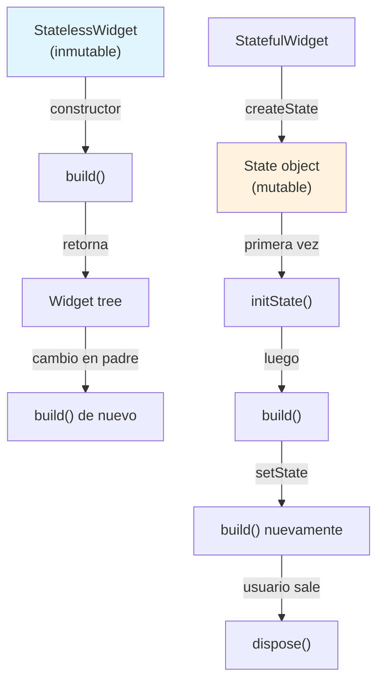
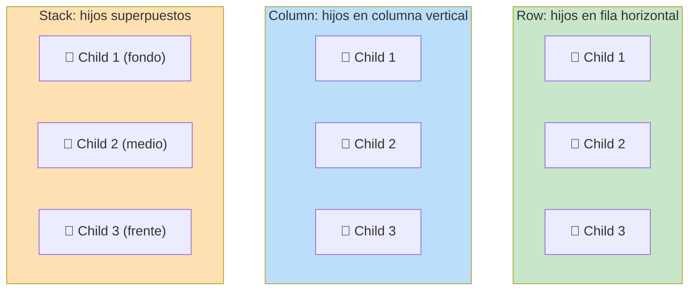
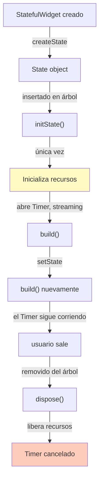
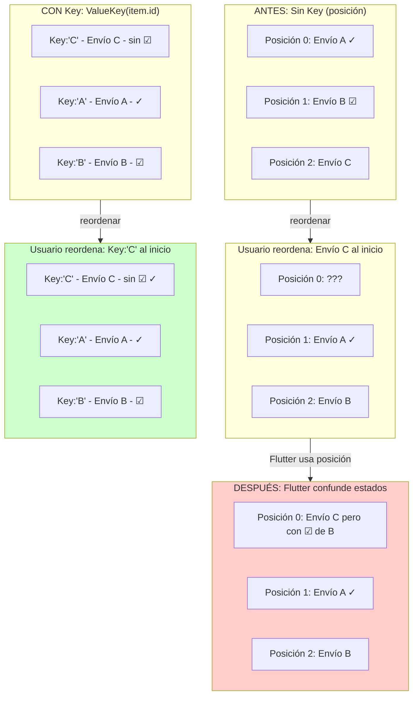
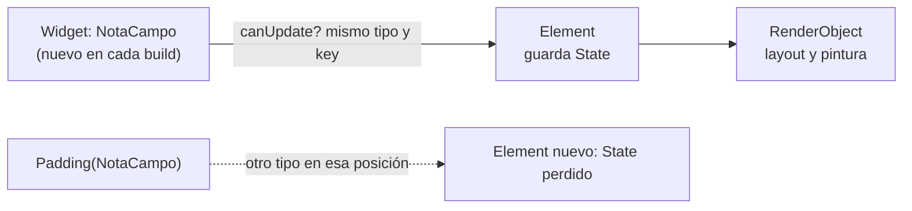
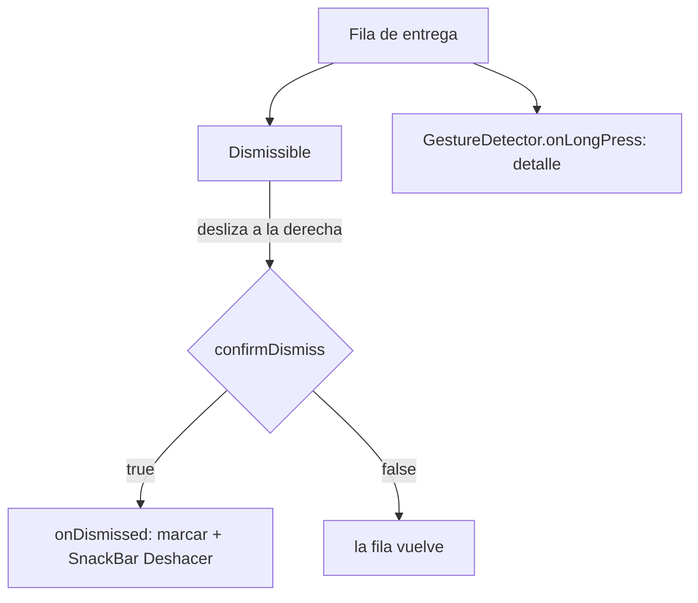

# Módulo 1: Widgets: stateless vs stateful


## Aprende construyendo


### Tema 1: StatelessWidget vs StatefulWidget · Básico · 35 min

<details open>
<summary><strong>Capa 1 — Lectura</strong></summary>

#### ► DE QUÉ TRATA
Al finalizar vas a extraer TarjetaEnvio (guía y estado de un envío) como StatelessWidget, y a construir ContadorIntentos como StatefulWidget con un contador local. Prerrequisitos: Módulo 0 completo.

#### ► LA IDEA EN UNA FRASE
**Al finalizar vas a extraer TarjetaEnvio (guía y estado de un envío) como StatelessWidget, y a construir ContadorIntentos como StatefulWidget con un contador local.**

#### ► POR QUÉ EXISTE ESTO
Resuelve un problema real de diseño o implementación y evita decisiones a ciegas.

#### ► LA ANALOGÍA
Piensa en statelesswidget vs statefulwidget como una herramienta de taller: útil cuando conoces su propósito y sus límites.
**Dónde se rompe la analogía:** en software, los efectos dependen del contexto, la escala y los trade-offs.

#### ► CÓMO FUNCIONA


#### ► LO QUE PUEDE SALIR MAL
| Síntoma | Causa probable | Arreglo |
|---|---|---|
| StatelessWidget vs StatefulWidget se aplica pero el resultado no mejora | Se usó sin medir el problema real | Mide antes y compara contra la alternativa simple |
| Aparece complejidad inesperada | Se adoptó la técnica sin comprender sus trade-offs | Vuelve a la sección de trade-offs y reduce el alcance |
| Falla en un caso límite | Se asumió un contexto que no se cumple | Prueba el caso límite y documenta cuándo NO usarlo |

#### ► TRADE-OFFS
| Opción | Cuándo usarla | Cuándo NO usarla |
|---|---|---|
| Usar StatelessWidget vs StatefulWidget | Cuando el problema coincide con su propósito y el beneficio es observable | Cuando agrega complejidad sin resolver un problema real |
| Alternativa más simple | Cuando el contexto es pequeño, estable o fácil de razonar | Cuando ya demostró no escalar o no cumplir el requisito |
| Postergar la decisión | Cuando falta evidencia del problema | Cuando el costo de esperar es mayor que el costo de probar |

#### ► CUÁNDO NO USAR ESTO
No uses statelesswidget vs statefulwidget por defecto. Aplícalo cuando el problema lo justifique y puedas verificar el beneficio; si una alternativa más simple resuelve igual, prefiérela.

#### ► DE VUELTA A LA ANALOGÍA
Volviendo a la analogía: statelesswidget vs statefulwidget funciona como el modelo inicial, pero recuerda dónde se rompe: en producción importan la evidencia, la escala y el costo de equivocarte.

#### ► LO QUE DEBES RECORDAR
- StatelessWidget vs StatefulWidget existe para resolver un problema específico.
- Mide antes de adoptar complejidad.
- Conoce el caso donde NO usarlo.
- Verifica con evidencia observable.

#### ► PREGUNTAS PARA PENSAR
1. ¿Qué problema concreto resuelve statelesswidget vs statefulwidget en tu contexto?
2. ¿Cómo sabrías que statelesswidget vs statefulwidget no está funcionando bien?
3. ¿Qué alternativa más simple considerarías antes de usar statelesswidget vs statefulwidget?

</details>

<details>
<summary><strong>Capa 2 — Construcción</strong></summary>

#### Código y verificación


```dart
class TarjetaTarea extends StatelessWidget {
  final String titulo;
  const TarjetaTarea({required this.titulo, super.key});
  Widget build(BuildContext context) => Text(titulo);
}

class Contador extends StatefulWidget {
  State<Contador> createState() => _ContadorState();
}

class _ContadorState extends State<Contador> {
  int valor = 0;
  Widget build(BuildContext context) => ElevatedButton(
    onPressed: () => setState(() => valor++), // dispara la reconstrucción de este widget
    child: Text("$valor"),
  );
}
```

```dart
import 'package:flutter/material.dart';

void main() => runApp(const MaterialApp(home: PantallaEnvio()));

class PantallaEnvio extends StatelessWidget {
  const PantallaEnvio({super.key});

  @override
  Widget build(BuildContext context) => Scaffold(
        appBar: AppBar(title: const Text('Envío del día')),
        body: const Column(
          children: [
            TarjetaEnvio(guia: 'RF-4471', estado: 'En ruta'),
            ContadorIntentos(),
          ],
        ),
      );
}

class TarjetaEnvio extends StatelessWidget {
  final String guia;
  final String estado;
  const TarjetaEnvio({required this.guia, required this.estado, super.key});

  @override
  Widget build(BuildContext context) => ListTile(title: Text(guia), subtitle: Text(estado));
}

class ContadorIntentos extends StatefulWidget {
  const ContadorIntentos({super.key});

  @override
  State<ContadorIntentos> createState() => _ContadorIntentosState();
}

class _ContadorIntentosState extends State<ContadorIntentos> {
  int intentos = 0;

  @override
  Widget build(BuildContext context) => ElevatedButton(
        onPressed: () => setState(() => intentos++),
        child: Text('Intentos: $intentos'),
      );
}
```

```bash
flutter create demo_flutter
cd demo_flutter
flutter run
```

</details>

### Tema 2: Layout con Row, Column y Stack, y ciclo de vida · Intermedio · 40 min

<details open>
<summary><strong>Capa 1 — Lectura</strong></summary>

#### ► DE QUÉ TRATA
Al finalizar vas a componer TarjetaEnvio con Row/Stack para mostrar un ícono de "urgente" superpuesto, y a usar initState/dispose para gestionar un timer que refresca el tiempo relativo de la lista. Prerrequisitos: Tema 1 de este módulo.

#### ► LA IDEA EN UNA FRASE
**Al finalizar vas a componer TarjetaEnvio con Row/Stack para mostrar un ícono de "urgente" superpuesto, y a usar initState/dispose para gestionar un timer que refresca el tiempo relativo de la lista.**

#### ► POR QUÉ EXISTE ESTO
Resuelve un problema real de diseño o implementación y evita decisiones a ciegas.

#### ► LA ANALOGÍA
Piensa en layout con row, column y stack, y ciclo de vida como una herramienta de taller: útil cuando conoces su propósito y sus límites.
**Dónde se rompe la analogía:** en software, los efectos dependen del contexto, la escala y los trade-offs.

#### ► CÓMO FUNCIONA


#### ► LO QUE PUEDE SALIR MAL
| Síntoma | Causa probable | Arreglo |
|---|---|---|
| Layout con Row, Column y Stack, y ciclo de vida se aplica pero el resultado no mejora | Se usó sin medir el problema real | Mide antes y compara contra la alternativa simple |
| Aparece complejidad inesperada | Se adoptó la técnica sin comprender sus trade-offs | Vuelve a la sección de trade-offs y reduce el alcance |
| Falla en un caso límite | Se asumió un contexto que no se cumple | Prueba el caso límite y documenta cuándo NO usarlo |

#### ► TRADE-OFFS
| Opción | Cuándo usarla | Cuándo NO usarla |
|---|---|---|
| Usar Layout con Row, Column y Stack, y ciclo de vida | Cuando el problema coincide con su propósito y el beneficio es observable | Cuando agrega complejidad sin resolver un problema real |
| Alternativa más simple | Cuando el contexto es pequeño, estable o fácil de razonar | Cuando ya demostró no escalar o no cumplir el requisito |
| Postergar la decisión | Cuando falta evidencia del problema | Cuando el costo de esperar es mayor que el costo de probar |

#### ► CUÁNDO NO USAR ESTO
No uses layout con row, column y stack, y ciclo de vida por defecto. Aplícalo cuando el problema lo justifique y puedas verificar el beneficio; si una alternativa más simple resuelve igual, prefiérela.

#### ► DE VUELTA A LA ANALOGÍA
Volviendo a la analogía: layout con row, column y stack, y ciclo de vida funciona como el modelo inicial, pero recuerda dónde se rompe: en producción importan la evidencia, la escala y el costo de equivocarte.

#### ► LO QUE DEBES RECORDAR
- Layout con Row, Column y Stack, y ciclo de vida existe para resolver un problema específico.
- Mide antes de adoptar complejidad.
- Conoce el caso donde NO usarlo.
- Verifica con evidencia observable.

#### ► PREGUNTAS PARA PENSAR
1. ¿Qué problema concreto resuelve layout con row, column y stack, y ciclo de vida en tu contexto?
2. ¿Cómo sabrías que layout con row, column y stack, y ciclo de vida no está funcionando bien?
3. ¿Qué alternativa más simple considerarías antes de usar layout con row, column y stack, y ciclo de vida?

</details>

<details>
<summary><strong>Capa 2 — Construcción</strong></summary>

#### Código y verificación




```dart
Column(children: [
  Row(children: [Text("Izquierda"), Spacer(), Text("Derecha")]),
  Stack(children: [Image.asset("fondo.png"), Text("Superpuesto")]),
])
```

```dart
// lib/main.dart (archivo completo)
import 'dart:async';

import 'package:flutter/material.dart';

void main() => runApp(const MaterialApp(home: ListaEnvios()));

class ListaEnvios extends StatefulWidget {
  const ListaEnvios({super.key});

  @override
  State<ListaEnvios> createState() => _ListaEnviosState();
}

class _ListaEnviosState extends State<ListaEnvios> {
  static const guia = 'RF-4471';
  static const estado = 'En ruta';
  static const urgente = true;
  Timer? _timer;

  @override
  void initState() {
    super.initState();
    _timer = Timer.periodic(const Duration(minutes: 1), (_) => setState(() {}));
  }

  @override
  void dispose() {
    _timer?.cancel();
    super.dispose();
  }

  @override
  Widget build(BuildContext context) {
    return Scaffold(
      body: SafeArea(
        child: Stack(
          children: [
            const Row(children: [Text(guia), Spacer(), Text(estado)]),
            if (urgente)
              const Positioned(top: 0, right: 0, child: Icon(Icons.priority_high)),
          ],
        ),
      ),
    );
  }
}
```

```bash
flutter create demo_flutter
cd demo_flutter
flutter run
```

</details>

### Tema 3: Keys · Intermedio · 35 min

<details open>
<summary><strong>Capa 1 — Lectura</strong></summary>

#### ► DE QUÉ TRATA
Al finalizar vas a corregir un bug de identidad en ListaEnvios reordenable, donde el estado de un checkbox "revisado" por fila se confunde al reordenar, usando ValueKey basada en el id del envío. Prerrequisitos: Tema 2 de este módulo.

#### ► LA IDEA EN UNA FRASE
**Al finalizar vas a corregir un bug de identidad en ListaEnvios reordenable, donde el estado de un checkbox "revisado" por fila se confunde al reordenar, usando ValueKey basada en el id del envío.**

#### ► POR QUÉ EXISTE ESTO
Resuelve un problema real de diseño o implementación y evita decisiones a ciegas.

#### ► LA ANALOGÍA
Piensa en keys como una herramienta de taller: útil cuando conoces su propósito y sus límites.
**Dónde se rompe la analogía:** en software, los efectos dependen del contexto, la escala y los trade-offs.

#### ► CÓMO FUNCIONA


#### ► LO QUE PUEDE SALIR MAL
| Síntoma | Causa probable | Arreglo |
|---|---|---|
| Keys se aplica pero el resultado no mejora | Se usó sin medir el problema real | Mide antes y compara contra la alternativa simple |
| Aparece complejidad inesperada | Se adoptó la técnica sin comprender sus trade-offs | Vuelve a la sección de trade-offs y reduce el alcance |
| Falla en un caso límite | Se asumió un contexto que no se cumple | Prueba el caso límite y documenta cuándo NO usarlo |

#### ► TRADE-OFFS
| Opción | Cuándo usarla | Cuándo NO usarla |
|---|---|---|
| Usar Keys | Cuando el problema coincide con su propósito y el beneficio es observable | Cuando agrega complejidad sin resolver un problema real |
| Alternativa más simple | Cuando el contexto es pequeño, estable o fácil de razonar | Cuando ya demostró no escalar o no cumplir el requisito |
| Postergar la decisión | Cuando falta evidencia del problema | Cuando el costo de esperar es mayor que el costo de probar |

#### ► CUÁNDO NO USAR ESTO
No uses keys por defecto. Aplícalo cuando el problema lo justifique y puedas verificar el beneficio; si una alternativa más simple resuelve igual, prefiérela.

#### ► DE VUELTA A LA ANALOGÍA
Volviendo a la analogía: keys funciona como el modelo inicial, pero recuerda dónde se rompe: en producción importan la evidencia, la escala y el costo de equivocarte.

#### ► LO QUE DEBES RECORDAR
- Keys existe para resolver un problema específico.
- Mide antes de adoptar complejidad.
- Conoce el caso donde NO usarlo.
- Verifica con evidencia observable.

#### ► PREGUNTAS PARA PENSAR
1. ¿Qué problema concreto resuelve keys en tu contexto?
2. ¿Cómo sabrías que keys no está funcionando bien?
3. ¿Qué alternativa más simple considerarías antes de usar keys?

</details>

<details>
<summary><strong>Capa 2 — Construcción</strong></summary>

#### Código y verificación


```dart
ListView(children: items.map((item) => TarjetaTarea(key: ValueKey(item.id), titulo: item.titulo)).toList())
```

```dart
items.map((item) => TarjetaTarea(key: ValueKey(item.id), titulo: item.titulo)).toList()
// La Key vincula el widget a la IDENTIDAD del dato, no a su posición en la lista
```

```dart
import 'package:flutter/material.dart';

void main() => runApp(const MaterialApp(home: ListaReordenable()));

class Envio {
  const Envio(this.id, this.guia, this.estado);
  final String id;
  final String guia;
  final String estado;
}

class ListaReordenable extends StatefulWidget {
  const ListaReordenable({super.key});

  @override
  State<ListaReordenable> createState() => _ListaReordenableState();
}

class _ListaReordenableState extends State<ListaReordenable> {
  final envios = [
    const Envio('e1', 'RF-4471', 'En ruta'),
    const Envio('e2', 'RF-5002', 'Asignado'),
    const Envio('e3', 'RF-5310', 'Urgente'),
  ];

  void mover(int desde, int hasta) {
    setState(() {
      final destino = hasta > desde ? hasta - 1 : hasta;
      envios.insert(destino, envios.removeAt(desde));
    });
  }

  @override
  Widget build(BuildContext context) => Scaffold(
        appBar: AppBar(title: const Text('Envíos')),
        body: ReorderableListView(
          onReorder: mover,
          children: envios
              .map((e) => TarjetaEnvio(key: ValueKey(e.id), guia: e.guia, estado: e.estado))
              .toList(),
        ),
      );
}

class TarjetaEnvio extends StatefulWidget {
  const TarjetaEnvio({required this.guia, required this.estado, super.key});
  final String guia;
  final String estado;

  @override
  State<TarjetaEnvio> createState() => _TarjetaEnvioState();
}

class _TarjetaEnvioState extends State<TarjetaEnvio> {
  bool revisado = false; // estado de la fila: debe seguir al envío al reordenar

  @override
  Widget build(BuildContext context) => CheckboxListTile(
        title: Text(widget.guia),
        subtitle: Text(widget.estado),
        value: revisado,
        onChanged: (valor) => setState(() => revisado = valor ?? false),
      );
}
```

```bash
flutter create demo_flutter
cd demo_flutter
flutter run
```

</details>

### Tema 4: Los tres árboles de Flutter: Widget, Element y RenderObject · Avanzado · 45 min

<details open>
<summary><strong>Capa 1 — Lectura</strong></summary>

#### ► DE QUÉ TRATA
Crea flutter create tres_arboles y reemplaza lib/main.dart con el código del tema. Ejecuta en cualquier dispositivo o en Chrome.

#### ► LA IDEA EN UNA FRASE
**Crea flutter create tres_arboles y reemplaza lib/main.dart con el código del tema.**

#### ► POR QUÉ EXISTE ESTO
Resuelve un problema real de diseño o implementación y evita decisiones a ciegas.

#### ► LA ANALOGÍA
Piensa en los tres árboles de flutter: widget, element y renderobject como una herramienta de taller: útil cuando conoces su propósito y sus límites.
**Dónde se rompe la analogía:** en software, los efectos dependen del contexto, la escala y los trade-offs.

#### ► CÓMO FUNCIONA


#### ► LO QUE PUEDE SALIR MAL
| Síntoma | Causa probable | Arreglo |
|---|---|---|
| Los tres árboles de Flutter: Widget, Element y RenderObject se aplica pero el resultado no mejora | Se usó sin medir el problema real | Mide antes y compara contra la alternativa simple |
| Aparece complejidad inesperada | Se adoptó la técnica sin comprender sus trade-offs | Vuelve a la sección de trade-offs y reduce el alcance |
| Falla en un caso límite | Se asumió un contexto que no se cumple | Prueba el caso límite y documenta cuándo NO usarlo |

#### ► TRADE-OFFS
| Opción | Cuándo usarla | Cuándo NO usarla |
|---|---|---|
| Usar Los tres árboles de Flutter: Widget, Element y RenderObject | Cuando el problema coincide con su propósito y el beneficio es observable | Cuando agrega complejidad sin resolver un problema real |
| Alternativa más simple | Cuando el contexto es pequeño, estable o fácil de razonar | Cuando ya demostró no escalar o no cumplir el requisito |
| Postergar la decisión | Cuando falta evidencia del problema | Cuando el costo de esperar es mayor que el costo de probar |

#### ► CUÁNDO NO USAR ESTO
No uses los tres árboles de flutter: widget, element y renderobject por defecto. Aplícalo cuando el problema lo justifique y puedas verificar el beneficio; si una alternativa más simple resuelve igual, prefiérela.

#### ► DE VUELTA A LA ANALOGÍA
Volviendo a la analogía: los tres árboles de flutter: widget, element y renderobject funciona como el modelo inicial, pero recuerda dónde se rompe: en producción importan la evidencia, la escala y el costo de equivocarte.

#### ► LO QUE DEBES RECORDAR
- Los tres árboles de Flutter: Widget, Element y RenderObject existe para resolver un problema específico.
- Mide antes de adoptar complejidad.
- Conoce el caso donde NO usarlo.
- Verifica con evidencia observable.

#### ► PREGUNTAS PARA PENSAR
1. ¿Qué problema concreto resuelve los tres árboles de flutter: widget, element y renderobject en tu contexto?
2. ¿Cómo sabrías que los tres árboles de flutter: widget, element y renderobject no está funcionando bien?
3. ¿Qué alternativa más simple considerarías antes de usar los tres árboles de flutter: widget, element y renderobject?

</details>

<details>
<summary><strong>Capa 2 — Construcción</strong></summary>

#### Código y verificación


```dart
import 'package:flutter/material.dart';

void main() => runApp(const MaterialApp(home: Demo()));

class Demo extends StatefulWidget {
  const Demo({super.key});
  @override
  State<Demo> createState() => _DemoState();
}

class _DemoState extends State<Demo> {
  bool conMargen = false;
  @override
  Widget build(BuildContext context) {
    const campo = NotaCampo();
    return Scaffold(
      body: Center(
        // Mismo lugar, distinto tipo según conMargen: el Element se reemplaza.
        child: conMargen ? const Padding(padding: EdgeInsets.all(16), child: campo) : campo,
      ),
      floatingActionButton: FloatingActionButton(
        onPressed: () => setState(() => conMargen = !conMargen),
        child: const Icon(Icons.swap_horiz),
      ),
    );
  }
}

class NotaCampo extends StatefulWidget {
  const NotaCampo({super.key});
  @override
  State<NotaCampo> createState() {
    debugPrint('createState: nuevo Element y nuevo State');
    return _NotaCampoState();
  }
}

class _NotaCampoState extends State<NotaCampo> {
  final controlador = TextEditingController();
  @override
  Widget build(BuildContext context) {
    debugPrint('build con texto "${controlador.text}"');
    return SizedBox(width: 240, child: TextField(controller: controlador));
  }
  @override
  void dispose() {
    debugPrint('dispose: el State se pierde');
    controlador.dispose();
    super.dispose();
  }
}
```

```bash
cd tres_arboles
flutter run -d chrome
# escribe "portería" en el campo y pulsa el botón flotante
```

```text
Al iniciar: createState: nuevo Element y nuevo State / build con texto ""
Tras escribir "portería" y pulsar el botón: dispose: el State se pierde / createState: nuevo Element y nuevo State / build con texto ""
El campo aparece vacío.
```

</details>

### Tema 5: Gestos en Flutter: GestureDetector, Dismissible y la arena de gestos · Avanzado · 40 min

<details open>
<summary><strong>Capa 1 — Lectura</strong></summary>

#### ► DE QUÉ TRATA
Continúa un proyecto Flutter (flutter create gestos_rutaflow). Escribe la lista en lib/main.dart.

#### ► LA IDEA EN UNA FRASE
**Continúa un proyecto Flutter (flutter create gestos_rutaflow).**

#### ► POR QUÉ EXISTE ESTO
Resuelve un problema real de diseño o implementación y evita decisiones a ciegas.

#### ► LA ANALOGÍA
**Conceptos clave:** `GestureDetector`, `onTap`, `onLongPress`, `onHorizontalDragUpdate`, arena de gestos, `Dismissible`, `confirmDismiss`, `SnackBar` con deshacer, `Semantics`.

`GestureDetector` envuelve un widget y llama callbacks por tipo de gesto. Cuando varios detectores podrían reconocer el mismo movimiento (un arrastre horizontal en una fila dentro de una lista vertical), compiten en la **arena de gestos**: cada uno observa el movimiento y el primero que lo reconoce con seguridad gana; los demás se retiran.

`Dismissible` ya resuelve el deslizamiento para descartar: anima la fila, llama `confirmDismiss` (puedes cancelar) y luego `onDismissed`. Necesita una `key` única por fila.

Toda acción por gesto necesita una alternativa accesible: un `Semantics` con acción personalizada o un botón en el detalle.

**Analogía:** la arena de gestos es una competencia de adivinanzas: varios jugadores miran el mismo movimiento y el primero que está seguro grita la respuesta. La analogía falla en que un jugador también puede rendirse antes de que otro gane.

**Límite de uso:** no ocultes acciones importantes solo en gestos. Las acciones de deslizar irreversibles necesitan confirmación o deshacer. Áreas táctiles menores a 48×48 dp fallan con dedos grandes.



**Dónde se rompe la analogía:** el modelo simplifica la realidad; en producción influyen escala, fallos, costo y contexto.

#### ► CÓMO FUNCIONA


#### ► LO QUE PUEDE SALIR MAL
| Síntoma | Causa probable | Arreglo |
|---|---|---|
| Gestos en Flutter: GestureDetector, Dismissible y la arena de gestos se aplica pero el resultado no mejora | Se usó sin medir el problema real | Mide antes y compara contra la alternativa simple |
| Aparece complejidad inesperada | Se adoptó la técnica sin comprender sus trade-offs | Vuelve a la sección de trade-offs y reduce el alcance |
| Falla en un caso límite | Se asumió un contexto que no se cumple | Prueba el caso límite y documenta cuándo NO usarlo |

#### ► TRADE-OFFS
| Opción | Cuándo usarla | Cuándo NO usarla |
|---|---|---|
| Usar Gestos en Flutter: GestureDetector, Dismissible y la arena de gestos | Cuando el problema coincide con su propósito y el beneficio es observable | Cuando agrega complejidad sin resolver un problema real |
| Alternativa más simple | Cuando el contexto es pequeño, estable o fácil de razonar | Cuando ya demostró no escalar o no cumplir el requisito |
| Postergar la decisión | Cuando falta evidencia del problema | Cuando el costo de esperar es mayor que el costo de probar |

#### ► CUÁNDO NO USAR ESTO
No uses gestos en flutter: gesturedetector, dismissible y la arena de gestos por defecto. Aplícalo cuando el problema lo justifique y puedas verificar el beneficio; si una alternativa más simple resuelve igual, prefiérela.

#### ► DE VUELTA A LA ANALOGÍA
Volviendo a la analogía: gestos en flutter: gesturedetector, dismissible y la arena de gestos funciona como el modelo inicial, pero recuerda dónde se rompe: en producción importan la evidencia, la escala y el costo de equivocarte.

#### ► LO QUE DEBES RECORDAR
- Gestos en Flutter: GestureDetector, Dismissible y la arena de gestos existe para resolver un problema específico.
- Mide antes de adoptar complejidad.
- Conoce el caso donde NO usarlo.
- Verifica con evidencia observable.

#### ► PREGUNTAS PARA PENSAR
1. ¿Qué problema concreto resuelve gestos en flutter: gesturedetector, dismissible y la arena de gestos en tu contexto?
2. ¿Cómo sabrías que gestos en flutter: gesturedetector, dismissible y la arena de gestos no está funcionando bien?
3. ¿Qué alternativa más simple considerarías antes de usar gestos en flutter: gesturedetector, dismissible y la arena de gestos?

</details>

<details>
<summary><strong>Capa 2 — Construcción</strong></summary>

#### Código y verificación


```dart
import 'package:flutter/material.dart';
import 'package:flutter/semantics.dart'; // CustomSemanticsAction

void main() => runApp(const MaterialApp(home: ListaEntregas()));

class ListaEntregas extends StatefulWidget {
  const ListaEntregas({super.key});
  @override
  State<ListaEntregas> createState() => _ListaEntregasState();
}

class _ListaEntregasState extends State<ListaEntregas> {
  final pendientes = ['ENV-41', 'ENV-42', 'ENV-43'];

  void marcar(String codigo, int indice) {
    setState(() => pendientes.removeAt(indice));
    ScaffoldMessenger.of(context).showSnackBar(SnackBar(
      content: Text('$codigo entregada'),
      action: SnackBarAction(
        label: 'Deshacer',
        onPressed: () => setState(() => pendientes.insert(indice, codigo)),
      ),
    ));
  }

  @override
  Widget build(BuildContext context) {
    return Scaffold(
      appBar: AppBar(title: Text('${pendientes.length} pendientes')),
      body: ListView.builder(
        itemCount: pendientes.length,
        itemBuilder: (context, i) {
          final codigo = pendientes[i];
          return Dismissible(
            key: ValueKey(codigo), // única por fila
            direction: DismissDirection.startToEnd,
            background: Container(color: Colors.green, alignment: Alignment.centerLeft,
                padding: const EdgeInsets.only(left: 24), child: const Icon(Icons.check, color: Colors.white)),
            onDismissed: (_) => marcar(codigo, i),
            child: Semantics(
              customSemanticsActions: {const CustomSemanticsAction(label: 'Marcar entregada'): () => marcar(codigo, i)},
              child: GestureDetector(
                onLongPress: () => showModalBottomSheet(context: context, builder: (_) => Text('Detalle de $codigo')),
                child: ListTile(title: Text(codigo), subtitle: const Text('Desliza para marcar')),
              ),
            ),
          );
        },
      ),
    );
  }
}
```

```bash
cd gestos_rutaflow
flutter run
```

```text
Deslizar ENV-42 a la derecha: la fila desaparece, el título cambia a «2 pendientes» y aparece «ENV-42 entregada» con «Deshacer».
Pulsar «Deshacer»: ENV-42 vuelve a su lugar y el título vuelve a «3 pendientes».
Mantener presionada una fila abre la hoja con su detalle.
```

```bash
flutter create demo_flutter
cd demo_flutter
flutter run -d chrome  # o -d emulator-5554, -d iPad, etc
```

</details>
