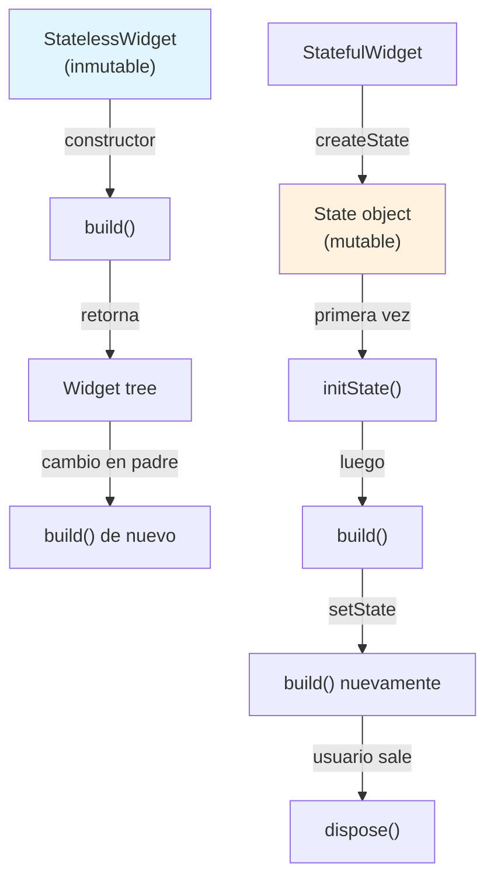
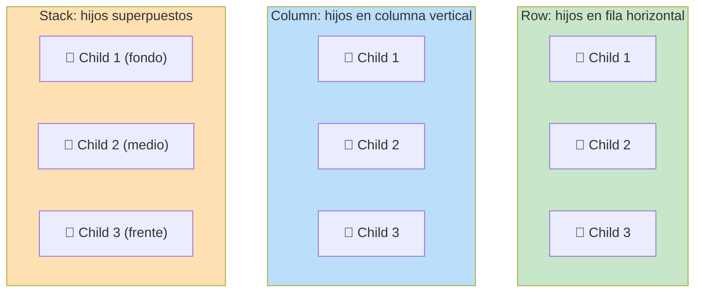
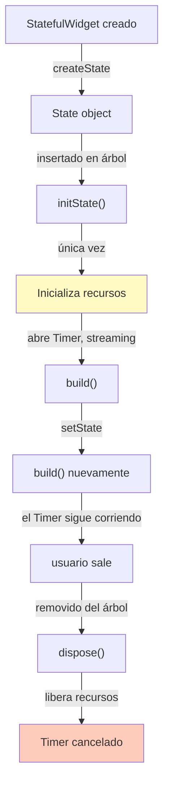
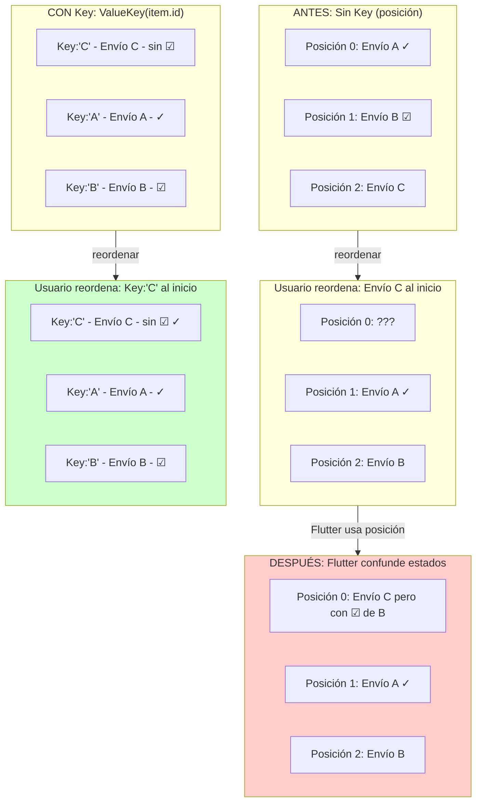
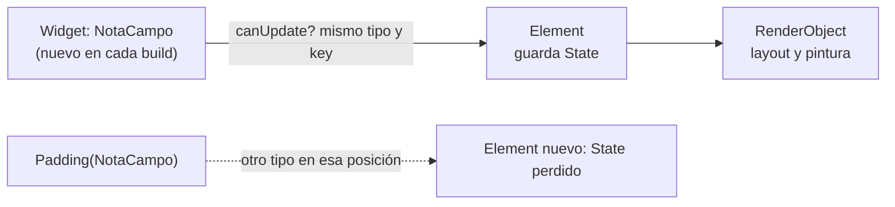
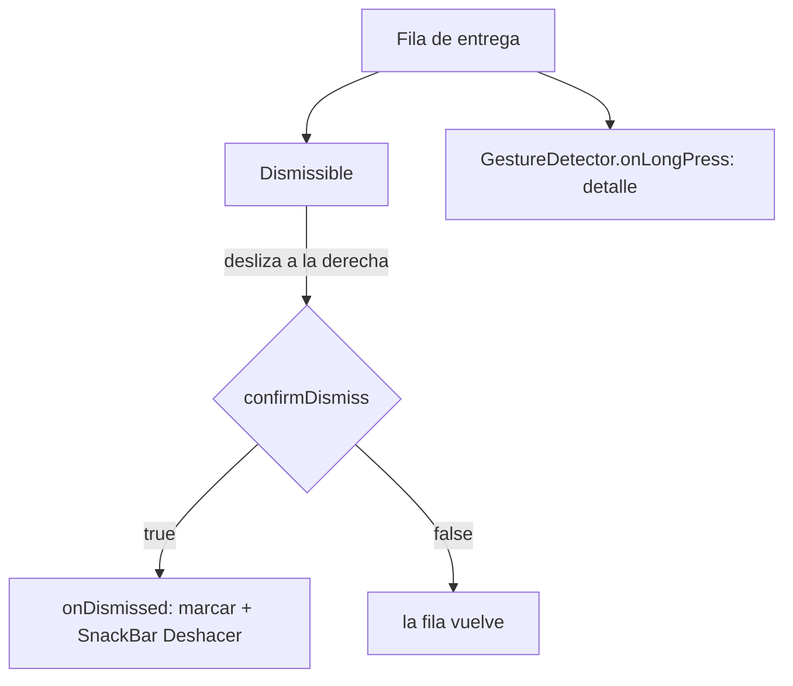

# Módulo 1: Widgets: stateless vs stateful


## Aprende construyendo


### Tema 1: StatelessWidget vs StatefulWidget · Básico · 35 min

<details open>
<summary><strong>Capa 1 — Lectura</strong></summary>

#### ► DE QUÉ TRATA
Al finalizar vas a extraer TarjetaEnvio (guía y estado de un envío) como StatelessWidget, y a construir ContadorIntentos como StatefulWidget con un contador local. Prerrequisitos: Módulo 0 completo.

#### ► POR QUÉ EXISTE
Flutter vuelve a llamar a `build()` muchas veces: cuando cambia el padre, el tema o el tamaño de pantalla. Si un dato vive dentro del widget, se perdería en cada reconstrucción, porque el widget es un objeto nuevo cada vez. `StatefulWidget` separa las dos cosas: el widget sigue siendo una descripción inmutable y desechable, y el `State` es un objeto que Flutter conserva entre reconstrucciones. Así el contador de intentos sobrevive aunque `PantallaEnvio` se reconstruya, y `TarjetaEnvio` no carga con estado que no necesita.

#### ► CÓMO FUNCIONA


#### ► REGLA PRÁCTICA
Usa `StatefulWidget` cuando el widget necesita datos propios que sobrevivan entre reconstrucciones (`setState`) y un ciclo de vida que gestionar (`initState`/`dispose`); si solo refleja datos que recibe desde afuera y se reconstruye cuando cambia su padre, `StatelessWidget` basta y es más simple.

#### ► LO QUE PUEDE SALIR MAL
| Síntoma | Causa | Arreglo |
|---|---|---|
| El contador vuelve a 0 al rotar o al cambiar algo del padre | El valor se guardó en un campo del widget, no del `State` | Mueve el campo a la clase `_ContadorIntentosState` |
| Cambias la variable y la pantalla no se actualiza | Se modificó el valor fuera de `setState` | Envuelve el cambio: `setState(() => intentos++)` |
| `setState() called after dispose()` en consola | Un `Future` o `Timer` termina después de que el widget salió del árbol | Comprueba `if (!mounted) return;` antes de `setState` y cancela el temporizador en `dispose` |
| Toda la pantalla se reconstruye por un solo botón | El estado se puso en el widget más alto | Baja el estado al widget más pequeño que lo usa |

#### ► PREGUNTAS PARA PENSAR
1. `TarjetaEnvio` recibe `guia` y `estado` del padre. ¿Por qué no necesita ser `StatefulWidget` aunque el estado del envío cambie durante el día?
2. Si el contador de intentos tuviera que verse también en la barra superior, ¿dónde pondrías ese dato y por qué ya no sirve un `State` local?
3. ¿Qué pasaría con el valor del contador si cambias la `key` de `ContadorIntentos` en cada `build()`?

</details>

<details>
<summary><strong>Capa 2 — Construcción</strong></summary>

#### Código y verificación

```dart
class TarjetaTarea extends StatelessWidget {
  final String titulo;
  const TarjetaTarea({required this.titulo, super.key});
  Widget build(BuildContext context) => Text(titulo);
}

class Contador extends StatefulWidget {
  State<Contador> createState() => _ContadorState();
}

class _ContadorState extends State<Contador> {
  int valor = 0;
  Widget build(BuildContext context) => ElevatedButton(
    onPressed: () => setState(() => valor++), // dispara la reconstrucción de este widget
    child: Text("$valor"),
  );
}
```

```dart
import 'package:flutter/material.dart';

void main() => runApp(const MaterialApp(home: PantallaEnvio()));

class PantallaEnvio extends StatelessWidget {
  const PantallaEnvio({super.key});

  @override
  Widget build(BuildContext context) => Scaffold(
        appBar: AppBar(title: const Text('Envío del día')),
        body: const Column(
          children: [
            TarjetaEnvio(guia: 'RF-4471', estado: 'En ruta'),
            ContadorIntentos(),
          ],
        ),
      );
}

class TarjetaEnvio extends StatelessWidget {
  final String guia;
  final String estado;
  const TarjetaEnvio({required this.guia, required this.estado, super.key});

  @override
  Widget build(BuildContext context) => ListTile(title: Text(guia), subtitle: Text(estado));
}

class ContadorIntentos extends StatefulWidget {
  const ContadorIntentos({super.key});

  @override
  State<ContadorIntentos> createState() => _ContadorIntentosState();
}

class _ContadorIntentosState extends State<ContadorIntentos> {
  int intentos = 0;

  @override
  Widget build(BuildContext context) => ElevatedButton(
        onPressed: () => setState(() => intentos++),
        child: Text('Intentos: $intentos'),
      );
}
```

```bash
flutter create demo_flutter
cd demo_flutter
flutter run
```

</details>

### Tema 2: Layout con Row, Column y Stack, y ciclo de vida · Intermedio · 40 min

<details open>
<summary><strong>Capa 1 — Lectura</strong></summary>

#### ► DE QUÉ TRATA
Al finalizar vas a componer TarjetaEnvio con Row/Stack para mostrar un ícono de "urgente" superpuesto, y a usar initState/dispose para gestionar un timer que refresca el tiempo relativo de la lista. Prerrequisitos: Tema 1 de este módulo.

#### ► POR QUÉ EXISTE
Una pantalla real mezcla tres necesidades de acomodo: elementos en fila (guía y estado), en columna (lista de envíos) y uno encima de otro (el ícono de urgente sobre la tarjeta). `Row`, `Column` y `Stack` cubren esos tres casos con reglas simples y predecibles, sin coordenadas fijas que se rompen en otra pantalla. El ciclo de vida existe por la otra mitad del tema: un `Timer` o una suscripción siguen vivos aunque la pantalla desaparezca. `initState` es el único lugar donde crearlos una sola vez y `dispose` el lugar obligatorio para liberarlos.

#### ► CÓMO FUNCIONA


#### ► LO QUE PUEDE SALIR MAL
| Síntoma | Causa | Arreglo |
|---|---|---|
| Franja amarilla y negra «RenderFlex overflowed» | Los hijos de un `Row` miden más que el ancho disponible | Envuelve el texto largo en `Expanded` o `Flexible` y usa `overflow: TextOverflow.ellipsis` |
| El ícono de urgente aparece en la esquina equivocada | Un hijo de `Stack` sin posición se alinea arriba a la izquierda | Usa `Positioned(top: 4, right: 4, child: ...)` |
| La app se vuelve lenta tras abrir y cerrar la lista varias veces | El `Timer.periodic` se creó y nunca se canceló | Guarda el temporizador en un campo y llama `_timer.cancel()` en `dispose` |
| El temporizador se duplica en cada `build` | Se creó dentro de `build()` | Créalo solo en `initState` |

#### ► REGLA PRÁCTICA
Elige el contenedor por la relación entre elementos: lado a lado → `Row`, uno bajo otro → `Column`, uno encima de otro → `Stack`. Todo recurso que abras en `initState` (temporizador, controlador, suscripción) se cierra en `dispose`, en orden inverso.

#### ► PREGUNTAS PARA PENSAR
1. La tarjeta muestra una guía muy larga y aparece el aviso de overflow. ¿Qué cambiarías: el `Row`, el `Text` o ambos?
2. ¿Por qué crear el `Timer` en `build()` produce varios temporizadores a la vez?
3. Si la lista se muestra dentro de un `TabBarView` y el usuario cambia de pestaña, ¿se llama `dispose`? ¿Cómo lo comprobarías con un `print`?

</details>

<details>
<summary><strong>Capa 2 — Construcción</strong></summary>

#### Código y verificación




```dart
Column(children: [
  Row(children: [Text("Izquierda"), Spacer(), Text("Derecha")]),
  Stack(children: [Image.asset("fondo.png"), Text("Superpuesto")]),
])
```

```dart
// lib/main.dart (archivo completo)
import 'dart:async';

import 'package:flutter/material.dart';

void main() => runApp(const MaterialApp(home: ListaEnvios()));

class ListaEnvios extends StatefulWidget {
  const ListaEnvios({super.key});

  @override
  State<ListaEnvios> createState() => _ListaEnviosState();
}

class _ListaEnviosState extends State<ListaEnvios> {
  static const guia = 'RF-4471';
  static const estado = 'En ruta';
  static const urgente = true;
  Timer? _timer;

  @override
  void initState() {
    super.initState();
    _timer = Timer.periodic(const Duration(minutes: 1), (_) => setState(() {}));
  }

  @override
  void dispose() {
    _timer?.cancel();
    super.dispose();
  }

  @override
  Widget build(BuildContext context) {
    return Scaffold(
      body: SafeArea(
        child: Stack(
          children: [
            const Row(children: [Text(guia), Spacer(), Text(estado)]),
            if (urgente)
              const Positioned(top: 0, right: 0, child: Icon(Icons.priority_high)),
          ],
        ),
      ),
    );
  }
}
```

```bash
flutter create demo_flutter
cd demo_flutter
flutter run
```

</details>

### Tema 3: Keys · Intermedio · 35 min

<details open>
<summary><strong>Capa 1 — Lectura</strong></summary>

#### ► DE QUÉ TRATA
Al finalizar vas a corregir un bug de identidad en ListaEnvios reordenable, donde el estado de un checkbox "revisado" por fila se confunde al reordenar, usando ValueKey basada en el id del envío. Prerrequisitos: Tema 2 de este módulo.

#### ► POR QUÉ EXISTE
Cuando Flutter reconstruye una lista, empareja los widgets nuevos con los elementos anteriores por **tipo y posición**. Si todas las filas son del mismo tipo y el usuario reordena, Flutter cree que la fila 0 sigue siendo la fila 0 y le deja el `State` anterior: el check de «revisado» se queda en la posición, no en el envío. Las keys existen para cambiar esa regla: con `ValueKey(envio.id)` el emparejamiento se hace por identidad del dato, y cada `State` viaja con su envío.

#### ► CÓMO FUNCIONA


#### ► LO QUE PUEDE SALIR MAL
| Síntoma | Causa | Arreglo |
|---|---|---|
| Al reordenar, el check aparece en otro envío | Filas con estado propio sin `key` | Agrega `key: ValueKey(envio.id)` a cada fila |
| El estado se pierde en cada reconstrucción | Se usó `UniqueKey()` dentro de `build()`: cada build crea una identidad nueva | Usa una key estable derivada del dato (`ValueKey`, `ObjectKey`) |
| Error «Duplicate keys found» | Dos filas comparten la misma key (por ejemplo, el mismo id) | Garantiza que el id sea único o combina campos |
| `ReorderableListView` falla al construir | Sus hijos directos no tienen key | Pon la key en el widget que devuelve `itemBuilder`, no en uno interno |

#### ► REGLA PRÁCTICA
Si una lista puede reordenarse, filtrarse o insertar elementos en medio, y sus filas tienen estado propio, cada fila lleva `ValueKey` con el id del dato. Una lista estática sin estado por fila no necesita keys.

#### ► PREGUNTAS PARA PENSAR
1. ¿Por qué el bug no aparece si las filas son `StatelessWidget` sin estado propio?
2. ¿Qué diferencia hay entre usar `ValueKey(envio.id)` y `ValueKey(index)` al reordenar?
3. Cuando borras un envío de la mitad de la lista, ¿qué fila hereda el estado si no hay keys?

</details>

<details>
<summary><strong>Capa 2 — Construcción</strong></summary>

#### Código y verificación


```dart
ListView(children: items.map((item) => TarjetaTarea(key: ValueKey(item.id), titulo: item.titulo)).toList())
```

```dart
items.map((item) => TarjetaTarea(key: ValueKey(item.id), titulo: item.titulo)).toList()
// La Key vincula el widget a la IDENTIDAD del dato, no a su posición en la lista
```

```dart
import 'package:flutter/material.dart';

void main() => runApp(const MaterialApp(home: ListaReordenable()));

class Envio {
  const Envio(this.id, this.guia, this.estado);
  final String id;
  final String guia;
  final String estado;
}

class ListaReordenable extends StatefulWidget {
  const ListaReordenable({super.key});

  @override
  State<ListaReordenable> createState() => _ListaReordenableState();
}

class _ListaReordenableState extends State<ListaReordenable> {
  final envios = [
    const Envio('e1', 'RF-4471', 'En ruta'),
    const Envio('e2', 'RF-5002', 'Asignado'),
    const Envio('e3', 'RF-5310', 'Urgente'),
  ];

  void mover(int desde, int hasta) {
    setState(() {
      final destino = hasta > desde ? hasta - 1 : hasta;
      envios.insert(destino, envios.removeAt(desde));
    });
  }

  @override
  Widget build(BuildContext context) => Scaffold(
        appBar: AppBar(title: const Text('Envíos')),
        body: ReorderableListView(
          onReorder: mover,
          children: envios
              .map((e) => TarjetaEnvio(key: ValueKey(e.id), guia: e.guia, estado: e.estado))
              .toList(),
        ),
      );
}

class TarjetaEnvio extends StatefulWidget {
  const TarjetaEnvio({required this.guia, required this.estado, super.key});
  final String guia;
  final String estado;

  @override
  State<TarjetaEnvio> createState() => _TarjetaEnvioState();
}

class _TarjetaEnvioState extends State<TarjetaEnvio> {
  bool revisado = false; // estado de la fila: debe seguir al envío al reordenar

  @override
  Widget build(BuildContext context) => CheckboxListTile(
        title: Text(widget.guia),
        subtitle: Text(widget.estado),
        value: revisado,
        onChanged: (valor) => setState(() => revisado = valor ?? false),
      );
}
```

```bash
flutter create demo_flutter
cd demo_flutter
flutter run
```

</details>

### Tema 4: Los tres árboles de Flutter: Widget, Element y RenderObject · Avanzado · 45 min

<details open>
<summary><strong>Capa 1 — Lectura</strong></summary>

#### ► DE QUÉ TRATA
Crea flutter create tres_arboles y reemplaza lib/main.dart con el código del tema. Ejecuta en cualquier dispositivo o en Chrome.

#### ► POR QUÉ EXISTE
Los widgets son baratos y desechables porque Flutter no dibuja con ellos directamente. Detrás hay dos árboles más: el de **Element**, que guarda la posición y el `State`, y el de **RenderObject**, que calcula tamaños y pinta. Conocer esa separación explica comportamientos que de otro modo parecen aleatorios: por qué el texto de un campo desaparece al envolverlo en `Padding`, o por qué reconstruir mucho no siempre es lento.

#### ► CÓMO FUNCIONA


#### ► LO QUE PUEDE SALIR MAL
| Síntoma | Causa | Arreglo |
|---|---|---|
| Envuelves un campo en `Padding` de forma condicional y pierde lo escrito | En esa posición cambió el tipo de widget, así que Flutter crea un Element y un `State` nuevos | Mantén la misma estructura y cambia solo el valor (`padding: EdgeInsets.zero`), o usa una `GlobalKey` |
| Crees que reconstruir es caro y llenas el código de cachés | Se confunde reconstruir widgets con volver a pintar | Mide con DevTools: el layout y la pintura solo se repiten si cambian las propiedades del RenderObject |
| `context` apunta a un ancestro equivocado | El `BuildContext` es el Element del widget que llama, no el de sus hijos | Usa un `Builder` para obtener el contexto debajo del widget nuevo |

#### ► REGLA PRÁCTICA
Para conservar el estado, conserva la forma del árbol: mismo tipo de widget en la misma posición. Cambia propiedades, no la estructura.

#### ► PREGUNTAS PARA PENSAR
1. En el ejemplo del tema, ¿qué regla de `canUpdate` hace que `NotaCampo` pierda su `State`?
2. ¿Cuál de los tres árboles se recorre cuando cambias solo el color de un texto?
3. ¿Por qué `BuildContext` es en realidad un Element?

</details>

<details>
<summary><strong>Capa 2 — Construcción</strong></summary>

#### Código y verificación


```dart
import 'package:flutter/material.dart';

void main() => runApp(const MaterialApp(home: Demo()));

class Demo extends StatefulWidget {
  const Demo({super.key});
  @override
  State<Demo> createState() => _DemoState();
}

class _DemoState extends State<Demo> {
  bool conMargen = false;
  @override
  Widget build(BuildContext context) {
    const campo = NotaCampo();
    return Scaffold(
      body: Center(
        // Mismo lugar, distinto tipo según conMargen: el Element se reemplaza.
        child: conMargen ? const Padding(padding: EdgeInsets.all(16), child: campo) : campo,
      ),
      floatingActionButton: FloatingActionButton(
        onPressed: () => setState(() => conMargen = !conMargen),
        child: const Icon(Icons.swap_horiz),
      ),
    );
  }
}

class NotaCampo extends StatefulWidget {
  const NotaCampo({super.key});
  @override
  State<NotaCampo> createState() {
    debugPrint('createState: nuevo Element y nuevo State');
    return _NotaCampoState();
  }
}

class _NotaCampoState extends State<NotaCampo> {
  final controlador = TextEditingController();
  @override
  Widget build(BuildContext context) {
    debugPrint('build con texto "${controlador.text}"');
    return SizedBox(width: 240, child: TextField(controller: controlador));
  }
  @override
  void dispose() {
    debugPrint('dispose: el State se pierde');
    controlador.dispose();
    super.dispose();
  }
}
```

```bash
cd tres_arboles
flutter run -d chrome
# escribe "portería" en el campo y pulsa el botón flotante
```

```text
Al iniciar: createState: nuevo Element y nuevo State / build con texto ""
Tras escribir "portería" y pulsar el botón: dispose: el State se pierde / createState: nuevo Element y nuevo State / build con texto ""
El campo aparece vacío.
```

</details>

### Tema 5: Gestos en Flutter: GestureDetector, Dismissible y la arena de gestos · Avanzado · 40 min

<details open>
<summary><strong>Capa 1 — Lectura</strong></summary>

#### ► DE QUÉ TRATA
Continúa un proyecto Flutter (flutter create gestos_rutaflow). Escribe la lista en lib/main.dart.

#### ► POR QUÉ EXISTE
En el celular la mayoría de acciones son gestos, y varios detectores pueden querer el mismo movimiento: una fila que se desliza a la derecha vive dentro de una lista que se desplaza hacia abajo. Flutter resuelve el conflicto con la arena de gestos, donde cada detector compite y solo uno gana. Sin entenderla, los gestos parecen fallar «a veces»; con ella sabes por qué el deslizamiento horizontal convive con el scroll vertical.

#### ► LA ANALOGÍA
**Conceptos clave:** `GestureDetector`, `onTap`, `onLongPress`, `onHorizontalDragUpdate`, arena de gestos, `Dismissible`, `confirmDismiss`, `SnackBar` con deshacer, `Semantics`.

`GestureDetector` envuelve un widget y llama callbacks por tipo de gesto. Cuando varios detectores podrían reconocer el mismo movimiento (un arrastre horizontal en una fila dentro de una lista vertical), compiten en la **arena de gestos**: cada uno observa el movimiento y el primero que lo reconoce con seguridad gana; los demás se retiran.

`Dismissible` ya resuelve el deslizamiento para descartar: anima la fila, llama `confirmDismiss` (puedes cancelar) y luego `onDismissed`. Necesita una `key` única por fila.

Toda acción por gesto necesita una alternativa accesible: un `Semantics` con acción personalizada o un botón en el detalle.

**Analogía:** la arena de gestos es una competencia de adivinanzas: varios jugadores miran el mismo movimiento y el primero que está seguro grita la respuesta. La analogía falla en que un jugador también puede rendirse antes de que otro gane.

**Límite de uso:** no ocultes acciones importantes solo en gestos. Las acciones de deslizar irreversibles necesitan confirmación o deshacer. Áreas táctiles menores a 48×48 dp fallan con dedos grandes.



#### ► CÓMO FUNCIONA


#### ► LO QUE PUEDE SALIR MAL
| Síntoma | Causa | Arreglo |
|---|---|---|
| El `onTap` de la fila no responde cerca del borde | El área táctil es más pequeña que el contenido visible | Usa `behavior: HitTestBehavior.opaque` o un área mínima de 48×48 dp |
| Error «A dismissed Dismissible widget is still part of the tree» | Se descartó la fila pero no se quitó de la lista de datos | En `onDismissed` elimina el elemento con `setState` antes del siguiente build |
| Marcar entregado por error ya no tiene vuelta atrás | Acción irreversible sin confirmación | Usa `confirmDismiss` o un `SnackBar` con «Deshacer» |
| Un usuario con lector de pantalla no puede marcar entregas | La acción solo existe como gesto | Agrega `Semantics` con acción personalizada o un botón equivalente |

#### ► REGLA PRÁCTICA
Todo gesto importante tiene una alternativa visible o accesible, y todo gesto destructivo tiene confirmación o deshacer.

#### ► PREGUNTAS PARA PENSAR
1. En una lista vertical, ¿por qué un `Dismissible` horizontal no bloquea el scroll?
2. ¿Qué devuelve `confirmDismiss` para cancelar el deslizamiento y dejar la fila en su sitio?
3. ¿Cómo probarías el gesto de deslizar en un test de widget sin un dispositivo real?

</details>

<details>
<summary><strong>Capa 2 — Construcción</strong></summary>

#### Código y verificación


```dart
import 'package:flutter/material.dart';
import 'package:flutter/semantics.dart'; // CustomSemanticsAction

void main() => runApp(const MaterialApp(home: ListaEntregas()));

class ListaEntregas extends StatefulWidget {
  const ListaEntregas({super.key});
  @override
  State<ListaEntregas> createState() => _ListaEntregasState();
}

class _ListaEntregasState extends State<ListaEntregas> {
  final pendientes = ['ENV-41', 'ENV-42', 'ENV-43'];

  void marcar(String codigo, int indice) {
    setState(() => pendientes.removeAt(indice));
    ScaffoldMessenger.of(context).showSnackBar(SnackBar(
      content: Text('$codigo entregada'),
      action: SnackBarAction(
        label: 'Deshacer',
        onPressed: () => setState(() => pendientes.insert(indice, codigo)),
      ),
    ));
  }

  @override
  Widget build(BuildContext context) {
    return Scaffold(
      appBar: AppBar(title: Text('${pendientes.length} pendientes')),
      body: ListView.builder(
        itemCount: pendientes.length,
        itemBuilder: (context, i) {
          final codigo = pendientes[i];
          return Dismissible(
            key: ValueKey(codigo), // única por fila
            direction: DismissDirection.startToEnd,
            background: Container(color: Colors.green, alignment: Alignment.centerLeft,
                padding: const EdgeInsets.only(left: 24), child: const Icon(Icons.check, color: Colors.white)),
            onDismissed: (_) => marcar(codigo, i),
            child: Semantics(
              customSemanticsActions: {const CustomSemanticsAction(label: 'Marcar entregada'): () => marcar(codigo, i)},
              child: GestureDetector(
                onLongPress: () => showModalBottomSheet(context: context, builder: (_) => Text('Detalle de $codigo')),
                child: ListTile(title: Text(codigo), subtitle: const Text('Desliza para marcar')),
              ),
            ),
          );
        },
      ),
    );
  }
}
```

```bash
cd gestos_rutaflow
flutter run
```

```text
Deslizar ENV-42 a la derecha: la fila desaparece, el título cambia a «2 pendientes» y aparece «ENV-42 entregada» con «Deshacer».
Pulsar «Deshacer»: ENV-42 vuelve a su lugar y el título vuelve a «3 pendientes».
Mantener presionada una fila abre la hoja con su detalle.
```

```bash
flutter create demo_flutter
cd demo_flutter
flutter run -d chrome  # o -d emulator-5554, -d iPad, etc
```

</details>
