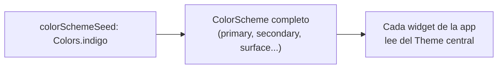
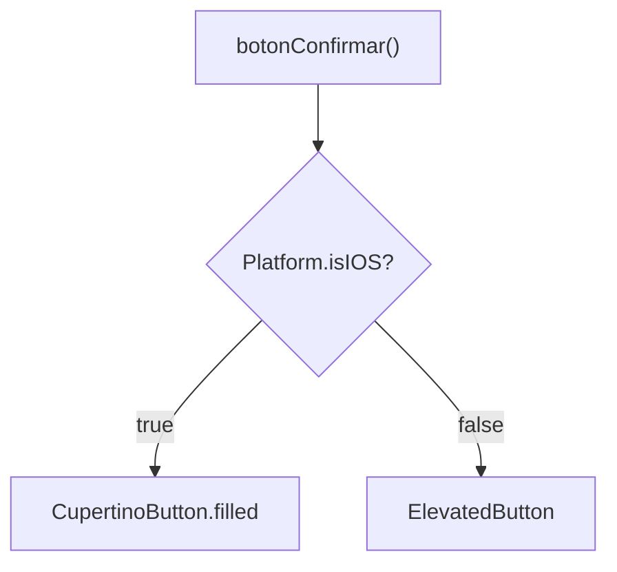
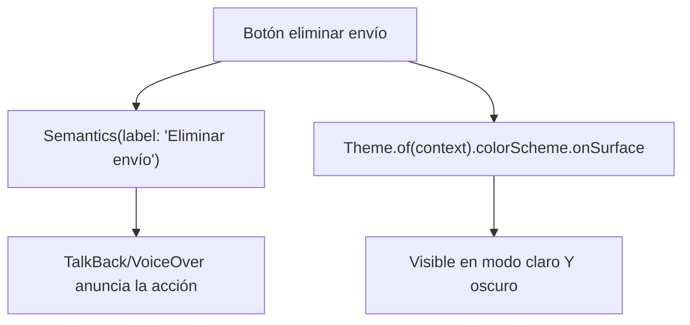

# Módulo 10: Theming, accesibilidad y Material/Cupertino


## Aprende construyendo


### Tema 1: ThemeData con Material 3 · Básico · 30 min

<details open>
<summary><strong>Capa 1 — Lectura</strong></summary>

#### ► DE QUÉ TRATA
Al finalizar vas a centralizar el ThemeData de RutaFlow con Material 3 y colorSchemeSeed, confirmando que un solo color base deriva un esquema completo coherente en toda la app. Prerrequisitos: Módulo 9 completo.

#### ► LA IDEA EN UNA FRASE
**Al finalizar vas a centralizar el ThemeData de RutaFlow con Material 3 y colorSchemeSeed, confirmando que un solo color base deriva un esquema completo coherente en toda la app.**

#### ► POR QUÉ EXISTE ESTO
Resuelve un problema real de diseño o implementación y evita decisiones a ciegas.

#### ► LA ANALOGÍA
Piensa en themedata con material 3 como una herramienta de taller: útil cuando conoces su propósito y sus límites.
**Dónde se rompe la analogía:** en software, los efectos dependen del contexto, la escala y los trade-offs.

#### ► CÓMO FUNCIONA


#### ► LO QUE PUEDE SALIR MAL
| Síntoma | Causa probable | Arreglo |
|---|---|---|
| ThemeData con Material 3 se aplica pero el resultado no mejora | Se usó sin medir el problema real | Mide antes y compara contra la alternativa simple |
| Aparece complejidad inesperada | Se adoptó la técnica sin comprender sus trade-offs | Vuelve a la sección de trade-offs y reduce el alcance |
| Falla en un caso límite | Se asumió un contexto que no se cumple | Prueba el caso límite y documenta cuándo NO usarlo |

#### ► TRADE-OFFS
| Opción | Cuándo usarla | Cuándo NO usarla |
|---|---|---|
| Usar ThemeData con Material 3 | Cuando el problema coincide con su propósito y el beneficio es observable | Cuando agrega complejidad sin resolver un problema real |
| Alternativa más simple | Cuando el contexto es pequeño, estable o fácil de razonar | Cuando ya demostró no escalar o no cumplir el requisito |
| Postergar la decisión | Cuando falta evidencia del problema | Cuando el costo de esperar es mayor que el costo de probar |

#### ► CUÁNDO NO USAR ESTO
No uses themedata con material 3 por defecto. Aplícalo cuando el problema lo justifique y puedas verificar el beneficio; si una alternativa más simple resuelve igual, prefiérela.

#### ► DE VUELTA A LA ANALOGÍA
Volviendo a la analogía: themedata con material 3 funciona como el modelo inicial, pero recuerda dónde se rompe: en producción importan la evidencia, la escala y el costo de equivocarte.

#### ► LO QUE DEBES RECORDAR
- ThemeData con Material 3 existe para resolver un problema específico.
- Mide antes de adoptar complejidad.
- Conoce el caso donde NO usarlo.
- Verifica con evidencia observable.

#### ► PREGUNTAS PARA PENSAR
1. ¿Qué problema concreto resuelve themedata con material 3 en tu contexto?
2. ¿Cómo sabrías que themedata con material 3 no está funcionando bien?
3. ¿Qué alternativa más simple considerarías antes de usar themedata con material 3?

</details>

<details>
<summary><strong>Capa 2 — Construcción</strong></summary>

#### Código y verificación
```dart
MaterialApp(
  theme: ThemeData(useMaterial3: true, colorSchemeSeed: Colors.blue),
  darkTheme: ThemeData(useMaterial3: true, colorSchemeSeed: Colors.blue, brightness: Brightness.dark),
  themeMode: ThemeMode.system, // sigue la preferencia del sistema operativo
)
```


```dart
import 'package:flutter/material.dart';

void main() => runApp(MaterialApp(
      theme: ThemeData(colorSchemeSeed: Colors.indigo),
      darkTheme: ThemeData(colorSchemeSeed: Colors.indigo, brightness: Brightness.dark),
      themeMode: ThemeMode.system,
      home: const PantallaConfirmar(),
    ));

class PantallaConfirmar extends StatelessWidget {
  const PantallaConfirmar({super.key});

  @override
  Widget build(BuildContext context) => Scaffold(
        appBar: AppBar(title: const Text('Entrega RF-4471')),
        body: Center(child: FilledButton(onPressed: () {}, child: const Text('Confirmar'))),
      );
}
```

```bash
flutter create demo_flutter
cd demo_flutter
flutter run
```

</details>

### Tema 2: Adaptación Material vs Cupertino · Intermedio · 30 min

<details open>
<summary><strong>Capa 1 — Lectura</strong></summary>

#### ► DE QUÉ TRATA
Al finalizar vas a adaptar el botón "Confirmar entrega" para mostrar CupertinoButton en iOS y ElevatedButton en Android, detectando la plataforma en tiempo de ejecución. Prerrequisitos: Tema 1 de este módulo.

#### ► LA IDEA EN UNA FRASE
**Al finalizar vas a adaptar el botón "Confirmar entrega" para mostrar CupertinoButton en iOS y ElevatedButton en Android, detectando la plataforma en tiempo de ejecución.**

#### ► POR QUÉ EXISTE ESTO
Resuelve un problema real de diseño o implementación y evita decisiones a ciegas.

#### ► LA ANALOGÍA
Piensa en adaptación material vs cupertino como una herramienta de taller: útil cuando conoces su propósito y sus límites.
**Dónde se rompe la analogía:** en software, los efectos dependen del contexto, la escala y los trade-offs.

#### ► CÓMO FUNCIONA


#### ► LO QUE PUEDE SALIR MAL
| Síntoma | Causa probable | Arreglo |
|---|---|---|
| Adaptación Material vs Cupertino se aplica pero el resultado no mejora | Se usó sin medir el problema real | Mide antes y compara contra la alternativa simple |
| Aparece complejidad inesperada | Se adoptó la técnica sin comprender sus trade-offs | Vuelve a la sección de trade-offs y reduce el alcance |
| Falla en un caso límite | Se asumió un contexto que no se cumple | Prueba el caso límite y documenta cuándo NO usarlo |

#### ► TRADE-OFFS
| Opción | Cuándo usarla | Cuándo NO usarla |
|---|---|---|
| Usar Adaptación Material vs Cupertino | Cuando el problema coincide con su propósito y el beneficio es observable | Cuando agrega complejidad sin resolver un problema real |
| Alternativa más simple | Cuando el contexto es pequeño, estable o fácil de razonar | Cuando ya demostró no escalar o no cumplir el requisito |
| Postergar la decisión | Cuando falta evidencia del problema | Cuando el costo de esperar es mayor que el costo de probar |

#### ► CUÁNDO NO USAR ESTO
No uses adaptación material vs cupertino por defecto. Aplícalo cuando el problema lo justifique y puedas verificar el beneficio; si una alternativa más simple resuelve igual, prefiérela.

#### ► DE VUELTA A LA ANALOGÍA
Volviendo a la analogía: adaptación material vs cupertino funciona como el modelo inicial, pero recuerda dónde se rompe: en producción importan la evidencia, la escala y el costo de equivocarte.

#### ► LO QUE DEBES RECORDAR
- Adaptación Material vs Cupertino existe para resolver un problema específico.
- Mide antes de adoptar complejidad.
- Conoce el caso donde NO usarlo.
- Verifica con evidencia observable.

#### ► PREGUNTAS PARA PENSAR
1. ¿Qué problema concreto resuelve adaptación material vs cupertino en tu contexto?
2. ¿Cómo sabrías que adaptación material vs cupertino no está funcionando bien?
3. ¿Qué alternativa más simple considerarías antes de usar adaptación material vs cupertino?

</details>

<details>
<summary><strong>Capa 2 — Construcción</strong></summary>

#### Código y verificación
```dart
import 'dart:io';

import 'package:flutter/cupertino.dart';
import 'package:flutter/material.dart';

Widget botonAdaptativo() => Platform.isIOS
    ? CupertinoButton(child: Text('Continuar'), onPressed: () {})
    : ElevatedButton(child: Text('Continuar'), onPressed: () {});
```


```dart
import 'dart:io';

import 'package:flutter/cupertino.dart';
import 'package:flutter/material.dart';

void confirmar() => debugPrint('Entrega confirmada');

Widget botonConfirmar() => Platform.isIOS
    ? CupertinoButton.filled(onPressed: confirmar, child: const Text('Confirmar entrega'))
    : ElevatedButton(onPressed: confirmar, child: const Text('Confirmar entrega'));

void main() => runApp(MaterialApp(home: Scaffold(body: Center(child: botonConfirmar()))));
```

```bash
flutter create demo_flutter
cd demo_flutter
flutter run
```

</details>

### Tema 3: Accesibilidad con Semantics y dark mode · Intermedio · 35 min

<details open>
<summary><strong>Capa 1 — Lectura</strong></summary>

#### ► DE QUÉ TRATA
Al finalizar vas a agregar Semantics al ícono de "eliminar envío" de RutaFlow, y a probar la pantalla explícitamente en modo oscuro para detectar contrastes insuficientes. Prerrequisitos: Tema 2 de este módulo.

#### ► LA IDEA EN UNA FRASE
**Al finalizar vas a agregar Semantics al ícono de "eliminar envío" de RutaFlow, y a probar la pantalla explícitamente en modo oscuro para detectar contrastes insuficientes.**

#### ► POR QUÉ EXISTE ESTO
Resuelve un problema real de diseño o implementación y evita decisiones a ciegas.

#### ► LA ANALOGÍA
Piensa en accesibilidad con semantics y dark mode como una herramienta de taller: útil cuando conoces su propósito y sus límites.
**Dónde se rompe la analogía:** en software, los efectos dependen del contexto, la escala y los trade-offs.

#### ► CÓMO FUNCIONA


#### ► LO QUE PUEDE SALIR MAL
| Síntoma | Causa probable | Arreglo |
|---|---|---|
| Accesibilidad con Semantics y dark mode se aplica pero el resultado no mejora | Se usó sin medir el problema real | Mide antes y compara contra la alternativa simple |
| Aparece complejidad inesperada | Se adoptó la técnica sin comprender sus trade-offs | Vuelve a la sección de trade-offs y reduce el alcance |
| Falla en un caso límite | Se asumió un contexto que no se cumple | Prueba el caso límite y documenta cuándo NO usarlo |

#### ► TRADE-OFFS
| Opción | Cuándo usarla | Cuándo NO usarla |
|---|---|---|
| Usar Accesibilidad con Semantics y dark mode | Cuando el problema coincide con su propósito y el beneficio es observable | Cuando agrega complejidad sin resolver un problema real |
| Alternativa más simple | Cuando el contexto es pequeño, estable o fácil de razonar | Cuando ya demostró no escalar o no cumplir el requisito |
| Postergar la decisión | Cuando falta evidencia del problema | Cuando el costo de esperar es mayor que el costo de probar |

#### ► CUÁNDO NO USAR ESTO
No uses accesibilidad con semantics y dark mode por defecto. Aplícalo cuando el problema lo justifique y puedas verificar el beneficio; si una alternativa más simple resuelve igual, prefiérela.

#### ► DE VUELTA A LA ANALOGÍA
Volviendo a la analogía: accesibilidad con semantics y dark mode funciona como el modelo inicial, pero recuerda dónde se rompe: en producción importan la evidencia, la escala y el costo de equivocarte.

#### ► LO QUE DEBES RECORDAR
- Accesibilidad con Semantics y dark mode existe para resolver un problema específico.
- Mide antes de adoptar complejidad.
- Conoce el caso donde NO usarlo.
- Verifica con evidencia observable.

#### ► PREGUNTAS PARA PENSAR
1. ¿Qué problema concreto resuelve accesibilidad con semantics y dark mode en tu contexto?
2. ¿Cómo sabrías que accesibilidad con semantics y dark mode no está funcionando bien?
3. ¿Qué alternativa más simple considerarías antes de usar accesibilidad con semantics y dark mode?

</details>

<details>
<summary><strong>Capa 2 — Construcción</strong></summary>

#### Código y verificación
```dart
Semantics(
  label: 'Eliminar tarea',
  button: true,
  child: IconButton(icon: Icon(Icons.delete), onPressed: eliminar),
)
```

```dart
final esOscuro = Theme.of(context).brightness == Brightness.dark;
```


```dart
import 'package:flutter/material.dart';

void main() => runApp(const MaterialApp(home: ListaEnvios()));

class ListaEnvios extends StatefulWidget {
  const ListaEnvios({super.key});

  @override
  State<ListaEnvios> createState() => _ListaEnviosState();
}

class _ListaEnviosState extends State<ListaEnvios> {
  final envios = ['RF-4471', 'RF-5002'];

  void eliminarEnvio(String guia) => setState(() => envios.remove(guia));

  @override
  Widget build(BuildContext context) => Scaffold(
        body: ListView(children: [
          for (final guia in envios)
            ListTile(
              title: Text(guia),
              trailing: Semantics(
                label: 'Eliminar envío',
                button: true,
                child: IconButton(icon: const Icon(Icons.delete), onPressed: () => eliminarEnvio(guia)),
              ),
            ),
        ]),
      );
}
```

```bash
flutter create demo_flutter
cd demo_flutter
flutter run
```

</details>
