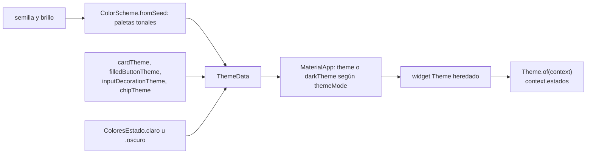
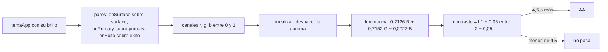
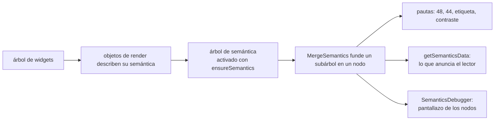
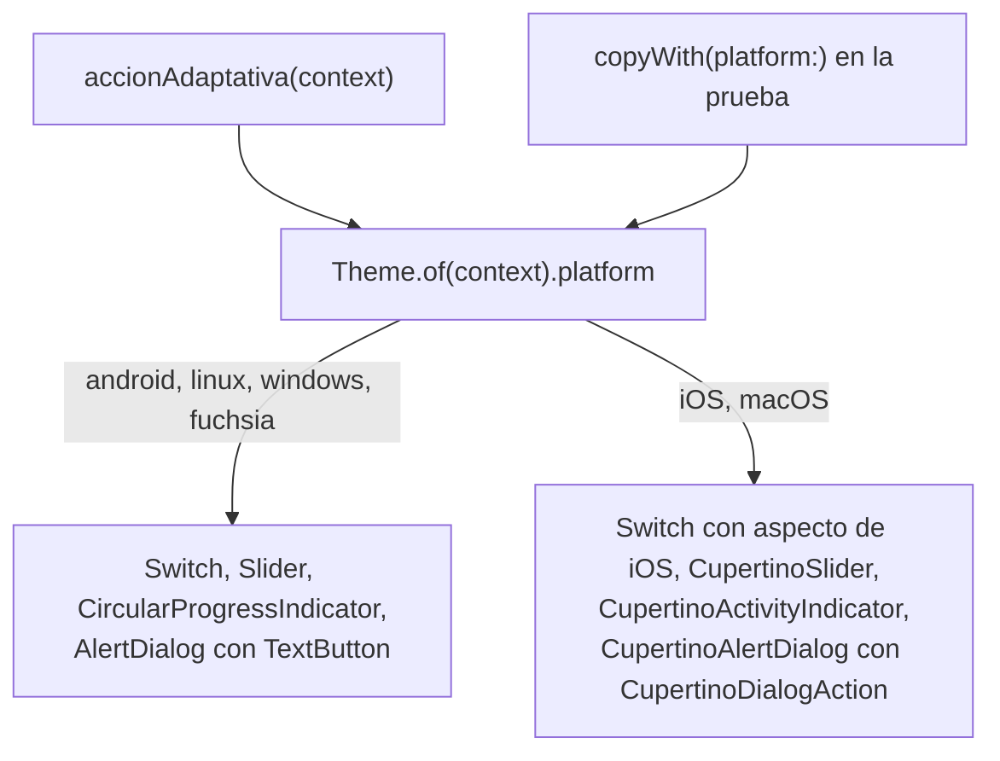

# Módulo 10: Theming, accesibilidad y Material/Cupertino

**Entorno comprobado para esta edición (2026-11-24):** Flutter 3.50.1 (canal estable) con Dart 3.14.0 en Linux
x86_64, con `material_ui` 1.11.1 y `cupertino_ui` 1.1.7. Todo el código se analizó con `flutter analyze` (`No issues
found!`) y todas las pruebas se ejecutaron ese día, en `/home/estudiante/labs/flutter/m10` (tu
`~/labs/flutter/m10`). Las imágenes del módulo son pantallazos que generan esas mismas pruebas con la herramienta del
Módulo 1. Las capturas de iOS se hicieron simulando la plataforma en Linux: el aspecto de los componentes es el de iOS,
pero el texto se ve con Roboto, porque la fuente de Apple (San Francisco) no existe en Linux.

En los módulos anteriores cada pantalla traía sus colores y tamaños. Este módulo los saca de las pantallas y los pone
en un solo lugar, el **tema**, y después comprueba con números que el resultado se pueda leer y usar: contraste,
tamaño de los botones y lo que anuncia el lector de pantalla. Al final, la misma pantalla se adapta a Android y a iOS.

**Al terminar este módulo podrás:**
- construir el tema de una app desde un color semilla, con modo claro y oscuro y colores propios;
- medir el contraste entre texto y fondo y saber si cumple WCAG AA;
- revisar una pantalla con las pautas de accesibilidad de Flutter y con el depurador de semántica;
- hacer que una pantalla use los componentes de Material en Android y los de Cupertino en iOS.

**Esquema del módulo:** Tema 1 (el tema de la app) → Tema 2 (contraste medible) → Tema 3 (accesibilidad: tamaño,
etiquetas y lector de pantalla) → Tema 4 (Material y Cupertino adaptativos) → Proyecto 27.

**Qué necesitas saber antes:** el Módulo 9, sobre todo **las pruebas de widgets** (Tema 2) y **las pruebas golden**
(Tema 4); del Módulo 1, **la herramienta de pantallazos** y **`Theme.of(context)`**; del Módulo 2, **los
formularios y `TextField`**.

**Qué no se repite:** la diagramación con `Row`, `Column` y `Expanded` (Módulo 1) y el diseño adaptable por tamaño
de pantalla (Módulo 2). Aquí la pantalla se adapta a la **plataforma**, no al ancho.

**Prepara el proyecto:**

```text
$ cd ~/labs/flutter
$ flutter create --org com.academia --platforms=linux,web m10
$ cd m10
$ flutter pub add cupertino_ui
```

Copia `test/pantallazo.dart` del Módulo 9. En este módulo tiene un cambio: además de Roboto e íconos, registra Roboto
con los nombres de las fuentes de iOS, para que las capturas de Cupertino muestren letras y no rectángulos.

```dart
// test/pantallazo.dart — herramienta del laboratorio: carga las fuentes reales y guarda un PNG de la pantalla
import 'dart:io';

import 'package:flutter/services.dart';
import 'package:flutter_test/flutter_test.dart';
import 'package:material_ui/material_ui.dart';

Future<void> cargarFuentes() async {
  final carpeta = '${Platform.environment['FLUTTER_ROOT']}/bin/cache/artifacts/material_fonts';
  final roboto = FontLoader('Roboto');
  for (final archivo in ['Roboto-Regular.ttf', 'Roboto-Medium.ttf', 'Roboto-Bold.ttf']) {
    roboto.addFont(Future.value(ByteData.sublistView(File('$carpeta/$archivo').readAsBytesSync())));
  }
  await roboto.load();
  // Las fuentes de iOS (San Francisco) no existen en Linux: en las capturas Cupertino se ve con Roboto.
  for (final familia in ['CupertinoSystemText', 'CupertinoSystemDisplay']) {
    final sustituta = FontLoader(familia);
    for (final archivo in ['Roboto-Regular.ttf', 'Roboto-Medium.ttf', 'Roboto-Bold.ttf']) {
      sustituta.addFont(Future.value(ByteData.sublistView(File('$carpeta/$archivo').readAsBytesSync())));
    }
    await sustituta.load();
  }
  final iconos = FontLoader('MaterialIcons')
    ..addFont(Future.value(ByteData.sublistView(File('$carpeta/MaterialIcons-Regular.otf').readAsBytesSync())));
  await iconos.load();
}

/// Ajusta el tamaño de la pantalla simulada (en puntos lógicos) y su densidad.
void tamanoPantalla(WidgetTester tester, {Size tamano = const Size(390, 760), double densidad = 2}) {
  tester.view.physicalSize = tamano * densidad;
  tester.view.devicePixelRatio = densidad;
  debugDisableShadows = false;                      // en las pruebas las sombras se apagan por defecto
  addTearDown(() {
    tester.view.reset();
    debugDisableShadows = true;
  });
}

/// Guarda lo que hay en pantalla como `test/pantallazos/<nombre>.png` (con --update-goldens).
Future<void> pantallazo(String nombre) async {
  await expectLater(find.byType(MaterialApp).first, matchesGoldenFile('pantallazos/$nombre.png'));
}
```

La app del módulo usa un tema claro y uno oscuro, y abre la pantalla de ajustes del Tema 4:

```dart
import 'package:material_ui/material_ui.dart';

import 'tema1/tema_app.dart';
import 'tema4/ajustes.dart';

void main() => runApp(const AppM10());

/// Un tema claro y uno oscuro; el sistema decide cuál usar (themeMode por defecto: ThemeMode.system).
class AppM10 extends StatelessWidget {
  const AppM10({super.key});

  @override
  Widget build(BuildContext context) => MaterialApp(
        title: 'Módulo 10',
        theme: temaApp(Brightness.light),
        darkTheme: temaApp(Brightness.dark),
        home: const Ajustes(),                                         // en Android se ve Material; en iOS, Cupertino
      );
}
```


## Aprende construyendo


### Tema 1: El tema de la app: un color semilla, dos modos y colores propios · Básico · 40 min

<details open>
<summary><strong>Capa 1 — Lectura</strong></summary>

#### Objetivos
Al terminar este tema podrás:
- generar el esquema de color completo con `ColorScheme.fromSeed`;
- dar estilo a todos los componentes de un tipo desde el tema (`cardTheme`, `filledButtonTheme`…);
- agregar colores que Material no trae con `ThemeExtension`;
- tener modo claro y oscuro con el mismo código de pantalla.

**Conceptos clave:** `ThemeData`, `ColorScheme.fromSeed`, rol de color, tema de componente, `ThemeExtension`

#### El problema
La pantalla de la ruta tiene el morado de la marca escrito en doce lugares, los botones miden 40 en una pantalla y
56 en otra, y el modo oscuro muestra texto negro sobre fondo casi negro. Cambiar de marca o arreglar el modo oscuro
obliga a buscar cada `Color(0xFF...)` del proyecto. El diseño debe decidirse una vez, en el tema, y las pantallas solo
deben pedir «el color principal» o «el texto sobre la superficie».

Este tema usa **`Theme.of(context)` y `textTheme`** (Módulo 1), **las extensiones** (Módulo 0, Tema 7) y **los
records en un `for`** (Módulo 0, Tema 6).

#### Glosario del tema

**`ThemeData`**
- **Definición técnica:** objeto inmutable con los colores, tipografía y estilos de componentes de la app; `MaterialApp` lo recibe en `theme` y `darkTheme`, y los widgets lo leen con `Theme.of(context)`.
- **En palabras sencillas:** el manual de estilo de la app, en código.
- **Dónde se rompe la comparación:** un manual se puede ignorar; un widget que no recibe color explícito siempre usa el del tema.
- **Ejemplo:** `MaterialApp(theme: temaApp(Brightness.light), darkTheme: temaApp(Brightness.dark))`.
- **Error típico:** crear `ThemeData` dentro de `build` de cada pantalla: cada una termina con su propio estilo.

**`ColorScheme.fromSeed`**
- **Definición técnica:** genera los cerca de 30 roles de color de Material 3 a partir de un color semilla y un brillo (`Brightness.light` o `dark`), con tonos calculados para que los pares texto/fondo tengan contraste.
- **En palabras sencillas:** das un color y te devuelve la paleta completa, clara u oscura.
- **Dónde se rompe la comparación:** el color principal resultante **no es** la semilla: con índigo sale `#515B92`, no el índigo puro.
- **Ejemplo:** `ColorScheme.fromSeed(seedColor: Colors.teal, brightness: Brightness.light)`.
- **Error típico:** esperar que `primary` sea exactamente el color de la marca y «corregirlo» a mano, rompiendo los pares de contraste.

**rol de color**
- **Definición técnica:** nombre de un color por su función (`primary`, `onPrimary`, `surface`, `onSurface`, `onSurfaceVariant`, `outlineVariant`, `error`…); el prefijo `on` es el color del texto que va encima del rol sin prefijo.
- **En palabras sencillas:** «el color de los botones principales» en lugar de «morado».
- **Dónde se rompe la comparación:** el mismo rol tiene valores distintos en claro y oscuro; ese es el punto.
- **Ejemplo:** texto secundario con `colorScheme.onSurfaceVariant`, no con `Colors.grey`.
- **Error típico:** usar `onPrimary` sobre `surface`: son de pares distintos y pueden no contrastar.

**tema de componente**
- **Definición técnica:** propiedades de `ThemeData` como `cardTheme`, `filledButtonTheme`, `inputDecorationTheme` o `chipTheme`, que fijan el estilo por defecto de todos los widgets de ese tipo.
- **En palabras sencillas:** «todas las tarjetas son así», dicho una vez.
- **Dónde se rompe la comparación:** un widget puede sobrescribirlo con su propio `style`; úsalo solo para excepciones.
- **Ejemplo:** `FilledButton.styleFrom(minimumSize: const Size.fromHeight(48))` hace todos los botones rellenos de ancho completo y 48 de alto.
- **Error típico:** copiar el mismo `style:` en cada botón.

**`ThemeExtension`**
- **Definición técnica:** clase propia que se agrega a `ThemeData.extensions`, con `copyWith` y `lerp`, y se lee con `Theme.of(context).extension<T>()`.
- **En palabras sencillas:** un cajón extra en el tema para los colores del negocio.
- **Dónde se rompe la comparación:** `lerp` es obligatorio: Flutter lo usa para animar el paso de un tema a otro.
- **Ejemplo:** `ColoresEstado` con `exito`/`enExito` y `alerta`/`enAlerta`, uno para claro y otro para oscuro.
- **Error típico:** guardar esos colores en constantes globales: no cambian con el modo oscuro.

#### ► CÓMO FUNCIONA

##### 1. La idea en lenguaje sencillo
Una empresa de envíos tiene un manual de marca. Los camiones, los uniformes y las facturas no deciden su color: lo
consultan. Si la marca cambia, se edita el manual y todo lo demás lo sigue.

El tema es ese manual dentro de la app. La pantalla de la ruta no debería decir «morado `0xFF...`», sino «el color
principal» o «el texto sobre la superficie». El tema traduce esos nombres a colores concretos.

Así se resuelven los tres síntomas del problema. El morado deja de estar en doce lugares. Todos los botones miden lo
mismo porque una sola regla lo fija. Y el modo oscuro deja de mostrar texto negro sobre fondo casi negro, porque cada
nombre tiene un valor distinto en cada modo.

##### 2. Definición formal y vocabulario
**`ThemeData`** es un objeto inmutable con la configuración visual de una app Material: colores, tipografía y estilos
de componentes. `MaterialApp` lo recibe en `theme` y `darkTheme`. Los widgets lo leen con `Theme.of(context)`.

Su parte más importante es `colorScheme`, un `ColorScheme`. **`ColorScheme.fromSeed`** lo genera desde un solo color
semilla y un brillo. Según la documentación, construye un conjunto de paletas tonales a partir de la semilla y asigna
desde ellas todos los colores del esquema.

Cada color del esquema es un **rol de color**: un nombre por función, como `primary`, `surface` u
`outlineVariant`. El prefijo `on` marca el color que va encima: `onSurface` es el texto sobre `surface`.

Un **tema de componente**, como `cardTheme` o `filledButtonTheme`, fija el estilo por defecto de un tipo de widget. Una
**`ThemeExtension`** añade al tema datos propios, como los colores de estado de una entrega.

##### 3. Cómo funciona por dentro, paso a paso
Sigue el recorrido desde `main` hasta el color de un chip:

1. `temaApp(Brightness.light)` llama a `ColorScheme.fromSeed` con la semilla índigo. El resultado no es la semilla:
   `primary` sale `#515B92`, como muestra la salida real.
2. Con `Brightness.dark`, la misma semilla produce otros tonos de las mismas paletas: `primary` pasa a `#BAC3FF` y
   `surface` a `#121318`.
3. `ThemeData` recibe el esquema, los temas de componente y la extensión correspondiente al brillo.
4. `MaterialApp` decide qué tema usar. Con `themeMode` en su valor por defecto, `ThemeMode.system`, consulta el brillo
   que pide el sistema operativo.
5. `MaterialApp` publica el tema elegido en el árbol con un widget `Theme`, que es un widget heredado.
6. Cuando un widget llama a `Theme.of(context)`, sube por el árbol hasta ese `Theme` y queda registrado como
   dependiente. Si el tema cambia, Flutter lo reconstruye.
7. Cada componente combina tres fuentes, de mayor a menor prioridad: el estilo que le pasas, su tema de componente y
   los valores por defecto de Material 3, calculados desde `colorScheme`.

```dart
filledButtonTheme: FilledButtonThemeData(
  style: FilledButton.styleFrom(minimumSize: const Size.fromHeight(48)),
),
```

Este fragmento actúa en el paso 7. `FilledButton` no recibe `style`, así que toma el de su tema y mide 48 de alto. La
salida lo confirma en las tres variantes: `botón 48 de alto`.



La extensión sigue el mismo camino. `ThemeData` guarda las extensiones por tipo.
`Theme.of(context).extension<ColoresEstado>()` devuelve la instancia del tema activo: la clara o la oscura. El atajo
`context.estados` solo acorta esa llamada.

##### 4. Reglas, variantes y casos límite
La semilla no reaparece intacta. La variante por defecto de `fromSeed` es `DynamicSchemeVariant.tonalSpot`, que da
paletas suaves aunque la semilla sea muy saturada. Si necesitas colores más fieles a la marca, existe
`DynamicSchemeVariant.fidelity`.

`fromSeed` también acepta `contrastLevel`, entre -1,0 y 1,0, con 0,0 por defecto. Según la guía de Material, 0,5 y 1,0
corresponden a contraste medio y alto.

Puedes reemplazar un rol suelto pasándolo a `fromSeed`, por ejemplo `primary:`. Hazlo con cuidado: si cambias un rol
sin su pareja `on`, rompes el contraste que el esquema había calculado.

Los roles cambiaron entre versiones. Desde Flutter 3.22, `background`, `onBackground` y `surfaceVariant` están
obsoletos. En su lugar se usan `surface`, `onSurface` y la familia `surfaceContainer`, como el
`surfaceContainerHighest` del Módulo 8.

`ThemeExtension` obliga a implementar `copyWith` y `lerp`, que son abstractos. Sin ellos, la clase no compila. `lerp`
sirve para interpolar entre dos temas cuando `MaterialApp` anima un cambio de tema.

Un widget dentro de otro `Theme` ve ese tema y no el de la app. Así puedes cambiar el aspecto de una sección con
`Theme(data: ..., child: ...)`. Para variar poco, parte del tema actual con `Theme.of(context).copyWith(...)`.

`MaterialApp` también acepta `highContrastTheme` y `highContrastDarkTheme`. Los usa cuando el sistema pide alto
contraste. El Tema 3 vuelve sobre esas preferencias del usuario.

##### 5. Relación con lo que ya sabes y lo que viene
Ya leías `Theme.of(context).colorScheme` y `textTheme` desde el Módulo 1. Los roles de color del Módulo 2, Tema 6
aparecen aquí generados desde una semilla. La extensión `context.estados` usa las extensiones de Dart del Módulo 0,
Tema 7.

No confundas `ThemeExtension` con una extensión de Dart. La primera es un dato guardado dentro del tema. La segunda
añade un método a un tipo existente, como el atajo `estados` sobre `BuildContext`.

Las pruebas golden del Módulo 9, Tema 4 son la red de este tema. El muestrario en claro y oscuro convierte cada cambio
de semilla o de componente en una diferencia de píxeles visible.

El Tema 2 mide con números si los pares que genera `fromSeed` y los de `ColoresEstado` se leen bien. El Tema 4 añade
Cupertino, que tiene su propio sistema de tema.

#### Problema resuelto 1.1
Escribe el tema de la app y una pantalla de muestra que no tenga ni un color ni un tamaño a mano. Pruébala con tres
variantes: índigo claro, índigo oscuro y verde azulado claro, y mira qué color principal produce cada una.

**Razonamiento:**
1. Una función `temaApp(brillo, semilla:)` produce el tema; el mismo código sirve para claro y oscuro.
2. Los estilos que se repiten (tarjetas, botones, campos, chips) van en los temas de componente.
3. Los colores de estado de una entrega no existen en Material: van en una `ThemeExtension` con versión clara y
   oscura, y un atajo `context.estados` para leerlos.
4. La pantalla de muestra usa solo `Theme.of(context)`, `textTheme` y `context.estados`.
5. La prueba imprime los colores principales y la altura del botón, y guarda un pantallazo por variante.

```dart
// lib/tema1/tema_app.dart — el tema de la app: esquema de color desde una semilla, componentes y colores propios
import 'package:material_ui/material_ui.dart';

/// Colores que Material no trae: los estados de una entrega. Cambian con el modo claro u oscuro.
@immutable
class ColoresEstado extends ThemeExtension<ColoresEstado> {
  const ColoresEstado({required this.exito, required this.enExito, required this.alerta, required this.enAlerta});
  final Color exito;
  final Color enExito;                                              // texto sobre «exito»
  final Color alerta;
  final Color enAlerta;

  static const claro = ColoresEstado(
    exito: Color(0xFFC8E6C9), enExito: Color(0xFF1B5E20), alerta: Color(0xFFFFE0B2), enAlerta: Color(0xFF7A3E00));
  static const oscuro = ColoresEstado(
    exito: Color(0xFF1E4620), enExito: Color(0xFFC8E6C9), alerta: Color(0xFF5A3300), enAlerta: Color(0xFFFFDCC2));

  @override
  ColoresEstado copyWith({Color? exito, Color? enExito, Color? alerta, Color? enAlerta}) => ColoresEstado(
        exito: exito ?? this.exito, enExito: enExito ?? this.enExito,
        alerta: alerta ?? this.alerta, enAlerta: enAlerta ?? this.enAlerta);

  @override
  ColoresEstado lerp(ColoresEstado? otro, double t) => otro == null
      ? this
      : ColoresEstado(                                              // para animar el cambio de claro a oscuro
          exito: Color.lerp(exito, otro.exito, t)!, enExito: Color.lerp(enExito, otro.enExito, t)!,
          alerta: Color.lerp(alerta, otro.alerta, t)!, enAlerta: Color.lerp(enAlerta, otro.enAlerta, t)!);
}

extension TemaContexto on BuildContext {
  ColoresEstado get estados => Theme.of(this).extension<ColoresEstado>()!;   // atajo: context.estados
}

ThemeData temaApp(Brightness brillo, {Color semilla = Colors.indigo}) {
  final esquema = ColorScheme.fromSeed(seedColor: semilla, brightness: brillo);   // toda la paleta desde un color
  return ThemeData(
    colorScheme: esquema,
    extensions: [brillo == Brightness.light ? ColoresEstado.claro : ColoresEstado.oscuro],
    cardTheme: CardThemeData(
      elevation: 0,
      shape: RoundedRectangleBorder(
        borderRadius: BorderRadius.circular(16),
        side: BorderSide(color: esquema.outlineVariant),
      ),
    ),
    filledButtonTheme: FilledButtonThemeData(
      style: FilledButton.styleFrom(minimumSize: const Size.fromHeight(48)),   // botones de ancho completo, 48 de alto
    ),
    inputDecorationTheme: const InputDecorationTheme(border: OutlineInputBorder()),
    chipTheme: const ChipThemeData(side: BorderSide.none),
  );
}
```

```dart
// lib/tema1/muestrario.dart — una pantalla que usa solo el tema: ningún color ni tamaño escrito a mano
import 'package:material_ui/material_ui.dart';

import 'tema_app.dart';

class Muestrario extends StatelessWidget {
  const Muestrario({super.key});

  @override
  Widget build(BuildContext context) {
    final texto = Theme.of(context).textTheme;
    final e = context.estados;
    Widget chip(String t, Color fondo, Color frente) =>
        Chip(label: Text(t, style: TextStyle(color: frente)), backgroundColor: fondo);
    return Scaffold(
      appBar: AppBar(title: const Text('Ruta de hoy')),
      body: ListView(
        padding: const EdgeInsets.all(16),
        children: [
          Card(
            child: Padding(
              padding: const EdgeInsets.all(16),
              child: Column(crossAxisAlignment: CrossAxisAlignment.start, children: [
                Text('EN-4472', style: texto.titleLarge),
                const SizedBox(height: 4),
                Text('Carrera 15 # 93-20 · Luis Pardo', style: texto.bodyMedium),
                const SizedBox(height: 12),
                Wrap(spacing: 8, children: [
                  chip('Entregada', e.exito, e.enExito),
                  chip('Frágil', e.alerta, e.enAlerta),
                ]),
              ]),
            ),
          ),
          const SizedBox(height: 16),
          const TextField(decoration: InputDecoration(labelText: 'Quién recibe')),
          const SizedBox(height: 8),
          SwitchListTile(value: true, onChanged: (_) {}, title: const Text('Avisar al llegar'), contentPadding: EdgeInsets.zero),
          const SizedBox(height: 8),
          FilledButton(onPressed: () {}, child: const Text('Confirmar entrega')),
          const SizedBox(height: 8),
          OutlinedButton(onPressed: () {}, child: const Text('Reportar novedad')),
        ],
      ),
    );
  }
}
```

```dart
import 'package:flutter_test/flutter_test.dart';
import 'package:m10/tema1/muestrario.dart';
import 'package:m10/tema1/tema_app.dart';
import 'package:material_ui/material_ui.dart';

import 'pantallazo.dart';

String hex(Color c) => '#${c.toARGB32().toRadixString(16).substring(2).toUpperCase()}';

void main() {
  setUpAll(cargarFuentes);

  const variantes = [
    ('indigo-claro', Colors.indigo, Brightness.light),
    ('indigo-oscuro', Colors.indigo, Brightness.dark),
    ('verde-claro', Colors.teal, Brightness.light),
  ];

  for (final (nombre, semilla, brillo) in variantes) {
    testWidgets('muestrario $nombre', (tester) async {
      tamanoPantalla(tester, tamano: const Size(360, 560));
      final tema = temaApp(brillo, semilla: semilla);
      await tester.pumpWidget(MaterialApp(debugShowCheckedModeBanner: false, theme: tema, home: const Muestrario()));
      final c = tema.colorScheme;
      debugPrint('${nombre.padRight(13)} primary ${hex(c.primary)}  surface ${hex(c.surface)}  '
          'onSurface ${hex(c.onSurface)}  botón ${tester.getSize(find.byType(FilledButton)).height.toStringAsFixed(0)} de alto');
      await pantallazo('m10-t1-$nombre');
    });
  }
}
```

```text
$ flutter test test/tema1_test.dart
00:00 +0: loading /home/estudiante/labs/flutter/m10/test/tema1_test.dart
00:00 +0: (setUpAll)
00:00 +0: muestrario indigo-claro
indigo-claro  primary #515B92  surface #FBF8FF  onSurface #1B1B21  botón 48 de alto
00:01 +1: muestrario indigo-oscuro
indigo-oscuro primary #BAC3FF  surface #121318  onSurface #E4E1E9  botón 48 de alto
00:01 +2: muestrario verde-claro
verde-claro   primary #006A60  surface #F4FBF8  onSurface #161D1C  botón 48 de alto
00:01 +3: (tearDownAll)
00:01 +3: All tests passed!
```


**Explicación por partes.**
- `primary` con semilla índigo es `#515B92` en claro y `#BAC3FF` en oscuro: el mismo rol, dos valores pensados para
  su fondo. La semilla verde azulado da `#006A60`.
- `surface` y `onSurface` también cambian: `#FBF8FF`/`#1B1B21` en claro y `#121318`/`#E4E1E9` en oscuro. Ninguna
  pantalla los menciona; los usa `Scaffold` y el texto por defecto.
- El botón mide 48 de alto en las tres variantes porque lo fija `filledButtonTheme`, no el botón.
- En la imagen, los chips cambian de verde y naranja claros a sus versiones oscuras sin tocar `Muestrario`: es
  `ColoresEstado.oscuro` entrando por la extensión.
- El tercer panel muestra lo que cuesta cambiar de marca: una línea (la semilla).

> **Error común.** Escribir `Colors.grey` o `Color(0xFF...)` dentro de una pantalla. Ese color no cambia en modo
> oscuro y no sigue a la marca. Busca el rol que describe su función (`onSurfaceVariant` para texto secundario,
> `outlineVariant` para bordes) o agrégalo a la extensión.

> **Error común.** Olvidar `darkTheme`. Sin él, la app usa el tema claro aunque el teléfono esté en modo oscuro; con
> él, y sin cambiar `themeMode`, sigue al sistema.

> **Buena práctica.** Ten una pantalla de muestra (un «muestrario») con todos los componentes de la app y pruébala con
> golden en claro y oscuro. Cualquier cambio del tema se ve ahí antes que en las pantallas reales.

> **Prevenir errores.** Busca en el proyecto `Color(0x` y `Colors.` fuera de la carpeta del tema
> (`grep -rn "Color(0x\|Colors\." lib --exclude-dir=tema1`). Cada resultado es un color que no seguirá al tema.

#### Checkpoint 1.1
¿Qué cambia en `Muestrario` si mañana la marca pasa de índigo a verde azulado?

Respuesta: nada. Solo cambia el argumento `semilla` en el lugar donde se crea el tema; la pantalla lee roles y los
roles se recalculan.

</details>

<details>
<summary><strong>Capa 2 — Construcción</strong></summary>

#### Paso 1 · Crea los archivos
Crea `lib/tema1/tema_app.dart`, `lib/tema1/muestrario.dart` y `test/tema1_test.dart`.

#### Paso 2 · Ejecuta
Ejecuta `flutter test --update-goldens test/tema1_test.dart` y abre las tres imágenes de `test/pantallazos/`.

#### Paso 3 · Cambia la semilla
Agrega una cuarta variante con `Colors.deepOrange` en claro. ¿Qué `primary` sale?

#### Paso 4 · Agrega un componente
Agrega al tema un `appBarTheme` con `centerTitle: true` y comprueba en el pantallazo que el título queda centrado sin
tocar `Muestrario`.

#### Paso 5 · Agrega un estado
Agrega a `ColoresEstado` el par `devuelta`/`enDevuelta` (rojo claro y rojo oscuro en claro; al revés en oscuro), con
su `copyWith` y su `lerp`, y un chip «Devuelta» al muestrario.

#### Resumen
- El **`ThemeData`** concentra el diseño; las pantallas lo leen con `Theme.of(context)`.
- **`ColorScheme.fromSeed`** produce la paleta completa en claro u oscuro.
- Las pantallas piden **roles de color**, no colores.
- Los **temas de componente** fijan el estilo de todos los widgets de un tipo.
- Lo que Material no trae va en una **`ThemeExtension`**.

#### Ejercicio verificable 1
Básico. ¿Qué altura tiene el botón «Confirmar entrega» y de dónde sale?

Respuesta esperada: 48, de `minimumSize: Size.fromHeight(48)` en `filledButtonTheme`.

#### Ejercicio verificable 2
Intermedio. ¿Por qué `primary` en oscuro (`#BAC3FF`) es mucho más claro que en claro (`#515B92`)?

Respuesta esperada: porque en oscuro el fondo es casi negro (`#121318`) y el color principal debe contrastar con él;
`fromSeed` elige un tono claro de la misma familia.

#### Ejercicio verificable 3
Reto. Si quitas `lerp` de `ColoresEstado`, ¿compila? ¿Para qué lo usa Flutter?

Respuesta esperada: no compila: `lerp` es abstracto en `ThemeExtension`. Flutter lo usa para animar el cambio entre
temas (por ejemplo, al pasar de claro a oscuro con `AnimatedTheme`).

#### En el trabajo
Los equipos con sistema de diseño entregan el tema como un paquete: semilla, tipografía, temas de componente y
extensiones. Las pantallas no aprueban revisión si traen colores a mano, y el muestrario con goldens en claro y oscuro
es el primer lugar donde se revisa un cambio de marca.

</details>

### Tema 2: Contraste medible: que el texto se pueda leer · Intermedio · 35 min

<details open>
<summary><strong>Capa 1 — Lectura</strong></summary>

#### Objetivos
Al terminar este tema podrás:
- calcular la luminancia relativa de un color y el contraste entre dos colores;
- saber qué contraste pide WCAG AA para texto normal y para texto grande;
- comprobar todos los pares texto/fondo del tema en claro y oscuro con una prueba;
- reconocer el gris «elegante» que no se lee.

**Conceptos clave:** luminancia relativa, relación de contraste, WCAG AA, par texto/fondo, texto grande

#### El problema
El diseñador pidió el estado «Entregada» en gris claro para que «no compita» con el número de guía. En el monitor
del diseñador se ve bien; en el teléfono del repartidor, al sol, no se lee. «Se lee bien» es una opinión; el
contraste es un número, y se puede probar.

Este tema usa **el tema del Tema 1**, **funciones de nivel superior** (Módulo 0, Tema 2) y **los records con
nombre** (Módulo 0, Tema 6).

#### Glosario del tema

**luminancia relativa**
- **Definición técnica:** brillo percibido de un color entre 0 (negro) y 1 (blanco): cada canal se linealiza (se deshace la corrección gamma) y se suma con pesos 0,2126 (rojo), 0,7152 (verde) y 0,0722 (azul).
- **En palabras sencillas:** cuánta luz le llega al ojo de ese color.
- **Dónde se rompe la comparación:** no es el promedio de los canales: el verde pesa diez veces más que el azul.
- **Ejemplo:** `luminancia(Colors.white)` es 1; `luminancia(Colors.black)`, 0.
- **Error típico:** comparar colores por su valor hexadecimal: `#0000FF` y `#00FF00` tienen «el mismo número de efes» y luminancias muy distintas.

**relación de contraste**
- **Definición técnica:** `(L1 + 0,05) / (L2 + 0,05)`, con `L1` la luminancia mayor; va de 1:1 (colores iguales) a 21:1 (negro sobre blanco).
- **En palabras sencillas:** cuántas veces más luz tiene el más claro que el más oscuro.
- **Dónde se rompe la comparación:** no depende del orden: texto blanco en fondo negro y al revés dan lo mismo.
- **Ejemplo:** `contraste(Colors.black, Colors.white)` da 21,00.
- **Error típico:** calcularlo con los colores del diseño y no con los del tema real.

**WCAG AA**
- **Definición técnica:** nivel de las Pautas de Accesibilidad para el Contenido Web que exige al menos 4,5:1 para texto normal y 3:1 para texto grande; el nivel AAA pide 7:1 y 4,5:1.
- **En palabras sencillas:** el mínimo aceptado para que la mayoría lea sin esfuerzo.
- **Dónde se rompe la comparación:** cumplir AA no garantiza comodidad al sol; es un piso, no una meta.
- **Ejemplo:** `onSurfaceVariant` sobre `surface` da 8,88:1: pasa AA y AAA.
- **Error típico:** aplicar 3:1 a todo el texto porque «es grande».

**par texto/fondo**
- **Definición técnica:** combinación de un color de texto con el fondo sobre el que se dibuja; en Material 3, cada rol `onX` está hecho para ir sobre `X`.
- **En palabras sencillas:** qué va encima de qué.
- **Dónde se rompe la comparación:** un color no tiene contraste por sí solo; lo tiene contra un fondo.
- **Ejemplo:** `enExito` sobre `exito` en la extensión del Tema 1.
- **Error típico:** probar el texto contra blanco cuando la app lo dibuja sobre `surface` o sobre una tarjeta.

**texto grande**
- **Definición técnica:** para WCAG, 18 pt (unos 24 px lógicos) normal, o 14 pt (unos 18,7 px) en negrita.
- **En palabras sencillas:** títulos, no párrafos.
- **Dónde se rompe la comparación:** el tamaño cuenta después del escalado del usuario; un texto de 14 sigue siendo normal aunque se vea más grande en tu teléfono.
- **Ejemplo:** un `titleLarge` (22) no es texto grande; un `headlineSmall` (24), sí.
- **Error típico:** declarar «grande» un texto de 16 para usar el límite de 3:1.

#### ► CÓMO FUNCIONA

##### 1. La idea en lenguaje sencillo
Piensa en un letrero de calle. Letras blancas sobre fondo azul oscuro se leen desde lejos, incluso con sol. Letras
grises sobre fondo blanco pueden verse elegantes en una oficina y desaparecer en la calle. Lo que decide no es el
color en sí, sino la diferencia de luz entre las letras y su fondo.

El repartidor mira el teléfono al sol, con prisa y a veces con la pantalla a medio brillo. El estado «Entregada» en
gris claro sobre blanco no se lee en esas condiciones, aunque en el monitor del diseñador pareciera bien.

El contraste convierte esa discusión en un número. El gris `#9E9E9E` sobre blanco da 2,68:1. La norma pide 4,5:1 para
texto normal. Con ese número, la decisión deja de ser una opinión y pasa a ser una prueba que falla o pasa.

##### 2. Definición formal y vocabulario
La **luminancia relativa** de un color es su brillo percibido, normalizado entre 0 para el negro y 1 para el blanco.
Las pautas WCAG 2 la definen sobre el espacio de color sRGB, el estándar de las pantallas.

La **relación de contraste** compara dos luminancias: `(L1 + 0,05) / (L2 + 0,05)`, con `L1` la mayor. Va de 1:1 a
21:1. El 0,05 representa el reflejo de luz ambiente sobre la pantalla y evita dividir por cero.

**WCAG AA** es el nivel intermedio de las Pautas de Accesibilidad para el Contenido Web. Para texto pide 4,5:1. Para
**texto grande** bastan 3:1. El nivel AAA sube a 7:1 y 4,5:1.

Un **par texto/fondo** es la unidad que se mide. Un color no tiene contraste solo: lo tiene contra el fondo concreto
sobre el que se dibuja. Por eso la prueba mide `onSurface` sobre `surface` y no `onSurface` a secas.

##### 3. Cómo funciona por dentro, paso a paso
Sigue el cálculo de un par, por ejemplo el gris a mano sobre blanco:

1. Cada canal del color se expresa entre 0 y 1. En `material_ui`, los getters `r`, `g` y `b` de `Color` ya devuelven
   ese rango.
2. Cada canal se linealiza. Las pantallas guardan los colores con una corrección gamma: la mitad del número no es la
   mitad de la luz. `_canal` deshace esa corrección.
3. Los tres canales lineales se suman con pesos 0,2126, 0,7152 y 0,0722. El verde pesa más porque el ojo humano es más
   sensible a él.
4. Con las dos luminancias, la función elige la mayor como `L1` y aplica la fórmula.
5. La prueba compara el resultado con 4,5 y lo imprime con dos decimales.

```dart
double _canal(double c) => c <= 0.04045 ? c / 12.92 : math.pow((c + 0.055) / 1.055, 2.4).toDouble();
```

Esta línea es el paso 2. Los valores muy oscuros siguen una recta; el resto, una potencia de 2,4. Es la curva de
transferencia de sRGB, la misma que usan los navegadores.



Los pares salen de `temaApp`, no de una lista escrita a mano. Si cambias la semilla, la prueba mide los colores
nuevos. Así se explica la salida: los roles del tema pasan en los dos modos y los dos grises a mano no.

Observa el caso del modo oscuro. `#333333` sobre blanco tiene mucho contraste. Sobre `surface` oscuro, `#121318`, da
1,47:1: dos colores casi igual de oscuros.

##### 4. Reglas, variantes y casos límite
El umbral es estricto. `#767676` sobre blanco da unos 4,54:1 y pasa; `#777777` da unos 4,48:1 y no pasa. No se
redondea a favor: 4,48 no es 4,5.

El **texto grande** tiene una definición exacta: 18 puntos normal o 14 puntos en negrita. En píxeles lógicos son unos
24 y unos 18,7. Un `titleLarge` de 22 no llega.

WCAG 2.1 añadió una regla para lo que no es texto. Los iconos que informan y los bordes de los controles necesitan al
menos 3:1 contra lo que tienen al lado. Un campo de texto con borde casi invisible incumple esta regla aunque su
texto pase.

Hay excepciones previstas. El texto de logotipos, el decorativo y el de controles desactivados no tiene mínimo. Un
botón desactivado puede verse tenue sin incumplir AA.

Las versiones de WCAG anteriores a mayo de 2021 escribían el umbral de linealización como 0,03928, tomado de una
versión antigua de sRGB. Hoy usan 0,04045, el mismo de este tema. Según la propia WCAG, el cambio no tiene efecto
práctico en el cálculo.

Flutter trae `Color.computeLuminance()`, que calcula la luminancia relativa. Este tema escribe la fórmula para que
veas cada paso. En código de producción puedes usar la de Flutter.

Desde Flutter 3.27, `Color` guarda sus canales como `double` y admite espacios de color amplios. Por eso `c.r` es un
número entre 0 y 1, y no un entero entre 0 y 255 como el antiguo `red`.

La fórmula no sirve para fondos que no son planos. Sobre una foto o un degradado, mide contra el punto más claro y el
más oscuro detrás del texto. También puedes poner una capa de color detrás.

##### 5. Relación con lo que ya sabes y lo que viene
Los roles `on` del Tema 1 existen precisamente para formar pares con contraste. `fromSeed` los calcula con tonos
separados. Esta prueba comprueba que lo consiguió, también con los colores propios de `ColoresEstado`.

El código usa piezas del Módulo 0. `luminancia` y `contraste` son funciones de nivel superior (Tema 2). `Par` es un
record con nombre (Tema 6), y `(claro, oscuro)` desestructura otro record para ordenar los colores.

Compara con la golden del Módulo 9, Tema 4. La golden detecta que un color cambió, pero no si el resultado se lee.
Esta prueba mide la legibilidad y la imagen ayuda a que una persona entienda el número.

El Tema 3 lleva la idea a la pantalla completa. Flutter tiene una pauta automática, `textContrastGuideline`, que mide
el contraste del texto ya dibujado, junto con el tamaño táctil y las etiquetas.

#### Problema resuelto 2.1
Implementa la fórmula de contraste, compruébala con valores conocidos y mide los pares del tema en claro y oscuro,
junto con dos colores elegidos a mano: el gris `#9E9E9E` sobre blanco y el gris oscuro `#333333` sobre la superficie
del modo oscuro.

**Razonamiento:**
1. La fórmula se prueba primero con dos valores que se saben de memoria: negro/blanco 21 y blanco/blanco 1.
2. Los pares salen del tema, no de una lista escrita a mano: si el tema cambia, la prueba mide lo nuevo.
3. Los dos colores a mano representan el error típico: un gris «suave» en claro y un gris «sobrio» en oscuro.
4. Un widget `Muestras` dibuja cada par con su resultado para el pantallazo.

```dart
// lib/tema2/contraste.dart — contraste entre texto y fondo según WCAG 2: un número que se puede comprobar
import 'dart:math' as math;

import 'package:material_ui/material_ui.dart';

double _canal(double c) => c <= 0.04045 ? c / 12.92 : math.pow((c + 0.055) / 1.055, 2.4).toDouble();

/// Luminancia relativa: cuánta luz percibe el ojo (0 negro, 1 blanco).
double luminancia(Color c) => 0.2126 * _canal(c.r) + 0.7152 * _canal(c.g) + 0.0722 * _canal(c.b);

/// De 1:1 (igual) a 21:1 (negro sobre blanco). WCAG AA pide 4,5 para texto normal y 3 para texto grande.
double contraste(Color a, Color b) {
  final (claro, oscuro) = luminancia(a) >= luminancia(b) ? (a, b) : (b, a);
  return (luminancia(claro) + 0.05) / (luminancia(oscuro) + 0.05);
}

typedef Par = ({String nombre, Color texto, Color fondo});

/// Muestra cada par con su texto real y su contraste, para revisarlo de un vistazo.
class Muestras extends StatelessWidget {
  const Muestras(this.pares, {super.key});
  final List<Par> pares;

  @override
  Widget build(BuildContext context) => ListView(
        padding: const EdgeInsets.all(12),
        children: [
          for (final p in pares)
            Container(
              margin: const EdgeInsets.only(bottom: 8),
              padding: const EdgeInsets.symmetric(horizontal: 12, vertical: 10),
              decoration: BoxDecoration(color: p.fondo, borderRadius: BorderRadius.circular(8)),
              child: Row(children: [
                Expanded(child: Text(p.nombre, style: TextStyle(color: p.texto, fontSize: 15))),
                Text('${contraste(p.texto, p.fondo).toStringAsFixed(1)}:1 ${contraste(p.texto, p.fondo) >= 4.5 ? 'AA' : 'no pasa'}',
                    style: TextStyle(color: p.texto, fontWeight: FontWeight.bold)),
              ]),
            ),
        ],
      );
}
```

```dart
import 'package:flutter_test/flutter_test.dart';
import 'package:m10/tema1/tema_app.dart';
import 'package:m10/tema2/contraste.dart';
import 'package:material_ui/material_ui.dart';

import 'pantallazo.dart';

List<Par> paresDe(ThemeData t) {
  final c = t.colorScheme;
  final e = t.extension<ColoresEstado>()!;
  return [
    (nombre: 'onSurface / surface', texto: c.onSurface, fondo: c.surface),
    (nombre: 'onSurfaceVariant / surface', texto: c.onSurfaceVariant, fondo: c.surface),
    (nombre: 'onPrimary / primary', texto: c.onPrimary, fondo: c.primary),
    (nombre: 'enExito / exito', texto: e.enExito, fondo: e.exito),
    (nombre: 'enAlerta / alerta', texto: e.enAlerta, fondo: e.alerta),
  ];
}

void main() {
  setUpAll(cargarFuentes);

  test('la fórmula con valores conocidos', () {
    debugPrint('negro / blanco: ${contraste(Colors.black, Colors.white).toStringAsFixed(2)}');
    debugPrint('blanco / blanco: ${contraste(Colors.white, Colors.white).toStringAsFixed(2)}');
  });

  for (final brillo in Brightness.values) {
    testWidgets('pares del tema ${brillo.name}', (tester) async {
      final tema = temaApp(brillo);
      final pares = [
        ...paresDe(tema),
        brillo == Brightness.light
            ? (nombre: 'gris a mano / blanco', texto: const Color(0xFF9E9E9E), fondo: Colors.white)
            : (nombre: '#333 a mano / surface', texto: const Color(0xFF333333), fondo: tema.colorScheme.surface),
      ];
      for (final p in pares) {
        final r = contraste(p.texto, p.fondo);
        debugPrint('${brillo.name.padRight(5)} ${p.nombre.padRight(27)} ${r.toStringAsFixed(2).padLeft(5)}:1 ${r >= 4.5 ? 'AA' : 'NO'}');
      }
      tamanoPantalla(tester, tamano: const Size(360, 340));
      await tester.pumpWidget(MaterialApp(
        debugShowCheckedModeBanner: false,
        theme: tema,
        home: Scaffold(backgroundColor: tema.colorScheme.surface, body: Muestras(pares)),
      ));
      await pantallazo('m10-t2-${brillo.name}');
    });
  }
}
```

```text
$ flutter test test/tema2_test.dart
00:00 +0: loading /home/estudiante/labs/flutter/m10/test/tema2_test.dart
00:00 +0: (setUpAll)
00:00 +0: la fórmula con valores conocidos
negro / blanco: 21.00
blanco / blanco: 1.00
00:00 +1: pares del tema dark
dark  onSurface / surface         14.35:1 AA
dark  onSurfaceVariant / surface  10.89:1 AA
dark  onPrimary / primary          7.71:1 AA
dark  enExito / exito              8.00:1 AA
dark  enAlerta / alerta            8.53:1 AA
dark  #333 a mano / surface        1.47:1 NO
00:00 +2: pares del tema light
light onSurface / surface         16.30:1 AA
light onSurfaceVariant / surface   8.88:1 AA
light onPrimary / primary          6.44:1 AA
light enExito / exito              5.85:1 AA
light enAlerta / alerta            6.58:1 AA
light gris a mano / blanco         2.68:1 NO
00:00 +3: (tearDownAll)
00:00 +3: All tests passed!
```


**Explicación por partes.**
- `negro / blanco: 21.00` y `blanco / blanco: 1.00` confirman la fórmula en sus extremos.
- Todos los pares del tema pasan AA, en los dos modos; el más justo es `enExito / exito` en claro, con 5,85:1.
- El gris `#9E9E9E` sobre blanco da 2,68:1: no llega ni a 3:1, el mínimo para texto grande.
- `#333333` sobre la superficie oscura da 1,47:1. En el pantallazo de la derecha, esa fila casi no se ve: es el error
  de «oscurecer» el texto en modo oscuro.
- La prueba no necesita mirar la imagen para fallar; la imagen sirve para que una persona entienda el número.

> **Error común.** Revisar el contraste solo en modo claro. El modo oscuro tiene sus propios pares; el `#333333` del
> ejemplo pasa en claro (12,6:1 sobre blanco) y desaparece en oscuro.

> **Error común.** Poner texto sobre una imagen o un degradado y medir contra un solo color. Mide contra el punto más
> claro y el más oscuro del fondo, o pon una capa de color detrás del texto.

> **Buena práctica.** Deja la prueba de contraste del tema en el CI: si alguien cambia la semilla o un color de la
> extensión, la prueba dice qué par dejó de pasar.

> **Prevenir errores.** Si el diseño pide «menos énfasis», usa `onSurfaceVariant` (8,88:1 en claro), no un gris
> más claro. Baja el énfasis con tamaño o peso, no con contraste.

#### Checkpoint 2.1
¿Un texto de 14 en negrita con 3,5:1 de contraste cumple AA?

Respuesta: no. 14 px lógicos en negrita no llega al umbral de texto grande (unos 18,7 px en negrita), así que necesita
4,5:1.

</details>

<details>
<summary><strong>Capa 2 — Construcción</strong></summary>

#### Paso 1 · Crea los archivos
Crea `lib/tema2/contraste.dart` y `test/tema2_test.dart`.

#### Paso 2 · Ejecuta
Ejecuta `flutter test --update-goldens test/tema2_test.dart` y mira los dos pantallazos.

#### Paso 3 · Mide la semilla verde
Cambia la prueba para usar `temaApp(brillo, semilla: Colors.teal)`. ¿Sigue pasando todo?

#### Paso 4 · Haz que falle
Agrega una prueba que use `expect(contraste(par.texto, par.fondo), greaterThanOrEqualTo(4.5), reason: par.nombre)`
para cada par, incluido el gris a mano. ¿Qué mensaje da?

#### Paso 5 · Arregla el gris
Busca el gris más claro sobre blanco que pasa AA (prueba `#767676` y `#777777`).

#### Resumen
- La **luminancia relativa** mide la luz percibida de un color.
- La **relación de contraste** va de 1:1 a 21:1.
- **WCAG AA** pide 4,5:1 para texto normal y 3:1 para **texto grande**.
- Se mide cada **par texto/fondo**, en claro y en oscuro.

#### Ejercicio verificable 1
Básico. ¿Qué contraste tiene `onSurface` sobre `surface` en claro?

Respuesta esperada: 16,30:1.

#### Ejercicio verificable 2
Intermedio. En el Paso 4, ¿qué dice el fallo?

Respuesta esperada: `Expected: a value greater than or equal to <4.5>`, `Actual: <2.68...>`, con el `reason`
«gris a mano / blanco».

#### Ejercicio verificable 3
Reto. En el Paso 5, ¿cuál pasa?

Respuesta esperada: `#767676` (unos 4,54:1); `#777777` queda en unos 4,48:1 y no pasa.

#### En el trabajo
Las auditorías de accesibilidad (y muchas licitaciones públicas) piden WCAG AA. Tener el contraste del tema en una
prueba convierte esa exigencia en algo que el CI vigila, en lugar de una revisión manual antes de cada entrega.

</details>

### Tema 3: Accesibilidad: tamaño táctil, etiquetas y lo que anuncia el lector de pantalla · Intermedio · 45 min

<details open>
<summary><strong>Capa 1 — Lectura</strong></summary>

#### Objetivos
Al terminar este tema podrás:
- revisar una pantalla con las pautas de accesibilidad de `flutter_test`;
- garantizar tamaños táctiles de 48 (Android) y 44 (iOS) y botones con etiqueta;
- ver el árbol de semántica con `SemanticsDebugger` y leer lo que anuncia el lector de pantalla;
- usar `MergeSemantics` sin tragarse un botón.

**Conceptos clave:** árbol de semántica, lector de pantalla, tamaño táctil mínimo, etiqueta semántica, `MergeSemantics`, pauta de accesibilidad

#### El problema
Una repartidora con baja visión usa TalkBack. En la fila de la guía EN-4472, el lector anuncia «EN-4472», después
«Entregada» por separado y después «botón», sin decir qué hace; el ícono de llamar mide 24 × 24 y cuesta acertarle
con guantes. Nada de esto se ve en la pantalla, pero se puede medir.

Este tema usa **el tema y los roles de color** (Temas 1 y 2), **las pruebas de widgets** (Módulo 9, Tema 2) y
**`ListTile`** (Módulo 1).

#### Glosario del tema

**árbol de semántica**
- **Definición técnica:** árbol paralelo al de widgets que Flutter entrega al sistema operativo, con nodos que tienen etiqueta, valor, acciones (tocar, desplazar) y banderas (es botón, está marcado).
- **En palabras sencillas:** la descripción de la pantalla para quien no la ve.
- **Dónde se rompe la comparación:** no es una copia del árbol de widgets: muchos widgets no producen nodo y otros se juntan en uno.
- **Ejemplo:** el `IconButton` de la fila accesible produce un nodo con `tooltip: "Llamar a Luis Pardo"`, bandera de botón y acción `tap`.
- **Error típico:** suponer que lo que se ve es lo que se anuncia.

**lector de pantalla**
- **Definición técnica:** servicio del sistema (TalkBack en Android, VoiceOver en iOS) que recorre el árbol de semántica, lee cada nodo en voz alta y ejecuta sus acciones con gestos propios (doble toque para activar).
- **En palabras sencillas:** quien lee la app en voz alta y la maneja por la persona.
- **Dónde se rompe la comparación:** no lee píxeles: un ícono sin etiqueta es «botón» y nada más.
- **Ejemplo:** al tocar el texto de la fila accesible anuncia «EN-4472, Entregada».
- **Error típico:** probar la accesibilidad solo mirando la pantalla.

**tamaño táctil mínimo**
- **Definición técnica:** área mínima que debe tener cada elemento tocable: 48 × 48 en Android (Material) y 44 × 44 en iOS (Apple).
- **En palabras sencillas:** el tamaño del dedo, no el del dibujo.
- **Dónde se rompe la comparación:** el ícono puede ser pequeño si el área que responde al toque es grande; eso hace `IconButton`.
- **Ejemplo:** el `IconButton` dibuja un ícono de 24 y responde en 48 × 48.
- **Error típico:** `GestureDetector` alrededor de un `Icon`: el área es la del ícono.

**etiqueta semántica**
- **Definición técnica:** texto del nodo que el lector anuncia; sale del `Text`, del `tooltip`, de `semanticLabel` o de un widget `Semantics(label: ...)`.
- **En palabras sencillas:** el nombre que se dice en voz alta.
- **Dónde se rompe la comparación:** el `tooltip` sirve para las dos cosas: el globo que aparece al mantener pulsado y la etiqueta para el lector.
- **Ejemplo:** `IconButton(tooltip: 'Llamar a Luis Pardo', ...)`.
- **Error típico:** etiquetas genéricas («botón», «ícono», «llamar») cuando hay varias filas iguales.

**`MergeSemantics`**
- **Definición técnica:** widget que junta en un solo nodo la semántica de **todo** su subárbol: etiquetas, banderas y acciones.
- **En palabras sencillas:** «léelo todo de una vez».
- **Dónde se rompe la comparación:** si dentro hay un botón, el nodo entero pasa a ser ese botón.
- **Ejemplo:** `MergeSemantics` solo alrededor del número de guía y el estado.
- **Error típico:** envolver la fila completa, botón incluido.

**pauta de accesibilidad**
- **Definición técnica:** objeto de `flutter_test` (`androidTapTargetGuideline`, `iOSTapTargetGuideline`, `labeledTapTargetGuideline`, `textContrastGuideline`) que revisa el árbol de semántica y los píxeles de la pantalla; se usa con `expectLater(tester, meetsGuideline(...))` o con `evaluate(tester)`.
- **En palabras sencillas:** un inspector automático.
- **Dónde se rompe la comparación:** revisa reglas medibles; no sabe si la etiqueta tiene sentido ni si el orden de lectura es lógico.
- **Ejemplo:** `await expectLater(tester, meetsGuideline(androidTapTargetGuideline))`.
- **Error típico:** confiar solo en las pautas: una pantalla puede pasarlas todas y anunciar algo confuso (lo verás en la fila fusionada).

#### ► CÓMO FUNCIONA

##### 1. La idea en lenguaje sencillo
Imagina que describes una oficina por teléfono a alguien que no puede verla. No le dices el color de las paredes: le
dices «a tu derecha hay un mostrador; el botón del timbre está junto a la caja». Lo que importa es qué hay, qué es y
qué se puede hacer con ello.

El lector de pantalla hace esa descripción para la repartidora con baja visión. No mira los píxeles de la fila
`EN-4472`: lee una descripción paralela que Flutter prepara para el sistema operativo. Si esa descripción dice solo
«botón», ella no sabe que el botón llama al cliente.

Hay además un problema físico. Un ícono de 24 × 24 es fácil de ver, pero difícil de acertar con guantes o en un
vehículo en movimiento. El área que responde al toque debe tener el tamaño de un dedo, no el del dibujo.

##### 2. Definición formal y vocabulario
El **árbol de semántica** es una estructura paralela al árbol de render. Cada nodo tiene un rectángulo, una
**etiqueta semántica**, acciones como `tap` y banderas como «es botón». Flutter lo entrega al sistema operativo.

El **lector de pantalla** es el servicio del sistema que recorre ese árbol: TalkBack en Android y VoiceOver en iOS.
Lee cada nodo en voz alta y ejecuta sus acciones con gestos propios, como el doble toque.

El **tamaño táctil mínimo** es el área mínima de un elemento tocable: 48 × 48 en las guías de Android y 44 × 44 en las
de Apple, en unidades lógicas. **`MergeSemantics`** junta en un solo nodo la semántica de todo su subárbol.

Una **pauta de accesibilidad** de `flutter_test` comprueba una regla medible sobre la pantalla. Este tema usa cuatro:
`androidTapTargetGuideline`, `iOSTapTargetGuideline`, `labeledTapTargetGuideline` y `textContrastGuideline`.

##### 3. Cómo funciona por dentro, paso a paso
El árbol de semántica no se construye siempre. Cuesta trabajo, así que Flutter lo activa solo cuando hace falta. Sigue
el recorrido en la prueba:

1. `tester.ensureSemantics()` pide activar la semántica y devuelve un manejador. En un teléfono, la activa el sistema
   cuando enciendes TalkBack o VoiceOver.
2. Tras construir y maquetar, cada objeto de render describe su parte. `Text` aporta su texto como etiqueta y
   `IconButton` aporta su `tooltip`, la bandera de botón y la acción `tap`.
3. Flutter agrupa esas descripciones en nodos. Muchos widgets no crean nodo propio y su información sube al nodo más
   cercano.
4. Donde hay un `MergeSemantics`, todo lo de abajo se funde en un nodo: etiquetas, banderas y acciones. Las etiquetas
   se unen con saltos de línea.
5. En la app, el árbol viaja al motor y de ahí a la API de accesibilidad del sistema. En la prueba, lo consultas tú.
6. Al terminar, `semantica.dispose()` libera el manejador. Si nadie más lo necesita, el árbol se apaga.

```dart
title: MergeSemantics(                                          // solo se funde el texto
  child: Column(crossAxisAlignment: CrossAxisAlignment.start, children: [
    const Text('EN-4472'),
    Text('Entregada', /* estilo del tema */),
  ]),
),
```

Este fragmento de `FilaAccesible` aplica el paso 4 solo al texto. El botón queda fuera, como nodo propio. Por eso la
salida real anuncia «EN-4472 | Entregada» al tocar el texto y «Llamar a Luis Pardo» (botón) al tocar el ícono.

En `FilaFusionada`, el `MergeSemantics` envuelve la fila entera. El paso 4 funde también el botón, con su acción y su
bandera. Toda la fila se convierte en un botón que llama.

Las pautas leen el resultado. Las de tamaño recorren los nodos con acción `tap` y miden su rectángulo. La de etiqueta
exige texto en esos nodos. La de contraste toma una imagen de la pantalla y mide los píxeles reales bajo cada texto.



##### 4. Reglas, variantes y casos límite
Pasar las cuatro pautas no basta. `FilaFusionada` las cumple todas y aun así engaña: un doble toque sobre «Entregada»
llama al cliente. Las pautas miden tamaños, etiquetas y contraste; no juzgan el sentido de lo anunciado.

La pauta de contraste mide contra el fondo real. Por eso encuentra 2,55:1 sobre `surface` (`#FBF8FF`), mientras que el
Tema 2 midió 2,68:1 contra blanco puro. Si el fondo cambia, el resultado cambia.

`IconButton` dibuja un ícono de 24 y responde en 48 × 48. Ese relleno lo controla `ThemeData.materialTapTargetSize`.
En móviles su valor por defecto es `padded`; en escritorio es `shrinkWrap`, y el área puede quedar más pequeña.

Para dar semántica a un widget propio usa `Semantics(button: true, label: ..., onTap: ...)`. Para ocultar algo
decorativo, `ExcludeSemantics`. Muchos widgets tienen su atajo, como `semanticLabel` en `Icon` e `Image`.

Usa `MergeSemantics` solo donde todo lo que contiene forma una unidad de lectura. Si dentro hay una acción propia, deja
esa acción fuera, como en `FilaAccesible`.

El tamaño del texto también es accesibilidad. Desde Flutter 3.16, la preferencia del usuario llega como un
`TextScaler`, que se lee con `MediaQuery.textScalerOf(context)` y reemplazó a `textScaleFactor`. Una fila que se
desborda con texto grande tampoco es accesible.

`MaterialApp(showSemanticsDebugger: true)` muestra los nodos en la app. En las pruebas, este tema usa
`SemanticsDebugger` directamente para controlar la fuente de las etiquetas.

##### 5. Relación con lo que ya sabes y lo que viene
El Tema 2 mide un par de colores; este tema mide el texto ya dibujado con `textContrastGuideline`. Los roles del Tema 1
lo arreglan: `onSurfaceVariant` en lugar del gris a mano.

Las pruebas de widgets del Módulo 9, Tema 2 son la base técnica. Aquí, además de buscar widgets, lees el árbol que
recibe el lector. `ListTile` (Módulo 1) aporta una estructura con área táctil y orden de lectura razonables.

Compara con los tres árboles del Módulo 1, Tema 6. El árbol de semántica es un cuarto árbol que se deriva del de
render. Las capas del Módulo 8, Tema 5 se derivan de la pintura de la misma forma.

El Tema 4 cambia los componentes según la plataforma. Los de Cupertino traen su propia semántica y la pauta de 44 de
iOS cobra sentido ahí.

#### Problema resuelto 3.1
Escribe tres versiones de la fila de la guía EN-4472: una inaccesible (ícono de 24 sin etiqueta y estado en gris),
una «casi bien» que envuelve todo en `MergeSemantics`, y una accesible. Pásales las pautas y compara lo que anuncia el
lector.

**Razonamiento:**
1. La inaccesible reproduce los errores reales: `GestureDetector` de 24 × 24, sin etiqueta, y el gris `#9E9E9E`.
2. La fusionada usa `ListTile` con `IconButton` (48 y con `tooltip`) y colores del tema, y junta todo con
   `MergeSemantics` para que el lector diga la guía y el estado de una vez.
3. La accesible junta solo el texto y deja el botón como su propio nodo.
4. Las pautas se evalúan con `evaluate`, que devuelve el motivo en lugar de detener la prueba, para comparar las
   tres.
5. `getSemanticsData()` devuelve el nodo ya fusionado, que es lo que llega al lector.

```dart
// lib/tema3/filas.dart — la misma fila de entrega, primero inaccesible y después corregida
import 'package:material_ui/material_ui.dart';

/// Problemas: botón de 24 × 24 sin etiqueta, estado en gris claro y piezas sueltas para el lector de pantalla.
class FilaInaccesible extends StatelessWidget {
  const FilaInaccesible({super.key});

  @override
  Widget build(BuildContext context) => Padding(
        padding: const EdgeInsets.all(16),
        child: Row(children: [
          const Text('EN-4472'),
          const SizedBox(width: 8),
          const Text('Entregada', style: TextStyle(color: Color(0xFF9E9E9E))),
          const Spacer(),
          GestureDetector(
            onTap: () {},
            child: const SizedBox(width: 24, height: 24, child: Icon(Icons.phone, size: 20)),
          ),
        ]),
      );
}

/// Casi bien: botón de 48 y colores del tema, pero MergeSemantics se traga el botón.
class FilaFusionada extends StatelessWidget {
  const FilaFusionada({super.key});

  @override
  Widget build(BuildContext context) => MergeSemantics(               // junta TODO lo de dentro en un nodo
        child: ListTile(
          title: const Text('EN-4472'),
          subtitle: Text('Entregada', style: TextStyle(color: Theme.of(context).colorScheme.onSurfaceVariant)),
          trailing: IconButton(onPressed: () {}, icon: const Icon(Icons.phone), tooltip: 'Llamar a Luis Pardo'),
        ),
      );
}

/// Corregida: el texto es una unidad y el botón queda como su propio nodo con etiqueta.
class FilaAccesible extends StatelessWidget {
  const FilaAccesible({super.key});

  @override
  Widget build(BuildContext context) => ListTile(                     // sin MergeSemantics alrededor del botón
        title: MergeSemantics(                                          // solo se funde el texto
          child: Column(crossAxisAlignment: CrossAxisAlignment.start, children: [
            const Text('EN-4472'),
            Text('Entregada',                                           // mismo estilo que el subtitle de ListTile
                style: Theme.of(context).textTheme.bodyMedium?.copyWith(color: Theme.of(context).colorScheme.onSurfaceVariant)),
          ]),
        ),
        trailing: IconButton(
          onPressed: () {},
          icon: const Icon(Icons.phone),
          tooltip: 'Llamar a Luis Pardo',                            // la etiqueta que lee el lector de pantalla
        ),
      );
}
```

```dart
import 'package:flutter/semantics.dart';
import 'package:flutter_test/flutter_test.dart';
import 'package:m10/tema1/tema_app.dart';
import 'package:m10/tema3/filas.dart';
import 'package:material_ui/material_ui.dart';

/// Comprueba una pauta y devuelve «cumple» o la primera línea del motivo.
Future<String> pauta(WidgetTester tester, AccessibilityGuideline g) async {
  final resultado = await g.evaluate(tester);
  return resultado.passed ? 'cumple' : resultado.reason!.trim().split('\n').take(2).join(' ').replaceAll(RegExp(r'\s+'), ' ');
}

void main() {
  final pautas = {
    'tamaño táctil Android (48)': androidTapTargetGuideline,
    'tamaño táctil iOS (44)': iOSTapTargetGuideline,
    'botones con etiqueta': labeledTapTargetGuideline,
    'contraste del texto': textContrastGuideline,
  };

  for (final (nombre, fila) in [('inaccesible', const FilaInaccesible()), ('fusionada', const FilaFusionada()), ('accesible', const FilaAccesible())]) {
    testWidgets('fila $nombre', (tester) async {
      final semantica = tester.ensureSemantics();                    // activa el árbol de accesibilidad
      await tester.pumpWidget(MaterialApp(theme: temaApp(Brightness.light), home: Scaffold(body: Column(children: [fila]))));
      debugPrint('— fila $nombre');
      for (final MapEntry(key: p, value: g) in pautas.entries) {
        debugPrint('  $p: ${await pauta(tester, g)}');
      }
      if (nombre != 'inaccesible') {
        // getSemanticsData() devuelve lo que llega al lector, ya fusionado
        final texto = tester.getSemantics(find.text('EN-4472')).getSemanticsData();
        final boton = tester.getSemantics(find.byIcon(Icons.phone)).getSemanticsData();
        String leer(SemanticsData d) => '«${[d.tooltip, d.label].where((t) => t.isNotEmpty).join(' | ').replaceAll('\n', ' | ')}»'
            '${d.flagsCollection.isButton ? ' (botón)' : ''}';
        debugPrint('  lo que anuncia al tocar el texto: ${leer(texto)}');
        debugPrint('  lo que anuncia al tocar el icono: ${leer(boton)}');
      }
      semantica.dispose();
    });
  }
}
```

```text
$ flutter test test/tema3_test.dart
00:00 +0: loading /home/estudiante/labs/flutter/m10/test/tema3_test.dart
00:00 +0: fila inaccesible
— fila inaccesible
  tamaño táctil Android (48): SemanticsNode#6(Rect.fromLTRB(760.0, 16.0, 784.0, 40.0), actions: [tap]): expected tap target size of at least Size(48.0, 48.0), but found Size(24.0, 24.0) See also: https://support.google.com/accessibility/android/answer/7101858?hl=en
  tamaño táctil iOS (44): SemanticsNode#6(Rect.fromLTRB(760.0, 16.0, 784.0, 40.0), actions: [tap]): expected tap target size of at least Size(44.0, 44.0), but found Size(24.0, 24.0) See also: https://developer.apple.com/design/human-interface-guidelines/ios/visual-design/adaptivity-and-layout/
  botones con etiqueta: SemanticsNode#6(Rect.fromLTRB(760.0, 16.0, 784.0, 40.0), actions: [tap]): expected tappable node to have semantic label, but none was found.
  contraste del texto: SemanticsNode#5(Rect.fromLTRB(123.8, 18.0, 252.0, 38.0), label: "Entregada", textDirection: ltr): Expected contrast ratio of at least 4.5 but found 2.55 for a font size of 14.0.
00:00 +1: fila fusionada
— fila fusionada
  tamaño táctil Android (48): cumple
  tamaño táctil iOS (44): cumple
  botones con etiqueta: cumple
  contraste del texto: cumple
  lo que anuncia al tocar el texto: «Llamar a Luis Pardo | EN-4472 | Entregada» (botón)
  lo que anuncia al tocar el icono: «Llamar a Luis Pardo | EN-4472 | Entregada» (botón)
00:00 +2: fila accesible
— fila accesible
  tamaño táctil Android (48): cumple
  tamaño táctil iOS (44): cumple
  botones con etiqueta: cumple
  contraste del texto: cumple
  lo que anuncia al tocar el texto: «EN-4472 | Entregada»
  lo que anuncia al tocar el icono: «Llamar a Luis Pardo» (botón)
00:00 +3: All tests passed!
```

```dart
import 'package:flutter_test/flutter_test.dart';
import 'package:m10/tema1/tema_app.dart';
import 'package:m10/tema3/filas.dart';
import 'package:material_ui/material_ui.dart';

import 'pantallazo.dart';

Widget filas() => Column(children: [
      for (final (titulo, fila) in [
        ('1 · inaccesible', const FilaInaccesible()),
        ('2 · fusionada', const FilaFusionada()),
        ('3 · accesible', const FilaAccesible()),
      ]) ...[
        Padding(padding: const EdgeInsets.fromLTRB(16, 12, 16, 0), child: Align(alignment: Alignment.centerLeft, child: Text(titulo))),
        fila,
      ],
    ]);

void main() {
  setUpAll(cargarFuentes);

  for (final depurador in [false, true]) {
    testWidgets('filas ${depurador ? 'como las ve el lector' : 'como se ven'}', (tester) async {
      final semantica = tester.ensureSemantics();                      // el depurador necesita el árbol activo
      tamanoPantalla(tester, tamano: const Size(360, 300));
      final app = MaterialApp(
        debugShowCheckedModeBanner: false,
        theme: temaApp(Brightness.light),
        home: Scaffold(body: filas()),
      );
      await tester.pumpWidget(depurador
          ? Directionality(
              textDirection: TextDirection.ltr,
              child: SemanticsDebugger(                                // pinta cada nodo de accesibilidad y su etiqueta
                labelStyle: const TextStyle(fontFamily: 'Roboto', fontSize: 11, color: Colors.black),
                child: app,
              ),
            )
          : app);
      await tester.pump();
      await expectLater(find.byType(depurador ? SemanticsDebugger : MaterialApp).first,
          matchesGoldenFile('pantallazos/m10-t3-${depurador ? 'semantica' : 'vista'}.png'));
      semantica.dispose();
    });
  }
}
```


**Explicación por partes.**
- **Inaccesible:** las tres pautas de tamaño y etiqueta señalan el mismo nodo (`SemanticsNode#6`, de 24 × 24), y la
  de contraste encuentra 2,55:1 en «Entregada». El Tema 2 midió 2,68 para el mismo gris, pero contra blanco; la pauta
  mide los píxeles reales, y el fondo es `surface` (`#FBF8FF`): ese par da exactamente 2,55.
- **Fusionada:** pasa las cuatro pautas, y aun así está mal. Al tocar el texto o el ícono, el lector anuncia lo mismo:
  «Llamar a Luis Pardo, EN-4472, Entregada», botón. `MergeSemantics` convirtió la fila entera en el botón de llamar;
  un doble toque en cualquier parte de la fila llama al cliente.
- **Accesible:** el texto es un nodo, «EN-4472, Entregada», y el botón es otro, «Llamar a Luis Pardo», botón. El
  `tooltip` del `IconButton` es la etiqueta.
- En el depurador (derecha) se ve la diferencia que el pantallazo normal (izquierda) no muestra: un rectángulo grande
  en la fila 2, dos en la fila 3.
- `SemanticsDebugger` se usó directamente, con fuente Roboto, porque `MaterialApp(showSemanticsDebugger: true)` dibuja
  las etiquetas con una fuente que en las pruebas aparece como bloques negros.

> **Error común.** Hacer tocable un `Icon` con `GestureDetector`. Usa `IconButton` (48 × 48, efecto de toque,
> `tooltip` como etiqueta) o, si necesitas un widget propio, envuélvelo en `Semantics(button: true, label: ...)` y dale
> al menos 48 × 48.

> **Error común.** Envolver con `MergeSemantics` una fila que tiene su propia acción. El lector ya no puede llegar al
> botón por separado, y la fila completa se vuelve ese botón. Junta solo la parte que se lee.

> **Buena práctica.** Agrega `meetsGuideline` de las cuatro pautas a las pruebas de cada pantalla importante, y revisa
> con `SemanticsDebugger` lo que las pautas no ven: si cada nodo dice algo útil y si hay acciones mezcladas.

> **Prevenir errores.** Antes de cada versión, recorre los flujos principales con TalkBack o VoiceOver activado en
> un teléfono real. Las pruebas encuentran lo medible; el recorrido encuentra lo confuso.

#### Checkpoint 3.1
La fila fusionada pasa las cuatro pautas. ¿Cuál es el problema y cómo lo detectaste?

Respuesta: el lector anuncia la fila entera como el botón «Llamar a Luis Pardo», y un doble toque en cualquier parte
llama. Se detecta leyendo lo que anuncia (`getSemanticsData()`) o con el depurador de semántica, no con las pautas.

</details>

<details>
<summary><strong>Capa 2 — Construcción</strong></summary>

#### Paso 1 · Crea los archivos
Crea `lib/tema3/filas.dart`, `test/tema3_test.dart` y `test/tema3_pantallazo_test.dart`.

#### Paso 2 · Ejecuta
Ejecuta `flutter test test/tema3_test.dart` y `flutter test --update-goldens test/tema3_pantallazo_test.dart`, y abre
las dos imágenes.

#### Paso 3 · Usa `meetsGuideline`
Agrega una prueba que exija las cuatro pautas a `FilaAccesible` con
`await expectLater(tester, meetsGuideline(androidTapTargetGuideline))` (y las otras tres). Después cámbiala a
`FilaInaccesible` y lee el fallo.

#### Paso 4 · Arregla el gris
En `FilaInaccesible`, cambia el gris por `Theme.of(context).colorScheme.onSurfaceVariant`. ¿Qué pauta deja de fallar?

#### Paso 5 · Prueba en un teléfono
Si tienes un Android, ejecuta la app con una lista de filas accesibles y recórrela con TalkBack. Anota qué anuncia en
cada fila.

#### Resumen
- El **árbol de semántica** es lo que recibe el **lector de pantalla**.
- Todo lo tocable necesita **tamaño táctil mínimo** (48/44) y **etiqueta semántica**.
- **`MergeSemantics`** junta todo su subárbol, botones incluidos.
- Las **pautas de accesibilidad** miden lo medible; el depurador y el lector muestran el resto.

#### Ejercicio verificable 1
Básico. ¿Qué tamaño encontró la pauta de Android en la fila inaccesible?

Respuesta esperada: `Size(24.0, 24.0)`, cuando esperaba al menos `Size(48.0, 48.0)`.

#### Ejercicio verificable 2
Intermedio. ¿Por qué la pauta de contraste da 2,55 y el Tema 2 daba 2,68 para el mismo gris?

Respuesta esperada: el Tema 2 lo medía contra blanco; la pauta mide contra el fondo real de la pantalla, `surface`
`#FBF8FF`, un poco más oscuro.

#### Ejercicio verificable 3
Reto. En la fila fusionada, ¿qué pasa si el lector está sobre el texto «Entregada» y la persona hace doble toque?

Respuesta esperada: llama a Luis Pardo, porque el nodo fusionado tiene la acción `tap` del botón.

#### En el trabajo
Las tiendas de aplicaciones y muchas empresas exigen accesibilidad básica, y los clientes institucionales la piden
por contrato. En los equipos, las pautas de `flutter_test` corren en el CI, y un recorrido con lector de pantalla
forma parte de la lista de revisión de cada pantalla nueva.

</details>

### Tema 4: Material y Cupertino: una pantalla que se siente de cada plataforma · Intermedio · 40 min

<details open>
<summary><strong>Capa 1 — Lectura</strong></summary>

#### Objetivos
Al terminar este tema podrás:
- usar los constructores `.adaptive` de `material_ui` para interruptores, deslizadores, indicadores y diálogos;
- decidir la plataforma con `Theme.of(context).platform`, no con `dart:io`;
- escribir un componente propio que elija entre Material y Cupertino;
- probar y capturar las dos versiones de una pantalla en el mismo equipo.

**Conceptos clave:** Material, Cupertino, constructor `.adaptive`, `TargetPlatform`, `showAdaptiveDialog`

#### El problema
La app de la ruta también se usa en iPhone. Los repartidores de iOS esperan el interruptor verde, el diálogo centrado
con los botones de ancho completo y la rueda de puntos de carga; con los de Material la app se siente «de Android».
Escribir dos pantallas duplica el trabajo y los errores. La pantalla debe ser una, y algunos componentes deben
cambiar de aspecto según la plataforma.

Este tema usa **el tema del Tema 1**, **`showDialog` y `Navigator.pop` con resultado** (Módulo 3) y **los
patrones en `switch`** (Módulo 0, Tema 6).

#### Glosario del tema

**Material**
- **Definición técnica:** sistema de diseño de Google; en Flutter 3.50 sus widgets están en el paquete `material_ui` (`import 'package:material_ui/material_ui.dart'`).
- **En palabras sencillas:** el aspecto de Android.
- **Dónde se rompe la comparación:** funciona en todas las plataformas; muchas apps de iOS usan Material a propósito.
- **Ejemplo:** `Switch`, `AlertDialog`, `CircularProgressIndicator`.
- **Error típico:** seguir importando `package:flutter/material.dart`: está obsoleto desde 3.47.

**Cupertino**
- **Definición técnica:** widgets con el aspecto de iOS, en el paquete `cupertino_ui` (`import 'package:cupertino_ui/cupertino_ui.dart'`).
- **En palabras sencillas:** el aspecto de iPhone.
- **Dónde se rompe la comparación:** la fuente de Apple (San Francisco) solo existe en sus dispositivos; en Linux y en estas capturas se ve con Roboto.
- **Ejemplo:** `CupertinoSwitch`, `CupertinoAlertDialog`, `CupertinoDialogAction`, `CupertinoActivityIndicator`.
- **Error típico:** mezclar un `CupertinoDialogAction` dentro de un `AlertDialog` de Material, o al revés.

**constructor `.adaptive`**
- **Definición técnica:** constructor de un widget de `material_ui` que dibuja la versión Cupertino cuando la plataforma del tema es iOS o macOS, y la Material en las demás (`Switch.adaptive`, `SwitchListTile.adaptive`, `Slider.adaptive`, `CircularProgressIndicator.adaptive`, `AlertDialog.adaptive`…).
- **En palabras sencillas:** «ponte la ropa del lugar».
- **Dónde se rompe la comparación:** solo cambia ese widget; sus hijos (como los botones de un diálogo) no se adaptan solos.
- **Ejemplo:** `SwitchListTile.adaptive(...)` es verde y redondo en iOS.
- **Error típico:** usar `AlertDialog.adaptive` con `TextButton` en `actions`.

**`TargetPlatform`**
- **Definición técnica:** enumeración (`android`, `iOS`, `macOS`, `linux`, `windows`, `fuchsia`) que `ThemeData.platform` usa para decidir comportamientos y aspecto; por defecto es la plataforma real, y se puede fijar en el tema.
- **En palabras sencillas:** «para qué teléfono me visto».
- **Dónde se rompe la comparación:** es una decisión de diseño, no la máquina que ejecuta: `Platform.isIOS` de `dart:io` responde la máquina y no existe en la web.
- **Ejemplo:** `temaApp(Brightness.light).copyWith(platform: TargetPlatform.iOS)` en una prueba.
- **Error típico:** decidir el aspecto con `Platform.isIOS`: no se puede probar ni capturar desde Linux.

**`showAdaptiveDialog`**
- **Definición técnica:** función que muestra un diálogo con la transición y la barrera de cada plataforma (la de `showCupertinoDialog` en iOS y la de `showDialog` en las demás).
- **En palabras sencillas:** abrir el diálogo «a la manera» de cada sistema.
- **Dónde se rompe la comparación:** no cambia el contenido; para eso se usa `AlertDialog.adaptive`.
- **Ejemplo:** `confirmarCierre(context)` devuelve `true`, `false` o `null`.
- **Error típico:** usar `showDialog` con `CupertinoAlertDialog`: el diálogo es de iOS y la animación, de Android.

#### ► CÓMO FUNCIONA

##### 1. La idea en lenguaje sencillo
Piensa en un conductor que maneja el mismo camión en dos países. El camión es igual, pero en cada país usa las
señales y los gestos locales. Nadie le pide un camión distinto; le piden que respete las costumbres del lugar.

La pantalla de ajustes de la ruta es una sola. Los repartidores con iPhone esperan ciertos gestos y formas: el
interruptor verde, el diálogo centrado con botones a lo ancho, la rueda de puntos. Los de Android esperan los de
Material. Si la app ignora esas costumbres, se siente ajena aunque funcione.

La solución no es duplicar pantallas. Es usar componentes que se visten según la plataforma, y mantener igual todo lo
demás: datos, lógica, tu marca y la mayoría de los widgets.

##### 2. Definición formal y vocabulario
**Material** es el sistema de diseño de Google. En Flutter 3.50 sus widgets viven en el paquete `material_ui`.
**Cupertino** es el conjunto de widgets con el aspecto de iOS, en el paquete `cupertino_ui`. Los dos funcionan en
todas las plataformas.

Un **constructor `.adaptive`** es una variante de un widget de `material_ui` que construye la versión Cupertino si la
plataforma es iOS o macOS. Ejemplos: `Switch.adaptive`, `Slider.adaptive`, `CircularProgressIndicator.adaptive` y
`AlertDialog.adaptive`.

**`TargetPlatform`** es la enumeración que nombra las plataformas: `android`, `iOS`, `macOS`, `linux`, `windows` y
`fuchsia`. `ThemeData.platform` guarda una de ellas. En sencillo: es la plataforma para la que la app se viste, no
necesariamente la máquina que la ejecuta.

**`showAdaptiveDialog`** muestra un diálogo con la presentación de cada plataforma: la de `showCupertinoDialog` en iOS
y macOS y la de `showDialog` en las demás.

##### 3. Cómo funciona por dentro, paso a paso
Sigue la construcción de la pantalla con la plataforma iOS fijada en el tema:

1. La prueba crea el tema con `copyWith(platform: TargetPlatform.iOS)`. Sin ese ajuste, `ThemeData.platform` toma
   `defaultTargetPlatform`, que en una app es la plataforma real.
2. `MaterialApp` publica el tema. También deriva de él un tema de Cupertino, para que los widgets Cupertino usen los
   colores de tu esquema.
3. `SwitchListTile.adaptive` lee `Theme.of(context).platform`. Ve `iOS` y dibuja el aspecto de iOS dentro del mismo
   `Switch`: por eso el conteo no encuentra `CupertinoSwitch`.
4. `Slider.adaptive` y `CircularProgressIndicator.adaptive` hacen la misma consulta y construyen `CupertinoSlider` y
   `CupertinoActivityIndicator`. La salida real cuenta uno de cada uno.
5. Al tocar «Cerrar turno», `showAdaptiveDialog` elige la ruta de diálogo de iOS, con su animación y su barrera.
6. `AlertDialog.adaptive` construye un `CupertinoAlertDialog`. Sus `actions` son los widgets que tú pasas: no se
   transforman.
7. `accionAdaptativa` consulta la misma plataforma y devuelve `CupertinoDialogAction`. El resultado: dos acciones de
   iOS, como cuenta la salida.

```dart
switch (Theme.of(context).platform) {
  case TargetPlatform.iOS || TargetPlatform.macOS:
    return CupertinoDialogAction(onPressed: alPulsar, isDestructiveAction: destructiva, child: Text(texto));
  default:
    return TextButton(onPressed: alPulsar, child: Text(texto));
}
```

Este fragmento resume `accionAdaptativa`, sin el estilo rojo de Material. El patrón lógico `||` agrupa iOS y macOS en
un caso, y `default` cubre el resto. Es la misma decisión que toman por dentro los constructores `.adaptive`.



##### 4. Reglas, variantes y casos límite
Un constructor `.adaptive` solo adapta su propio widget. Los hijos que pasas, como las acciones de un diálogo, siguen
siendo lo que son. La captura de la mezcla lo muestra: un diálogo de iOS con botones de Material y sin rojo.

Decide con `Theme.of(context).platform`, no con `Platform.isIOS` de `dart:io`. `dart:io` responde por la máquina que
ejecuta y no existe en la web. La salida real lo prueba: el tema dice `iOS` y `Platform.isIOS` dice `false` en Linux.

En las pruebas, la plataforma por defecto es Android. Por eso basta `copyWith(platform:)` para capturar iOS desde
Linux. `testWidgets` también acepta `variant: TargetPlatformVariant.only(TargetPlatform.iOS)`, que fija la plataforma
para toda la prueba.

La plataforma cambia más cosas que los `.adaptive`. `AppBar` centra el título en iOS, como se ve en la captura. Las
listas rebotan al llegar al borde y las transiciones entre pantallas se deslizan desde la derecha.

Las animaciones que nunca terminan cambian la forma de probar. Ni la rueda de Material ni la de iOS se detienen, así
que la prueba avanza con `pump` y una duración fija.

Si necesitas ajustar Cupertino por separado, `ThemeData` acepta `cupertinoOverrideTheme`. Sin él, los widgets
Cupertino toman los colores del esquema de Material.

La fuente es la excepción visible de estas capturas. San Francisco solo existe en los dispositivos de Apple; en Linux
el texto se ve con Roboto. El aspecto de los componentes sí es el de iOS.

##### 5. Relación con lo que ya sabes y lo que viene
El tema del Tema 1 sigue siendo uno solo. `copyWith(platform:)` cambia un campo y conserva colores y componentes. Los
interruptores de iOS siguen siendo verdes porque es su convención, pero los textos usan tus roles.

`showDialog` y `Navigator.pop` con resultado (Módulo 3) siguen funcionando igual: `confirmarCierre` devuelve `true`,
`false` o `null`. El `switch` con patrones del Módulo 0, Tema 6 decide la variante.

Compara con el diseño adaptable del Módulo 2. Allí la pantalla cambiaba según el ancho disponible. Aquí cambia según
la plataforma, aunque el ancho sea el mismo. Una app real combina las dos adaptaciones.

La pauta de 44 × 44 del Tema 3 corresponde a iOS. Las goldens del Módulo 9 en las dos plataformas vigilan estas
pantallas. El Proyecto 27 reúne tema, contraste, accesibilidad y adaptación en un mismo sistema de diseño.

#### Problema resuelto 4.1
Escribe la pantalla de ajustes de la ruta con interruptores, un deslizador, un indicador de carga y un botón que
pide confirmación para cerrar el turno. Pruébala con la plataforma Android y con iOS, cuenta qué widgets se
construyeron en cada caso y captura la pantalla y el diálogo.

**Razonamiento:**
1. Interruptores, deslizador e indicador usan sus constructores `.adaptive`.
2. El diálogo usa `showAdaptiveDialog` y `AlertDialog.adaptive`.
3. Los botones del diálogo no se adaptan solos: `accionAdaptativa` elige con un `switch` sobre la plataforma del
   tema, y marca la acción destructiva en rojo en las dos.
4. La prueba fija la plataforma con `copyWith(platform:)`; así las dos versiones se prueban en Linux.
5. Como el indicador gira para siempre, se avanza un tiempo fijo con `pump(...)`, no con `pumpAndSettle`.

```dart
import 'package:cupertino_ui/cupertino_ui.dart';
import 'package:material_ui/material_ui.dart';

/// Un botón de diálogo con el aspecto de cada plataforma.
Widget accionAdaptativa(BuildContext context,
    {required String texto, required VoidCallback alPulsar, bool destructiva = false}) {
  switch (Theme.of(context).platform) {                              // la plataforma del tema, no la del dispositivo
    case TargetPlatform.iOS || TargetPlatform.macOS:
      return CupertinoDialogAction(onPressed: alPulsar, isDestructiveAction: destructiva, child: Text(texto));
    default:
      return TextButton(
        onPressed: alPulsar,
        style: destructiva ? TextButton.styleFrom(foregroundColor: Theme.of(context).colorScheme.error) : null,
        child: Text(texto),
      );
  }
}

Future<bool?> confirmarCierre(BuildContext context) => showAdaptiveDialog<bool>(
      context: context,
      builder: (context) => AlertDialog.adaptive(                     // Material en Android, Cupertino en iOS
        title: const Text('¿Cerrar el turno?'),
        content: const Text('Quedan 3 entregas sin marcar.'),
        actions: [
          accionAdaptativa(context, texto: 'Seguir', alPulsar: () => Navigator.pop(context, false)),
          accionAdaptativa(context, texto: 'Cerrar', destructiva: true, alPulsar: () => Navigator.pop(context, true)),
        ],
      ),
    );

class Ajustes extends StatefulWidget {
  const Ajustes({super.key});

  @override
  State<Ajustes> createState() => _AjustesState();
}

class _AjustesState extends State<Ajustes> {
  bool avisar = true;
  bool soloWifi = false;
  double radio = 300;

  @override
  Widget build(BuildContext context) => Scaffold(
        appBar: AppBar(title: const Text('Ajustes de ruta')),
        body: ListView(children: [
          SwitchListTile.adaptive(                                      // interruptor de cada plataforma
            title: const Text('Avisar al llegar'),
            value: avisar,
            onChanged: (v) => setState(() => avisar = v),
          ),
          SwitchListTile.adaptive(
            title: const Text('Subir fotos solo con wifi'),
            value: soloWifi,
            onChanged: (v) => setState(() => soloWifi = v),
          ),
          ListTile(title: Text('Radio de llegada: ${radio.round()} m')),
          Slider.adaptive(value: radio, min: 50, max: 500, onChanged: (v) => setState(() => radio = v)),
          const ListTile(
            leading: CircularProgressIndicator.adaptive(),              // rueda Material o «spinner» de iOS
            title: Text('Sincronizando entregas…'),
          ),
          Padding(
            padding: const EdgeInsets.all(16),
            child: FilledButton(onPressed: () => confirmarCierre(context), child: const Text('Cerrar turno')),
          ),
        ]),
      );
}
```

```dart
import 'package:cupertino_ui/cupertino_ui.dart';
import 'package:flutter_test/flutter_test.dart';
import 'package:m10/tema1/tema_app.dart';
import 'package:m10/tema4/ajustes.dart';
import 'package:material_ui/material_ui.dart';

import 'pantallazo.dart';

void main() {
  setUpAll(cargarFuentes);

  for (final plataforma in [TargetPlatform.android, TargetPlatform.iOS]) {
    testWidgets('ajustes en ${plataforma.name}', (tester) async {
      tamanoPantalla(tester, tamano: const Size(360, 520));
      await tester.pumpWidget(MaterialApp(
        debugShowCheckedModeBanner: false,
        theme: temaApp(Brightness.light).copyWith(platform: plataforma), // simula la plataforma
        home: const Ajustes(),
      ));
      await tester.pump(const Duration(milliseconds: 300));           // la rueda gira: no hay pumpAndSettle
      int cuantos(Type t) => find.byType(t).evaluate().length;
      debugPrint('— ${plataforma.name}');
      debugPrint('  pantalla: CupertinoActivityIndicator=${cuantos(CupertinoActivityIndicator)}'
          ' CupertinoSlider=${cuantos(CupertinoSlider)}');
      await pantallazo('m10-t4-${plataforma.name}');

      await tester.tap(find.text('Cerrar turno'));
      await tester.pump();
      await tester.pump(const Duration(milliseconds: 400));          // deja terminar la animación del diálogo
      debugPrint('  diálogo: Dialog (Material)=${cuantos(Dialog)} CupertinoAlertDialog=${cuantos(CupertinoAlertDialog)}'
          ' | acciones: TextButton=${cuantos(TextButton)} CupertinoDialogAction=${cuantos(CupertinoDialogAction)}');
      await pantallazo('m10-t4-${plataforma.name}-dialogo');
    });
  }
}
```

```text
$ flutter test --update-goldens test/tema4_test.dart
00:00 +0: loading /home/estudiante/labs/flutter/m10/test/tema4_test.dart
00:00 +0: (setUpAll)
00:00 +0: ajustes en android
— android
  pantalla: CupertinoActivityIndicator=0 CupertinoSlider=0
  diálogo: Dialog (Material)=1 CupertinoAlertDialog=0 | acciones: TextButton=2 CupertinoDialogAction=0
00:01 +1: ajustes en iOS
— iOS
  pantalla: CupertinoActivityIndicator=1 CupertinoSlider=1
  diálogo: Dialog (Material)=0 CupertinoAlertDialog=1 | acciones: TextButton=0 CupertinoDialogAction=2
00:01 +2: (tearDownAll)
00:01 +2: All tests passed!
```


**Explicación por partes.**
- En Android no se construyó ningún widget Cupertino; el diálogo es un `Dialog` de Material con dos `TextButton`.
- En iOS aparecen `CupertinoActivityIndicator` y `CupertinoSlider`, y el diálogo es un `CupertinoAlertDialog` con dos
  `CupertinoDialogAction`, las de `accionAdaptativa`.
- El interruptor no aparece en el conteo porque `Switch.adaptive` no construye un `CupertinoSwitch`: dibuja el aspecto
  de iOS dentro del mismo `Switch`. En la imagen se ve verde y sin ícono.
- El título de la barra queda centrado en iOS sin que la pantalla lo pida: `AppBar` también lee la plataforma del tema.
- «Cerrar» va en rojo en las dos plataformas: `colorScheme.error` en Material e `isDestructiveAction` en Cupertino.

Lo que pasa si no se adaptan los botones del diálogo, y por qué no sirve `Platform.isIOS` para decidir:

```dart
import 'dart:io' show Platform;

import 'package:flutter_test/flutter_test.dart';
import 'package:m10/tema1/tema_app.dart';
import 'package:material_ui/material_ui.dart';

import 'pantallazo.dart';

void _nada() {}

void main() {
  setUpAll(cargarFuentes);

  testWidgets('Platform.isIOS no ve el tema', (tester) async {
    await tester.pumpWidget(MaterialApp(
      theme: temaApp(Brightness.light).copyWith(platform: TargetPlatform.iOS),
      home: Builder(builder: (context) {
        debugPrint('Theme.of(context).platform: ${Theme.of(context).platform.name}');
        debugPrint('Platform.isIOS (dart:io):   ${Platform.isIOS}  ← es la máquina que ejecuta, aquí Linux');
        return const SizedBox();
      }),
    ));
  });

  testWidgets('diálogo adaptativo con botones sin adaptar en iOS', (tester) async {
    tamanoPantalla(tester, tamano: const Size(360, 300));
    await tester.pumpWidget(MaterialApp(
      debugShowCheckedModeBanner: false,
      theme: temaApp(Brightness.light).copyWith(platform: TargetPlatform.iOS),
      home: Scaffold(
        body: AlertDialog.adaptive(
          title: const Text('¿Cerrar el turno?'),
          content: const Text('Quedan 3 entregas sin marcar.'),
          actions: const [                                                  // TextButton dentro de un diálogo de iOS
            TextButton(onPressed: _nada, child: Text('Seguir')),
            TextButton(onPressed: _nada, child: Text('Cerrar')),
          ],
        ),
      ),
    ));
    await pantallazo('m10-t4-mezcla');
  });
}
```

```text
$ flutter test --update-goldens test/tema4_errores_test.dart
00:00 +0: loading /home/estudiante/labs/flutter/m10/test/tema4_errores_test.dart
00:00 +0: (setUpAll)
00:00 +0: Platform.isIOS no ve el tema
Theme.of(context).platform: iOS
Platform.isIOS (dart:io):   false  ← es la máquina que ejecuta, aquí Linux
00:00 +1: diálogo adaptativo con botones sin adaptar en iOS
00:00 +2: (tearDownAll)
00:00 +2: All tests passed!
```


- `Theme.of(context).platform` dice `iOS` y `Platform.isIOS` dice `false`: `dart:io` responde por la máquina que
  ejecuta (Linux). Un `if (Platform.isIOS)` nunca mostraría la versión iOS en una prueba, un pantallazo o la web.
- El diálogo con `TextButton` sí es de iOS, pero sus botones no: la letra es la de Material y no hay acción
  destructiva.

> **Error común.** Decidir el aspecto con `Platform.isIOS`. Usa `Theme.of(context).platform`: es la plataforma real
> por defecto, se puede fijar en pruebas y funciona en la web.

> **Error común.** Confiar en que `.adaptive` adapta todo lo de adentro. Solo adapta el widget que lo usa; los hijos
> que pasas tú (acciones, íconos, campos) son tu responsabilidad.

> **Buena práctica.** Adapta los componentes que la gente reconoce por plataforma (interruptores, diálogos, hojas
> inferiores, indicadores de carga, gesto de volver) y mantén tu marca en el resto. Una app adaptativa no es una app
> duplicada.

> **Prevenir errores.** Ten una prueba golden de cada pantalla con `TargetPlatform.iOS` además de la de Android: un
> componente que olvidaste adaptar se ve en la imagen.

#### Checkpoint 4.1
¿Qué cambia si se ejecuta la app en macOS?

Respuesta: se ve como en iOS. Los constructores `.adaptive` y `accionAdaptativa` tratan `macOS` igual que `iOS`.

</details>

<details>
<summary><strong>Capa 2 — Construcción</strong></summary>

#### Paso 1 · Crea los archivos
Crea `lib/tema4/ajustes.dart`, `test/tema4_test.dart` y `test/tema4_errores_test.dart`.

#### Paso 2 · Ejecuta
Ejecuta las dos pruebas con `--update-goldens` y abre las capturas.

#### Paso 3 · Prueba el resultado
Agrega una prueba que, en las dos plataformas, toque «Cerrar turno», toque «Cerrar» y compruebe que el diálogo
desaparece. Guarda el valor de `confirmarCierre` en una variable para comprobar que es `true`.

#### Paso 4 · Adapta una casilla
Agrega un `CheckboxListTile.adaptive` («Pedir firma») y mira cómo cambia en iOS.

#### Paso 5 · Ejecuta la app
Ejecuta `flutter run -d linux`. Después, en `main.dart`, agrega `platform: TargetPlatform.iOS` al tema con
`copyWith` y ejecútala otra vez.

#### Resumen
- **Material** y **Cupertino** son dos paquetes de widgets, cada uno con el aspecto de su plataforma.
- Los **constructores `.adaptive`** eligen según **`TargetPlatform`** del tema.
- **`showAdaptiveDialog`** con `AlertDialog.adaptive` muestra el diálogo de cada sistema; sus acciones se adaptan a
  mano.
- La plataforma se decide con `Theme.of(context).platform`, no con `dart:io`.

#### Ejercicio verificable 1
Básico. ¿Cuántos `CupertinoDialogAction` hay en el diálogo de iOS?

Respuesta esperada: 2.

#### Ejercicio verificable 2
Intermedio. ¿Qué imprime `Platform.isIOS` en la prueba con el tema en iOS, y por qué?

Respuesta esperada: `false`, porque la prueba se ejecuta en Linux; `dart:io` no lee el tema.

#### Ejercicio verificable 3
Reto. ¿Por qué la prueba usa `pump(const Duration(milliseconds: 300))` y no `pumpAndSettle()`?

Respuesta esperada: porque el indicador de carga gira sin fin; `pumpAndSettle` esperaría a que terminen todas las
animaciones y fallaría por tiempo.

#### En el trabajo
Las apps de logística, banca y salud suelen adaptar los componentes nativos más visibles y mantener la marca en el
resto. Las pruebas golden en las dos plataformas son la forma más barata de que nadie se olvide de iOS mientras
trabaja en un Android.

</details>


### Proyecto 27: el sistema de diseño accesible de la ruta

<details open>
<summary><strong>Capa 1 — Lectura</strong></summary>

Vas a llevar la app de la ruta a un sistema de diseño: un solo tema, con modo claro y oscuro, comprobado con números
para que se pueda leer y usar con lector de pantalla, y con los componentes de cada plataforma.

**Qué debe cumplir:**
- Un `temaApp(brillo)` con semilla, temas de componente y una `ThemeExtension` con los colores de estado; ninguna
  pantalla tiene colores ni tamaños escritos a mano (Tema 1).
- Una prueba que mide todos los pares texto/fondo del tema en claro y oscuro y exige 4,5:1 (Tema 2).
- Cada pantalla pasa las cuatro pautas de accesibilidad, y su semántica se revisó con el depurador: cada fila con
  acción tiene el texto y el botón en nodos separados (Tema 3).
- Interruptores, diálogos e indicadores se adaptan a iOS, con acciones de diálogo adaptadas (Tema 4).
- Un muestrario con goldens en claro, oscuro e iOS.

</details>

<details>
<summary><strong>Capa 2 — Construcción</strong></summary>

**Pruebas que debes ejecutar y su evidencia esperada:**

| Prueba | Cómo | Evidencia esperada |
|---|---|---|
| Tema | `flutter test --update-goldens` del muestrario | tres imágenes: claro, oscuro e iOS |
| Contraste | prueba de pares con `greaterThanOrEqualTo(4.5)` | todos AA en los dos modos |
| Pautas | `meetsGuideline` de las cuatro pautas por pantalla | todas pasan |
| Semántica | `getSemanticsData()` y `SemanticsDebugger` | texto y botón en nodos separados |
| Plataforma | conteo de widgets Cupertino con `TargetPlatform.iOS` | diálogo y acciones de iOS |
| Búsqueda | `grep -rn "Color(0x\|Colors\." lib` fuera del tema | sin resultados |

**Entregables:** el proyecto; las imágenes del muestrario y de semántica; la salida de las pruebas; y `diseno.md` con
la semilla, la tabla de contraste de los pares y la lista de componentes adaptados.

</details>
