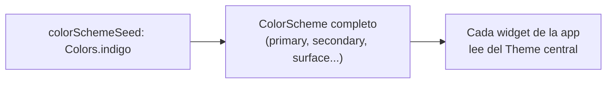
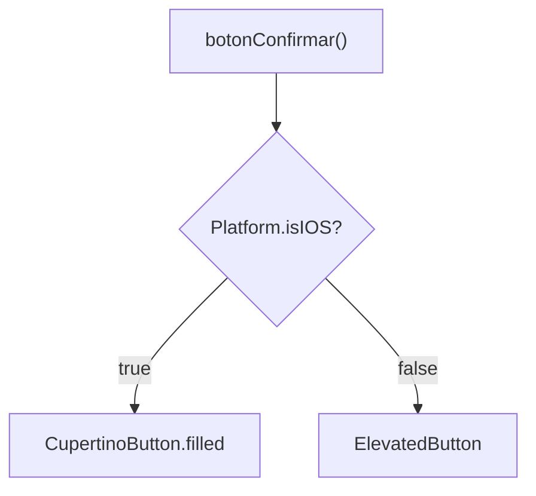
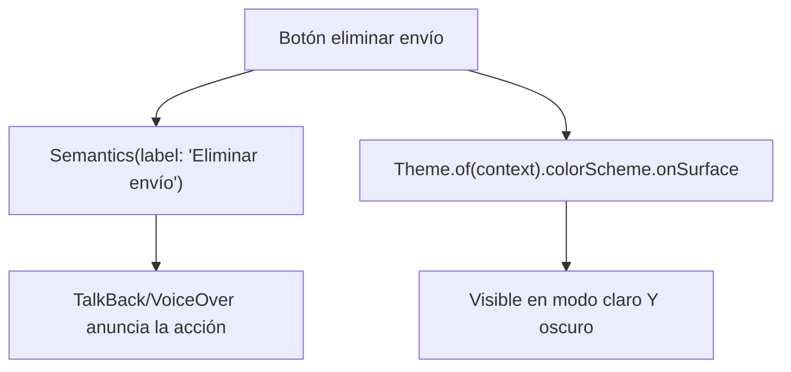

# Módulo 10: Theming, accesibilidad y Material/Cupertino


## Aprende construyendo


### Tema 1: ThemeData con Material 3 · Básico · 30 min

<details open>
<summary><strong>Capa 1 — Lectura</strong></summary>

#### ► DE QUÉ TRATA
Al finalizar vas a centralizar el ThemeData de RutaFlow con Material 3 y colorSchemeSeed, confirmando que un solo color base deriva un esquema completo coherente en toda la app. Prerrequisitos: Módulo 9 completo.

#### ► CÓMO FUNCIONA


</details>

<details>
<summary><strong>Capa 2 — Construcción</strong></summary>

#### Código y verificación
```dart
MaterialApp(
  theme: ThemeData(useMaterial3: true, colorSchemeSeed: Colors.blue),
  darkTheme: ThemeData(useMaterial3: true, colorSchemeSeed: Colors.blue, brightness: Brightness.dark),
  themeMode: ThemeMode.system, // sigue la preferencia del sistema operativo
)
```


```dart
import 'package:flutter/material.dart';

void main() => runApp(MaterialApp(
      theme: ThemeData(colorSchemeSeed: Colors.indigo),
      darkTheme: ThemeData(colorSchemeSeed: Colors.indigo, brightness: Brightness.dark),
      themeMode: ThemeMode.system,
      home: const PantallaConfirmar(),
    ));

class PantallaConfirmar extends StatelessWidget {
  const PantallaConfirmar({super.key});

  @override
  Widget build(BuildContext context) => Scaffold(
        appBar: AppBar(title: const Text('Entrega RF-4471')),
        body: Center(child: FilledButton(onPressed: () {}, child: const Text('Confirmar'))),
      );
}
```

```bash
flutter create demo_flutter
cd demo_flutter
flutter run
```

</details>

### Tema 2: Adaptación Material vs Cupertino · Intermedio · 30 min

<details open>
<summary><strong>Capa 1 — Lectura</strong></summary>

#### ► DE QUÉ TRATA
Al finalizar vas a adaptar el botón "Confirmar entrega" para mostrar CupertinoButton en iOS y ElevatedButton en Android, detectando la plataforma en tiempo de ejecución. Prerrequisitos: Tema 1 de este módulo.

#### ► CÓMO FUNCIONA


#### ► REGLA PRÁCTICA
Detecta la plataforma en tiempo de ejecución (`Platform.isIOS`) y muestra el widget nativo correspondiente (`CupertinoButton` en iOS, `ElevatedButton` en Android) en vez de forzar un único estilo visual en ambas plataformas.

</details>

<details>
<summary><strong>Capa 2 — Construcción</strong></summary>

#### Código y verificación
```dart
import 'dart:io';

import 'package:flutter/cupertino.dart';
import 'package:flutter/material.dart';

Widget botonAdaptativo() => Platform.isIOS
    ? CupertinoButton(child: Text('Continuar'), onPressed: () {})
    : ElevatedButton(child: Text('Continuar'), onPressed: () {});
```


```dart
import 'dart:io';

import 'package:flutter/cupertino.dart';
import 'package:flutter/material.dart';

void confirmar() => debugPrint('Entrega confirmada');

Widget botonConfirmar() => Platform.isIOS
    ? CupertinoButton.filled(onPressed: confirmar, child: const Text('Confirmar entrega'))
    : ElevatedButton(onPressed: confirmar, child: const Text('Confirmar entrega'));

void main() => runApp(MaterialApp(home: Scaffold(body: Center(child: botonConfirmar()))));
```

```bash
flutter create demo_flutter
cd demo_flutter
flutter run
```

</details>

### Tema 3: Accesibilidad con Semantics y dark mode · Intermedio · 35 min

<details open>
<summary><strong>Capa 1 — Lectura</strong></summary>

#### ► DE QUÉ TRATA
Al finalizar vas a agregar Semantics al ícono de "eliminar envío" de RutaFlow, y a probar la pantalla explícitamente en modo oscuro para detectar contrastes insuficientes. Prerrequisitos: Tema 2 de este módulo.

#### ► CÓMO FUNCIONA


</details>

<details>
<summary><strong>Capa 2 — Construcción</strong></summary>

#### Código y verificación
```dart
Semantics(
  label: 'Eliminar tarea',
  button: true,
  child: IconButton(icon: Icon(Icons.delete), onPressed: eliminar),
)
```

```dart
final esOscuro = Theme.of(context).brightness == Brightness.dark;
```


```dart
import 'package:flutter/material.dart';

void main() => runApp(const MaterialApp(home: ListaEnvios()));

class ListaEnvios extends StatefulWidget {
  const ListaEnvios({super.key});

  @override
  State<ListaEnvios> createState() => _ListaEnviosState();
}

class _ListaEnviosState extends State<ListaEnvios> {
  final envios = ['RF-4471', 'RF-5002'];

  void eliminarEnvio(String guia) => setState(() => envios.remove(guia));

  @override
  Widget build(BuildContext context) => Scaffold(
        body: ListView(children: [
          for (final guia in envios)
            ListTile(
              title: Text(guia),
              trailing: Semantics(
                label: 'Eliminar envío',
                button: true,
                child: IconButton(icon: const Icon(Icons.delete), onPressed: () => eliminarEnvio(guia)),
              ),
            ),
        ]),
      );
}
```

```bash
flutter create demo_flutter
cd demo_flutter
flutter run
```

</details>
