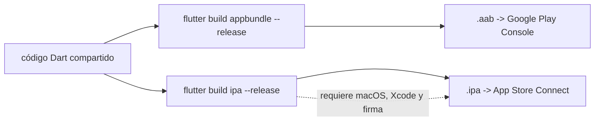
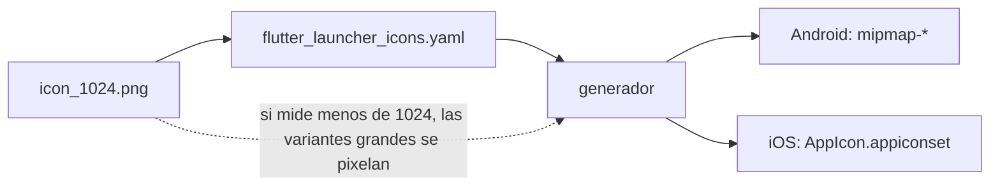
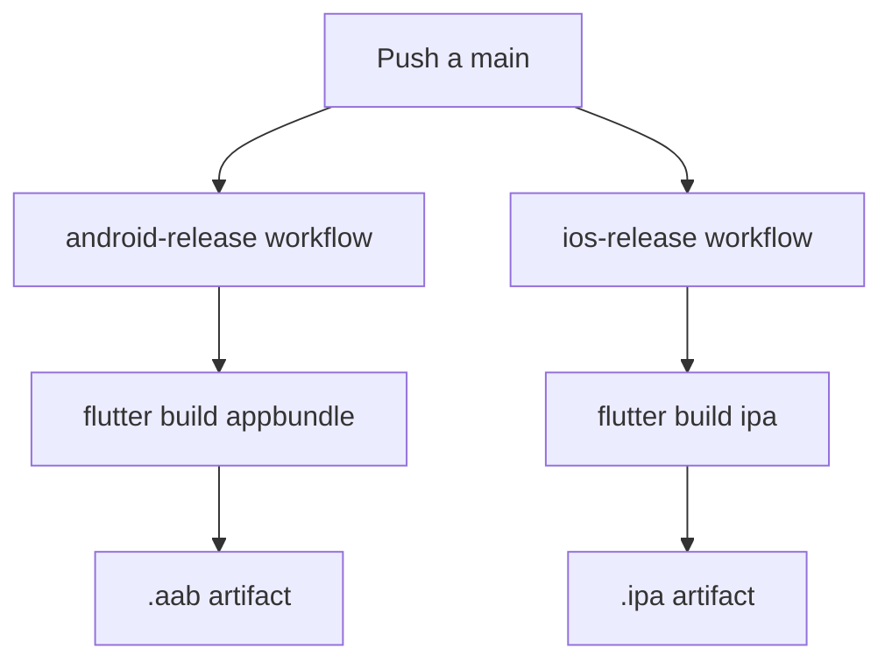
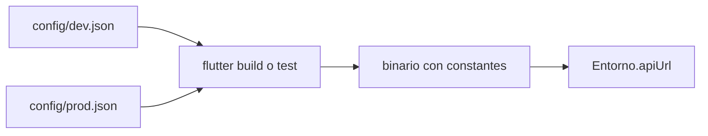
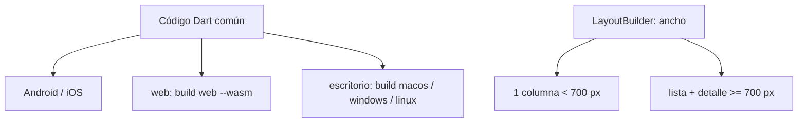

# Módulo 11: Publicación en App Store y Google Play


## Aprende construyendo


### Tema 1: Builds de release para cada plataforma · Intermedio · 40 min

<details open>
<summary><strong>Capa 1 — Lectura</strong></summary>

#### ► DE QUÉ TRATA
Al finalizar vas a generar un .aab de release real con Flutter y a comprobar, con un script, que el artefacto y la versión cumplen los requisitos mínimos de publicación. Prerrequisitos: Flutter y Android SDK instalados; para el .ipa necesitás macOS con Xcode y certificados de fir…

#### ► CÓMO FUNCIONA


</details>

<details>
<summary><strong>Capa 2 — Construcción</strong></summary>

#### Código y verificación

```bash
flutter create flujo_release
cd flujo_release
flutter build appbundle --release
```

Crea `tool/verificar_release.sh`. Usa solo herramientas que ya tienes en macOS y Linux (`sed`, `unzip`, `grep`):

```bash
#!/usr/bin/env bash
# tool/verificar_release.sh — comprueba versión y estructura del .aab antes de subirlo
set -euo pipefail
aab=build/app/outputs/bundle/release/app-release.aab
version=$(sed -n 's/^version:[[:space:]]*//p' pubspec.yaml)
[[ "$version" == *+* ]] || { echo "fallo: pubspec.yaml sin build number (usa 1.0.0+1)"; exit 1; }
[[ -f "$aab" ]] || { echo "fallo: no existe $aab; ejecuta flutter build appbundle --release"; exit 1; }
contenido=$(unzip -Z1 "$aab")
grep -qx 'BundleConfig.pb' <<<"$contenido" && grep -qx 'base/manifest/AndroidManifest.xml' <<<"$contenido" \
  || { echo "fallo: el .aab no tiene la estructura esperada"; exit 1; }
echo "aab: $aab ($(wc -c < "$aab" | tr -d ' ') bytes)"
echo "version: $version"
echo "estructura: BundleConfig.pb y manifest presentes"
[[ -f ios/Flutter/Release.xcconfig ]] && echo "ios: Release.xcconfig presente" || echo "ios: Release.xcconfig ausente"
```

```bash
chmod +x tool/verificar_release.sh
./tool/verificar_release.sh
```

```text
aab: build/app/outputs/bundle/release/app-release.aab (<tamaño> bytes)
version: 1.0.0+1
estructura: BundleConfig.pb y manifest presentes
ios: Release.xcconfig presente
```

</details>

### Tema 2: Iconos y splash screens · Intermedio · 35 min

<details open>
<summary><strong>Capa 1 — Lectura</strong></summary>

#### ► DE QUÉ TRATA
Al finalizar vas a validar, antes de generar variantes, que la imagen fuente de RutaFlow tiene la resolución mínima y que la configuración de íconos apunta a ella. Prerrequisitos: el proyecto `flujo_release` del Tema 1.

#### ► CÓMO FUNCIONA


</details>

<details>
<summary><strong>Capa 2 — Construcción</strong></summary>

#### Código y verificación


No hace falta diseñar un ícono para practicar: `flutter create` ya dejó uno de 1024×1024 en el proyecto iOS y uno
de 192×192 en `web/icons`. Copia los dos a `assets/`:

```bash
cd flujo_release
mkdir -p assets tool
cp ios/Runner/Assets.xcassets/AppIcon.appiconset/Icon-App-1024x1024@1x.png assets/icon_1024.png
cp web/icons/Icon-192.png assets/icon_192.png
```

Crea `flutter_launcher_icons.yaml`:

```yaml
flutter_launcher_icons:
  image_path: "assets/icon_1024.png"
  android: true
  ios: true
```

Crea `tool/verificar_iconos.sh`. `file` lee el encabezado del PNG y devuelve el ancho y el alto:

```bash
#!/usr/bin/env bash
# tool/verificar_iconos.sh — la fuente del ícono existe, es PNG y mide al menos 1024x1024
set -euo pipefail
origen=$(sed -n 's/^[[:space:]]*image_path:[[:space:]]*"\{0,1\}\([^"]*\)"\{0,1\}[[:space:]]*$/\1/p' flutter_launcher_icons.yaml)
[[ -f "$origen" ]] || { echo "fallo: no existe $origen"; exit 1; }
tipo=$(file -b "$origen")
[[ "$tipo" == PNG* ]] || { echo "fallo: $origen no es un PNG válido"; exit 1; }
read -r ancho alto < <(sed -E 's/.*, ([0-9]+) x ([0-9]+),.*/\1 \2/' <<<"$tipo")
(( ancho >= 1024 && alto >= 1024 )) || { echo "fallo: $origen mide ${ancho}x${alto}; la fuente debe ser al menos 1024x1024"; exit 1; }
echo "fuente: $origen (${ancho}x${alto})"
grep -E '^[[:space:]]*(android|ios):' flutter_launcher_icons.yaml | sed 's/^[[:space:]]*//'
echo "destinos esperados: mipmap-* e ios/Runner/Assets.xcassets/AppIcon.appiconset"
```

```bash
chmod +x tool/verificar_iconos.sh
./tool/verificar_iconos.sh
```

```text
fuente: assets/icon_1024.png (1024x1024)
android: true
ios: true
destinos esperados: mipmap-* e ios/Runner/Assets.xcassets/AppIcon.appiconset
```

Cambia `image_path` a `assets/icon_192.png` y vuelve a ejecutar. El script se detiene antes de generar variantes
pixeladas:

```text
fallo: assets/icon_192.png mide 192x192; la fuente debe ser al menos 1024x1024
```

</details>

### Tema 3: CI/CD con Codemagic o Fastlane · Avanzado · 40 min

<details open>
<summary><strong>Capa 1 — Lectura</strong></summary>

#### ► DE QUÉ TRATA
Al finalizar vas a configurar un pipeline de Codemagic que automatice el build de release de RutaFlow para Android, con pasos separados específicos de esa plataforma. Prerrequisitos: Tema 2 de este módulo.

#### ► CÓMO FUNCIONA


</details>

<details>
<summary><strong>Capa 2 — Construcción</strong></summary>

#### Código y verificación
```yaml
# codemagic.yaml
workflows:
  android-release:
    scripts:
      - flutter build appbundle --release
    artifacts:
      - build/**/outputs/**/*.aab
```

```yaml
workflows:
  android-release:
    scripts: [flutter build appbundle --release]
    artifacts: [build/**/outputs/**/*.aab]
  ios-release:
    scripts: [flutter build ipa --release]
    artifacts: [build/ios/**/*.ipa]
```


```yaml
# codemagic.yaml
workflows:
  android-release:
    scripts:
      - flutter build appbundle --release
    artifacts:
      - build/**/outputs/**/*.aab
```

```bash
flutter create demo_flutter
cd demo_flutter
flutter run
```

</details>

### Tema 4: Entornos y flavors con --dart-define-from-file · Avanzado · 40 min

<details open>
<summary><strong>Capa 1 — Lectura</strong></summary>

#### ► DE QUÉ TRATA
Al finalizar podrás compilar la misma app para desarrollo, QA y producción inyectando configuración con --dart-define-from-file, leerla con constantes de compilación y fallar rápido si falta un valor. Prerrequisitos: Temas 1 a 3 de este módulo.

#### ► CÓMO FUNCIONA


</details>

<details>
<summary><strong>Capa 2 — Construcción</strong></summary>

#### Código y verificación


```bash
mkdir entornos && cd entornos
flutter create repartidor_entornos
cd repartidor_entornos
mkdir -p config
```

```json
{
  "ENTORNO": "dev",
  "API_URL": "https://api-dev.rutaflow.co",
  "LOGS_DETALLADOS": "true"
}
```

```json
{
  "ENTORNO": "prod",
  "API_URL": "https://api.rutaflow.co",
  "LOGS_DETALLADOS": "false"
}
```

```dart
// lib/entorno.dart — la configuración llega en tiempo de COMPILACIÓN con --dart-define
class Entorno {
  static const nombre = String.fromEnvironment('ENTORNO', defaultValue: 'desconocido');
  static const apiUrl = String.fromEnvironment('API_URL');
  static const logsDetallados = bool.fromEnvironment('LOGS_DETALLADOS');

  static void validar() {
    if (apiUrl.isEmpty) {
      throw StateError('API_URL no definido: ejecuta con --dart-define-from-file=config/<entorno>.json');
    }
  }
}
```

```dart
// test/entorno_test.dart
import 'package:flutter_test/flutter_test.dart';
import 'package:repartidor_entornos/entorno.dart';

void main() {
  test('usa la configuración del entorno dev', () {
    expect(Entorno.nombre, 'dev');
    expect(Entorno.apiUrl, 'https://api-dev.rutaflow.co');
    expect(Entorno.logsDetallados, isTrue);
    expect(Entorno.validar, returnsNormally);
  });
}
```

</details>

### Tema 5: Flutter para web y escritorio: compilar, adaptar la interfaz y elegir el renderizador · Avanzado · 45 min

<details open>
<summary><strong>Capa 1 — Lectura</strong></summary>

#### ► DE QUÉ TRATA
Usa Flutter 3.24 o superior. Habilita las plataformas: flutter config --enable-web --enable-macos-desktop (o --enable-windows-desktop / --enable-linux-desktop) y agrega las carpetas al proyecto con flutter create --platforms=web,macos ..

#### ► LA ANALOGÍA
**Conceptos clave:** `kIsWeb`, `defaultTargetPlatform`, WebAssembly (`--wasm`), renderizador, `LayoutBuilder`, hover, atajos (`Shortcuts`, `Actions`), plugin no disponible por plataforma.

- **Web:** `flutter build web` genera archivos estáticos. Con `--wasm` usa WebAssembly y el renderizador skwasm (más rápido) en navegadores que lo soportan, con respaldo automático a JavaScript.
- **Escritorio:** `flutter build macos`, `windows` o `linux` genera una app nativa. Debes compilar en ese sistema operativo.

Para adaptar la interfaz:

1. **Diseño:** `LayoutBuilder` elige una o varias columnas según el ancho, no según la plataforma.
2. **Entrada:** `MouseRegion` para hover, `Shortcuts` y `Actions` para atajos de teclado.
3. **Capacidades:** algunos plugins no existen en web (por ejemplo, `dart:io`, cámara nativa). Usa `kIsWeb` o importaciones condicionales para esas partes.

**Analogía:** la misma receta se sirve en un restaurante (escritorio), en un local de comida rápida (web) y para llevar (móvil): el plato es el mismo, pero cambian el empaque y los cubiertos. La analogía falla en que algunos ingredientes (plugins) solo existen en una de las cocinas.

**Límite de uso:** Flutter web no es la mejor opción para sitios de contenido que necesitan SEO; úsalo para aplicaciones. El primer arranque web descarga el motor: mide el tamaño y la carga.



#### ► CÓMO FUNCIONA


</details>

<details>
<summary><strong>Capa 2 — Construcción</strong></summary>

#### Código y verificación


```dart
import 'package:flutter/foundation.dart' show kIsWeb;
import 'package:flutter/material.dart';
import 'package:flutter/services.dart';

class RefrescarIntent extends Intent { const RefrescarIntent(); }

class Tablero extends StatelessWidget {
  const Tablero({super.key, required this.alRefrescar});
  final VoidCallback alRefrescar;

  @override
  Widget build(BuildContext context) {
    return Shortcuts( // Ctrl+R / Cmd+R refresca en escritorio y web
      shortcuts: {
        const SingleActivator(LogicalKeyboardKey.keyR, control: true): const RefrescarIntent(),
        const SingleActivator(LogicalKeyboardKey.keyR, meta: true): const RefrescarIntent(),
      },
      child: Actions(
        actions: {RefrescarIntent: CallbackAction<RefrescarIntent>(onInvoke: (_) { alRefrescar(); return null; })},
        child: Focus(
          autofocus: true,
          child: LayoutBuilder(builder: (context, limites) {
            final ancho = limites.maxWidth >= 700; // por ancho, no por plataforma
            return Scaffold(
              appBar: AppBar(title: Text(kIsWeb ? 'Panel (web)' : 'Panel')),
              body: ancho
                  ? const Row(children: [Expanded(child: _Lista()), VerticalDivider(), Expanded(flex: 2, child: _Detalle())])
                  : const _Lista(),
            );
          }),
        ),
      ),
    );
  }
}

class _Lista extends StatelessWidget {
  const _Lista();
  @override
  Widget build(BuildContext context) => ListView(children: [
        for (final c in ['ENV-41', 'ENV-42'])
          MouseRegion(cursor: SystemMouseCursors.click, child: ListTile(title: Text(c), onTap: () {})),
      ]);
}

class _Detalle extends StatelessWidget {
  const _Detalle();
  @override
  Widget build(BuildContext context) => const Center(child: Text('Selecciona un envío'));
}
```

```bash
flutter run -d chrome
flutter build web --wasm
flutter build macos   # en una Mac
```

```text
flutter build web --wasm termina con «✓ Built build/web».
En Chrome a pantalla completa: lista a la izquierda y detalle a la derecha; al estrechar la ventana por debajo de 700 px, una sola columna.
Ctrl+R (o Cmd+R en macOS) llama alRefrescar.
```

</details>
