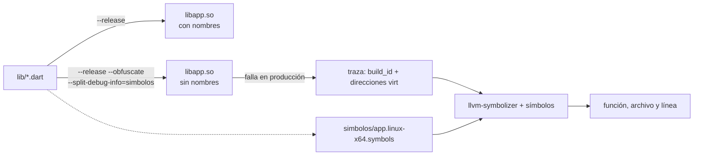
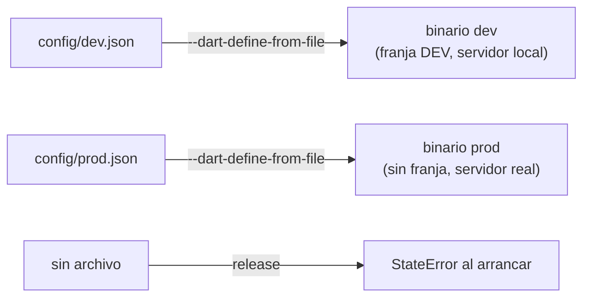
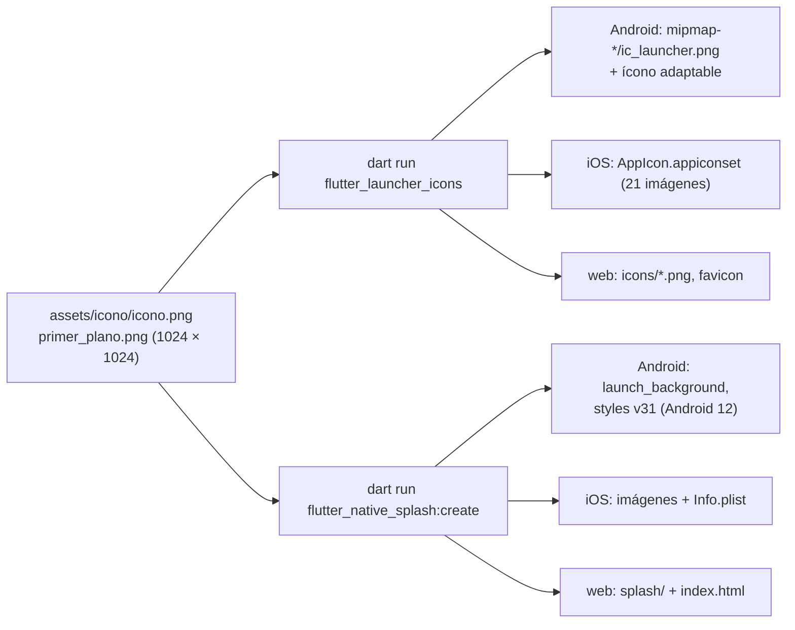
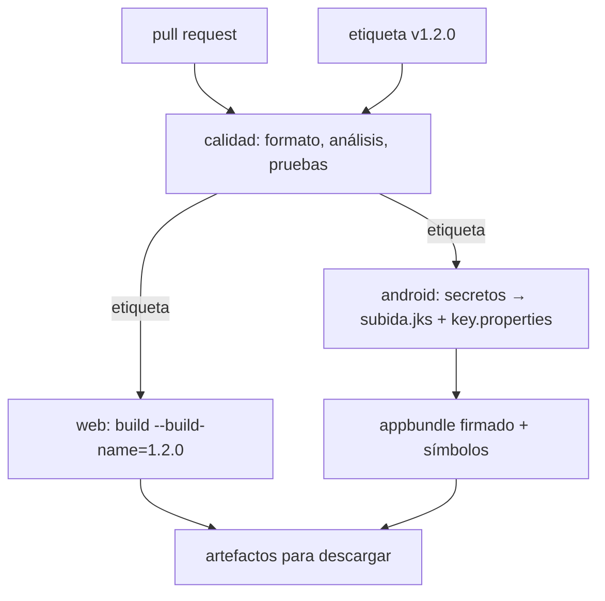

# Módulo 11: Publicación: compilaciones, entornos, íconos, firma y CI/CD

**Entorno comprobado para esta edición (2026-11-24):** Flutter 3.50.1 (canal estable) con Dart 3.14.0 en Linux
x86_64, con `material_ui` 1.11.1, `package_info_plus` 10.2.2, `flutter_launcher_icons` 0.14.4 y
`flutter_native_splash` 2.4.8, y OpenJDK con `keytool`. Todas las compilaciones de este módulo se hicieron ese día, en
`/home/estudiante/labs/flutter/m11` (tu `~/labs/flutter/m11`): Linux en debug y release, web en release, y las
variantes ofuscadas y por entorno. Las capturas de la app son de la **app de escritorio real**, ejecutada en una
pantalla virtual (`xvfb`). El equipo de pruebas **no tiene el SDK de Android ni Xcode**: los archivos de Android e iOS
(íconos, pantalla de inicio, firma) se generaron y revisaron de verdad, pero el `.aab` y el `.ipa` no se compilaron
aquí; el módulo muestra el error real que da `flutter build appbundle` sin SDK y explica qué cambia en un equipo con
él.

Hasta ahora la app se ejecutó con `flutter run` o en pruebas. Este módulo la convierte en algo que se entrega: un
binario optimizado con su versión, configurado para un entorno (desarrollo o producción), con su ícono y su nombre en
cada plataforma, firmado, y producido por un CI que no depende del equipo de nadie.

**Al terminar este módulo podrás:**
- elegir entre los modos debug, profile y release, poner la versión y medir lo que se entrega;
- ofuscar el código, guardar los símbolos y traducir una traza de error de producción;
- compilar la misma app para varios entornos con `--dart-define-from-file`, sin secretos en el binario;
- generar íconos, ícono adaptable de Android y pantalla de inicio para cada plataforma;
- firmar la app de Android sin subir la clave al repositorio y automatizar todo en un CI.

**Esquema del módulo:** Tema 1 (modos de compilación, versión y ofuscación) → Tema 2 (entornos con
`--dart-define-from-file`) → Tema 3 (identidad: nombre, íconos y pantalla de inicio) → Tema 4 (firma y CI/CD) →
Proyecto 28.

**Qué necesitas saber antes:** el Módulo 10 (el tema de la app); del Módulo 9, **las pruebas y el script de CI**
(Tema 5); del Módulo 8, **el modo profile** (Tema 3); del Módulo 7, **las pruebas de integración en Linux** (Tema
1).

**Qué no se repite:** la medición de rendimiento en profile (Módulo 8) y las pruebas en sí (Módulo 9). Aquí las
pruebas son un paso más del CI.

**Prepara el proyecto:**

```text
$ cd ~/labs/flutter
$ flutter create --org com.academia --platforms=linux,web,android,ios m11
$ cd m11
$ flutter pub add package_info_plus dev:flutter_launcher_icons dev:flutter_native_splash
$ sudo apt install xvfb imagemagick llvm openjdk-17-jdk-headless   # pantalla virtual, capturas, símbolos y keytool
```

Agrega al final de `analysis_options.yaml` el ancho de línea que usa el curso, para que `dart format` y el CI estén
de acuerdo:

```yaml
formatter:
  page_width: 120
```

La app del módulo es una sola pantalla, «Acerca de», que muestra lo que este módulo controla: versión, entorno,
servidor y modo de compilación. `ruta.dart` tiene un cálculo que falla a propósito para el Tema 1.

```dart
// lib/config.dart — la configuración llega al compilar (--dart-define-from-file) y queda fija en el binario
class Config {
  static const entorno = String.fromEnvironment('ENTORNO', defaultValue: 'dev');
  static const apiUrl = String.fromEnvironment('API_URL', defaultValue: 'http://localhost:8080');
  static const _semilla = String.fromEnvironment('COLOR_SEMILLA', defaultValue: '0xFFE65100');
  static const fallar = bool.fromEnvironment('FALLAR'); // solo para la demostración del Tema 1

  static int get colorSemilla => int.parse(_semilla);
  static bool get esProduccion => entorno == 'prod';
}
```

```dart
// lib/ruta.dart — un cálculo que falla a propósito, para ver cómo queda la traza en cada compilación
class PlanificadorRuta {
  int calcularDistancia(List<int> tramos) {
    if (tramos.isEmpty) throw StateError('la ruta no tiene tramos');
    return tramos.reduce((a, b) => a + b);
  }

  int planificar() => calcularDistancia(const []);
}
```

```dart
import 'dart:async';
import 'dart:io';

import 'package:flutter/foundation.dart';
import 'package:material_ui/material_ui.dart';
import 'package:package_info_plus/package_info_plus.dart';

import 'config.dart';
import 'ruta.dart';

String get modo => kReleaseMode ? 'release' : (kProfileMode ? 'profile' : 'debug');

Future<void> main() async {
  if (kReleaseMode && !const bool.hasEnvironment('ENTORNO')) {
    // una release sin entorno no debe arrancar
    throw StateError('Falta el entorno: compila con --dart-define-from-file=config/<entorno>.json');
  }
  WidgetsFlutterBinding.ensureInitialized();
  final info = await PackageInfo.fromPlatform(); // nombre y versión del pubspec
  stdout.writeln(
    'arranque: ${info.appName} ${info.version}+${info.buildNumber} '
    'modo=$modo entorno=${Config.entorno} api=${Config.apiUrl}',
  );
  if (Config.fallar) {
    Timer(const Duration(milliseconds: 500), () => PlanificadorRuta().planificar());
  }
  runApp(AppRuta(info: info));
}

class AppRuta extends StatelessWidget {
  const AppRuta({super.key, required this.info});
  final PackageInfo info;

  @override
  Widget build(BuildContext context) {
    final app = MaterialApp(
      debugShowCheckedModeBanner: false, // el aviso de entorno lo ponemos nosotros
      title: Config.esProduccion ? 'Ruta' : 'Ruta (${Config.entorno})',
      theme: ThemeData(colorScheme: ColorScheme.fromSeed(seedColor: Color(Config.colorSemilla))),
      home: AcercaDe(info: info),
    );
    if (Config.esProduccion) return app;
    return Directionality(
      // franja de esquina solo fuera de producción
      textDirection: TextDirection.ltr,
      child: Banner(message: Config.entorno.toUpperCase(), location: BannerLocation.topEnd, child: app),
    );
  }
}

class AcercaDe extends StatelessWidget {
  const AcercaDe({super.key, required this.info});
  final PackageInfo info;

  @override
  Widget build(BuildContext context) {
    final esquema = Theme.of(context).colorScheme;
    Widget dato(String etiqueta, String valor) => ListTile(title: Text(etiqueta), subtitle: Text(valor));
    return Scaffold(
      appBar: AppBar(title: const Text('Acerca de'), backgroundColor: esquema.primaryContainer),
      body: ListView(
        children: [
          dato('Versión', '${info.version} (compilación ${info.buildNumber})'),
          dato('Entorno', Config.entorno),
          dato('Servidor', Config.apiUrl),
          dato('Modo de compilación', modo),
        ],
      ),
    );
  }
}
```

```dart
import 'package:flutter_test/flutter_test.dart';
import 'package:m11/main.dart';
import 'package:m11/ruta.dart';
import 'package:package_info_plus/package_info_plus.dart';

void main() {
  test('una ruta sin tramos se rechaza', () {
    expect(() => PlanificadorRuta().calcularDistancia(const []), throwsStateError);
    expect(PlanificadorRuta().calcularDistancia(const [3, 4]), 7);
  });

  testWidgets('sin --dart-define la app se considera dev y lo muestra', (tester) async {
    PackageInfo.setMockInitialValues(
      // datos de prueba en lugar de los del sistema
      appName: 'm11',
      packageName: 'com.academia.m11',
      version: '1.0.0',
      buildNumber: '1',
      buildSignature: '',
    );
    await tester.pumpWidget(AppRuta(info: await PackageInfo.fromPlatform()));
    expect(find.text('dev'), findsOneWidget);
    expect(find.text('DEV'), findsNothing); // la franja es pintura, no texto en el árbol
    expect(find.text('1.0.0 (compilación 1)'), findsOneWidget);
  });
}
```

Para ver la app de escritorio sin abrir ventanas, el laboratorio usa este script, que la ejecuta en una pantalla
virtual, toma la captura y la cierra. La ventana se configuró de 480 × 420 en `linux/runner/my_application.cc` (línea
`gtk_window_set_default_size`): si la ventana es más grande que la pantalla virtual, la captura recorta la esquina
derecha, justo donde va la franja de entorno del Tema 2.

```bash
#!/bin/bash
# correr_app.sh <binario> <png> [segundos] : ejecuta la app de escritorio en una pantalla virtual, captura la ventana y la cierra
bin="$1"; png="$2"; seg="${3:-4}"
xvfb-run -a -s "-screen 0 480x420x24" bash -c "\"$bin\" & p=\$!; sleep $seg; import -window root \"$png\"; kill \$p; wait \$p 2>/dev/null; true"
```


## Aprende construyendo


### Tema 1: Modos de compilación, versión y ofuscación · Intermedio · 45 min

<details open>
<summary><strong>Capa 1 — Lectura</strong></summary>

#### Objetivos
Al terminar este tema podrás:
- explicar qué cambia entre debug, profile y release, y medir el tamaño de cada uno;
- poner la versión y el número de compilación desde `pubspec.yaml` o desde la línea de órdenes;
- compilar ofuscado con `--split-debug-info` y guardar los símbolos;
- traducir una traza de error ofuscada a funciones y líneas.

**Conceptos clave:** modo de compilación, AOT y JIT, versión y número de compilación, ofuscación, archivo de
símbolos, traza ofuscada

#### El problema
La app de pruebas pesa 131 MB y en el teléfono de un cliente arranca lenta: alguien entregó la compilación de
depuración. Cuando por fin se entrega la release, un repartidor reporta un cierre inesperado y el registro solo
muestra direcciones de memoria. Hace falta saber qué se entrega, con qué versión, y cómo leer sus errores.

Este tema usa **el modo profile** (Módulo 8, Tema 3), **las excepciones y las trazas** (Módulo 0, Tema 3) y **los
`Timer`** (Módulo 0, Tema 8).

#### Glosario del tema

**modo de compilación**
- **Definición técnica:** debug (código JIT, aserciones, recarga en caliente, herramientas de depuración), profile (AOT con herramientas de medición) o release (AOT optimizado, sin aserciones ni herramientas); se elige con `--debug`, `--profile` o `--release` y se consulta con `kDebugMode`, `kProfileMode` y `kReleaseMode`.
- **En palabras sencillas:** borrador, ensayo general y función de estreno.
- **Dónde se rompe la comparación:** el «borrador» no es más lento por estar incompleto, sino porque compila mientras corre y verifica todo.
- **Ejemplo:** el paquete de Linux pesa 131,3 MB en debug y 21,6 MB en release.
- **Error típico:** medir el rendimiento o entregar en debug.

**AOT y JIT**
- **Definición técnica:** AOT (*ahead of time*) compila Dart a código de máquina antes de ejecutar (en Linux, `lib/libapp.so`); JIT (*just in time*) compila mientras la app corre, lo que permite la recarga en caliente.
- **En palabras sencillas:** traer la comida hecha o cocinarla mientras el cliente espera.
- **Dónde se rompe la comparación:** el JIT de debug no es «peor»: es lo que hace posible cambiar el código sin reiniciar.
- **Ejemplo:** `libapp.so` de la release ocupa 3,9 MB.
- **Error típico:** concluir que «Flutter es lento» por lo que se vio en debug.

**versión y número de compilación**
- **Definición técnica:** `version: 1.0.0+1` en `pubspec.yaml`: la parte antes de `+` es la versión visible (`versionName` en Android, `CFBundleShortVersionString` en iOS) y la de después, un entero que debe crecer en cada subida (`versionCode`, `CFBundleVersion`); `--build-name` y `--build-number` las reemplazan al compilar.
- **En palabras sencillas:** el nombre de la edición y el número de serie.
- **Dónde se rompe la comparación:** las tiendas rechazan un número de compilación repetido aunque la versión visible cambie.
- **Ejemplo:** `--build-name=1.2.0 --build-number=7` produce «m11 1.2.0+7».
- **Error típico:** subir dos compilaciones con el mismo `+N`.

**ofuscación**
- **Definición técnica:** `--obfuscate` reemplaza los nombres de clases y funciones del binario por identificadores sin sentido; exige `--split-debug-info=<carpeta>`, que saca la información de depuración a un archivo aparte.
- **En palabras sencillas:** borrar las etiquetas de las cajas y guardar el inventario en otra parte.
- **Dónde se rompe la comparación:** no cifra nada; dificulta leer el binario, pero los textos (como una URL) siguen visibles.
- **Ejemplo:** la `libapp.so` ofuscada baja de 3,9 a 3,1 MB, y los símbolos (1,6 MB) quedan en `simbolos/`.
- **Error típico:** ofuscar y no guardar los símbolos de esa compilación exacta.

**archivo de símbolos**
- **Definición técnica:** archivo ELF con información DWARF (`app.linux-x64.symbols`, `app.android-arm64.symbols`…) que relaciona cada dirección del código compilado con su función, archivo y línea.
- **En palabras sencillas:** el diccionario que traduce las direcciones a código.
- **Dónde se rompe la comparación:** cada compilación tiene el suyo; el de otra compilación da respuestas equivocadas o ninguna.
- **Ejemplo:** `llvm-symbolizer` traduce `0x2e35d6` a `PlanificadorRuta.calcularDistancia (lib/ruta.dart:4:25)`.
- **Error típico:** borrar `simbolos/` con `flutter clean`, o no subirlo al servicio de reportes de errores.

**traza ofuscada**
- **Definición técnica:** traza que imprime una release con `--split-debug-info`: en lugar de nombres, muestra el `build_id` y, por cada marco, la dirección absoluta (`abs`) y la relativa al código (`virt`).
- **En palabras sencillas:** una dirección de bodega en lugar del nombre del producto.
- **Dónde se rompe la comparación:** el mensaje de la excepción («la ruta no tiene tramos») sí se ve; solo se pierden los nombres.
- **Ejemplo:** `#00 abs 00007f3b885405d6 virt 00000000002e35d6 _kDartSnapshotText+0x1f75d6`.
- **Error típico:** pegar solo el mensaje en el reporte y perder las direcciones.

#### ► CÓMO FUNCIONA
`flutter build` compila el Dart según el modo y empaqueta el motor y los recursos. Con `--obfuscate` el binario
pierde los nombres y los símbolos van a otra carpeta. Cuando la app falla en producción, se toman las direcciones
`virt` de la traza y se buscan en el archivo de símbolos de esa misma compilación.



#### Problema resuelto 1.1
Compila la app en debug y release para Linux y en release para web, y compara lo que pesa cada entrega. Después
compila la versión 1.2.0+7 ofuscada, con el cálculo que falla, y traduce la traza que imprime.

**Razonamiento:**
1. El tamaño se mide sobre lo que se entrega: la carpeta `bundle` en Linux y `build/web` en web.
2. Para ver qué aporta la ofuscación, se compara la misma app con y sin `--obfuscate`, con la misma traza.
3. La versión se pasa en la línea de órdenes, como lo hará el CI, sin editar `pubspec.yaml`.
4. `FALLAR=true` hace que `planificar()` lance un `StateError` medio segundo después de arrancar.
5. La traza ofuscada se traduce con el archivo de símbolos de esa compilación.

```bash
#!/bin/bash
# tamanos.sh : tamaño de lo que se entrega en cada compilación
t() { du -sb "$1" | awk -v e="$2" '{printf "%-44s %6.1f MB\n", e, $1/1048576}'; }
t build/linux/x64/debug/bundle   "Linux debug (paquete completo)"
t paquete-prod                   "Linux release (paquete completo)"
t paquete-prod/lib/libapp.so     "  libapp.so (código Dart compilado)"
t libapp-ofuscada.so             "  libapp.so ofuscada + split-debug-info"
t simbolos                       "  símbolos guardados aparte"
t build/web                      "Web release (carpeta completa)"
t build/web/main.dart.js         "  main.dart.js"
t build/web/canvaskit            "  canvaskit (motor de dibujo)"
```

```text
$ ./tamanos.sh
Linux debug (paquete completo)                131.3 MB
Linux release (paquete completo)               21.6 MB
  libapp.so (código Dart compilado)            3.9 MB
  libapp.so ofuscada + split-debug-info         3.1 MB
  símbolos guardados aparte                    1.6 MB
Web release (carpeta completa)                 38.6 MB
  main.dart.js                                  0.8 MB
  canvaskit (motor de dibujo)                  36.3 MB
```

Release sin ofuscar, con la falla activada:

```text
arranque: m11 1.0.0+1 modo=release entorno=prod api=https://api.envios.example.com
[ERROR:flutter/runtime/dart_vm_initializer.cc(40)] Unhandled Exception: Bad state: la ruta no tiene tramos
#0      PlanificadorRuta.calcularDistancia (package:m11/ruta.dart:4)
#1      PlanificadorRuta.planificar (package:m11/ruta.dart:8)
#2      main.<anonymous closure> (package:m11/main.dart:25)
#3      Timer._createTimer.<anonymous closure> (dart:async-patch/timer_patch.dart:18)
#4      _Timer._runTimers (dart:isolate-patch/timer_impl.dart:423)
#5      _Timer._handleMessage (dart:isolate-patch/timer_impl.dart:454)
#6      _RawReceivePort._handleMessage (dart:isolate-patch/isolate_patch.dart:192)
```

Release ofuscada, versión 1.2.0+7:

```text
$ flutter build linux --release --dart-define-from-file=config/prod.json --dart-define=FALLAR=true --build-name=1.2.0 --build-number=7 --obfuscate --split-debug-info=simbolos
Building Linux application...                                   
✓ Built build/linux/x64/release/bundle/m11
```

```text
arranque: m11 1.2.0+7 modo=release entorno=prod api=https://api.envios.example.com
[ERROR:flutter/runtime/dart_vm_initializer.cc(40)] Unhandled Exception: Bad state: la ruta no tiene tramos
*** *** *** *** *** *** *** *** *** *** *** *** *** *** *** ***
pid: 10003, tid: 139893727116096, name io.flutter.ui
os: linux arch: x64 comp: no sim: no
build_id: '8dbf7f6027d61247db7fe4dd5d6318c1'
isolate_dso_base: 7f3b8825d000, vm_dso_base: 0
isolate_instructions: 7f3b88349000, vm_instructions: 0
    #00 abs 00007f3b885405d6 virt 00000000002e35d6 _kDartSnapshotText+0x1f75d6
    #01 abs 00007f3b8854058e virt 00000000002e358e _kDartSnapshotText+0x1f758e
    #02 abs 00007f3b883666c2 virt 00000000001096c2 _kDartSnapshotText+0x1d6c2
    #03 abs 00007f3b88545b3b virt 00000000002e8b3b _kDartSnapshotText+0x1fcb3b
    #04 abs 00007f3b883652a5 virt 00000000001082a5 _kDartSnapshotText+0x1c2a5
    #05 abs 00007f3b8836522e virt 000000000010822e _kDartSnapshotText+0x1c22e
    #06 abs 00007f3b885748f9 virt 00000000003178f9 _kDartSnapshotText+0x22b8f9
    #07 abs 00007f3b88541cab virt 00000000002e4cab _kDartSnapshotText+0x1f8cab
```

La herramienta oficial, `flutter symbolize`, falla con este archivo de símbolos de Linux en Flutter 3.50.1:

```text
$ flutter symbolize -i traza.txt -d simbolos/app.linux-x64.symbols
arranque: m11 1.2.0+7 modo=release entorno=prod api=https://api.envios.example.com
[ERROR:flutter/runtime/dart_vm_initializer.cc(40)] Unhandled Exception: Bad state: la ruta no tiene tramos
*** *** *** *** *** *** *** *** *** *** *** *** *** *** *** ***
pid: 10003, tid: 139893727116096, name io.flutter.ui
os: linux arch: x64 comp: no sim: no
build_id: '8dbf7f6027d61247db7fe4dd5d6318c1'
isolate_dso_base: 7f3b8825d000, vm_dso_base: 0
isolate_instructions: 7f3b88349000, vm_instructions: 0
Failed to symbolize stack trace:
 Cannot locate isolate instructions section in snapshot
[código de salida: 1]
```

El archivo de símbolos es un ELF estándar con DWARF, así que `llvm-symbolizer` (del paquete `llvm`) lo lee
directamente:

```bash
#!/bin/bash
# simbolizar.sh <traza> <símbolos> : traduce las direcciones «virt» de una traza ofuscada a función y línea
# (llvm-symbolizer lee el DWARF del archivo de símbolos; una dirección puede tener varias funciones «inlined»)
grep -oE 'virt [0-9a-f]+' "$1" | while read -r _ dir; do
  llvm-symbolizer --obj="$2" "0x$dir" | paste - - | sed -E 's#/home/[^ ]*/lib/#lib/#; s#third_party/dart/sdk/lib/_internal/vm/lib/#dart:#' |
    awk -F'\t' -v d="0x${dir#0000000000}" '$1!=""{printf "%s  %s (%s)\n", (n++ ? "   (inline)" : d), $1, $2}'
done
```

```text
$ ./simbolizar.sh traza.txt simbolos/app.linux-x64.symbols
0x2e35d6  PlanificadorRuta.calcularDistancia (lib/ruta.dart:4:25)
0x2e358e  PlanificadorRuta.planificar (lib/ruta.dart:8:23)
   (inline)  main.<anonymous closure> (lib/main.dart:25:71)
0x1096c2  Timer._createTimer.<anonymous closure> (dart:timer_patch.dart:18:15)
0x2e8b3b  _Timer._runTimers (dart:timer_impl.dart:423:19)
0x1082a5  _Timer._handleMessage (dart:timer_impl.dart:454:5)
0x10822e  _Timer._handleMessage (dart:timer_impl.dart:444:3)
0x3178f9  _Closure.call (dart:function.dart:0:0)
0x2e4cab  _RawReceivePort._handleMessage (dart:isolate_patch.dart:192:12)
```

**Explicación por partes.**
- **Tamaños:** el paquete debug (131,3 MB) es seis veces el release (21,6 MB) porque lleva el compilador JIT, el
  código fuente compilado a *kernel* y las herramientas de depuración. Del release, solo 3,9 MB son tu código Dart
  (`libapp.so`); el resto es el motor de Flutter.
- **Web:** la carpeta pesa 38,6 MB, pero 36,3 MB son variantes del motor de dibujo (`canvaskit.wasm` de 7 MB,
  `skwasm.wasm` de 3,4 MB y otras); el navegador descarga solo la que le sirve. Tu código es `main.dart.js`: 0,8 MB.
- **Sin ofuscar:** la release imprime la traza con nombres y líneas: `calcularDistancia` (ruta.dart:4), `planificar`
  (ruta.dart:8) y el `Timer` de `main.dart:25`.
- **Ofuscada:** la línea `arranque` confirma la versión `1.2.0+7`. La traza conserva el mensaje (`Bad state: la ruta
  no tiene tramos`), pero cada marco es una dirección. `libapp.so` bajó de 3,9 a 3,1 MB.
- **Traducción:** `llvm-symbolizer` devuelve los mismos lugares que la traza sin ofuscar, con columna: `ruta.dart:4:25`
  y `ruta.dart:8:23`. Además muestra que el compilador metió (*inline*) el cierre de `main.dart:25` dentro del marco
  de `planificar`: por eso la traza ofuscada tiene un marco menos.
- `flutter symbolize` busca una sección con el nombre que usaban versiones anteriores del formato de símbolos y no la
  encuentra (`Cannot locate isolate instructions section`). Es una falla de la herramienta, no del archivo: guarda
  los símbolos igual, y comprueba la herramienta de tu versión antes de necesitarla en una emergencia.

> **Error común.** Entregar el resultado de `flutter run` o de `flutter build --debug`. Ocupa seis veces más, arranca
> más lento y tiene las aserciones activas. Lo que se entrega sale siempre de `flutter build ... --release`.

> **Error común.** Ofuscar y descartar la carpeta de símbolos, o guardar los de otra compilación. Sin el archivo
> exacto (comprueba el `build_id`), una traza de producción no se puede leer.

> **Buena práctica.** Guarda los símbolos de cada versión publicada junto con el binario (el CI del Tema 4 los sube
> como artefacto), o súbelos al servicio de reportes de errores que uses (Módulo 13).

> **Prevenir errores.** Agrega `app.*.symbols` y la carpeta de símbolos al `.gitignore` (Flutter ya incluye
> `app.*.symbols`): son grandes y cambian en cada compilación. Se guardan como artefactos, no en el repositorio.

#### Checkpoint 1.1
Te llega una traza ofuscada con `build_id: '8dbf7f6027d61247db7fe4dd5d6318c1'`. ¿Qué necesitas para traducirla?

Respuesta: el archivo de símbolos de la compilación con ese mismo `build_id` (el de la versión publicada), y una
herramienta que lea DWARF, como `llvm-symbolizer`, aplicada a las direcciones `virt`.

</details>

<details>
<summary><strong>Capa 2 — Construcción</strong></summary>

#### Paso 1 · Compila y mide
Compila Linux en debug y release, y web en release, con `--dart-define-from-file=config/prod.json` (el archivo es del
Tema 2; créalo ya). Copia el release a `paquete-prod` y ejecuta `./tamanos.sh`.

#### Paso 2 · Haz fallar la release
Compila con `--dart-define=FALLAR=true` y ejecuta `./correr_app.sh build/linux/x64/release/bundle/m11 /tmp/x.png 3`.
Lee la traza.

#### Paso 3 · Ofusca
Compila con `--obfuscate --split-debug-info=simbolos --build-name=1.2.0 --build-number=7`, guarda la salida en
`traza.txt` y tradúcela con `./simbolizar.sh`.

#### Paso 4 · Prueba con símbolos equivocados
Cambia una línea de `ruta.dart`, compila otra vez ofuscado en otra carpeta (`--split-debug-info=simbolos2`) y traduce
la traza vieja con los símbolos nuevos. ¿Coinciden los `build_id`? ¿Qué dice la traducción?

#### Paso 5 · Profile
Compila con `--profile` y compara su `libapp.so` con la de release.

#### Resumen
- El **modo de compilación** decide qué se entrega: solo release va a producción.
- Release usa **AOT**; debug usa **JIT** para la recarga en caliente.
- La **versión y el número de compilación** se pueden fijar al compilar.
- La **ofuscación** exige guardar el **archivo de símbolos** para leer una **traza ofuscada**.

#### Ejercicio verificable 1
Básico. ¿Cuánto pesa el código Dart compilado de la release, sin ofuscar?

Respuesta esperada: 3,9 MB (`libapp.so`).

#### Ejercicio verificable 2
Intermedio. ¿Qué línea de `main.dart` aparece en la traza sin ofuscar y cómo aparece en la traducida?

Respuesta esperada: `main.dart:25` como marco `#2`; en la traducida aparece `main.dart:25:71` como *inline* dentro de
la dirección de `planificar`.

#### Ejercicio verificable 3
Reto. En el Paso 4, ¿por qué la traducción no es confiable?

Respuesta esperada: el `build_id` de la traza no coincide con el de los símbolos nuevos; al cambiar el código, las
direcciones de las funciones se movieron y cada dirección vieja cae en otro lugar.

#### En el trabajo
Los equipos guardan, por cada versión publicada, el binario, sus símbolos y el número de compilación. Los servicios
de reportes de errores (Crashlytics, Sentry) traducen las trazas solos si reciben los símbolos en el CI; sin ese
paso, los errores de producción llegan como direcciones.

</details>

### Tema 2: Entornos con `--dart-define-from-file`: dev y prod sin secretos · Intermedio · 40 min

<details open>
<summary><strong>Capa 1 — Lectura</strong></summary>

#### Objetivos
Al terminar este tema podrás:
- definir la configuración de cada entorno en un archivo JSON y pasarla al compilar;
- leerla con `String.fromEnvironment` y `bool.hasEnvironment`;
- distinguir visualmente las compilaciones que no son de producción;
- impedir que una release arranque sin entorno, y saber qué nunca debe ir en esa configuración.

**Conceptos clave:** entorno, `--dart-define-from-file`, `String.fromEnvironment`, constante de compilación, secreto

#### El problema
La app de pruebas y la de producción son la misma con otro servidor. Alguien compiló la release olvidando el archivo
de producción, y los repartidores enviaron entregas al servidor de desarrollo durante una mañana. Otro dejó una clave
de la API de mapas en la configuración «porque el binario es compilado». Las dos cosas se pueden evitar.

Este tema usa **las constantes `const`** (Módulo 0, Tema 1), **el tema desde una semilla** (Módulo 10, Tema 1) y
**el modo de compilación** (Tema 1).

#### Glosario del tema

**entorno**
- **Definición técnica:** conjunto de valores que cambian entre compilaciones de la misma app: servidor, nombre visible, color, nivel de registro, claves públicas de servicios.
- **En palabras sencillas:** la misma app, apuntando a otro lugar.
- **Dónde se rompe la comparación:** en Android e iOS existen además los *flavors* y *schemes*, que cambian el identificador de la app para instalar dos a la vez; este tema cubre la parte de Dart, que sirve en todas las plataformas.
- **Ejemplo:** `config/dev.json` y `config/prod.json`.
- **Error típico:** `if (entorno == 'prod')` repartido por todo el código.

**`--dart-define-from-file`**
- **Definición técnica:** opción de `flutter run` y `flutter build` que lee un JSON (o un `.env`) y define cada clave como constante de compilación; equivale a un `--dart-define=CLAVE=valor` por cada entrada.
- **En palabras sencillas:** la etiqueta que le pegas a la caja al cerrarla.
- **Dónde se rompe la comparación:** la etiqueta no se puede cambiar después: otro entorno es otra compilación.
- **Ejemplo:** `flutter build linux --release --dart-define-from-file=config/prod.json`.
- **Error típico:** olvidar el archivo y compilar con los valores por defecto.

**`String.fromEnvironment`**
- **Definición técnica:** constructor `const` que lee una constante de compilación (`String.fromEnvironment`, `int.fromEnvironment`, `bool.fromEnvironment`) con un `defaultValue`; `bool.hasEnvironment` dice si se definió.
- **En palabras sencillas:** leer la etiqueta de la caja.
- **Dónde se rompe la comparación:** solo funciona como `const`; sin `const` lee siempre el valor por defecto.
- **Ejemplo:** `static const apiUrl = String.fromEnvironment('API_URL', defaultValue: 'http://localhost:8080');`.
- **Error típico:** escribir `final x = String.fromEnvironment(...)` sin `const`.

**constante de compilación**
- **Definición técnica:** valor que el compilador conoce y escribe dentro del binario; el código que depende de él puede eliminarse si no se usa (por ejemplo, la rama `if (Config.fallar)` cuando es `false`).
- **En palabras sencillas:** algo impreso, no algo que se pregunta.
- **Dónde se rompe la comparación:** «impreso» significa también «legible»: cualquiera con el binario puede encontrarlo.
- **Ejemplo:** `strings libapp.so` muestra `https://api.envios.example.com`.
- **Error típico:** creer que compilar oculta los valores.

**secreto**
- **Definición técnica:** dato que da acceso o poder si se conoce (claves privadas de API, contraseñas, tokens de servicio, la clave de firma); nunca debe estar en el código ni en el binario de una app cliente.
- **En palabras sencillas:** la llave, no la dirección.
- **Dónde se rompe la comparación:** algunas «claves» son públicas por diseño (la de un SDK de mapas restringida al identificador de la app); un secreto, no.
- **Ejemplo:** la URL del servidor no es secreta; la clave para firmar pagos, sí: vive en el servidor.
- **Error típico:** poner un token privado en `config/prod.json`.

#### ► CÓMO FUNCIONA
Cada entorno es un archivo JSON. Al compilar, sus claves se vuelven constantes que `Config` lee. La app muestra una
franja con el entorno si no es producción y, en release, se niega a arrancar si no recibió ninguno.



#### Problema resuelto 2.1
Compila la misma app para desarrollo y producción, ejecuta las dos y compáralas. Después compila una release sin
archivo de entorno y comprueba qué pasa. Por último, busca la configuración dentro del binario.

**Razonamiento:**
1. Las claves de cada entorno van en `config/<entorno>.json`; `Config` las lee con valores por defecto de desarrollo,
   para que `flutter run` funcione sin opciones.
2. Fuera de producción, un `Banner` en la esquina hace imposible confundir las compilaciones; el color de la semilla
   también cambia.
3. Los valores por defecto son peligrosos en release: `main` comprueba `bool.hasEnvironment('ENTORNO')` y se detiene.
4. `strings` muestra qué textos quedaron dentro del binario.

```json
{
  "ENTORNO": "dev",
  "API_URL": "http://localhost:8080",
  "COLOR_SEMILLA": "0xFFE65100"
}
```

```json
{
  "ENTORNO": "prod",
  "API_URL": "https://api.envios.example.com",
  "COLOR_SEMILLA": "0xFF3F51B5"
}
```

```text
$ flutter build linux --release --dart-define-from-file=config/dev.json
$ ./correr_app.sh build/linux/x64/release/bundle/m11 ventana-dev.png 4
arranque: m11 1.0.0+1 modo=release entorno=dev api=http://localhost:8080
$ flutter build linux --release --dart-define-from-file=config/prod.json
$ ./correr_app.sh build/linux/x64/release/bundle/m11 ventana-prod.png 4
arranque: m11 1.0.0+1 modo=release entorno=prod api=https://api.envios.example.com
```


Una release sin archivo de entorno:

```text
Building Linux application...                                   
✓ Built build/linux/x64/release/bundle/m11
$ ./correr_app.sh build/linux/x64/release/bundle/m11 ventana.png 3
[ERROR:flutter/runtime/dart_vm_initializer.cc(40)] Unhandled Exception: Bad state: Falta el entorno: compila con --dart-define-from-file=config/<entorno>.json
#0      main (package:m11/main.dart:16)
#1      _runMain.<anonymous closure> (dart:ui/hooks.dart:430)
#2      _delayEntrypointInvocation.<anonymous closure> (dart:isolate-patch/isolate_patch.dart:313)
#3      _RawReceivePort._handleMessage (dart:isolate-patch/isolate_patch.dart:192)
```

Lo que queda dentro del binario de producción:

```text
$ strings build/linux/x64/release/bundle/lib/libapp.so | grep -E 'envios|prod$'
https://api.envios.example.com
prod
```

**Explicación por partes.**
- Las dos compilaciones son release y tienen la misma versión; cambian el entorno, el servidor, el color y la
  franja. La franja la pinta el `Banner` por encima de toda la app, así que no hay pantalla que se libre de ella.
- Sin archivo, la compilación termina bien (`✓ Built`): el error aparece al arrancar, en `main.dart:16`, con un mensaje
  que dice cómo arreglarlo. Sin esa comprobación, la app habría arrancado como `dev` contra `localhost`.
- La prueba `acerca_de_test.dart` confirma el otro lado: en pruebas y con `flutter run`, sin opciones, la app es `dev`.
- `strings` encuentra la URL de producción y el texto `prod` dentro de `libapp.so`. Cualquiera que descargue la app
  puede hacer lo mismo; por eso ahí solo va lo que no es secreto.

> **Error común.** Poner secretos en `--dart-define` o en `config/*.json`. Quedan en texto dentro del binario, como
> mostró `strings`. Los secretos viven en el servidor; la app recibe tokens de corta duración después de iniciar
> sesión (Módulo 5).

> **Error común.** Leer la configuración sin `const` (`final url = String.fromEnvironment('API_URL')`). En debug
> funciona y en release no, que es lo peor que puede pasar. La regla `prefer_const_declarations` de `flutter_lints`
> lo avisa: no la silencies.

Este programa lo comprueba con `dart run` (JIT, como debug) y con un ejecutable compilado AOT (como release):

```dart
// ejemplos_que_fallan/const_o_no.dart — String.fromEnvironment con y sin const, en JIT y en AOT
// ignore_for_file: avoid_print
void main() {
  const a = String.fromEnvironment('X', defaultValue: 'defecto');
  // ignore: prefer_const_declarations
  final b = String.fromEnvironment('X', defaultValue: 'defecto');
  print('const=$a final=$b');
}
```

```text
$ dart run -DX=prod const_o_no.dart && dart compile exe -DX=prod const_o_no.dart -o /tmp/const_o_no >/dev/null && /tmp/const_o_no
const=prod final=prod
const=prod final=defecto
```

Con `const`, las dos ejecuciones dan `prod`; sin `const`, el ejecutable AOT devuelve `defecto`.

> **Buena práctica.** Los valores por defecto deben ser los de desarrollo, y la release debe exigir el entorno. Así
> `flutter run` funciona sin opciones y una release mal compilada no llega a nadie.

> **Prevenir errores.** Compila desde scripts o desde el CI, nunca escribiendo la orden a mano para producción. El
> CI del Tema 4 siempre pasa `--dart-define-from-file=config/prod.json`.

#### Checkpoint 2.1
¿Puede la misma compilación de la app apuntar a otro servidor cambiando `config/prod.json` después de compilar?

Respuesta: no. Los valores se escribieron en el binario al compilar; cambiar el archivo exige compilar de nuevo.

</details>

<details>
<summary><strong>Capa 2 — Construcción</strong></summary>

#### Paso 1 · Crea los archivos
Crea `config/dev.json`, `config/prod.json` y `lib/config.dart`, y agrega la comprobación de `main`.

#### Paso 2 · Compila los dos entornos
Compila y ejecuta dev y prod con `correr_app.sh`, y compara las capturas.

#### Paso 3 · Agrega un entorno
Crea `config/qa.json` con `ENTORNO: qa`, otro servidor y semilla verde. ¿Qué dice la franja?

#### Paso 4 · Rompe el `const`
Cambia `static const apiUrl` por `static final apiUrl` y ejecuta la release de producción. ¿Qué servidor muestra?

#### Paso 5 · Busca en el binario
Agrega a `prod.json` una clave `"TOKEN_FALSO": "abc123-no-secreto"`, léela en `Config` y muéstrala en una línea de la
pantalla. Compila y búscala con `strings`.

#### Resumen
- Cada **entorno** es un archivo JSON que se pasa con **`--dart-define-from-file`**.
- **`String.fromEnvironment`** lee las **constantes de compilación**, siempre con `const`.
- Una release sin entorno debe negarse a arrancar.
- Ningún **secreto** va en la configuración de una app cliente.

#### Ejercicio verificable 1
Básico. ¿Qué servidor usa la compilación de desarrollo?

Respuesta esperada: `http://localhost:8080`.

#### Ejercicio verificable 2
Intermedio. En el Paso 4, ¿qué muestra la release de producción?

Respuesta esperada: `http://localhost:8080`, el valor por defecto: en AOT, sin `const`, el valor no se resuelve
(con `flutter run` en debug sí habría mostrado el de producción).

#### Ejercicio verificable 3
Reto. En el Paso 5, ¿aparece el texto con `strings`?

Respuesta esperada: sí, `abc123-no-secreto` aparece dentro de `libapp.so`. Si no lo usas en el código, el compilador
puede eliminarlo; por eso el paso pide mostrarlo.

#### En el trabajo
Los equipos mantienen al menos desarrollo, pruebas (QA) y producción, cada uno con su archivo, y el CI compila cada
uno con su orden fija. Las revisiones de seguridad buscan secretos en el binario con herramientas como `strings`;
encontrar uno obliga a cambiarlo de inmediato.

</details>

### Tema 3: Identidad de la app: nombre, íconos y pantalla de inicio · Básico · 35 min

<details open>
<summary><strong>Capa 1 — Lectura</strong></summary>

#### Objetivos
Al terminar este tema podrás:
- cambiar el nombre visible de la app en cada plataforma;
- generar los íconos de Android, iOS y web desde una sola imagen con `flutter_launcher_icons`;
- diseñar un ícono adaptable de Android que sobreviva a las máscaras de cada fabricante;
- generar la pantalla de inicio nativa con `flutter_native_splash`.

**Conceptos clave:** nombre visible, densidad de pantalla, ícono adaptable, zona segura, pantalla de inicio nativa

#### El problema
La app se llama «m11» en el teléfono, tiene el ícono azul de Flutter y, al abrirla, muestra una pantalla blanca
durante un segundo antes del primer cuadro. Para Android hacen falta cinco tamaños de ícono más el adaptable; para
iOS, veintiuno; para la web, varios más. Nadie debería exportarlos a mano.

Este tema usa **los paquetes de desarrollo** (`dev:`, Módulo 9), **el color de la marca** (Módulo 10, Tema 1) y
**los archivos de cada plataforma** que crea `flutter create` (Módulo 1).

#### Glosario del tema

**nombre visible**
- **Definición técnica:** el texto bajo el ícono o en la barra de la ventana; está en `android:label` (AndroidManifest.xml), `CFBundleDisplayName` (Info.plist), `<title>` y `manifest.json` (web) y `gtk_window_set_title` (Linux).
- **En palabras sencillas:** cómo se llama la app para quien la usa.
- **Dónde se rompe la comparación:** no es el `name` de `pubspec.yaml` (`m11`), que es el nombre del paquete de Dart.
- **Ejemplo:** «Ruta» en las cinco ubicaciones.
- **Error típico:** cambiar solo una plataforma.

**densidad de pantalla**
- **Definición técnica:** píxeles físicos por píxel lógico; Android agrupa los recursos en `mdpi` (1×), `hdpi` (1,5×), `xhdpi` (2×), `xxhdpi` (3×) y `xxxhdpi` (4×), e iOS en `@1x`, `@2x` y `@3x`.
- **En palabras sencillas:** el mismo dibujo en distintas resoluciones.
- **Dónde se rompe la comparación:** a 48 px los detalles finos desaparecen; el diseño debe leerse en el tamaño menor.
- **Ejemplo:** el ícono de 48 dp mide 48 px en `mdpi` y 192 px en `xxxhdpi`.
- **Error típico:** diseñar el ícono a 1024 px con texto pequeño que en el teléfono es una mancha.

**ícono adaptable**
- **Definición técnica:** ícono de Android 8+ formado por dos capas de 108 × 108 dp (fondo y primer plano); el sistema muestra 72 × 72 dp recortados con la máscara del fabricante (círculo, *squircle*, cuadrado redondeado) y puede moverlas para animarlas.
- **En palabras sencillas:** un sticker sobre un fondo, que cada marca de teléfono recorta con su molde.
- **Dónde se rompe la comparación:** el molde no se elige; el diseño debe funcionar con todos.
- **Ejemplo:** `adaptive_icon_background: "#3F51B5"` y `adaptive_icon_foreground: assets/icono/primer_plano.png`.
- **Error típico:** usar como primer plano el ícono completo, hasta los bordes.

**zona segura**
- **Definición técnica:** el círculo central de 66 dp de diámetro dentro de la capa de 108 dp: lo único que ninguna máscara recorta.
- **En palabras sencillas:** el centro del sticker, que siempre se ve.
- **Dónde se rompe la comparación:** `flutter_launcher_icons` reduce el primer plano con un margen (*inset*) del 16 % por defecto, que ayuda pero no garantiza nada si el dibujo llega a las esquinas.
- **Ejemplo:** con el inset del 16 %, el pin y el punto de partida quedan dentro del círculo.
- **Error típico:** comprobar el ícono solo en el emulador con una sola máscara.

**pantalla de inicio nativa**
- **Definición técnica:** lo que el sistema muestra mientras carga el proceso y el motor de Flutter, antes del primer cuadro: `LaunchTheme` y `windowSplashScreen*` en Android, `LaunchScreen.storyboard` en iOS y el HTML de `index.html` en la web.
- **En palabras sencillas:** la cortina mientras se arma el escenario.
- **Dónde se rompe la comparación:** no es un widget de Flutter; no puede tener animaciones de Flutter ni datos.
- **Ejemplo:** fondo `#3F51B5` con el primer plano del ícono en el centro.
- **Error típico:** hacer una «pantalla de inicio» en Flutter con un `Future.delayed` de tres segundos: alarga el arranque en lugar de cubrirlo.

#### ► CÓMO FUNCIONA
Dos archivos YAML describen la identidad; dos herramientas generan los archivos de cada plataforma. El nombre visible
se edita a mano en cada plataforma, porque cada una lo guarda en su formato.



#### Problema resuelto 3.1
Dale identidad a la app: nombre «Ruta» en todas las plataformas, ícono de la marca y pantalla de inicio del color de
la marca. Comprueba los archivos generados y cómo se ve el ícono adaptable con distintas máscaras.

**Razonamiento:**
1. El ícono se dibuja una vez a 1024 × 1024, con formas simples que se lean a 48 px. Para el ícono adaptable se
   prepara aparte el primer plano, con fondo transparente.
2. `flutter_launcher_icons` genera todos los tamaños; `remove_alpha_ios` evita el rechazo de App Store por
   transparencia.
3. `flutter_native_splash` usa el mismo color y el mismo primer plano, con su sección propia para Android 12.
4. El nombre se cambia en cada archivo de plataforma y se comprueba con un script.
5. Las máscaras de Android se simulan con la geometría real (capa de 108 dp, 72 visibles, 66 seguros) y el inset que
   escribió la herramienta en `ic_launcher.xml`.

```yaml
# flutter_launcher_icons.yaml — de una imagen de 1024 × 1024 a todos los tamaños de cada plataforma
flutter_launcher_icons:
  image_path: assets/icono/icono.png
  android: "ic_launcher"
  adaptive_icon_background: "#3F51B5"                 # Android 8+: fondo y primer plano por separado
  adaptive_icon_foreground: assets/icono/primer_plano.png
  ios: true
  remove_alpha_ios: true                               # App Store rechaza íconos con transparencia
  web:
    generate: true
    background_color: "#3F51B5"
    theme_color: "#3F51B5"
```

```yaml
# flutter_native_splash.yaml — lo que se ve mientras arranca el motor, antes del primer cuadro de Flutter
flutter_native_splash:
  color: "#3F51B5"
  image: assets/icono/primer_plano.png
  android_12:                                          # Android 12+ usa su propia API: ícono en un círculo
    color: "#3F51B5"
    image: assets/icono/primer_plano.png
  web: true
  ios: true
  android: true
```

```text
$ dart run flutter_launcher_icons
  ════════════════════════════════════════════
     FLUTTER LAUNCHER ICONS (v0.14.4)                               
  ════════════════════════════════════════════
  
• Creating default icons Android
• Creating adaptive icons Android
• Adding a new Android launcher icon
• No colors.xml file found in your Android project
• Creating colors.xml file and adding it to your Android project
• Creating mipmap xml file Android
• Overwriting default iOS launcher icon with new icon
Creating Icons for Web...

✓ Successfully generated launcher icons
```

```text
$ dart run flutter_native_splash:create
[Android] Creating default splash images
[Android] Creating default android12splash images
[Android] Creating dark mode android12splash images
[Android] Updating launch background(s) with splash image path...
[Android]  - android/app/src/main/res/drawable/launch_background.xml
[Android]  - android/app/src/main/res/drawable-v21/launch_background.xml
[Android] Updating styles...
[Android]  - android/app/src/main/res/values-v31/styles.xml
[Android] No android/app/src/main/res/values-v31/styles.xml found in your Android project
[Android] Creating android/app/src/main/res/values-v31/styles.xml and adding it to your Android project
[Android]  - android/app/src/main/res/values-night-v31/styles.xml
[Android] No android/app/src/main/res/values-night-v31/styles.xml found in your Android project
[Android] Creating android/app/src/main/res/values-night-v31/styles.xml and adding it to your Android project
[Android]  - android/app/src/main/res/values/styles.xml
[Android]  - android/app/src/main/res/values-night/styles.xml
[iOS] Creating  images
[iOS] Updating ios/Runner/Info.plist for status bar hidden/visible
[Web] Creating images
[Web] Creating images
[Web] Creating background images
[Web] Creating CSS
[Web] Updating index.html

✅ Native splash complete.
Now go finish building something awesome! 💪 You rock! 🤘🤩
Like the package? Please give it a 👍 here: https://pub.dev/packages/flutter_native_splash
```

```bash
#!/bin/bash
# listar_iconos.sh : los íconos que se generaron, con su tamaño en píxeles
for f in android/app/src/main/res/mipmap-*/ic_launcher.png \
         ios/Runner/Assets.xcassets/AppIcon.appiconset/Icon-App-{20x20@1x,29x29@3x,60x60@3x,1024x1024@1x}.png \
         web/icons/Icon-{192,512,maskable-512}.png web/favicon.png; do
  printf '%-78s %s\n' "$f" "$(identify -format '%wx%h' "$f")"
done
echo "íconos de iOS generados: $(ls ios/Runner/Assets.xcassets/AppIcon.appiconset/*.png | wc -l)"
```

```text
$ ./listar_iconos.sh
android/app/src/main/res/mipmap-hdpi/ic_launcher.png                           72x72
android/app/src/main/res/mipmap-mdpi/ic_launcher.png                           48x48
android/app/src/main/res/mipmap-xhdpi/ic_launcher.png                          96x96
android/app/src/main/res/mipmap-xxhdpi/ic_launcher.png                         144x144
android/app/src/main/res/mipmap-xxxhdpi/ic_launcher.png                        192x192
ios/Runner/Assets.xcassets/AppIcon.appiconset/Icon-App-20x20@1x.png            20x20
ios/Runner/Assets.xcassets/AppIcon.appiconset/Icon-App-29x29@3x.png            87x87
ios/Runner/Assets.xcassets/AppIcon.appiconset/Icon-App-60x60@3x.png            180x180
ios/Runner/Assets.xcassets/AppIcon.appiconset/Icon-App-1024x1024@1x.png        1024x1024
web/icons/Icon-192.png                                                         192x192
web/icons/Icon-512.png                                                         512x512
web/icons/Icon-maskable-512.png                                                512x512
web/favicon.png                                                                16x16
íconos de iOS generados: 21
```

```bash
#!/bin/bash
# nombres.sh : el nombre que ve la persona usuaria, en cada plataforma
grep -n 'android:label' android/app/src/main/AndroidManifest.xml | sed 's/^/AndroidManifest.xml:/'
grep -n -A1 CFBundleDisplayName ios/Runner/Info.plist | sed 's/^/Info.plist:/'
grep -n '<title>' web/index.html | sed 's/^/index.html:/'
grep -n '"name"\|"short_name"' web/manifest.json | sed 's/^/manifest.json:/'
grep -n 'gtk_window_set_title(window' linux/runner/my_application.cc | sed 's/^/my_application.cc:/'
```

```text
$ ./nombres.sh
AndroidManifest.xml:3:        android:label="Ruta"
Info.plist:9:		<key>CFBundleDisplayName</key>
Info.plist:10-		<string>Ruta</string>
index.html:42:  <title>Ruta</title>
manifest.json:2:    "name": "Ruta",
manifest.json:3:    "short_name": "Ruta",
my_application.cc:36:  gtk_window_set_title(window, "Ruta");
```


Lo que pasa si el primer plano llega a los bordes (inset 0 %):


**Explicación por partes.**
- `flutter_launcher_icons` creó los cinco tamaños de Android, el ícono adaptable (con su `colors.xml` para el
  fondo), los 21 de iOS y los de la web. `flutter_native_splash` creó las imágenes y actualizó seis archivos XML
  de Android (fondos de arranque y estilos, incluidos los de Android 12 y modo noche), las imágenes y el `Info.plist`
  de iOS, y el `index.html` de la web.
- El listado confirma las densidades: 48, 72, 96, 144 y 192 px en Android; 87 px para `29x29@3x` en iOS.
- El nombre «Ruta» quedó en las cinco ubicaciones; `pubspec.yaml` sigue diciendo `m11`, y no importa.
- En la simulación, el inset del 16 % que `flutter_launcher_icons` escribe en `mipmap-anydpi-v26/ic_launcher.xml`
  mete el dibujo en la zona segura. Sin él, la máscara circular corta el pin.
- La captura web es real: es lo que se ve mientras el navegador descarga el motor. En Chrome sin interfaz y sin GPU
  del laboratorio, la app no pasó de esa pantalla, así que la captura de la app en sí es la de escritorio del Tema 2.

> **Error común.** Dibujar el primer plano del ícono adaptable hasta los bordes. Cada fabricante recorta distinto;
> mantén lo importante dentro del círculo de 66 dp y comprueba con varias máscaras.

> **Error común.** Cambiar la imagen del ícono y olvidar volver a ejecutar las herramientas. Los archivos de cada
> plataforma no se actualizan solos.

> **Buena práctica.** Guarda en el repositorio las imágenes fuente y los dos YAML, además de los archivos generados:
> así cualquiera puede regenerarlos, y el CI compila sin ejecutar las herramientas.

> **Prevenir errores.** Revisa el ícono a 48 px antes de aprobarlo: si no se reconoce en el `mdpi`, no se reconoce en
> la pantalla de inicio del teléfono.

#### Checkpoint 3.1
¿En qué archivo cambiarías el nombre visible para iPhone, y qué nombre de `pubspec.yaml` no debes tocar para eso?

Respuesta: en `ios/Runner/Info.plist`, clave `CFBundleDisplayName`. El `name: m11` de `pubspec.yaml` es el paquete de
Dart; cambiarlo rompe los `import 'package:m11/...'`.

</details>

<details>
<summary><strong>Capa 2 — Construcción</strong></summary>

#### Paso 1 · Dibuja o consigue el ícono
Prepara `assets/icono/icono.png` (1024 × 1024, sin transparencia) y `primer_plano.png` (1024 × 1024, con fondo
transparente).

#### Paso 2 · Genera
Crea los dos YAML y ejecuta las dos herramientas. Revisa `git status`: ¿cuántos archivos cambiaron?

#### Paso 3 · Cambia el nombre
Pon el nombre de tu app en las cinco ubicaciones y comprueba con `nombres.sh`.

#### Paso 4 · Prueba sin margen
Agrega `adaptive_icon_foreground_inset: 0` a `flutter_launcher_icons.yaml`, regenera y abre
`android/app/src/main/res/mipmap-anydpi-v26/ic_launcher.xml`. ¿Qué cambió?

#### Paso 5 · Modo oscuro
Agrega `color_dark` y `image_dark` a la pantalla de inicio, regenera y busca los archivos `night` de Android.

#### Resumen
- El **nombre visible** se define en cada plataforma, no en `pubspec.yaml`.
- Una imagen fuente genera todas las **densidades de pantalla**.
- El **ícono adaptable** debe mantener lo importante en la **zona segura**.
- La **pantalla de inicio nativa** cubre la carga del motor; no es un widget.

#### Ejercicio verificable 1
Básico. ¿Cuántos íconos de iOS se generaron?

Respuesta esperada: 21.

#### Ejercicio verificable 2
Intermedio. ¿Qué tamaño en píxeles tiene el ícono `xxhdpi` y por qué?

Respuesta esperada: 144 × 144, porque el ícono mide 48 dp y `xxhdpi` es 3×.

#### Ejercicio verificable 3
Reto. En el Paso 4, ¿qué cambió en `ic_launcher.xml`?

Respuesta esperada: el `android:inset` pasa de `16%` a `0%`; el primer plano ocupa toda la capa y las máscaras
recortan sus bordes.

#### En el trabajo
El ícono y la pantalla de inicio suelen venir del equipo de diseño como fuentes de alta resolución; el equipo de
desarrollo los convierte con estas herramientas y revisa el ícono adaptable con varias máscaras. Las tiendas revisan
el ícono: transparencias en iOS o un ícono ilegible retrasan la publicación.

</details>

### Tema 4: Firma de Android y CI/CD · Avanzado · 50 min

<details open>
<summary><strong>Capa 1 — Lectura</strong></summary>

#### Objetivos
Al terminar este tema podrás:
- crear la clave de subida de Android con `keytool` y leer su huella;
- configurar Gradle para firmar la release desde `key.properties`, sin subir la clave;
- escribir un script de CI local que se detenga en el primer fallo;
- escribir un workflow de GitHub Actions que pruebe cada cambio y compile y firme cada versión etiquetada.

**Conceptos clave:** clave de subida, `key.properties`, firma de la app en Play, CI, CD, secreto del CI

#### El problema
La release de Android se firmaba con la clave de depuración del portátil de un desarrollador, y Google Play la
rechazó. Cuando se creó la clave buena, alguien la subió al repositorio «para que el CI la tenga». Y cada versión la
compila una persona en su equipo, con su versión de Flutter, y a veces se olvida de correr las pruebas.

Este tema usa **el script de CI** (Módulo 9, Tema 5), **la versión y la ofuscación** (Tema 1) y **los entornos**
(Tema 2).

#### Glosario del tema

**clave de subida**
- **Definición técnica:** par de claves (RSA de 2048 bits o más) en un almacén `.jks` o PKCS12, con un alias y contraseñas, con el que se firma el `.aab` antes de subirlo a Google Play.
- **En palabras sencillas:** la firma que demuestra que la versión nueva viene de quien publicó la anterior.
- **Dónde se rompe la comparación:** con la firma de la app en Play, Google firma lo que llega a los teléfonos con su propia clave, y la de subida se puede cambiar si se pierde; sin ella, perder la clave impide actualizar la app.
- **Ejemplo:** `~/claves/ruta-subida.jks`, alias `subida`.
- **Error típico:** guardarla dentro del proyecto o en el repositorio.

**`key.properties`**
- **Definición técnica:** archivo de propiedades en `android/` con `storeFile`, `storePassword`, `keyAlias` y `keyPassword`, que `build.gradle.kts` lee para configurar `signingConfigs`; el `.gitignore` de Android que crea Flutter ya lo excluye.
- **En palabras sencillas:** la nota que dice dónde está la llave y cuál es la combinación.
- **Dónde se rompe la comparación:** es tan secreto como la clave: con los dos, cualquiera firma como tú.
- **Ejemplo:** `git check-ignore -v android/key.properties` muestra la regla que lo excluye.
- **Error típico:** escribir las contraseñas directamente en `build.gradle.kts`.

**firma de la app en Play**
- **Definición técnica:** servicio de Google Play que guarda la clave de firma de la app y vuelve a firmar los APK que genera a partir de cada `.aab`; el desarrollador solo firma con la clave de subida.
- **En palabras sencillas:** Google guarda la llave maestra; tú tienes una copia que se puede reemplazar.
- **Dónde se rompe la comparación:** las huellas SHA-256 que piden servicios como Google Maps o el inicio de sesión con Google son las de la clave de firma de Play, no solo las de la de subida.
- **Ejemplo:** la huella `SHA256: 9F:24:EC:…` de `keytool -list -v` es la de la clave de subida.
- **Error típico:** registrar en un servicio solo la huella de la clave de subida y no entender por qué falla en producción.

**CI**
- **Definición técnica:** integración continua: en cada cambio propuesto, un servidor limpio descarga el código y ejecuta formato, análisis y pruebas; el cambio no se fusiona si falla.
- **En palabras sencillas:** un revisor automático que nunca se cansa.
- **Dónde se rompe la comparación:** solo revisa lo que le pediste; un CI sin pruebas siempre está en verde.
- **Ejemplo:** `ci.sh` en el equipo y el trabajo `calidad` del workflow.
- **Error típico:** un CI que tarda tanto que la gente lo salta.

**CD**
- **Definición técnica:** entrega continua: compilar, firmar y guardar (o publicar) automáticamente cada versión aprobada, a partir de una etiqueta o de la rama principal.
- **En palabras sencillas:** la línea de empaque que sigue al control de calidad.
- **Dónde se rompe la comparación:** «continua» no obliga a publicar en la tienda en cada cambio; puede terminar en un artefacto que una persona sube.
- **Ejemplo:** etiquetar `v1.2.0` compila web y Android con versión 1.2.0.
- **Error típico:** compilar las versiones en el equipo de alguien.

**secreto del CI**
- **Definición técnica:** valor cifrado que el servidor de CI guarda (en GitHub, *Settings → Secrets and variables → Actions*) y entrega como variable de entorno a los trabajos, sin mostrarlo en los registros.
- **En palabras sencillas:** la caja fuerte del servidor.
- **Dónde se rompe la comparación:** los trabajos que vienen de *forks* no reciben secretos, por diseño.
- **Ejemplo:** `CLAVE_JKS_BASE64` y `CLAVE_PASSWORD`.
- **Error típico:** imprimir el secreto en un paso de depuración (`echo $CLAVE_PASSWORD`).

#### ► CÓMO FUNCIONA
En el equipo, `ci.sh` repite lo que hará el servidor. En GitHub, cada pull request ejecuta el trabajo `calidad`; cada
etiqueta `v*` ejecuta además los trabajos que compilan web y Android. El de Android reconstruye la clave y
`key.properties` desde los secretos, en una carpeta temporal del servidor.



#### Problema resuelto 4.1
Crea la clave de subida, configura la firma en Gradle sin datos en el código, comprueba que la clave y los símbolos no
se suban, y automatiza: un `ci.sh` local que se detenga en el primer fallo, y un workflow de GitHub Actions.

**Razonamiento:**
1. La clave se crea fuera del proyecto (`~/claves`), con PKCS12 y RSA de 2048 bits.
2. Gradle lee `key.properties`; si no existe, la release no se firma con la clave de depuración, sino que falla.
3. `git check-ignore -v` muestra qué regla excluye cada archivo.
4. `ci.sh` usa `set -euo pipefail` y pasos en orden de costo: formato (segundos), análisis, pruebas y compilaciones
   (minutos).
5. El workflow fija la versión de Flutter y toma la versión de la etiqueta.

```text
$ keytool -genkeypair -v -keystore ~/claves/ruta-subida.jks -storetype PKCS12 -keyalg RSA -keysize 2048 -validity 10000 -alias subida -dname 'CN=Envios Academia, O=Academia, C=CO' -storepass clave-de-laboratorio -keypass clave-de-laboratorio
Generating 2048-bit RSA key pair and self-signed certificate (SHA384withRSA) with a validity of 10,000 days
	for: CN=Envios Academia, O=Academia, C=CO
[Storing /home/estudiante/claves/ruta-subida.jks]
```

```text
$ keytool -list -v -keystore ~/claves/ruta-subida.jks -storepass clave-de-laboratorio | grep -E 'Alias|Owner|Valid|SHA256:|Signature algorithm'
Alias name: subida
Owner: CN=Envios Academia, O=Academia, C=CO
Valid from: Wed Nov 25 01:17:46 GMT-05:00 2026 until: Sun Apr 12 01:17:46 GMT-05:00 2054
	 SHA256: 9F:24:EC:6E:19:C4:08:6D:62:F3:E2:20:9C:6B:4B:8E:B9:C9:5B:99:B4:73:64:76:80:25:4F:17:9B:91:B4:0D
Signature algorithm name: SHA384withRSA
```

```kotlin
import java.util.Properties

// Datos de firma fuera del código: android/key.properties (no se sube al repositorio)
val propiedadesFirma = Properties().apply {
    val archivo = rootProject.file("key.properties")
    if (archivo.exists()) archivo.inputStream().use { load(it) }
}

plugins {
    id("com.android.application")
    // The Flutter Gradle Plugin must be applied after the Android and Kotlin Gradle plugins.
    id("dev.flutter.flutter-gradle-plugin")
}

android {
    namespace = "com.academia.m11"
    compileSdk = flutter.compileSdkVersion
    ndkVersion = flutter.ndkVersion

    compileOptions {
        sourceCompatibility = JavaVersion.VERSION_17
        targetCompatibility = JavaVersion.VERSION_17
    }

    defaultConfig {
        // El identificador de la app en Google Play: no se puede cambiar después de publicar
        applicationId = "com.academia.m11"
        // You can update the following values to match your application needs.
        // For more information, see: https://flutter.dev/to/review-gradle-config.
        minSdk = flutter.minSdkVersion
        targetSdk = flutter.targetSdkVersion
        // Uses the version code from pubspec.yaml. When using split APKs, 1000 * ABI_VERSION
        // is added automatically by Flutter. (https://developer.android.com/studio/build/configure-apk-splits#configure-APK-versions)
        // You can force using the value of versionCode by specifying the `-P force-version-code-ignoring-abi=true`
        // flag during build.
        versionCode = flutter.versionCode
        versionName = flutter.versionName
    }

    signingConfigs {
        create("subida") {
            keyAlias = propiedadesFirma.getProperty("keyAlias")
            keyPassword = propiedadesFirma.getProperty("keyPassword")
            storeFile = propiedadesFirma.getProperty("storeFile")?.let { file(it) }
            storePassword = propiedadesFirma.getProperty("storePassword")
        }
    }

    buildTypes {
        release {
            // Sin key.properties la release no se firma con la clave de depuración: falla al compilar
            signingConfig = signingConfigs.getByName("subida")
        }
    }
}

kotlin {
    compilerOptions {
        jvmTarget = org.jetbrains.kotlin.gradle.dsl.JvmTarget.JVM_17
    }
}

flutter {
    source = "../.."
}
```

```properties
# android/key.properties — SOLO en tu equipo o como secreto del CI; nunca en el repositorio
storePassword=clave-de-laboratorio
keyPassword=clave-de-laboratorio
keyAlias=subida
storeFile=/home/estudiante/claves/ruta-subida.jks
```

```text
$ git check-ignore -v android/key.properties simbolos/app.linux-x64.symbols lib/config.dart
android/.gitignore:12:key.properties	android/key.properties
.gitignore:37:app.*.symbols	simbolos/app.linux-x64.symbols
```

Este equipo no tiene el SDK de Android, así que la compilación del `.aab` se detiene aquí:

```text
$ flutter build appbundle --release --dart-define-from-file=config/prod.json
[!] No Android SDK found. Try setting the ANDROID_HOME environment variable.
[código de salida: 1]
```

El CI local:

```bash
#!/bin/bash
# ci.sh — lo mismo que ejecuta el servidor de CI, para correrlo antes de subir. Se detiene en el primer fallo.
set -euo pipefail
paso() { echo; echo "▶ $*"; }

paso "formato";        dart format --output=none --set-exit-if-changed lib test
paso "análisis";       flutter analyze --fatal-infos
paso "pruebas";        flutter test
paso "web (prod)";     flutter build web --release --dart-define-from-file=config/prod.json
paso "linux (prod)";   flutter build linux --release --dart-define-from-file=config/prod.json \
                         --obfuscate --split-debug-info=build/simbolos
echo; echo "✔ CI local en verde: $(git rev-parse --short HEAD 2>/dev/null || echo 'sin git')"
```

Con `lib/ruta.dart` mal formateado a propósito (un espacio de más):

```text
$ ./ci.sh

▶ formato
Changed lib/ruta.dart
Formatted 4 files (1 changed) in 0.01 seconds.
[código de salida: 1]
```

Con el código como debe estar:

```text
$ ./ci.sh
▶ formato
Formatted 4 files (0 changed) in 0.01 seconds.
▶ análisis
Analyzing m11...                                                
No issues found! (ran in 3.4s)
▶ pruebas
00:00 +0: loading /home/estudiante/labs/flutter/m11/test/acerca_de_test.dart
00:00 +0: una ruta sin tramos se rechaza
00:00 +1: sin --dart-define la app se considera dev y lo muestra
00:00 +2: All tests passed!
▶ web (prod)
Compiling lib/main.dart for the Web...                          
Wasm dry run succeeded. Consider building and testing your application with the `--wasm` flag. See docs for more info: https://docs.flutter.dev/platform-integration/web/wasm
Use --no-wasm-dry-run to disable these warnings.
Font asset "CupertinoIcons.ttf" was tree-shaken, reducing it from 257628 to 844 bytes (99.7% reduction). Tree-shaking can be disabled by providing the --no-tree-shake-icons flag when building your app.
Font asset "MaterialIcons-Regular.otf" was tree-shaken, reducing it from 1645184 to 1004 bytes (99.9% reduction). Tree-shaking can be disabled by providing the --no-tree-shake-icons flag when building your app.
Compiling lib/main.dart for the Web...                             51.2s
✓ Built build/web
▶ linux (prod)
Building Linux application...                                   
✓ Built build/linux/x64/release/bundle/m11
✔ CI local en verde: 7379a8f
```

El mismo proceso en GitHub Actions:

```yaml
# .github/workflows/ci.yml — en cada pull request: formato, análisis y pruebas; en cada etiqueta v*: compilar y guardar
name: CI

on:
  pull_request:
  push:
    tags: ["v*"]

jobs:
  calidad:
    runs-on: ubuntu-latest
    steps:
      - uses: actions/checkout@v4
      - uses: subosito/flutter-action@v2
        with:
          flutter-version: "3.50.1"          # la misma versión que en tu equipo
          cache: true
      - run: flutter pub get
      - run: dart format --output=none --set-exit-if-changed lib test
      - run: flutter analyze --fatal-infos
      - run: flutter test

  web:
    needs: calidad
    if: startsWith(github.ref, 'refs/tags/v')
    runs-on: ubuntu-latest
    steps:
      - uses: actions/checkout@v4
      - uses: subosito/flutter-action@v2
        with:
          flutter-version: "3.50.1"
          cache: true
      - name: Compilar con el número de la etiqueta
        run: >
          flutter build web --release
          --dart-define-from-file=config/prod.json
          --build-name=${GITHUB_REF_NAME#v}
          --build-number=${{ github.run_number }}
      - uses: actions/upload-artifact@v4
        with:
          name: web-${{ github.ref_name }}
          path: build/web

  android:
    needs: calidad
    if: startsWith(github.ref, 'refs/tags/v')
    runs-on: ubuntu-latest
    steps:
      - uses: actions/checkout@v4
      - uses: actions/setup-java@v4
        with:
          distribution: temurin
          java-version: "17"
      - uses: subosito/flutter-action@v2
        with:
          flutter-version: "3.50.1"
          cache: true
      - name: Restaurar la clave de subida desde los secretos
        env:
          CLAVE_JKS_BASE64: ${{ secrets.CLAVE_JKS_BASE64 }}
          CLAVE_PASSWORD: ${{ secrets.CLAVE_PASSWORD }}
        run: |
          echo "$CLAVE_JKS_BASE64" | base64 --decode > "$RUNNER_TEMP/subida.jks"
          {
            echo "storePassword=$CLAVE_PASSWORD"
            echo "keyPassword=$CLAVE_PASSWORD"
            echo "keyAlias=subida"
            echo "storeFile=$RUNNER_TEMP/subida.jks"
          } > android/key.properties
      - name: Compilar el App Bundle firmado
        run: >
          flutter build appbundle --release
          --dart-define-from-file=config/prod.json
          --build-name=${GITHUB_REF_NAME#v}
          --build-number=${{ github.run_number }}
          --obfuscate --split-debug-info=build/simbolos
      - uses: actions/upload-artifact@v4
        with:
          name: android-${{ github.ref_name }}
          path: |
            build/app/outputs/bundle/release/app-release.aab
            build/simbolos
```

Comprobación de la estructura del YAML (trabajos, dependencias y condiciones), leída con PyYAML:

```text
calidad   needs=-        pasos=6 si=siempre
web       needs=calidad  pasos=4 si=startsWith(github.ref, 'refs/tags/v')
android   needs=calidad  pasos=6 si=startsWith(github.ref, 'refs/tags/v')
```

**Explicación por partes.**
- `keytool` creó una clave RSA de 2048 bits, firmada con SHA384withRSA, válida hasta 2054. La huella SHA-256 es la que
  registrarías en un servicio que la pida (junto con la de la firma de Play).
- `build.gradle.kts` ya no menciona `signingConfigs.getByName("debug")` en la release: sin `key.properties`, la
  compilación de release falla en lugar de firmar con la clave de depuración.
- `git check-ignore` confirma que `key.properties` (regla del `.gitignore` de Android) y los símbolos (regla
  `app.*.symbols`) no se suben; `lib/config.dart` no aparece porque sí se sube.
- Sin SDK, `flutter build appbundle` se niega antes de empezar. En un equipo con el SDK de Android, la misma orden
  produce `build/app/outputs/bundle/release/app-release.aab` firmado con la clave de subida.
- El CI con el archivo mal formateado se detuvo en el primer paso, en menos de un segundo, con código 1: no gastó
  minutos compilando algo que no se iba a aceptar. En verde, recorrió los cinco pasos y terminó con el commit
  evaluado (`7379a8f`).
- El workflow tiene tres trabajos: `calidad` siempre, y `web` y `android` solo con etiquetas, después de `calidad`.
  Esta comprobación solo valida la estructura; el workflow se ejecuta de verdad cuando lo subes a GitHub.

> **Error común.** Subir la clave o `key.properties` al repositorio, aunque sea privado. Cualquiera con acceso al
> repositorio (o a una copia filtrada) puede firmar como tú. Si pasa, cambia la clave de subida en Play Console.

> **Error común.** Dejar la release firmada con la clave de depuración «mientras tanto». Play la rechaza, y si se
> instala por fuera, las actualizaciones firmadas con la clave buena no se podrán instalar encima.

> **Buena práctica.** Guarda la clave de subida en dos lugares seguros (un gestor de contraseñas del equipo y el
> secreto del CI), activa la firma de la app en Play y anota las huellas SHA-256 de las dos claves.

> **Prevenir errores.** No escribas contraseñas en la línea de órdenes de `keytool` en un equipo real (quedan en el
> historial): ejecútalo sin `-storepass` y escríbelas cuando las pida. Aquí se pasaron en la orden solo porque es una
> clave de laboratorio.

#### Checkpoint 4.1
Un compañero propone guardar `key.properties` en el repositorio con las contraseñas cifradas «para no depender de los
secretos de GitHub». ¿Qué le respondes?

Respuesta: que la clave para descifrarlas tendría que estar en algún lugar del CI: es otro secreto con otro nombre.
Los secretos del CI existen para eso; el repositorio no debe tener nada que permita firmar.

</details>

<details>
<summary><strong>Capa 2 — Construcción</strong></summary>

#### Paso 1 · Crea la clave
Ejecuta `keytool -genkeypair` sin `-storepass` ni `-keypass`, escribe las contraseñas cuando las pida y guarda la
clave en `~/claves`. Lee su huella con `keytool -list -v`.

#### Paso 2 · Configura Gradle
Edita `android/app/build.gradle.kts` y crea `android/key.properties`. Comprueba con `git check-ignore -v`.

#### Paso 3 · CI local
Crea `ci.sh`, rompe el formato de un archivo y ejecútalo; arréglalo y ejecútalo otra vez.

#### Paso 4 · Workflow
Crea `.github/workflows/ci.yml`. Si tienes un repositorio en GitHub, súbelo, abre un pull request y mira el trabajo
`calidad`.

#### Paso 5 · Secretos
Convierte la clave a base64 (`base64 -w0 ~/claves/ruta-subida.jks`) y crea en GitHub los secretos
`CLAVE_JKS_BASE64` y `CLAVE_PASSWORD`. Crea la etiqueta `v1.0.0` y súbela. ¿Qué artefactos aparecen?

#### Resumen
- La **clave de subida** se crea una vez, fuera del proyecto, y se guarda en dos lugares seguros.
- **`key.properties`** conecta Gradle con la clave sin escribir contraseñas en el código.
- Con la **firma de la app en Play**, la clave de subida se puede reemplazar.
- El **CI** revisa cada cambio; el **CD** compila y firma cada versión con los **secretos del CI**.

#### Ejercicio verificable 1
Básico. ¿Qué algoritmo y tamaño tiene la clave, y hasta cuándo es válida?

Respuesta esperada: RSA de 2048 bits, firmada con SHA384withRSA, válida hasta el 12 de abril de 2054.

#### Ejercicio verificable 2
Intermedio. ¿En qué paso se detuvo `ci.sh` con el archivo mal formateado y con qué código?

Respuesta esperada: en «formato», con código de salida 1 (`Changed lib/ruta.dart`).

#### Ejercicio verificable 3
Reto. Si se crea la etiqueta `v1.3.0` y el trabajo `calidad` falla, ¿se compila Android?

Respuesta esperada: no; `android` tiene `needs: calidad`, así que no empieza si `calidad` falla.

#### En el trabajo
En los equipos, nadie compila versiones en su equipo: una etiqueta dispara el CD, que deja el `.aab`, los símbolos y
la web como artefactos (o los sube directamente a la pista de pruebas internas de Play). La clave de subida la
guardan dos personas, y su rotación está documentada.

</details>


### Proyecto 28: la línea de publicación de la ruta

<details open>
<summary><strong>Capa 1 — Lectura</strong></summary>

Vas a convertir la app de la ruta en algo que se publica sin depender de nadie: versiones trazables, entornos
separados, identidad propia en cada plataforma y una línea de CI/CD que prueba, compila y firma.

**Qué debe cumplir:**
- Las versiones se compilan en release, con la versión de la etiqueta y ofuscadas; los símbolos de cada versión se
  guardan y una traza de prueba se tradujo con ellos (Tema 1).
- Hay al menos tres entornos (dev, qa, prod) en `config/`; la release sin entorno no arranca; fuera de producción se
  ve la franja; ningún secreto aparece con `strings` (Tema 2).
- El nombre, los íconos (con ícono adaptable revisado con varias máscaras) y la pantalla de inicio son propios en
  Android, iOS, web y Linux (Tema 3).
- La release de Android se firma con una clave de subida que no está en el repositorio, y el CI local y el workflow
  ejecutan formato, análisis, pruebas y compilaciones (Tema 4).

</details>

<details>
<summary><strong>Capa 2 — Construcción</strong></summary>

**Pruebas que debes ejecutar y su evidencia esperada:**

| Prueba | Cómo | Evidencia esperada |
|---|---|---|
| Tamaños | `./tamanos.sh` | release mucho menor que debug; símbolos aparte |
| Traza | release ofuscada con `FALLAR=true` + `simbolizar.sh` | funciones y líneas reales |
| Entornos | `correr_app.sh` con dev, qa y prod | tres capturas distintas; sin entorno, `StateError` |
| Secretos | `strings libapp.so` | solo valores públicos |
| Identidad | `listar_iconos.sh`, `nombres.sh` | todos los tamaños; el nombre en todas las plataformas |
| Firma | `git check-ignore -v android/key.properties` | excluido |
| CI | `./ci.sh` con un error y sin él | se detiene en el paso correcto; después, en verde |

**Entregables:** el proyecto; las capturas de los tres entornos; la traza ofuscada y su traducción; la figura del
ícono adaptable con máscaras; `ci.sh` y `.github/workflows/ci.yml`; y `publicacion.md` con la orden exacta de cada
compilación, dónde se guardan la clave y los símbolos, y las huellas SHA-256.

</details>
