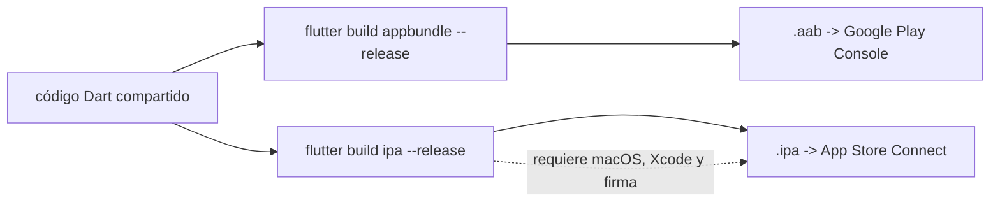
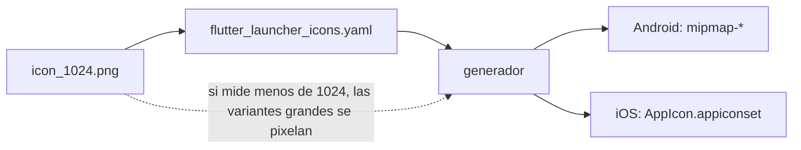
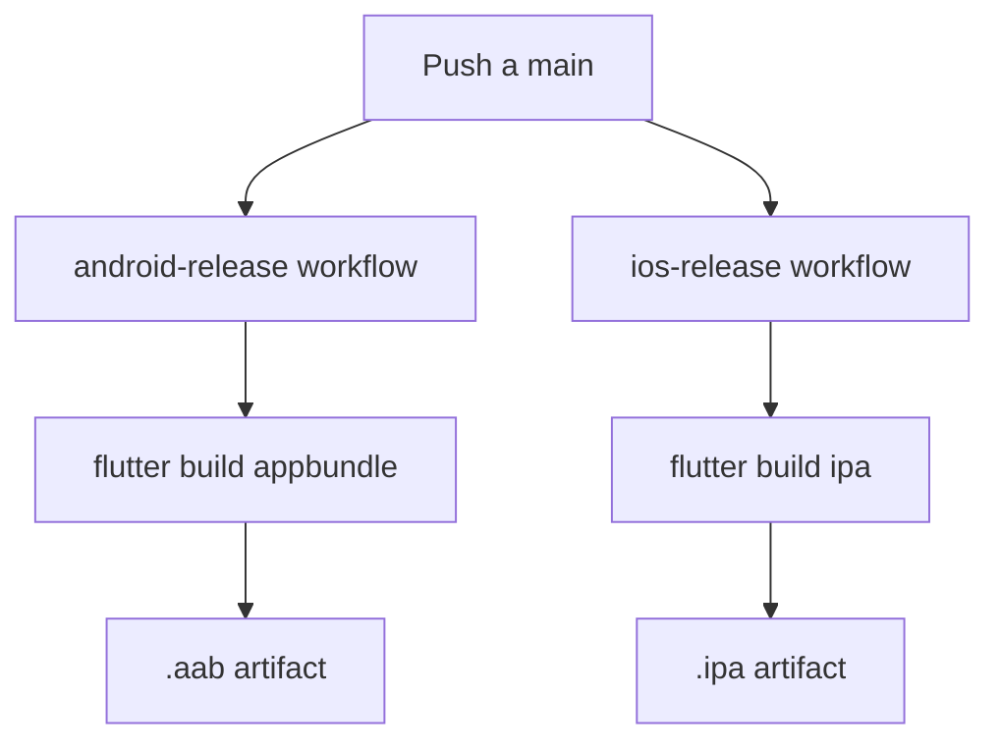
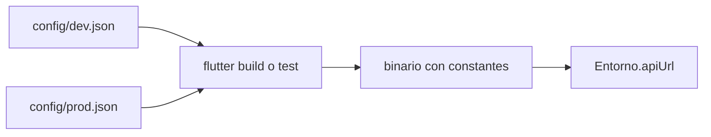

# Módulo 11: Publicación en App Store y Google Play


## Aprende construyendo

### Tema 1: Builds de release para cada plataforma

#### Paso 1 · Objetivo y preparación
Al finalizar vas a generar un `.aab` de release real con Flutter y a comprobar, con un script, que el artefacto y la versión cumplen los requisitos mínimos de publicación. Prerrequisitos: Flutter y Android SDK instalados; para el `.ipa` necesitás macOS con Xcode y certificados de firma.

#### Paso 2 · Contexto y caso real
RutaFlow comparte una sola base de código Dart, pero Google Play y App Store no aceptan el mismo archivo. Play recibe un Android App Bundle (`.aab`) y genera APKs optimizados por dispositivo; App Store recibe un `.ipa` firmado con certificados y provisioning profiles. El equipo descubrió tarde que un build de depuración no sirve para publicar: el artefacto existe, pero no está optimizado ni firmado para la tienda.

#### Paso 3 · Teoría, modelo mental y analogía
`flutter build appbundle --release` compila en modo release y produce el `.aab` que Play Console acepta. `flutter build ipa --release` produce el `.ipa` y requiere macOS con Xcode, certificados y un perfil de aprovisionamiento válido. La unificación de Flutter ocurre en el código fuente, no en el empaquetado: cada tienda conserva su formato, su firma y su proceso de revisión.

El modo release elimina herramientas de depuración y aplica optimizaciones; el modo debug prioriza iteración. Publicar un build debug es un error frecuente porque el archivo se genera igual y la diferencia solo se nota en rendimiento, tamaño o rechazo de la tienda. La versión debe incluir un build number creciente (`1.0.0+1`); sin él, la tienda no distingue dos subidas del mismo nombre.

**Conceptos clave:** una base de código, artefacto por plataforma, Android App Bundle, IPA, modo release, build number, firma y provisioning profile.



**Analogía:** es el mismo manuscrito enviado a dos imprentas con especificaciones distintas: el contenido es idéntico, pero el formato, la encuadernación y el sello de cada oficina no se pueden reutilizar.

**¿Por qué es importante?** Porque un artefacto generado no es lo mismo que un artefacto publicable: formato, firma y versión deben cumplir los requisitos de cada tienda.

**Límite de uso:** este tema no cubre la configuración completa de certificados ni la revisión de la tienda; valida el artefacto y la metadata, no garantiza que la publicación sea aprobada.

#### Paso 4 · Demostración guiada desde cero
**Ejemplo independiente (desde cero):** crea un proyecto Flutter nuevo, genera el bundle de release y verifica el artefacto con un script.

```bash
flutter create flujo_release
cd flujo_release
flutter build appbundle --release
```

Crea `verificar_release.py` en la raíz del proyecto para comprobar el `.aab`, la versión y la configuración de iOS:

```python
import re
import zipfile
from pathlib import Path

aab = Path("build/app/outputs/bundle/release/app-release.aab")
pubspec = Path("pubspec.yaml").read_text(encoding="utf-8")
version = re.search(r"^version:\s*(\S+)", pubspec, re.MULTILINE).group(1)
if "+" not in version:
    raise SystemExit("fallo: pubspec.yaml sin build number (usa 1.0.0+1)")
if not aab.is_file():
    raise SystemExit(f"fallo: no existe {aab}; ejecuta flutter build appbundle --release")

with zipfile.ZipFile(aab) as paquete:
    nombres = paquete.namelist()
if "BundleConfig.pb" not in nombres or "base/manifest/AndroidManifest.xml" not in nombres:
    raise SystemExit("fallo: el .aab no tiene la estructura esperada")

ios = Path("ios/Flutter/Release.xcconfig").is_file()
print(f"aab: {aab} ({aab.stat().st_size} bytes)")
print(f"version: {version}")
print("estructura: BundleConfig.pb y manifest presentes")
print(f"ios: Release.xcconfig {'presente' if ios else 'ausente'}")
```

**Ejecuta el ejemplo:**

```bash
python3 verificar_release.py
```

Resultado esperado:

```text
aab: build/app/outputs/bundle/release/app-release.aab (<tamaño> bytes)
version: 1.0.0+1
estructura: BundleConfig.pb y manifest presentes
ios: Release.xcconfig presente
```

El tamaño exacto varía: en la ejecución de referencia (Flutter 3.47.2 en macOS arm64) el archivo pesó 44.248.888 bytes. El script explica, línea por línea, cada requisito: build number, existencia del artefacto, estructura interna del bundle y presencia de la configuración release de iOS.

Si el comando termina con `Release app bundle failed to strip debug symbols from native libraries`, no es un problema del código Dart: `flutter doctor -v` reporta la herramienta de Android incompleta (por ejemplo, `cmdline-tools` ausente o licencias sin aceptar). En ese caso el `.aab` puede existir, pero el build no es limpio y conviene corregir el toolchain antes de publicar.

#### Paso 5 · Práctica guiada
Pista: quitá el `+1` de `version: 1.0.0+1` en `pubspec.yaml` y volvé a ejecutar `python3 verificar_release.py`; ese es el fallo deliberado: termina con `fallo: pubspec.yaml sin build number (usa 1.0.0+1)`, porque la tienda necesita un número creciente para distinguir dos subidas.

#### Paso 6 · Práctica independiente
Restaurá `1.0.0+1`, subí el build number a `1.0.0+2` y confirmá que el verificador sigue pasando. Después documentá los pasos de firma que no se ejecutaron aquí: crear un keystore, configurar `key.properties`, no versionarlo y compilar el `.aab` firmado. Para iOS, comprobá que `ios/Flutter/Release.xcconfig` existe y que el `.ipa` requiere un certificado y un provisioning profile válidos. Aplicá la misma separación al proyecto integrador RutaFlow: un artefacto por tienda, con la misma versión lógica y distinto proceso de firma.

#### Paso 7 · Cierre
Entregá el `.aab` verificado, el error de versión del Paso 5 y la configuración de firma documentada del Paso 6; explicá por qué “una sola base de código” no elimina el trabajo específico de cada tienda. Siguiente paso: generar íconos y splash screens consistentes en el Tema 2. Errores comunes: publicar un build debug, omitir el build number, olvidar la firma de release y confundir el `.aab` con un APK instalable. **Fuentes oficiales:** https://docs.flutter.dev/deployment/android y https://docs.flutter.dev/deployment/ios.

### Tema 2: Iconos y splash screens

#### Paso 1 · Objetivo y preparación
Al finalizar vas a validar, antes de generar variantes, que la imagen fuente de RutaFlow tiene la resolución mínima y que la configuración de íconos apunta a ella. Prerrequisitos: Python 3 con PyYAML y el Tema 1 de este módulo.

#### Paso 2 · Contexto y caso real
Android necesita íconos en varias densidades e iOS usa su propio catálogo de tamaños. Producirlos a mano es tedioso y propenso a inconsistencias. El equipo de RutaFlow cometió el error inverso: usó un PNG de 48×48 “porque la herramienta lo genera todo”, y las variantes de alta densidad se vieron pixeladas. La generación automática reduce tamaños desde una fuente grande; no inventa detalle que la fuente no tiene.

#### Paso 3 · Teoría, modelo mental y analogía
`flutter_launcher_icons` y `flutter_native_splash` leen una configuración declarativa, toman una imagen fuente y escriben las variantes que cada plataforma espera. La calidad final depende de la fuente: si la imagen original es más pequeña que el destino de mayor densidad, el generador solo puede ampliarla y el resultado se ve borroso. La configuración debe apuntar a un archivo existente y a una resolución suficiente, típicamente 1024×1024 para el ícono.

El splash screen sigue la misma lógica: una imagen central y un color de fondo se adaptan a tamaños y orientaciones. No conviene regenerar los assets en cada build de CI si la fuente no cambió; es un paso determinista que se ejecuta al actualizar la marca y se versiona con el proyecto.

**Conceptos clave:** imagen fuente, resolución mínima, densidad de pantalla, catálogo de íconos, splash screen, configuración declarativa y artefacto generado.



**Analogía:** es como imprimir un póster desde una foto diminuta: la imprenta puede cambiar el tamaño de salida, pero no recuperar los píxeles que la foto nunca tuvo.

**¿Por qué es importante?** Porque la calidad de todas las variantes depende de una única fuente; detectar una fuente insuficiente antes de generar evita rehacer los assets en ambas tiendas.

**Límite de uso:** este ejercicio valida la fuente y la configuración, no ejecuta el generador ni comprueba cómo se ve el ícono en un dispositivo real.

#### Paso 4 · Demostración guiada desde cero
**Ejemplo independiente (desde cero):** crea un directorio de trabajo nuevo, genera dos PNG de prueba y valida la configuración antes de invocar al generador.

```bash
mkdir ejemplo && cd ejemplo
```

Crea `generar_png.py` para producir una fuente de 1024×1024 y una versión reducida de 48×48:

```python
import struct
import zlib
from pathlib import Path


def png(path, tamano, color=(28, 110, 164)):
    def bloque(tipo, datos):
        return struct.pack(">I", len(datos)) + tipo + datos + struct.pack(">I", zlib.crc32(tipo + datos) & 0xFFFFFFFF)

    fila = b"\x00" + bytes(color) * tamano
    contenido = b"\x89PNG\r\n\x1a\n" + bloque(b"IHDR", struct.pack(">IIBBBBB", tamano, tamano, 8, 2, 0, 0, 0)) + bloque(b"IDAT", zlib.compress(fila * tamano)) + bloque(b"IEND", b"")
    Path(path).write_bytes(contenido)


Path("assets").mkdir(exist_ok=True)
png("assets/icon_1024.png", 1024)
png("assets/icon_48.png", 48)
```

Crea `flutter_launcher_icons.yaml` apuntando a la fuente grande:

```yaml
flutter_launcher_icons:
  image_path: "assets/icon_1024.png"
  android: true
  ios: true
```

Crea `verificar_iconos.py` para leer las dimensiones reales del PNG y compararlas con el mínimo:

```python
import struct
from pathlib import Path

import yaml


def dimensiones(path):
    datos = path.read_bytes()
    if datos[:8] != b"\x89PNG\r\n\x1a\n":
        raise SystemExit(f"fallo: {path} no es un PNG válido")
    ancho, alto = struct.unpack(">II", datos[16:24])
    return ancho, alto


config = yaml.safe_load(Path("flutter_launcher_icons.yaml").read_text(encoding="utf-8"))["flutter_launcher_icons"]
origen = Path(config["image_path"])
ancho, alto = dimensiones(origen)
if min(ancho, alto) < 1024:
    raise SystemExit(f"fallo: {origen} mide {ancho}x{alto}; la fuente debe ser al menos 1024x1024")

print(f"fuente: {origen} ({ancho}x{alto})")
print(f"android: {config['android']}")
print(f"ios: {config['ios']}")
print("destinos esperados: mipmap-* e ios/Runner/Assets.xcassets/AppIcon.appiconset")
```

**Ejecuta el ejemplo:**

```bash
python3 generar_png.py
python3 verificar_iconos.py
```

Resultado esperado:

```text
fuente: assets/icon_1024.png (1024x1024)
android: True
ios: True
destinos esperados: mipmap-* e ios/Runner/Assets.xcassets/AppIcon.appiconset
```

El script explica, línea por línea, cada validación: firma PNG, dimensiones del IHDR, ruta declarada y plataformas habilitadas. Con la configuración aprobada, el generador se invoca con `dart run flutter_launcher_icons`.

#### Paso 5 · Práctica guiada
Pista: cambiá `image_path` a `assets/icon_48.png` y volvé a ejecutar `python3 verificar_iconos.py`; ese es el fallo deliberado: el validador termina con `fallo: assets/icon_48.png mide 48x48; la fuente debe ser al menos 1024x1024`, porque una fuente pequeña no puede producir variantes nítidas para pantallas de alta densidad.

#### Paso 6 · Práctica independiente
Restaurá la fuente de 1024×1024 y agregá la configuración de `flutter_native_splash` con una imagen y un color de fondo. Documentá qué archivos generaría el paquete en Android e iOS y por qué conviene versionarlos en vez de regenerarlos en cada build. Relacioná el ejercicio con el proyecto integrador RutaFlow: la imagen de marca vive una sola vez en `assets/`, y ambas tiendas consumen las variantes generadas.

#### Paso 7 · Cierre
Entregá la salida del Paso 4, el error de resolución del Paso 5 y la configuración de splash del Paso 6; explicá por qué la generación automática no mejora una fuente deficiente. Siguiente paso: automatizar el build y la publicación en el Tema 3. Errores comunes: usar una fuente de baja resolución, configurar una ruta inexistente y regenerar assets sin cambios en cada build. **Fuentes oficiales:** https://pub.dev/packages/flutter_launcher_icons y https://pub.dev/packages/flutter_native_splash.

### Tema 3: CI/CD con Codemagic o Fastlane

#### Paso 1 · Objetivo y preparación
Al finalizar vas a configurar un pipeline de Codemagic que automatice el build de release de RutaFlow para Android, con pasos separados específicos de esa plataforma. Prerrequisitos: Tema 2 de este módulo.

#### Paso 2 · Contexto y caso real
Cada vez que el equipo de RutaFlow quiere publicar una nueva versión, alguien corre manualmente los comandos de build, firma y subida — un proceso repetitivo y propenso a que alguien olvide un paso.

#### Paso 3 · Teoría, modelo mental y analogía
Codemagic/Fastlane automatizan la secuencia completa de build, firma y distribución; una sola base de código no elimina la necesidad de pasos separados por plataforma dentro de ese mismo pipeline.
**Conceptos clave:** pipeline automatizado con pasos específicos por plataforma, a pesar del código compartido.

```yaml
# codemagic.yaml
workflows:
  android-release:
    scripts:
      - flutter build appbundle --release
    artifacts:
      - build/**/outputs/**/*.aab
```

Codemagic (un servicio de CI/CD especializado específicamente en apps Flutter) o Fastlane (la misma herramienta de automatización de release estudiada en Kotlin Multiplatform, Módulo 10 de ese track) automatizan la secuencia completa de build, firma y distribución para ambas plataformas, reduciendo el proceso manual de publicación a un pipeline configurado una única vez y ejecutado consistentemente en cada release; sin embargo, una sola base de código Flutter no elimina la necesidad de pasos **separados** dentro de ese mismo pipeline para Android e iOS (firma con credenciales distintas, builds con herramientas distintas, subida a portales de distribución distintos), dado que la unificación de Flutter opera exclusivamente a nivel del código fuente de la app, no a nivel de las herramientas y procesos de publicación de cada tienda, que permanecen inevitablemente específicos de cada plataforma.

Este matiz es importante para calibrar expectativas realistas sobre "una sola base de código": Flutter reduce drásticamente el esfuerzo de desarrollo de la lógica y UI de la app compartida entre plataformas, pero no elimina por completo el trabajo de configuración específico de publicación que cada tienda de aplicaciones exige de forma independiente entre sí.

**Analogía:** un pipeline de CI/CD para Flutter es como una línea de producción centralizada que fabrica el mismo producto base para dos mercados distintos, pero que igual necesita estaciones de empaquetado y etiquetado separadas y específicas para cada mercado de destino, dado que cada uno exige su propio formato de presentación final e inevitablemente distinto.

**¿Por qué es importante?** Automatizar ambos builds con un solo pipeline ahorra el esfuerzo manual repetido de cada release, pero no elimina la necesidad de pasos específicos y separados por plataforma dentro de ese pipeline, dado que cada tienda exige su propio proceso de firma y distribución independiente.

**Configuración del ejemplo:**

```yaml
workflows:
  android-release:
    scripts: [flutter build appbundle --release]
    artifacts: [build/**/outputs/**/*.aab]
  ios-release:
    scripts: [flutter build ipa --release]
    artifacts: [build/ios/**/*.ipa]
```

**Diagrama: pipeline con pasos separados por plataforma**



En el proyecto integrador RutaFlow, el pipeline vive en `codemagic.yaml` en la raíz del repositorio. Límite de la decisión: no conviene automatizar con CI/CD un proyecto que todavía no publicó ninguna versión manual exitosa al menos una vez — primero conviene validar el proceso completo manualmente, y recién automatizarlo cuando el flujo manual ya es confiable y repetible.

---

#### Paso 4 · Demostración guiada desde cero
```yaml
# codemagic.yaml
workflows:
  android-release:
    scripts:
      - flutter build appbundle --release
    artifacts:
      - build/**/outputs/**/*.aab
```

**Ejecuta el ejemplo** (crea un proyecto Flutter desde cero, pega el widget en `lib/main.dart` y arráncalo en un emulador o dispositivo):

```bash
flutter create demo_flutter
cd demo_flutter
flutter run
```
Para las pruebas de widget: `flutter test`.

Resultado esperado: cada vez que se dispara este workflow, Codemagic ejecuta automáticamente el build de Android y produce el `.aab` como artefacto descargable, sin que nadie corra el comando manualmente.

#### Paso 5 · Práctica guiada
Pista: agregá un segundo workflow `ios-release` que reutilice literalmente el mismo script `flutter build appbundle --release` del workflow de Android — ese es el fallo deliberado: ese comando genera un `.aab` (formato de Android), completamente inútil para App Store Connect, que necesita específicamente un `.ipa` generado en un entorno macOS.

#### Paso 6 · Práctica independiente
Corregí el Paso 5 definiendo el workflow `ios-release` con su propio script correcto (`flutter build ipa --release`) y su propio artefacto `.ipa`, confirmando que cada workflow produce el artefacto específico que su tienda realmente necesita.

#### Paso 7 · Cierre
Entregá el workflow de Android del Paso 4, el workflow de iOS incorrecto por copiar el de Android en el Paso 5, y la corrección con el script apropiado del Paso 6; explicá por qué "compartir código" en Flutter no significa que los pasos de publicación también puedan compartirse sin modificación entre plataformas. Siguiente paso: cerrá el módulo integrando build, assets y CI/CD en un release real de RutaFlow. Errores comunes: copiar el mismo script de build entre workflows de plataformas distintas, no verificar que cada workflow produce el artefacto correcto para su tienda, y asumir que un solo pipeline elimina toda la especificidad de plataforma. Fuentes oficiales: https://docs.codemagic.io/flutter-configuration/flutter-projects/ y https://docs.flutter.dev/deployment/cd.
**Implicación práctica:** Automatizar ambos builds con un solo pipeline ahorra esfuerzo manual repetido, pero no elimina la necesidad de pasos específicos y separados por plataforma.

### Tema 4: Entornos y flavors con --dart-define-from-file

#### Paso 1 · Objetivo y preparación
Al finalizar podrás compilar la misma app para desarrollo, QA y producción inyectando configuración con `--dart-define-from-file`, leerla con constantes de compilación y fallar rápido si falta un valor. Prerrequisitos: Temas 1 a 3 de este módulo.

#### Paso 2 · Contexto y caso real
La app del repartidor de RutaFlow se publicó una vez apuntando al servidor de pruebas, porque la URL estaba escrita en el código y alguien olvidó cambiarla. Separar entornos en la compilación es el caso real que resuelven los *flavors*: cada build sabe a qué API habla, con qué nombre y con qué nivel de logs.

#### Paso 3 · Teoría, modelo mental y analogía
`--dart-define` y `--dart-define-from-file` pasan pares clave-valor al **compilador**. En Dart se leen con `String.fromEnvironment`, `bool.fromEnvironment` o `int.fromEnvironment`, que solo están garantizados como **constantes** (`const`). Como el valor queda dentro del binario, **no sirve para secretos**: solo para configuración pública (URLs, nombres, banderas). Los *flavors* nativos (`productFlavors` de Android y *schemes* de iOS) agregan lo que Dart no puede cambiar: el identificador de la app, el ícono y el nombre visible, para instalar dev y prod en el mismo teléfono. Se usan juntos: `flutter run --flavor dev --dart-define-from-file=config/dev.json`.

**Analogía:** es imprimir el mismo folleto con distinta dirección de contacto según la ciudad: la dirección se decide en la imprenta, no cuando alguien lo lee.

**Diagrama:**



#### Paso 4 · Demostración guiada desde cero
**Ejemplo independiente (desde cero):** este tema se reproduce en una **carpeta vacía**, como **proyecto nuevo**, sin estado de otros temas.

```bash
mkdir entornos && cd entornos
flutter create repartidor_entornos
cd repartidor_entornos
mkdir -p config
```

Crea `config/dev.json`:

```json
{
  "ENTORNO": "dev",
  "API_URL": "https://api-dev.rutaflow.co",
  "LOGS_DETALLADOS": "true"
}
```

Crea `config/prod.json`:

```json
{
  "ENTORNO": "prod",
  "API_URL": "https://api.rutaflow.co",
  "LOGS_DETALLADOS": "false"
}
```

Crea `lib/entorno.dart`:

```dart
// lib/entorno.dart — la configuración llega en tiempo de COMPILACIÓN con --dart-define
class Entorno {
  static const nombre = String.fromEnvironment('ENTORNO', defaultValue: 'desconocido');
  static const apiUrl = String.fromEnvironment('API_URL');
  static const logsDetallados = bool.fromEnvironment('LOGS_DETALLADOS');

  static void validar() {
    if (apiUrl.isEmpty) {
      throw StateError('API_URL no definido: ejecuta con --dart-define-from-file=config/<entorno>.json');
    }
  }
}
```

Crea `test/entorno_test.dart`:

```dart
// test/entorno_test.dart
import 'package:flutter_test/flutter_test.dart';
import 'package:repartidor_entornos/entorno.dart';

void main() {
  test('usa la configuración del entorno dev', () {
    expect(Entorno.nombre, 'dev');
    expect(Entorno.apiUrl, 'https://api-dev.rutaflow.co');
    expect(Entorno.logsDetallados, isTrue);
    expect(Entorno.validar, returnsNormally);
  });
}
```

**Ejecuta el ejemplo:**

```bash
rm test/widget_test.dart
flutter test --dart-define-from-file=config/dev.json
flutter run --dart-define-from-file=config/prod.json
```

**Resultado esperado:**

```text
00:02 +1: All tests passed!
```

En el `flutter run` con `prod.json` la app compila contra `https://api.rutaflow.co`; puedes mostrar `Entorno.nombre` en una esquina de la pantalla para comprobarlo. El tiempo y el número de la primera columna varían.

**Fallo deliberado:** Ejecuta `flutter test` **sin** `--dart-define-from-file`. La prueba falla con `Expected: 'dev'` y `Actual: 'desconocido'`: sin la definición, las constantes toman su valor por defecto. Por eso `validar()` debe llamarse al arrancar la app (`main`) para que una compilación mal configurada falle de inmediato y no en manos del repartidor.

#### Paso 5 · Práctica guiada
Crea `config/qa.json` y una prueba que verifique que en QA los logs detallados están activos y la URL termina en `-qa.rutaflow.co`. **Pista:** copia la prueba de dev, cambia las expectativas y ejecútala con `--dart-define-from-file=config/qa.json`.

#### Paso 6 · Práctica independiente
Configura `productFlavors` dev y prod en `android/app/build.gradle.kts` con `applicationIdSuffix = ".dev"` y un nombre visible distinto, e instala ambas versiones en el mismo emulador.

#### Paso 7 · Cierre
**¿Por qué es importante?** porque publicar con la configuración equivocada es un error real y costoso, y los flavors son requisito en cualquier equipo con QA.
**Fuente oficial:** [Flutter: Set up flavors for Android](https://docs.flutter.dev/deployment/flavors), [Dart: String.fromEnvironment](https://api.dart.dev/stable/dart-core/String/String.fromEnvironment.html).
**Conceptos clave:** `--dart-define`, `--dart-define-from-file`, `String.fromEnvironment`, constante de compilación, flavor, `applicationIdSuffix`, scheme de iOS.
**Cuándo no usarlo:** no pongas claves privadas ni tokens en `dart-define`: cualquiera puede extraerlos del binario. Los secretos se quedan en el backend (ver Módulo 13, Tema 2).

**Transferencia al proyecto integrador «Aplicación móvil del repartidor»:** compila la app del repartidor contra la API de QA o de producción sin cambiar código, y muestra el entorno en la pantalla de ajustes.
Como **siguiente** paso, aplica lo aprendido en el proyecto integrador del track y compara el resultado con lo que esperabas.
**Errores comunes:** correr `flutter build --release` sin `--dart-define-from-file=config/prod.json`, confiando en que el build "ya sabe" a qué entorno apunta — las constantes de `String.fromEnvironment` caen en su valor por defecto (`ENTORNO` queda en `desconocido`, `API_URL` queda vacío), y el binario compila sin ningún error aunque no tenga a dónde conectarse.

## Laboratorio práctico

**Objetivo del laboratorio:** generar builds de release para Android e iOS listos para subir a sus tiendas.

**Requisitos previos:** Módulo 10 completado, macOS con Xcode para el build de iOS.

| Paso | Acción | Comando | Explicación |
|---|---|---|---|
| 1 | Generar el build de release para Android | `flutter build appbundle --release` | `.aab` para Play Console |
| 2 | Generar el build de release para iOS | `flutter build ipa --release` | Requiere macOS/Xcode |
| 3 | Configurar ícono y splash screen | Ver Tema 2 | `flutter_launcher_icons`/`flutter_native_splash` |
| 4 | Configurar un pipeline básico | Ver Tema 3 | Codemagic o Fastlane |

**Verificación:** el laboratorio se considera exitoso si ambos builds (`.aab` e `.ipa`) se generan correctamente sin errores, y si el ícono y splash screen se aplican consistentemente en ambas plataformas.

**Errores comunes y soluciones**

- **Intentar generar el build de iOS sin macOS/Xcode disponible.** Requiere específicamente ese entorno; usa una máquina macOS o un runner de CI con macOS.
- **Producir manualmente cada variante de ícono por plataforma y resolución.** Usa `flutter_launcher_icons` para generarlas automáticamente.
- **Asumir que un solo pipeline elimina toda la especificidad de plataforma.** El pipeline igual necesita pasos separados de firma y distribución por tienda.

---
