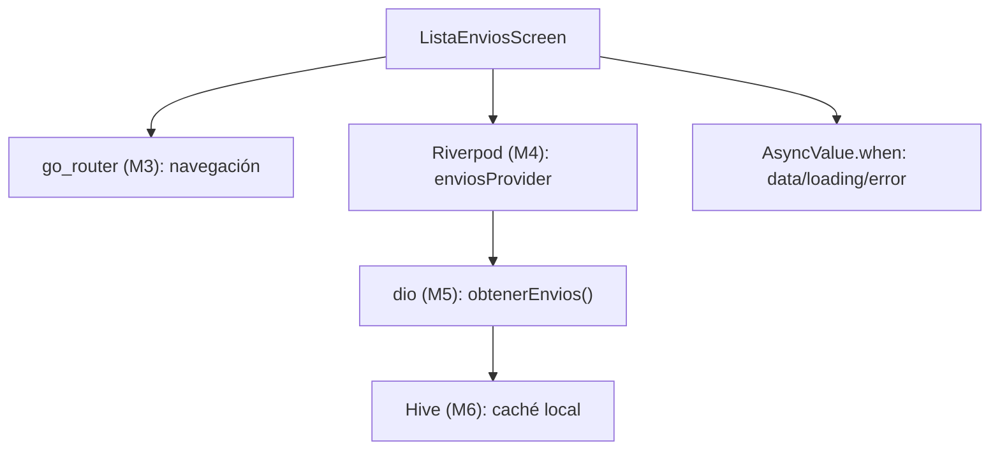
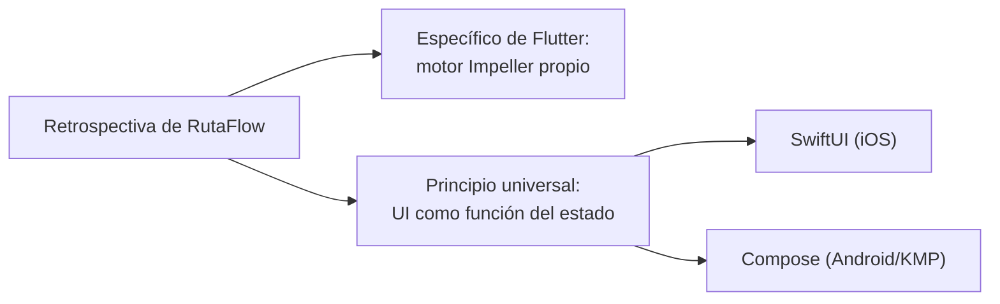
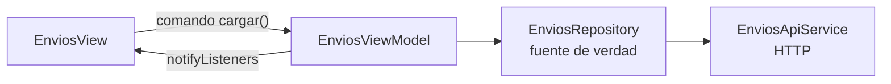

# Módulo 12: Proyecto integrador: app Flutter completa


## Aprende construyendo


### Tema 1: Arquitectura por features y Clean Architecture · Avanzado · 40 min

<details open>
<summary><strong>Capa 1 — Lectura</strong></summary>

#### ► DE QUÉ TRATA
Al finalizar vas a organizar el proyecto integrador de RutaFlow en lib/features/envios/ y lib/features/auth/, con capas Domain/Data/Presentation dentro de cada feature. Prerrequisitos: módulos 0-11 completos.

#### ► LA IDEA EN UNA FRASE
**Al finalizar vas a organizar el proyecto integrador de RutaFlow en lib/features/envios/ y lib/features/auth/, con capas Domain/Data/Presentation dentro de cada feature.**

#### ► POR QUÉ EXISTE ESTO
Resuelve un problema real de diseño o implementación y evita decisiones a ciegas.

#### ► LA ANALOGÍA
Piensa en arquitectura por features y clean architecture como una herramienta de taller: útil cuando conoces su propósito y sus límites.
**Dónde se rompe la analogía:** en software, los efectos dependen del contexto, la escala y los trade-offs.

#### ► CÓMO FUNCIONA
1. Identifica el problema que arquitectura por features y clean architecture resuelve.
2. Observa sus componentes y relaciones.
3. Aplica la opción más simple que funcione.
4. Verifica el resultado y los límites.

#### ► LO QUE PUEDE SALIR MAL
| Síntoma | Causa probable | Arreglo |
|---|---|---|
| Arquitectura por features y Clean Architecture se aplica pero el resultado no mejora | Se usó sin medir el problema real | Mide antes y compara contra la alternativa simple |
| Aparece complejidad inesperada | Se adoptó la técnica sin comprender sus trade-offs | Vuelve a la sección de trade-offs y reduce el alcance |
| Falla en un caso límite | Se asumió un contexto que no se cumple | Prueba el caso límite y documenta cuándo NO usarlo |

#### ► TRADE-OFFS
| Opción | Cuándo usarla | Cuándo NO usarla |
|---|---|---|
| Usar Arquitectura por features y Clean Architecture | Cuando el problema coincide con su propósito y el beneficio es observable | Cuando agrega complejidad sin resolver un problema real |
| Alternativa más simple | Cuando el contexto es pequeño, estable o fácil de razonar | Cuando ya demostró no escalar o no cumplir el requisito |
| Postergar la decisión | Cuando falta evidencia del problema | Cuando el costo de esperar es mayor que el costo de probar |

#### ► CUÁNDO NO USAR ESTO
No uses arquitectura por features y clean architecture por defecto. Aplícalo cuando el problema lo justifique y puedas verificar el beneficio; si una alternativa más simple resuelve igual, prefiérela.

#### ► DE VUELTA A LA ANALOGÍA
Volviendo a la analogía: arquitectura por features y clean architecture funciona como el modelo inicial, pero recuerda dónde se rompe: en producción importan la evidencia, la escala y el costo de equivocarte.

#### ► LO QUE DEBES RECORDAR
- Arquitectura por features y Clean Architecture existe para resolver un problema específico.
- Mide antes de adoptar complejidad.
- Conoce el caso donde NO usarlo.
- Verifica con evidencia observable.

#### ► PREGUNTAS PARA PENSAR
1. ¿Qué problema concreto resuelve arquitectura por features y clean architecture en tu contexto?
2. ¿Cómo sabrías que arquitectura por features y clean architecture no está funcionando bien?
3. ¿Qué alternativa más simple considerarías antes de usar arquitectura por features y clean architecture?

</details>

<details>
<summary><strong>Capa 2 — Construcción</strong></summary>

#### Código y verificación
```
lib/
  features/
    tareas/
      data/          ← repositorio (dio + Hive, módulos 5-6)
      domain/         ← modelos
      presentation/    ← widgets + providers Riverpod (módulo 4)
    auth/
  core/
    router.dart        ← go_router (módulo 3)
    theme.dart
```

```
lib/features/tareas/
  domain/         ← modelos y lógica pura, SIN dependencias externas
  data/           ← implementa interfaces de domain, SÍ depende de dio/Hive
  presentation/   ← widgets + providers, depende de domain
```

```text
lib/
  features/
    envios/
      data/          ← repositorio (dio + Hive, módulos 5-6)
      domain/         ← modelos y lógica pura
      presentation/    ← widgets + providers Riverpod (módulo 4)
    auth/
  core/
    router.dart        ← go_router (módulo 3)
    theme.dart
```

```bash
flutter create demo_flutter
cd demo_flutter
flutter run
```

</details>

### Tema 2: Uniendo los módulos del track · Avanzado · 40 min

<details open>
<summary><strong>Capa 1 — Lectura</strong></summary>

#### ► DE QUÉ TRATA
Al finalizar vas a conectar envioRepositoryProvider (Riverpod), el estado explícito de AsyncValue, y la persistencia offline-first en una sola pantalla ListaEnviosScreen completa. Prerrequisitos: Tema 1 de este módulo.

#### ► LA IDEA EN UNA FRASE
**Al finalizar vas a conectar envioRepositoryProvider (Riverpod), el estado explícito de AsyncValue, y la persistencia offline-first en una sola pantalla ListaEnviosScreen completa.**

#### ► POR QUÉ EXISTE ESTO
Resuelve un problema real de diseño o implementación y evita decisiones a ciegas.

#### ► LA ANALOGÍA
`AsyncValue.when(data:, loading:, error:)` maneja exhaustivamente los tres estados posibles de una operación asíncrona directamente en la UI.
**Conceptos clave:** cada concepto estudiado por separado encaja como parte de un sistema mayor.

```dart
final tareasProvider = FutureProvider<List<Tarea>>((ref) async {
  final repo = ref.watch(tareaRepositoryProvider);
  return repo.obtenerTareas(); // lee de caché local, sincroniza en background
});

class ListaTareasScreen extends ConsumerWidget {
  Widget build(BuildContext context, WidgetRef ref) {
    final tareasAsync = ref.watch(tareasProvider);
    return tareasAsync.when(
      data: (tareas) => ListView(children: tareas.map((t) => TarjetaTarea(tarea: t)).toList()),
      loading: () => CircularProgressIndicator(),
      error: (e, _) => Text('Error: $e'),
    );
  }
}
```

Este proyecto integra directamente cada módulo estudiado a lo largo del track en un único sistema coherente: navegación declarativa con go_router y rutas protegidas (Módulo 3), gestión de estado completa con Riverpod o Bloc sin `setState` disperso (Módulo 4), networking con `dio` y estados explícitos modelados con sealed classes (Módulo 5), persistencia offline-first con Hive o `sqflite` (Módulo 6), y widget tests de las pantallas más críticas (Módulo 9); el método `.when(data:, loading:, error:)` de `AsyncValue` en Riverpod es la forma idiomática de manejar exhaustivamente los tres estados posibles de una operación asíncrona directamente en la UI, reflejando el mismo principio de estados explícitos modelados como un conjunto cerrado ya estudiado en el Módulo 5.

La internacionalización con `intl` y `flutter_localizations` (mencionada en el contenido de este módulo integrador) permite que la app soporte múltiples idiomas de forma estructurada, generando código a partir de archivos de traducción declarativos, un aspecto adicional de pulido profesional que completa una app lista para un público potencialmente internacional, más allá de la funcionalidad central ya integrada del resto del track.

**Analogía:** el proyecto integrador es como el ensamblaje final de un producto donde cada componente estudiado por separado en su propio módulo (navegación, estado, networking, persistencia, testing) se integra en un sistema funcional completo, demostrando que cada pieza individual efectivamente encaja con las demás tal como se diseñó.

**¿Por qué es importante?** Integrar cada módulo del track en un proyecto real demuestra que los conceptos estudiados por separado (navegación, estado, networking, persistencia, testing) se combinan naturalmente en un sistema coherente, reflejando cómo se construyen apps Flutter profesionales reales.

**Código del ejemplo:**

```dart
tareasAsync.when(
  data: (tareas) => ListView(...),
  loading: () => CircularProgressIndicator(),
  error: (e, _) => Text('Error: $e'),
)
```

**Diagrama: integración de módulos en una pantalla**



En el proyecto integrador RutaFlow, `ListaEnviosScreen` vive en `lib/features/deliveries/presentation/delivery_list_screen.dart` y `envioRepositoryProvider` en `lib/features/deliveries/domain/delivery_providers.dart`.

**Dónde se rompe la analogía:** el modelo simplifica la realidad; en producción influyen escala, fallos, costo y contexto.

#### ► CÓMO FUNCIONA


#### ► LO QUE PUEDE SALIR MAL
| Síntoma | Causa probable | Arreglo |
|---|---|---|
| Uniendo los módulos del track se aplica pero el resultado no mejora | Se usó sin medir el problema real | Mide antes y compara contra la alternativa simple |
| Aparece complejidad inesperada | Se adoptó la técnica sin comprender sus trade-offs | Vuelve a la sección de trade-offs y reduce el alcance |
| Falla en un caso límite | Se asumió un contexto que no se cumple | Prueba el caso límite y documenta cuándo NO usarlo |

#### ► TRADE-OFFS
| Opción | Cuándo usarla | Cuándo NO usarla |
|---|---|---|
| Usar Uniendo los módulos del track | Cuando el problema coincide con su propósito y el beneficio es observable | Cuando agrega complejidad sin resolver un problema real |
| Alternativa más simple | Cuando el contexto es pequeño, estable o fácil de razonar | Cuando ya demostró no escalar o no cumplir el requisito |
| Postergar la decisión | Cuando falta evidencia del problema | Cuando el costo de esperar es mayor que el costo de probar |

#### ► CUÁNDO NO USAR ESTO
No uses uniendo los módulos del track por defecto. Aplícalo cuando el problema lo justifique y puedas verificar el beneficio; si una alternativa más simple resuelve igual, prefiérela.

#### ► DE VUELTA A LA ANALOGÍA
Volviendo a la analogía: uniendo los módulos del track funciona como el modelo inicial, pero recuerda dónde se rompe: en producción importan la evidencia, la escala y el costo de equivocarte.

#### ► LO QUE DEBES RECORDAR
- Uniendo los módulos del track existe para resolver un problema específico.
- Mide antes de adoptar complejidad.
- Conoce el caso donde NO usarlo.
- Verifica con evidencia observable.

#### ► PREGUNTAS PARA PENSAR
1. ¿Qué problema concreto resuelve uniendo los módulos del track en tu contexto?
2. ¿Cómo sabrías que uniendo los módulos del track no está funcionando bien?
3. ¿Qué alternativa más simple considerarías antes de usar uniendo los módulos del track?

</details>

<details>
<summary><strong>Capa 2 — Construcción</strong></summary>

#### Objetivo observable
Al finalizar vas a conectar `envioRepositoryProvider` (Riverpod), el estado explícito de `AsyncValue`, y la persistencia offline-first en una sola pantalla `ListaEnviosScreen` completa. Prerrequisitos: Tema 1 de este módulo.

</details>

### Tema 3: Retrospectiva del proyecto integrador · Avanzado · 35 min

<details open>
<summary><strong>Capa 1 — Lectura</strong></summary>

#### ► DE QUÉ TRATA
Al finalizar vas a escribir una retrospectiva comparando una decisión de RutaFlow en Flutter (que renderiza con su propio motor gráfico —Impeller en iOS y Android—, no componentes nativos envueltos) contra la misma decisión en otro track de la Academia. Prerrequisitos: Temas 1-2…

#### ► LA IDEA EN UNA FRASE
**Al finalizar vas a escribir una retrospectiva comparando una decisión de RutaFlow en Flutter (que renderiza con su propio motor gráfico —Impeller en iOS y Android—, no componentes nativos envueltos) contra la misma decisión en otro track de la Academia.**

#### ► POR QUÉ EXISTE ESTO
Resuelve un problema real de diseño o implementación y evita decisiones a ciegas.

#### ► LA ANALOGÍA
Piensa en retrospectiva del proyecto integrador como una herramienta de taller: útil cuando conoces su propósito y sus límites.
**Dónde se rompe la analogía:** en software, los efectos dependen del contexto, la escala y los trade-offs.

#### ► CÓMO FUNCIONA


#### ► LO QUE PUEDE SALIR MAL
| Síntoma | Causa probable | Arreglo |
|---|---|---|
| Retrospectiva del proyecto integrador se aplica pero el resultado no mejora | Se usó sin medir el problema real | Mide antes y compara contra la alternativa simple |
| Aparece complejidad inesperada | Se adoptó la técnica sin comprender sus trade-offs | Vuelve a la sección de trade-offs y reduce el alcance |
| Falla en un caso límite | Se asumió un contexto que no se cumple | Prueba el caso límite y documenta cuándo NO usarlo |

#### ► TRADE-OFFS
| Opción | Cuándo usarla | Cuándo NO usarla |
|---|---|---|
| Usar Retrospectiva del proyecto integrador | Cuando el problema coincide con su propósito y el beneficio es observable | Cuando agrega complejidad sin resolver un problema real |
| Alternativa más simple | Cuando el contexto es pequeño, estable o fácil de razonar | Cuando ya demostró no escalar o no cumplir el requisito |
| Postergar la decisión | Cuando falta evidencia del problema | Cuando el costo de esperar es mayor que el costo de probar |

#### ► CUÁNDO NO USAR ESTO
No uses retrospectiva del proyecto integrador por defecto. Aplícalo cuando el problema lo justifique y puedas verificar el beneficio; si una alternativa más simple resuelve igual, prefiérela.

#### ► DE VUELTA A LA ANALOGÍA
Volviendo a la analogía: retrospectiva del proyecto integrador funciona como el modelo inicial, pero recuerda dónde se rompe: en producción importan la evidencia, la escala y el costo de equivocarte.

#### ► LO QUE DEBES RECORDAR
- Retrospectiva del proyecto integrador existe para resolver un problema específico.
- Mide antes de adoptar complejidad.
- Conoce el caso donde NO usarlo.
- Verifica con evidencia observable.

#### ► PREGUNTAS PARA PENSAR
1. ¿Qué problema concreto resuelve retrospectiva del proyecto integrador en tu contexto?
2. ¿Cómo sabrías que retrospectiva del proyecto integrador no está funcionando bien?
3. ¿Qué alternativa más simple considerarías antes de usar retrospectiva del proyecto integrador?

</details>

<details>
<summary><strong>Capa 2 — Construcción</strong></summary>

#### Código y verificación
```
Flutter = una base de código Dart
        + motor gráfico propio (Impeller en móvil)
        + widgets propios (NO wrappers de componentes nativos)
        = apariencia y rendimiento consistentes en Android e iOS
```


```text
Decisión: TarjetaEnvio se ve y se comporta idéntica en Android e iOS,
porque Flutter la dibuja con Impeller, no con componentes nativos de cada
plataforma.

Específico de Flutter: el motor Impeller propio, que elimina diferencias
sutiles de comportamiento entre implementaciones nativas distintas.

Principio universal: declarar la UI como función del estado actual
(igual en SwiftUI y Compose), solo que Flutter además controla el
renderizado final, mientras SwiftUI/Compose delegan en el sistema nativo.
```

```bash
flutter create demo_flutter
cd demo_flutter
flutter run
```

</details>

### Tema 4: Arquitectura recomendada de Flutter: views, view models, repositories y services · Avanzado · 45 min

<details open>
<summary><strong>Capa 1 — Lectura</strong></summary>

#### ► DE QUÉ TRATA
Usa Flutter 3.24 o superior. Crea la carpeta lib/features/envios/ con subcarpetas data/services, data/repositories y ui/. El ejemplo usa ChangeNotifier para no depender de paquetes.

#### ► LA IDEA EN UNA FRASE
**Usa Flutter 3.24 o superior.**

#### ► POR QUÉ EXISTE ESTO
Resuelve un problema real de diseño o implementación y evita decisiones a ciegas.

#### ► LA ANALOGÍA
Piensa en arquitectura recomendada de flutter: views, view models, repositories y services como una herramienta de taller: útil cuando conoces su propósito y sus límites.
**Dónde se rompe la analogía:** en software, los efectos dependen del contexto, la escala y los trade-offs.

#### ► CÓMO FUNCIONA


#### ► LO QUE PUEDE SALIR MAL
| Síntoma | Causa probable | Arreglo |
|---|---|---|
| Arquitectura recomendada de Flutter: views, view models, repositories y services se aplica pero el resultado no mejora | Se usó sin medir el problema real | Mide antes y compara contra la alternativa simple |
| Aparece complejidad inesperada | Se adoptó la técnica sin comprender sus trade-offs | Vuelve a la sección de trade-offs y reduce el alcance |
| Falla en un caso límite | Se asumió un contexto que no se cumple | Prueba el caso límite y documenta cuándo NO usarlo |

#### ► TRADE-OFFS
| Opción | Cuándo usarla | Cuándo NO usarla |
|---|---|---|
| Usar Arquitectura recomendada de Flutter: views, view models, repositories y services | Cuando el problema coincide con su propósito y el beneficio es observable | Cuando agrega complejidad sin resolver un problema real |
| Alternativa más simple | Cuando el contexto es pequeño, estable o fácil de razonar | Cuando ya demostró no escalar o no cumplir el requisito |
| Postergar la decisión | Cuando falta evidencia del problema | Cuando el costo de esperar es mayor que el costo de probar |

#### ► CUÁNDO NO USAR ESTO
No uses arquitectura recomendada de flutter: views, view models, repositories y services por defecto. Aplícalo cuando el problema lo justifique y puedas verificar el beneficio; si una alternativa más simple resuelve igual, prefiérela.

#### ► DE VUELTA A LA ANALOGÍA
Volviendo a la analogía: arquitectura recomendada de flutter: views, view models, repositories y services funciona como el modelo inicial, pero recuerda dónde se rompe: en producción importan la evidencia, la escala y el costo de equivocarte.

#### ► LO QUE DEBES RECORDAR
- Arquitectura recomendada de Flutter: views, view models, repositories y services existe para resolver un problema específico.
- Mide antes de adoptar complejidad.
- Conoce el caso donde NO usarlo.
- Verifica con evidencia observable.

#### ► PREGUNTAS PARA PENSAR
1. ¿Qué problema concreto resuelve arquitectura recomendada de flutter: views, view models, repositories y services en tu contexto?
2. ¿Cómo sabrías que arquitectura recomendada de flutter: views, view models, repositories y services no está funcionando bien?
3. ¿Qué alternativa más simple considerarías antes de usar arquitectura recomendada de flutter: views, view models, repositories y services?

</details>

<details>
<summary><strong>Capa 2 — Construcción</strong></summary>

#### Código y verificación


```dart
class EnviosApiService {
  // En la app real usa Dio; aquí simula la API.
  Future<List<Map<String, dynamic>>> obtener() async {
    await Future.delayed(const Duration(milliseconds: 300));
    return [
      {'codigo': 'ENV-42', 'estado': 'EN_RUTA'},
      {'codigo': 'ENV-43', 'estado': 'ENTREGADO'},
    ];
  }
}
```

```dart
import '../services/envios_api_service.dart';

class Envio {
  const Envio(this.codigo, this.entregado);
  final String codigo;
  final bool entregado;
}

class EnviosRepository {
  EnviosRepository(this._api);
  final EnviosApiService _api;
  List<Envio>? _cache;

  Future<List<Envio>> pendientes({bool forzar = false}) async {
    if (_cache == null || forzar) {
      final crudos = await _api.obtener();
      _cache = [for (final j in crudos) Envio(j['codigo'] as String, j['estado'] == 'ENTREGADO')];
    }
    return _cache!.where((e) => !e.entregado).toList();
  }
}
```

```dart
import 'package:flutter/foundation.dart';
import '../data/repositories/envios_repository.dart';

class EnviosViewModel extends ChangeNotifier {
  EnviosViewModel(this._repositorio);
  final EnviosRepository _repositorio;

  List<Envio> envios = [];
  bool cargando = false;
  String? error;

  Future<void> cargar() async { // comando
    cargando = true;
    error = null;
    notifyListeners();
    try {
      envios = await _repositorio.pendientes(forzar: true);
    } catch (e) {
      error = 'No se pudieron cargar los envíos';
    } finally {
      cargando = false;
      notifyListeners();
    }
  }
}
```

```dart
import 'package:flutter/material.dart';
import 'envios_view_model.dart';

class EnviosView extends StatelessWidget {
  const EnviosView({super.key, required this.viewModel});
  final EnviosViewModel viewModel;

  @override
  Widget build(BuildContext context) {
    return ListenableBuilder(
      listenable: viewModel,
      builder: (context, _) {
        if (viewModel.cargando) return const Center(child: CircularProgressIndicator());
        if (viewModel.error != null) {
          return Center(child: TextButton(onPressed: viewModel.cargar, child: Text('${viewModel.error}. Reintentar')));
        }
        return ListView(children: [for (final e in viewModel.envios) ListTile(title: Text(e.codigo))]);
      },
    );
  }
}
```

```dart
import 'package:flutter_test/flutter_test.dart';
import 'package:rutaflow/features/envios/data/repositories/envios_repository.dart';
import 'package:rutaflow/features/envios/data/services/envios_api_service.dart';
import 'package:rutaflow/features/envios/ui/envios_view_model.dart';

class ApiFalsa extends EnviosApiService {
  @override
  Future<List<Map<String, dynamic>>> obtener() async => [{'codigo': 'ENV-1', 'estado': 'EN_RUTA'}];
}

void main() {
  test('cargar deja solo los pendientes', () async {
    final vm = EnviosViewModel(EnviosRepository(ApiFalsa()));
    await vm.cargar();
    expect(vm.envios.map((e) => e.codigo), ['ENV-1']);
    expect(vm.cargando, isFalse);
  });
}
```

</details>
