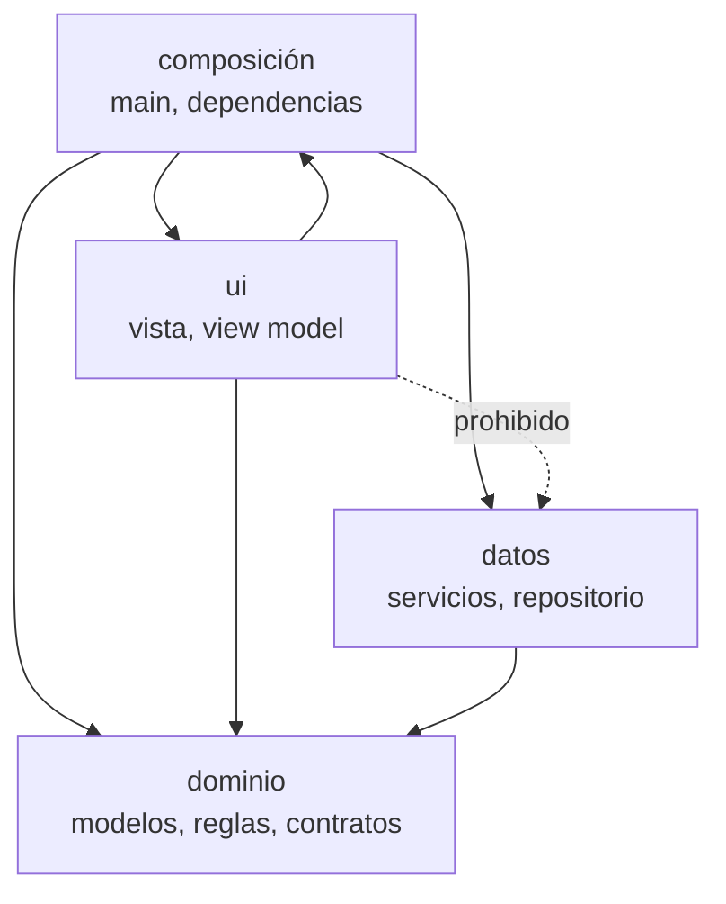
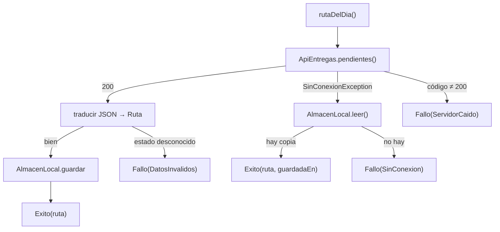
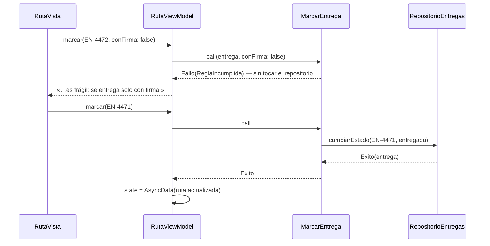
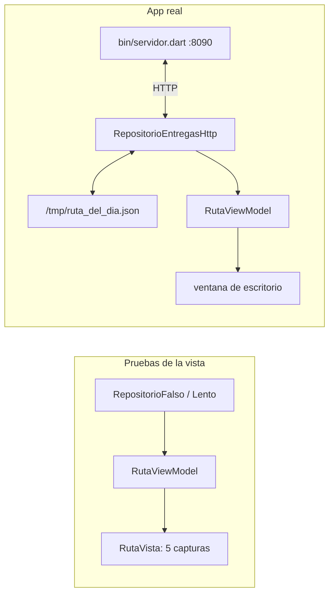

# Módulo 12: Proyecto integrador: la arquitectura de una app completa

**Entorno comprobado para esta edición (2026-11-24):** Flutter 3.50.1 (canal estable) con Dart 3.14.0 en Linux
x86_64, con `material_ui` 1.11.1, `flutter_riverpod` 3.5.0 y `http` 1.6.0, y Graphviz para dibujar el grafo de
dependencias. Todo el código se analizó con `flutter analyze` (`No issues found!`) y las 20 pruebas se ejecutaron ese
día, en `/home/estudiante/labs/flutter/m12` (tu `~/labs/flutter/m12`). Las pruebas de datos usan un servidor HTTP real
en `127.0.0.1` y archivos reales; la demostración final ejecuta la app de escritorio en release contra el servidor de
desarrollo, y después sin él.

Los módulos anteriores enseñaron cada pieza por separado: estado (Módulo 4), red (Módulo 5), persistencia (Módulo
6), pruebas (Módulo 9), tema (Módulo 10). Este módulo las une en una app pequeña pero completa, con una arquitectura
que permite cambiar una pieza sin romper las demás y probar cada una por su lado. La arquitectura sigue la guía
oficial de Flutter: una capa de interfaz (vistas y *view models*), una de datos (repositorios y servicios) y, entre
ellas, un dominio con los modelos y las reglas.

**Al terminar este módulo podrás:**
- organizar una app en capas y comprobar con una prueba que nadie rompa las reglas de dependencia;
- escribir servicios y un repositorio que funcione con red y sin ella, y que devuelva errores como valores;
- poner las reglas del negocio en casos de uso y el estado de pantalla en *view models*;
- probar cada capa con su propia herramienta y ejecutar la app completa contra un servidor real.

**Esquema del módulo:** Tema 1 (capas y reglas de dependencia) → Tema 2 (capa de datos: servicios y repositorio
con copia local) → Tema 3 (dominio y *view models*) → Tema 4 (la app integrada) → Proyecto 29.

**Qué necesitas saber antes:** del Módulo 4, **`AsyncNotifier` y `overrideWithValue`** (Temas 4 y 6); del Módulo 5,
**`http` y los errores de red** (Temas 1 y 3); del Módulo 6, **guardar en archivos** (Tema 2); del Módulo 9, **los
dobles de prueba y los goldens** (Temas 3 y 4); del Módulo 0, **las clases `sealed` y el `switch` con patrones**
(Tema 6).

**Qué no se repite:** cómo funciona Riverpod, cómo se hace una petición HTTP o cómo se escribe una prueba de widgets.
Aquí se usan esas herramientas para decidir **dónde** va cada cosa.

**Prepara el proyecto:**

```text
$ cd ~/labs/flutter
$ flutter create --org com.academia --platforms=linux,web m12
$ cd m12
$ flutter pub add flutter_riverpod http
$ sudo apt install graphviz          # solo para dibujar el grafo del Tema 1
```

Agrega `formatter: page_width: 120` a `analysis_options.yaml`, como en el Módulo 11, y copia `test/pantallazo.dart`
del Módulo 10.

La estructura final del proyecto:

```text
lib/
├── main.dart                         composición: arranca la app
├── dependencias.dart                 composición: conecta implementaciones
├── dominio/
│   ├── modelos/entrega.dart          Entrega, EstadoEntrega, Ruta
│   ├── resultado.dart                Resultado (Exito/Fallo) y ErrorRuta
│   ├── repositorio_entregas.dart     el contrato del repositorio
│   └── casos_uso/marcar_entrega.dart la regla de marcar
├── datos/
│   ├── servicios/api_entregas.dart   HTTP + JSON
│   ├── servicios/almacen_local.dart  archivo JSON
│   └── repositorios/                 repositorio con red y copia; JSON → modelo
└── ui/ruta/
    ├── ruta_view_model.dart          estado de la pantalla y acciones
    └── ruta_vista.dart               widgets
bin/servidor.dart                     servidor de desarrollo
```


## Aprende construyendo


### Tema 1: Capas y reglas de dependencia, comprobadas con una prueba · Avanzado · 45 min

<details open>
<summary><strong>Capa 1 — Lectura</strong></summary>

#### Objetivos
Al terminar este tema podrás:
- repartir el código en capas de interfaz, dominio y datos, y una zona de composición;
- escribir qué capa puede importar a cuál;
- comprobar esas reglas con una prueba que lee los `import` del proyecto;
- dibujar el grafo real de dependencias.

**Conceptos clave:** capa, regla de dependencia, inversión de dependencias, raíz de composición, prueba de
arquitectura

#### El problema
En la app de la ruta, la pantalla hace la petición HTTP, decodifica el JSON, decide si una entrega frágil puede
marcarse y guarda la copia en un archivo. Para probar la regla de la firma hay que levantar un servidor; para cambiar
de `http` a `dio` hay que tocar la pantalla. Y aunque el equipo acuerde «la interfaz no habla con la red», tres
semanas después alguien agrega el `import` porque era más rápido.

Este tema usa **las clases abstractas e `interface`** (Módulo 0, Tema 5), **Riverpod** (Módulo 4) y **las pruebas
unitarias** (Módulo 9, Tema 1).

#### Glosario del tema

**capa**
- **Definición técnica:** grupo de archivos con una responsabilidad y unas dependencias permitidas: interfaz (vistas y *view models*), dominio (modelos, reglas, contratos) y datos (servicios y repositorios).
- **En palabras sencillas:** los pisos de un edificio, cada uno con su función.
- **Dónde se rompe la comparación:** las capas no son carpetas por gusto: la carpeta es la forma de comprobar la regla.
- **Ejemplo:** `lib/ui/`, `lib/dominio/`, `lib/datos/`.
- **Error típico:** carpetas por tipo de archivo (`widgets/`, `models/`, `services/`) sin reglas entre ellas.

**regla de dependencia**
- **Definición técnica:** restricción sobre qué capa puede importar a cuál; aquí el dominio no importa a nadie, los datos importan al dominio y la interfaz importa al dominio y a la composición, nunca a los datos.
- **En palabras sencillas:** quién puede llamar a quién.
- **Dónde se rompe la comparación:** una regla que solo está escrita en un documento no es una regla; hay que comprobarla.
- **Ejemplo:** `ruta_vista.dart` no puede importar `api_entregas.dart`.
- **Error típico:** un `import` «temporal» que se queda.

**inversión de dependencias**
- **Definición técnica:** la capa de alto nivel define una interfaz (`RepositorioEntregas`) y la de bajo nivel la implementa (`RepositorioEntregasHttp`); así el dominio no depende de los datos, sino al revés.
- **En palabras sencillas:** el enchufe lo define la casa, no el electrodoméstico.
- **Dónde se rompe la comparación:** alguien tiene que conectar el electrodoméstico: esa es la raíz de composición.
- **Ejemplo:** `MarcarEntrega` recibe un `RepositorioEntregas`, no sabe que hay HTTP detrás.
- **Error típico:** crear una interfaz para cada clase, aunque solo haya una implementación y nadie la reemplace en pruebas.

**raíz de composición**
- **Definición técnica:** el único lugar que conoce las implementaciones concretas y las conecta; con Riverpod, los *providers* de `dependencias.dart`.
- **En palabras sencillas:** el tablero eléctrico.
- **Dónde se rompe la comparación:** puede importar todas las capas, y por eso debe ser pequeña y sin lógica.
- **Ejemplo:** `repositorioProvider` crea `RepositorioEntregasHttp(ApiEntregas(...), AlmacenLocal(...))`.
- **Error típico:** crear servicios dentro de los widgets con `ApiEntregas(http.Client(), ...)`.

**prueba de arquitectura**
- **Definición técnica:** prueba que lee el código fuente (aquí, las líneas `import` de `lib/`) y falla si una capa importa algo que no le está permitido.
- **En palabras sencillas:** un inspector de obra que revisa los planos en cada cambio.
- **Dónde se rompe la comparación:** revisa dependencias, no calidad: un código malo con buenos `import` pasa.
- **Ejemplo:** `test/arquitectura_test.dart`.
- **Error típico:** escribir las reglas una vez y no ejecutarlas en el CI.

#### ► CÓMO FUNCIONA
Cada archivo pertenece a una capa por su carpeta. La prueba recorre `lib/`, resuelve cada `import` relativo a su
archivo y compara las dos capas con la tabla de permitidas. Además escribe el grafo en formato DOT, que Graphviz
convierte en imagen.



#### Problema resuelto 1.1
Escribe la prueba de arquitectura del proyecto, ejecútala, provoca dos violaciones (la vista importando un servicio
y el dominio importando la biblioteca de widgets) y dibuja el grafo real.

**Razonamiento:**
1. La capa sale de la ruta: `lib/ui/...`, `lib/dominio/...`, `lib/datos/...`; lo demás es composición.
2. Las reglas son una tabla `capa → capas permitidas`, y otra de paquetes permitidos para dominio y datos.
3. Los `import 'dart:...'` siempre se permiten; los de paquete se revisan con la segunda tabla.
4. Los relativos se resuelven con `Uri.resolve` para saber a qué archivo apuntan.
5. El grafo se escribe en `build/capas.dot` para no ensuciar el proyecto.

```dart
// test/arquitectura_test.dart — las reglas de dependencia entre capas, comprobadas en cada `flutter test`
import 'dart:io';

import 'package:flutter/foundation.dart';
import 'package:flutter_test/flutter_test.dart';

/// La capa de un archivo de lib/, por su carpeta.
String capaDe(String ruta) => switch (ruta.split('/')) {
  ['lib', 'ui', ...] => 'ui',
  ['lib', 'dominio', ...] => 'dominio',
  ['lib', 'datos', ...] => 'datos',
  _ => 'composición', // main.dart y dependencias.dart
};

/// Qué puede importar cada capa (de otras capas del proyecto y de paquetes).
const permitidas = {
  'dominio': {'dominio'},
  'datos': {'datos', 'dominio'},
  'ui': {'ui', 'dominio', 'composición'},
  'composición': {'composición', 'ui', 'dominio', 'datos'},
};
const paquetesPermitidos = {
  'dominio': {'package:flutter/foundation.dart'}, // solo @immutable
  'datos': {'package:http/http.dart'},
};

void main() {
  final archivos = Directory('lib').listSync(recursive: true).whereType<File>().where((f) => f.path.endsWith('.dart'));
  final aristas = <(String, String)>{}; // (archivo, importado), para el grafo
  final violaciones = <String>[];

  for (final archivo in archivos) {
    final origen = archivo.path;
    final capa = capaDe(origen);
    for (final m in RegExp(r"^import '([^']+)'", multiLine: true).allMatches(archivo.readAsStringSync())) {
      final destino = m.group(1)!;
      if (destino.startsWith('dart:')) continue;
      if (destino.startsWith('package:')) {
        if (paquetesPermitidos.containsKey(capa) && !paquetesPermitidos[capa]!.contains(destino)) {
          violaciones.add('$origen ($capa) importa $destino');
        }
        continue;
      }
      final resuelto = File(archivo.parent.uri.resolve(destino).toFilePath()).path; // ruta relativa → lib/...
      final otra = capaDe(resuelto);
      aristas.add((origen, resuelto));
      if (!permitidas[capa]!.contains(otra)) violaciones.add('$origen ($capa) importa $resuelto ($otra)');
    }
  }

  test('cada capa importa solo lo permitido', () {
    debugPrint('${archivos.length} archivos, ${aristas.length} imports entre archivos del proyecto');
    for (final v in violaciones) {
      debugPrint('  VIOLACIÓN: $v');
    }
    expect(violaciones, isEmpty);
  });

  test('grafo de dependencias', () {
    final color = {'ui': '#C5CAE9', 'dominio': '#FFE0B2', 'datos': '#C8E6C9', 'composición': '#E0E0E0'};
    final dot = StringBuffer(
      'digraph capas {\n  rankdir=TB; node [shape=box, style="rounded,filled", fontname="Roboto"];\n',
    );
    for (final capa in ['ui', 'composición', 'datos', 'dominio']) {
      dot.writeln('  subgraph "cluster_$capa" { label="$capa"; fontname="Roboto"; style=dashed;');
      for (final f in archivos.where((f) => capaDe(f.path) == capa)) {
        dot.writeln('    "${f.path}" [label="${f.path.split('/').last}", fillcolor="${color[capa]}"];');
      }
      dot.writeln('  }');
    }
    for (final (a, b) in aristas) {
      dot.writeln('  "$a" -> "$b";');
    }
    dot.writeln('}');
    File('build/capas.dot')
      ..createSync(recursive: true)
      ..writeAsStringSync('$dot');
  });
}
```

```text
$ flutter test test/arquitectura_test.dart
00:00 +0: loading /home/estudiante/labs/flutter/m12/test/arquitectura_test.dart
00:00 +0: cada capa importa solo lo permitido
12 archivos, 24 imports entre archivos del proyecto
00:00 +1: grafo de dependencias
00:00 +2: All tests passed!
```

Con dos violaciones agregadas a propósito (después se quitan):

```text
$ flutter test test/arquitectura_test.dart
00:00 +0: loading /home/estudiante/labs/flutter/m12/test/arquitectura_test.dart
00:00 +0: cada capa importa solo lo permitido
12 archivos, 25 imports entre archivos del proyecto
  VIOLACIÓN: lib/dominio/modelos/entrega.dart (dominio) importa package:material_ui/material_ui.dart
  VIOLACIÓN: lib/ui/ruta/ruta_vista.dart (ui) importa lib/datos/servicios/api_entregas.dart (datos)
00:00 +0 -1: cada capa importa solo lo permitido [E]
  Expected: empty
    Actual: [
              'lib/dominio/modelos/entrega.dart (dominio) importa package:material_ui/material_ui.dart',
              'lib/ui/ruta/ruta_vista.dart (ui) importa lib/datos/servicios/api_entregas.dart (datos)'
            ]
  
  package:matcher                                     expect
  package:flutter_test/src/widget_tester.dart 473:18  expect
  test/arquitectura_test.dart 56:5                    main.<fn>
  
00:00 +0 -1: grafo de dependencias
00:00 +1 -1: Some tests failed.

Failing tests:
  /home/estudiante/labs/flutter/m12/test/arquitectura_test.dart: cada capa importa solo lo permitido
[código de salida: 1]
```

```text
$ dot -Tpng -Gdpi=110 build/capas.dot -o build/capas.png
```


**Explicación por partes.**
- En verde: 12 archivos y 24 `import` entre archivos del proyecto, sin violaciones.
- Las dos violaciones se informan con el archivo, su capa, lo que importa y la capa de destino. El mensaje dice
  exactamente qué línea borrar.
- La de dominio no es entre capas: es un paquete. Si `entrega.dart` importa `material_ui`, el modelo del negocio
  queda atado a los widgets y no se podría usar, por ejemplo, desde un servidor en Dart.
- En el grafo, el grupo «dominio» solo recibe flechas: es el centro estable del que dependen los demás.
  `dependencias.dart` es el único que apunta a la vez a datos y a dominio.
- `ruta_view_model.dart` importa `dependencias.dart` (para leer los *providers*), no `datos/`. Así la interfaz usa el
  repositorio sin conocer su implementación.

> **Error común.** Organizar por tipo de archivo (`models/`, `services/`, `screens/`) y creer que eso es una
> arquitectura. Sin reglas entre carpetas, cualquier archivo importa a cualquiera.

> **Error común.** Poner `package:material_ui` o `BuildContext` en el dominio «solo para un color». El dominio deja
> de poder probarse sin Flutter y de reutilizarse.

> **Buena práctica.** Ejecuta la prueba de arquitectura en el CI con las demás (Módulo 11). Una regla que falla en
> el pull request se respeta; una regla en un documento se olvida.

> **Prevenir errores.** Cuando una regla estorbe de verdad, cámbiala en la tabla de la prueba, en el mismo pull
> request y con una explicación. No la saltes con un `import` «temporal».

#### Checkpoint 1.1
¿Por qué `ruta_view_model.dart` puede importar `dependencias.dart`, que a su vez importa `datos/`, y no se considera
una violación?

Respuesta: la regla es sobre los `import` directos de cada archivo. La interfaz depende de la composición, que es la
que decide qué implementación usar; el *view model* solo ve el tipo `RepositorioEntregas` del dominio. Si la
implementación cambia, el *view model* no se toca.

</details>

<details>
<summary><strong>Capa 2 — Construcción</strong></summary>

#### Paso 1 · Crea la estructura
Crea las carpetas de la estructura y los archivos del dominio (`entrega.dart`, `resultado.dart`,
`repositorio_entregas.dart`); los demás llegan en los Temas 2 y 3.

#### Paso 2 · Escribe la prueba
Crea `test/arquitectura_test.dart` y ejecútala.

#### Paso 3 · Rómpela
Agrega a `ruta_vista.dart` un `import` de `datos/servicios/api_entregas.dart` y ejecuta. Quítalo.

#### Paso 4 · Dibuja el grafo
Ejecuta la prueba y después `dot -Tpng build/capas.dot -o build/capas.png`. ¿Sale alguna flecha de dominio?

#### Paso 5 · Agrega una regla
Agrega a la prueba: «los archivos de `lib/ui/` no importan `package:http`». Compruébala agregando ese `import` a la
vista.

#### Resumen
- Cada **capa** tiene una responsabilidad y una **regla de dependencia**.
- Con **inversión de dependencias**, el dominio define el contrato y los datos lo implementan.
- La **raíz de composición** conecta las implementaciones.
- Una **prueba de arquitectura** hace que las reglas se cumplan.

#### Ejercicio verificable 1
Básico. ¿Cuántos archivos e imports internos tiene el proyecto?

Respuesta esperada: 12 archivos y 24 imports entre archivos del proyecto.

#### Ejercicio verificable 2
Intermedio. ¿Qué dice la prueba en el Paso 3?

Respuesta esperada: `VIOLACIÓN: lib/ui/ruta/ruta_vista.dart (ui) importa lib/datos/servicios/api_entregas.dart
(datos)`, y la prueba falla con `Expected: empty`.

#### Ejercicio verificable 3
Reto. ¿Qué cambia en la tabla de reglas si agregas una capa `lib/plataforma/` con código que usa *plugins* (cámara,
GPS)?

Respuesta esperada: una entrada `'plataforma': {'plataforma', 'dominio'}`; `datos` o la composición pueden
importarla, y `ui` no. Además, `capaDe` debe reconocer la carpeta nueva.

#### En el trabajo
Los equipos grandes escriben sus reglas de dependencia como pruebas o con herramientas de análisis, y las revisan en
cada pull request. La arquitectura se discute al cambiar una regla, no al descubrir, meses después, que la interfaz
llama al servidor desde veinte lugares.

</details>

### Tema 2: Capa de datos: servicios, repositorio y copia local · Avanzado · 50 min

<details open>
<summary><strong>Capa 1 — Lectura</strong></summary>

#### Objetivos
Al terminar este tema podrás:
- separar los servicios (hablan con el exterior) del repositorio (decide y traduce);
- traducir el JSON del servidor al modelo del dominio en un solo lugar;
- devolver los errores esperables como valores (`Resultado`) en lugar de excepciones;
- hacer un repositorio que use la red y, sin ella, la última copia guardada.

**Conceptos clave:** servicio, repositorio, traducción JSON → modelo, `Resultado`, red primero con copia local

#### El problema
Sin red, la app muestra una pantalla de error aunque la ruta del día se descargó hace media hora. Cuando el servidor
envía un estado nuevo («perdida»), la app se cierra. Y cada pantalla captura excepciones distintas
(`SocketException`, `ClientException`, `FormatException`) y muestra mensajes distintos para lo mismo.

Este tema usa **`http` y los códigos de estado** (Módulo 5, Tema 1), **guardar JSON en un archivo** (Módulo 6, Tema
2) y **las clases `sealed`** (Módulo 0, Tema 6).

#### Glosario del tema

**servicio**
- **Definición técnica:** clase de la capa de datos que envuelve una fuente externa (HTTP, archivo, base de datos, *plugin*) y expone métodos que devuelven datos crudos o lanzan excepciones propias; no conoce el dominio.
- **En palabras sencillas:** el mensajero que va y trae paquetes sin abrirlos.
- **Dónde se rompe la comparación:** sí los abre lo justo: convierte las excepciones de la biblioteca en las suyas.
- **Ejemplo:** `ApiEntregas` devuelve `List<Map<String, Object?>>` y lanza `SinConexionException`.
- **Error típico:** que el servicio devuelva modelos del dominio o decida reglas.

**repositorio**
- **Definición técnica:** implementación del contrato del dominio que combina servicios, traduce sus datos a modelos, decide qué fuente usar y convierte los fallos en `Resultado`.
- **En palabras sencillas:** el encargado de bodega que sabe dónde buscar y qué responder.
- **Dónde se rompe la comparación:** no guarda estado de pantalla; eso es del *view model*.
- **Ejemplo:** `RepositorioEntregasHttp`.
- **Error típico:** un repositorio por pantalla, en lugar de uno por tipo de dato.

**traducción JSON → modelo**
- **Definición técnica:** función que convierte el mapa del servidor en el objeto del dominio, y falla con un error claro si un campo falta o trae un valor desconocido.
- **En palabras sencillas:** el traductor en la frontera.
- **Dónde se rompe la comparación:** el JSON es del servidor y puede cambiar; el modelo es tuyo y no debería cambiar por eso.
- **Ejemplo:** `EstadoEntrega.values.byName(j['estado'] as String)` lanza `ArgumentError` con `perdida`.
- **Error típico:** usar `Map` del JSON en los widgets (`e['destinatario']`).

**`Resultado`**
- **Definición técnica:** clase `sealed` con dos casos, `Exito(valor)` y `Fallo(error)`, donde `error` es otro tipo `sealed` (`ErrorRuta`) con los errores esperables; el `switch` obliga a tratar los dos.
- **En palabras sencillas:** un sobre que dice por fuera si trae la respuesta o el motivo.
- **Dónde se rompe la comparación:** los errores de programación (un `null` inesperado) siguen siendo excepciones; `Resultado` es para lo que **se sabe** que puede pasar.
- **Ejemplo:** `Fallo(ServidorCaido(500))`.
- **Error típico:** `catch (e) { return null; }`: se pierde el motivo.

**red primero con copia local**
- **Definición técnica:** estrategia de lectura que pide a la red, guarda lo recibido y, si no hay conexión, devuelve la última copia con su fecha; otros errores (500, datos inválidos) no usan la copia.
- **En palabras sencillas:** pregunta al servidor; si no contesta, mira la libreta.
- **Dónde se rompe la comparación:** la libreta puede estar vieja: la interfaz debe decir desde cuándo.
- **Ejemplo:** `Ruta(entregas, guardadaEn: 2026-11-24 07:30)`.
- **Error típico:** guardar en la copia lo que llegó antes de validarlo.

#### ► CÓMO FUNCIONA
El repositorio pide a `ApiEntregas`. Si responde, traduce el JSON (y con eso lo valida), lo guarda y devuelve la ruta.
Si no hay conexión, lee `AlmacenLocal`. Cada otro problema se convierte en un `Fallo` con su tipo.



#### Problema resuelto 2.1
Escribe los dos servicios, la traducción y el repositorio, y pruébalos contra un servidor HTTP real en `127.0.0.1`
con un archivo real: con red, sin red con copia, sin red sin copia, error 500, JSON con un estado desconocido y el
cambio de estado.

**Razonamiento:**
1. `ApiEntregas` convierte `SocketException` y `ClientException` en `SinConexionException`, y todo código distinto
   de 200 en `RespuestaHttpException`.
2. El repositorio traduce **antes** de guardar: un JSON que no se entiende no debe reemplazar una copia buena.
3. Sin red, la copia se devuelve con su fecha; con un 500, no, porque el servidor sí respondió y la copia podría
   ocultar un problema real.
4. El servidor de prueba elige un puerto libre y tiene modos (`normal`, `error500`, `jsonRaro`); «sin red» es
   detenerlo, que produce una conexión rechazada real.
5. El reloj se inyecta para que la fecha de la copia sea fija en las pruebas.

```dart
// lib/dominio/resultado.dart — los errores esperables son valores, no excepciones que alguien olvida capturar
sealed class Resultado<T> {
  const Resultado();
}

final class Exito<T> extends Resultado<T> {
  const Exito(this.valor);
  final T valor;
}

final class Fallo<T> extends Resultado<T> {
  const Fallo(this.error);
  final ErrorRuta error;
}

sealed class ErrorRuta {
  const ErrorRuta();
}

final class SinConexion extends ErrorRuta {
  const SinConexion();
}

final class ServidorCaido extends ErrorRuta {
  const ServidorCaido(this.codigo);
  final int codigo;
}

final class DatosInvalidos extends ErrorRuta {
  const DatosInvalidos(this.detalle);
  final String detalle;
}

final class ReglaIncumplida extends ErrorRuta {
  const ReglaIncumplida(this.mensaje);
  final String mensaje;
}

/// Texto para la persona usuaria; la UI no decide qué decir según el tipo técnico de error.
String describir(ErrorRuta e) => switch (e) {
  SinConexion() => 'Sin conexión. Inténtalo de nuevo cuando tengas señal.',
  ServidorCaido(:final codigo) => 'El servidor no responde (código $codigo).',
  DatosInvalidos() => 'El servidor envió datos que la app no entiende.',
  ReglaIncumplida(:final mensaje) => mensaje,
};
```

```dart
// lib/datos/servicios/api_entregas.dart — habla HTTP y JSON; no conoce el modelo del dominio ni las reglas
import 'dart:convert';
import 'dart:io';

import 'package:http/http.dart' as http;

class SinConexionException implements Exception {}

class RespuestaHttpException implements Exception {
  RespuestaHttpException(this.codigo);
  final int codigo;
}

class ApiEntregas {
  ApiEntregas(this._cliente, this._base);
  final http.Client _cliente;
  final Uri _base;

  Future<List<Map<String, Object?>>> pendientes() async {
    final r = await _enviar(() => _cliente.get(_base.resolve('/entregas')));
    return (jsonDecode(r.body) as List).cast<Map<String, Object?>>();
  }

  Future<Map<String, Object?>> cambiarEstado(String guia, String estado) async {
    final r = await _enviar(
      () => _cliente.patch(
        _base.resolve('/entregas/$guia'),
        headers: {'content-type': 'application/json'},
        body: jsonEncode({'estado': estado}),
      ),
    );
    return jsonDecode(r.body) as Map<String, Object?>;
  }

  Future<http.Response> _enviar(Future<http.Response> Function() peticion) async {
    try {
      final r = await peticion().timeout(const Duration(seconds: 5));
      if (r.statusCode != 200) throw RespuestaHttpException(r.statusCode);
      return r;
    } on SocketException {
      throw SinConexionException();
    } on http.ClientException {
      throw SinConexionException();
    }
  }
}
```

```dart
// lib/datos/servicios/almacen_local.dart — guarda y lee la última ruta descargada en un archivo JSON
import 'dart:convert';
import 'dart:io';

class AlmacenLocal {
  AlmacenLocal(this._archivo);
  final File _archivo;

  Future<void> guardar(List<Map<String, Object?>> entregas, DateTime cuando) =>
      _archivo.writeAsString(jsonEncode({'guardadaEn': cuando.toIso8601String(), 'entregas': entregas}));

  Future<({List<Map<String, Object?>> entregas, DateTime guardadaEn})?> leer() async {
    if (!await _archivo.exists()) return null;
    final json = jsonDecode(await _archivo.readAsString()) as Map<String, Object?>;
    return (
      entregas: (json['entregas'] as List).cast<Map<String, Object?>>(),
      guardadaEn: DateTime.parse(json['guardadaEn'] as String),
    );
  }
}
```

```dart
// lib/datos/repositorios/entrega_json.dart — traducción entre el JSON del servidor y el modelo del dominio
import '../../dominio/modelos/entrega.dart';

Entrega entregaDesdeJson(Map<String, Object?> j) => Entrega(
  guia: j['guia'] as String,
  destinatario: j['destinatario'] as String,
  direccion: j['direccion'] as String,
  fragil: j['fragil'] as bool? ?? false,
  estado: EstadoEntrega.values.byName(j['estado'] as String),
);
```

```dart
// lib/datos/repositorios/repositorio_entregas_http.dart — red primero; si no hay red, la última copia guardada
import '../../dominio/modelos/entrega.dart';
import '../../dominio/repositorio_entregas.dart';
import '../../dominio/resultado.dart';
import '../servicios/almacen_local.dart';
import '../servicios/api_entregas.dart';
import 'entrega_json.dart';

class RepositorioEntregasHttp implements RepositorioEntregas {
  RepositorioEntregasHttp(this._api, this._almacen, {DateTime Function()? reloj}) : _reloj = reloj ?? DateTime.now;
  final ApiEntregas _api;
  final AlmacenLocal _almacen;
  final DateTime Function() _reloj;

  @override
  Future<Resultado<Ruta>> rutaDelDia() async {
    try {
      final json = await _api.pendientes();
      final ruta = Ruta(json.map(entregaDesdeJson).toList()); // valida antes de guardar
      await _almacen.guardar(json, _reloj());
      return Exito(ruta);
    } on SinConexionException {
      final copia = await _almacen.leer();
      if (copia == null) return const Fallo(SinConexion());
      return Exito(Ruta(copia.entregas.map(entregaDesdeJson).toList(), guardadaEn: copia.guardadaEn));
    } on RespuestaHttpException catch (e) {
      return Fallo(ServidorCaido(e.codigo));
    } on TypeError catch (e) {
      return Fallo(DatosInvalidos('$e')); // un campo con otro tipo
    } on ArgumentError catch (e) {
      return Fallo(DatosInvalidos('$e')); // un estado desconocido
    }
  }

  @override
  Future<Resultado<Entrega>> cambiarEstado(Entrega entrega, EstadoEntrega nuevo) async {
    try {
      return Exito(entregaDesdeJson(await _api.cambiarEstado(entrega.guia, nuevo.name)));
    } on SinConexionException {
      return const Fallo(SinConexion());
    } on RespuestaHttpException catch (e) {
      return Fallo(ServidorCaido(e.codigo));
    }
  }
}
```

```dart
// test/servidor_prueba.dart — un servidor HTTP real en 127.0.0.1, con un modo que cada prueba elige
import 'dart:convert';
import 'dart:io';

enum Modo { normal, error500, jsonRaro }

class ServidorPrueba {
  ServidorPrueba._(this._servidor);
  final HttpServer _servidor;
  Modo modo = Modo.normal;
  int peticiones = 0;

  final entregas = <Map<String, Object?>>[
    {
      'guia': 'EN-4471',
      'destinatario': 'Ana Ruiz',
      'direccion': 'Cl 45 # 12-30',
      'fragil': false,
      'estado': 'pendiente',
    },
    {
      'guia': 'EN-4472',
      'destinatario': 'Luis Pardo',
      'direccion': 'Cra 15 # 93-20',
      'fragil': true,
      'estado': 'pendiente',
    },
    {
      'guia': 'EN-4473',
      'destinatario': 'Marta Gil',
      'direccion': 'Av 68 # 24-10',
      'fragil': false,
      'estado': 'entregada',
    },
  ];

  static Future<ServidorPrueba> iniciar() async {
    final s = ServidorPrueba._(await HttpServer.bind(InternetAddress.loopbackIPv4, 0)); // puerto libre
    s._servidor.listen(s._atender);
    return s;
  }

  Uri get base => Uri.parse('http://127.0.0.1:${_servidor.port}');
  Future<void> detener() => _servidor.close(force: true);

  Future<void> _atender(HttpRequest p) async {
    peticiones++;
    final r = p.response..headers.contentType = ContentType.json;
    if (modo == Modo.error500) {
      r.statusCode = 500;
    } else if (p.method == 'GET' && p.uri.path == '/entregas') {
      r.write(
        jsonEncode(
          modo == Modo.jsonRaro
              ? [
                  {...entregas.first, 'estado': 'perdida'},
                ]
              : entregas,
        ),
      );
    } else if (p.method == 'PATCH' && p.uri.path.startsWith('/entregas/')) {
      final guia = p.uri.pathSegments.last;
      final cuerpo = jsonDecode(await utf8.decodeStream(p)) as Map<String, Object?>;
      final e = entregas.firstWhere((e) => e['guia'] == guia)..['estado'] = cuerpo['estado'];
      r.write(jsonEncode(e));
    } else {
      r.statusCode = 404;
    }
    await r.close();
  }
}
```

```dart
// test/datos_test.dart — el repositorio con red real (local), archivo real y un reloj fijo
import 'dart:io';

import 'package:flutter/foundation.dart';
import 'package:flutter_test/flutter_test.dart';
import 'package:http/http.dart' as http;
import 'package:m12/datos/repositorios/repositorio_entregas_http.dart';
import 'package:m12/datos/servicios/almacen_local.dart';
import 'package:m12/datos/servicios/api_entregas.dart';
import 'package:m12/dominio/modelos/entrega.dart';
import 'package:m12/dominio/resultado.dart';

import 'servidor_prueba.dart';

void main() {
  late ServidorPrueba servidor;
  late Directory carpeta;
  late http.Client cliente;
  final reloj = DateTime(2026, 11, 24, 7, 30);

  RepositorioEntregasHttp repo(Uri base) => RepositorioEntregasHttp(
    ApiEntregas(cliente, base),
    AlmacenLocal(File('${carpeta.path}/ruta.json')),
    reloj: () => reloj,
  );

  String resumen(Resultado<Ruta> r) => switch (r) {
    Exito(valor: final ruta) =>
      'Exito: ${ruta.entregas.length} entregas, ${ruta.pendientes} pendientes, '
          '${ruta.desdeCopiaLocal ? 'copia local del ${ruta.guardadaEn}' : 'desde la red'}',
    Fallo(:final error) => 'Fallo: ${error.runtimeType} → «${describir(error)}»',
  };

  setUp(() async {
    servidor = await ServidorPrueba.iniciar();
    carpeta = await Directory.systemTemp.createTemp('m12_');
    cliente = http.Client();
  });
  tearDown(() async {
    cliente.close();
    await servidor.detener();
    await carpeta.delete(recursive: true);
  });

  test('red disponible: datos de la red y copia guardada', () async {
    final r = await repo(servidor.base).rutaDelDia();
    debugPrint('1 ${resumen(r)}; archivo guardado: ${File('${carpeta.path}/ruta.json').existsSync()}');
    expect(r, isA<Exito<Ruta>>());
  });

  test('sin red, con copia: la copia y su fecha', () async {
    await repo(servidor.base).rutaDelDia(); // primera vez, con red
    final base = servidor.base;
    await servidor.detener(); // el servidor deja de existir
    final r = await repo(base).rutaDelDia();
    debugPrint('2 ${resumen(r)}');
    expect((r as Exito<Ruta>).valor.desdeCopiaLocal, isTrue);
  });

  test('sin red y sin copia: SinConexion', () async {
    final base = servidor.base;
    await servidor.detener();
    final r = await repo(base).rutaDelDia();
    debugPrint('3 ${resumen(r)}');
    expect(r, isA<Fallo<Ruta>>());
  });

  test('servidor con error 500: ServidorCaido, y no se usa la copia', () async {
    await repo(servidor.base).rutaDelDia();
    servidor.modo = Modo.error500;
    final r = await repo(servidor.base).rutaDelDia();
    debugPrint('4 ${resumen(r)}');
    expect((r as Fallo<Ruta>).error, isA<ServidorCaido>());
  });

  test('JSON con un estado desconocido: DatosInvalidos, y la copia buena no se pisa', () async {
    await repo(servidor.base).rutaDelDia();
    servidor.modo = Modo.jsonRaro;
    final r = await repo(servidor.base).rutaDelDia();
    debugPrint('5 ${resumen(r)}');
    final copia = await AlmacenLocal(File('${carpeta.path}/ruta.json')).leer();
    debugPrint('  la copia sigue teniendo ${copia!.entregas.length} entregas');
    expect((r as Fallo<Ruta>).error, isA<DatosInvalidos>());
  });

  test('cambiar estado: PATCH y respuesta traducida al modelo', () async {
    final entrega = const Entrega(guia: 'EN-4471', destinatario: 'Ana Ruiz', direccion: 'Cl 45 # 12-30');
    final r = await repo(servidor.base).cambiarEstado(entrega, EstadoEntrega.entregada);
    debugPrint('6 ${(r as Exito<Entrega>).valor.guia} quedó ${r.valor.estado.name} en el servidor');
  });
}
```

```text
$ flutter test test/datos_test.dart
00:00 +0: loading /home/estudiante/labs/flutter/m12/test/datos_test.dart
00:00 +0: red disponible: datos de la red y copia guardada
1 Exito: 3 entregas, 2 pendientes, desde la red; archivo guardado: true
00:00 +1: sin red, con copia: la copia y su fecha
2 Exito: 3 entregas, 2 pendientes, copia local del 2026-11-24 07:30:00.000
00:00 +2: sin red y sin copia: SinConexion
3 Fallo: SinConexion → «Sin conexión. Inténtalo de nuevo cuando tengas señal.»
00:00 +3: servidor con error 500: ServidorCaido, y no se usa la copia
4 Fallo: ServidorCaido → «El servidor no responde (código 500).»
00:00 +4: JSON con un estado desconocido: DatosInvalidos, y la copia buena no se pisa
5 Fallo: DatosInvalidos → «El servidor envió datos que la app no entiende.»
  la copia sigue teniendo 3 entregas
00:00 +5: cambiar estado: PATCH y respuesta traducida al modelo
6 EN-4471 quedó entregada en el servidor
00:00 +6: All tests passed!
```

Por qué se traduce antes de guardar. Este ejemplo pide una ruta buena, después una con el estado `perdida` y después
apaga el servidor:

```dart
// ejemplos_que_fallan/guardar_antes_test.dart — qué pasa si el repositorio guarda el JSON antes de validarlo
// Para reproducirlo: intercambia las líneas 19 y 20 de repositorio_entregas_http.dart y ejecuta este archivo.
import 'dart:io';

import 'package:flutter/foundation.dart';
import 'package:flutter_test/flutter_test.dart';
import 'package:http/http.dart' as http;
import 'package:m12/datos/repositorios/repositorio_entregas_http.dart';
import 'package:m12/datos/servicios/almacen_local.dart';
import 'package:m12/datos/servicios/api_entregas.dart';

import '../test/servidor_prueba.dart';

void main() {
  test('JSON raro y después sin red', () async {
    final servidor = await ServidorPrueba.iniciar();
    final carpeta = await Directory.systemTemp.createTemp('m12_');
    final cliente = http.Client();
    final base = servidor.base;
    RepositorioEntregasHttp repo() =>
        RepositorioEntregasHttp(ApiEntregas(cliente, base), AlmacenLocal(File('${carpeta.path}/ruta.json')));

    await repo().rutaDelDia(); // copia buena
    servidor.modo = Modo.jsonRaro;
    debugPrint('con JSON raro: ${(await repo().rutaDelDia()).runtimeType}');
    await servidor.detener();
    debugPrint('sin red: ${(await repo().rutaDelDia()).runtimeType}'); // ¿qué copia quedó?
    cliente.close();
  });
}
```

Con el repositorio tal como está (traduce y después guarda):

```text
$ flutter test ejemplos_que_fallan/guardar_antes_test.dart
00:00 +0: loading /home/estudiante/labs/flutter/m12/ejemplos_que_fallan/guardar_antes_test.dart
00:00 +0: JSON raro y después sin red
con JSON raro: Fallo<Ruta>
sin red: Exito<Ruta>
00:00 +1: All tests passed!
```

Con las líneas 19 y 20 del repositorio intercambiadas (guarda y después traduce):

```text
$ flutter test ejemplos_que_fallan/guardar_antes_test.dart
00:00 +0: loading /home/estudiante/labs/flutter/m12/ejemplos_que_fallan/guardar_antes_test.dart
00:00 +0: JSON raro y después sin red
con JSON raro: Fallo<Ruta>
00:00 +0 -1: JSON raro y después sin red [E]
  Invalid argument (name): No enum value with that name: "perdida"
  dart:core                                                            EnumByName.byName
  package:m12/datos/repositorios/entrega_json.dart 9:32                entregaDesdeJson
  dart:_internal                                                       ListIterable.toList
  package:m12/datos/repositorios/repositorio_entregas_http.dart 25:62  RepositorioEntregasHttp.rutaDelDia
00:00 +0 -1: Some tests failed.
Failing tests:
  /home/estudiante/labs/flutter/m12/ejemplos_que_fallan/guardar_antes_test.dart: JSON raro y después sin red
[código de salida: 1]
```

**Explicación por partes.**
- Caso 1: tres entregas de la red, dos pendientes, y el archivo de copia creado.
- Caso 2: con el servidor detenido, el repositorio devuelve la copia con la fecha del reloj inyectado (07:30).
- Caso 3: sin copia, `SinConexion`, con el texto que verá la persona usuaria.
- Caso 4: el 500 da `ServidorCaido(500)` aunque hay copia: no se esconden los problemas del servidor.
- Caso 5: el estado `perdida` da `DatosInvalidos`, y la copia sigue con las 3 entregas buenas.
- Caso 6: el `PATCH` llega al servidor y la respuesta vuelve traducida a `Entrega`.
- En el ejemplo: con el orden correcto, después del JSON raro y sin red, la app tiene su copia buena (`Exito`). Con
  el orden invertido, el JSON raro se guardó antes de fallar la traducción; sin red, el repositorio lee esa copia,
  la traducción lanza `ArgumentError` dentro del bloque `on SinConexionException`, que ningún `catch` cubre, y la
  excepción llega hasta la pantalla.

> **Error común.** Guardar lo recibido antes de validarlo. Una respuesta mala del servidor destruye la única copia
> buena, y el fallo aparece después, sin red, donde nadie lo espera.

> **Error común.** Usar la copia local ante cualquier error. Un 500 o un 401 no son «sin red»: esconderlos detrás de
> datos viejos retrasa que alguien los vea.

> **Buena práctica.** Prueba la capa de datos contra un servidor HTTP real local, como aquí. Encuentra problemas que
> un doble de `http.Client` no encuentra: cabeceras, códigos, cuerpos vacíos, conexiones rechazadas.

> **Prevenir errores.** Todo `catch` de la capa de datos debe terminar en un `Fallo` con un tipo concreto. Si
> aparece una excepción en la interfaz que no es un `ErrorRuta`, falta un caso en el repositorio.

#### Checkpoint 2.1
El servidor responde 200 con `[]` (ninguna entrega). ¿Qué devuelve el repositorio y qué pasa con la copia?

Respuesta: `Exito(Ruta([]))`, y la copia se reemplaza por la lista vacía: es una respuesta válida del servidor (no
hay entregas hoy), no un error.

</details>

<details>
<summary><strong>Capa 2 — Construcción</strong></summary>

#### Paso 1 · Crea los servicios
Crea `api_entregas.dart` y `almacen_local.dart`.

#### Paso 2 · Crea el repositorio
Crea `entrega_json.dart` y `repositorio_entregas_http.dart`.

#### Paso 3 · Prueba
Crea `servidor_prueba.dart` y `datos_test.dart` y ejecútalas.

#### Paso 4 · Reproduce el error
Intercambia las líneas 19 y 20 del repositorio y ejecuta `ejemplos_que_fallan/guardar_antes_test.dart`. Vuelve a
dejarlas como estaban.

#### Paso 5 · Agrega un caso
Agrega al servidor un modo `lento` que espere 6 segundos antes de responder. ¿Qué devuelve el repositorio?

#### Resumen
- Un **servicio** habla con el exterior; el **repositorio** decide y traduce.
- La **traducción JSON → modelo** está en un solo lugar y valida.
- Los errores esperables son valores: **`Resultado`** con `ErrorRuta`.
- **Red primero con copia local**, y la copia solo se reemplaza con datos válidos.

#### Ejercicio verificable 1
Básico. Sin red y con copia, ¿qué fecha trae la ruta en la prueba?

Respuesta esperada: `2026-11-24 07:30:00.000`, la del reloj inyectado.

#### Ejercicio verificable 2
Intermedio. ¿Por qué el error 500 no devuelve la copia?

Respuesta esperada: porque el servidor respondió; el problema no es la conexión. Devolver la copia ocultaría una
falla real del servidor.

#### Ejercicio verificable 3
Reto. En el Paso 5, ¿qué devuelve el repositorio?

Respuesta esperada: el `timeout` de 5 segundos de `ApiEntregas` lanza `TimeoutException`, que el repositorio no
captura: la excepción escapa. Hay que agregar `on TimeoutException` en el servicio (convertirla en
`SinConexionException`) para que termine en la copia o en `SinConexion`.

#### En el trabajo
La capa de datos es donde más fallan las apps en producción: servidores lentos, respuestas nuevas, redes que se caen
a medias. Los equipos la prueban contra servidores reales locales o grabados, y mantienen una lista de los errores
esperables con el mensaje que ve la persona usuaria para cada uno.

</details>

### Tema 3: Dominio y *view models*: reglas en un lugar, estado de pantalla en otro · Avanzado · 45 min

<details open>
<summary><strong>Capa 1 — Lectura</strong></summary>

#### Objetivos
Al terminar este tema podrás:
- escribir una regla del negocio como caso de uso, sin widgets ni red;
- escribir un *view model* con `AsyncNotifier` que use casos de uso y repositorios del dominio;
- probar las reglas con un repositorio en memoria y el *view model* con `ProviderContainer`;
- decidir qué texto ve la persona usuaria para cada error, en un solo lugar.

**Conceptos clave:** modelo del dominio, caso de uso, *view model*, repositorio en memoria, mensaje para la persona
usuaria

#### El problema
La regla «las entregas frágiles se entregan solo con firma» está en el `onTap` de la fila. La pantalla de detalle,
hecha después, permite marcar sin firma porque nadie copió la regla. Y para probarla hay que construir la pantalla
completa.

Este tema usa **`AsyncNotifier` y `AsyncValue`** (Módulo 4, Tema 4), **`ProviderContainer` con `overrides`**
(Módulo 4, Tema 6) y **los dobles de prueba** (Módulo 9, Tema 3).

#### Glosario del tema

**modelo del dominio**
- **Definición técnica:** clase inmutable que representa un concepto del negocio con sus valores válidos (`Entrega`, `EstadoEntrega`, `Ruta`), sin anotaciones de JSON ni dependencias de la interfaz.
- **En palabras sencillas:** cómo habla de sus cosas el negocio, no el servidor.
- **Dónde se rompe la comparación:** puede tener cálculos propios (`Ruta.pendientes`) mientras no dependan de nada externo.
- **Ejemplo:** `Ruta.desdeCopiaLocal` es `true` si `guardadaEn` no es `null`.
- **Error típico:** usar como modelo la clase generada desde el JSON del servidor.

**caso de uso**
- **Definición técnica:** clase con un método (aquí `call`) que aplica una regla del negocio y coordina repositorios; recibe sus dependencias por el constructor.
- **En palabras sencillas:** una acción del negocio con sus condiciones.
- **Dónde se rompe la comparación:** no todo necesita caso de uso: si solo pasa los datos del repositorio, el *view model* puede llamar al repositorio directamente.
- **Ejemplo:** `MarcarEntrega` rechaza las frágiles sin firma y las que no están pendientes.
- **Error típico:** casos de uso vacíos que solo llaman a un método del repositorio, «por si acaso».

***view model***
- **Definición técnica:** objeto de la capa de interfaz que expone el estado de una pantalla y sus acciones, usando casos de uso y repositorios; con Riverpod, un `AsyncNotifier` con un *provider*.
- **En palabras sencillas:** el que prepara lo que la pantalla muestra y atiende lo que la pantalla pide.
- **Dónde se rompe la comparación:** no conoce widgets ni `BuildContext`: devuelve el mensaje y la vista decide mostrarlo en un `SnackBar`.
- **Ejemplo:** `RutaViewModel.marcar` devuelve `null` si se marcó, o el texto del problema.
- **Error típico:** un *view model* que llama a `ScaffoldMessenger` o navega.

**repositorio en memoria**
- **Definición técnica:** implementación del contrato del repositorio con datos fijos y registro de llamadas, para probar dominio e interfaz.
- **En palabras sencillas:** una bodega de utilería.
- **Dónde se rompe la comparación:** no prueba la red ni el JSON; eso lo probó el Tema 2.
- **Ejemplo:** `RepositorioFalso(alCambiar: SinConexion())`.
- **Error típico:** un falso tan listo que reproduce los errores del real.

**mensaje para la persona usuaria**
- **Definición técnica:** el texto asociado a cada `ErrorRuta`, definido en una función (`describir`) en lugar de en cada pantalla.
- **En palabras sencillas:** lo que se le dice a quien usa la app, escrito una sola vez.
- **Dónde se rompe la comparación:** un mismo error puede ocurrir en acciones distintas; el texto debe servir para todas.
- **Ejemplo:** `SinConexion() => 'Sin conexión. Inténtalo de nuevo cuando tengas señal.'`.
- **Error típico:** escribir el mensaje pensando en una sola acción (lo verás en la prueba del *view model*).

#### ► CÓMO FUNCIONA
La vista llama a una acción del *view model*. El *view model* usa el caso de uso, que aplica la regla y, si se
cumple, llama al repositorio. El `Resultado` vuelve hasta el *view model*, que actualiza el estado o devuelve el
mensaje.



#### Problema resuelto 3.1
Escribe el modelo, el caso de uso `MarcarEntrega` y el `RutaViewModel`. Prueba el caso de uso en sus cuatro casos y
el *view model* al cargar, al fallar la carga y al marcar con y sin red.

**Razonamiento:**
1. El caso de uso comprueba primero el estado y después la firma; si no se cumple, no llama al repositorio.
2. El *view model* convierte el `Fallo` de la carga en `AsyncError` con el `ErrorRuta` como error, para que la vista
   use `describir`.
3. `marcar` reemplaza solo la entrega que cambió y conserva `guardadaEn`.
4. El *provider* desactiva los reintentos automáticos de Riverpod 3 (`retry: (_, _) => null`), que en las pruebas
   esconderían el error (Módulo 4).
5. Las pruebas del dominio no necesitan Flutter; las del *view model* usan `ProviderContainer`, sin widgets.

```dart
// lib/dominio/modelos/entrega.dart — el modelo del negocio: no sabe de JSON, de red ni de widgets
import 'package:flutter/foundation.dart';

enum EstadoEntrega { pendiente, entregada, devuelta }

@immutable
class Entrega {
  const Entrega({
    required this.guia,
    required this.destinatario,
    required this.direccion,
    this.fragil = false,
    this.estado = EstadoEntrega.pendiente,
  });

  final String guia;
  final String destinatario;
  final String direccion;
  final bool fragil;
  final EstadoEntrega estado;

  Entrega copyWith({EstadoEntrega? estado}) => Entrega(
    guia: guia,
    destinatario: destinatario,
    direccion: direccion,
    fragil: fragil,
    estado: estado ?? this.estado,
  );

  @override
  bool operator ==(Object other) =>
      other is Entrega && other.guia == guia && other.estado == estado && other.destinatario == destinatario;

  @override
  int get hashCode => Object.hash(guia, estado, destinatario);
}

/// La ruta del día y de dónde salió: de la red ahora, o de la copia local guardada en [guardadaEn].
@immutable
class Ruta {
  const Ruta(this.entregas, {this.guardadaEn});
  final List<Entrega> entregas;
  final DateTime? guardadaEn;

  bool get desdeCopiaLocal => guardadaEn != null;
  int get pendientes => entregas.where((e) => e.estado == EstadoEntrega.pendiente).length;
}
```

```dart
// lib/dominio/repositorio_entregas.dart — el contrato; la implementación vive en la capa de datos
import 'modelos/entrega.dart';
import 'resultado.dart';

abstract interface class RepositorioEntregas {
  Future<Resultado<Ruta>> rutaDelDia();
  Future<Resultado<Entrega>> cambiarEstado(Entrega entrega, EstadoEntrega nuevo);
}
```

```dart
// lib/dominio/casos_uso/marcar_entrega.dart — una regla del negocio, en un solo lugar y sin widgets
import '../modelos/entrega.dart';
import '../repositorio_entregas.dart';
import '../resultado.dart';

class MarcarEntrega {
  const MarcarEntrega(this._repositorio);
  final RepositorioEntregas _repositorio;

  Future<Resultado<Entrega>> call(Entrega entrega, {required bool conFirma}) async {
    if (entrega.estado != EstadoEntrega.pendiente) {
      return Fallo(ReglaIncumplida('La guía ${entrega.guia} ya está ${entrega.estado.name}.'));
    }
    if (entrega.fragil && !conFirma) {
      return Fallo(ReglaIncumplida('La guía ${entrega.guia} es frágil: se entrega solo con firma.'));
    }
    return _repositorio.cambiarEstado(entrega, EstadoEntrega.entregada);
  }
}
```

```dart
// lib/dependencias.dart — el único lugar que conoce las implementaciones concretas y las conecta
import 'dart:io';

import 'package:flutter_riverpod/flutter_riverpod.dart';
import 'package:http/http.dart' as http;

import 'datos/repositorios/repositorio_entregas_http.dart';
import 'datos/servicios/almacen_local.dart';
import 'datos/servicios/api_entregas.dart';
import 'dominio/casos_uso/marcar_entrega.dart';
import 'dominio/repositorio_entregas.dart';

const _servidor = String.fromEnvironment('API_URL', defaultValue: 'http://localhost:8080');

final repositorioProvider = Provider<RepositorioEntregas>((ref) {
  final cliente = http.Client();
  ref.onDispose(cliente.close);
  return RepositorioEntregasHttp(
    ApiEntregas(cliente, Uri.parse(_servidor)),
    AlmacenLocal(File('${Directory.systemTemp.path}/ruta_del_dia.json')),
  );
});

final marcarEntregaProvider = Provider((ref) => MarcarEntrega(ref.watch(repositorioProvider)));
```

```dart
// lib/ui/ruta/ruta_view_model.dart — estado de la pantalla y acciones; habla con el dominio, nunca con HTTP
import 'package:flutter_riverpod/flutter_riverpod.dart';

import '../../dependencias.dart';
import '../../dominio/modelos/entrega.dart';
import '../../dominio/resultado.dart';

class RutaViewModel extends AsyncNotifier<Ruta> {
  @override
  Future<Ruta> build() async => switch (await ref.watch(repositorioProvider).rutaDelDia()) {
    Exito(:final valor) => valor,
    Fallo(:final error) => throw error, // AsyncValue.error lleva el ErrorRuta
  };

  /// Devuelve el mensaje para la persona usuaria si no se pudo, o null si se marcó.
  Future<String?> marcar(Entrega entrega, {required bool conFirma}) async {
    final resultado = await ref.read(marcarEntregaProvider)(entrega, conFirma: conFirma);
    switch (resultado) {
      case Fallo(:final error):
        return describir(error);
      case Exito(valor: final actualizada):
        final ruta = state.requireValue;
        state = AsyncData(
          Ruta([
            for (final e in ruta.entregas) e.guia == actualizada.guia ? actualizada : e,
          ], guardadaEn: ruta.guardadaEn),
        );
        return null;
    }
  }
}

final rutaViewModelProvider = AsyncNotifierProvider<RutaViewModel, Ruta>(RutaViewModel.new, retry: (_, _) => null);
```

```dart
// test/repositorio_falso.dart — un repositorio en memoria para probar dominio y UI sin red
import 'package:m12/dominio/modelos/entrega.dart';
import 'package:m12/dominio/repositorio_entregas.dart';
import 'package:m12/dominio/resultado.dart';

const rutaDePrueba = [
  Entrega(guia: 'EN-4471', destinatario: 'Ana Ruiz', direccion: 'Cl 45 # 12-30'),
  Entrega(guia: 'EN-4472', destinatario: 'Luis Pardo', direccion: 'Cra 15 # 93-20', fragil: true),
  Entrega(guia: 'EN-4473', destinatario: 'Marta Gil', direccion: 'Av 68 # 24-10', estado: EstadoEntrega.entregada),
];

class RepositorioFalso implements RepositorioEntregas {
  RepositorioFalso({this.ruta = const Exito(Ruta(rutaDePrueba)), this.alCambiar});
  Resultado<Ruta> ruta;
  ErrorRuta? alCambiar; // si no es null, cambiarEstado falla
  final llamadas = <String>[];

  @override
  Future<Resultado<Ruta>> rutaDelDia() async {
    llamadas.add('rutaDelDia');
    return ruta;
  }

  @override
  Future<Resultado<Entrega>> cambiarEstado(Entrega entrega, EstadoEntrega nuevo) async {
    llamadas.add('cambiarEstado(${entrega.guia}, ${nuevo.name})');
    return alCambiar == null ? Exito(entrega.copyWith(estado: nuevo)) : Fallo(alCambiar!);
  }
}
```

```dart
// test/dominio_test.dart — las reglas de MarcarEntrega, sin red, sin archivos y sin widgets
import 'package:flutter/foundation.dart';
import 'package:flutter_test/flutter_test.dart';
import 'package:m12/dominio/casos_uso/marcar_entrega.dart';
import 'package:m12/dominio/resultado.dart';

import 'repositorio_falso.dart';

void main() {
  final [comun, fragil, entregada] = rutaDePrueba;

  for (final (caso, entrega, conFirma) in [
    ('común sin firma', comun, false),
    ('frágil sin firma', fragil, false),
    ('frágil con firma', fragil, true),
    ('ya entregada', entregada, true),
  ]) {
    test(caso, () async {
      final repo = RepositorioFalso();
      final r = await MarcarEntrega(repo)(entrega, conFirma: conFirma);
      debugPrint(
        '${caso.padRight(17)} → ${switch (r) {
          Exito(:final valor) => 'Exito: ${valor.estado.name}',
          Fallo(:final error) => 'Fallo: ${describir(error)}',
        }}  | repositorio: ${repo.llamadas}',
      );
    });
  }
}
```

```text
$ flutter test test/dominio_test.dart
00:00 +0: loading /home/estudiante/labs/flutter/m12/test/dominio_test.dart
00:00 +0: común sin firma
común sin firma   → Exito: entregada  | repositorio: [cambiarEstado(EN-4471, entregada)]
00:00 +1: frágil sin firma
frágil sin firma  → Fallo: La guía EN-4472 es frágil: se entrega solo con firma.  | repositorio: []
00:00 +2: frágil con firma
frágil con firma  → Exito: entregada  | repositorio: [cambiarEstado(EN-4472, entregada)]
00:00 +3: ya entregada
ya entregada      → Fallo: La guía EN-4473 ya está entregada.  | repositorio: []
00:00 +4: All tests passed!
```

```dart
// test/view_model_test.dart — el view model con el repositorio reemplazado; sin widgets
import 'package:flutter/foundation.dart';
import 'package:flutter_riverpod/flutter_riverpod.dart';
import 'package:flutter_test/flutter_test.dart';
import 'package:m12/dependencias.dart';
import 'package:m12/dominio/resultado.dart';
import 'package:m12/ui/ruta/ruta_view_model.dart';

import 'repositorio_falso.dart';

void main() {
  ProviderContainer contenedor(RepositorioFalso repo) {
    final c = ProviderContainer(overrides: [repositorioProvider.overrideWithValue(repo)]);
    addTearDown(c.dispose);
    return c;
  }

  test('carga: AsyncData con la ruta', () async {
    final c = contenedor(RepositorioFalso());
    final ruta = await c.read(rutaViewModelProvider.future);
    debugPrint('carga: ${ruta.entregas.length} entregas, ${ruta.pendientes} pendientes');
  });

  test('carga fallida: AsyncError con el ErrorRuta', () async {
    final c = contenedor(RepositorioFalso(ruta: const Fallo(ServidorCaido(503))));
    await expectLater(c.read(rutaViewModelProvider.future), throwsA(isA<ServidorCaido>()));
    final estado = c.read(rutaViewModelProvider);
    debugPrint(
      'carga fallida: ${estado.runtimeType}, error ${estado.error.runtimeType} '
      '→ «${describir(estado.error! as ErrorRuta)}»',
    );
  });

  test('marcar: regla, éxito y error de red', () async {
    final repo = RepositorioFalso();
    final c = contenedor(repo);
    final vm = c.read(rutaViewModelProvider.notifier);
    final [comun, fragil, _] = (await c.read(rutaViewModelProvider.future)).entregas;

    debugPrint('frágil sin firma: «${await vm.marcar(fragil, conFirma: false)}»');
    debugPrint(
      'común: ${await vm.marcar(comun, conFirma: false)}; pendientes ahora: '
      '${c.read(rutaViewModelProvider).requireValue.pendientes}',
    );
    repo.alCambiar = const SinConexion();
    debugPrint('frágil con firma, sin red: «${await vm.marcar(fragil, conFirma: true)}»');
    debugPrint('llamadas al repositorio: ${repo.llamadas}');
  });
}
```

La primera versión de `describir` decía, para `SinConexion`, «Sin conexión y sin copia guardada.». La prueba del
*view model* mostró el problema:

```text
$ cd ~/labs/flutter/m12 && flutter test test/view_model_test.dart
00:00 +0: loading /home/estudiante/labs/flutter/m12/test/view_model_test.dart
00:00 +0: carga: AsyncData con la ruta
carga: 3 entregas, 2 pendientes
00:00 +1: carga fallida: AsyncError con el ErrorRuta
carga fallida: AsyncError<Ruta>, error ServidorCaido → «El servidor no responde (código 503).»
00:00 +2: marcar: regla, éxito y error de red
frágil sin firma: «La guía EN-4472 es frágil: se entrega solo con firma.»
común: null; pendientes ahora: 1
frágil con firma, sin red: «Sin conexión y sin copia guardada.»
llamadas al repositorio: [rutaDelDia, cambiarEstado(EN-4471, entregada), cambiarEstado(EN-4472, entregada)]
00:00 +3: All tests passed!
```

Con el texto corregido:

```text
$ flutter test test/view_model_test.dart
00:00 +0: loading /home/estudiante/labs/flutter/m12/test/view_model_test.dart
00:00 +0: carga: AsyncData con la ruta
carga: 3 entregas, 2 pendientes
00:00 +1: carga fallida: AsyncError con el ErrorRuta
carga fallida: AsyncError<Ruta>, error ServidorCaido → «El servidor no responde (código 503).»
00:00 +2: marcar: regla, éxito y error de red
frágil sin firma: «La guía EN-4472 es frágil: se entrega solo con firma.»
común: null; pendientes ahora: 1
frágil con firma, sin red: «Sin conexión. Inténtalo de nuevo cuando tengas señal.»
llamadas al repositorio: [rutaDelDia, cambiarEstado(EN-4471, entregada), cambiarEstado(EN-4472, entregada)]
00:00 +3: All tests passed!
```

**Explicación por partes.**
- **Dominio:** las dos reglas se cumplen sin red ni widgets. Cuando la regla rechaza, la lista de llamadas al
  repositorio está vacía: el caso de uso no hizo trabajo inútil.
- **Carga:** 3 entregas, 2 pendientes. Con el repositorio devolviendo `Fallo(ServidorCaido(503))`, el estado es
  `AsyncError<Ruta>` y su error es el `ServidorCaido`, con su texto.
- **Marcar:** la frágil sin firma devuelve el mensaje de la regla; la común devuelve `null` y baja las pendientes a
  1; la frágil con firma pasa la regla, llega al repositorio y vuelve con `SinConexion`.
- **El mensaje:** «sin copia guardada» tenía sentido al cargar la ruta, pero no al marcar una entrega. El texto de
  un error se escribe para todas las acciones que pueden producirlo; por eso vive en un solo lugar y se prueba.

> **Error común.** Poner la regla en el `onTap` de la vista. La siguiente pantalla que marque entregas no la tendrá,
> y para probarla habrá que construir widgets.

> **Error común.** Que el *view model* use `BuildContext` para mostrar un `SnackBar` o navegar. Queda atado a la
> vista y no se puede probar con `ProviderContainer`. Devuelve un valor y deja que la vista decida.

> **Buena práctica.** Por cada caso de uso, una prueba por regla y una por el camino feliz, comprobando también qué
> llamadas recibió el repositorio.

> **Prevenir errores.** Revisa los mensajes de error leyendo las salidas de las pruebas, no el código: ahí se ve cada
> texto en la acción donde aparece.

#### Checkpoint 3.1
Mañana se agrega «solo se puede marcar entre 6:00 y 20:00». ¿Dónde va la regla y qué necesita recibir para poder
probarse?

Respuesta: en `MarcarEntrega`, y debe recibir un reloj (`DateTime Function()`) por el constructor, como el
repositorio del Tema 2, para probar las 5:59, las 6:00, las 20:00 y las 20:01 sin esperar.

</details>

<details>
<summary><strong>Capa 2 — Construcción</strong></summary>

#### Paso 1 · Crea el dominio
Crea `entrega.dart`, `repositorio_entregas.dart` y `marcar_entrega.dart`.

#### Paso 2 · Crea el *view model*
Crea `dependencias.dart` y `ruta_view_model.dart`.

#### Paso 3 · Prueba
Crea `repositorio_falso.dart`, `dominio_test.dart` y `view_model_test.dart`, y ejecútalas.

#### Paso 4 · Agrega la regla del horario
Implementa la regla del Checkpoint con un reloj inyectado, y sus cuatro pruebas de límite.

#### Paso 5 · Agrega «devolver»
Agrega el caso de uso `DevolverEntrega` (solo pendientes; exige un motivo de al menos 10 caracteres) y su acción en
el *view model*.

#### Resumen
- El **modelo del dominio** no depende del JSON ni de la interfaz.
- Las reglas van en **casos de uso** que se prueban con un **repositorio en memoria**.
- El ***view model*** expone estado y acciones, sin widgets.
- El **mensaje para la persona usuaria** se define una vez por tipo de error.

#### Ejercicio verificable 1
Básico. ¿Qué llamadas recibe el repositorio en el caso «frágil sin firma»?

Respuesta esperada: ninguna (`[]`).

#### Ejercicio verificable 2
Intermedio. ¿Cuántas pendientes quedan después de marcar EN-4471 en la prueba del *view model*?

Respuesta esperada: 1.

#### Ejercicio verificable 3
Reto. ¿Por qué el *view model* lanza el `ErrorRuta` (`throw error`) en `build` en lugar de devolver un estado
especial?

Respuesta esperada: porque `AsyncNotifier` convierte la excepción de `build` en `AsyncError`, que la vista ya trata
con su caso de `switch`; el error conserva su tipo y la vista usa `describir`.

#### En el trabajo
En los equipos, los casos de uso son lo primero que se revisa cuando cambia una regla del negocio, y sus pruebas son
la especificación. Los *view models* se prueban sin pantalla, y las vistas se prueban por sus estados (Tema 4).

</details>

### Tema 4: La app integrada: la vista por estados y la app real contra un servidor · Avanzado · 45 min

<details open>
<summary><strong>Capa 1 — Lectura</strong></summary>

#### Objetivos
Al terminar este tema podrás:
- escribir una vista que solo dibuja el estado del *view model*: cargando, datos, copia local y error;
- probar y capturar cada estado reemplazando el repositorio;
- ejecutar la app completa contra un servidor de desarrollo y comprobar la copia local sin servidor;
- leer en las capturas los detalles de texto que una prueba de lógica no ve.

**Conceptos clave:** vista por estados, *override* del repositorio, servidor de desarrollo, prueba de punta a punta

#### El problema
Las capas están probadas por separado, pero nadie ha visto la pantalla sin conexión, ni la de error, ni la app real
hablando con un servidor. Ahí aparecen problemas que ninguna prueba de lógica encuentra: textos con mal plural,
«hace 0 min», un aviso que tapa la lista.

Este tema usa **`ConsumerWidget` y `switch` sobre `AsyncValue`** (Módulo 4), **las pruebas golden** (Módulo 9, Tema
4) y **la app de escritorio en una pantalla virtual** (Módulo 11).

#### Glosario del tema

**vista por estados**
- **Definición técnica:** widget que hace `switch` sobre el `AsyncValue` del *view model* y tiene una rama por estado (`AsyncData`, `AsyncError`, carga), sin lógica de negocio ni llamadas a servicios.
- **En palabras sencillas:** una pantalla con un dibujo para cada situación.
- **Dónde se rompe la comparación:** dentro de `AsyncData` puede haber subestados (red o copia local) que el dominio indica (`desdeCopiaLocal`).
- **Ejemplo:** `MaterialBanner` solo si `ruta.desdeCopiaLocal`.
- **Error típico:** olvidar el estado de error y dejar la rueda girando para siempre.

***override* del repositorio**
- **Definición técnica:** `ProviderScope(overrides: [repositorioProvider.overrideWithValue(falso)])` reemplaza la implementación para todo lo que hay debajo, incluida la vista.
- **En palabras sencillas:** cambiar la bodega real por la de utilería sin tocar la tienda.
- **Dónde se rompe la comparación:** solo funciona porque la vista y el *view model* piden el repositorio al *provider*; si lo crearan ellos, no habría nada que reemplazar.
- **Ejemplo:** `RepositorioLento` deja la vista en «cargando» para la captura.
- **Error típico:** esperar con `pumpAndSettle` mientras gira la rueda de carga.

**servidor de desarrollo**
- **Definición técnica:** programa local que imita la API real con datos fijos, para ejecutar la app completa sin depender del servidor de otro equipo.
- **En palabras sencillas:** un mostrador de práctica.
- **Dónde se rompe la comparación:** responde lo que tú programaste; la API real puede responder otra cosa (por eso el Tema 2 valida).
- **Ejemplo:** `dart run bin/servidor.dart 8090`.
- **Error típico:** desarrollar siempre contra producción.

**prueba de punta a punta**
- **Definición técnica:** ejecución de la app compilada contra servicios reales o de desarrollo, recorriendo un flujo completo; confirma que las piezas probadas por separado funcionan juntas.
- **En palabras sencillas:** el ensayo con todo el elenco.
- **Dónde se rompe la comparación:** es lenta y frágil; se hacen pocas, para los flujos principales.
- **Ejemplo:** primera ejecución con servidor, segunda sin servidor y con la copia guardada.
- **Error típico:** querer probarlo todo de punta a punta.

#### ► CÓMO FUNCIONA
En las pruebas de la vista, el repositorio se reemplaza para producir cada estado. En la demostración, la app real
usa el repositorio HTTP contra el servidor de desarrollo; al apagarlo, el mismo repositorio lee la copia que guardó.



#### Problema resuelto 4.1
Escribe la vista y su `main`, pruébala en sus cuatro estados más la interacción, con capturas. Después ejecuta la app
real de escritorio contra el servidor de desarrollo, apágalo y ejecútala otra vez.

**Razonamiento:**
1. La vista solo hace `switch` y pasa acciones; el «hace cuánto» se calcula con un `ahora` que las pruebas fijan.
2. Cada estado tiene su repositorio: el falso con datos, con copia, con error, y uno que nunca responde.
3. En la interacción se toca una fila común (se marca) y la frágil (aparece el aviso).
4. La demostración real usa `--dart-define=API_URL` para apuntar al puerto 8090 y un script que arranca el servidor,
   captura, lo apaga y vuelve a capturar.
5. Cada captura se revisa leyendo los textos.

```dart
// lib/ui/ruta/ruta_vista.dart — solo dibuja el estado del view model y le pasa las acciones
import 'package:flutter_riverpod/flutter_riverpod.dart';
import 'package:material_ui/material_ui.dart';

import '../../dominio/modelos/entrega.dart';
import '../../dominio/resultado.dart';
import 'ruta_view_model.dart';

class RutaVista extends ConsumerWidget {
  const RutaVista({super.key, this.ahora});
  final DateTime? ahora; // para pruebas: «hace cuánto»

  @override
  Widget build(BuildContext context, WidgetRef ref) {
    final estado = ref.watch(rutaViewModelProvider);
    return Scaffold(
      appBar: AppBar(
        title: Text(switch (estado) {
          AsyncData(:final value) =>
            'Ruta de hoy · ${value.pendientes} ${value.pendientes == 1 ? 'pendiente' : 'pendientes'}',
          _ => 'Ruta de hoy',
        }),
      ),
      body: switch (estado) {
        AsyncData(:final value) => _Lista(ruta: value, ahora: ahora ?? DateTime.now()),
        AsyncError(:final error) => _Error(
          mensaje: error is ErrorRuta ? describir(error) : '$error',
          reintentar: () => ref.invalidate(rutaViewModelProvider),
        ),
        _ => const Center(child: CircularProgressIndicator()),
      },
    );
  }
}

/// «hace 0 min» no se dice: por debajo de un minuto es «hace un momento».
String haceCuanto(Duration d) => d.inMinutes < 1 ? 'hace un momento' : 'hace ${d.inMinutes} min';

class _Lista extends ConsumerWidget {
  const _Lista({required this.ruta, required this.ahora});
  final Ruta ruta;
  final DateTime ahora;

  @override
  Widget build(BuildContext context, WidgetRef ref) {
    final esquema = Theme.of(context).colorScheme;
    return Column(
      children: [
        if (ruta.desdeCopiaLocal)
          MaterialBanner(
            backgroundColor: esquema.tertiaryContainer,
            leading: const Icon(Icons.cloud_off),
            content: Text('Sin conexión. Datos guardados ${haceCuanto(ahora.difference(ruta.guardadaEn!))}.'),
            actions: const [SizedBox.shrink()],
          ),
        Expanded(
          child: ListView(
            children: [
              for (final e in ruta.entregas)
                ListTile(
                  key: Key('fila-${e.guia}'),
                  title: Text('${e.guia} · ${e.destinatario}'),
                  subtitle: Text(e.direccion),
                  leading: Icon(
                    e.estado == EstadoEntrega.entregada ? Icons.check_circle : Icons.local_shipping_outlined,
                    color: e.estado == EstadoEntrega.entregada ? esquema.primary : esquema.onSurfaceVariant,
                  ),
                  trailing: e.fragil ? const Chip(label: Text('Frágil')) : null,
                  onTap: e.estado == EstadoEntrega.pendiente ? () => _marcar(context, ref, e) : null,
                ),
            ],
          ),
        ),
      ],
    );
  }

  Future<void> _marcar(BuildContext context, WidgetRef ref, Entrega e) async {
    final mensaje = await ref.read(rutaViewModelProvider.notifier).marcar(e, conFirma: false);
    if (mensaje != null && context.mounted) {
      ScaffoldMessenger.of(context).showSnackBar(SnackBar(content: Text(mensaje)));
    }
  }
}

class _Error extends StatelessWidget {
  const _Error({required this.mensaje, required this.reintentar});
  final String mensaje;
  final VoidCallback reintentar;

  @override
  Widget build(BuildContext context) => Center(
    child: Padding(
      padding: const EdgeInsets.all(24),
      child: Column(
        mainAxisSize: MainAxisSize.min,
        children: [
          Icon(Icons.error_outline, size: 48, color: Theme.of(context).colorScheme.error),
          const SizedBox(height: 12),
          Text(mensaje, textAlign: TextAlign.center),
          const SizedBox(height: 12),
          FilledButton(onPressed: reintentar, child: const Text('Reintentar')),
        ],
      ),
    ),
  );
}
```

```dart
import 'package:flutter_riverpod/flutter_riverpod.dart';
import 'package:material_ui/material_ui.dart';

import 'ui/ruta/ruta_vista.dart';

void main() => runApp(const ProviderScope(child: AppRuta()));

class AppRuta extends StatelessWidget {
  const AppRuta({super.key});

  @override
  Widget build(BuildContext context) => MaterialApp(
    title: 'Ruta',
    theme: ThemeData(colorScheme: ColorScheme.fromSeed(seedColor: Colors.indigo)),
    home: const RutaVista(),
  );
}
```

```dart
// test/ui_test.dart — la vista en sus cuatro estados y su interacción, con el repositorio reemplazado
import 'dart:async';

import 'package:flutter_riverpod/flutter_riverpod.dart';
import 'package:flutter_test/flutter_test.dart';
import 'package:m12/dependencias.dart';
import 'package:m12/dominio/modelos/entrega.dart';
import 'package:m12/dominio/repositorio_entregas.dart';
import 'package:m12/dominio/resultado.dart';
import 'package:m12/ui/ruta/ruta_vista.dart';
import 'package:material_ui/material_ui.dart';

import 'pantallazo.dart';
import 'repositorio_falso.dart';

/// Un repositorio que nunca responde: deja la vista en «cargando».
class RepositorioLento extends RepositorioFalso {
  @override
  Future<Resultado<Ruta>> rutaDelDia() => Completer<Resultado<Ruta>>().future;
}

final ahora = DateTime(2026, 11, 24, 8, 5);

Future<void> mostrar(WidgetTester tester, RepositorioEntregas repo) async {
  tamanoPantalla(tester, tamano: const Size(360, 400));
  await tester.pumpWidget(
    ProviderScope(
      overrides: [repositorioProvider.overrideWithValue(repo)],
      child: MaterialApp(
        debugShowCheckedModeBanner: false,
        theme: ThemeData(colorScheme: ColorScheme.fromSeed(seedColor: Colors.indigo)),
        home: RutaVista(ahora: ahora),
      ),
    ),
  );
  await tester.pump();
}

void main() {
  setUpAll(cargarFuentes);

  testWidgets('cargando', (tester) async {
    await mostrar(tester, RepositorioLento());
    await tester.pump(const Duration(milliseconds: 400));                 // la rueda gira: avanzar un poco
    await pantallazo('m12-cargando');
  });

  testWidgets('datos de la red', (tester) async {
    await mostrar(tester, RepositorioFalso());
    debugPrint(
      'título: «${tester.widget<Text>(find.descendant(of: find.byType(AppBar), matching: find.byType(Text))).data}»',
    );
    await pantallazo('m12-red');
  });

  testWidgets('copia local', (tester) async {
    await mostrar(tester, RepositorioFalso(ruta: Exito(Ruta(rutaDePrueba, guardadaEn: DateTime(2026, 11, 24, 7, 30)))));
    debugPrint('aviso: «${tester.widget<Text>(find.textContaining('Sin conexión')).data}»');
    await pantallazo('m12-copia');
  });

  testWidgets('error', (tester) async {
    await mostrar(tester, RepositorioFalso(ruta: const Fallo(ServidorCaido(503))));
    await pantallazo('m12-error');
  });

  testWidgets('tocar filas: una se marca, la frágil avisa', (tester) async {
    final repo = RepositorioFalso();
    await mostrar(tester, repo);
    await tester.tap(find.byKey(const Key('fila-EN-4471')));
    await tester.pump();
    await tester.tap(find.byKey(const Key('fila-EN-4472')));
    await tester.pump();
    await tester.pump(const Duration(milliseconds: 750)); // entra el SnackBar
    debugPrint(
      'título: «${tester.widget<Text>(find.descendant(of: find.byType(AppBar), matching: find.byType(Text))).data}»',
    );
    debugPrint(
      'aviso: «${tester.widget<Text>(find.descendant(of: find.byType(SnackBar), matching: find.byType(Text))).data}»',
    );
    debugPrint('repositorio: ${repo.llamadas}');
    await pantallazo('m12-interaccion');
  });
}
```

```text
$ flutter test --update-goldens test/ui_test.dart
00:00 +0: loading /home/estudiante/labs/flutter/m12/test/ui_test.dart
00:00 +0: (setUpAll)
00:00 +0: cargando
00:00 +1: datos de la red
título: «Ruta de hoy · 2 pendientes»
00:01 +2: copia local
aviso: «Sin conexión. Datos guardados hace 35 min.»
00:01 +3: error
00:01 +4: tocar filas: una se marca, la frágil avisa
título: «Ruta de hoy · 1 pendiente»
aviso: «La guía EN-4472 es frágil: se entrega solo con firma.»
repositorio: [rutaDelDia, cambiarEstado(EN-4471, entregada)]
00:01 +5: (tearDownAll)
00:01 +5: All tests passed!
```


La app real:

```dart
// bin/servidor.dart — servidor de desarrollo de la ruta: dart run bin/servidor.dart [puerto]
import 'dart:convert';
import 'dart:io';

final entregas = <Map<String, Object?>>[
  {'guia': 'EN-4471', 'destinatario': 'Ana Ruiz', 'direccion': 'Cl 45 # 12-30', 'fragil': false, 'estado': 'pendiente'},
  {
    'guia': 'EN-4472',
    'destinatario': 'Luis Pardo',
    'direccion': 'Cra 15 # 93-20',
    'fragil': true,
    'estado': 'pendiente',
  },
  {
    'guia': 'EN-4473',
    'destinatario': 'Marta Gil',
    'direccion': 'Av 68 # 24-10',
    'fragil': false,
    'estado': 'entregada',
  },
  {
    'guia': 'EN-4474',
    'destinatario': 'Jorge Leal',
    'direccion': 'Cl 80 # 30-15',
    'fragil': false,
    'estado': 'pendiente',
  },
];

Future<void> main(List<String> args) async {
  final servidor = await HttpServer.bind(InternetAddress.loopbackIPv4, int.parse(args.firstOrNull ?? '8080'));
  stdout.writeln('servidor en http://127.0.0.1:${servidor.port}');
  await for (final p in servidor) {
    stdout.writeln('${p.method} ${p.uri.path}');
    final r = p.response..headers.contentType = ContentType.json;
    if (p.method == 'GET' && p.uri.path == '/entregas') {
      r.write(jsonEncode(entregas));
    } else if (p.method == 'PATCH' && p.uri.path.startsWith('/entregas/')) {
      final cuerpo = jsonDecode(await utf8.decodeStream(p)) as Map<String, Object?>;
      r.write(
        jsonEncode(entregas.firstWhere((e) => e['guia'] == p.uri.pathSegments.last)..['estado'] = cuerpo['estado']),
      );
    } else {
      r.statusCode = 404;
    }
    await r.close();
  }
}
```

```bash
#!/bin/bash
# demo_completa.sh : la app real contra el servidor real; después, sin servidor, con la copia guardada
cd "$(dirname "$0")"
app=build/linux/x64/release/bundle/m12
dart run bin/servidor.dart 8090 > /tmp/servidor.log 2>&1 &
servidor=$!
sleep 4
./correr_app.sh "$app" /tmp/m12-con-red.png 4 >/dev/null 2>&1
kill $servidor; wait $servidor 2>/dev/null
echo "— registro del servidor:"; cat /tmp/servidor.log
echo "— copia guardada: $(wc -c < /tmp/ruta_del_dia.json) bytes, $(grep -o '"guia"' /tmp/ruta_del_dia.json | wc -l) entregas"
./correr_app.sh "$app" /tmp/m12-sin-red.png 4 >/dev/null 2>&1
echo "— segunda ejecución, sin servidor: captura en /tmp/m12-sin-red.png"
```

```text
$ flutter build linux --release --dart-define=API_URL=http://127.0.0.1:8090
$ ./demo_completa.sh
— registro del servidor:
servidor en http://127.0.0.1:8090
GET /entregas
— copia guardada: 497 bytes, 4 entregas
— segunda ejecución, sin servidor: captura en /tmp/m12-sin-red.png
```


Toda la suite:

```text
$ flutter test
00:00 +0: loading /home/estudiante/labs/flutter/m12/test/datos_test.dart
00:00 +0: /home/estudiante/labs/flutter/m12/test/datos_test.dart: red disponible: datos de la red y copia guardada
1 Exito: 3 entregas, 2 pendientes, desde la red; archivo guardado: true
00:00 +1: /home/estudiante/labs/flutter/m12/test/datos_test.dart: sin red, con copia: la copia y su fecha
2 Exito: 3 entregas, 2 pendientes, copia local del 2026-11-24 07:30:00.000
00:00 +2: /home/estudiante/labs/flutter/m12/test/datos_test.dart: sin red y sin copia: SinConexion
3 Fallo: SinConexion → «Sin conexión. Inténtalo de nuevo cuando tengas señal.»
00:00 +3: /home/estudiante/labs/flutter/m12/test/datos_test.dart: servidor con error 500: ServidorCaido, y no se usa la copia
4 Fallo: ServidorCaido → «El servidor no responde (código 500).»
00:00 +4: /home/estudiante/labs/flutter/m12/test/datos_test.dart: JSON con un estado desconocido: DatosInvalidos, y la copia buena no se pisa
5 Fallo: DatosInvalidos → «El servidor envió datos que la app no entiende.»
  la copia sigue teniendo 3 entregas
00:00 +5: /home/estudiante/labs/flutter/m12/test/datos_test.dart: cambiar estado: PATCH y respuesta traducida al modelo
6 EN-4471 quedó entregada en el servidor
00:00 +6: loading /home/estudiante/labs/flutter/m12/test/view_model_test.dart
00:00 +6: /home/estudiante/labs/flutter/m12/test/view_model_test.dart: carga: AsyncData con la ruta
carga: 3 entregas, 2 pendientes
00:00 +7: /home/estudiante/labs/flutter/m12/test/view_model_test.dart: carga fallida: AsyncError con el ErrorRuta
carga fallida: AsyncError<Ruta>, error ServidorCaido → «El servidor no responde (código 503).»
00:00 +8: /home/estudiante/labs/flutter/m12/test/view_model_test.dart: marcar: regla, éxito y error de red
frágil sin firma: «La guía EN-4472 es frágil: se entrega solo con firma.»
común: null; pendientes ahora: 1
frágil con firma, sin red: «Sin conexión. Inténtalo de nuevo cuando tengas señal.»
llamadas al repositorio: [rutaDelDia, cambiarEstado(EN-4471, entregada), cambiarEstado(EN-4472, entregada)]
00:01 +9: loading /home/estudiante/labs/flutter/m12/test/ui_test.dart
00:01 +9: /home/estudiante/labs/flutter/m12/test/ui_test.dart: (setUpAll)
00:01 +9: /home/estudiante/labs/flutter/m12/test/ui_test.dart: cargando
00:02 +10: /home/estudiante/labs/flutter/m12/test/ui_test.dart: datos de la red
título: «Ruta de hoy · 2 pendientes»
00:02 +11: /home/estudiante/labs/flutter/m12/test/ui_test.dart: copia local
aviso: «Sin conexión. Datos guardados hace 35 min.»
00:02 +12: /home/estudiante/labs/flutter/m12/test/ui_test.dart: error
00:03 +13: /home/estudiante/labs/flutter/m12/test/ui_test.dart: tocar filas: una se marca, la frágil avisa
título: «Ruta de hoy · 1 pendiente»
aviso: «La guía EN-4472 es frágil: se entrega solo con firma.»
repositorio: [rutaDelDia, cambiarEstado(EN-4471, entregada)]
00:03 +14: /home/estudiante/labs/flutter/m12/test/ui_test.dart: (tearDownAll)
00:03 +14: loading /home/estudiante/labs/flutter/m12/test/dominio_test.dart
00:03 +14: /home/estudiante/labs/flutter/m12/test/dominio_test.dart: común sin firma
común sin firma   → Exito: entregada  | repositorio: [cambiarEstado(EN-4471, entregada)]
00:03 +15: /home/estudiante/labs/flutter/m12/test/dominio_test.dart: frágil sin firma
frágil sin firma  → Fallo: La guía EN-4472 es frágil: se entrega solo con firma.  | repositorio: []
00:03 +16: /home/estudiante/labs/flutter/m12/test/dominio_test.dart: frágil con firma
frágil con firma  → Exito: entregada  | repositorio: [cambiarEstado(EN-4472, entregada)]
00:03 +17: /home/estudiante/labs/flutter/m12/test/dominio_test.dart: ya entregada
ya entregada      → Fallo: La guía EN-4473 ya está entregada.  | repositorio: []
00:03 +18: loading /home/estudiante/labs/flutter/m12/test/arquitectura_test.dart
00:04 +18: /home/estudiante/labs/flutter/m12/test/arquitectura_test.dart: cada capa importa solo lo permitido
12 archivos, 24 imports entre archivos del proyecto
00:04 +19: /home/estudiante/labs/flutter/m12/test/arquitectura_test.dart: grafo de dependencias
00:04 +20: All tests passed!
```

**Explicación por partes.**
- Las cinco capturas salen de la misma vista; solo cambió el repositorio. La vista no tiene ni un `if` de red ni de
  reglas.
- Dos detalles salieron al leer las capturas y se corrigieron antes de esta versión: el título decía «1 pendientes»
  (ahora elige singular o plural) y el aviso de la app real decía «hace 0 min» (ahora, por debajo de un minuto,
  «hace un momento», con la función `haceCuanto`). Ninguna prueba de lógica los habría encontrado.
- En la interacción, el repositorio recibió una sola llamada de cambio: la frágil se detuvo en la regla.
- En la app real, el servidor registró un `GET /entregas`; la copia quedó en un archivo de 497 bytes con 4 entregas,
  y la segunda ejecución, sin servidor, mostró esas 4 con el aviso. Es el camino completo: vista, *view model*,
  repositorio, servicio HTTP, archivo.
- La suite completa tiene 20 pruebas: arquitectura (2), datos (6), dominio (4), *view model* (3) e interfaz (5).

> **Error común.** Probar solo el estado con datos. Los estados de carga, error y copia local son los que ven las
> personas en la calle, con mala señal; necesitan su captura y su revisión.

> **Error común.** Calcular «hace cuánto» con `DateTime.now()` dentro de la vista sin poder fijarlo. Las capturas
> cambian en cada ejecución y no sirven como golden.

> **Buena práctica.** Ten un servidor de desarrollo en el mismo repositorio (`bin/servidor.dart`) con datos que
> cubran los casos de la interfaz (frágil, entregada, pendiente). Cualquiera puede ejecutar la app completa en un
> minuto.

> **Prevenir errores.** Lee los textos de cada captura en voz alta antes de aprobarla: los errores de redacción
> («1 pendientes», «hace 0 min») se oyen más fácil de lo que se ven.

#### Checkpoint 4.1
¿Qué tendrías que cambiar para que la app use `dio` en lugar de `http`, y qué pruebas lo confirmarían?

Respuesta: solo `ApiEntregas` y la creación del cliente en `dependencias.dart`. Las pruebas de datos (contra el
servidor real local) lo confirman; las de dominio, *view model* e interfaz no cambian porque no conocen el servicio,
y la de arquitectura vigila que el cambio no se filtre a otra capa.

</details>

<details>
<summary><strong>Capa 2 — Construcción</strong></summary>

#### Paso 1 · Crea la vista
Crea `ruta_vista.dart` y `main.dart`, y copia `test/pantallazo.dart` del Módulo 10.

#### Paso 2 · Captura los estados
Crea `test/ui_test.dart` y ejecútala con `--update-goldens`. Revisa las cinco imágenes.

#### Paso 3 · Ejecuta la app real
Crea `bin/servidor.dart` y `demo_completa.sh`, cambia el tamaño de la ventana a 480 × 420 (Módulo 11), compila con
`--dart-define=API_URL=http://127.0.0.1:8090` y ejecuta el script.

#### Paso 4 · Marca de verdad
Con el servidor encendido, ejecuta la app con `flutter run -d linux --dart-define=API_URL=http://127.0.0.1:8090`,
toca EN-4471 y mira el registro del servidor. ¿Qué petición llegó?

#### Paso 5 · Agrega el detalle
Agrega una pantalla de detalle con un interruptor «Firmó» que use la misma acción `marcar` del *view model*, y su
captura.

#### Resumen
- La **vista por estados** solo dibuja y pasa acciones.
- Con un ***override* del repositorio**, cada estado se prueba y se captura.
- Un **servidor de desarrollo** permite ejecutar la app completa.
- Una **prueba de punta a punta** confirma que las capas funcionan juntas.

#### Ejercicio verificable 1
Básico. ¿Qué dice el aviso en la captura de copia local?

Respuesta esperada: «Sin conexión. Datos guardados hace 35 min.» (de 7:30 a 8:05).

#### Ejercicio verificable 2
Intermedio. En el Paso 4, ¿qué petición registra el servidor?

Respuesta esperada: `PATCH /entregas/EN-4471`.

#### Ejercicio verificable 3
Reto. En la demostración, ¿por qué la segunda ejecución muestra «hace un momento» y no «hace 35 min»?

Respuesta esperada: porque la copia se guardó segundos antes, en la primera ejecución, y la app real usa
`DateTime.now()`; las 7:30 y las 8:05 son el reloj fijo de las pruebas.

#### En el trabajo
Así se trabaja en un equipo con varias personas: una cambia la capa de datos, otra la interfaz, y las pruebas de
cada capa y la de arquitectura avisan si una invadió a la otra. El servidor de desarrollo y unas pocas pruebas de
punta a punta confirman que todo junto funciona antes de cada versión.

</details>


### Proyecto 29: la app de la ruta, completa y por capas

<details open>
<summary><strong>Capa 1 — Lectura</strong></summary>

Vas a terminar la app de la ruta con la arquitectura de este módulo: capas con reglas comprobadas, datos con copia
local, reglas en casos de uso, *view models* probados y una interfaz revisada en todos sus estados, que funciona contra
un servidor de desarrollo.

**Qué debe cumplir:**
- Las capas `ui`, `dominio`, `datos` y la composición están separadas, y la prueba de arquitectura pasa (Tema 1).
- El repositorio usa la red primero y la copia local sin conexión; valida antes de guardar, y trata el tiempo de
  espera (Tema 2).
- `MarcarEntrega` (con firma y horario) y `DevolverEntrega` son casos de uso probados con un repositorio en memoria;
  el *view model* se prueba sin widgets (Tema 3).
- La lista y el detalle se capturan en carga, datos, copia local, error e interacción, y la app real funciona contra
  `bin/servidor.dart` con y sin él (Tema 4).

</details>

<details>
<summary><strong>Capa 2 — Construcción</strong></summary>

**Pruebas que debes ejecutar y su evidencia esperada:**

| Prueba | Cómo | Evidencia esperada |
|---|---|---|
| Arquitectura | `flutter test test/arquitectura_test.dart` | sin violaciones; grafo sin flechas desde dominio |
| Datos | servidor local con modos | red, copia, sin copia, 500, JSON raro, tiempo de espera |
| Dominio | repositorio en memoria | cada regla y sus límites; llamadas vacías cuando rechaza |
| *View model* | `ProviderContainer` con *override* | carga, error y acciones con sus mensajes |
| Interfaz | goldens de lista y detalle | todos los estados, textos revisados |
| Punta a punta | `demo_completa.sh` | con servidor y sin él, con copia |

**Entregables:** el proyecto; el grafo de capas; las capturas de los estados y de la app real; la salida de toda la
suite; y `arquitectura.md` con la tabla de reglas de dependencia, la lista de errores esperables con su mensaje y la
decisión de qué casos de uso existen y por qué.

</details>
