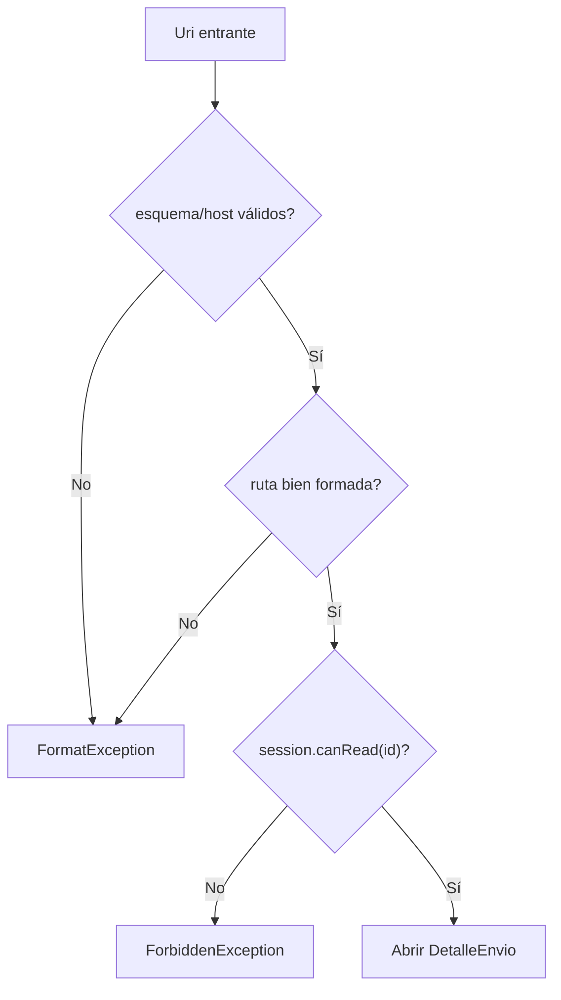
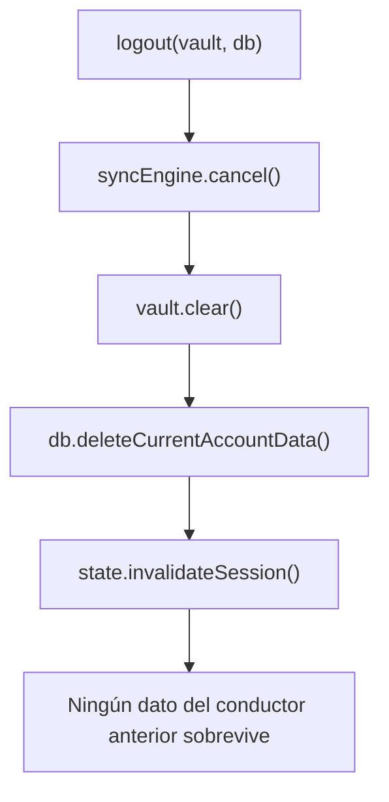
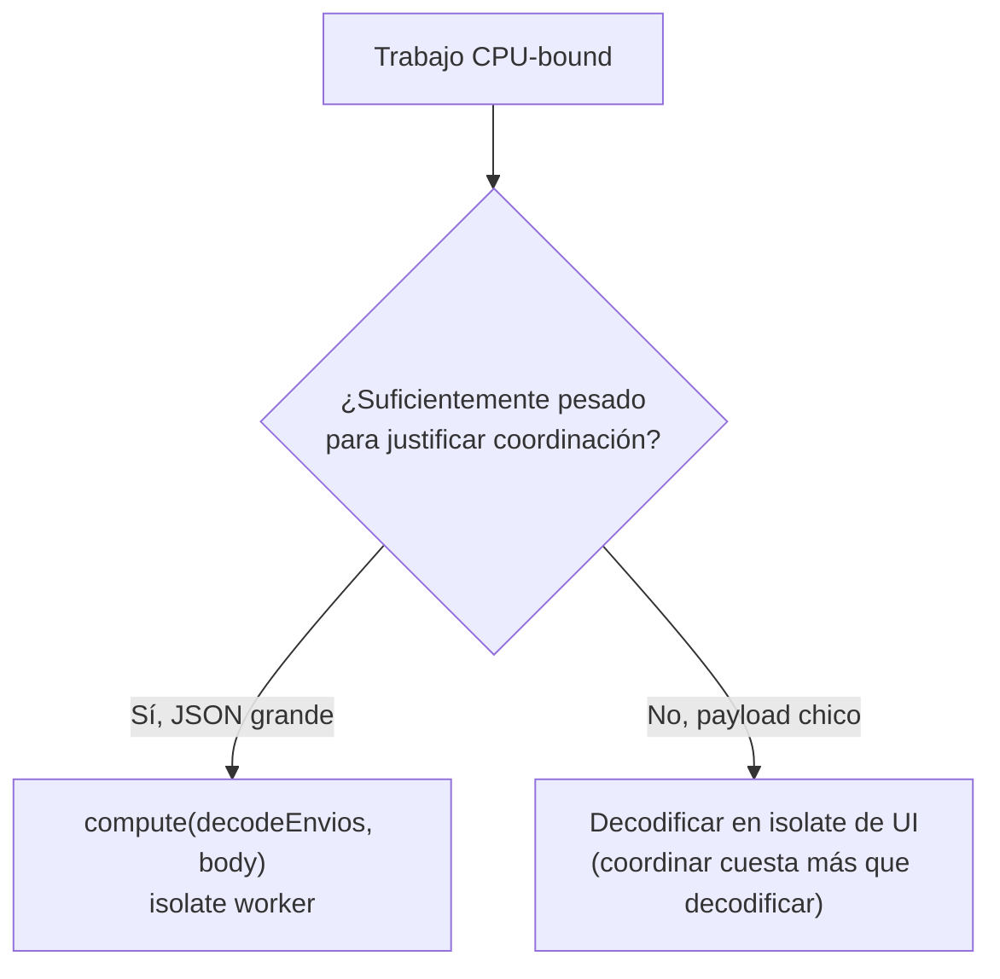
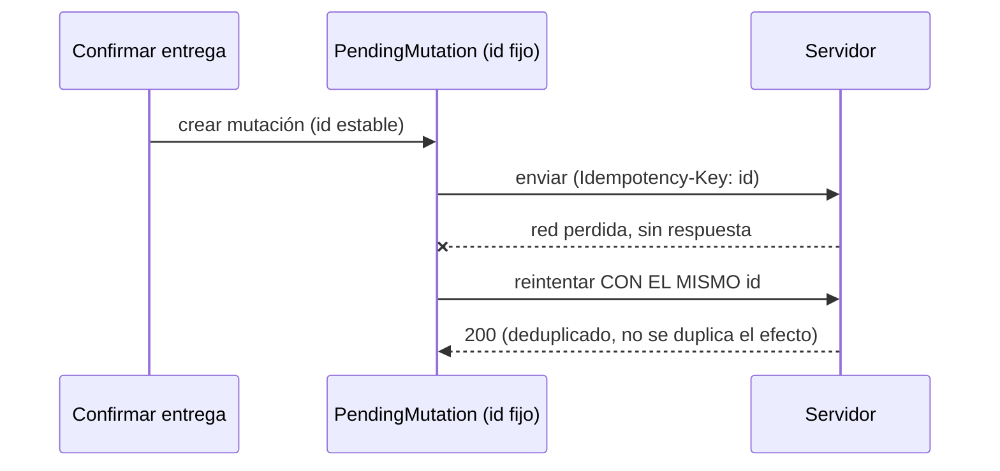

# Módulo 13: Flutter en producción — seguridad, isolates y operación

Compartir código no comparte automáticamente garantías. Flutter entrega una interfaz común sobre sistemas con permisos, almacenamiento y ciclos de vida diferentes. Este módulo endurece el proyecto integrador: examina fronteras nativas, elimina bloqueos del isolate de UI, modela sincronización y prepara releases que puedan observarse y contenerse.


## Aprende construyendo


### Tema 1: Una API Dart puede terminar en una frontera nativa · Avanzado · 40 min

<details open>
<summary><strong>Capa 1 — Lectura</strong></summary>

#### ► DE QUÉ TRATA
Al finalizar vas a validar un deep link entrante de RutaFlow (https://rutaflow.app/envios/<id>) verificando esquema, host, ruta y autorización, antes de confiar en que puede abrir el envío correspondiente. Prerrequisitos: Módulo 7 completo.

#### ► LA IDEA EN UNA FRASE
**Al finalizar vas a validar un deep link entrante de RutaFlow (https://rutaflow.app/envios/<id>) verificando esquema, host, ruta y autorización, antes de confiar en que puede abrir el envío correspondiente.**

#### ► POR QUÉ EXISTE ESTO
Resuelve un problema real de diseño o implementación y evita decisiones a ciegas.

#### ► LA ANALOGÍA
Piensa en una api dart puede terminar en una frontera nativa como una herramienta de taller: útil cuando conoces su propósito y sus límites.
**Dónde se rompe la analogía:** en software, los efectos dependen del contexto, la escala y los trade-offs.

#### ► CÓMO FUNCIONA


#### ► LO QUE PUEDE SALIR MAL
| Síntoma | Causa probable | Arreglo |
|---|---|---|
| Una API Dart puede terminar en una frontera nativa se aplica pero el resultado no mejora | Se usó sin medir el problema real | Mide antes y compara contra la alternativa simple |
| Aparece complejidad inesperada | Se adoptó la técnica sin comprender sus trade-offs | Vuelve a la sección de trade-offs y reduce el alcance |
| Falla en un caso límite | Se asumió un contexto que no se cumple | Prueba el caso límite y documenta cuándo NO usarlo |

#### ► TRADE-OFFS
| Opción | Cuándo usarla | Cuándo NO usarla |
|---|---|---|
| Usar Una API Dart puede terminar en una frontera nativa | Cuando el problema coincide con su propósito y el beneficio es observable | Cuando agrega complejidad sin resolver un problema real |
| Alternativa más simple | Cuando el contexto es pequeño, estable o fácil de razonar | Cuando ya demostró no escalar o no cumplir el requisito |
| Postergar la decisión | Cuando falta evidencia del problema | Cuando el costo de esperar es mayor que el costo de probar |

#### ► CUÁNDO NO USAR ESTO
No uses una api dart puede terminar en una frontera nativa por defecto. Aplícalo cuando el problema lo justifique y puedas verificar el beneficio; si una alternativa más simple resuelve igual, prefiérela.

#### ► DE VUELTA A LA ANALOGÍA
Volviendo a la analogía: una api dart puede terminar en una frontera nativa funciona como el modelo inicial, pero recuerda dónde se rompe: en producción importan la evidencia, la escala y el costo de equivocarte.

#### ► LO QUE DEBES RECORDAR
- Una API Dart puede terminar en una frontera nativa existe para resolver un problema específico.
- Mide antes de adoptar complejidad.
- Conoce el caso donde NO usarlo.
- Verifica con evidencia observable.

#### ► PREGUNTAS PARA PENSAR
1. ¿Qué problema concreto resuelve una api dart puede terminar en una frontera nativa en tu contexto?
2. ¿Cómo sabrías que una api dart puede terminar en una frontera nativa no está funcionando bien?
3. ¿Qué alternativa más simple considerarías antes de usar una api dart puede terminar en una frontera nativa?

</details>

<details>
<summary><strong>Capa 2 — Construcción</strong></summary>

#### Código y verificación
```dart
TaskId parseTaskLink(Uri uri, Session session) {
  if (uri.scheme != 'https' || uri.host != 'tasks.example.com') {
    throw const FormatException('Origen inválido');
  }
  if (uri.pathSegments.length != 2 || uri.pathSegments.first != 'tasks') {
    throw const FormatException('Ruta inválida');
  }
  final id = TaskId.parse(uri.pathSegments.last);
  if (!session.canRead(id)) throw const ForbiddenException();
  return id;
}
```

```text
Dart -> plugin/channel -> Android/iOS capability
entrada externa -> validar -> autenticar -> autorizar -> dominio
```


```dart
import 'package:flutter/material.dart';

class EnvioId {
  const EnvioId._(this.valor);
  final String valor;

  factory EnvioId.parse(String texto) {
    if (!RegExp(r'^RF-\d+$').hasMatch(texto)) throw FormatException('Id inválido', texto);
    return EnvioId._(texto);
  }
}

class ForbiddenException implements Exception {
  const ForbiddenException();
}

class Session {
  const Session(this.legibles);
  final Set<String> legibles;
  bool canRead(EnvioId id) => legibles.contains(id.valor);
}

EnvioId parseEnvioLink(Uri uri, Session session) {
  if (uri.scheme != 'https' || uri.host != 'rutaflow.app') {
    throw const FormatException('Origen inválido');
  }
  if (uri.pathSegments.length != 2 || uri.pathSegments.first != 'envios') {
    throw const FormatException('Ruta inválida');
  }
  final id = EnvioId.parse(uri.pathSegments.last);
  if (!session.canRead(id)) throw const ForbiddenException();
  return id;
}

String probar(String enlace, Session session) {
  try {
    return 'abre ${parseEnvioLink(Uri.parse(enlace), session).valor}';
  } on FormatException catch (e) {
    return 'FormatException: ${e.message}';
  } on ForbiddenException {
    return 'ForbiddenException';
  }
}

void main() {
  const session = Session({'RF-4471'});
  const enlaces = [
    'https://rutaflow.app/envios/RF-4471',
    'https://rutaflow.app/envios/RF-9999',
    'https://otro.app/envios/RF-4471',
    'https://rutaflow.app/admin',
  ];
  runApp(MaterialApp(
    home: Scaffold(
      body: SafeArea(
        child: ListView(children: [
          for (final enlace in enlaces) ListTile(title: Text(enlace), subtitle: Text(probar(enlace, session))),
        ]),
      ),
    ),
  ));
}
```

```bash
flutter create demo_flutter
cd demo_flutter
flutter run
```

</details>

### Tema 2: Los secretos no pertenecen al binario · Avanzado · 40 min

<details open>
<summary><strong>Capa 1 — Lectura</strong></summary>

#### ► DE QUÉ TRATA
Al finalizar vas a implementar SessionVault para guardar el refresh token del conductor delegando en Keychain/Keystore, y a confirmar que logout() borra tanto el token como la caché local relacionada. Prerrequisitos: Tema 1 de este módulo.

#### ► LA IDEA EN UNA FRASE
**Al finalizar vas a implementar SessionVault para guardar el refresh token del conductor delegando en Keychain/Keystore, y a confirmar que logout() borra tanto el token como la caché local relacionada.**

#### ► POR QUÉ EXISTE ESTO
Resuelve un problema real de diseño o implementación y evita decisiones a ciegas.

#### ► LA ANALOGÍA
Una clave compilada puede extraerse; ningún `.env` empacado es bóveda. El cliente puede contener identificadores públicos, pero una credencial con autoridad debe vivir en servidor. Para tokens de usuario usa un plugin mantenido que delegue a Keychain/Keystore y configura accesibilidad, backup y autenticación según la amenaza real. Conserva datos grandes en almacenamiento privado con cifrado mantenido y política de retención. **Conceptos clave:** data classification, minimization, Keychain, Android Keystore, secure storage, backup, log redaction, screenshot, clipboard, token rotation, logout y privacy manifest.

Revisa copias: logs, analytics, crash reports, backups, notificaciones y capturas. Redacta por defecto y documenta qué SDK recoge qué dato y con qué propósito. Prueba cambio de cuenta y restauración; borrar un token sin borrar caché puede exponer la sesión anterior. La analogía: el almacén seguro es una caja fuerte, pero el dato también deja huellas en recibos, cámaras y papeleras.

**Diagrama:**



**¿Por qué es importante?** Porque la mayoría de exposiciones ocurren en copias secundarias o configuración, no rompiendo cifrado. **Casos de uso reales:** API key en assets, token en preferencias, email en crash report, base restaurada en otro dispositivo y datos persistentes tras logout.

**Dónde se rompe la analogía:** el modelo simplifica la realidad; en producción influyen escala, fallos, costo y contexto.

#### ► CÓMO FUNCIONA


#### ► LO QUE PUEDE SALIR MAL
| Síntoma | Causa probable | Arreglo |
|---|---|---|
| Los secretos no pertenecen al binario se aplica pero el resultado no mejora | Se usó sin medir el problema real | Mide antes y compara contra la alternativa simple |
| Aparece complejidad inesperada | Se adoptó la técnica sin comprender sus trade-offs | Vuelve a la sección de trade-offs y reduce el alcance |
| Falla en un caso límite | Se asumió un contexto que no se cumple | Prueba el caso límite y documenta cuándo NO usarlo |

#### ► TRADE-OFFS
| Opción | Cuándo usarla | Cuándo NO usarla |
|---|---|---|
| Usar Los secretos no pertenecen al binario | Cuando el problema coincide con su propósito y el beneficio es observable | Cuando agrega complejidad sin resolver un problema real |
| Alternativa más simple | Cuando el contexto es pequeño, estable o fácil de razonar | Cuando ya demostró no escalar o no cumplir el requisito |
| Postergar la decisión | Cuando falta evidencia del problema | Cuando el costo de esperar es mayor que el costo de probar |

#### ► CUÁNDO NO USAR ESTO
No uses los secretos no pertenecen al binario por defecto. Aplícalo cuando el problema lo justifique y puedas verificar el beneficio; si una alternativa más simple resuelve igual, prefiérela.

#### ► DE VUELTA A LA ANALOGÍA
Volviendo a la analogía: los secretos no pertenecen al binario funciona como el modelo inicial, pero recuerda dónde se rompe: en producción importan la evidencia, la escala y el costo de equivocarte.

#### ► LO QUE DEBES RECORDAR
- Los secretos no pertenecen al binario existe para resolver un problema específico.
- Mide antes de adoptar complejidad.
- Conoce el caso donde NO usarlo.
- Verifica con evidencia observable.

#### ► PREGUNTAS PARA PENSAR
1. ¿Qué problema concreto resuelve los secretos no pertenecen al binario en tu contexto?
2. ¿Cómo sabrías que los secretos no pertenecen al binario no está funcionando bien?
3. ¿Qué alternativa más simple considerarías antes de usar los secretos no pertenecen al binario?

</details>

<details>
<summary><strong>Capa 2 — Construcción</strong></summary>

#### Código y verificación


```bash
flutter create demo_flutter
cd demo_flutter
mkdir -p lib/core
```

```dart
abstract interface class SessionVault {
  Future<void> writeRefreshToken(String token);
  Future<String?> readRefreshToken();
  Future<void> clear();
}

class LocalDatabase {
  bool hasCurrentAccountData = true;
  Future<void> deleteCurrentAccountData() async => hasCurrentAccountData = false;
}

class SyncEngine {
  bool running = true;
  Future<void> cancel() async => running = false;
}

class SessionState {
  bool active = true;
  void invalidateSession() => active = false;
}

final syncEngine = SyncEngine();
final state = SessionState();

Future<void> logout(SessionVault vault, LocalDatabase db) async {
  await syncEngine.cancel();
  await vault.clear();
  await db.deleteCurrentAccountData();
  state.invalidateSession();
}

class InMemoryVault implements SessionVault {
  String? _token;
  @override
  Future<void> writeRefreshToken(String token) async => _token = token;
  @override
  Future<String?> readRefreshToken() async => _token;
  @override
  Future<void> clear() async => _token = null;
}

Future<void> main() async {
  final vault = InMemoryVault();
  await vault.writeRefreshToken('refresh-123');
  final db = LocalDatabase();
  await logout(vault, db);
  print('token=${await vault.readRefreshToken()} cache=${db.hasCurrentAccountData} session=${state.active} sync=${syncEngine.running}');
}
```

```bash
dart run lib/core/session_vault.dart
```

</details>

### Tema 3: Fluidez se mide contra el presupuesto de cada frame · Avanzado · 35 min

<details open>
<summary><strong>Capa 1 — Lectura</strong></summary>

#### ► DE QUÉ TRATA
Al finalizar vas a mover el parseo de un JSON grande de envíos históricos a un isolate separado con compute, para no bloquear el isolate de UI mientras se decodifica. Prerrequisitos: Tema 2 de este módulo.

#### ► LA IDEA EN UNA FRASE
**Al finalizar vas a mover el parseo de un JSON grande de envíos históricos a un isolate separado con compute, para no bloquear el isolate de UI mientras se decodifica.**

#### ► POR QUÉ EXISTE ESTO
Resuelve un problema real de diseño o implementación y evita decisiones a ciegas.

#### ► LA ANALOGÍA
Piensa en fluidez se mide contra el presupuesto de cada frame como una herramienta de taller: útil cuando conoces su propósito y sus límites.
**Dónde se rompe la analogía:** en software, los efectos dependen del contexto, la escala y los trade-offs.

#### ► CÓMO FUNCIONA


#### ► LO QUE PUEDE SALIR MAL
| Síntoma | Causa probable | Arreglo |
|---|---|---|
| Fluidez se mide contra el presupuesto de cada frame se aplica pero el resultado no mejora | Se usó sin medir el problema real | Mide antes y compara contra la alternativa simple |
| Aparece complejidad inesperada | Se adoptó la técnica sin comprender sus trade-offs | Vuelve a la sección de trade-offs y reduce el alcance |
| Falla en un caso límite | Se asumió un contexto que no se cumple | Prueba el caso límite y documenta cuándo NO usarlo |

#### ► TRADE-OFFS
| Opción | Cuándo usarla | Cuándo NO usarla |
|---|---|---|
| Usar Fluidez se mide contra el presupuesto de cada frame | Cuando el problema coincide con su propósito y el beneficio es observable | Cuando agrega complejidad sin resolver un problema real |
| Alternativa más simple | Cuando el contexto es pequeño, estable o fácil de razonar | Cuando ya demostró no escalar o no cumplir el requisito |
| Postergar la decisión | Cuando falta evidencia del problema | Cuando el costo de esperar es mayor que el costo de probar |

#### ► CUÁNDO NO USAR ESTO
No uses fluidez se mide contra el presupuesto de cada frame por defecto. Aplícalo cuando el problema lo justifique y puedas verificar el beneficio; si una alternativa más simple resuelve igual, prefiérela.

#### ► DE VUELTA A LA ANALOGÍA
Volviendo a la analogía: fluidez se mide contra el presupuesto de cada frame funciona como el modelo inicial, pero recuerda dónde se rompe: en producción importan la evidencia, la escala y el costo de equivocarte.

#### ► LO QUE DEBES RECORDAR
- Fluidez se mide contra el presupuesto de cada frame existe para resolver un problema específico.
- Mide antes de adoptar complejidad.
- Conoce el caso donde NO usarlo.
- Verifica con evidencia observable.

#### ► PREGUNTAS PARA PENSAR
1. ¿Qué problema concreto resuelve fluidez se mide contra el presupuesto de cada frame en tu contexto?
2. ¿Cómo sabrías que fluidez se mide contra el presupuesto de cada frame no está funcionando bien?
3. ¿Qué alternativa más simple considerarías antes de usar fluidez se mide contra el presupuesto de cada frame?

</details>

<details>
<summary><strong>Capa 2 — Construcción</strong></summary>

#### Código y verificación
```dart
List<Task> decodeTasks(String body) =>
    (jsonDecode(body) as List)
        .cast<Map<String, Object?>>()
        .map(Task.fromJson)
        .toList(growable: false);

Future<List<Task>> decodeOffUi(String body) => compute(decodeTasks, body);
```

```text
evento -> UI isolate -> build/layout/paint -> frame
             | trabajo CPU grande
             +-> worker isolate -> resultado pequeño -> estado
```


```dart
import 'dart:convert';

import 'package:flutter/foundation.dart';
import 'package:flutter/material.dart';

class Envio {
  const Envio(this.id, this.estado);
  factory Envio.fromJson(Map<String, Object?> json) => Envio(json['id']! as String, json['estado']! as String);
  final String id;
  final String estado;
}

List<Envio> decodeEnvios(String body) =>
    (jsonDecode(body) as List)
        .cast<Map<String, Object?>>()
        .map(Envio.fromJson)
        .toList(growable: false);

Future<List<Envio>> decodeOffUi(String body) => compute(decodeEnvios, body);

final historial = jsonEncode([
  for (var i = 0; i < 20000; i++) {'id': 'RF-$i', 'estado': i.isEven ? 'entregado' : 'en_ruta'},
]);

void main() => runApp(const MaterialApp(home: PantallaHistorial()));

class PantallaHistorial extends StatefulWidget {
  const PantallaHistorial({super.key});

  @override
  State<PantallaHistorial> createState() => _PantallaHistorialState();
}

class _PantallaHistorialState extends State<PantallaHistorial> {
  late final Future<List<Envio>> envios = decodeOffUi(historial);

  @override
  Widget build(BuildContext context) => Scaffold(
        body: Center(
          child: FutureBuilder<List<Envio>>(
            future: envios,
            builder: (context, snapshot) => snapshot.hasData
                ? Text('${snapshot.data!.length} envíos decodificados')
                : const CircularProgressIndicator(),
          ),
        ),
      );
}
```

```bash
flutter create demo_flutter
cd demo_flutter
flutter run
```

</details>

### Tema 4: Producción exige protocolo, telemetría y contención · Avanzado · 45 min

<details open>
<summary><strong>Capa 1 — Lectura</strong></summary>

#### ► DE QUÉ TRATA
Al finalizar vas a construir una outbox con PendingMutation para la confirmación de entregas de RutaFlow, con una clave de idempotencia estable que sobrevive reintentos tras perder conectividad. Prerrequisitos: Tema 3 de este módulo.

#### ► LA IDEA EN UNA FRASE
**Al finalizar vas a construir una outbox con PendingMutation para la confirmación de entregas de RutaFlow, con una clave de idempotencia estable que sobrevive reintentos tras perder conectividad.**

#### ► POR QUÉ EXISTE ESTO
Resuelve un problema real de diseño o implementación y evita decisiones a ciegas.

#### ► LA ANALOGÍA
Piensa en producción exige protocolo, telemetría y contención como una herramienta de taller: útil cuando conoces su propósito y sus límites.
**Dónde se rompe la analogía:** en software, los efectos dependen del contexto, la escala y los trade-offs.

#### ► CÓMO FUNCIONA


#### ► LO QUE PUEDE SALIR MAL
| Síntoma | Causa probable | Arreglo |
|---|---|---|
| Producción exige protocolo, telemetría y contención se aplica pero el resultado no mejora | Se usó sin medir el problema real | Mide antes y compara contra la alternativa simple |
| Aparece complejidad inesperada | Se adoptó la técnica sin comprender sus trade-offs | Vuelve a la sección de trade-offs y reduce el alcance |
| Falla en un caso límite | Se asumió un contexto que no se cumple | Prueba el caso límite y documenta cuándo NO usarlo |

#### ► TRADE-OFFS
| Opción | Cuándo usarla | Cuándo NO usarla |
|---|---|---|
| Usar Producción exige protocolo, telemetría y contención | Cuando el problema coincide con su propósito y el beneficio es observable | Cuando agrega complejidad sin resolver un problema real |
| Alternativa más simple | Cuando el contexto es pequeño, estable o fácil de razonar | Cuando ya demostró no escalar o no cumplir el requisito |
| Postergar la decisión | Cuando falta evidencia del problema | Cuando el costo de esperar es mayor que el costo de probar |

#### ► CUÁNDO NO USAR ESTO
No uses producción exige protocolo, telemetría y contención por defecto. Aplícalo cuando el problema lo justifique y puedas verificar el beneficio; si una alternativa más simple resuelve igual, prefiérela.

#### ► DE VUELTA A LA ANALOGÍA
Volviendo a la analogía: producción exige protocolo, telemetría y contención funciona como el modelo inicial, pero recuerda dónde se rompe: en producción importan la evidencia, la escala y el costo de equivocarte.

#### ► LO QUE DEBES RECORDAR
- Producción exige protocolo, telemetría y contención existe para resolver un problema específico.
- Mide antes de adoptar complejidad.
- Conoce el caso donde NO usarlo.
- Verifica con evidencia observable.

#### ► PREGUNTAS PARA PENSAR
1. ¿Qué problema concreto resuelve producción exige protocolo, telemetría y contención en tu contexto?
2. ¿Cómo sabrías que producción exige protocolo, telemetría y contención no está funcionando bien?
3. ¿Qué alternativa más simple considerarías antes de usar producción exige protocolo, telemetría y contención?

</details>

<details>
<summary><strong>Capa 2 — Construcción</strong></summary>

#### Código y verificación
```dart
final class PendingMutation {
  PendingMutation(this.id, this.entityId, this.baseVersion, this.payload);
  final String id; // clave de idempotencia estable
  final String entityId;
  final int baseVersion;
  final Map<String, Object?> payload;
  int attempts = 0;
}
```

```text
local DB -> outbox -> API/idempotencia -> reconciliar
build -> pruebas -> cohorte -> métricas -> ampliar o contener
```


```dart
import 'package:flutter/material.dart';

final class PendingMutation {
  PendingMutation(this.id, this.entityId, this.baseVersion, this.payload);
  final String id; // clave de idempotencia estable
  final String entityId;
  final int baseVersion;
  final Map<String, Object?> payload;
  int attempts = 0;
}

/// Servidor simulado: recuerda qué claves de idempotencia ya aplicó.
class ServidorEntregas {
  final _aplicadas = <String>{};
  int efectos = 0;

  void recibir(PendingMutation mutacion) {
    if (_aplicadas.add(mutacion.id)) efectos++; // un id repetido no repite el efecto
  }
}

void main() {
  final servidor = ServidorEntregas();
  final mutacion = PendingMutation('op-RF-4471-1', 'RF-4471', 3, {'estado': 'entregado'});
  for (var intento = 0; intento < 3; intento++) { // tres reintentos tras perder la red
    mutacion.attempts++;
    servidor.recibir(mutacion);
  }
  runApp(MaterialApp(
    home: Scaffold(body: Center(child: Text('intentos=${mutacion.attempts} efectos=${servidor.efectos}'))),
  ));
}
```

```bash
flutter create demo_flutter
cd demo_flutter
flutter run
```

</details>

### Versiones y migraciones controladas

<details open>
<summary><strong>Capa 1 — Lectura</strong></summary>

#### ► DE QUÉ TRATA
Este tema te guía por versiones y migraciones controladas con foco en comprensión antes de implementación.

#### ► LA IDEA EN UNA FRASE
**Entender versiones y migraciones controladas te permite tomar mejores decisiones técnicas.**

#### ► POR QUÉ EXISTE ESTO
Resuelve un problema real de diseño o implementación y evita decisiones a ciegas.

#### ► LA ANALOGÍA
Piensa en versiones y migraciones controladas como una herramienta de taller: útil cuando conoces su propósito y sus límites.
**Dónde se rompe la analogía:** en software, los efectos dependen del contexto, la escala y los trade-offs.

#### ► CÓMO FUNCIONA
1. Identifica el problema que versiones y migraciones controladas resuelve.
2. Observa sus componentes y relaciones.
3. Aplica la opción más simple que funcione.
4. Verifica el resultado y los límites.

#### ► LO QUE PUEDE SALIR MAL
| Síntoma | Causa probable | Arreglo |
|---|---|---|
| Versiones y migraciones controladas se aplica pero el resultado no mejora | Se usó sin medir el problema real | Mide antes y compara contra la alternativa simple |
| Aparece complejidad inesperada | Se adoptó la técnica sin comprender sus trade-offs | Vuelve a la sección de trade-offs y reduce el alcance |
| Falla en un caso límite | Se asumió un contexto que no se cumple | Prueba el caso límite y documenta cuándo NO usarlo |

#### ► TRADE-OFFS
| Opción | Cuándo usarla | Cuándo NO usarla |
|---|---|---|
| Usar Versiones y migraciones controladas | Cuando el problema coincide con su propósito y el beneficio es observable | Cuando agrega complejidad sin resolver un problema real |
| Alternativa más simple | Cuando el contexto es pequeño, estable o fácil de razonar | Cuando ya demostró no escalar o no cumplir el requisito |
| Postergar la decisión | Cuando falta evidencia del problema | Cuando el costo de esperar es mayor que el costo de probar |

#### ► CUÁNDO NO USAR ESTO
No uses versiones y migraciones controladas por defecto. Aplícalo cuando el problema lo justifique y puedas verificar el beneficio; si una alternativa más simple resuelve igual, prefiérela.

#### ► DE VUELTA A LA ANALOGÍA
Volviendo a la analogía: versiones y migraciones controladas funciona como el modelo inicial, pero recuerda dónde se rompe: en producción importan la evidencia, la escala y el costo de equivocarte.

#### ► LO QUE DEBES RECORDAR
- Versiones y migraciones controladas existe para resolver un problema específico.
- Mide antes de adoptar complejidad.
- Conoce el caso donde NO usarlo.
- Verifica con evidencia observable.

#### ► PREGUNTAS PARA PENSAR
1. ¿Qué problema concreto resuelve versiones y migraciones controladas en tu contexto?
2. ¿Cómo sabrías que versiones y migraciones controladas no está funcionando bien?
3. ¿Qué alternativa más simple considerarías antes de usar versiones y migraciones controladas?

</details>

<details>
<summary><strong>Capa 2 — Construcción</strong></summary>

#### Nota de construcción
Este tema es principalmente conceptual en esta versión. La verificación se realiza con las preguntas de comprensión y el criterio de cuándo NO usar versiones y migraciones controladas.

</details>

### Método de estudio y proyecto de ampliación

<details open>
<summary><strong>Capa 1 — Lectura</strong></summary>

#### ► DE QUÉ TRATA
Este tema te guía por método de estudio y proyecto de ampliación con foco en comprensión antes de implementación.

#### ► LA IDEA EN UNA FRASE
**Entender método de estudio y proyecto de ampliación te permite tomar mejores decisiones técnicas.**

#### ► POR QUÉ EXISTE ESTO
Resuelve un problema real de diseño o implementación y evita decisiones a ciegas.

#### ► LA ANALOGÍA
Piensa en método de estudio y proyecto de ampliación como una herramienta de taller: útil cuando conoces su propósito y sus límites.
**Dónde se rompe la analogía:** en software, los efectos dependen del contexto, la escala y los trade-offs.

#### ► CÓMO FUNCIONA
1. Identifica el problema que método de estudio y proyecto de ampliación resuelve.
2. Observa sus componentes y relaciones.
3. Aplica la opción más simple que funcione.
4. Verifica el resultado y los límites.

#### ► LO QUE PUEDE SALIR MAL
| Síntoma | Causa probable | Arreglo |
|---|---|---|
| Método de estudio y proyecto de ampliación se aplica pero el resultado no mejora | Se usó sin medir el problema real | Mide antes y compara contra la alternativa simple |
| Aparece complejidad inesperada | Se adoptó la técnica sin comprender sus trade-offs | Vuelve a la sección de trade-offs y reduce el alcance |
| Falla en un caso límite | Se asumió un contexto que no se cumple | Prueba el caso límite y documenta cuándo NO usarlo |

#### ► TRADE-OFFS
| Opción | Cuándo usarla | Cuándo NO usarla |
|---|---|---|
| Usar Método de estudio y proyecto de ampliación | Cuando el problema coincide con su propósito y el beneficio es observable | Cuando agrega complejidad sin resolver un problema real |
| Alternativa más simple | Cuando el contexto es pequeño, estable o fácil de razonar | Cuando ya demostró no escalar o no cumplir el requisito |
| Postergar la decisión | Cuando falta evidencia del problema | Cuando el costo de esperar es mayor que el costo de probar |

#### ► CUÁNDO NO USAR ESTO
No uses método de estudio y proyecto de ampliación por defecto. Aplícalo cuando el problema lo justifique y puedas verificar el beneficio; si una alternativa más simple resuelve igual, prefiérela.

#### ► DE VUELTA A LA ANALOGÍA
Volviendo a la analogía: método de estudio y proyecto de ampliación funciona como el modelo inicial, pero recuerda dónde se rompe: en producción importan la evidencia, la escala y el costo de equivocarte.

#### ► LO QUE DEBES RECORDAR
- Método de estudio y proyecto de ampliación existe para resolver un problema específico.
- Mide antes de adoptar complejidad.
- Conoce el caso donde NO usarlo.
- Verifica con evidencia observable.

#### ► PREGUNTAS PARA PENSAR
1. ¿Qué problema concreto resuelve método de estudio y proyecto de ampliación en tu contexto?
2. ¿Cómo sabrías que método de estudio y proyecto de ampliación no está funcionando bien?
3. ¿Qué alternativa más simple considerarías antes de usar método de estudio y proyecto de ampliación?

</details>

<details>
<summary><strong>Capa 2 — Construcción</strong></summary>

#### Nota de construcción
Este tema es principalmente conceptual en esta versión. La verificación se realiza con las preguntas de comprensión y el criterio de cuándo NO usar método de estudio y proyecto de ampliación.

</details>
