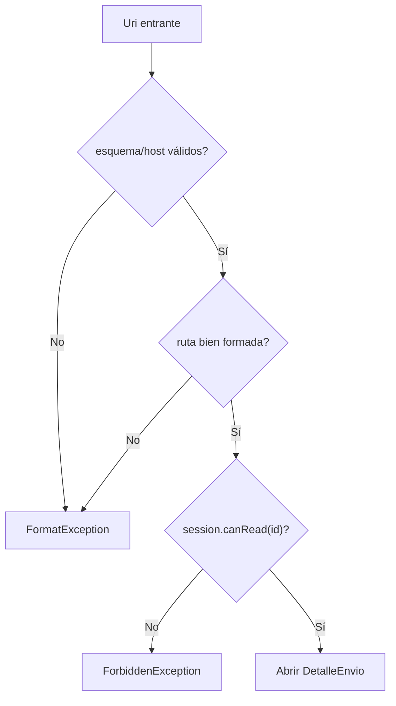
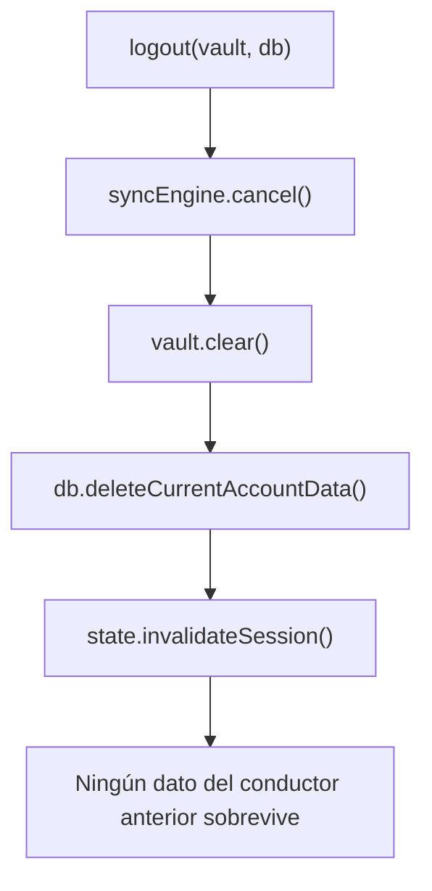
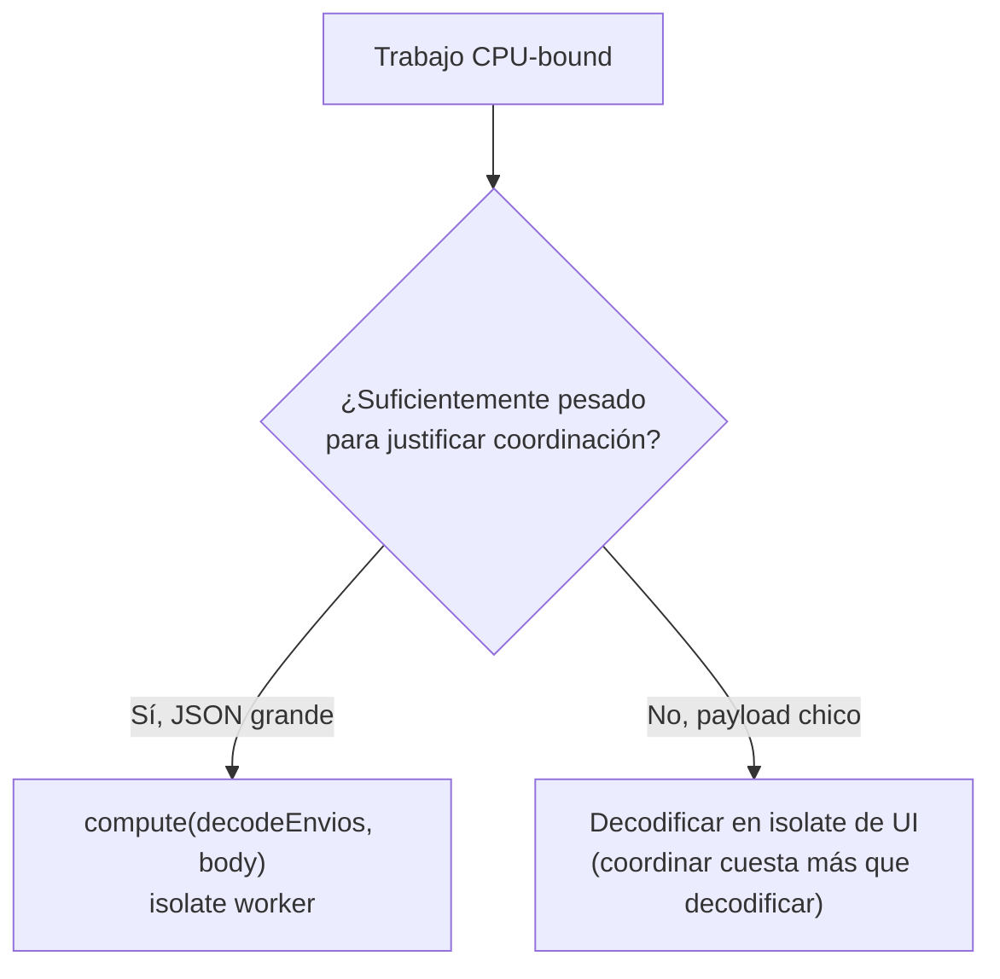
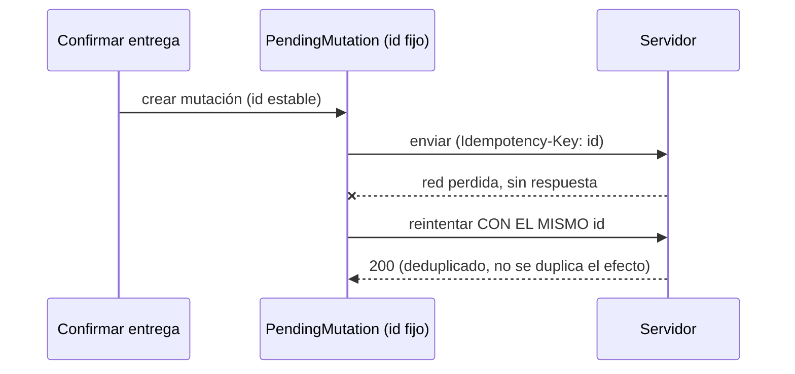

# Módulo 13: Flutter en producción — seguridad, isolates y operación

Compartir código no comparte automáticamente garantías. Flutter entrega una interfaz común sobre sistemas con permisos, almacenamiento y ciclos de vida diferentes. Este módulo endurece el proyecto integrador: examina fronteras nativas, elimina bloqueos del isolate de UI, modela sincronización y prepara releases que puedan observarse y contenerse.


## Aprende construyendo


### Tema 1: Una API Dart puede terminar en una frontera nativa · Avanzado · 40 min

<details open>
<summary><strong>Capa 1 — Lectura</strong></summary>

#### ► DE QUÉ TRATA
Al finalizar vas a validar un deep link entrante de RutaFlow (https://rutaflow.app/envios/<id>) verificando esquema, host, ruta y autorización, antes de confiar en que puede abrir el envío correspondiente. Prerrequisitos: Módulo 7 completo.

#### ► CÓMO FUNCIONA


</details>

<details>
<summary><strong>Capa 2 — Construcción</strong></summary>

#### Código y verificación
```dart
TaskId parseTaskLink(Uri uri, Session session) {
  if (uri.scheme != 'https' || uri.host != 'tasks.example.com') {
    throw const FormatException('Origen inválido');
  }
  if (uri.pathSegments.length != 2 || uri.pathSegments.first != 'tasks') {
    throw const FormatException('Ruta inválida');
  }
  final id = TaskId.parse(uri.pathSegments.last);
  if (!session.canRead(id)) throw const ForbiddenException();
  return id;
}
```

```text
Dart -> plugin/channel -> Android/iOS capability
entrada externa -> validar -> autenticar -> autorizar -> dominio
```


```dart
import 'package:flutter/material.dart';

class EnvioId {
  const EnvioId._(this.valor);
  final String valor;

  factory EnvioId.parse(String texto) {
    if (!RegExp(r'^RF-\d+$').hasMatch(texto)) throw FormatException('Id inválido', texto);
    return EnvioId._(texto);
  }
}

class ForbiddenException implements Exception {
  const ForbiddenException();
}

class Session {
  const Session(this.legibles);
  final Set<String> legibles;
  bool canRead(EnvioId id) => legibles.contains(id.valor);
}

EnvioId parseEnvioLink(Uri uri, Session session) {
  if (uri.scheme != 'https' || uri.host != 'rutaflow.app') {
    throw const FormatException('Origen inválido');
  }
  if (uri.pathSegments.length != 2 || uri.pathSegments.first != 'envios') {
    throw const FormatException('Ruta inválida');
  }
  final id = EnvioId.parse(uri.pathSegments.last);
  if (!session.canRead(id)) throw const ForbiddenException();
  return id;
}

String probar(String enlace, Session session) {
  try {
    return 'abre ${parseEnvioLink(Uri.parse(enlace), session).valor}';
  } on FormatException catch (e) {
    return 'FormatException: ${e.message}';
  } on ForbiddenException {
    return 'ForbiddenException';
  }
}

void main() {
  const session = Session({'RF-4471'});
  const enlaces = [
    'https://rutaflow.app/envios/RF-4471',
    'https://rutaflow.app/envios/RF-9999',
    'https://otro.app/envios/RF-4471',
    'https://rutaflow.app/admin',
  ];
  runApp(MaterialApp(
    home: Scaffold(
      body: SafeArea(
        child: ListView(children: [
          for (final enlace in enlaces) ListTile(title: Text(enlace), subtitle: Text(probar(enlace, session))),
        ]),
      ),
    ),
  ));
}
```

```bash
flutter create demo_flutter
cd demo_flutter
flutter run
```

</details>

### Tema 2: Los secretos no pertenecen al binario · Avanzado · 40 min

<details open>
<summary><strong>Capa 1 — Lectura</strong></summary>

#### ► DE QUÉ TRATA
Al finalizar vas a implementar SessionVault para guardar el refresh token del conductor delegando en Keychain/Keystore, y a confirmar que logout() borra tanto el token como la caché local relacionada. Prerrequisitos: Tema 1 de este módulo.

#### ► LA ANALOGÍA
Una clave compilada puede extraerse; ningún `.env` empacado es bóveda. El cliente puede contener identificadores públicos, pero una credencial con autoridad debe vivir en servidor. Para tokens de usuario usa un plugin mantenido que delegue a Keychain/Keystore y configura accesibilidad, backup y autenticación según la amenaza real. Conserva datos grandes en almacenamiento privado con cifrado mantenido y política de retención. **Conceptos clave:** data classification, minimization, Keychain, Android Keystore, secure storage, backup, log redaction, screenshot, clipboard, token rotation, logout y privacy manifest.

Revisa copias: logs, analytics, crash reports, backups, notificaciones y capturas. Redacta por defecto y documenta qué SDK recoge qué dato y con qué propósito. Prueba cambio de cuenta y restauración; borrar un token sin borrar caché puede exponer la sesión anterior. La analogía: el almacén seguro es una caja fuerte, pero el dato también deja huellas en recibos, cámaras y papeleras.

**Diagrama:**



**¿Por qué es importante?** Porque la mayoría de exposiciones ocurren en copias secundarias o configuración, no rompiendo cifrado. **Casos de uso reales:** API key en assets, token en preferencias, email en crash report, base restaurada en otro dispositivo y datos persistentes tras logout.

#### ► CÓMO FUNCIONA


</details>

<details>
<summary><strong>Capa 2 — Construcción</strong></summary>

#### Código y verificación

```bash
flutter create demo_flutter
cd demo_flutter
mkdir -p lib/core
```

```dart
abstract interface class SessionVault {
  Future<void> writeRefreshToken(String token);
  Future<String?> readRefreshToken();
  Future<void> clear();
}

class LocalDatabase {
  bool hasCurrentAccountData = true;
  Future<void> deleteCurrentAccountData() async => hasCurrentAccountData = false;
}

class SyncEngine {
  bool running = true;
  Future<void> cancel() async => running = false;
}

class SessionState {
  bool active = true;
  void invalidateSession() => active = false;
}

final syncEngine = SyncEngine();
final state = SessionState();

Future<void> logout(SessionVault vault, LocalDatabase db) async {
  await syncEngine.cancel();
  await vault.clear();
  await db.deleteCurrentAccountData();
  state.invalidateSession();
}

class InMemoryVault implements SessionVault {
  String? _token;
  @override
  Future<void> writeRefreshToken(String token) async => _token = token;
  @override
  Future<String?> readRefreshToken() async => _token;
  @override
  Future<void> clear() async => _token = null;
}

Future<void> main() async {
  final vault = InMemoryVault();
  await vault.writeRefreshToken('refresh-123');
  final db = LocalDatabase();
  await logout(vault, db);
  print('token=${await vault.readRefreshToken()} cache=${db.hasCurrentAccountData} session=${state.active} sync=${syncEngine.running}');
}
```

```bash
dart run lib/core/session_vault.dart
```

</details>

### Tema 3: Fluidez se mide contra el presupuesto de cada frame · Avanzado · 35 min

<details open>
<summary><strong>Capa 1 — Lectura</strong></summary>

#### ► DE QUÉ TRATA
Al finalizar vas a mover el parseo de un JSON grande de envíos históricos a un isolate separado con compute, para no bloquear el isolate de UI mientras se decodifica. Prerrequisitos: Tema 2 de este módulo.

#### ► CÓMO FUNCIONA


</details>

<details>
<summary><strong>Capa 2 — Construcción</strong></summary>

#### Código y verificación
```dart
List<Task> decodeTasks(String body) =>
    (jsonDecode(body) as List)
        .cast<Map<String, Object?>>()
        .map(Task.fromJson)
        .toList(growable: false);

Future<List<Task>> decodeOffUi(String body) => compute(decodeTasks, body);
```

```text
evento -> UI isolate -> build/layout/paint -> frame
             | trabajo CPU grande
             +-> worker isolate -> resultado pequeño -> estado
```


```dart
import 'dart:convert';

import 'package:flutter/foundation.dart';
import 'package:flutter/material.dart';

class Envio {
  const Envio(this.id, this.estado);
  factory Envio.fromJson(Map<String, Object?> json) => Envio(json['id']! as String, json['estado']! as String);
  final String id;
  final String estado;
}

List<Envio> decodeEnvios(String body) =>
    (jsonDecode(body) as List)
        .cast<Map<String, Object?>>()
        .map(Envio.fromJson)
        .toList(growable: false);

Future<List<Envio>> decodeOffUi(String body) => compute(decodeEnvios, body);

final historial = jsonEncode([
  for (var i = 0; i < 20000; i++) {'id': 'RF-$i', 'estado': i.isEven ? 'entregado' : 'en_ruta'},
]);

void main() => runApp(const MaterialApp(home: PantallaHistorial()));

class PantallaHistorial extends StatefulWidget {
  const PantallaHistorial({super.key});

  @override
  State<PantallaHistorial> createState() => _PantallaHistorialState();
}

class _PantallaHistorialState extends State<PantallaHistorial> {
  late final Future<List<Envio>> envios = decodeOffUi(historial);

  @override
  Widget build(BuildContext context) => Scaffold(
        body: Center(
          child: FutureBuilder<List<Envio>>(
            future: envios,
            builder: (context, snapshot) => snapshot.hasData
                ? Text('${snapshot.data!.length} envíos decodificados')
                : const CircularProgressIndicator(),
          ),
        ),
      );
}
```

```bash
flutter create demo_flutter
cd demo_flutter
flutter run
```

</details>

### Tema 4: Producción exige protocolo, telemetría y contención · Avanzado · 45 min

<details open>
<summary><strong>Capa 1 — Lectura</strong></summary>

#### ► DE QUÉ TRATA
Al finalizar vas a construir una outbox con PendingMutation para la confirmación de entregas de RutaFlow, con una clave de idempotencia estable que sobrevive reintentos tras perder conectividad. Prerrequisitos: Tema 3 de este módulo.

#### ► CÓMO FUNCIONA


</details>

<details>
<summary><strong>Capa 2 — Construcción</strong></summary>

#### Código y verificación
```dart
final class PendingMutation {
  PendingMutation(this.id, this.entityId, this.baseVersion, this.payload);
  final String id; // clave de idempotencia estable
  final String entityId;
  final int baseVersion;
  final Map<String, Object?> payload;
  int attempts = 0;
}
```

```text
local DB -> outbox -> API/idempotencia -> reconciliar
build -> pruebas -> cohorte -> métricas -> ampliar o contener
```


```dart
import 'package:flutter/material.dart';

final class PendingMutation {
  PendingMutation(this.id, this.entityId, this.baseVersion, this.payload);
  final String id; // clave de idempotencia estable
  final String entityId;
  final int baseVersion;
  final Map<String, Object?> payload;
  int attempts = 0;
}

/// Servidor simulado: recuerda qué claves de idempotencia ya aplicó.
class ServidorEntregas {
  final _aplicadas = <String>{};
  int efectos = 0;

  void recibir(PendingMutation mutacion) {
    if (_aplicadas.add(mutacion.id)) efectos++; // un id repetido no repite el efecto
  }
}

void main() {
  final servidor = ServidorEntregas();
  final mutacion = PendingMutation('op-RF-4471-1', 'RF-4471', 3, {'estado': 'entregado'});
  for (var intento = 0; intento < 3; intento++) { // tres reintentos tras perder la red
    mutacion.attempts++;
    servidor.recibir(mutacion);
  }
  runApp(MaterialApp(
    home: Scaffold(body: Center(child: Text('intentos=${mutacion.attempts} efectos=${servidor.efectos}'))),
  ));
}
```

```bash
flutter create demo_flutter
cd demo_flutter
flutter run
```

</details>

### Versiones y migraciones controladas

<details open>
<summary><strong>Capa 1 — Lectura</strong></summary>

</details>

<details>
<summary><strong>Capa 2 — Construcción</strong></summary>

#### Nota de construcción
Este tema es principalmente conceptual en esta versión. La verificación se realiza con las preguntas de comprensión y el criterio de cuándo NO usar versiones y migraciones controladas.

</details>

### Método de estudio y proyecto de ampliación

<details open>
<summary><strong>Capa 1 — Lectura</strong></summary>

</details>

<details>
<summary><strong>Capa 2 — Construcción</strong></summary>

#### Nota de construcción
Este tema es principalmente conceptual en esta versión. La verificación se realiza con las preguntas de comprensión y el criterio de cuándo NO usar método de estudio y proyecto de ampliación.

</details>
