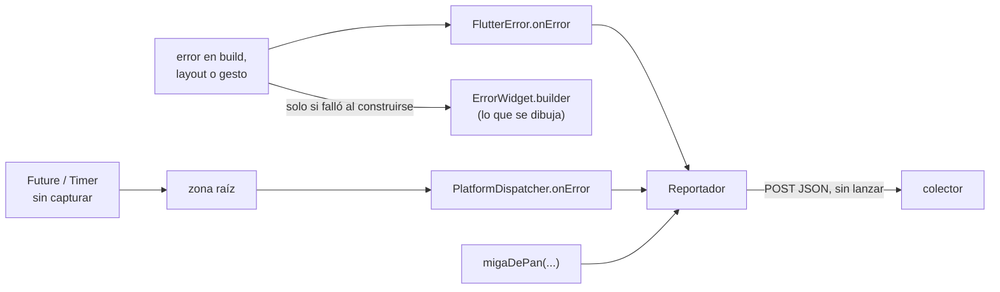
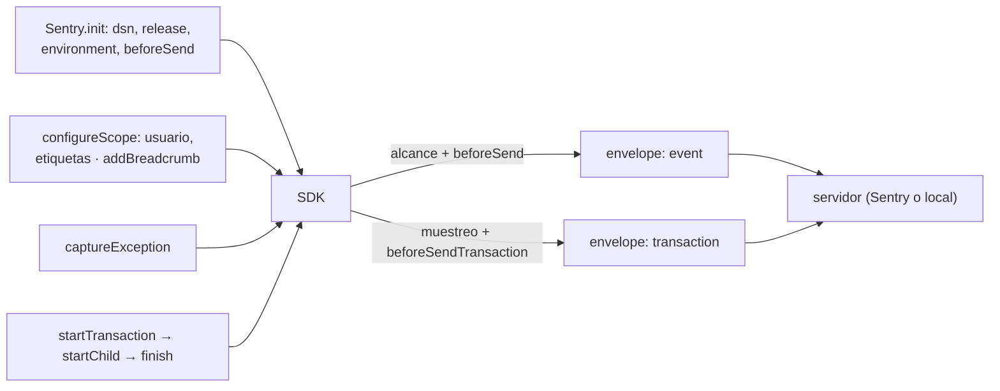
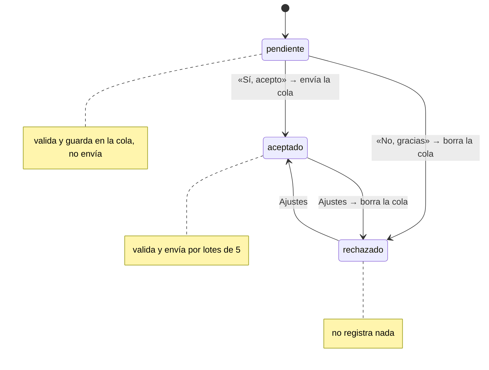
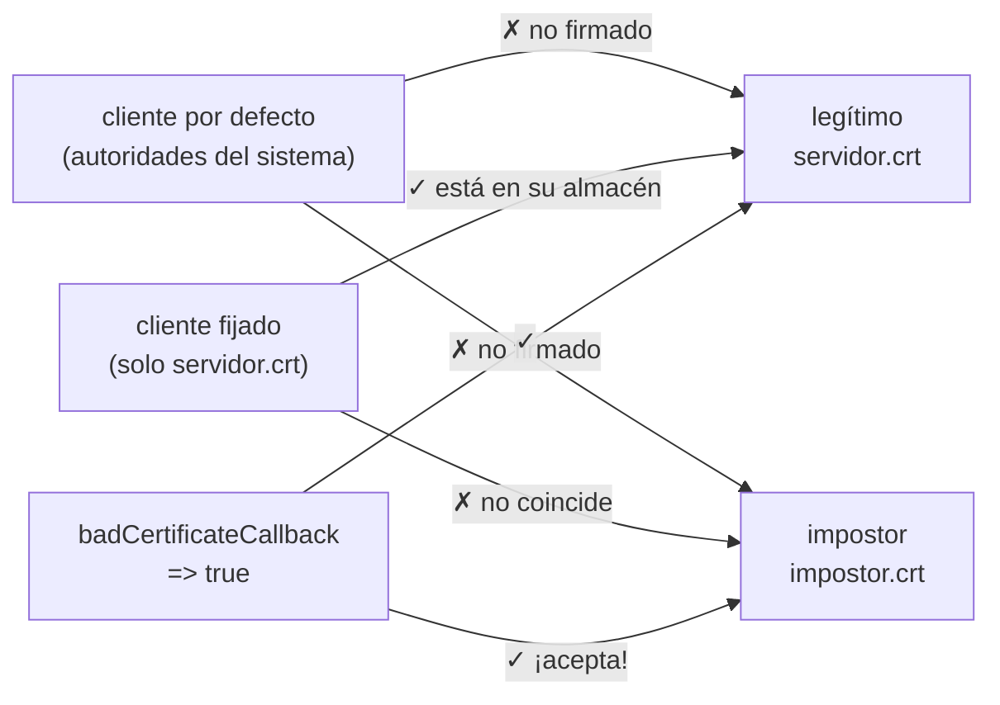

# Módulo 13: Producción: errores, monitoreo, analítica y seguridad en tránsito

**Entorno comprobado para esta edición (2026-11-24):** Flutter 3.50.1 (canal estable) con Dart 3.14.0 en Linux
x86_64, con `material_ui` 1.11.1, `http` 1.6.0, `sentry` 10.6.0 (el SDK de Dart puro) y OpenSSL. Todo el código se
analizó con `flutter analyze` (`No issues found!`) y se ejecutó ese día, en `/home/estudiante/labs/flutter/m13` (tu
`~/labs/flutter/m13`). Los errores del Tema 1 los provoca la app de escritorio real, compilada en release; el SDK de
Sentry del Tema 2 envía a un servidor local que imprime lo que recibe, así que no hace falta una cuenta; el HTTPS del
Tema 4 es real, con certificados creados con OpenSSL. Una limitación: `sentry_flutter` (el paquete con integraciones
nativas) descarga y compila `sentry-native` desde GitHub al compilar para Linux, y el equipo de pruebas no lo
permite; por eso el Tema 2 usa `sentry`, el núcleo en Dart que `sentry_flutter` usa por dentro. En Android e iOS se
usa `sentry_flutter` con las mismas opciones.

Una app publicada falla en teléfonos que no son el tuyo, con datos que no previste y redes que no controlas. Este
módulo prepara la app para enterarse: capturar todos los errores, enviarlos con contexto, medir lo que tarda,
entender cómo se usa sin invadir a nadie y asegurarse de hablar con el servidor correcto.

**Al terminar este módulo podrás:**
- capturar los errores de todas las fuentes de una app Flutter y reportarlos con versión, entorno y migas de pan;
- configurar Sentry con versión, entorno, filtro de datos personales y medición de rendimiento;
- registrar analítica solo con consentimiento, sin datos personales y por lotes;
- fijar el certificado del servidor para que un impostor no pueda leer ni responder.

**Esquema del módulo:** Tema 1 (captura global de errores) → Tema 2 (Sentry: errores y rendimiento) → Tema 3
(analítica con consentimiento) → Tema 4 (seguridad en tránsito: fijar el certificado) → Proyecto 30.

**Qué necesitas saber antes:** el Módulo 12 (la arquitectura por capas); del Módulo 11, **versión, entornos y
símbolos** (Temas 1 y 2) y **la app de escritorio en pantalla virtual**; del Módulo 5, **`http`** (Tema 1); del
Módulo 0, **`Future` y errores asíncronos** (Tema 3).

**Qué no se repite:** traducir trazas ofuscadas (Módulo 11, Tema 1), los secretos en el binario (Módulo 11, Tema 2) y
la medición de cuadros en profile (Módulo 8). Aquí se trata de lo que la app envía desde producción.

**Prepara el proyecto:**

```text
$ cd ~/labs/flutter
$ flutter create --org com.academia --platforms=linux,web m13
$ cd m13
$ flutter pub add http sentry
```

Agrega `formatter: page_width: 120` a `analysis_options.yaml`, copia `test/pantallazo.dart` del Módulo 10 y
`correr_app.sh` del Módulo 11, y deja la ventana de Linux en 480 × 420.


## Aprende construyendo


### Tema 1: Captura global de errores: las tres salidas y un reporte con contexto · Avanzado · 45 min

<details open>
<summary><strong>Capa 1 — Lectura</strong></summary>

#### Objetivos
Al terminar este tema podrás:
- nombrar por dónde salen los errores de una app Flutter: el framework, los asíncronos y la construcción de widgets;
- instalar `FlutterError.onError`, `PlatformDispatcher.instance.onError` y `ErrorWidget.builder`;
- enviar cada error con versión, entorno, pila y migas de pan;
- reemplazar la caja gris de release por un mensaje útil.

**Conceptos clave:** `FlutterError.onError`, `PlatformDispatcher.onError`, `ErrorWidget`, migas de pan, reporte de error

#### El problema
Un repartidor dice que «a veces la tarjeta de una guía sale en gris». En debug nunca pasa porque los datos de
prueba están completos. En release, el error de esa tarjeta se registra en una consola que nadie ve, y un error en una
sincronización en segundo plano desaparece sin rastro. El equipo se entera por las reseñas.

Este tema usa **los errores asíncronos y `Future`** (Módulo 0, Tema 3), **`http`** (Módulo 5) y **la versión y el
entorno** (Módulo 11).

#### Glosario del tema

**`FlutterError.onError`**
- **Definición técnica:** función que Flutter llama con un `FlutterErrorDetails` cuando falla algo dentro del framework: `build`, *layout*, pintura y los *callbacks* de gestos y animaciones.
- **En palabras sencillas:** el buzón de los errores de la interfaz.
- **Dónde se rompe la comparación:** por defecto solo imprime (`FlutterError.presentError`); si la reemplazas sin llamarla, pierdes también el registro en consola.
- **Ejemplo:** el `Null check operator` de `TarjetaRota.build`.
- **Error típico:** reemplazarla en `main` después de `runApp`, cuando el primer cuadro ya pudo fallar.

**`PlatformDispatcher.onError`**
- **Definición técnica:** función que recibe los errores que nadie capturó fuera del framework (un `Future` sin `catchError`, un `Timer`, un *stream*); si devuelve `true`, el error se da por atendido.
- **En palabras sencillas:** el buzón de los errores que ocurren «por detrás».
- **Dónde se rompe la comparación:** no reemplaza al `try`/`catch` donde sabes qué hacer; es la red de seguridad para lo que no previste.
- **Ejemplo:** `StateError: sincronización sin token` desde un `Future.delayed`.
- **Error típico:** usar `runZonedGuarded` y además `PlatformDispatcher.onError` sin saber cuál recibe qué (desde Flutter 3.3, `PlatformDispatcher.onError` es la forma recomendada).

**`ErrorWidget`**
- **Definición técnica:** el widget que Flutter pone en lugar del que lanzó una excepción al construirse; `ErrorWidget.builder` decide cuál es. Por defecto es la pantalla roja con el mensaje en debug y una caja gris sin texto en release.
- **En palabras sencillas:** el cartel de «en reparación».
- **Dónde se rompe la comparación:** solo reemplaza **ese** widget; el resto de la pantalla sigue funcionando.
- **Ejemplo:** «No se pudo mostrar esta parte. El error ya fue reportado.».
- **Error típico:** mostrar el mensaje técnico de la excepción a la persona usuaria.

**migas de pan**
- **Definición técnica:** lista acotada de las últimas acciones de la persona usuaria y de la app (pantallas, toques, peticiones), que se adjunta a cada reporte.
- **En palabras sencillas:** el rastro de lo que pasó justo antes.
- **Dónde se rompe la comparación:** deben ser pocas (aquí 20) y sin datos personales: van en cada reporte.
- **Ejemplo:** `01:39:27 tocó EN-4472`.
- **Error típico:** guardar en las migas el contenido de los formularios.

**reporte de error**
- **Definición técnica:** lo que se envía al colector: origen, tipo y mensaje, las primeras líneas de la pila, versión, entorno y migas.
- **En palabras sencillas:** la ficha del incidente.
- **Dónde se rompe la comparación:** si el envío falla, el reporte se pierde; nunca debe causar otro error.
- **Ejemplo:** `reporte 2 · plataforma · 1.3.0+12 (prod)`.
- **Error típico:** reportes sin versión: no se sabe si el error ya se corrigió.

#### ► CÓMO FUNCIONA

##### 1. La idea en lenguaje sencillo

Una empresa de envíos no espera a que el cliente llame para saber que un paquete se dañó. Cada bodega tiene un
formulario de incidentes, y el formulario pide lo mismo siempre: qué pasó, dónde, en qué turno y qué se hizo justo
antes. Sin ese formulario, el daño se descubre por una queja semanas después.

Una app publicada vive igual. Corre en teléfonos que no son el tuyo, con datos que tus pruebas no tenían. En modo
release, un error en la tarjeta de una guía deja una caja gris y un registro en una consola que nadie mira. Un error
en una sincronización de fondo ni siquiera deja eso.

Este tema instala los formularios de incidentes de la app. Encuentra los puntos por donde salen los errores, los
dirige a un solo reportador y adjunta el contexto que permite reproducirlos: versión, entorno, pila y lo que hizo la
persona antes.

##### 2. Definición formal y vocabulario

Un error que nadie captura en una app Flutter sale por uno de dos caminos. El primero es **`FlutterError.onError`**:
Flutter lo llama con un `FlutterErrorDetails` cuando falla algo que el framework ejecuta. Eso incluye `build`,
*layout*, pintura y los *callbacks* de gestos y animaciones.

El segundo es **`PlatformDispatcher.onError`**: recibe los errores que nadie capturó fuera del framework. Son, por
ejemplo, un `Future` que falla sin que nadie lo espere, un `Timer` o un *stream* sin manejador de errores. Si la
función devuelve `true`, el error se da por atendido.

Además, cuando un widget lanza al construirse, Flutter necesita dibujar algo en su lugar. Ese algo es un
**`ErrorWidget`**, y `ErrorWidget.builder` decide cuál. Por defecto es la pantalla roja con el mensaje en debug y una
caja gris sin texto en release.

Cada error se convierte en un **reporte de error**: origen, tipo, mensaje, primeras líneas de la pila, versión y
entorno. El reporte lleva también las **migas de pan**, una lista acotada de las últimas acciones. En sencillo: la
ficha del incidente y el rastro de lo que pasó justo antes.

##### 3. Cómo funciona por dentro, paso a paso

Sigue el arranque de la app y después los dos errores de la demostración.

1. `WidgetsFlutterBinding.ensureInitialized()` crea el enlace entre el framework y el motor. A partir de ahí existen
   `PlatformDispatcher.instance` y el resto de servicios.
2. `instalarCapturaDeErrores` reemplaza los tres puntos. El orden importa: se instalan antes de `runApp`, para que el
   primer frame ya esté cubierto.
3. `runApp` construye el árbol. Cada `build` corre dentro de un `try` del propio framework.

Ahora el primer error. `TarjetaRota.build` aplica `!` a un `peso` nulo y lanza un `TypeError`:

4. El framework captura la excepción en `ComponentElement.performRebuild`, como muestra la pila del reporte 1. Arma un
   `FlutterErrorDetails` y llama a `FlutterError.reportError`, que a su vez llama a `FlutterError.onError`.
5. Tu función llama primero a `presentError` para conservar el registro en consola y después al reportador:

```dart
FlutterError.onError = (detalles) {
  FlutterError.presentError(detalles); // conserva el registro en consola
  reportador.reportar(detalles.exception, detalles.stack, origen: 'flutter');
};
```

6. En lugar del widget roto, el framework construye lo que devuelve `ErrorWidget.builder`. Como `kDebugMode` es una
   constante, el compilador elimina en release la rama que no se usa.

El segundo error sigue otro camino. Un `Future.delayed` lanza `StateError` y nadie espera ese `Future`:

7. El error no tiene quien lo maneje, así que la zona raíz lo trata como error no capturado.
8. La zona raíz lo entrega a `PlatformDispatcher.instance.onError`. Tu función lo reporta con origen `plataforma` y
   devuelve `true`.
9. `ReportadorHttp.reportar` arma un JSON y hace el `POST` dentro de un `try` vacío. Si el colector no responde, el
   reporte se pierde, pero no nace un error nuevo.



Las migas viven en una `ListQueue` de `dart:collection`. Agregar al final y quitar del principio cuesta tiempo
constante, así que mantener las últimas 20 no depende del tamaño. Cada reporte copia la lista en ese instante; por eso
«tocó «Marcar todas»» no aparece en ninguno.

##### 4. Reglas, variantes y casos límite

`PlatformDispatcher.onError` existe desde Flutter 3.3 y es la forma recomendada. Antes se envolvía la app en
`runZonedGuarded`. Si mezclas las dos, la zona propia atrapa los errores asíncronos antes que el despachador. Además,
la zona debe ser la misma en `ensureInitialized` y en `runApp`; si no, Flutter advierte de un *zone mismatch*.

Si `PlatformDispatcher.onError` devuelve `false`, el error sigue al manejo por defecto del motor, que lo imprime.
Devolver `true` es afirmar que ya lo atendiste. No devuelvas `true` si tu función no hizo nada con el error.

`ErrorWidget` solo aparece cuando un widget falla al **construirse**. Una excepción en un `onPressed` llega a
`FlutterError.onError`, porque el reconocedor de gestos la captura, pero la pantalla no cambia. Un error de *layout*,
como un desbordamiento, también se reporta y dibuja sus propias marcas en debug.

Estos manejadores solo ven errores de Dart en el *isolate* principal. Un *isolate* creado con `Isolate.spawn` tiene
sus propios errores; se escuchan con `addErrorListener`. Un fallo del código nativo de Android o iOS tampoco pasa por
aquí: lo capturan SDK nativos, como el de Sentry para Flutter.

El reportador tiene una regla dura: nunca lanza. Si `reportar` lanzara dentro de `onError`, ese error volvería a
`onError`, y así sin fin. Por eso el `catch (_)` vacío no es descuido: es la decisión de perder un reporte antes que
colgar la app.

Las pilas del reporte traen nombres y líneas porque la compilación no estaba ofuscada. Con `--obfuscate`, los nombres
se vuelven códigos y hace falta el archivo de símbolos de esa versión para leerlos.

##### 5. Relación con lo que ya sabes y lo que viene

Los `Future` y los errores asíncronos son del Módulo 0, Tema 3: allí viste que el `try` solo captura el error de un
`Future` que esperas con `await`. Un `Future` que nadie espera escapa de todo `try`, y por eso llega a
`PlatformDispatcher.onError`. La versión y el entorno que viajan en cada reporte salen del Módulo 11, y traducir
trazas ofuscadas es del Módulo 11, Tema 1.

Compara esta captura con el `Resultado` del Módulo 12, Tema 2. `Resultado` trata los errores que esperas, como la
falta de red, y les da un mensaje. La captura global atrapa los que no esperabas, que son errores de programación o
datos imprevistos. Las dos se complementan: ninguna reemplaza a la otra.

El Tema 2 cambia el colector propio por Sentry, que agrupa errores iguales, avisa de los nuevos y mide tiempos. El
Paso 5 de ese tema conecta la interfaz `Reportador` de este tema con el SDK. El Tema 3 aplica la misma prudencia a la
analítica: qué sale del teléfono y con qué datos.

#### Problema resuelto 1.1
Instala la captura global en la app de la ruta y haz que, en release, una tarjeta falle al construirse con un dato
nulo y una sincronización falle en segundo plano. Recibe los dos reportes en un colector local y captura la pantalla.

**Razonamiento:**
1. `instalarCapturaDeErrores` reemplaza los tres puntos, y `onError` llama primero a `presentError` para no perder
   el registro en consola.
2. El reportador es una interfaz: en producción enviará a Sentry (Tema 2); aquí, a un colector HTTP propio.
3. El envío está dentro de un `try` vacío: si no hay red, el reporte se pierde, pero la app sigue.
4. En debug se conserva la pantalla roja (que es útil al desarrollar); en release se muestra un texto propio.
5. `--dart-define=DEMO=true` hace que la app provoque los dos errores sola, para poder ejecutarla sin tocar nada.

```dart
// lib/errores/reportador.dart — envía cada error, con contexto y migas de pan, a un colector HTTP
import 'dart:collection';
import 'dart:convert';

import 'package:http/http.dart' as http;

abstract interface class Reportador {
  void migaDePan(String mensaje);
  Future<void> reportar(Object error, StackTrace? pila, {required String origen});
}

class ReportadorHttp implements Reportador {
  ReportadorHttp(this._destino, {required this.version, required this.entorno, http.Client? cliente})
    : _cliente = cliente ?? http.Client();
  final Uri _destino;
  final String version;
  final String entorno;
  final http.Client _cliente;
  final _migas = ListQueue<String>(); // las últimas 20 acciones

  @override
  void migaDePan(String mensaje) {
    _migas.addLast('${DateTime.now().toIso8601String().substring(11, 19)} $mensaje');
    if (_migas.length > 20) _migas.removeFirst();
  }

  @override
  Future<void> reportar(Object error, StackTrace? pila, {required String origen}) async {
    final cuerpo = {
      'origen': origen,
      'tipo': error.runtimeType.toString(),
      'mensaje': error.toString(),
      'pila': (pila ?? StackTrace.empty).toString().split('\n').take(6).toList(),
      'version': version,
      'entorno': entorno,
      'migas': _migas.toList(),
    };
    try {
      await _cliente.post(_destino, headers: {'content-type': 'application/json'}, body: jsonEncode(cuerpo));
    } catch (_) {
      // Un reporte que no sale no debe causar otro error: se pierde, y la app sigue.
    }
  }
}
```

```dart
// lib/errores/instalar.dart — los tres puntos por donde salen los errores de una app Flutter
import 'package:flutter/foundation.dart';
import 'package:material_ui/material_ui.dart';

import 'reportador.dart';

void instalarCapturaDeErrores(Reportador reportador) {
  // 1. Errores del framework: build, layout, paint y callbacks de gestos.
  FlutterError.onError = (detalles) {
    FlutterError.presentError(detalles); // conserva el registro en consola
    reportador.reportar(detalles.exception, detalles.stack, origen: 'flutter');
  };

  // 2. Errores asíncronos que nadie capturó (Future, Timer, streams).
  PlatformDispatcher.instance.onError = (error, pila) {
    reportador.reportar(error, pila, origen: 'plataforma');
    return true; // true: ya lo atendimos
  };

  // 3. Lo que se dibuja en lugar del widget que falló al construirse.
  ErrorWidget.builder = (detalles) => kDebugMode
      ? ErrorWidget(detalles.exception) // en debug, la pantalla roja de siempre
      : const Material(
          child: Center(
            child: Padding(
              padding: EdgeInsets.all(12),
              child: Text('No se pudo mostrar esta parte.\nEl error ya fue reportado.', textAlign: TextAlign.center),
            ),
          ),
        );
}
```

```dart
import 'dart:async';

import 'package:material_ui/material_ui.dart';

import 'errores/instalar.dart';
import 'errores/reportador.dart';

const _colector = String.fromEnvironment('COLECTOR', defaultValue: 'http://127.0.0.1:8095/reportes');
const _demo = bool.fromEnvironment('DEMO'); // provoca los dos errores sola

late final Reportador reportador;

void main() {
  WidgetsFlutterBinding.ensureInitialized();
  reportador = ReportadorHttp(Uri.parse(_colector), version: '1.3.0+12', entorno: 'prod');
  instalarCapturaDeErrores(reportador);
  runApp(const AppM13());
}

class AppM13 extends StatelessWidget {
  const AppM13({super.key});

  @override
  Widget build(BuildContext context) => MaterialApp(
    debugShowCheckedModeBanner: false,
    theme: ThemeData(colorScheme: ColorScheme.fromSeed(seedColor: Colors.indigo)),
    home: const Pantalla(),
  );
}

class Pantalla extends StatefulWidget {
  const Pantalla({super.key});

  @override
  State<Pantalla> createState() => _PantallaState();
}

class _PantallaState extends State<Pantalla> {
  bool mostrarTarjetaRota = false;

  @override
  void initState() {
    super.initState();
    if (_demo) _demostracion();
  }

  Future<void> _demostracion() async {
    await Future<void>.delayed(const Duration(milliseconds: 800));
    reportador.migaDePan('abrió la ruta de hoy');
    reportador.migaDePan('tocó EN-4472');
    setState(() => mostrarTarjetaRota = true); // error 1: en build
    await Future<void>.delayed(const Duration(milliseconds: 300));
    unawaited(Future<void>.delayed(Duration.zero, () => throw StateError('sincronización sin token'))); // error 2
    await Future<void>.delayed(const Duration(milliseconds: 300));
    reportador.migaDePan('tocó «Marcar todas»');
  }

  @override
  Widget build(BuildContext context) => Scaffold(
    appBar: AppBar(title: const Text('Ruta de hoy')),
    body: ListView(
      padding: const EdgeInsets.all(16),
      children: [
        const Card(
          child: ListTile(title: Text('EN-4471 · Ana Ruiz'), subtitle: Text('Cl 45 # 12-30')),
        ),
        SizedBox(height: 90, child: Card(child: mostrarTarjetaRota ? const TarjetaRota() : const SizedBox())),
        const Card(
          child: ListTile(title: Text('EN-4473 · Marta Gil'), subtitle: Text('Av 68 # 24-10')),
        ),
      ],
    ),
  );
}

/// Simula un dato del servidor que la tarjeta no esperaba.
class TarjetaRota extends StatelessWidget {
  const TarjetaRota({super.key});

  @override
  Widget build(BuildContext context) {
    final Map<String, Object?> datos = {'guia': 'EN-4472', 'peso': null};
    return ListTile(title: Text('EN-4472 · ${(datos['peso']! as num).toStringAsFixed(1)} kg'));
  }
}
```

```dart
// bin/colector.dart — un colector de reportes mínimo: imprime cada reporte que recibe
import 'dart:convert';
import 'dart:io';

Future<void> main(List<String> args) async {
  final servidor = await HttpServer.bind(InternetAddress.loopbackIPv4, int.parse(args.firstOrNull ?? '8095'));
  stdout.writeln('colector en http://127.0.0.1:${servidor.port}/reportes');
  var n = 0;
  await for (final p in servidor) {
    final r = jsonDecode(await utf8.decodeStream(p)) as Map<String, Object?>;
    n++;
    stdout.writeln('── reporte $n · ${r['origen']} · ${r['version']} (${r['entorno']})');
    stdout.writeln('   ${r['tipo']}: ${r['mensaje']}');
    for (final linea in (r['pila']! as List).take(3)) {
      stdout.writeln('   │ $linea');
    }
    stdout.writeln('   migas: ${r['migas']}');
    p.response.statusCode = 204;
    await p.response.close();
  }
}
```

```bash
#!/bin/bash
# demo_errores.sh : la app en release provoca dos errores; el colector muestra lo que recibió
cd "$(dirname "$0")"
dart run bin/colector.dart 8095 > /tmp/colector.log 2>&1 &
colector=$!
sleep 4
./correr_app.sh build/linux/x64/release/bundle/m13 /tmp/m13-errores.png 4 >/dev/null 2>&1
sleep 1
kill $colector; wait $colector 2>/dev/null
cat /tmp/colector.log
```

```text
$ flutter build linux --release --dart-define=DEMO=true
$ ./demo_errores.sh
colector en http://127.0.0.1:8095/reportes
── reporte 1 · flutter · 1.3.0+12 (prod)
   _TypeError: Null check operator used on a null value
   │ #0      TarjetaRota.build (package:m13/main.dart:83)
   │ #1      StatelessElement.build (package:flutter/src/widgets/framework.dart:5907)
   │ #2      ComponentElement.performRebuild (package:flutter/src/widgets/framework.dart:5835)
   migas: [01:39:27 abrió la ruta de hoy, 01:39:27 tocó EN-4472]
── reporte 2 · plataforma · 1.3.0+12 (prod)
   StateError: Bad state: sincronización sin token
   │ #0      _PantallaState._demostracion.<anonymous closure> (package:m13/main.dart:53)
   │ #1      new Future.delayed.<anonymous closure> (dart:async/future.dart:448)
   │ #2      Timer._createTimer.<anonymous closure> (dart:async-patch/timer_patch.dart:18)
   migas: [01:39:27 abrió la ruta de hoy, 01:39:27 tocó EN-4472]
```


**Explicación por partes.**
- **Reporte 1** (origen `flutter`): `_TypeError: Null check operator used on a null value` en `TarjetaRota.build`,
  línea 83 de `main.dart`: el `!` sobre un `peso` nulo. Las migas dicen qué hizo la persona antes.
- **Reporte 2** (origen `plataforma`): el `StateError` del `Future.delayed`, que ningún `try` rodeaba. Sin
  `PlatformDispatcher.onError` no habría quedado registro en ningún lugar visible.
- La migaja «tocó «Marcar todas»» no aparece en ningún reporte: se agregó después del último error. Cada reporte
  lleva las migas que había **en ese momento**.
- En la captura, solo la tarjeta que falló muestra el texto; la pantalla sigue funcionando. Sin `ErrorWidget.builder`,
  ese hueco sería una caja gris sin explicación.
- La pila tiene nombres porque esta compilación no está ofuscada. Con `--obfuscate`, el reporte traería direcciones
  y harían falta los símbolos (Módulo 11).

> **Error común.** Instalar la captura después de `runApp`. Los errores del primer cuadro (temas, configuración,
> lectura inicial) no se reportan. Instálala justo después de `WidgetsFlutterBinding.ensureInitialized()`.

> **Error común.** Que el reportador lance si no hay red. Un error al reportar dentro de `onError` produce otro error,
> que llama otra vez a `onError`: un ciclo que puede colgar la app. El envío nunca debe lanzar.

> **Buena práctica.** Agrega migas en los puntos que explican un error: cambio de pantalla, acción principal,
> respuesta del servidor (método, ruta y código, no el cuerpo).

> **Prevenir errores.** Prueba la captura en release, como aquí, antes de publicar. En debug, la pantalla roja y la
> consola esconden que la captura no está funcionando.

#### Checkpoint 1.1
Un `onPressed` lanza una excepción. ¿Por cuál de los dos buzones llega, y se dibuja un `ErrorWidget`?

Respuesta: por `FlutterError.onError`, porque los *callbacks* de gestos los ejecuta el framework y este captura su
excepción. No se dibuja `ErrorWidget`: ese solo reemplaza widgets que fallan al **construirse**.

</details>

<details>
<summary><strong>Capa 2 — Construcción</strong></summary>

#### Paso 1 · Crea la captura
Crea `reportador.dart`, `instalar.dart` y `main.dart`.

#### Paso 2 · Ejecuta la demostración
Crea `bin/colector.dart` y `demo_errores.sh`, compila en release con `DEMO=true` y ejecuta el script.

#### Paso 3 · Un error en un botón
Agrega un botón cuyo `onPressed` lance `UnsupportedError('todavía no')` y una miga antes. ¿Con qué origen llega?

#### Paso 4 · Sin `ErrorWidget.builder`
Comenta la parte 3 de `instalar.dart`, compila en release y captura. ¿Qué se ve en la tarjeta?

#### Paso 5 · Sin colector
Ejecuta la app sin el colector encendido. ¿Se cierra la app? ¿Qué pasa con los reportes?

#### Resumen
- Los errores salen por **`FlutterError.onError`** (framework) y **`PlatformDispatcher.onError`** (asíncronos).
- **`ErrorWidget`** reemplaza el widget que no se pudo construir.
- Cada **reporte de error** lleva versión, entorno, pila y **migas de pan**.
- El reportador nunca lanza.

#### Ejercicio verificable 1
Básico. ¿En qué línea de `main.dart` ocurrió el error de la tarjeta?

Respuesta esperada: la 83 (`TarjetaRota.build`).

#### Ejercicio verificable 2
Intermedio. En el Paso 3, ¿qué origen tiene el reporte?

Respuesta esperada: `flutter`, porque el *callback* del botón lo ejecuta el framework.

#### Ejercicio verificable 3
Reto. En el Paso 5, ¿qué pasa?

Respuesta esperada: la app sigue funcionando y muestra el mismo texto en la tarjeta; el `post` falla con una
conexión rechazada, el `catch` vacío lo absorbe y los dos reportes se pierden.

#### En el trabajo
Ninguna app se publica sin captura global de errores. Los equipos revisan cada mañana los errores nuevos de la
versión más reciente, ordenados por cuántas personas afectan, y las migas son lo primero que leen para
reproducirlos.

</details>

### Tema 2: Sentry: errores con contexto, datos personales fuera y medición de rendimiento · Avanzado · 45 min

<details open>
<summary><strong>Capa 1 — Lectura</strong></summary>

#### Objetivos
Al terminar este tema podrás:
- inicializar Sentry con DSN, versión, entorno y muestreo;
- agregar usuario, etiquetas y migas al contexto de los errores;
- quitar datos personales con `beforeSend` antes de que salgan del teléfono;
- medir una operación con una transacción y sus tramos, y saber por qué el SDK 10 no la envía por defecto.

**Conceptos clave:** DSN, *envelope*, alcance (*scope*), `beforeSend`, transacción y tramo, muestreo

#### El problema
El colector propio del Tema 1 funciona, pero no agrupa errores iguales, no avisa cuando aparece uno nuevo, no
traduce trazas ofuscadas y no mide nada. Los servicios de reportes (Sentry, Firebase Crashlytics) hacen todo eso. Al
integrarlo, alguien agrega el correo del repartidor al usuario «para poder llamarlo», y ese dato sale del teléfono en
cada error.

Este tema usa **el reportador del Tema 1**, **la versión del Módulo 11** y **el tiempo de la red y del disco**
(Módulos 5 y 6).

#### Glosario del tema

**DSN**
- **Definición técnica:** URL que identifica el proyecto de Sentry y a dónde enviar (`https://<clave pública>@<servidor>/<id de proyecto>`); la clave es pública: solo permite enviar eventos.
- **En palabras sencillas:** la dirección del buzón del proyecto.
- **Dónde se rompe la comparación:** no es un secreto como la clave de firma (Módulo 11), pero filtrarlo permite que alguien llene tu proyecto de basura; por eso se puede rotar.
- **Ejemplo:** `http://clave-publica@127.0.0.1:8096/1`, el servidor local de este tema.
- **Error típico:** enviar los eventos de desarrollo al mismo proyecto que producción, sin `environment`.

**envelope**
- **Definición técnica:** formato de envío de Sentry: una cabecera JSON y, después, pares «cabecera de ítem + contenido» (`event`, `transaction`, adjuntos), separados por líneas, a `POST /api/<id>/envelope/`.
- **En palabras sencillas:** el sobre con uno o varios documentos dentro.
- **Dónde se rompe la comparación:** el SDK decide cuándo enviarlos; `Sentry.close()` espera a que salgan los pendientes.
- **Ejemplo:** el servidor local imprime `ítem: event` e `ítem: transaction`.
- **Error típico:** terminar el proceso sin `close()` y perder lo último.

**alcance (scope)**
- **Definición técnica:** contexto que el SDK añade a todo lo que se envía: usuario, etiquetas, migas, extras; se cambia con `Sentry.configureScope`.
- **En palabras sencillas:** la etiqueta que se pega a todos los sobres que salen.
- **Dónde se rompe la comparación:** lo que pones en el alcance se envía con **todos** los eventos siguientes.
- **Ejemplo:** `setTag('ruta', 'norte-3')`.
- **Error típico:** poner datos personales en el usuario o en etiquetas.

**`beforeSend`**
- **Definición técnica:** función que recibe cada evento ya preparado y puede modificarlo o devolver `null` para descartarlo; se ejecuta en el dispositivo, antes del envío.
- **En palabras sencillas:** la última revisión antes de cerrar el sobre.
- **Dónde se rompe la comparación:** no se aplica a las transacciones; para ellas existe `beforeSendTransaction`.
- **Ejemplo:** dejar solo el `id` del usuario.
- **Error típico:** filtrar en el servidor de Sentry: el dato ya salió del teléfono.

**transacción y tramo**
- **Definición técnica:** una transacción mide una operación completa (`cargar ruta`) y contiene tramos (*spans*) con las partes (`GET /entregas`, `guardar copia local`), cada uno con operación, descripción, duración y estado.
- **En palabras sencillas:** el cronómetro de la vuelta y los parciales.
- **Dónde se rompe la comparación:** mide lo que tú marcas; lo que no está en un tramo queda como tiempo sin explicar.
- **Ejemplo:** `cargar ruta: 227 ms`, de los cuales 184 son la red.
- **Error típico:** olvidar `finish()` y que la transacción nunca se envíe.

**muestreo**
- **Definición técnica:** fracción de transacciones que se envían (`tracesSampleRate` de 0 a 1); los errores se envían siempre (salvo `sampleRate`).
- **En palabras sencillas:** medir a unos cuantos, no a todos.
- **Dónde se rompe la comparación:** con 1.0 se mide todo: útil en pruebas, caro en producción.
- **Ejemplo:** `o.tracesSampleRate = 1.0` aquí; 0.1 sería una de cada diez.
- **Error típico:** dejar 1.0 en producción con miles de personas usuarias.

#### ► CÓMO FUNCIONA

##### 1. La idea en lenguaje sencillo

El formulario de incidentes del Tema 1 funciona, pero alguien tiene que leer cien formularios iguales para darse
cuenta de que son el mismo problema. Una empresa grande usa una central: agrupa los incidentes repetidos, avisa cuando
aparece uno nuevo y además cronometra cuánto tarda cada despacho.

Sentry es una central de ese tipo para apps. Recibe errores y mediciones, los agrupa y los muestra por versión. Para
usarlo, la app incluye su SDK: una biblioteca que arma los envíos, les agrega contexto y los manda en segundo plano.

Hay un riesgo nuevo. Todo lo que pongas en el contexto viaja con cada error, desde miles de teléfonos. Si alguien
agrega el correo del repartidor «para poder llamarlo», ese correo sale en cada falla. Por eso este tema enseña también
a limpiar los datos antes de que salgan del dispositivo.

##### 2. Definición formal y vocabulario

El **DSN** (*Data Source Name*) es la URL que identifica tu proyecto y dice a dónde enviar. Tiene la forma
`https://<clave pública>@<servidor>/<id de proyecto>`. La clave es pública: solo permite enviar eventos, no leerlos.
Aun así, filtrarla permite llenar tu proyecto de basura.

Cada envío viaja en un ***envelope***, el formato de transporte de Sentry. Es texto con una cabecera JSON y después
pares de líneas: la cabecera de un ítem y su contenido. Un ítem puede ser un `event` (un error) o una `transaction`
(una medición). Se envía con `POST` a `/api/<id>/envelope/`.

El **alcance** (*scope*) es el contexto que el SDK agrega a lo que envía: usuario, etiquetas, migas y datos extra. Lo
cambias con `Sentry.configureScope`, y desde ese momento acompaña a todos los envíos siguientes. En sencillo: la
etiqueta pegada a todos los sobres.

**`beforeSend`** es una función que recibe cada evento de error ya armado y puede modificarlo o devolver `null` para
descartarlo. Corre en el dispositivo, antes del envío. Para las mediciones existe una función aparte,
`beforeSendTransaction`.

Una **transacción** mide una operación completa, como «cargar ruta». Contiene **tramos** (*spans*), cada uno con
operación, descripción, duración y estado. El **muestreo** decide qué fracción de transacciones se envía:
`tracesSampleRate` va de 0 a 1. Los errores tienen su propia tasa, `sampleRate`.

##### 3. Cómo funciona por dentro, paso a paso

Sigue lo que hace el SDK desde `Sentry.init` hasta que el servidor local imprime cada ítem.

1. `Sentry.init` guarda las opciones y crea el cliente que arma y envía. Desde ese momento, las llamadas estáticas
   como `Sentry.captureException` usan esa configuración.
2. `configureScope` y `addBreadcrumb` escriben en el alcance. Todavía no se envía nada.
3. `startTransaction('cargar ruta', 'ui.load')` crea la medición y empieza a contar. Cada `startChild` abre un tramo
   dentro de ella.
4. `finish` cierra el tramo con su hora de fin y su estado. Al cerrar la transacción, el SDK la empaqueta con sus
   tramos en un *envelope*.

```dart
final red = carga.startChild('http.client', description: 'GET /entregas');
await Future<void>.delayed(const Duration(milliseconds: 180));
await red.finish(status: const SpanStatus.ok());
```

El primer argumento de `startChild` es la operación, una categoría con puntos (`http.client`, `file.write`). Sentry
agrupa los tramos por operación para comparar tiempos entre muchas ejecuciones.

5. `captureException` arma un evento con el tipo, el mensaje y la pila. Después le aplica el alcance: usuario,
   etiquetas, migas, `release` y `environment`.
6. El evento pasa por `beforeSend`. Aquí la función reemplaza el usuario por uno con solo el `id`:

```dart
o.beforeSend = (evento, pista) {
  final usuario = evento.user;
  if (usuario != null) evento.user = SentryUser(id: usuario.id); // fuera correo, IP y nombre
  return evento;
};
```

7. El transporte serializa el evento en un *envelope*, puede comprimirlo con gzip y hace el `POST`. Las cabeceras
   llevan la clave pública del DSN.
8. `Sentry.close()` espera a que salgan los envíos pendientes y libera el SDK. Si el proceso termina antes, lo último
   se pierde.



El servidor local de la demostración hace el trabajo inverso. Descomprime si llega gzip, separa las líneas y lee cada
par cabecera más contenido. Así ves, campo por campo, lo que sale del dispositivo.

##### 4. Reglas, variantes y casos límite

El cambio más traicionero está en la propia salida del tema. En `sentry` 10, el valor por defecto de `traceLifecycle`
es `SentryTraceLifecycle.stream`, pensado para la API `Sentry.startSpan`. Con ese valor, `startTransaction` devuelve
un `NoOpSentrySpan` y nada se mide, sin ningún error. Por eso el código fija `SentryTraceLifecycle.static`.

Esa línea muestra una regla general: comprueba que lo medido llega. Un SDK de monitoreo está diseñado para no romper
la app, así que sus fallos de configuración son silenciosos. La línea `transacción: NO se mide` de la demostración
existe para hacer visible ese silencio.

Los datos personales tienen dos defensas. La opción `sendDefaultPii` viene desactivada y controla lo que el SDK recoge
solo, como la IP. Pero lo que tú pones a mano, como un correo en `setUser`, sale igual. Para eso está `beforeSend`,
que filtra en el dispositivo.

Filtrar en el servidor de Sentry llega tarde: el dato ya viajó y quedó en registros intermedios. Y recuerda que
`beforeSend` no ve las transacciones. Un correo puesto en una etiqueta de la transacción solo se quita con
`beforeSendTransaction`.

El muestreo cambia el costo, no la lógica. Con `tracesSampleRate = 1.0` se envía cada transacción: útil en pruebas,
caro con miles de personas. Con 0.2 llega una de cada cinco, al azar. `tracesSampleRate` no afecta a los errores; solo
`sampleRate` los reduce.

Sentry agrupa los eventos en *issues* por una huella que calcula sobre todo con la pila. Si la pila está ofuscada y no
subiste los símbolos, errores distintos pueden agruparse mal. Por eso `release` debe coincidir con la versión
publicada, en la forma recomendada `paquete@versión+compilación`.

En Android e iOS se usa `sentry_flutter`, que agrega integraciones nativas sobre este mismo núcleo en Dart. Captura
también fallos del código nativo e instala por su cuenta los manejadores del Tema 1. Las opciones que viste aquí son
las mismas.

##### 5. Relación con lo que ya sabes y lo que viene

El Tema 1 te dio el formato del reporte: origen, versión, entorno, pila y migas. Sentry recibe esos mismos campos con
otros nombres: `release`, `environment`, `stacktrace` y `breadcrumbs`. La versión `1.3.0+12` sale del Módulo 11, y los
tiempos de red y disco que mides son los de los Módulos 5 y 6.

Diferencia la medición de este tema de la del Módulo 8. Allí mediste cuadros en modo profile, en tu equipo. Aquí mides
operaciones en los teléfonos de las personas, ya publicados. Una te dice por qué algo va lento; la otra te dice que va
lento y para cuántos.

El Paso 5 conecta la interfaz `Reportador` del Tema 1 con el SDK, sin tocar el resto de la app. El Tema 3 lleva la
misma pregunta, qué sale del teléfono, a la analítica de uso. Allí la regla es más estricta: sin consentimiento, nada
sale.

#### Problema resuelto 2.1
Configura Sentry con la versión `ruta@1.3.0+12` y el entorno `prod`, agrega un usuario con correo, una etiqueta y
dos migas, mide la carga de la ruta con dos tramos y captura un error. Envíalo todo a un servidor local que muestre
qué llegó.

**Razonamiento:**
1. El DSN apunta a `127.0.0.1:8096`; el servidor local decodifica el *envelope* (con o sin gzip) e imprime cada ítem.
2. `beforeSend` reemplaza el usuario por uno con solo el `id`.
3. La transacción tiene un tramo de red y uno de disco, con esperas fijas para que las duraciones se puedan leer.
4. `Sentry.close()` al final espera a que salgan los envíos pendientes.
5. Para comprobar `beforeSend`, se ejecuta también una vez sin él.

```dart
// bin/sentry_demo.dart — el SDK de Sentry (Dart puro) enviando un error y una medición a un servidor local
import 'dart:io';

import 'package:sentry/sentry.dart';

Future<void> main() async {
  await Sentry.init((o) {
    o.dsn = 'http://clave-publica@127.0.0.1:8096/1'; // en producción, el DSN de tu proyecto
    o.release = 'ruta@1.3.0+12';
    o.environment = 'prod';
    o.tracesSampleRate = 1.0; // medir todas (en producción: una fracción)
    o.traceLifecycle = SentryTraceLifecycle.static; // transacción completa (el SDK 10 trae «stream»)
    o.beforeSend = (evento, pista) {
      // última oportunidad de quitar datos
      final usuario = evento.user;
      if (usuario != null) evento.user = SentryUser(id: usuario.id); // fuera correo, IP y nombre
      return evento;
    };
  });

  Sentry.configureScope(
    (s) => s
      ..setUser(SentryUser(id: 'repartidor-118', email: 'luis.pardo@ejemplo.com'))
      ..setTag('ruta', 'norte-3'),
  );
  await Sentry.addBreadcrumb(Breadcrumb(category: 'ui', message: 'abrió la ruta de hoy'));
  await Sentry.addBreadcrumb(Breadcrumb(category: 'http', message: 'GET /entregas → 200'));

  final carga = Sentry.startTransaction('cargar ruta', 'ui.load'); // monitoreo de rendimiento
  stdout.writeln(
    'transacción: ${carga is NoOpSentrySpan ? 'NO se mide (NoOpSentrySpan)' : 'se mide (${carga.runtimeType})'}',
  );
  final red = carga.startChild('http.client', description: 'GET /entregas');
  await Future<void>.delayed(const Duration(milliseconds: 180));
  await red.finish(status: const SpanStatus.ok());
  final disco = carga.startChild('file.write', description: 'guardar copia local');
  await Future<void>.delayed(const Duration(milliseconds: 25));
  await disco.finish(status: const SpanStatus.ok());
  await carga.finish(status: const SpanStatus.ok());

  try {
    marcarEntregada(null);
  } catch (e, pila) {
    await Sentry.captureException(e, stackTrace: pila);
  }
  await Sentry.close();
}

void marcarEntregada(String? guia) {
  if (guia == null) throw ArgumentError.notNull('guia');
}
```

```dart
// bin/sentry_local.dart — recibe los «envelopes» del SDK de Sentry y muestra qué trae cada uno
import 'dart:convert';
import 'dart:io';

Future<void> main(List<String> args) async {
  final servidor = await HttpServer.bind(InternetAddress.loopbackIPv4, int.parse(args.firstOrNull ?? '8096'));
  stdout.writeln('sentry local en http://127.0.0.1:${servidor.port}');
  await for (final p in servidor) {
    var bytes = await p.fold<List<int>>([], (a, b) => a..addAll(b));
    if (p.headers.value('content-encoding') == 'gzip') bytes = gzip.decode(bytes);
    final lineas = utf8.decode(bytes).split('\n');
    stdout.writeln('${p.method} ${p.uri.path} (${bytes.length} bytes)');
    for (var i = 1; i + 1 < lineas.length; i += 2) {
      // cabecera de ítem + contenido
      final tipo = (jsonDecode(lineas[i]) as Map)['type'];
      final item = jsonDecode(lineas[i + 1]) as Map<String, Object?>;
      stdout.writeln('  ítem: $tipo');
      if (tipo == 'event') _evento(item);
      if (tipo == 'transaction') _transaccion(item);
    }
    p.response.statusCode = 200;
    await p.response.close();
  }
}

void _evento(Map<String, Object?> e) {
  final ex = ((e['exception'] as Map)['values'] as List).first as Map;
  final marcos = ((ex['stacktrace'] as Map?)?['frames'] as List? ?? []).reversed.take(2);
  stdout.writeln('    ${ex['type']}: ${ex['value']}');
  for (final m in marcos.cast<Map>()) {
    stdout.writeln('    │ ${m['function']} (${m['filename']}:${m['lineno']})');
  }
  stdout.writeln('    release=${e['release']} environment=${e['environment']}');
  stdout.writeln('    user=${jsonEncode(e['user'])}');
  stdout.writeln('    tags=${jsonEncode(e['tags'])}');
  for (final b in ((e['breadcrumbs'] as List?) ?? []).cast<Map>()) {
    stdout.writeln('    miga: [${b['category']}] ${b['message']}');
  }
}

void _transaccion(Map<String, Object?> t) {
  double seg(Object? v) => v is num ? v.toDouble() : DateTime.parse(v! as String).microsecondsSinceEpoch / 1e6;
  double ms(Map x) => (seg(x['timestamp']) - seg(x['start_timestamp'])) * 1000;
  stdout.writeln('    ${t['transaction']}: ${ms(t).toStringAsFixed(0)} ms');
  for (final s in (t['spans'] as List).cast<Map>()) {
    stdout.writeln('    └ ${s['op']} «${s['description']}»: ${ms(s).toStringAsFixed(0)} ms (${s['status']})');
  }
}
```

```bash
#!/bin/bash
# demo_sentry.sh : el SDK de Sentry envía a un servidor local; se muestra lo que llegó
cd "$(dirname "$0")"
dart run bin/sentry_local.dart 8096 > /tmp/sentry.log 2>&1 &
s=$!
sleep 4
dart run bin/sentry_demo.dart
sleep 1
kill $s; wait $s 2>/dev/null
cat /tmp/sentry.log
```

```text
$ ./demo_sentry.sh
transacción: se mide (SentryTracer)
sentry local en http://127.0.0.1:8096
POST /api/1/envelope/ (2876 bytes)
  ítem: transaction
    cargar ruta: 227 ms
    └ http.client «GET /entregas»: 184 ms (ok)
    └ file.write «guardar copia local»: 27 ms (ok)
POST /api/1/envelope/ (2403 bytes)
  ítem: event
    ArgumentError: Invalid argument(s) (guia): Must not be null
    │ marcarEntregada (sentry_demo.dart:50)
    │ main (sentry_demo.dart:42)
    release=ruta@1.3.0+12 environment=prod
    user={"id":"repartidor-118"}
    tags={"ruta":"norte-3"}
    miga: [ui] abrió la ruta de hoy
    miga: [http] GET /entregas → 200
```

Sin la línea `o.traceLifecycle = SentryTraceLifecycle.static;`:

```text
$ ./demo_sentry.sh
transacción: NO se mide (NoOpSentrySpan)
sentry local en http://127.0.0.1:8096
POST /api/1/envelope/ (2403 bytes)
  ítem: event
    ArgumentError: Invalid argument(s) (guia): Must not be null
    │ marcarEntregada (sentry_demo.dart:49)
    │ main (sentry_demo.dart:41)
    release=ruta@1.3.0+12 environment=prod
    user={"id":"repartidor-118"}
    tags={"ruta":"norte-3"}
    miga: [ui] abrió la ruta de hoy
    miga: [http] GET /entregas → 200
```

Sin `beforeSend`, el usuario del evento llega así:

```text
$ ./demo_sentry.sh | grep user=
    user={"id":"repartidor-118","email":"luis.pardo@ejemplo.com"}
```

**Explicación por partes.**
- Llegaron dos *envelopes*: la transacción (227 ms en total, 184 de red y 27 de disco, los dos `ok`) y el evento.
- El evento trae el tipo y el mensaje, los dos marcos de la pila con archivo y línea, `release` y `environment`,
  la etiqueta `ruta` y las dos migas con su categoría.
- `user` llegó solo con `id`: `beforeSend` quitó el correo en el dispositivo. Sin él, el correo
  `luis.pardo@ejemplo.com` habría llegado con cada error.
- **El hallazgo:** sin `traceLifecycle = static`, `startTransaction` devuelve un `NoOpSentrySpan` y la transacción no
  se envía, sin ningún error. En `sentry` 10 el valor por defecto es `SentryTraceLifecycle.stream`, que espera la API
  nueva `Sentry.startSpan`; el código con `startTransaction`, que es el de casi todos los ejemplos publicados, queda
  mudo. La línea `transacción: NO se mide` que imprime la demostración es la forma de notarlo.

> **Error común.** Poner el correo, el teléfono o el nombre en el usuario de Sentry «para contactar». Usa un
> identificador interno; si necesitas contactar, búscalo en tu sistema con ese identificador.

> **Error común.** Copiar el código de medición de un ejemplo de otra versión del SDK y no comprobar que se envía.
> Como se vio, puede quedar en silencio. Comprueba siempre que lo medido llega.

> **Buena práctica.** Pon `release` con el mismo nombre y número que la versión publicada (Módulo 11) y sube los
> símbolos de esa versión: así cada error se agrupa por versión y su traza se lee.

> **Prevenir errores.** Ten una prueba o un script, como `demo_sentry.sh`, que envíe a un servidor local y revise lo
> que sale. Es la forma de saber qué datos personales viajan.

#### Checkpoint 2.1
Si `tracesSampleRate` es 0.2 y hay 1 000 cargas de ruta en un día, ¿cuántas transacciones aproximadamente llegan, y
cuántos errores si cada carga falla una vez?

Respuesta: unas 200 transacciones (el muestreo es aleatorio) y 1 000 errores: `tracesSampleRate` no afecta a los
errores.

</details>

<details>
<summary><strong>Capa 2 — Construcción</strong></summary>

#### Paso 1 · Crea los archivos
Crea `bin/sentry_demo.dart`, `bin/sentry_local.dart` y `demo_sentry.sh`, y ejecuta.

#### Paso 2 · Quita `traceLifecycle`
Borra esa línea y ejecuta. ¿Qué imprime la primera línea? ¿Cuántos *envelopes* llegan?

#### Paso 3 · Filtra más
Agrega a `beforeSend` que, si el mensaje del error contiene `@`, se reemplace por `[correo]`. Provoca un
`ArgumentError('cliente luis@ejemplo.com')` y mira qué llega.

#### Paso 4 · Descarta eventos
Haz que `beforeSend` devuelva `null` para los `SocketException`. Provoca uno y comprueba que no llega.

#### Paso 5 · Conecta el Tema 1
Implementa `ReportadorSentry` (con la interfaz `Reportador`) que use `Sentry.captureException` y
`Sentry.addBreadcrumb`, y cámbialo en `main`.

#### Resumen
- El **DSN** dice a dónde enviar; cada envío es un ***envelope***.
- El **alcance** agrega usuario, etiquetas y migas a todo.
- **`beforeSend`** quita datos personales antes de que salgan.
- Una **transacción** con **tramos** mide una operación; el **muestreo** decide cuántas se envían.

#### Ejercicio verificable 1
Básico. ¿Cuánto tardó el tramo de red en la medición?

Respuesta esperada: 184 ms (de 227 ms de la transacción).

#### Ejercicio verificable 2
Intermedio. En el Paso 2, ¿qué imprime la primera línea y cuántos *envelopes* llegan?

Respuesta esperada: `transacción: NO se mide (NoOpSentrySpan)`, y llega un solo *envelope*, el del evento.

#### Ejercicio verificable 3
Reto. ¿Por qué `beforeSend` no quitaría un correo puesto en una etiqueta de la transacción?

Respuesta esperada: porque `beforeSend` solo se aplica a los eventos de error; las transacciones pasan por
`beforeSendTransaction`, que habría que configurar también.

#### En el trabajo
Sentry y Crashlytics se configuran el primer día del proyecto. Las revisiones de privacidad piden ver qué sale del
dispositivo, y una demostración contra un servidor local, como esta, es la evidencia más directa. Las alertas de
«error nuevo en la versión X» llegan al canal del equipo.

</details>

### Tema 3: Analítica con consentimiento: medir el uso sin invadir · Intermedio · 40 min

<details open>
<summary><strong>Capa 1 — Lectura</strong></summary>

#### Objetivos
Al terminar este tema podrás:
- pedir consentimiento con dos opciones del mismo peso y un texto que diga qué se mide;
- no enviar nada antes del consentimiento y borrar todo si se rechaza;
- rechazar eventos con nombres inválidos o con datos personales;
- enviar por lotes y conservar los eventos si la red falla.

**Conceptos clave:** evento de analítica, consentimiento, dato personal, lote, patrón engañoso

#### El problema
El equipo quiere saber cuánto tarda marcar una entrega y qué pantallas no usa nadie. La primera versión envía cada
toque al instante (gastando datos y batería), incluye el correo «para cruzar datos», y el aviso de consentimiento
tiene un botón enorme para aceptar y un enlace gris diminuto para rechazar. Las leyes de protección de datos
personales (en Colombia, la Ley 1581 de 2012; en Europa, el RGPD) exigen consentimiento informado, y las tiendas
revisan los avisos.

Este tema usa **los records y las colecciones** (Módulo 0), **la inyección del reloj** (Módulo 12, Tema 2) y **el
contraste** (Módulo 10, Tema 2).

#### Glosario del tema

**evento de analítica**
- **Definición técnica:** registro con un nombre (`entrega_marcada`), propiedades simples y una fecha, que describe una acción o una medida, no a una persona.
- **En palabras sencillas:** una marca en el cuaderno de «qué pasó», sin nombres.
- **Dónde se rompe la comparación:** combinando muchas propiedades «anónimas» se puede identificar a alguien; menos es mejor.
- **Ejemplo:** `{evento: entrega_marcada, guia: EN-4472, segundos: 42}`.
- **Error típico:** nombres libres («Entrega Marcada», «entregaMarcada») que después no se pueden agrupar.

**consentimiento**
- **Definición técnica:** decisión de la persona usuaria (`pendiente`, `aceptado`, `rechazado`) que la app guarda y respeta: sin aceptado no se envía nada; con rechazado, ni se guarda.
- **En palabras sencillas:** pedir permiso antes, y aceptar un no.
- **Dónde se rompe la comparación:** se puede cambiar en cualquier momento; la app debe ofrecer cómo.
- **Ejemplo:** `analitica.decidir(Consentimiento.rechazado)` borra la cola.
- **Error típico:** enviar «solo lo básico» antes de que la persona decida.

**dato personal**
- **Definición técnica:** información que identifica o permite identificar a una persona: nombre, correo, teléfono, documento, dirección, ubicación precisa, identificadores de dispositivo.
- **En palabras sencillas:** lo que dice quién eres o dónde estás.
- **Dónde se rompe la comparación:** la guía de una entrega no identifica al repartidor, pero la dirección de entrega sí identifica al destinatario.
- **Ejemplo:** el evento con `email` se rechaza.
- **Error típico:** confiar en que nadie va a mirar esos datos.

**lote**
- **Definición técnica:** grupo de eventos que se envía en una sola petición cuando la cola llega a un tamaño (aquí 5) o al vaciarla a propósito (al pasar a segundo plano, por ejemplo).
- **En palabras sencillas:** llevar las cartas al correo de a cinco.
- **Dónde se rompe la comparación:** si la app se cierra antes, la cola se pierde; para no perderla, se guarda en disco.
- **Ejemplo:** 12 eventos → lotes `[5+5+2]`.
- **Error típico:** una petición por toque.

**patrón engañoso**
- **Definición técnica:** diseño que empuja a una decisión que la persona no tomaría informada: botón de aceptar destacado y rechazar escondido, texto vago, opciones preseleccionadas.
- **En palabras sencillas:** hacer trampa con el diseño.
- **Dónde se rompe la comparación:** no siempre es intencional; un buen diseño visual mal aplicado puede producirlo.
- **Ejemplo:** «continuar sin mejoras» en gris claro con 1,7:1 de contraste.
- **Error típico:** medir «cuántos aceptaron» con un aviso así y creer que ese número significa algo.

#### ► CÓMO FUNCIONA

##### 1. La idea en lenguaje sencillo

Una empresa de envíos quiere saber cuánto tarda cada entrega para mejorar sus rutas. Puede anotar «entrega EN-4472, 42
segundos» sin escribir el nombre del repartidor. Y si va a anotar algo más personal, primero le pregunta, le explica
para qué y acepta un no.

La analítica de una app hace esas anotaciones. Registra acciones como «abrió la ruta» o «marcó una entrega» para que
el equipo sepa qué pantallas se usan y cuánto tardan. Bien hecha, describe lo que pasa, no a quién le pasa.

Mal hecha, la primera versión del problema envía cada toque al instante, gasta datos y batería, incluye el correo y
presenta un aviso con trampa. Este tema arregla las cuatro cosas: pedir permiso de verdad, no enviar nada sin él,
rechazar datos personales y enviar por lotes.

##### 2. Definición formal y vocabulario

Un **evento de analítica** es un registro con un nombre, unas propiedades simples y una fecha. Describe una acción o
una medida, no a una persona. El nombre sigue un formato fijo, aquí `snake_case`, para que los eventos iguales se
puedan agrupar.

El **consentimiento** es la decisión de la persona usuaria, y la app la guarda en uno de tres estados: `pendiente`,
`aceptado` o `rechazado`. La Ley 1581 de 2012 de Colombia define la autorización como un consentimiento previo,
expreso e informado. El RGPD europeo exige que retirarlo sea tan fácil como darlo.

Un **dato personal** es información que identifica o permite identificar a alguien. Incluye nombre, correo, teléfono,
documento, dirección, ubicación precisa e identificadores del dispositivo. La guía de una entrega no identifica al
repartidor; la dirección de entrega sí identifica al destinatario.

Un **lote** es un grupo de eventos enviados en una sola petición. Aquí se envía cuando la cola llega a 5 o cuando la
vacías a propósito. Por último, un **patrón engañoso** es un diseño que empuja a una decisión que la persona no
tomaría informada.

##### 3. Cómo funciona por dentro, paso a paso

Sigue un evento desde que la pantalla llama a `registrar` hasta que sale, o no sale, del dispositivo.

1. Si el consentimiento es `rechazado`, `registrar` termina en la primera línea. El evento ni siquiera se guarda en
   memoria.
2. El nombre pasa por una expresión regular. `^[a-z][a-z0-9_]{2,39}$` exige una minúscula inicial y de 3 a 40
   caracteres en total, solo minúsculas, dígitos y guion bajo.

```dart
static final _nombreValido = RegExp(r'^[a-z][a-z0-9_]{2,39}$');
static const _clavesPersonales = {'email', 'correo', 'telefono', 'nombre', 'direccion', 'documento'};
```

3. Las claves de las propiedades se comparan con la lista de claves personales. Si alguna coincide, el evento se
   rechaza y el motivo queda en `rechazados` para verlo en pruebas y en desarrollo.
4. El evento válido se convierte en mapa con la fecha del reloj inyectado y entra a la cola.
5. Si el consentimiento es `aceptado` y la cola llegó al tamaño del lote, `registrar` llama a `vaciar`. Con
   `pendiente`, el evento espera.

`vaciar` es donde se protege la información frente a una red que falla:

```dart
while (_cola.isNotEmpty) {
  final lote = _cola.take(tamanoLote).toList();
  if (!await _enviar(lote)) return;
  _cola.removeRange(0, lote.length);
}
```

6. Toma hasta cinco eventos del inicio de la cola sin quitarlos todavía.
7. Llama al transporte. Si devuelve `false`, sale del ciclo y los eventos siguen en la cola para el próximo intento.
8. Solo después de un envío confirmado, los quita. Así ningún evento se pierde por una caída de red.

El consentimiento cambia el comportamiento completo. `decidir(aceptado)` vacía la cola acumulada; `decidir(rechazado)`
la borra y bloquea los registros siguientes.



##### 4. Reglas, variantes y casos límite

El aviso es parte del mecanismo, no decoración. Dos botones del mismo tipo y tamaño, uno al lado del otro, dan el
mismo peso al sí y al no. La versión engañosa pone «continuar sin mejoras» con un contraste de 1,7:1, y la pauta de
contraste exige 4,5:1 para texto normal.

Un aviso engañoso tiene además un costo técnico. Si casi todos «aceptan» porque no vieron cómo rechazar, la tasa de
aceptación no mide nada. Y sin consentimiento válido, los datos recogidos no deberían usarse.

La lista de claves personales es una red, no una garantía. Detecta `email`, pero no `correo_cliente` ni un correo
escrito dentro de otra propiedad. Por eso el catálogo de eventos se revisa como el código, y por eso la regla general
es registrar lo mínimo.

`vaciar` no admite dos ejecuciones a la vez. Si dos llamadas a `registrar` se lanzan sin esperar, ambas pueden tomar
el mismo lote. Ese lote se enviaría dos veces. En el código del tema cada `registrar` se espera con `await`, así que
no ocurre.

La cola vive en memoria. Si la app se cierra antes de enviar, se pierde, y mientras el estado es `pendiente` crece sin
límite. Las variantes habituales son guardarla en disco y vaciarla al pasar a segundo plano, como pide el Paso 5 con
`AppLifecycleListener`.

Rechazar después de aceptar borra la cola local, pero no lo que ya salió. Esos eventos están en el servicio de
analítica. La persona tiene derecho a pedir que se eliminen, y tu política de privacidad debe decir cómo.

##### 5. Relación con lo que ya sabes y lo que viene

Los records y las colecciones del Módulo 0 sostienen la cola y los lotes. El reloj inyectado es el mismo recurso del
Módulo 12, Tema 2: con una fecha fija, el primer evento enviado siempre dice `2026-11-24T08:00:00.000`. La pauta de
contraste viene del Módulo 10, Tema 2.

Compara la analítica con los reportes de los Temas 1 y 2. Un reporte de error sirve para arreglar un fallo. La
analítica sirve para decisiones de producto, y aquí es opcional: sin consentimiento previo, nada sale. Las dos
comparten una regla: filtrar en el dispositivo, antes de enviar.

El Tema 4 cierra el recorrido de los datos: después de decidir qué sale, asegura a quién llega. Fijar el certificado
evita que un intermediario lea los lotes de analítica o los reportes de error. En el Módulo 14, la ubicación del
repartidor será un dato personal que viaja en tiempo real.

#### Problema resuelto 3.1
Implementa la analítica con consentimiento, validación y lotes, pruébala con un transporte falso y un reloj fijo, y
diseña el aviso de consentimiento comparándolo con una versión engañosa.

**Razonamiento:**
1. El transporte es una función que devuelve `true` o `false`; la prueba lo reemplaza y puede «cortar la red».
2. Los nombres válidos son `snake_case` de 3 a 40 caracteres; las claves personales conocidas se rechazan, y el
   motivo queda en `rechazados` para verlo en desarrollo.
3. Antes de decidir, los eventos esperan en la cola; aceptar los envía, rechazar los borra.
4. El aviso usa dos botones iguales, uno al lado del otro, y explica qué se registra y qué no.
5. La versión engañosa se dibuja en la prueba solo para la comparación.

```dart
// lib/analitica/analitica.dart — eventos de uso con consentimiento, validación y envío por lotes
import 'package:flutter/foundation.dart';

enum Consentimiento { pendiente, aceptado, rechazado }

@immutable
class Evento {
  const Evento(this.nombre, [this.propiedades = const {}]);
  final String nombre;
  final Map<String, Object> propiedades;

  Map<String, Object> aJson(DateTime cuando) => {'evento': nombre, 'cuando': cuando.toIso8601String(), ...propiedades};
}

/// A dónde van los lotes (un servicio de analítica, tu servidor…). Devuelve false si no se pudo enviar.
typedef Transporte = Future<bool> Function(List<Map<String, Object>> lote);

class Analitica {
  Analitica(this._enviar, {this.tamanoLote = 5, DateTime Function()? reloj}) : _reloj = reloj ?? DateTime.now;
  final Transporte _enviar;
  final int tamanoLote;
  final DateTime Function() _reloj;

  Consentimiento _consentimiento = Consentimiento.pendiente;
  final _cola = <Map<String, Object>>[];
  final rechazados = <String>[]; // para revisar en pruebas y en debug

  static final _nombreValido = RegExp(r'^[a-z][a-z0-9_]{2,39}$');
  static const _clavesPersonales = {'email', 'correo', 'telefono', 'nombre', 'direccion', 'documento'};

  Consentimiento get consentimiento => _consentimiento;
  int get enCola => _cola.length;

  Future<void> registrar(Evento e) async {
    if (_consentimiento == Consentimiento.rechazado) return; // ni siquiera se guarda
    if (!_nombreValido.hasMatch(e.nombre)) {
      rechazados.add('${e.nombre}: nombre inválido');
      return;
    }
    final personales = e.propiedades.keys.where(_clavesPersonales.contains);
    if (personales.isNotEmpty) {
      rechazados.add('${e.nombre}: datos personales (${personales.join(', ')})');
      return;
    }
    _cola.add(e.aJson(_reloj()));
    if (_consentimiento == Consentimiento.aceptado && _cola.length >= tamanoLote) await vaciar();
  }

  Future<void> decidir(Consentimiento c) async {
    _consentimiento = c;
    if (c == Consentimiento.rechazado) _cola.clear(); // lo anotado antes también se borra
    if (c == Consentimiento.aceptado) await vaciar();
  }

  /// Envía lo que haya en lotes; si falla, lo deja en la cola para el siguiente intento.
  Future<void> vaciar() async {
    if (_consentimiento != Consentimiento.aceptado) return;
    while (_cola.isNotEmpty) {
      final lote = _cola.take(tamanoLote).toList();
      if (!await _enviar(lote)) return;
      _cola.removeRange(0, lote.length);
    }
  }
}
```

```dart
// test/analitica_test.dart — consentimiento, validación y lotes con un transporte falso y un reloj fijo
import 'package:flutter/foundation.dart';
import 'package:flutter_test/flutter_test.dart';
import 'package:m13/analitica/analitica.dart';

void main() {
  late List<List<Map<String, Object>>> enviados;
  late bool redCaida;
  Analitica nueva() {
    enviados = [];
    redCaida = false;
    return Analitica((lote) async {
      if (redCaida) return false;
      enviados.add(lote);
      return true;
    }, reloj: () => DateTime(2026, 11, 24, 8));
  }

  String lotes() => enviados.map((l) => l.length).join('+');

  test('antes de decidir se anota pero no se envía; al aceptar se envía todo', () async {
    final a = nueva();
    for (final e in ['ruta_abierta', 'entrega_marcada', 'entrega_marcada']) {
      await a.registrar(Evento(e));
    }
    debugPrint('pendiente: en cola ${a.enCola}, lotes enviados [${lotes()}]');
    await a.decidir(Consentimiento.aceptado);
    debugPrint('aceptado:  en cola ${a.enCola}, lotes enviados [${lotes()}]');
  });

  test('al rechazar se borra lo anotado y no se anota nada más', () async {
    final a = nueva();
    await a.registrar(const Evento('ruta_abierta'));
    await a.decidir(Consentimiento.rechazado);
    await a.registrar(const Evento('entrega_marcada'));
    debugPrint('rechazado: en cola ${a.enCola}, lotes enviados [${lotes()}]');
  });

  test('validación: nombres y datos personales', () async {
    final a = nueva();
    await a.decidir(Consentimiento.aceptado);
    await a.registrar(const Evento('Entrega Marcada'));
    await a.registrar(const Evento('entrega_marcada', {'guia': 'EN-4472', 'email': 'luis@ejemplo.com'}));
    await a.registrar(const Evento('entrega_marcada', {'guia': 'EN-4472', 'segundos': 42}));
    debugPrint('rechazados: ${a.rechazados}');
    debugPrint('en cola: ${a.enCola}');
  });

  test('lotes de 5 y reintento si la red falla', () async {
    final a = nueva();
    await a.decidir(Consentimiento.aceptado);
    for (var i = 0; i < 12; i++) {
      if (i == 10) redCaida = true;
      await a.registrar(Evento('paso_$i'));
    }
    debugPrint('12 eventos, red caída desde el 11: lotes [${lotes()}], en cola ${a.enCola}');
    redCaida = false;
    await a.vaciar();
    debugPrint('red de vuelta: lotes [${lotes()}], en cola ${a.enCola}');
    debugPrint('primer evento enviado: ${enviados.first.first}');
  });
}
```

```text
$ flutter test test/analitica_test.dart
00:00 +0: loading /home/estudiante/labs/flutter/m13/test/analitica_test.dart
00:00 +0: antes de decidir se anota pero no se envía; al aceptar se envía todo
pendiente: en cola 3, lotes enviados []
aceptado:  en cola 0, lotes enviados [3]
00:00 +1: al rechazar se borra lo anotado y no se anota nada más
rechazado: en cola 0, lotes enviados []
00:00 +2: validación: nombres y datos personales
rechazados: [Entrega Marcada: nombre inválido, entrega_marcada: datos personales (email)]
en cola: 1
00:00 +3: lotes de 5 y reintento si la red falla
12 eventos, red caída desde el 11: lotes [5+5], en cola 2
red de vuelta: lotes [5+5+2], en cola 0
primer evento enviado: {evento: paso_0, cuando: 2026-11-24T08:00:00.000}
00:00 +4: All tests passed!
```

```dart
// lib/analitica/aviso_consentimiento.dart — pide permiso con dos opciones del mismo peso y explica qué se mide
import 'package:material_ui/material_ui.dart';

import 'analitica.dart';

class AvisoConsentimiento extends StatelessWidget {
  const AvisoConsentimiento({super.key, required this.alDecidir});
  final ValueChanged<Consentimiento> alDecidir;

  @override
  Widget build(BuildContext context) {
    final texto = Theme.of(context).textTheme;
    return Card(
      margin: const EdgeInsets.all(12),
      child: Padding(
        padding: const EdgeInsets.all(16),
        child: Column(
          mainAxisSize: MainAxisSize.min,
          crossAxisAlignment: CrossAxisAlignment.start,
          children: [
            Text('¿Nos ayudas a mejorar la app?', style: texto.titleMedium),
            const SizedBox(height: 8),
            Text(
              'Registramos qué pantallas usas y cuánto tardan, sin tu nombre, correo ni ubicación. '
              'Puedes cambiar esto en Ajustes cuando quieras.',
              style: texto.bodyMedium,
            ),
            const SizedBox(height: 16),
            Row(
              children: [
                Expanded(
                  child: OutlinedButton(
                    onPressed: () => alDecidir(Consentimiento.rechazado),
                    child: const Text('No, gracias'),
                  ),
                ),
                const SizedBox(width: 12),
                Expanded(
                  child: OutlinedButton(
                    onPressed: () => alDecidir(Consentimiento.aceptado),
                    child: const Text('Sí, acepto'),
                  ),
                ),
              ],
            ),
          ],
        ),
      ),
    );
  }
}
```

```dart
// test/aviso_test.dart — el aviso de consentimiento junto a una versión engañosa, para comparar
import 'package:flutter_test/flutter_test.dart';
import 'package:m13/analitica/analitica.dart';
import 'package:m13/analitica/aviso_consentimiento.dart';
import 'package:material_ui/material_ui.dart';

import 'pantallazo.dart';

/// Lo que NO hay que hacer: aceptar es enorme y de color; rechazar es un enlace gris y el texto no dice qué se mide.
class AvisoEnganoso extends StatelessWidget {
  const AvisoEnganoso({super.key});

  @override
  Widget build(BuildContext context) => Card(
    margin: const EdgeInsets.all(12),
    child: Padding(
      padding: const EdgeInsets.all(16),
      child: Column(
        mainAxisSize: MainAxisSize.min,
        children: [
          Text('¡Mejora tu experiencia!', style: Theme.of(context).textTheme.titleMedium),
          const SizedBox(height: 8),
          const Text('Usamos datos para ofrecerte lo mejor.'),
          const SizedBox(height: 16),
          SizedBox(
            width: double.infinity,
            child: FilledButton(onPressed: () {}, child: const Text('¡Claro que sí!')),
          ),
          TextButton(
            onPressed: () {},
            child: const Text('continuar sin mejoras', style: TextStyle(fontSize: 11, color: Color(0xFFBDBDBD))),
          ),
        ],
      ),
    ),
  );
}

void main() {
  setUpAll(cargarFuentes);

  for (final (nombre, aviso) in [
    ('bien', AvisoConsentimiento(alDecidir: (_) {})),
    ('enganoso', const AvisoEnganoso()),
  ]) {
    testWidgets('aviso $nombre', (tester) async {
      tamanoPantalla(tester, tamano: const Size(360, 300));
      await tester.pumpWidget(
        MaterialApp(
          debugShowCheckedModeBanner: false,
          theme: ThemeData(colorScheme: ColorScheme.fromSeed(seedColor: Colors.indigo)),
          home: Scaffold(
            body: Align(alignment: Alignment.bottomCenter, child: aviso),
          ),
        ),
      );
      await pantallazo('m13-aviso-$nombre');
    });
  }

  testWidgets('tocar «No, gracias» decide rechazado', (tester) async {
    Consentimiento? decision;
    await tester.pumpWidget(
      MaterialApp(
        home: Scaffold(body: AvisoConsentimiento(alDecidir: (c) => decision = c)),
      ),
    );
    await tester.tap(find.text('No, gracias'));
    expect(decision, Consentimiento.rechazado);
  });
}
```


**Explicación por partes.**
- Pendiente: 3 eventos en cola y nada enviado. Al aceptar, salen en un lote de 3.
- Rechazado: el evento anterior se borró y el siguiente no se anotó: cola en 0.
- Validación: «Entrega Marcada» se rechaza por el nombre y el evento con `email` por datos personales; el que solo
  trae `guia` y `segundos` entra.
- Lotes: con la red caída desde el evento 11, se enviaron dos lotes de 5 y 2 quedaron en cola; al volver la red,
  salió el lote de 2. Ningún evento se perdió.
- El primer evento enviado tiene la fecha del reloj fijo: las pruebas no dependen de la hora.
- En la imagen, el enlace «continuar sin mejoras» tiene un contraste de 1,7:1 con su fondo (Módulo 10: el mínimo
  para texto es 4,5:1). No pasa ni la prueba de accesibilidad.

> **Error común.** Enviar eventos antes de que la persona decida, «porque todavía no dijo que no». Sin aceptado, nada
> sale del dispositivo.

> **Error común.** Un aviso con el «sí» destacado y el «no» escondido. Además de ser un patrón engañoso, hace que tus
> datos de consentimiento no sirvan para decidir nada.

> **Buena práctica.** Mantén un catálogo de eventos (nombre, propiedades, para qué se usa) revisado como el código.
> Un evento sin uso es un dato que no deberías tener.

> **Prevenir errores.** Ejecuta la validación también en las pruebas de cada pantalla: si alguien agrega un evento
> con un dato personal, `rechazados` deja de estar vacío y la prueba falla.

#### Checkpoint 3.1
Una persona acepta, usa la app y una semana después rechaza en Ajustes. ¿Qué pasa con los eventos ya enviados y con
los que estaban en cola?

Respuesta: los de la cola se borran en el dispositivo. Los ya enviados están en el servicio de analítica; la app no
puede borrarlos, y la persona tiene derecho a pedirlo: el servicio debe ofrecer cómo eliminarlos (y tu política de
privacidad, cómo pedirlo).

</details>

<details>
<summary><strong>Capa 2 — Construcción</strong></summary>

#### Paso 1 · Crea la analítica
Crea `analitica.dart` y `analitica_test.dart` y ejecútalas.

#### Paso 2 · Diseña el aviso
Crea `aviso_consentimiento.dart` y `aviso_test.dart`, ejecuta con `--update-goldens` y compara las dos imágenes.

#### Paso 3 · Guarda la decisión
Guarda el consentimiento con `shared_preferences` (Módulo 6) para no preguntar en cada arranque.

#### Paso 4 · Mide la accesibilidad del aviso
Pasa las pautas del Módulo 10 a las dos versiones del aviso. ¿Cuál falla y en qué?

#### Paso 5 · Vacía al salir
Llama a `vaciar()` cuando la app pase a segundo plano (`AppLifecycleListener`, `onHide`).

#### Resumen
- Un **evento de analítica** describe acciones, no personas.
- Sin **consentimiento** aceptado no se envía nada; rechazar borra la cola.
- Los eventos con **datos personales** se rechazan antes de entrar a la cola.
- Se envía por **lotes**, y lo que falla se reintenta.
- Un aviso con un **patrón engañoso** no es consentimiento.

#### Ejercicio verificable 1
Básico. ¿Cuántos eventos se enviaron al aceptar en la primera prueba?

Respuesta esperada: 3, en un solo lote.

#### Ejercicio verificable 2
Intermedio. ¿Por qué con la red caída quedaron 2 en cola y no 0 ni 5?

Respuesta esperada: los eventos 1 a 10 salieron en dos lotes de 5 antes de la caída; el 11 y el 12 llegaron a la
cola, pero no completaron un lote, así que no se intentó enviar.

#### Ejercicio verificable 3
Reto. En el Paso 4, ¿qué pauta falla en la versión engañosa?

Respuesta esperada: `textContrastGuideline`, por el texto «continuar sin mejoras» (1,7:1); según el tamaño del
botón de texto, también puede fallar el tamaño táctil.

#### En el trabajo
Los equipos de producto deciden qué medir; los de desarrollo hacen que solo eso se mida, con consentimiento y sin
datos personales. Antes de publicar, alguien revisa el catálogo de eventos contra la política de privacidad.

</details>

### Tema 4: Seguridad en tránsito: fijar el certificado del servidor · Avanzado · 40 min

<details open>
<summary><strong>Capa 1 — Lectura</strong></summary>

#### Objetivos
Al terminar este tema podrás:
- explicar qué comprueba TLS y qué no;
- fijar el certificado del servidor con `SecurityContext(withTrustedRoots: false)`;
- probar la fijación contra un servidor legítimo y un impostor, con HTTPS real;
- reconocer el error de `badCertificateCallback` que devuelve `true`.

**Conceptos clave:** TLS, autoridad de certificación, ataque de intermediario, fijación de certificado, `badCertificateCallback`

#### El problema
La app viaja en teléfonos que se conectan a redes públicas. Una red preparada, o un teléfono con un certificado raíz
instalado por alguien, puede presentarse como el servidor de la empresa, leer el token de sesión y responder
entregas falsas. Y para «arreglar» un error de certificado en pruebas, alguien dejó en el código
`badCertificateCallback = (...) => true`.

Este tema usa **`http` y `IOClient`** (Módulo 5), **las pruebas con servidor local** (Módulo 12, Tema 2) y **los
entornos** (Módulo 11, Tema 2).

#### Glosario del tema

**TLS**
- **Definición técnica:** protocolo que cifra la conexión (HTTPS) y autentica al servidor: el cliente comprueba que el certificado presentado es válido, está a nombre del host y está firmado por una autoridad en la que confía.
- **En palabras sencillas:** un sobre sellado con el documento de identidad del destinatario.
- **Dónde se rompe la comparación:** «en la que confía» incluye cualquier autoridad instalada en el dispositivo, también una puesta por un atacante o una empresa.
- **Ejemplo:** `CERTIFICATE_VERIFY_FAILED: self signed certificate`.
- **Error típico:** creer que HTTPS por sí solo garantiza hablar con tu servidor.

**autoridad de certificación**
- **Definición técnica:** entidad cuyo certificado raíz está en el almacén de confianza del sistema y que firma los certificados de los servidores.
- **En palabras sencillas:** el notario que da fe de la identidad.
- **Dónde se rompe la comparación:** hay cientos, y basta con que una se equivoque o sea suplantada.
- **Ejemplo:** el cliente por defecto rechaza los dos certificados autofirmados porque ningún notario los firmó.
- **Error típico:** usar un certificado autofirmado en producción y desactivar la verificación para «que funcione».

**ataque de intermediario**
- **Definición técnica:** alguien en el camino de la red se hace pasar por el servidor ante la app (y por la app ante el servidor), leyendo y cambiando lo que pasa.
- **En palabras sencillas:** un cartero falso que abre y vuelve a cerrar las cartas.
- **Dónde se rompe la comparación:** con TLS bien verificado necesita un certificado que la app acepte; por eso ataca la confianza.
- **Ejemplo:** el servidor «impostor» de la prueba, en el mismo `127.0.0.1`.
- **Error típico:** pensar que solo pasa en redes públicas.

**fijación de certificado**
- **Definición técnica:** la app confía solo en un certificado o una clave concretos (los de tu servidor), no en todas las autoridades del sistema; en Dart, con `SecurityContext(withTrustedRoots: false)` y `setTrustedCertificatesBytes`.
- **En palabras sencillas:** no basta con un documento de identidad: tiene que ser **ese** documento.
- **Dónde se rompe la comparación:** cuando el certificado del servidor se renueva, la app vieja deja de conectar si no fijaste también el nuevo; hay que planear la rotación.
- **Ejemplo:** `clienteFijado(certificado)` conecta con el legítimo y rechaza al impostor.
- **Error típico:** fijar solo el certificado actual y bloquear a todas las versiones publicadas cuando vence.

**`badCertificateCallback`**
- **Definición técnica:** función de `HttpClient` que se llama cuando un certificado no se puede verificar; si devuelve `true`, la conexión se acepta igual.
- **En palabras sencillas:** el portero al que le dices «deja pasar al que sea».
- **Dónde se rompe la comparación:** sirve para comparar una huella concreta y aceptar solo esa; devolver `true` sin mirar anula TLS.
- **Ejemplo:** el tercer cliente acepta al impostor.
- **Error típico:** dejarlo en el código «solo para desarrollo» y que llegue a producción.

#### ► CÓMO FUNCIONA

##### 1. La idea en lenguaje sencillo

Un repartidor llega a recoger paquetes a una bodega. En la puerta, alguien con uniforme y carné le dice: «Soy de la
empresa, entrégame la planilla». El carné parece válido, pero lo emitió una imprenta cualquiera. Un repartidor
prudente no acepta cualquier carné: solo el que la empresa le mostró antes.

HTTPS funciona con carnés llamados certificados. La app los acepta si los firmó una autoridad en la que el teléfono
confía. El problema es que el teléfono confía en muchas autoridades, incluidas las que alguien instaló en él. Una red
preparada puede presentar un certificado aceptable y hacerse pasar por tu servidor.

Este tema hace que la app confíe solo en el certificado de tu servidor. Lo prueba con HTTPS real contra dos servidores
en tu equipo: el legítimo y un impostor con un certificado igual de válido para la misma dirección.

##### 2. Definición formal y vocabulario

**TLS** (*Transport Layer Security*) es el protocolo bajo HTTPS. Cifra la conexión y autentica al servidor. El cliente
comprueba tres cosas: que el certificado está vigente, que nombra al host y que lo firmó una autoridad de confianza.

Una **autoridad de certificación** es una entidad cuyo certificado raíz está en ese almacén y que firma los
certificados de los servidores. En sencillo: el notario que da fe de la identidad. Hay cientos, y basta con que una se
equivoque o sea suplantada.

Un **ataque de intermediario** ocurre cuando alguien en el camino de la red se hace pasar por el servidor ante la app.
Lee y cambia lo que pasa. Con TLS bien verificado, el atacante necesita un certificado que la app acepte, así que
ataca la confianza.

La **fijación de certificado** (*certificate pinning*) reduce la confianza a un certificado o una clave concretos: los
de tu servidor. En Dart se hace con un `SecurityContext` sin raíces del sistema y con tu certificado cargado por
`setTrustedCertificatesBytes`.

Por último, **`badCertificateCallback`** es una función de `HttpClient` que se llama cuando un certificado no se pudo
verificar. Si devuelve `true`, la conexión se acepta igual. Bien usada, compara una huella concreta; devolviendo
`true` sin mirar, anula TLS.

##### 3. Cómo funciona por dentro, paso a paso

Sigue lo que pasa cuando el cliente fijado pide `https://127.0.0.1:<puerto>/entregas`.

1. `HttpClient` abre una conexión TCP con el puerto del servidor. Todavía no se ha enviado nada de HTTP.
2. Empieza el saludo TLS (*handshake*). El servidor envía su cadena de certificados; aquí es un solo certificado
   autofirmado.
3. La biblioteca TLS del motor de Dart, BoringSSL, intenta construir una cadena desde ese certificado hasta uno de
   confianza. El `handshake.cc` de la salida es un archivo de BoringSSL.
4. El almacén de confianza es el del `SecurityContext` del cliente:

```dart
final contexto = SecurityContext(withTrustedRoots: false)..setTrustedCertificatesBytes(certificadoPem);
return IOClient(HttpClient(context: contexto));
```

`withTrustedRoots: false` deja el almacén vacío de autoridades del sistema. `setTrustedCertificatesBytes` agrega solo
`servidor.crt`. El valor por defecto de ese parámetro ya es `false`; escribirlo deja la intención a la vista.

5. Con el servidor legítimo, el certificado presentado está en el almacén y la verificación pasa. Además se comprueba
   que el certificado sea válido para `127.0.0.1`, gracias a su `subjectAltName`.
6. Durante el saludo, el servidor demuestra que tiene la clave privada del certificado. Un impostor que copiara
   `servidor.crt` sin su `servidor.key` no podría completar este paso.
7. Con el impostor, el certificado no está en el almacén. La verificación falla, el cliente corta el saludo y lanza
   `HandshakeException` con `CERTIFICATE_VERIFY_FAILED`.
8. Solo si la verificación pasa, `IOClient` envía la petición HTTP cifrada y recibe `3 entregas`.

El cliente que acepta todo cambia el paso 7. Cuando la verificación falla, `HttpClient` llama a
`badCertificateCallback`; si devuelve `true`, sigue como si nada. Por eso recibe `entregas falsas` del impostor.



##### 4. Reglas, variantes y casos límite

`badCertificateCallback` solo se llama cuando la verificación normal falla. Si un certificado está firmado por una
autoridad de confianza, la función nunca corre. Por eso, para fijar por huella como pide el Paso 3, el `HttpClient`
necesita un contexto sin raíces del sistema. Si no, un impostor con un certificado de autoridad pasaría sin revisión.

Hay dos objetos que se pueden fijar. Fijar el certificado completo es lo más simple, pero cambia en cada renovación.
Fijar la clave pública sobrevive a una renovación si el servidor conserva la misma clave. En los dos casos, fija
también uno de respaldo.

La rotación es el riesgo principal. Los certificados del tema vencen a los 30 días, por `-days 30`. Cuando el
certificado fijado vence o cambia, todas las versiones publicadas que solo lo conocen dejan de conectar. Se planea al
revés: primero publicas una versión que ya confía en el nuevo.

`setTrustedCertificatesBytes` agrega certificados al almacén; puedes llamarla varias veces. Así, el certificado actual
y el de respaldo conviven. Eso es lo que comprueba el Ejercicio verificable 3.

La fijación depende de `dart:io`, que no existe en la web. En el navegador, la conexión TLS la maneja el propio
navegador y la app no puede fijar nada.

La guía MASVS de OWASP trata estos controles en su categoría de red, MASVS-NETWORK, que incluye la fijación de
identidad. Las auditorías de seguridad de apps de banca, salud y logística suelen revisarla.

##### 5. Relación con lo que ya sabes y lo que viene

`http` e `IOClient` son del Módulo 5: allí usaste el cliente sin configurar su seguridad. La técnica de levantar
servidores reales en `127.0.0.1` con puerto libre es la del Módulo 12, Tema 2; aquí `HttpServer.bindSecure` agrega
HTTPS. Los entornos del Módulo 11, Tema 2 deciden cuándo activar la fijación.

Distingue fijar de cifrar. HTTPS sin fijación ya cifra la conexión: nadie en la red lee su contenido. Lo que no
garantiza es con quién hablas, porque confía en todas las autoridades del dispositivo. La fijación responde a esa
pregunta.

El Paso 5 pone `clienteFijado` en `dependencias.dart`, la raíz de composición del Módulo 12, solo en producción.
Ningún otro archivo cambia, porque el cliente HTTP llega por el constructor de `ApiEntregas`. En el Módulo 14, el
seguimiento abre una conexión WebSocket; en producción, esa conexión también va sobre TLS, con `wss://`.

#### Problema resuelto 4.1
Crea dos certificados autofirmados para `127.0.0.1` (el del servidor y el de un impostor), levanta los dos servidores
HTTPS y prueba tres clientes: el normal, uno fijado al certificado del servidor y uno que acepta cualquier
certificado.

**Razonamiento:**
1. `openssl req -x509` crea cada certificado con `subjectAltName=IP:127.0.0.1`: los dos son válidos para el mismo
   host, como lo sería un impostor bien preparado.
2. `HttpServer.bindSecure` sirve HTTPS con cada uno, en un puerto libre.
3. El cliente fijado no usa las autoridades del sistema (`withTrustedRoots: false`) y confía solo en
   `servidor.crt`.
4. `intentar` resume el resultado en una línea: la respuesta o la causa del rechazo.

```bash
#!/bin/bash
# certs/crear.sh : dos certificados autofirmados para 127.0.0.1 — el del servidor real y el de un impostor
cd "$(dirname "$0")"
for nombre in servidor impostor; do
  openssl req -x509 -newkey rsa:2048 -nodes -days 30 -subj "/CN=127.0.0.1" \
    -addext "subjectAltName=IP:127.0.0.1" -keyout $nombre.key -out $nombre.crt 2>/dev/null
  echo "$nombre: $(openssl x509 -in $nombre.crt -noout -fingerprint -sha256 | cut -d= -f2 | cut -c1-23)…"
done
```

```text
$ ./certs/crear.sh
servidor: 3B:F6:45:58:43:86:7B:3B…
impostor: 2E:6B:94:BB:AC:4A:89:D7…
```

```dart
// lib/red/cliente_fijado.dart — un cliente HTTP que solo confía en el certificado de tu servidor
import 'dart:io';

import 'package:http/http.dart' as http;
import 'package:http/io_client.dart';

/// Fija el certificado: ignora las autoridades del sistema y confía solo en [certificadoPem].
http.Client clienteFijado(List<int> certificadoPem) {
  final contexto = SecurityContext(withTrustedRoots: false)..setTrustedCertificatesBytes(certificadoPem);
  return IOClient(HttpClient(context: contexto));
}
```

```dart
// test/tls_test.dart — HTTPS real en 127.0.0.1: el servidor legítimo, un impostor y tres clientes
import 'dart:io';

import 'package:flutter/foundation.dart';
import 'package:flutter_test/flutter_test.dart';
import 'package:http/http.dart' as http;
import 'package:http/io_client.dart';
import 'package:m13/red/cliente_fijado.dart';

Future<HttpServer> servidorHttps(String nombre, String respuesta) async {
  final contexto = SecurityContext()
    ..useCertificateChain('certs/$nombre.crt')
    ..usePrivateKey('certs/$nombre.key');
  final s = await HttpServer.bindSecure(InternetAddress.loopbackIPv4, 0, contexto);
  s.listen(
    (p) => p.response
      ..write(respuesta)
      ..close(),
  );
  return s;
}

Future<String> intentar(http.Client cliente, HttpServer s) async {
  try {
    return 'respuesta: «${(await cliente.get(Uri.parse('https://127.0.0.1:${s.port}/entregas'))).body}»';
  } on HandshakeException catch (e) {
    return 'HandshakeException: ${(e.osError?.message ?? e.message).replaceAll(RegExp(r'\s+'), ' ').trim()}';
  } catch (e) {
    return '${e.runtimeType}: $e';
  }
}

void main() {
  late HttpServer legitimo, impostor;
  final certificado = File('certs/servidor.crt').readAsBytesSync();

  setUpAll(() async {
    legitimo = await servidorHttps('servidor', '3 entregas');
    impostor = await servidorHttps('impostor', 'entregas falsas');
  });
  tearDownAll(() async {
    await legitimo.close(force: true);
    await impostor.close(force: true);
  });

  final clientes = <String, http.Client Function()>{
    'cliente por defecto (autoridades del sistema)': http.Client.new,
    'cliente fijado al certificado del servidor': () => clienteFijado(certificado),
    'cliente que acepta cualquier certificado': () =>
        IOClient(HttpClient()..badCertificateCallback = (cert, host, puerto) => true),
  };

  for (final MapEntry(key: nombre, value: crear) in clientes.entries) {
    test(nombre, () async {
      final c = crear();
      debugPrint('— $nombre');
      debugPrint('  servidor legítimo: ${await intentar(c, legitimo)}');
      debugPrint('  impostor:          ${await intentar(c, impostor)}');
      c.close();
    });
  }
}
```

```text
$ flutter test test/tls_test.dart
00:00 +0: loading /home/estudiante/labs/flutter/m13/test/tls_test.dart
00:00 +0: (setUpAll)
00:00 +0: cliente por defecto (autoridades del sistema)
— cliente por defecto (autoridades del sistema)
  servidor legítimo: HandshakeException: CERTIFICATE_VERIFY_FAILED: self signed certificate(handshake.cc:319)
  impostor:          HandshakeException: CERTIFICATE_VERIFY_FAILED: self signed certificate(handshake.cc:319)
00:00 +1: cliente fijado al certificado del servidor
— cliente fijado al certificado del servidor
  servidor legítimo: respuesta: «3 entregas»
  impostor:          HandshakeException: CERTIFICATE_VERIFY_FAILED: self signed certificate(handshake.cc:319)
00:00 +2: cliente que acepta cualquier certificado
— cliente que acepta cualquier certificado
  servidor legítimo: respuesta: «3 entregas»
  impostor:          respuesta: «entregas falsas»
00:00 +3: (tearDownAll)
00:00 +3: All tests passed!
```

**Explicación por partes.**
- **Por defecto:** rechaza a los dos, porque ningún certificado está firmado por una autoridad del sistema. Con un
  certificado de una autoridad real en el servidor, el legítimo pasaría… y también un impostor con un certificado
  firmado por una autoridad que el teléfono acepte.
- **Fijado:** conecta con el legítimo (`3 entregas`) y rechaza al impostor aunque su certificado sea igual de
  «válido» para `127.0.0.1`: no es **el** certificado fijado.
- **`badCertificateCallback => true`:** conecta con los dos y recibe `entregas falsas` del impostor. Es la línea que
  más se copia de foros para «arreglar» un error de certificado, y anula toda la protección.
- En producción, el servidor tendría un certificado de una autoridad real y la app fijaría ese certificado (o su clave
  pública), con uno de respaldo para la rotación.

> **Error común.** `badCertificateCallback = (_, _, _) => true` para que funcione el servidor de pruebas. Si hace
> falta en desarrollo, que dependa del entorno (Módulo 11) y que la compilación de producción falle si está activo.

> **Error común.** Fijar un solo certificado sin plan de renovación. Cuando vence, todas las versiones publicadas
> dejan de conectar hasta que la gente actualice. Fija también el de respaldo, o la clave pública si se conserva al
> renovar.

> **Buena práctica.** Combina la fijación con lo de los módulos anteriores: tokens de corta duración (Módulo 5),
> ningún secreto en el binario (Módulo 11) y nada sensible en los registros ni en las migas (Temas 1 y 2).

> **Prevenir errores.** Ten una prueba como esta en el CI, con un impostor. Si alguien cambia la configuración del
> cliente, la prueba lo detecta.

#### Checkpoint 4.1
¿Por qué el cliente fijado rechaza al impostor si los dos certificados dicen `CN=127.0.0.1` y tienen el mismo
`subjectAltName`?

Respuesta: porque la fijación no compara el nombre, sino el certificado (su firma y su clave). El del impostor tiene
otra clave y no está en el almacén de confianza del cliente, que solo contiene `servidor.crt`.

</details>

<details>
<summary><strong>Capa 2 — Construcción</strong></summary>

#### Paso 1 · Crea los certificados
Ejecuta `certs/crear.sh` y agrega `certs/*.key` al `.gitignore`.

#### Paso 2 · Prueba
Crea `cliente_fijado.dart` y `tls_test.dart` y ejecútalas.

#### Paso 3 · Fija por huella
Escribe un cliente que use `badCertificateCallback` para aceptar solo si la huella SHA-256 del certificado (de
`cert.der`) coincide con la de `servidor.crt`. Pruébalo con los dos servidores.

#### Paso 4 · Rota el certificado
Crea un tercer certificado `nuevo`, levanta el legítimo con él y comprueba que el cliente fijado deja de conectar.
Agrega el nuevo como respaldo y vuelve a probar.

#### Paso 5 · Integra
Usa `clienteFijado` en la composición del Módulo 12 (`dependencias.dart`) solo en el entorno de producción.

#### Resumen
- **TLS** cifra y autentica, pero confía en todas las **autoridades de certificación** del dispositivo.
- Un **ataque de intermediario** se aprovecha de esa confianza.
- La **fijación de certificado** confía solo en el tuyo.
- **`badCertificateCallback`** que devuelve `true` anula TLS.

#### Ejercicio verificable 1
Básico. ¿Qué respuesta recibe el cliente fijado del servidor legítimo?

Respuesta esperada: «3 entregas».

#### Ejercicio verificable 2
Intermedio. ¿Qué cliente recibe «entregas falsas»?

Respuesta esperada: el que acepta cualquier certificado (`badCertificateCallback` que devuelve `true`).

#### Ejercicio verificable 3
Reto. En el Paso 4, ¿qué error da el cliente fijado con el certificado nuevo, y qué cambia al agregarlo como
respaldo?

Respuesta esperada: `HandshakeException` con `CERTIFICATE_VERIFY_FAILED`; con `setTrustedCertificatesBytes` llamado
también con el nuevo, el almacén tiene los dos y la conexión funciona.

#### En el trabajo
Las apps de banca, salud y logística con datos sensibles fijan certificados o claves, y lo revisan las auditorías
de seguridad (por ejemplo, con la guía MASVS de OWASP). La rotación se planea con meses de anticipación, publicando
antes una versión que ya confíe en el certificado nuevo.

</details>


### Proyecto 30: la app de la ruta, lista para producción

<details open>
<summary><strong>Capa 1 — Lectura</strong></summary>

Vas a preparar la app del Módulo 12 para producción: enterarte de sus errores con contexto, medir lo que tarda,
entender cómo se usa sin invadir a nadie y hablar solo con tu servidor.

**Qué debe cumplir:**
- Captura global de errores instalada antes de `runApp`, con migas de las acciones principales y un `ErrorWidget`
  propio en release (Tema 1).
- Sentry (o el reportador propio) con versión y entorno del Módulo 11, `beforeSend` que deja solo un identificador,
  y la carga de la ruta medida con tramos de red y disco que **comprobaste que llegan** (Tema 2).
- Analítica solo con consentimiento, catálogo de eventos sin datos personales, lotes con reintento y un aviso que
  pasa las pautas de accesibilidad (Tema 3).
- El cliente HTTP de producción fija el certificado del servidor (con respaldo), y una prueba con un impostor lo
  comprueba (Tema 4).

</details>

<details>
<summary><strong>Capa 2 — Construcción</strong></summary>

**Pruebas que debes ejecutar y su evidencia esperada:**

| Prueba | Cómo | Evidencia esperada |
|---|---|---|
| Errores | app en release con `DEMO=true` + colector | un reporte por cada origen, con migas |
| Sentry | `demo_sentry.sh` contra el servidor local | evento sin datos personales y transacción con tramos |
| Analítica | `flutter test test/analitica_test.dart` | nada antes de aceptar; nada tras rechazar; lotes |
| Aviso | goldens y pautas de accesibilidad | dos opciones del mismo peso; contraste ≥ 4,5:1 |
| TLS | `flutter test test/tls_test.dart` con impostor | el fijado rechaza al impostor |

**Entregables:** el proyecto; la salida del colector y del servidor local de Sentry; las capturas del `ErrorWidget`
y del aviso; el catálogo de eventos (`eventos.md`: nombre, propiedades, para qué); y `seguridad.md` con qué sale del
dispositivo, a dónde, y el plan de rotación del certificado.

</details>
