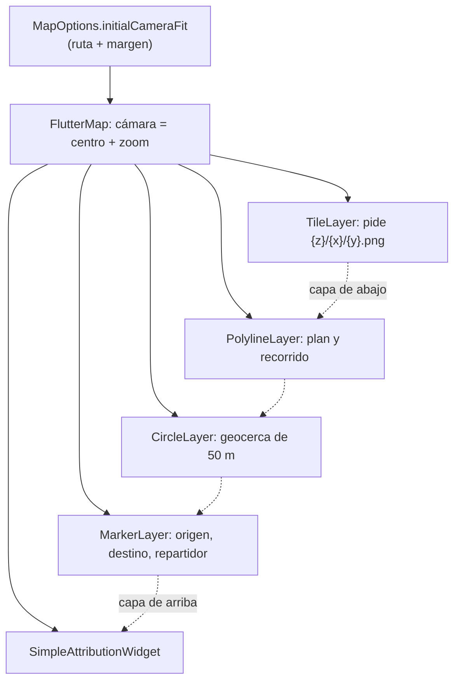
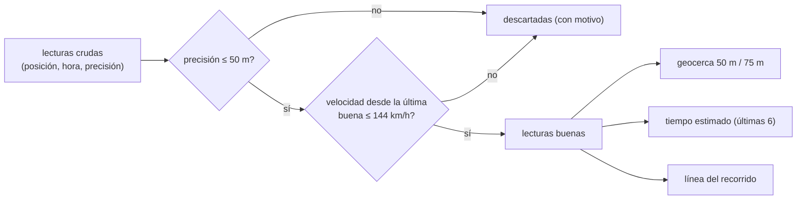
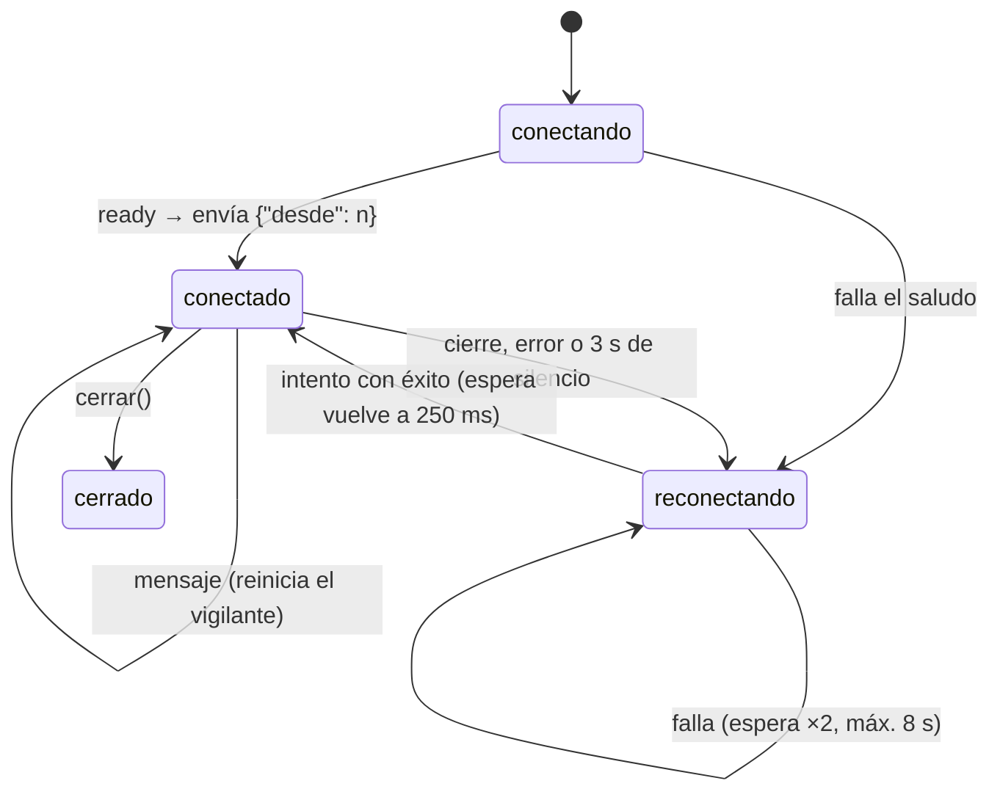
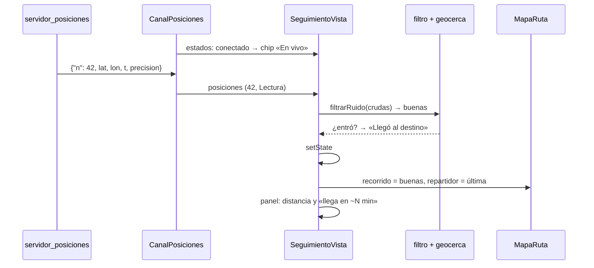

# Módulo 14: Mapas, ubicación y tiempo real

**Entorno comprobado para esta edición (2026-11-24):** Flutter 3.50.1 (canal estable) con Dart 3.14.0 en Linux
x86_64, con `material_ui` 1.11.1, `flutter_map` 8.3.2, `latlong2` 0.10.1, `web_socket_channel` 3.0.3 y `meta`
1.19.0. Todo el código se analizó con `flutter analyze` (`No issues found!`) y las pruebas se ejecutaron ese día, en
`/home/estudiante/labs/flutter/m14` (tu `~/labs/flutter/m14`). Las capturas del mapa son de la **app de escritorio
real** en release, con teselas de OpenStreetMap descargadas en ese momento, siguiendo un recorrido que envía un
servidor WebSocket local. El GPS no es real: el equipo de pruebas no tiene receptor, así que las lecturas vienen de un
recorrido de prueba por Chapinero (Bogotá) con errores puestos a propósito. En un teléfono, esas lecturas las daría un
paquete como `geolocator`; todo lo demás (filtro, geocerca, tiempo estimado, canal en tiempo real, mapa) es igual.

Seguir un envío es lo que más mira la persona que lo espera: un mapa, un punto que se mueve, «llega en 4 min». Detrás
hay tres problemas distintos: dibujar el mapa, entender lecturas de GPS que mienten, y recibir posiciones por una red
que se corta. Este módulo los resuelve por separado y después los une en una pantalla.

**Al terminar este módulo podrás:**
- dibujar un mapa con teselas, ruta, zona y marcadores, respetando la atribución y la política del proveedor;
- calcular distancias, descartar lecturas de GPS imposibles, detectar llegadas sin parpadeos y estimar el tiempo;
- recibir posiciones por WebSocket con reconexión, espera creciente y reanudación sin perder ni repetir;
- unir todo en una pantalla de seguimiento y comprobarla con la app real.

**Esquema del módulo:** Tema 1 (el mapa con `flutter_map`) → Tema 2 (geometría y lecturas de GPS) → Tema 3 (tiempo
real con WebSocket) → Tema 4 (la pantalla de seguimiento) → Proyecto 31.

**Qué necesitas saber antes:** el Módulo 12 (capas y pruebas por capa); del Módulo 5, **errores de red y
reintentos** (Tema 3); del Módulo 0, **`Stream` y `StreamController`** (Tema 5); del Módulo 1, **`Timer`** (Tema 4);
del Módulo 11, **la app de escritorio en pantalla virtual**.

**Qué no se repite:** las peticiones HTTP y la copia local (Módulos 5 y 12). Aquí la información llega empujada por
el servidor, segundo a segundo.

**Prepara el proyecto:**

```text
$ cd ~/labs/flutter
$ flutter create --org com.academia --platforms=linux,web m14
$ cd m14
$ flutter pub add flutter_map latlong2 web_socket_channel meta
```

Agrega `formatter: page_width: 120` a `analysis_options.yaml`, copia `correr_app.sh` del Módulo 11 y pon la ventana
de Linux en 420 × 640 (`gtk_window_set_default_size` en `linux/runner/my_application.cc`).

La estructura:

```text
lib/
├── geo/geo.dart                       distancias, filtro, geocerca, tiempo estimado (Dart puro)
├── geo/recorrido_demo.dart            el recorrido de prueba
├── tiempo_real/canal_posiciones.dart  cliente WebSocket con reconexión
├── tiempo_real/servidor_posiciones.dart
├── ui/mapa_ruta.dart                  el mapa
├── ui/seguimiento_vista.dart          la pantalla que lo une todo
└── main.dart
bin/servidor_posiciones.dart           servidor para la app real
```


## Aprende construyendo


### Tema 1: El mapa con `flutter_map`: teselas, capas y atribución · Intermedio · 40 min

<details open>
<summary><strong>Capa 1 — Lectura</strong></summary>

#### Objetivos
Al terminar este tema podrás:
- explicar qué son las teselas y cómo un mapa se arma con capas;
- dibujar la ruta, la zona de llegada y los marcadores con `flutter_map`;
- encuadrar el mapa en la ruta con `CameraFit` dejando sitio a los marcadores;
- cumplir la política de uso y la atribución del proveedor de teselas.

**Conceptos clave:** tesela, capa, `CameraFit`, marcador, atribución

#### El problema
La pantalla de seguimiento necesita un mapa que funcione en Android, iOS, web y escritorio, sin una clave de API para
empezar. El primer intento centra el mapa en el origen con un zoom fijo: en una ruta larga, el destino queda fuera; en
una corta, todo se ve diminuto. Y el pin del destino sale cortado contra el borde.

Este tema usa **`Stack` y capas de widgets** (Módulo 1), **los colores del tema** (Módulo 10, Tema 1) y **la app de
escritorio** (Módulo 11).

#### Glosario del tema

**tesela**
- **Definición técnica:** imagen cuadrada de 256 × 256 píxeles que cubre una parte del mundo en un nivel de zoom `z`, con coordenadas `x`, `y`; el mapa pide las que se ven con una plantilla como `https://tile.openstreetmap.org/{z}/{x}/{y}.png`.
- **En palabras sencillas:** las baldosas con que se arma el piso del mapa.
- **Dónde se rompe la comparación:** cada nivel de zoom tiene cuatro veces más teselas que el anterior; por eso se descargan solo las visibles.
- **Ejemplo:** la captura del tema pidió unas 20 teselas de Bogotá.
- **Error típico:** usar el servidor de teselas de OpenStreetMap para una app con mucho tráfico: su política lo prohíbe; hay que usar un proveedor comercial o propio.

**capa**
- **Definición técnica:** cada hijo de `FlutterMap` (`TileLayer`, `PolylineLayer`, `CircleLayer`, `MarkerLayer`, la atribución) se dibuja encima del anterior, con las mismas coordenadas geográficas.
- **En palabras sencillas:** hojas transparentes apiladas sobre el plano.
- **Dónde se rompe la comparación:** el orden importa: lo último queda encima y recibe los toques primero.
- **Ejemplo:** la ruta va encima de las teselas y los marcadores encima de todo.
- **Error típico:** poner los marcadores antes de la ruta y que la línea los tape.

**`CameraFit`**
- **Definición técnica:** calcula el centro y el zoom para que un conjunto de coordenadas quepa en el mapa, con un margen (`padding`) en píxeles.
- **En palabras sencillas:** «muéstrame todo esto, con aire alrededor».
- **Dónde se rompe la comparación:** encuadra puntos, no el dibujo de los marcadores: un pin de 36 px sobre el destino puede quedar cortado si el margen es pequeño.
- **Ejemplo:** `CameraFit.coordinates(coordinates: ruta, padding: EdgeInsets.fromLTRB(40, 70, 40, 40))`.
- **Error típico:** un zoom fijo para rutas de cualquier tamaño.

**marcador**
- **Definición técnica:** widget de Flutter puesto en una coordenada (`Marker(point:, child:)`), con un tamaño y una alineación respecto al punto.
- **En palabras sencillas:** una chincheta, que puede ser cualquier widget.
- **Dónde se rompe la comparación:** por defecto se centra en el punto; un pin debe tener la punta en el punto (`alignment: Alignment.topCenter`).
- **Ejemplo:** el camión del repartidor es un `Container` circular con un ícono.
- **Error típico:** miles de marcadores con widgets pesados: el mapa se vuelve lento.

**atribución**
- **Definición técnica:** el crédito obligatorio a los autores de los datos del mapa, visible sobre el mapa; en OpenStreetMap, «© OpenStreetMap contributors», por su licencia ODbL.
- **En palabras sencillas:** la firma de quienes dibujaron el mapa.
- **Dónde se rompe la comparación:** no es decoración: quitarla incumple la licencia.
- **Ejemplo:** `SimpleAttributionWidget(source: Text('OpenStreetMap contributors'))`.
- **Error típico:** taparla con un panel inferior.

#### ► CÓMO FUNCIONA

##### 1. La idea en lenguaje sencillo

Imagina un piso hecho de baldosas cuadradas, todas del mismo tamaño. Si quieres ver una habitación, solo levantas las
baldosas de esa habitación. Si quieres más detalle, cambias a baldosas más pequeñas, cada una con un pedazo más chico
del piso.

Un mapa de app funciona así. El mundo se corta en imágenes cuadradas, y la app descarga solo las que caben en la
pantalla al nivel de detalle actual. Encima de ese piso se ponen hojas transparentes: la línea de la ruta, la zona de
llegada, el camión y el pin del destino.

Para el seguimiento de un envío hay dos exigencias más. El mapa debe encuadrar la ruta completa, sea de 500 m o de 20
km, sin cortar el pin del destino. Y debe dar crédito a quienes hicieron el mapa, porque la licencia de los datos lo
exige.

##### 2. Definición formal y vocabulario

Una **tesela** (*tile*) es una imagen cuadrada de 256 × 256 píxeles que cubre una parte del mundo en un nivel de zoom
`z`. Se identifica con tres números, `z`, `x` e `y`, que el mapa pone en una plantilla de URL como
`https://tile.openstreetmap.org/{z}/{x}/{y}.png`.

En `flutter_map`, cada hijo de `FlutterMap` es una **capa**. `TileLayer` dibuja las teselas; `PolylineLayer`,
`CircleLayer` y `MarkerLayer` dibujan encima, con las mismas coordenadas geográficas. Lo último de la lista queda
arriba y recibe los toques primero.

**`CameraFit`** calcula el centro y el zoom para que un conjunto de coordenadas quepa en el mapa, con un margen en
píxeles. Un **marcador** es un widget de Flutter puesto en una coordenada, con un tamaño y una alineación respecto a
ese punto.

La **atribución** es el crédito obligatorio a los autores de los datos. Los datos de OpenStreetMap usan la licencia
ODbL, que exige el texto «© OpenStreetMap contributors» visible sobre el mapa. En sencillo: la firma de quienes
dibujaron el plano.

##### 3. Cómo funciona por dentro, paso a paso

Casi todos los mapas web usan la proyección **Web Mercator**: aplanan la esfera en un cuadrado. En el zoom 0 el mundo
entero es una tesela. Cada nivel parte cada tesela en cuatro, así que el zoom `z` tiene `4^z` teselas. Este programa
calcula en qué tesela cae el destino:

```dart
import 'dart:math' as math;

(int, int) tesela(double lat, double lon, int z) {
  final n = math.pow(2, z);
  final phi = lat * math.pi / 180;
  final x = ((lon + 180) / 360 * n).floor();
  final y = ((1 - math.log(math.tan(phi) + 1 / math.cos(phi)) / math.pi) / 2 * n).floor();
  return (x, y);
}

void main() {
  for (final z in [12, 15]) print('zoom $z: ${math.pow(4, z)} teselas; destino en ${tesela(4.6770, -74.0510, z)}');
}
```

```text
$ dart run tesela.dart
zoom 12: 16777216 teselas; destino en (1205, 1994)
zoom 15: 1073741824 teselas; destino en (9643, 15957)
```

La `x` crece de forma lineal con la longitud. La `y` usa un logaritmo: así se estira la latitud cerca de los polos.
Con más de mil millones de teselas en el zoom 15, descargar solo las visibles no es una optimización: es la única
opción.

Con eso, sigue lo que hace `FlutterMap` al construirse:

1. Lee `MapOptions.initialCameraFit`. `CameraFit.coordinates` busca el rectángulo que contiene todos los puntos de la
   ruta y resta el margen al tamaño del widget.
2. Elige el mayor zoom en el que ese rectángulo cabe en el espacio que queda, y centra la cámara en él.
3. Con la cámara fijada, cada capa convierte coordenadas geográficas a píxeles de pantalla usando la misma proyección.
4. `TileLayer` calcula qué teselas cubren la pantalla, arma sus URL con la plantilla y las descarga. Cada petición
   lleva una cabecera *User-Agent* con `userAgentPackageName`.
5. Las demás capas se pintan en orden sobre las teselas: el plan, lo recorrido, la geocerca y los marcadores.
6. Al arrastrar o hacer zoom, la cámara cambia y el mapa repite los pasos 3 a 5. Las teselas ya descargadas se
   reutilizan.



##### 4. Reglas, variantes y casos límite

`CameraFit` encuadra puntos, no dibujos. El pin del destino mide 36 px y, con `alignment: Alignment.topCenter`, se
dibuja hacia arriba desde su punto. Con un margen superior pequeño, el punto cabe pero el pin se corta. Por eso el
margen de arriba es 70 y los demás, 40.

Un marcador se centra en su punto por defecto. En `flutter_map` 6 se reemplazó `builder` por `child`, y el ancla
`AnchorPos` dejó su lugar a `alignment`; si copias un ejemplo anterior, no compila. Este curso usa la versión 8.3.2.

`CircleMarker` mide su radio en píxeles salvo que pongas `useRadiusInMeter: true`. En píxeles, la zona cubre
kilómetros al alejar y un poste al acercar. En metros, la zona de 50 m mide unos pocos píxeles a zoom de ciudad, como
se ve en la captura.

El servidor público de OpenStreetMap tiene una política de uso. Exige una cabecera que identifique la app, la
atribución visible y un uso moderado. Prohíbe el uso intensivo y la descarga masiva. Una app con muchas personas
usuarias necesita un proveedor comercial o teselas propias.

Cambiar de proveedor toca dos cosas: la `urlTemplate` y el texto de la atribución que ese proveedor exija. Si el
proveedor pide una clave, esa clave viaja en cada petición y debe restringirse a tu app. Las demás capas no cambian.

La proyección Web Mercator no llega a los polos: se corta cerca de los 85° de latitud. No afecta a una ruta urbana,
pero explica por qué Groenlandia se ve enorme en un mapa web.

##### 5. Relación con lo que ya sabes y lo que viene

Las capas del mapa siguen la misma idea que `Stack` en el Módulo 1: lo último de la lista se pinta encima. Los colores
de las líneas y el pin salen del `ColorScheme` del Módulo 10, Tema 1. La captura de la app real usa la pantalla
virtual del Módulo 11.

Compara `flutter_map` con `google_maps_flutter`. El segundo dibuja con el SDK nativo de Google y solo funciona en
Android, iOS y web, con claves restringidas. `flutter_map` dibuja con widgets de Flutter, así que corre también en
escritorio y acepta cualquier proveedor de teselas.

El Tema 2 calcula las distancias y la geocerca que este mapa dibuja. El Tema 3 trae las posiciones del camión en
tiempo real. El Tema 4 une las tres cosas en `SeguimientoVista`, que reconstruye `MapaRuta` con cada lectura buena.

#### Problema resuelto 1.1
Dibuja el mapa de la ruta: el plan en color tenue, lo recorrido en color fuerte, una zona de 50 m alrededor del
destino, los marcadores y la atribución, encuadrado para que todo se vea.

**Razonamiento:**
1. Las teselas son de OpenStreetMap, con `userAgentPackageName`, que su política exige para identificar la app.
2. Dos polilíneas: el plan con transparencia y lo recorrido encima.
3. La zona usa `useRadiusInMeter: true`; sin eso, el radio serían 50 píxeles a cualquier zoom.
4. El pin del destino tiene `alignment: Alignment.topCenter` para que su punta quede en el punto.
5. El margen superior es mayor (70) porque el pin se dibuja hacia arriba.

```dart
// lib/ui/mapa_ruta.dart — el mapa: teselas de OpenStreetMap, la ruta, la geocerca y los marcadores
import 'package:flutter_map/flutter_map.dart';
import 'package:latlong2/latlong.dart';
import 'package:material_ui/material_ui.dart';

class MapaRuta extends StatelessWidget {
  const MapaRuta({super.key, required this.ruta, required this.recorrido, required this.destino, this.repartidor});
  final List<LatLng> ruta; // la ruta planeada
  final List<LatLng> recorrido; // lo que ya recorrió (lecturas buenas)
  final LatLng destino;
  final LatLng? repartidor;

  @override
  Widget build(BuildContext context) {
    final esquema = Theme.of(context).colorScheme;
    return FlutterMap(
      options: MapOptions(
        initialCameraFit: CameraFit.coordinates(coordinates: ruta, padding: const EdgeInsets.fromLTRB(40, 70, 40, 40)),
        interactionOptions: const InteractionOptions(flags: InteractiveFlag.drag | InteractiveFlag.pinchZoom),
      ),
      children: [
        TileLayer(
          urlTemplate: 'https://tile.openstreetmap.org/{z}/{x}/{y}.png',
          userAgentPackageName: 'com.academia.m14', // la política de OSM exige identificarse
        ),
        PolylineLayer(
          polylines: [
            Polyline(points: ruta, strokeWidth: 5, color: esquema.primary.withValues(alpha: 0.35)),
            Polyline(points: recorrido, strokeWidth: 5, color: esquema.primary),
          ],
        ),
        CircleLayer(
          circles: [
            CircleMarker(
              point: destino,
              radius: 50,
              useRadiusInMeter: true, // 50 m reales, no 50 píxeles
              color: esquema.tertiary.withValues(alpha: 0.2),
              borderColor: esquema.tertiary,
              borderStrokeWidth: 2,
            ),
          ],
        ),
        MarkerLayer(
          markers: [
            Marker(
              point: ruta.first,
              child: Icon(Icons.trip_origin, color: esquema.primary),
            ),
            Marker(
              point: destino,
              width: 36,
              height: 36,
              alignment: Alignment.topCenter, // la punta del pin en el punto
              child: Icon(Icons.location_on, color: esquema.tertiary, size: 36),
            ),
            if (repartidor != null)
              Marker(
                point: repartidor!,
                width: 34,
                height: 34,
                child: Container(
                  decoration: BoxDecoration(
                    color: esquema.primary,
                    shape: BoxShape.circle,
                    border: Border.all(color: Colors.white, width: 3),
                  ),
                  child: const Icon(Icons.local_shipping, color: Colors.white, size: 16),
                ),
              ),
          ],
        ),
        const SimpleAttributionWidget(source: Text('OpenStreetMap contributors')),
      ],
    );
  }
}
```


**Explicación por partes.**
- El encuadre muestra la ruta completa, de la calle 45 a la 93, sin elegir zoom a mano. Con `padding: all(40)`, en
  una primera versión, el pin del destino quedaba pegado al borde superior; con 70 arriba se ve completo.
- El tramo recorrido es corto porque la captura se tomó a los 3 segundos; el resto de la ruta se ve tenue.
- La zona de 50 m existe, pero a este zoom mide unos pocos píxeles bajo el pin: es la escala real. Se ve al acercar
  el mapa, y por eso tiene sentido el `pinchZoom`.
- La ruta es una línea recta entre tres puntos (calle 45, calle 72 y calle 93): el recorrido de prueba se generó así.
  Un GPS real sigue las calles, y una ruta planeada real vendría de un servicio de rutas.
- La atribución quedó visible sobre el mapa y encima del panel, como exige la licencia.

> **Error común.** Usar el servidor público de teselas de OpenStreetMap en una app de producción con muchas personas
> usuarias. Su política lo prohíbe y puede bloquear la app. En producción se contrata un proveedor de teselas o se
> sirven las propias; el código solo cambia la `urlTemplate`.

> **Error común.** Dibujar la zona de llegada con un radio en píxeles. A zoom bajo cubre kilómetros; a zoom alto, un
> poste. Usa `useRadiusInMeter: true`.

> **Buena práctica.** Encuadra con `CameraFit` y un margen pensado para los marcadores. Revisa la captura: lo que se
> corta en el borde no se ve en las pruebas de lógica.

> **Prevenir errores.** Agrega la atribución desde el primer día y comprueba en cada captura que ningún panel la tape.

#### Checkpoint 1.1
¿Qué cambia en el código para usar Mapbox, Stadia o un servidor de teselas propio en lugar de OpenStreetMap?

Respuesta: la `urlTemplate` (con la clave del proveedor si la pide, que no debe ir en el binario sin restricciones,
Módulo 11) y el texto de la atribución que exija ese proveedor. Las demás capas no cambian.

</details>

<details>
<summary><strong>Capa 2 — Construcción</strong></summary>

#### Paso 1 · Crea el mapa
Crea `lib/ui/mapa_ruta.dart` y una pantalla mínima que lo muestre con `rutaPlaneada` y `destino` (Tema 2).

#### Paso 2 · Ejecuta
Ejecuta `flutter run -d linux`. Arrastra y acerca el mapa: ¿cuándo empieza a verse la zona de 50 m?

#### Paso 3 · Quita el margen
Cambia el `padding` a `EdgeInsets.all(8)` y compara el pin del destino.

#### Paso 4 · Radio en píxeles
Quita `useRadiusInMeter` y acerca y aleja el mapa. ¿Qué pasa con la zona?

#### Paso 5 · Otra capa
Agrega una `PolygonLayer` con la zona de cobertura de la empresa (un polígono de cuatro esquinas en Chapinero) por
debajo de la ruta.

#### Resumen
- El mapa se arma con **teselas** y **capas** apiladas.
- **`CameraFit`** encuadra la ruta; el margen debe dejar sitio a los **marcadores**.
- Las distancias del mapa se dibujan en metros reales.
- La **atribución** es obligatoria y visible.

#### Ejercicio verificable 1
Básico. ¿Qué parámetro de `TileLayer` exige la política de OpenStreetMap?

Respuesta esperada: `userAgentPackageName` (que identifica la app en cada petición).

#### Ejercicio verificable 2
Intermedio. En el Paso 4, ¿qué pasa con la zona al alejar el mapa?

Respuesta esperada: mantiene 50 píxeles de radio, así que cubre cada vez más terreno; con `useRadiusInMeter` cubre
siempre 50 m y se ve más pequeña al alejar.

#### Ejercicio verificable 3
Reto. ¿Por qué el margen superior es mayor que los demás?

Respuesta esperada: porque `CameraFit` encuadra los puntos, y el pin del destino se dibuja 36 px hacia arriba de su
punto (`alignment: Alignment.topCenter`); con un margen pequeño, el pin se sale del mapa.

#### En el trabajo
Las apps de logística y movilidad eligen el proveedor de mapas por costo, cobertura y condiciones de uso, y lo
esconden detrás de un widget propio como `MapaRuta` para poder cambiarlo. Google Maps (`google_maps_flutter`) solo
funciona en Android, iOS y web, y exige claves restringidas por app.

</details>

### Tema 2: Geometría y lecturas de GPS: distancia, ruido, llegada y tiempo estimado · Avanzado · 45 min

<details open>
<summary><strong>Capa 1 — Lectura</strong></summary>

#### Objetivos
Al terminar este tema podrás:
- calcular distancias entre coordenadas con la fórmula de haversine y saber cuánto se equivoca;
- descartar lecturas de GPS imprecisas o imposibles;
- detectar la llegada a un destino con una geocerca con histéresis;
- estimar el tiempo de llegada con la velocidad reciente.

**Conceptos clave:** haversine, precisión de la lectura, filtro de saltos, geocerca con histéresis, tiempo estimado de llegada

#### El problema
El repartidor reporta posiciones cada 5 segundos. Algunas vienen con un radio de error de 120 m (debajo de un puente),
una lo pone 2 km atrás durante un instante, y al llegar, entre edificios, el GPS oscila entre 45 y 60 m del destino.
La app marcaba «Llegó» y «En camino» varias veces seguidas, y el mapa dibujaba un rayo hacia el salto.

Este tema usa **las listas y los records** (Módulo 0), **la inyección del reloj y los datos de prueba** (Módulo 12)
y **las pruebas unitarias** (Módulo 9, Tema 1).

#### Glosario del tema

**haversine**
- **Definición técnica:** fórmula de la distancia sobre una esfera a partir de latitudes y longitudes: `2R·asin(√(sin²(Δφ/2) + cos φ1·cos φ2·sin²(Δλ/2)))`, con `R` = 6 371 km.
- **En palabras sencillas:** la distancia en línea recta, siguiendo la curva de la Tierra.
- **Dónde se rompe la comparación:** la Tierra no es una esfera perfecta; la fórmula de Vincenty, sobre el elipsoide, es más exacta (y más lenta).
- **Ejemplo:** origen → destino: 5 256 m con haversine y 5 231 m con `latlong2` (Vincenty).
- **Error típico:** restar grados como si fueran metros.

**precisión de la lectura**
- **Definición técnica:** el radio, en metros, dentro del cual el sistema estima que está la posición real con cierta confianza; Android e iOS la entregan con cada lectura.
- **En palabras sencillas:** «estoy por aquí, más o menos tantos metros».
- **Dónde se rompe la comparación:** es una estimación del propio GPS; una lectura con precisión buena también puede estar mal.
- **Ejemplo:** la lectura 45 trae 120 m y se descarta.
- **Error típico:** usar todas las lecturas sin mirar la precisión.

**filtro de saltos**
- **Definición técnica:** descartar una lectura si, para llegar a ella desde la última buena, habría que ir más rápido de lo posible (aquí, 40 m/s = 144 km/h).
- **En palabras sencillas:** «una moto no se teletransporta».
- **Dónde se rompe la comparación:** compara con la última **buena**; si la primera es mala, todas las siguientes parecen saltos.
- **Ejemplo:** la lectura 30 implicaba 1 441 km/h.
- **Error típico:** comparar con la lectura anterior aunque esa también fuera mala.

**geocerca con histéresis**
- **Definición técnica:** zona circular con dos umbrales: se entra al bajar de `radio` y se sale solo al superar `radio × factor` (aquí 50 m y 75 m), para no cambiar de estado con el ruido.
- **En palabras sencillas:** una puerta que se abre fácil pero hay que alejarse de verdad para cerrarla.
- **Dónde se rompe la comparación:** un factor muy grande tarda en detectar salidas reales.
- **Ejemplo:** sin histéresis, 5 cambios en la llegada; con factor 1,5, uno.
- **Error típico:** un solo umbral: la app avisa «llegó» y «se fue» varias veces en un minuto.

**tiempo estimado de llegada**
- **Definición técnica:** distancia restante dividida por la velocidad media de las últimas lecturas buenas; si no hay movimiento, no se estima.
- **En palabras sencillas:** «a este ritmo, llegas en…».
- **Dónde se rompe la comparación:** usa la línea recta hasta el destino; por calles, el camino es más largo.
- **Ejemplo:** a 1 189 m, estimado 150 s, real 145 s.
- **Error típico:** dividir por la velocidad instantánea: con un semáforo, la estimación salta a infinito.

#### ► CÓMO FUNCIONA

##### 1. La idea en lenguaje sencillo

Piensa en un despachador que recibe por radio la posición de un repartidor cada cinco segundos. Casi siempre los
reportes son razonables. A veces uno dice que la moto saltó dos kilómetros en un instante; otro llega con «más o
menos, por aquí». Un buen despachador no mueve el alfiler del tablero con cada reporte: primero se pregunta si es
posible.

Las lecturas de GPS son esos reportes. Traen una posición, una hora y una precisión, y a veces mienten: debajo de un
puente, entre edificios o al arrancar el teléfono. Si la app las dibuja todas, el mapa traza rayos y la llegada
parpadea.

Este tema le da a la app el criterio del despachador. Mide distancias sobre la Tierra, descarta lo imposible, decide
cuándo el repartidor llegó sin cambiar de idea con cada temblor y estima cuánto falta.

##### 2. Definición formal y vocabulario

La fórmula de **haversine** calcula la distancia sobre una esfera a partir de dos pares de latitud y longitud. Usa el
radio medio de la Tierra, `R` = 6 371 km. Es la distancia en línea recta siguiendo la curva, no por calles.

La **precisión de la lectura** es el radio, en metros, dentro del cual el sistema estima que está la posición real.
Android la define como el radio con un 68 % de confianza. Es una estimación del propio receptor, así que una lectura
con buena precisión también puede estar mal.

El **filtro de saltos** descarta una lectura imposible. Lo es si, para llegar a ella desde la última buena, habría que
superar 40 m/s, unos 144 km/h. En sencillo: una moto no se teletransporta.

Una **geocerca con histéresis** es una zona circular con dos umbrales. Se entra al bajar de 50 m y se sale solo al
superar 75 m. El **tiempo estimado de llegada** divide la distancia restante entre la velocidad media de las últimas
lecturas buenas.

##### 3. Cómo funciona por dentro, paso a paso

Empieza por la distancia. Un grado de latitud mide siempre lo mismo, unos 111,2 km sobre la esfera del cálculo. Un
grado de longitud se encoge al alejarse del ecuador, multiplicado por el coseno de la latitud. Por eso la salida da
111,2 m y 110,8 m para 0,001° en Bogotá, que está cerca del ecuador.

1. `distanciaMetros` pasa las diferencias de latitud y longitud a radianes.
2. Calcula `h`, el cuadrado del seno de media distancia angular. La forma con senos de ángulos pequeños es estable
   para distancias cortas, a diferencia de la ley esférica de los cosenos.
3. Devuelve `2R·asin(√h)`: el arco por el radio.

Ahora el filtro. Recorre las lecturas en orden con `indexed`, un record `(índice, valor)` por elemento:

4. Si la precisión supera 50 m, la descarta y anota el motivo.
5. Si ya hay una lectura buena, calcula la velocidad necesaria para ir de esa a la actual. La lectura 30 exigía 1 441
   km/h, así que se descarta.
6. Si pasa las dos pruebas, la agrega a las buenas. Las siguientes se comparan con ella.

La geocerca guarda un solo dato, `_dentro`, y aplica dos umbrales:

```dart
if (!_dentro && d < radio) { _dentro = true; return CambioGeocerca.entro; }
if (_dentro && d > radio * factorSalida) { _dentro = false; return CambioGeocerca.salio; }
return null;
```

7. Fuera de la zona, solo importa el umbral de entrada. Dentro, solo el de salida. Entre 50 y 75 m nada cambia, y ahí
   caen las oscilaciones de 45 a 58 m de la llegada.
8. Con factor 1,0 los dos umbrales coinciden y la salida muestra cinco cambios. Con factor 1,5, uno solo.

El tiempo estimado toma las últimas seis lecturas buenas, suma los cinco tramos entre ellas y divide por los segundos
transcurridos. Esa velocidad media divide la distancia restante.



##### 4. Reglas, variantes y casos límite

La Tierra no es una esfera: es un elipsoide achatado en los polos. La fórmula de Vincenty trabaja sobre ese elipsoide
y por eso `latlong2` da 5 231 m donde haversine da 5 256 m. La diferencia, 0,5 %, sobra para entregas y no para
topografía. Vincenty es iterativa y puede no converger con puntos casi opuestos del globo.

El filtro tiene un punto débil al arrancar: compara con la última **buena**, y la primera lectura siempre se acepta.
Si esa primera es mala, las lecturas correctas parecen saltos y se descartan en cadena. El Checkpoint y el Paso 2
muestran el efecto.

Dos lecturas con la misma hora dividen entre cero. En Dart, con números `double`, eso no lanza error:

```dart
void main() {
  final saltoSinTiempo = 120 / 0; // otra posición, misma hora: Infinity
  final quietoSinTiempo = 0 / 0; // misma posición, misma hora: NaN
  print('$saltoSinTiempo > 40: ${saltoSinTiempo > 40}');
  print('$quietoSinTiempo > 40: ${quietoSinTiempo > 40}');
}
```

```text
$ dart run nan.dart
Infinity > 40: true
NaN > 40: false
```

Una posición distinta con la misma hora da infinito y se descarta, como corresponde. Una lectura repetida da `NaN`, y
toda comparación con `NaN` es falsa: el filtro la acepta. No hace daño aquí, pero conviene saber que `NaN` pasa por
los `if` sin avisar.

El factor de histéresis es un compromiso. Uno pequeño deja pasar el ruido; uno grande tarda en detectar una salida
real. Ajústalo con recorridos grabados de los lugares difíciles, no con uno perfecto.

El tiempo estimado usa línea recta y velocidad reciente. Con calles, semáforos y tráfico, el error crece. Si el
repartidor está detenido, la función devuelve `null` en lugar de inventar un número. La interfaz redondea a minutos
para no prometer una precisión que no existe.

##### 5. Relación con lo que ya sabes y lo que viene

Los records como `(buenas: ..., descartadas: ...)` y el `indexed` de las listas son del Módulo 0. El reloj y los datos
de prueba fijos siguen la idea del Módulo 12: el recorrido de prueba empieza siempre a las 9:00 y trae los errores en
posiciones conocidas. Las pruebas son unitarias, como en el Módulo 9, Tema 1.

Si has estudiado electrónica, la geocerca con histéresis es un disparador Schmitt: un comparador con dos umbrales que
ignora el ruido alrededor del punto de cambio. La diferencia es que aquí la señal es una distancia y el umbral se mide
en metros.

La capa `geo` no importa Flutter, sino `package:meta` para `@immutable`. Por eso la usan las pruebas, la app y el
servidor de posiciones del Tema 3, que corre con `dart run`. El Tema 4 aplica el filtro y la geocerca a cada posición
que llega y muestra «Llegó al destino» una sola vez.

#### Problema resuelto 2.1
Implementa la distancia, el filtro, la geocerca y el tiempo estimado, y pruébalos con el recorrido de prueba: 138
lecturas por Chapinero, con un salto de 2 km, dos lecturas imprecisas y una llegada que oscila.

**Razonamiento:**
1. La capa `geo` no importa Flutter (usa `package:meta` para `@immutable`): así la usan también el servidor con
   `dart run` y las pruebas.
2. El recorrido se genera a 8 m/s (40 m cada 5 s) entre tres puntos, y después se le meten los errores en posiciones
   fijas.
3. La geocerca se prueba con factor 1,0 (sin histéresis) y 1,5.
4. El tiempo estimado se compara con el momento en que, de verdad, el recorrido entra a 50 m del destino.

```dart
// lib/geo/geo.dart — distancias, filtro de lecturas malas, geocerca con histéresis y tiempo estimado
import 'dart:math' as math;

import 'package:meta/meta.dart'; // no Flutter: también corre con dart run
import 'package:latlong2/latlong.dart';

const radioTierra = 6371000.0; // metros

/// Distancia sobre la esfera (haversine), en metros.
double distanciaMetros(LatLng a, LatLng b) {
  double rad(double g) => g * math.pi / 180;
  final dLat = rad(b.latitude - a.latitude), dLon = rad(b.longitude - a.longitude);
  final h =
      math.pow(math.sin(dLat / 2), 2) +
      math.cos(rad(a.latitude)) * math.cos(rad(b.latitude)) * math.pow(math.sin(dLon / 2), 2);
  return 2 * radioTierra * math.asin(math.sqrt(h));
}

@immutable
class Lectura {
  const Lectura(this.posicion, this.cuando, {this.precisionMetros = 8});
  final LatLng posicion;
  final DateTime cuando;
  final double precisionMetros; // radio de error que informa el GPS
}

/// Descarta lecturas imprecisas y saltos imposibles (más rápido que [maxMetrosPorSegundo] desde la última buena).
({List<Lectura> buenas, List<String> descartadas}) filtrarRuido(
  List<Lectura> lecturas, {
  double maxPrecision = 50,
  double maxMetrosPorSegundo = 40, // 144 km/h
}) {
  final buenas = <Lectura>[];
  final descartadas = <String>[];
  for (final (i, l) in lecturas.indexed) {
    if (l.precisionMetros > maxPrecision) {
      descartadas.add('#$i: precisión ${l.precisionMetros.round()} m');
      continue;
    }
    if (buenas.isNotEmpty) {
      final anterior = buenas.last;
      final segundos = l.cuando.difference(anterior.cuando).inMilliseconds / 1000;
      final velocidad = distanciaMetros(anterior.posicion, l.posicion) / segundos;
      if (velocidad > maxMetrosPorSegundo) {
        descartadas.add('#$i: salto a ${(velocidad * 3.6).round()} km/h');
        continue;
      }
    }
    buenas.add(l);
  }
  return (buenas: buenas, descartadas: descartadas);
}

enum CambioGeocerca { entro, salio }

/// Una zona circular con histéresis: entra a menos de [radio] y sale solo a más de [radio] × [factorSalida].
class Geocerca {
  Geocerca(this.centro, this.radio, {this.factorSalida = 1.5});
  final LatLng centro;
  final double radio;
  final double factorSalida;
  bool _dentro = false;

  bool get dentro => _dentro;

  CambioGeocerca? actualizar(LatLng p) {
    final d = distanciaMetros(centro, p);
    if (!_dentro && d < radio) {
      _dentro = true;
      return CambioGeocerca.entro;
    }
    if (_dentro && d > radio * factorSalida) {
      _dentro = false;
      return CambioGeocerca.salio;
    }
    return null;
  }
}

/// Tiempo estimado de llegada con la velocidad media de las últimas lecturas buenas.
Duration? tiempoEstimado(List<Lectura> buenas, LatLng destino, {int ultimas = 6}) {
  if (buenas.length < 2) return null;
  final tramo = buenas.sublist(math.max(0, buenas.length - ultimas));
  var metros = 0.0;
  for (var i = 1; i < tramo.length; i++) {
    metros += distanciaMetros(tramo[i - 1].posicion, tramo[i].posicion);
  }
  final segundos = tramo.last.cuando.difference(tramo.first.cuando).inSeconds;
  if (metros < 1 || segundos == 0) return null; // detenido: no se puede estimar
  return Duration(seconds: (distanciaMetros(tramo.last.posicion, destino) / (metros / segundos)).round());
}
```

```dart
// lib/geo/recorrido_demo.dart — un recorrido de prueba por Chapinero (Bogotá), una lectura cada 5 s
import 'package:latlong2/latlong.dart';

import 'geo.dart';

const origen = LatLng(4.6325, -74.0670); // Cl 45 con Cra 13
const destino = LatLng(4.6770, -74.0510); // Cra 15 # 93
const _paso = [LatLng(4.6560, -74.0590)]; // Cl 72 con Cra 13
const rutaPlaneada = [origen, ..._paso, destino]; // la que se dibuja como plan

/// 8 m/s entre los puntos, con tres lecturas malas a propósito y un vaivén al llegar.
List<Lectura> recorridoDemo({DateTime? inicio}) {
  final t0 = inicio ?? DateTime(2026, 11, 24, 9);
  final puntos = [origen, ..._paso, destino];
  final lecturas = <Lectura>[];
  var t = t0;
  for (var s = 0; s < puntos.length - 1; s++) {
    final a = puntos[s], b = puntos[s + 1];
    final n = (distanciaMetros(a, b) / 40).ceil(); // 40 m cada 5 s = 8 m/s
    for (var i = 0; i < n; i++) {
      final f = i / n;
      lecturas.add(
        Lectura(LatLng(a.latitude + (b.latitude - a.latitude) * f, a.longitude + (b.longitude - a.longitude) * f), t),
      );
      t = t.add(const Duration(seconds: 5));
    }
  }
  // Al llegar, el GPS oscila alrededor de 45-60 m del destino (un edificio alto, una calle estrecha).
  for (final metrosAlNorte in [-60.0, -45.0, -58.0, -44.0, -20.0, -8.0]) {
    lecturas.add(Lectura(LatLng(destino.latitude + metrosAlNorte / 111320, destino.longitude), t));
    t = t.add(const Duration(seconds: 5));
  }
  // Las lecturas malas: un salto de 2 km, una imprecisa y otra imprecisa al llegar.
  lecturas[30] = Lectura(const LatLng(4.6500, -74.0800), lecturas[30].cuando);
  lecturas[45] = Lectura(lecturas[45].posicion, lecturas[45].cuando, precisionMetros: 120);
  lecturas[lecturas.length - 3] = Lectura(
    lecturas[lecturas.length - 3].posicion,
    lecturas[lecturas.length - 3].cuando,
    precisionMetros: 80,
  );
  return lecturas;
}
```

```dart
// test/geo_test.dart — la geometría con el recorrido de prueba; sin GPS, sin mapa y sin red
import 'package:flutter/foundation.dart';
import 'package:flutter_test/flutter_test.dart';
import 'package:latlong2/latlong.dart';
import 'package:m14/geo/geo.dart';
import 'package:m14/geo/recorrido_demo.dart';

void main() {
  final lecturas = recorridoDemo();

  test('distancias', () {
    final propia = distanciaMetros(origen, destino);
    final libreria = const Distance().as(LengthUnit.Meter, origen, destino);
    debugPrint('origen → destino: haversine propio ${propia.round()} m, latlong2 ${libreria.round()} m');
    debugPrint(
      '0,001° de latitud: ${distanciaMetros(origen, LatLng(origen.latitude + 0.001, origen.longitude)).toStringAsFixed(1)} m',
    );
    debugPrint(
      '0,001° de longitud en Bogotá: '
      '${distanciaMetros(origen, LatLng(origen.latitude, origen.longitude + 0.001)).toStringAsFixed(1)} m',
    );
  });

  test('filtro de lecturas', () {
    final r = filtrarRuido(lecturas);
    debugPrint('${lecturas.length} lecturas → ${r.buenas.length} buenas; descartadas: ${r.descartadas}');
  });

  test('geocerca de 50 m en el destino, sin y con histéresis', () {
    final buenas = filtrarRuido(lecturas).buenas;
    for (final factor in [1.0, 1.5]) {
      final cerca = Geocerca(destino, 50, factorSalida: factor);
      final cambios = <String>[];
      for (final l in buenas) {
        final c = cerca.actualizar(l.posicion);
        if (c != null) cambios.add('${c.name}@${distanciaMetros(destino, l.posicion).round()}m');
      }
      debugPrint('factor de salida $factor: $cambios');
    }
  });

  test('tiempo estimado de llegada', () {
    final buenas = filtrarRuido(lecturas).buenas;
    for (final i in [10, 60, 100]) {
      final hasta = buenas.sublist(0, i + 1);
      final eta = tiempoEstimado(hasta, destino)!;
      final faltan = distanciaMetros(hasta.last.posicion, destino).round();
      final real = buenas
          .firstWhere((l) => distanciaMetros(l.posicion, destino) < 50)
          .cuando
          .difference(hasta.last.cuando);
      debugPrint(
        'lectura $i: faltan $faltan m, estimado ${eta.inSeconds} s, real hasta la geocerca ${real.inSeconds} s',
      );
    }
  });
}
```

```text
$ flutter test test/geo_test.dart
00:00 +0: loading /home/estudiante/labs/flutter/m14/test/geo_test.dart
00:00 +0: distancias
origen → destino: haversine propio 5256 m, latlong2 5231 m
0,001° de latitud: 111.2 m
0,001° de longitud en Bogotá: 110.8 m
00:00 +1: filtro de lecturas
138 lecturas → 135 buenas; descartadas: [#30: salto a 1441 km/h, #45: precisión 120 m, #135: precisión 80 m]
00:00 +2: geocerca de 50 m en el destino, sin y con histéresis
factor de salida 1.0: [entro@40m, salio@60m, entro@45m, salio@58m, entro@20m]
factor de salida 1.5: [entro@40m]
00:00 +3: tiempo estimado de llegada
lectura 10: faltan 4856 m, estimado 607 s, real hasta la geocerca 605 s
lectura 60: faltan 2778 m, estimado 347 s, real hasta la geocerca 345 s
lectura 100: faltan 1189 m, estimado 150 s, real hasta la geocerca 145 s
00:00 +4: All tests passed!
```

**Explicación por partes.**
- **Distancias:** haversine da 5 256 m y `latlong2`, 5 231 m: 25 m (0,5 %) de diferencia, porque `latlong2` usa
  Vincenty sobre el elipsoide. Para una app de entregas sobra; para topografía, no.
- 0,001° de latitud son 111,2 m; de longitud, 110,8 m en Bogotá. Están casi iguales porque Bogotá está cerca del
  ecuador; en Buenos Aires, 0,001° de longitud son unos 92 m.
- **Filtro:** de 138 lecturas quedan 135; se descartan el salto (1 441 km/h), la de 120 m y la de 80 m, cada una con
  su motivo.
- **Geocerca:** sin histéresis, la llegada produce cinco cambios (entra a 40 m, sale a 60, entra a 45, sale a 58,
  entra a 20). Con factor 1,5, uno solo: entra a 40 m y las oscilaciones hasta 58 m ya no la sacan.
- **Tiempo estimado:** coincide con el real con menos de 5 s de diferencia. Es tan bueno porque el recorrido de
  prueba va a velocidad constante y casi en línea recta; con tráfico y calles, el error crece, y por eso la interfaz
  muestra «~9 min» y no «607 s».

> **Error común.** No pedir la precisión al GPS, o no usarla. Una sola lectura de 120 m al lado de un río mueve el
> punto al otro lado del agua.

> **Error común.** Una geocerca con un solo umbral. El ruido del GPS cerca del borde dispara llegadas y salidas en
> cadena, y cada una puede ser una notificación.

> **Buena práctica.** Guarda los motivos de descarte (como `descartadas`) y envíalos a la analítica en agregado
> (Módulo 13): dicen dónde y cuándo falla el GPS de tus repartidores.

> **Prevenir errores.** Prueba la geometría con recorridos grabados que incluyan los casos malos (saltos, lecturas
> imprecisas, oscilaciones), no solo con recorridos perfectos.

#### Checkpoint 2.1
La primera lectura del día viene con un salto (el teléfono aún recordaba la posición de ayer). ¿Qué hace el filtro
con las siguientes, y cómo lo evitarías?

Respuesta: como el filtro compara con la última **buena**, la primera (mala) se toma como referencia y las lecturas
correctas parecen saltos imposibles; solo se aceptan cuando pasó tanto tiempo que el «salto» ya parece posible. Se
evita exigiendo una precisión buena y reciente para la primera, o aceptando un salto si varias lecturas seguidas
coinciden entre sí.

</details>

<details>
<summary><strong>Capa 2 — Construcción</strong></summary>

#### Paso 1 · Crea los archivos
Crea `geo.dart`, `recorrido_demo.dart` y `geo_test.dart`, y ejecuta.

#### Paso 2 · Primera lectura mala
Cambia la lectura 0 del recorrido por una en `LatLng(4.70, -74.10)` y ejecuta el filtro. ¿Cuántas quedan?

#### Paso 3 · Corrige el arranque
Implementa la solución del Checkpoint y vuelve a probar.

#### Paso 4 · Factor de histéresis
Prueba factores 1,2 y 2,0 en la geocerca. ¿Cuántos cambios hay con cada uno?

#### Paso 5 · Velocidad del repartidor
Agrega a `geo.dart` una función que devuelva la velocidad media en km/h de las últimas lecturas, y muéstrala en la
prueba para la lectura 60.

#### Resumen
- **Haversine** da distancias sobre la esfera; Vincenty es más exacta.
- La **precisión de la lectura** y el **filtro de saltos** quitan lo que el GPS inventa.
- La **geocerca con histéresis** detecta llegadas sin parpadeos.
- El **tiempo estimado de llegada** usa la velocidad reciente y es una aproximación.

#### Ejercicio verificable 1
Básico. ¿Cuántas lecturas quedan después del filtro?

Respuesta esperada: 135 de 138.

#### Ejercicio verificable 2
Intermedio. Sin histéresis, ¿cuántas veces cambia la geocerca al llegar?

Respuesta esperada: 5 (entro, salio, entro, salio, entro).

#### Ejercicio verificable 3
Reto. En el Paso 2, ¿cuántas lecturas quedan y por qué?

Respuesta esperada: quedan 97 y se descartan 41. Las lecturas 1 a 29, que eran buenas (y varias después), se descartan como saltos desde
la primera; la primera que se acepta es la 30, justo el salto falso, porque está más cerca de la lectura mala. Un
error al arrancar contamina todo lo que sigue.

#### En el trabajo
Los equipos de logística guardan recorridos reales (anonimizados) de los casos difíciles —túneles, edificios altos,
puentes— y los usan como datos de prueba. Las reglas de la geocerca (radio, histéresis) se ajustan con esos datos, no
con un recorrido perfecto.

</details>

### Tema 3: Tiempo real con WebSocket: reconexión, espera creciente y reanudación · Avanzado · 45 min

<details open>
<summary><strong>Capa 1 — Lectura</strong></summary>

#### Objetivos
Al terminar este tema podrás:
- recibir posiciones por WebSocket como un `Stream`;
- detectar una conexión muerta por silencio, no solo por cierre;
- reconectar con espera creciente sin saturar al servidor;
- reanudar desde el último mensaje recibido, sin huecos ni repetidos.

**Conceptos clave:** WebSocket, latido o vigilante de silencio, espera creciente (*backoff*), reanudación, mensaje idempotente

#### El problema
Preguntar al servidor cada 5 segundos «¿dónde está?» gasta batería y datos y llega tarde. Con WebSocket, el servidor
empuja cada posición. Pero la red del repartidor se corta en túneles, y la conexión a veces queda «abierta» sin que
llegue nada. La primera versión no se daba cuenta, y cuando reconectaba, pedía todo desde el principio y repetía
posiciones.

Este tema usa **`Stream` y `StreamController`** (Módulo 0, Tema 5), **`Timer`** (Módulo 1, Tema 4), **los reintentos**
(Módulo 5, Tema 3) y **el servidor de prueba local** (Módulo 12).

#### Glosario del tema

**WebSocket**
- **Definición técnica:** protocolo que, tras un saludo HTTP (`Upgrade: websocket`), mantiene una conexión TCP abierta por la que los dos lados envían mensajes cuando quieren; en Dart, `WebSocketChannel.connect` y `WebSocketTransformer.upgrade`.
- **En palabras sencillas:** una llamada telefónica abierta en lugar de mensajes de texto sueltos.
- **Dónde se rompe la comparación:** no avisa siempre cuando se corta; una red que cae sin cerrar deja la llamada «abierta» y en silencio.
- **Ejemplo:** `ws://127.0.0.1:8097` en la app real.
- **Error típico:** asumir que `onDone` llega siempre que se pierde la conexión.

**latido o vigilante de silencio**
- **Definición técnica:** un `Timer` que se reinicia con cada mensaje; si vence (aquí, 3 s sin nada), el cliente da la conexión por muerta y la cierra.
- **En palabras sencillas:** «si no oigo nada en un rato, cuelgo y vuelvo a llamar».
- **Dónde se rompe la comparación:** si el servidor no tiene nada que enviar, debe mandar un latido (*ping*) para que el silencio signifique algo.
- **Ejemplo:** `silencioMaximo: Duration(seconds: 3)`.
- **Error típico:** quedarse esperando para siempre en una conexión zombi.

**espera creciente (backoff)**
- **Definición técnica:** entre intentos de reconexión, una espera que se duplica (250, 500, 1 000 ms…) hasta un máximo (8 s), y vuelve al mínimo al conectar.
- **En palabras sencillas:** insistir, pero cada vez con más paciencia.
- **Dónde se rompe la comparación:** si miles de teléfonos reconectan con la misma espera, llegan todos juntos; en producción se le suma un poco de azar (*jitter*).
- **Ejemplo:** tres intentos fallidos a los 250, 500 y 1 000 ms; el cuarto conecta.
- **Error típico:** reintentar en bucle sin espera: la batería se va y el servidor se cae del todo.

**reanudación**
- **Definición técnica:** al reconectar, el cliente dice desde qué número de mensaje quiere seguir (`{"desde": n}`), y el servidor continúa desde ahí.
- **En palabras sencillas:** «íbamos en la página 6».
- **Dónde se rompe la comparación:** exige que el servidor guarde los mensajes recientes y que estén numerados.
- **Ejemplo:** después de la caída, llegan 6, 7, 8, 9.
- **Error típico:** pedir todo desde el principio y redibujar el recorrido completo.

**mensaje idempotente**
- **Definición técnica:** mensaje que, si llega dos veces, produce el mismo efecto que una; aquí, se ignora todo `n` menor o igual al último recibido.
- **En palabras sencillas:** recibir dos veces la misma carta no cambia nada.
- **Dónde se rompe la comparación:** solo funciona si cada mensaje tiene un identificador ordenado.
- **Ejemplo:** `if (n <= ultimaRecibida) return;`.
- **Error típico:** sumar distancias o contar entregas con mensajes repetidos.

#### ► CÓMO FUNCIONA

##### 1. La idea en lenguaje sencillo

Hay dos formas de saber dónde va un repartidor. Puedes llamarlo cada cinco segundos y preguntar, o dejar una llamada
abierta para que él hable cuando avance. La primera gasta saldo y siempre llega un poco tarde. La segunda es
inmediata, pero tiene un riesgo: la llamada puede quedar muda sin colgarse, y tú no te enteras.

El seguimiento en vivo usa la llamada abierta. El servidor empuja cada posición en cuanto la tiene. El cliente debe
darse cuenta cuando la línea muere y volver a llamar sin saturar a nadie. Al reconectar, dice «íbamos en la posición
6».

Este tema construye ese cliente y lo prueba con una caída real: el servidor desaparece a los 0,7 s y vuelve 1,6 s
después en el mismo puerto. La prueba cuenta si se perdió o se repitió alguna posición.

##### 2. Definición formal y vocabulario

**WebSocket** es un protocolo, definido en el RFC 6455, que mantiene abierta una conexión TCP por la que ambos lados
envían mensajes cuando quieren. Empieza como una petición HTTP con `Upgrade: websocket`. Si el servidor acepta,
responde `101 Switching Protocols` y desde ahí ya no se habla HTTP.

El **vigilante de silencio** es un `Timer` que se reinicia con cada mensaje. Si vence, aquí a los 3 s sin nada, el
cliente da la conexión por muerta y la cierra. Para que el silencio signifique algo, el servidor debe enviar un
**latido** cuando no tenga datos.

La **espera creciente** (*backoff* exponencial) duplica la pausa entre intentos de reconexión: 250, 500, 1 000 ms,
hasta un máximo de 8 s. Al conectar, vuelve al mínimo. En producción se le suma un poco de azar, llamado *jitter*.

La **reanudación** consiste en que el cliente, al reconectar, dice desde qué número de mensaje quiere seguir:
`{"desde": n}`. Un **mensaje idempotente** es uno que, si llega dos veces, produce el mismo efecto que una. Aquí se
logra ignorando todo `n` menor o igual al último recibido.

##### 3. Cómo funciona por dentro, paso a paso

Sigue la vida de una conexión en la prueba, con las horas de la salida real.

1. `WebSocketChannel.connect(url)` abre el TCP y envía el saludo HTTP. `await canal.ready` espera a que el servidor
   responda con 101. A los 33 ms el estado pasa a `conectado`.
2. El cliente envía `{"desde": 0}`, porque `ultimaRecibida` empieza en -1. El servidor arranca un `Timer.periodic` que
   envía una lectura cada 100 ms desde ese número.
3. Cada mensaje entra por `_recibir`, que primero reinicia el vigilante y después descarta repetidos:

```dart
void _recibir(dynamic mensaje) {
  _vigilar();
  final m = jsonDecode(mensaje as String) as Map<String, Object?>;
  final n = m['n']! as int;
  if (n <= ultimaRecibida) return; // repetida: se ignora
  ultimaRecibida = n;
  // ... arma la Lectura y la publica en _posiciones
}
```

4. A los 687 ms el servidor cae: envía un cierre con código 1001 (`goingAway`) y deja de escuchar. El *stream* del
   canal termina y `onDone` llama a `_perdida`.
5. `_perdida` cancela el vigilante y la suscripción, cuenta el intento y calcula la espera: `250 ms ×
   min(2^(intentos−1), 32)`. Programa un `Timer` que llamará a `conectar`.
6. Los tres intentos siguientes fallan: no hay servidor y la conexión se rechaza. `ready` lanza, el `catch` llama otra
   vez a `_perdida` y la espera se duplica.
7. El servidor vuelve a los 2,3 s. El cuarto intento conecta, `_intentos` vuelve a 0 y el cliente envía `{"desde":
   6}`. La secuencia sigue en 6, 7, 8, 9.



Observa que todas las pérdidas pasan por el mismo método: cierre, error, fallo al conectar y silencio. Un solo camino
de recuperación es más fácil de probar que cuatro.

##### 4. Reglas, variantes y casos límite

Una conexión TCP no siempre avisa cuando muere. Si la red del repartidor cae en un túnel, puede que ningún paquete de
cierre llegue nunca. Sin vigilante, el cliente sigue «conectado» y la pantalla dice «En vivo» con datos viejos.

El vigilante cierra el *sink* y espera que el *stream* termine. En una red muerta de verdad, ese saludo de cierre
puede no completarse. Una variante más robusta llama a `_perdida` directamente desde el vigilante. Otra, solo en
plataformas con `dart:io`, usa `pingInterval`: el cliente envía *pings* del protocolo y cierra si no llega respuesta.

La espera creciente protege al servidor. Imagina miles de teléfonos que pierden la conexión a la vez y reintentan sin
pausa. El servidor que vuelve recibe miles de conexiones por segundo y cae otra vez. El azar del Paso 4 reparte esos
intentos en el tiempo para que no lleguen todos juntos.

La reanudación exige dos cosas del servidor: numerar los mensajes y guardar los recientes. Si el cliente pide un
número que el servidor ya olvidó, hay que decidir qué hacer, por ejemplo enviar el estado actual completo. La
idempotencia del cliente cubre el caso contrario: mensajes que llegan dos veces.

Los `StreamController` del canal son *broadcast*: varios oyentes pueden suscribirse. Pero un evento que se emite sin
oyentes se pierde. Por eso la prueba se suscribe a `estados` y `posiciones` antes de llamar a `conectar`.

`cerrar` marca `_cerrado`, cancela el vigilante y también el `Timer` de una reconexión ya programada,
guardado en `_reconexion`. Sin esa cancelación, un intento pendiente conectaba después de cerrar: la prueba
`cerrar_test.dart` lo demuestra. Además, `conectar` no hace nada si el canal ya está cerrado.

##### 5. Relación con lo que ya sabes y lo que viene

`Stream` y `StreamController` son del Módulo 0, Tema 5, y `Timer`, del Módulo 1, Tema 4; aquí se combinan en un objeto
con estado. Los reintentos del Módulo 5, Tema 3 eran para peticiones sueltas; aquí se aplican a una conexión que debe
vivir mucho tiempo. El servidor real en `127.0.0.1` con puerto libre es la técnica del Módulo 12, Tema 2.

Compara WebSocket con consultar al servidor cada pocos segundos con HTTP. La consulta periódica es más simple y
funciona detrás de cualquier red, pero gasta batería y llega tarde. WebSocket llega al instante y exige vigilancia,
reconexión y reanudación, que es justo lo que este tema construye.

En producción, la conexión va cifrada con `wss://`, sobre el mismo TLS del Módulo 13, Tema 4. El Tema 4 de este módulo
conecta `CanalPosiciones` con la vista: el chip muestra el estado del canal y cada posición nueva pasa por el filtro
del Tema 2.

#### Problema resuelto 3.1
Escribe el cliente con reconexión y el servidor que envía el recorrido. En una prueba con sockets reales, el servidor
se cae a los 0,7 s y vuelve 1,6 s después en el mismo puerto. Comprueba los intentos, que no se pierda ni repita
ninguna posición, y que la secuencia siga donde iba.

**Razonamiento:**
1. El cliente expone dos `Stream`: posiciones (con su número) y estados.
2. Toda pérdida (cierre, error o silencio) pasa por `_perdida`, que calcula la espera y programa el intento.
3. El servidor envía una posición cada 100 ms desde el número que el cliente pida.
4. La caída se simula cerrando los sockets y el servidor; la vuelta, con un servidor nuevo en el mismo puerto.
5. Al final se cuentan repetidas y huecos en la secuencia recibida.

```dart
// lib/tiempo_real/canal_posiciones.dart — WebSocket con reconexión, espera creciente y reanudación
import 'dart:async';
import 'dart:convert';
import 'dart:math' as math;

import 'package:latlong2/latlong.dart';
import 'package:web_socket_channel/web_socket_channel.dart';

import '../geo/geo.dart';

enum EstadoCanal { conectando, conectado, reconectando, cerrado }

class CanalPosiciones {
  CanalPosiciones(
    this.url, {
    this.silencioMaximo = const Duration(seconds: 3),
    this.esperaBase = const Duration(milliseconds: 250),
  });
  final Uri url;
  final Duration silencioMaximo; // sin mensajes en este tiempo: conexión muerta
  final Duration esperaBase;

  final _posiciones = StreamController<(int, Lectura)>.broadcast();
  final _estados = StreamController<EstadoCanal>.broadcast();
  WebSocketChannel? _canal;
  StreamSubscription<dynamic>? _sub;
  Timer? _vigilante;
  Timer? _reconexion; // el intento programado; cerrar() lo cancela
  int _intentos = 0;
  Duration ultimaEspera = Duration.zero; // la espera antes del próximo intento
  int ultimaRecibida = -1; // para pedir desde ahí al reconectar
  bool _cerrado = false;

  Stream<(int, Lectura)> get posiciones => _posiciones.stream;
  Stream<EstadoCanal> get estados => _estados.stream;

  Future<void> conectar() async {
    if (_cerrado) return;
    if (_intentos == 0) _estados.add(EstadoCanal.conectando);
    try {
      final canal = WebSocketChannel.connect(url);
      await canal.ready;
      _canal = canal;
      _intentos = 0;
      _estados.add(EstadoCanal.conectado);
      canal.sink.add(jsonEncode({'desde': ultimaRecibida + 1})); // reanudar sin repetir ni perder
      _vigilar();
      _sub = canal.stream.listen(_recibir, onDone: _perdida, onError: (_) => _perdida());
    } catch (_) {
      _perdida();
    }
  }

  void _recibir(dynamic mensaje) {
    _vigilar();
    final m = jsonDecode(mensaje as String) as Map<String, Object?>;
    final n = m['n']! as int;
    if (n <= ultimaRecibida) return; // repetida: se ignora
    ultimaRecibida = n;
    _posiciones.add((
      n,
      Lectura(
        LatLng(m['lat']! as double, m['lon']! as double),
        DateTime.parse(m['t']! as String),
        precisionMetros: (m['precision']! as num).toDouble(),
      ),
    ));
  }

  void _vigilar() {
    _vigilante?.cancel();
    _vigilante = Timer(silencioMaximo, () => _canal?.sink.close()); // silencio: se cierra y se reconecta
  }

  void _perdida() {
    _vigilante?.cancel();
    _sub?.cancel();
    _canal = null;
    if (_cerrado) return;
    _intentos++;
    final espera = esperaBase * math.min(math.pow(2, _intentos - 1), 32).toInt(); // 250, 500, 1000… hasta 8 s
    ultimaEspera = espera;
    _estados.add(EstadoCanal.reconectando);
    _reconexion = Timer(espera, conectar);
  }

  Future<void> cerrar() async {
    _cerrado = true;
    _vigilante?.cancel();
    _reconexion?.cancel(); // sin esto, un intento ya programado conecta después de cerrar
    await _sub?.cancel();
    await _canal?.sink.close();
    _estados.add(EstadoCanal.cerrado);
    await _posiciones.close();
    await _estados.close();
  }
}
```

```dart
// lib/tiempo_real/servidor_posiciones.dart — envía el recorrido por WebSocket, desde donde el cliente pida
import 'dart:async';
import 'dart:convert';
import 'dart:io';

import '../geo/geo.dart';

class ServidorPosiciones {
  ServidorPosiciones(this.lecturas, {this.cada = const Duration(milliseconds: 100)});
  final List<Lectura> lecturas;
  final Duration cada;
  HttpServer? _http;
  final _clientes = <WebSocket>{};

  int get puerto => _http!.port;

  Future<void> iniciar({int puerto = 0}) async {
    _http = await HttpServer.bind(InternetAddress.loopbackIPv4, puerto, shared: true);
    _http!.listen((p) async {
      final ws = await WebSocketTransformer.upgrade(p);
      _clientes.add(ws);
      Timer? emisor;
      ws.listen(
        (m) {
          var n = (jsonDecode(m as String) as Map)['desde'] as int; // el cliente dice desde cuál
          emisor?.cancel();
          emisor = Timer.periodic(cada, (_) {
            if (n >= lecturas.length) return emisor?.cancel();
            final l = lecturas[n];
            ws.add(
              jsonEncode({
                'n': n++,
                'lat': l.posicion.latitude,
                'lon': l.posicion.longitude,
                't': l.cuando.toIso8601String(),
                'precision': l.precisionMetros,
              }),
            );
          });
        },
        onDone: () {
          emisor?.cancel();
          _clientes.remove(ws);
        },
      );
    });
  }

  /// Simula una caída: corta a todos los clientes y deja de escuchar.
  Future<void> caer() async {
    for (final ws in _clientes.toList()) {
      await ws.close(WebSocketStatus.goingAway);
    }
    await _http?.close(force: true);
  }
}
```

```dart
// test/tiempo_real_test.dart — WebSocket real en 127.0.0.1: el servidor se cae y vuelve; el cliente se recupera

import 'package:flutter/foundation.dart';
import 'package:flutter_test/flutter_test.dart';
import 'package:m14/geo/recorrido_demo.dart';
import 'package:m14/tiempo_real/canal_posiciones.dart';
import 'package:m14/tiempo_real/servidor_posiciones.dart';

void main() {
  test('caída del servidor, reconexión con espera creciente y reanudación', () async {
    final reloj = Stopwatch()..start();
    String ms() => '${reloj.elapsedMilliseconds}'.padLeft(5);
    final lecturas = recorridoDemo();
    var servidor = ServidorPosiciones(lecturas);
    await servidor.iniciar();
    final puerto = servidor.puerto;

    final canal = CanalPosiciones(Uri.parse('ws://127.0.0.1:$puerto'));
    final recibidas = <int>[];
    canal.estados.listen(
      (e) => debugPrint(
        '${ms()} ms  estado: ${e.name}${e == EstadoCanal.reconectando ? ' (próximo intento en ${canal.ultimaEspera.inMilliseconds} ms)' : ''}',
      ),
    );
    canal.posiciones.listen((p) => recibidas.add(p.$1));
    await canal.conectar();

    await Future<void>.delayed(const Duration(milliseconds: 650));
    debugPrint('${ms()} ms  recibidas hasta ahora: $recibidas');
    debugPrint('${ms()} ms  ── el servidor se cae ──');
    final antes = recibidas.length;
    await servidor.caer();

    await Future<void>.delayed(const Duration(milliseconds: 1600));
    debugPrint('${ms()} ms  ── el servidor vuelve en el mismo puerto ──');
    servidor = ServidorPosiciones(lecturas);
    await servidor.iniciar(puerto: puerto);

    await Future<void>.delayed(const Duration(milliseconds: 2500));
    debugPrint(
      '${ms()} ms  recibidas: ${recibidas.length}, primeras después de la caída: '
      '${recibidas.sublist(antes).take(4).toList()}',
    );
    final repetidas = recibidas.length - recibidas.toSet().length;
    final huecos = [
      for (var i = 1; i < recibidas.length; i++)
        if (recibidas[i] != recibidas[i - 1] + 1) i,
    ];
    debugPrint('${ms()} ms  repetidas: $repetidas, huecos en la secuencia: $huecos');
    await canal.cerrar();
    await servidor.caer();
  });
}
```

```text
$ flutter test test/tiempo_real_test.dart
00:00 +0: loading /home/estudiante/labs/flutter/m14/test/tiempo_real_test.dart
00:00 +0: caída del servidor, reconexión con espera creciente y reanudación
   14 ms  estado: conectando
   33 ms  estado: conectado
  685 ms  recibidas hasta ahora: [0, 1, 2, 3, 4, 5]
  687 ms  ── el servidor se cae ──
  701 ms  estado: reconectando (próximo intento en 250 ms)
  957 ms  estado: reconectando (próximo intento en 500 ms)
 1460 ms  estado: reconectando (próximo intento en 1000 ms)
 2304 ms  ── el servidor vuelve en el mismo puerto ──
 2468 ms  estado: conectado
 4807 ms  recibidas: 29, primeras después de la caída: [6, 7, 8, 9]
 4809 ms  repetidas: 0, huecos en la secuencia: []
 4812 ms  estado: cerrado
00:04 +1: All tests passed!
```

**Explicación por partes.**
- Conectó a los 33 ms y, en unos 650 ms, recibió las posiciones 0 a 5.
- Al caer el servidor, el cliente lo detectó en 14 ms (el cierre llegó) y reintentó con esperas de 250, 500 y
  1 000 ms; los tres intentos fallaron porque no había servidor.
- El servidor volvió a los 2,3 s; el cuarto intento (después de la espera de 1 000 ms) conectó y pidió desde la 6.
- En total llegaron 29 posiciones, sin repetidas ni huecos: después de la caída, la secuencia siguió en 6, 7, 8, 9.
- La espera vuelve a 250 ms al conectar (`_intentos = 0`): la próxima caída empieza de nuevo con esperas cortas.

Un caso que la prueba anterior no cubre: cerrar el canal mientras espera para reconectar. La primera versión de
`cerrar()` no cancelaba el `Timer` de la reconexión ya programada; si el servidor volvía durante esa espera, el canal
cerrado se conectaba igual y dejaba una conexión abierta. Esta prueba lo demuestra contando las conexiones que recibe
un servidor que vuelve justo después de `cerrar()`:

```dart
// test/cerrar_test.dart — cerrar() durante la espera de reconexión: el servidor vuelve, y el canal no debe conectarse
import 'dart:io';

import 'package:flutter/foundation.dart';
import 'package:flutter_test/flutter_test.dart';
import 'package:m14/tiempo_real/canal_posiciones.dart';

void main() {
  test('cerrar mientras espera reconectar: ninguna conexión nueva', () async {
    final libre = await ServerSocket.bind(InternetAddress.loopbackIPv4, 0); // un puerto libre, todavía sin servidor
    final puerto = libre.port;
    await libre.close();

    final canal = CanalPosiciones(Uri.parse('ws://127.0.0.1:$puerto'));
    await canal.conectar(); // falla: queda programado un intento en 250 ms
    await canal.cerrar(); // la persona sale de la pantalla durante la espera

    var conexiones = 0; // el servidor vuelve antes del intento pendiente y cuenta quién se conecta
    final servidor = await HttpServer.bind(InternetAddress.loopbackIPv4, puerto);
    servidor.listen((p) async {
      conexiones++;
      await WebSocketTransformer.upgrade(p);
    });
    await Future<void>.delayed(const Duration(milliseconds: 600)); // más que la espera pendiente
    debugPrint('conexiones recibidas después de cerrar(): $conexiones');
    await servidor.close(force: true);
    expect(conexiones, 0);
  });
}
```

Con la versión sin `_reconexion` (el `Timer(espera, conectar)` sin guardar):

```text
$ flutter test test/cerrar_test.dart
00:00 +0: loading /home/estudiante/labs/flutter/m14/test/cerrar_test.dart
00:00 +0: cerrar mientras espera reconectar: ninguna conexión nueva
conexiones recibidas después de cerrar(): 1
00:00 +0 -1: cerrar mientras espera reconectar: ninguna conexión nueva [E]
  Expected: <0>
    Actual: <1>
  
  package:matcher                                     expect
  package:flutter_test/src/widget_tester.dart 473:18  expect
  test/cerrar_test.dart 27:5                          main.<fn>
  
00:00 +0 -1: Some tests failed.

Failing tests:
  /home/estudiante/labs/flutter/m14/test/cerrar_test.dart: cerrar mientras espera reconectar: ninguna conexión nueva
[código de salida: 1]
```

Con la versión de arriba, que guarda el `Timer` en `_reconexion`, lo cancela en `cerrar()` y además hace que
`conectar()` no haga nada si el canal ya está cerrado:

```text
$ flutter test test/cerrar_test.dart
00:00 +0: loading /home/estudiante/labs/flutter/m14/test/cerrar_test.dart
00:00 +0: cerrar mientras espera reconectar: ninguna conexión nueva
conexiones recibidas después de cerrar(): 0
00:00 +1: All tests passed!
```

> **Error común.** Confiar en que la conexión avisa cuando se pierde. En redes móviles, muchas veces no llega ningún
> cierre: sin vigilante de silencio, la app muestra «En vivo» con datos de hace diez minutos.

> **Error común.** Reconectar en bucle, sin espera. Con miles de clientes, el servidor que vuelve recibe miles de
> conexiones por segundo y se vuelve a caer.

> **Buena práctica.** Numera los mensajes y haz que el cliente pida desde el siguiente: reanudar es más barato que
> volver a empezar, y la idempotencia protege de los duplicados.

> **Prevenir errores.** Prueba la reconexión con sockets reales y caídas reales, como aquí, y cuenta huecos y
> repetidos. Un doble de `WebSocketChannel` no reproduce el orden de los eventos de red.

#### Checkpoint 3.1
Si el servidor tarda 20 segundos en volver, ¿cuántos intentos hace el cliente y cuánto espera entre los últimos?

Respuesta: las esperas son 250, 500, 1 000, 2 000, 4 000 y 8 000 ms (ya en el máximo), así que los intentos caen,
contando desde la caída, a los 0,25, 0,75, 1,75, 3,75, 7,75 y 15,75 s: **6 intentos fallidos en 20 s**. El séptimo
llega tras otra espera de 8 000 ms, a los 23,75 s, y conecta unos 3,75 s después de que el servidor vuelve. Desde ahí
la espera entre intentos se queda en 8 s (a esos tiempos se suman los pocos milisegundos que tarda cada rechazo).

</details>

<details>
<summary><strong>Capa 2 — Construcción</strong></summary>

#### Paso 1 · Crea los archivos
Crea `canal_posiciones.dart`, `servidor_posiciones.dart`, `tiempo_real_test.dart` y `cerrar_test.dart`, y ejecuta.

#### Paso 2 · Sin reanudación
Cambia el cliente para que envíe siempre `{"desde": 0}` y quita la línea que ignora repetidas. ¿Cuántas repetidas
cuenta la prueba?

#### Paso 3 · Conexión zombi
Agrega al servidor un modo que deje de enviar sin cerrar el socket. ¿Cuándo se da cuenta el cliente?

#### Paso 4 · Azar en la espera
Suma a cada espera un azar de hasta el 20 % y explica por qué ayuda con muchos clientes.

#### Paso 5 · Latido
Haz que el servidor envíe `{"ping": true}` cada segundo cuando no tenga posiciones, y que el cliente lo use para el
vigilante sin tratarlo como posición.

#### Resumen
- **WebSocket** mantiene una conexión por la que el servidor empuja mensajes.
- Un **vigilante de silencio** detecta conexiones muertas que no avisan.
- La **espera creciente** reconecta sin saturar.
- La **reanudación** con **mensajes idempotentes** evita huecos y repetidos.

#### Ejercicio verificable 1
Básico. ¿Cuántas posiciones había recibido el cliente antes de la caída?

Respuesta esperada: 6 (de la 0 a la 5).

#### Ejercicio verificable 2
Intermedio. ¿Qué esperas usó el cliente mientras el servidor estaba caído?

Respuesta esperada: 250, 500 y 1 000 ms.

#### Ejercicio verificable 3
Reto. En el Paso 3, ¿cuánto tarda el cliente en reconectar después del último mensaje?

Respuesta esperada: unos 3 s (el `silencioMaximo`) hasta cerrar la conexión, más 250 ms de la primera espera.

#### En el trabajo
El seguimiento en vivo de pedidos, conductores o repartidores usa WebSocket (o servicios construidos sobre él) con
exactamente estas piezas: vigilante, espera creciente con azar, reanudación y deduplicación. Los equipos las prueban
con caídas provocadas antes de cada versión.

</details>

### Tema 4: La pantalla de seguimiento: todo junto, en la app real · Avanzado · 40 min

<details open>
<summary><strong>Capa 1 — Lectura</strong></summary>

#### Objetivos
Al terminar este tema podrás:
- unir canal, filtro, geocerca, tiempo estimado y mapa en una pantalla;
- mostrar el estado de la conexión y el progreso con textos útiles;
- ejecutar la app real contra el servidor de posiciones y capturarla en varios momentos;
- revisar las capturas buscando lo que una prueba de lógica no ve.

**Conceptos clave:** vista de seguimiento, estado de conexión visible, texto de distancia, captura por momentos

#### El problema
Cada pieza funciona por separado. Falta la pantalla que la persona mira: el camión que avanza, cuánto falta, cuándo
llega, si la información está en vivo, y el aviso de llegada una sola vez.

Este tema usa **los Temas 1 a 3**, **`StatefulWidget` con suscripciones** (Módulo 4) y **la app de escritorio en
pantalla virtual** (Módulo 11).

#### Glosario del tema

**vista de seguimiento**
- **Definición técnica:** pantalla que se suscribe a los `Stream` del canal en `initState`, aplica el filtro y la geocerca a cada posición, y dibuja el mapa y un panel; cancela las suscripciones en `dispose`.
- **En palabras sencillas:** la ventanilla desde donde se ve todo.
- **Dónde se rompe la comparación:** con más pantallas, este trabajo iría a un *view model* (Módulo 12); aquí es una sola.
- **Ejemplo:** `SeguimientoVista`.
- **Error típico:** olvidar cancelar las suscripciones: la pantalla cerrada sigue recibiendo posiciones.

**estado de conexión visible**
- **Definición técnica:** un indicador en la interfaz con el estado del canal (`En vivo` o `Reconectando…`).
- **En palabras sencillas:** decir si lo que ves es de ahora.
- **Dónde se rompe la comparación:** «En vivo» solo es verdad si hay vigilante de silencio (Tema 3).
- **Ejemplo:** el `Chip` con el ícono de wifi.
- **Error típico:** mostrar la última posición sin decir que es vieja.

**texto de distancia**
- **Definición técnica:** la distancia formateada para leer: kilómetros con un decimal desde 1 km, metros redondeados a 10 por debajo.
- **En palabras sencillas:** decir la distancia como la diría una persona.
- **Dónde se rompe la comparación:** la precisión del texto no debe superar la del GPS: «a 7 m» promete más de lo que se sabe.
- **Ejemplo:** `distanciaLegible(4320)` → `4.3 km`; `distanciaLegible(8)` → `a 10 m`.
- **Error típico:** «0.0 km» al llegar.

**captura por momentos**
- **Definición técnica:** tomar pantallazos de la app real a tiempos fijos mientras el servidor envía un recorrido conocido, para revisar estados que solo existen en movimiento.
- **En palabras sencillas:** fotos de la carrera en la salida, a la mitad y en la meta.
- **Dónde se rompe la comparación:** los tiempos dependen de la máquina; sirven para revisar, no como prueba golden.
- **Ejemplo:** `demo_mapa.sh` captura a los 3, 9 y 17 segundos.
- **Error típico:** revisar solo el estado inicial.

#### ► CÓMO FUNCIONA

##### 1. La idea en lenguaje sencillo

En una central de despachos, la pantalla grande no inventa nada: muestra lo que llega por radio, filtrado por el
despachador, sobre un plano de la ciudad. Al lado hay un letrero que dice si la radio funciona. Si el letrero dice «en
línea» cuando no lo está, toda la pantalla miente.

La pantalla de seguimiento es esa central en pequeño. Recibe posiciones del canal del Tema 3, las filtra con la
geometría del Tema 2 y las dibuja en el mapa del Tema 1. Debajo, un panel dice cuánto falta, cuándo llega y si la
información es de ahora.

Las piezas ya están probadas. Lo nuevo es el pegamento: quién se suscribe a qué, cuándo se redibuja y qué texto lee la
persona que espera el envío. Ahí aparecen errores que ninguna prueba de lógica encuentra, como «0.0 km» al llegar.

##### 2. Definición formal y vocabulario

La **vista de seguimiento** es un `StatefulWidget` que se suscribe a los `Stream` del canal en `initState`. Con cada
posición aplica el filtro y la geocerca, y dibuja el mapa y un panel. En `dispose` cancela las suscripciones.

El **estado de conexión visible** es el `Chip` que muestra «En vivo» o «Reconectando…». Solo dice la verdad porque el
canal tiene vigilante de silencio: sin él, una conexión muerta seguiría marcada como viva.

El **texto de distancia** es la distancia formateada para leer: kilómetros con un decimal desde 1 km y metros
redondeados a 10 por debajo. Su precisión no debe superar la del GPS. Por último, la **captura por momentos** toma
pantallazos de la app real a tiempos fijos mientras el servidor envía un recorrido conocido.

##### 3. Cómo funciona por dentro, paso a paso

Sigue la vida de la pantalla desde que Flutter la monta.

1. Flutter crea el `State` y llama a `initState` una sola vez. Allí la vista se suscribe a `estados` y a `posiciones`,
   y solo después llama a `conectar`. Como los controladores son *broadcast*, suscribirse antes evita perder los
   primeros eventos.
2. La geocerca se declara como `late final _geocerca = Geocerca(widget.destino, 50)`. Un inicializador de campo normal
   no puede leer `widget`; con `late`, se evalúa la primera vez que se usa, cuando `widget` ya existe.
3. Cada posición llega al oyente, que la agrega a las crudas y vuelve a filtrar la lista completa:

```dart
widget.canal.posiciones.listen((p) {
  _crudas.add(p.$2);
  final buenas = filtrarRuido(_crudas).buenas;
  if (buenas.length != _buenas.length && _geocerca.actualizar(buenas.last.posicion) == CambioGeocerca.entro) {
    _llego = true;
  }
  setState(() => _buenas = buenas);
}),
```

4. La geocerca solo se actualiza si hubo una lectura buena nueva. Una lectura descartada no cuenta como movimiento.
   Cuando la geocerca devuelve `entro`, `_llego` queda en `true` para siempre.
5. `setState` marca el widget para reconstruir en el siguiente frame. `build` calcula la última posición, el tiempo
   estimado y los textos.
6. `MapaRuta` recibe el recorrido nuevo y la posición del camión. Sus capas se repintan; la cámara no se mueve, porque
   `initialCameraFit` solo se aplica al crear el mapa.
7. El panel escribe la distancia con `distanciaLegible` y el tiempo con `(eta.inSeconds / 60).ceil()`: redondear hacia
   arriba evita prometer menos de lo que falta.



La demostración real compila la app en release y la ejecuta contra `bin/servidor_posiciones.dart`, que envía una
lectura cada 100 ms. Así, el recorrido de 11 minutos pasa en unos 14 s. El script captura la ventana a los 3, 9 y 17
segundos.

##### 4. Reglas, variantes y casos límite

Cancelar las suscripciones en `dispose` es obligatorio. Sin eso, la pantalla cerrada seguiría recibiendo posiciones y
llamando a `setState`. Flutter lo reporta como error porque ese `State` ya no está en el árbol.

La vista cancela sus suscripciones, pero no cierra el canal: el canal se creó en `main` y la vista no es su dueña. Si
la pantalla se cierra, el canal sigue conectado o reconectando. Quien crea el canal debe cerrarlo; con más pantallas,
ese trabajo pasa a un *view model*.

Filtrar la lista completa en cada mensaje es simple y correcto, pero su costo crece con el recorrido. Con 138 lecturas
no se nota. Con horas de lecturas, conviene un filtro incremental que solo compare la nueva con la última buena.

El texto de distancia tiene sus propios bordes. `distanciaLegible(8)` da «a 10 m», como en la captura de llegada. Pero
`distanciaLegible(4)` da «a 0 m», porque `(0.4).round()` es 0. Si el repartidor puede quedar a menos de 5 m, ese caso
necesita su propio texto.

El chip solo distingue `conectado` del resto. Mientras el canal está en `conectando`, al abrir la pantalla, ya dice
«Reconectando…». Es un detalle menor, pero es un texto que la persona lee.

Las capturas por momentos sirven para revisar, no como prueba golden. Los tiempos dependen de la máquina, de la red y
de las teselas descargadas. Lo que se compara es lo que dicen los textos y lo que se ve en el mapa.

##### 5. Relación con lo que ya sabes y lo que viene

`StatefulWidget`, `initState`, `dispose` y las suscripciones son del Módulo 4. La app de escritorio en pantalla
virtual, con `xvfb-run` y capturas, es del Módulo 11. El mapa, la geometría y el canal son los Temas 1, 2 y 3 de este
módulo, sin cambios.

Compara esta vista con la vista por estados del Módulo 12, Tema 4. Allí la vista solo dibujaba lo que el *view model*
le daba. Aquí la vista hace ese trabajo ella misma: filtra, actualiza la geocerca y arma los textos. Con una sola
pantalla es aceptable; el Paso 5 la separa como en el Módulo 12.

El Proyecto 31 pide agregar azar a la espera, un latido y una captura durante la reconexión. En el Módulo 15, los
textos de este panel, como «llega en ~9 min» y las distancias, pasan a formatos por idioma.

#### Problema resuelto 4.1
Escribe la vista y `main`, compila la app en release y ejecútala contra el servidor de posiciones, con capturas a la
salida, a la mitad y al llegar.

**Razonamiento:**
1. La vista crea su geocerca de 50 m y se suscribe a estados y posiciones.
2. La geocerca solo se actualiza cuando hay una lectura buena nueva, y «Llegó» queda fijo al entrar.
3. El panel usa `distanciaLegible` y redondea el tiempo estimado hacia arriba en minutos.
4. El servidor envía una lectura cada 100 ms (el recorrido de 11 minutos pasa en unos 14 s) para capturar todo en
   una ejecución.
5. La ventana mide 420 × 640, y la pantalla virtual lo mismo.

```dart
// lib/ui/seguimiento_vista.dart — une el canal en tiempo real, el filtro, la geocerca y el mapa
import 'dart:async';

import 'package:latlong2/latlong.dart';
import 'package:material_ui/material_ui.dart';

import '../geo/geo.dart';
import '../tiempo_real/canal_posiciones.dart';
import 'mapa_ruta.dart';

/// «0.0 km» no dice nada al llegar: por debajo de 1 km, en metros redondeados a 10.
String distanciaLegible(double metros) =>
    metros < 1000 ? 'a ${(metros / 10).round() * 10} m' : '${(metros / 1000).toStringAsFixed(1)} km';

class SeguimientoVista extends StatefulWidget {
  const SeguimientoVista({super.key, required this.canal, required this.ruta, required this.destino});
  final CanalPosiciones canal;
  final List<LatLng> ruta;
  final LatLng destino;

  @override
  State<SeguimientoVista> createState() => _SeguimientoVistaState();
}

class _SeguimientoVistaState extends State<SeguimientoVista> {
  final _crudas = <Lectura>[];
  List<Lectura> _buenas = [];
  late final _geocerca = Geocerca(widget.destino, 50);
  EstadoCanal _estado = EstadoCanal.conectando;
  bool _llego = false;
  late final List<StreamSubscription<Object>> _subs;

  @override
  void initState() {
    super.initState();
    _subs = [
      widget.canal.estados.listen((e) => setState(() => _estado = e)),
      widget.canal.posiciones.listen((p) {
        _crudas.add(p.$2);
        final buenas = filtrarRuido(_crudas).buenas;
        if (buenas.length != _buenas.length && _geocerca.actualizar(buenas.last.posicion) == CambioGeocerca.entro) {
          _llego = true;
        }
        setState(() => _buenas = buenas);
      }),
    ];
    widget.canal.conectar();
  }

  @override
  void dispose() {
    for (final s in _subs) {
      s.cancel();
    }
    super.dispose();
  }

  @override
  Widget build(BuildContext context) {
    final texto = Theme.of(context).textTheme;
    final ultima = _buenas.isEmpty ? null : _buenas.last;
    final eta = tiempoEstimado(_buenas, widget.destino);
    return Scaffold(
      body: Column(
        children: [
          Expanded(
            child: MapaRuta(
              ruta: widget.ruta,
              recorrido: [for (final l in _buenas) l.posicion],
              destino: widget.destino,
              repartidor: ultima?.posicion,
            ),
          ),
          Material(
            elevation: 4,
            child: Padding(
              padding: const EdgeInsets.fromLTRB(16, 12, 16, 16),
              child: Row(
                children: [
                  Expanded(
                    child: Column(
                      crossAxisAlignment: CrossAxisAlignment.start,
                      children: [
                        Text(_llego ? 'Llegó al destino' : 'EN-4472 · en camino', style: texto.titleMedium),
                        Text(
                          ultima == null
                              ? 'Esperando la primera posición…'
                              : '${distanciaLegible(distanciaMetros(ultima.posicion, widget.destino))}'
                                    '${eta == null || _llego ? '' : ' · llega en ~${(eta.inSeconds / 60).ceil()} min'}',
                          style: texto.bodyMedium,
                        ),
                      ],
                    ),
                  ),
                  Chip(
                    avatar: Icon(_estado == EstadoCanal.conectado ? Icons.wifi : Icons.wifi_off, size: 18),
                    label: Text(_estado == EstadoCanal.conectado ? 'En vivo' : 'Reconectando…'),
                  ),
                ],
              ),
            ),
          ),
        ],
      ),
    );
  }
}
```

```dart
import 'package:material_ui/material_ui.dart';

import 'geo/recorrido_demo.dart';
import 'tiempo_real/canal_posiciones.dart';
import 'ui/seguimiento_vista.dart';

const _servidor = String.fromEnvironment('POSICIONES', defaultValue: 'ws://127.0.0.1:8097');

void main() => runApp(
  MaterialApp(
    debugShowCheckedModeBanner: false,
    title: 'Seguimiento',
    theme: ThemeData(colorScheme: ColorScheme.fromSeed(seedColor: Colors.indigo)),
    home: SeguimientoVista(canal: CanalPosiciones(Uri.parse(_servidor)), ruta: rutaPlaneada, destino: destino),
  ),
);
```

```dart
// bin/servidor_posiciones.dart — dart run bin/servidor_posiciones.dart [puerto] [ms por lectura]
import 'dart:io';

import 'package:m14/geo/recorrido_demo.dart';
import 'package:m14/tiempo_real/servidor_posiciones.dart';

Future<void> main(List<String> args) async {
  final s = ServidorPosiciones(
    recorridoDemo(),
    cada: Duration(milliseconds: int.parse(args.elementAtOrNull(1) ?? '100')),
  );
  await s.iniciar(puerto: int.parse(args.firstOrNull ?? '8097'));
  stdout.writeln('posiciones en ws://127.0.0.1:${s.puerto}');
}
```

```bash
#!/bin/bash
# demo_mapa.sh : la app real siguiendo al repartidor; tres capturas: al salir, a mitad y al llegar
cd "$(dirname "$0")"
app=build/linux/x64/release/bundle/m14
dart run bin/servidor_posiciones.dart 8097 100 > /tmp/posiciones.log 2>&1 &
servidor=$!
sleep 4
xvfb-run -a -s "-screen 0 420x640x24" bash -c "
  $app > /tmp/app14.log 2>&1 & p=\$!
  sleep 3;  import -window root /tmp/m14-salida.png
  sleep 6;  import -window root /tmp/m14-mitad.png
  sleep 8;  import -window root /tmp/m14-llegada.png
  kill \$p"
kill $servidor; wait $servidor 2>/dev/null
cat /tmp/posiciones.log
echo "capturas: /tmp/m14-salida.png /tmp/m14-mitad.png /tmp/m14-llegada.png"
```

```text
$ flutter build linux --release
$ ./demo_mapa.sh
posiciones en ws://127.0.0.1:8097
capturas: /tmp/m14-salida.png /tmp/m14-mitad.png /tmp/m14-llegada.png
```


Toda la suite:

```text
$ flutter test
00:00 +0: loading /home/estudiante/labs/flutter/m14/test/tiempo_real_test.dart
00:00 +0: /home/estudiante/labs/flutter/m14/test/tiempo_real_test.dart: caída del servidor, reconexión con espera creciente y reanudación
   12 ms  estado: conectando
   30 ms  estado: conectado
  682 ms  recibidas hasta ahora: [0, 1, 2, 3, 4, 5]
  683 ms  ── el servidor se cae ──
  693 ms  estado: reconectando (próximo intento en 250 ms)
  949 ms  estado: reconectando (próximo intento en 500 ms)
 1451 ms  estado: reconectando (próximo intento en 1000 ms)
 2294 ms  ── el servidor vuelve en el mismo puerto ──
 2460 ms  estado: conectado
 4797 ms  recibidas: 29, primeras después de la caída: [6, 7, 8, 9]
 4801 ms  repetidas: 0, huecos en la secuencia: []
 4803 ms  estado: cerrado
00:04 +1: loading /home/estudiante/labs/flutter/m14/test/cerrar_test.dart
00:05 +1: /home/estudiante/labs/flutter/m14/test/cerrar_test.dart: cerrar mientras espera reconectar: ninguna conexión nueva
conexiones recibidas después de cerrar(): 0
00:05 +2: loading /home/estudiante/labs/flutter/m14/test/geo_test.dart
00:06 +2: /home/estudiante/labs/flutter/m14/test/geo_test.dart: distancias
origen → destino: haversine propio 5256 m, latlong2 5231 m
0,001° de latitud: 111.2 m
0,001° de longitud en Bogotá: 110.8 m
00:06 +3: /home/estudiante/labs/flutter/m14/test/geo_test.dart: filtro de lecturas
138 lecturas → 135 buenas; descartadas: [#30: salto a 1441 km/h, #45: precisión 120 m, #135: precisión 80 m]
00:06 +4: /home/estudiante/labs/flutter/m14/test/geo_test.dart: geocerca de 50 m en el destino, sin y con histéresis
factor de salida 1.0: [entro@40m, salio@60m, entro@45m, salio@58m, entro@20m]
factor de salida 1.5: [entro@40m]
00:06 +5: /home/estudiante/labs/flutter/m14/test/geo_test.dart: tiempo estimado de llegada
lectura 10: faltan 4856 m, estimado 607 s, real hasta la geocerca 605 s
lectura 60: faltan 2778 m, estimado 347 s, real hasta la geocerca 345 s
lectura 100: faltan 1189 m, estimado 150 s, real hasta la geocerca 145 s
00:06 +6: All tests passed!
```

**Explicación por partes.**
- Las tres capturas son la misma app en release, con teselas reales y posiciones por WebSocket. El tramo recorrido
  crece y el plan tenue va quedando debajo.
- A los 3 s: 4,3 km y ~9 min. A los 9 s: 1,8 km y ~4 min. A los 17 s: «Llegó al destino», «a 10 m», y ya no se
  muestra tiempo estimado.
- La línea recorrida no tiene el rayo del salto de la lectura 30: el filtro lo quitó antes de dibujar.
- Dos detalles salieron al revisar estas capturas y se corrigieron: el pin del destino se cortaba arriba (margen de
  40 → 70 en el Tema 1) y, al llegar, el panel decía «0.0 km» (ahora `distanciaLegible` dice «a 10 m»).
- En una ejecución de esta demostración, el servidor de posiciones no arrancó: `bin/servidor_posiciones.dart` falló
  con «Dart library 'dart:ui' is not available on this platform», porque `geo.dart` importaba
  `package:flutter/foundation.dart` solo para `@immutable`. Con `package:meta`, la capa `geo` es Dart puro y la usan
  la app, las pruebas y el servidor.

> **Error común.** Importar `package:flutter/foundation.dart` en código que también usa un servidor o un script con
> `dart run`. Basta un `@immutable` para que ese código ya no corra fuera de Flutter. Usa `package:meta`.

> **Error común.** Escribir números con más precisión de la que tienen: «a 7 m» o «llega en 607 s» con un GPS de
> ±10 m y un tiempo estimado en línea recta. Redondea a lo que de verdad sabes.

> **Buena práctica.** Ten un servidor de posiciones con recorridos grabados y una velocidad ajustable, como
> `bin/servidor_posiciones.dart`: permite revisar toda la experiencia de seguimiento en segundos.

> **Prevenir errores.** Captura la app en movimiento (salida, mitad, llegada, reconexión) antes de cada versión y
> lee cada texto del panel.

#### Checkpoint 4.1
El repartidor entra en la geocerca y, por un error del GPS, la siguiente lectura buena está a 70 m. ¿Qué muestra la
pantalla?

Respuesta: sigue «Llegó al destino»: la vista fija `_llego` al entrar, y además 70 m está por debajo del umbral de
salida (75 m) de la geocerca con histéresis.

</details>

<details>
<summary><strong>Capa 2 — Construcción</strong></summary>

#### Paso 1 · Crea la vista
Crea `seguimiento_vista.dart`, `main.dart` y `bin/servidor_posiciones.dart`.

#### Paso 2 · Ejecuta la demostración
Compila en release y ejecuta `demo_mapa.sh`. Revisa las tres capturas.

#### Paso 3 · Reconexión en vivo
Con la app abierta (`flutter run -d linux`), detén el servidor y vuelve a iniciarlo. ¿Qué muestra el chip y qué
pasa con el recorrido?

#### Paso 4 · Seguir al camión
Agrega un `MapController` y, con cada posición buena, mueve la cámara para que el camión quede visible si sale del
encuadre.

#### Paso 5 · Separa la lógica
Mueve el filtro, la geocerca y los textos a un *view model* (Módulo 12) y prueba sus estados sin mapa.

#### Resumen
- La **vista de seguimiento** une canal, geometría y mapa, y cancela sus suscripciones.
- El **estado de conexión visible** dice si los datos son de ahora.
- El **texto de distancia** no promete más precisión que el GPS.
- La **captura por momentos** revisa lo que solo existe en movimiento.

#### Ejercicio verificable 1
Básico. ¿Qué texto muestra el panel a los 9 segundos?

Respuesta esperada: «EN-4472 · en camino» y «1.8 km · llega en ~4 min», con «En vivo».

#### Ejercicio verificable 2
Intermedio. En el Paso 3, ¿se repiten tramos del recorrido al reconectar?

Respuesta esperada: no; el cliente pide desde la siguiente posición y el recorrido sigue donde iba. Mientras el
servidor está detenido, el chip dice «Reconectando…».

#### Ejercicio verificable 3
Reto. ¿Por qué el servidor de la demostración envía una lectura cada 100 ms si el recorrido real tiene una cada 5 s?

Respuesta esperada: para recorrer los 11 minutos del trayecto en unos 14 s y capturar los tres momentos en una sola
ejecución; la lógica no depende del ritmo de llegada, solo de las horas que trae cada lectura.

#### En el trabajo
Las pantallas de seguimiento se revisan en movimiento, con recorridos grabados y redes que se cortan, porque es ahí
donde fallan. Los textos (distancias, tiempos, «llegó») los revisa el equipo de producto: son lo que la persona que
espera el envío lee.

</details>


### Proyecto 31: el seguimiento en vivo de un envío

<details open>
<summary><strong>Capa 1 — Lectura</strong></summary>

Vas a construir la pantalla de seguimiento de un envío, de punta a punta: mapa con atribución, lecturas de GPS
filtradas, llegada detectada una sola vez, tiempo estimado honesto y posiciones en vivo que sobreviven a cortes de
red.

**Qué debe cumplir:**
- El mapa encuadra la ruta con margen para los marcadores, dibuja la geocerca en metros y muestra la atribución; el
  proveedor de teselas se puede cambiar en un solo lugar (Tema 1).
- El filtro descarta lecturas imprecisas y saltos, también al arrancar; la geocerca tiene histéresis; el tiempo
  estimado usa la velocidad reciente (Tema 2).
- El canal detecta silencio, reconecta con espera creciente con azar, reanuda y deduplica; hay latido (Tema 3).
- La pantalla muestra el estado de conexión, textos redondeados y la llegada; se revisa en la app real en movimiento
  y con una caída del servidor (Tema 4).

</details>

<details>
<summary><strong>Capa 2 — Construcción</strong></summary>

**Pruebas que debes ejecutar y su evidencia esperada:**

| Prueba | Cómo | Evidencia esperada |
|---|---|---|
| Geometría | `flutter test test/geo_test.dart` | descartes con motivo; una sola entrada a la geocerca |
| Arranque | primera lectura mala | no se pierden las lecturas buenas siguientes |
| Tiempo real | caída y vuelta del servidor | esperas crecientes; 0 repetidas; 0 huecos |
| Silencio | servidor que se calla sin cerrar | reconexión a los ~3 s |
| App real | `demo_mapa.sh` | capturas de salida, mitad y llegada |
| Reconexión visible | detener el servidor con la app abierta | «Reconectando…» y continuidad del recorrido |

**Entregables:** el proyecto; las capturas de la app real (incluida una durante la reconexión); la salida de las
pruebas; y `seguimiento.md` con el proveedor de teselas elegido y sus condiciones, los umbrales del filtro y de la
geocerca, y la política de reconexión.

</details>
