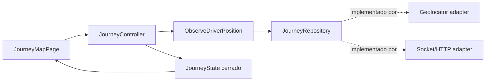
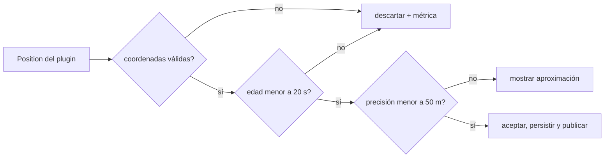
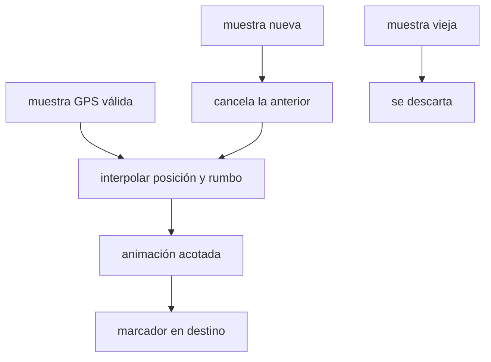
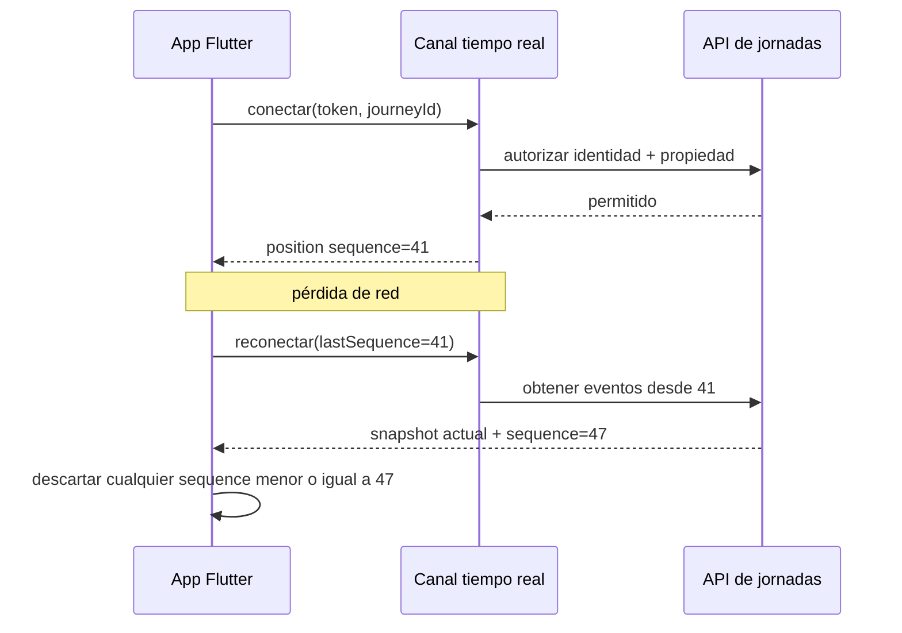
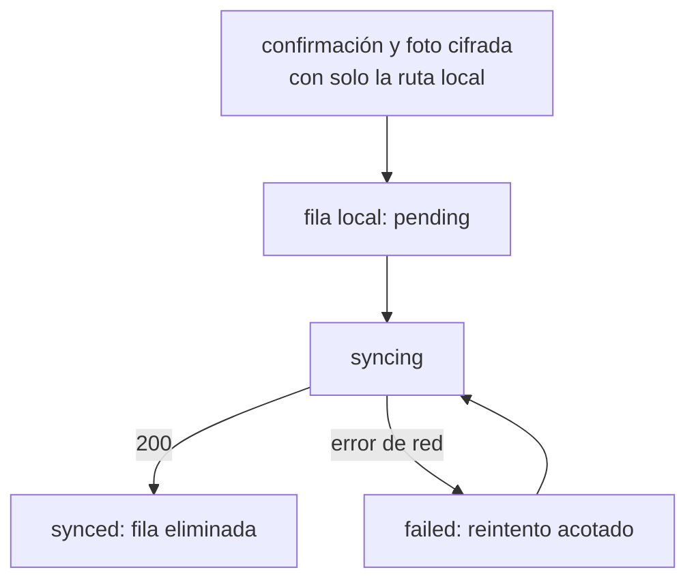
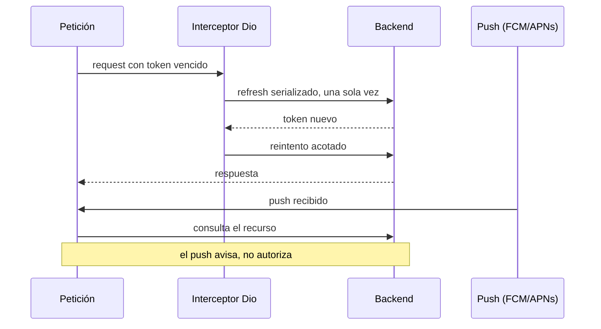

# Módulo 14: Flutter para entregas: mapas, GPS y tiempo real


## Antes de escribir código: vertical y estructura de carpetas

Construirás una vertical pequeña, no un clon completo de una marca: el conductor inicia una jornada, comparte posiciones aceptables, recibe una ruta y confirma una entrega aun si pierde conexión. Parte de un proyecto nuevo con `flutter create demo_driver`, agrega únicamente los paquetes del incremento que estés implementando y conserva las claves de mapas fuera del repositorio.

```text
lib/
  features/journey/
    domain/position_sample.dart
    domain/journey_repository.dart
    application/observe_driver_position.dart
    data/geolocator_position_source.dart
    data/socket_journey_gateway.dart
    presentation/journey_controller.dart
    presentation/journey_map_page.dart
  shared/
    network/dio_client.dart
    storage/local_database.dart
test/features/journey/
  position_sample_test.dart
  journey_controller_test.dart
```

La dirección de dependencias es `presentation → application → domain`; `data` implementa interfaces del dominio. Google Maps, Geolocator, Dio y Socket.IO son adaptadores reemplazables, no tipos que deban atravesar toda la aplicación. Ejecuta después de cada incremento con `flutter analyze` y `flutter test`; prueba permisos y ejecución en segundo plano en dispositivo real porque el simulador no reproduce todas las restricciones del sistema operativo.

## Aprende construyendo


### Tema 1: Diseño de pantallas y Riverpod · Intermedio · 35 min

<details open>
<summary><strong>Capa 1 — Lectura</strong></summary>

#### ► DE QUÉ TRATA
Al finalizar vas a modelar el estado de una jornada de entrega como un sealed class JourneyState observado con Riverpod, evitando las combinaciones imposibles que producen varios booleanos sueltos. Prerrequisitos: Flutter estable, Dart y un dispositivo o emulador; confirma flutte…

#### ► LA ANALOGÍA
Riverpod es la central de despacho que distribuye un estado único y observable; un estado cerrado (`sealed class`) obliga a un `switch` exhaustivo en la vista, que nunca puede olvidar visualmente un caso como el offline.

**Conceptos clave:** contratos, estados explícitos, fallos, seguridad y verificación.

La jornada se diseña desde tareas reales: iniciar turno, aceptar ruta, navegar a una parada, escanear, capturar evidencia y confirmar. La pantalla no debería deducir reglas a partir de varios booleanos independientes (`isLoading`, `hasError`, `isOffline`), porque combinaciones imposibles terminan apareciendo. Modela un estado cerrado que indique exactamente qué puede mostrar y qué acción es válida.

```dart
sealed class JourneyState {
  const JourneyState();
}
final class JourneyIdle extends JourneyState { const JourneyIdle(); }
final class JourneyLoading extends JourneyState { const JourneyLoading(); }
final class JourneyReady extends JourneyState {
  const JourneyReady(this.viewModel);
  final JourneyViewModel viewModel;
}
final class JourneyOffline extends JourneyState {
  const JourneyOffline(this.pendingCommands);
  final int pendingCommands;
}
final class JourneyFailure extends JourneyState {
  const JourneyFailure(this.message, {required this.canRetry});
  final String message;
  final bool canRetry;
}
```

`JourneyController` coordina casos de uso y emite estos estados; no importa widgets, `BuildContext`, Dio ni SQLite. La vista usa un `switch` exhaustivo para renderizar progreso, mapa, cola pendiente o recuperación. Esto permite probar el flujo sin inicializar plugins móviles y hace imposible olvidar visualmente el estado offline.

**Analogía:** Es como un tablero de una sola aguja: en lugar de encender y apagar tres luces que pueden contradecirse, un indicador único dice «en ruta», «sin señal» o «fallo», y no admite dos a la vez.

**¿Por qué es importante?** Porque una aplicación logística funciona en movimiento, con mala red, concurrencia y datos sensibles. La corrección debe sobrevivir fuera de una demostración local.

**Casos de uso reales:** una jornada que pasa de «sin conexión» a «reintentando» sin mostrar a la vez error y carga; un operador que ve la cola pendiente y el botón de reintento solo cuando corresponde; una prueba del controlador sin emulador.

**Diagrama: cómo leer la dependencia:** la UI solicita una acción al controlador; el caso de uso aplica la regla; el repositorio decide entre adaptadores sin que el dominio conozca plugins.



**Transferencia al proyecto integrador «Aplicación móvil del repartidor»:** Expón carga, error y ruta disponible desde el provider de entregas. Cambia de pantalla durante una consulta y verifica que el estado anterior no contamina la ruta recién seleccionada.

#### ► CÓMO FUNCIONA


</details>

<details>
<summary><strong>Capa 2 — Construcción</strong></summary>

#### Código y verificación
```dart
sealed class JourneyState {
  const JourneyState();
}
final class JourneyIdle extends JourneyState { const JourneyIdle(); }
final class JourneyLoading extends JourneyState { const JourneyLoading(); }
final class JourneyReady extends JourneyState {
  const JourneyReady(this.viewModel);
  final JourneyViewModel viewModel;
}
final class JourneyOffline extends JourneyState {
  const JourneyOffline(this.pendingCommands);
  final int pendingCommands;
}
final class JourneyFailure extends JourneyState {
  const JourneyFailure(this.message, {required this.canRetry});
  final String message;
  final bool canRetry;
}
```


```bash
flutter create ejemplo
```

```bash
flutter create ejemplo_riverpod
flutter analyze
```

</details>

### Tema 2: Google Maps y localización en tiempo real · Intermedio · 40 min

<details open>
<summary><strong>Capa 1 — Lectura</strong></summary>

#### ► DE QUÉ TRATA
Al finalizar vas a convertir una Position cruda del plugin de geolocalización en un PositionSample de dominio que rechaza coordenadas imposibles, muestras viejas o imprecisas. Prerrequisitos: Flutter estable, Dart y un dispositivo o emulador; confirma flutter doctor.

#### ► CÓMO FUNCIONA


</details>

<details>
<summary><strong>Capa 2 — Construcción</strong></summary>

#### Código y verificación
```dart
final class PositionSample {
  PositionSample({
    required this.latitude,
    required this.longitude,
    required this.accuracyMeters,
    required this.capturedAt,
  }) {
    if (latitude < -90 || latitude > 90) throw ArgumentError('latitude');
    if (longitude < -180 || longitude > 180) throw ArgumentError('longitude');
    if (accuracyMeters < 0) throw ArgumentError('accuracyMeters');
  }

  final double latitude;
  final double longitude;
  final double accuracyMeters;
  final DateTime capturedAt;

  bool isUsableAt(DateTime now) =>
      accuracyMeters <= 50 && now.difference(capturedAt) <= const Duration(seconds: 20);
}
```


```bash
flutter create ejemplo
```

```bash
flutter create ejemplo_mapa
flutter analyze
```

</details>

### Tema 3: Animaciones de localización · Intermedio · 30 min

<details open>
<summary><strong>Capa 1 — Lectura</strong></summary>

#### ► DE QUÉ TRATA
Al finalizar vas a interpolar la posición y el rumbo de un marcador entre dos muestras de GPS durante un intervalo limitado, en vez de saltar directamente a la nueva coordenada. Prerrequisitos: Flutter estable, Dart y un dispositivo o emulador; confirma flutter doctor.

#### ► CÓMO FUNCIONA


</details>

<details>
<summary><strong>Capa 2 — Construcción</strong></summary>

#### Código y verificación


```bash
flutter create ejemplo
```

```bash
flutter create ejemplo_animacion
flutter analyze
```

</details>

### Tema 4: Socket.IO y actualización de rutas · Avanzado · 40 min

<details open>
<summary><strong>Capa 1 — Lectura</strong></summary>

#### ► DE QUÉ TRATA
Al finalizar vas a aplicar un JourneyEventReducer que descarta eventos de posición duplicados o fuera de secuencia recibidos por Socket.IO. Prerrequisitos: Flutter estable, Dart y un dispositivo o emulador; confirma flutter doctor.

#### ► CÓMO FUNCIONA


</details>

<details>
<summary><strong>Capa 2 — Construcción</strong></summary>

#### Código y verificación
```dart
final class JourneyEventReducer {
  int _lastSequence = 0;

  PositionSample? apply(DriverPositionEvent event, DateTime now) {
    if (event.sequence <= _lastSequence) return null;
    if (!event.position.isUsableAt(now)) return null;
    _lastSequence = event.sequence;
    return event.position;
  }

  int get resumeAfter => _lastSequence;
}
```


```bash
flutter create ejemplo
```

```bash
flutter create ejemplo_socket
flutter analyze
```

</details>

### Tema 5: Almacenamiento local, imágenes y offline · Avanzado · 35 min

<details open>
<summary><strong>Capa 1 — Lectura</strong></summary>

#### ► DE QUÉ TRATA
Al finalizar vas a conservar una confirmación de entrega en una cola local (SQLite) con estado pending/syncing/synced/failed, que sobrevive aunque el conductor pierda conexión o reinicie la app. Prerrequisitos: Flutter estable, Dart y un dispositivo o emulador; confirma flutter d…

#### ► CÓMO FUNCIONA


</details>

<details>
<summary><strong>Capa 2 — Construcción</strong></summary>

#### Código y verificación


```bash
flutter create ejemplo
```

```bash
flutter create ejemplo_offline
flutter analyze
```

</details>

### Tema 6: Dio y notificaciones push · Avanzado · 40 min

<details open>
<summary><strong>Capa 1 — Lectura</strong></summary>

#### ► DE QUÉ TRATA
Al finalizar vas a configurar un cliente Dio con interceptores que serializan la renovación de token, y a tratar una notificación push como un aviso, no como una autorización. Prerrequisitos: Flutter estable, Dart y un dispositivo o emulador; confirma flutter doctor.

#### ► CÓMO FUNCIONA


</details>

<details>
<summary><strong>Capa 2 — Construcción</strong></summary>

#### Código y verificación


```bash
flutter create ejemplo
```

```bash
flutter create ejemplo_http
flutter analyze
```

</details>
