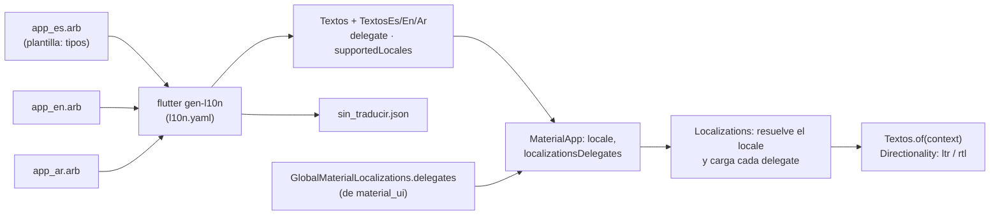
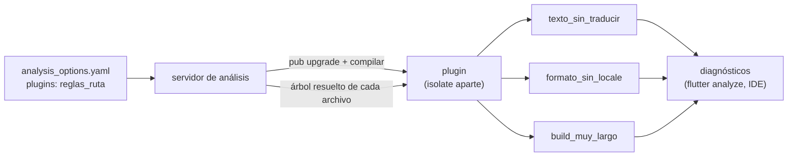
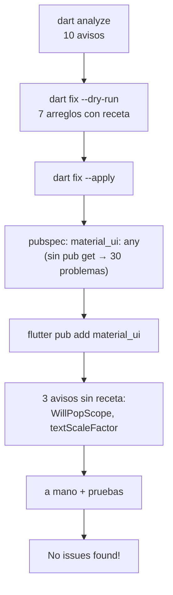
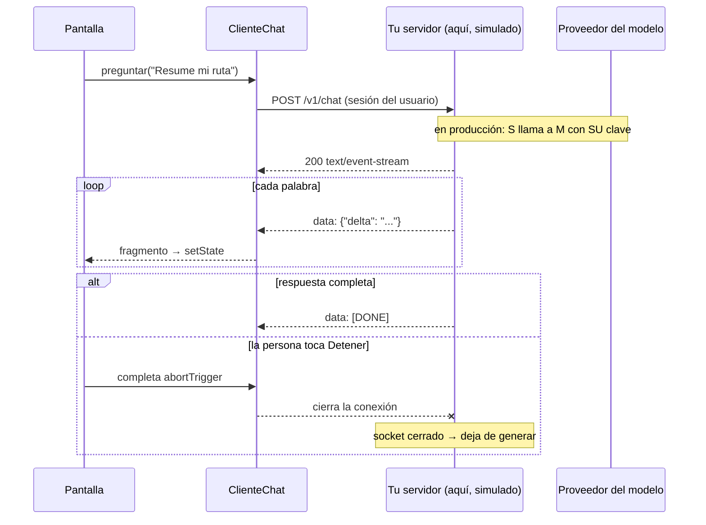

# Módulo 15: Flutter Master: internacionalización, calidad, migración a 3.50 e IA generativa

**Entorno comprobado para esta edición (2026-11-24):** Flutter 3.50.1 (canal estable) con Dart 3.14.0 en Linux
x86_64, con `material_ui` 1.11.1, `cupertino_ui` 1.1.7, `flutter_localizations` (del SDK), `intl` 0.20.3, `http`
1.6.0, `analysis_server_plugin` 0.3.26 y `analyzer` 14.7.0. Todo el código se analizó con `flutter analyze`
(`No issues found!`) y se ejecutó ese día en `/home/estudiante/labs/flutter/m15` (tu `~/labs/flutter/m15`). Las
capturas del Tema 1 son pruebas *golden* con las fuentes reales; las del Tema 4 son la app de escritorio real, en
release, hablando con un servidor local. Tres límites que debes conocer: (1) el «modelo» del Tema 4 es **simulado**:
un servidor de este laboratorio devuelve un texto fijo palabra por palabra, como lo haría una API de chat real, pero
no hay ningún modelo de lenguaje detrás ni se usó ninguna clave; (2) la fuente con glifos árabes es DejaVu Sans,
copiada de las fuentes del sistema (`/usr/share/fonts`), porque las de Google Fonts se descargan de GitHub y el
equipo de pruebas no lo permite; (3) el equipo de pruebas comparte 8 GB de memoria con otros procesos, y el servidor
de análisis con el plugin del Tema 2 fue detenido por falta de memoria en varios intentos antes de terminar bien.

La app de la ruta ya funciona, está probada y se publica. Este módulo la prepara para crecer: hablar el idioma de cada
persona (también uno que se escribe de derecha a izquierda), hacer que el analizador vigile las reglas propias del
equipo, ponerse al día con Flutter 3.50 sin romper nada y agregar un asistente que responde mientras escribe.

**Al terminar este módulo podrás:**
- traducir una app con archivos ARB, plurales y género, y mostrar fechas y dinero según el idioma, también en árabe;
- escribir reglas propias para el analizador con un plugin, y medir lo que cuestan;
- migrar una app de `package:flutter/material.dart` a `material_ui` con `dart fix` y terminar a mano lo que no migra;
- conectar la app a una API de chat en *streaming*, con cancelación, tiempos de espera y errores, sin claves en la app.

**Esquema del módulo:** Tema 1 (internacionalización y RTL) → Tema 2 (reglas propias del analizador) → Tema 3
(migrar a Flutter 3.50) → Tema 4 (IA generativa en *streaming*) → Proyecto 32.

**Qué necesitas saber antes:** del Módulo 0, **el analizador y los lints** (Tema 4) y **los streams** (Tema 5); del
Módulo 5, **`package:http` con límite de tiempo** (Tema 1) y **el diseño de errores de red** (Tema 4); del Módulo 9,
**las pruebas *golden*** (Tema 4); del Módulo 10, **el tema de la app** (Tema 1) y **Material y Cupertino** (Tema 4);
del Módulo 11, **la app de escritorio en pantalla virtual** y **los secretos fuera del binario** (Tema 2).

**Qué no se repite:** las bases de `analysis_options.yaml`, los modos estrictos y `dart fix` por regla (Módulo 0,
Tema 4), las pruebas en sí (Módulo 9), la medición de cuadros (Módulo 8), la publicación (Módulo 11) y las capas
(Módulo 12). Aquí se trata de lo que esas bases no cubren: idiomas, reglas propias, migraciones de versión y respuestas
que llegan por partes.

**Prepara el proyecto:**

```text
$ cd ~/labs/flutter
$ flutter create --org com.academia --platforms=linux m15
$ cd m15
$ flutter pub add flutter_localizations --sdk=flutter
$ flutter pub add intl http
```

`flutter create` ya agrega `material_ui`. Agrega `formatter: page_width: 120` a `analysis_options.yaml`, copia
`test/pantallazo.dart` del Módulo 10 y deja la ventana de Linux en 480 × 560
(`gtk_window_set_default_size(window, 480, 560)` en `linux/runner/my_application.cc`).


## Aprende construyendo


### Tema 1: Internacionalización: ARB, plurales, género, fechas, dinero y derecha a izquierda · Avanzado · 55 min

<details open>
<summary><strong>Capa 1 — Lectura</strong></summary>

#### Objetivos
Al terminar este tema podrás:
- generar las clases de textos con `flutter gen-l10n` a partir de archivos ARB;
- escribir plurales y género con la sintaxis ICU, también para el árabe, que tiene seis formas de plural;
- formatear fechas y dinero según el idioma, sin que el idioma cambie la moneda;
- mostrar la misma pantalla en español, inglés y árabe (de derecha a izquierda) y detectar textos que no caben.

**Conceptos clave:** ARB, `gen-l10n`, ICU (`plural` y `select`), locale, `LocalizationsDelegate`, RTL

#### El problema
La empresa abre operación con repartidores que hablan inglés y con un cliente en Medio Oriente. Hoy los textos están
escritos en el código, el contador dice «Quedan 1 entregas» y el valor a cobrar se arma con `'\$${valor}'`. Al
traducir «a mano» aparece de todo: botones que no caben en español, la repartidora llamada «el repartidor», precios
con el símbolo del euro y una pantalla en árabe con cuadritos en lugar de letras.

Este tema usa **el tema de la app** (Módulo 10, Tema 1), **las pruebas *golden*** (Módulo 9, Tema 4) y **los
records y patrones** (Módulo 0, Tema 6).

#### Glosario del tema

**ARB**
- **Definición técnica:** *Application Resource Bundle*, un JSON con un mensaje por clave (`"tituloApp": "Ruta del día"`) y, en la plantilla, metadatos con `@clave` (descripción y tipo de cada marcador); hay un archivo por idioma.
- **En palabras sencillas:** el diccionario de la app, con una página por idioma.
- **Dónde se rompe la comparación:** solo la plantilla (`app_es.arb`) define los tipos; si un idioma no trae una clave, la app muestra la de la plantilla, sin avisar en pantalla.
- **Ejemplo:** `app_ar.arb` sin `botonNovedad` muestra «Reportar novedad» en la pantalla árabe.
- **Error típico:** no mirar `sin_traducir.json`, el informe de claves que faltan.

**`gen-l10n`**
- **Definición técnica:** la herramienta de Flutter que lee los ARB (según `l10n.yaml`) y genera una clase abstracta (`Textos`), una subclase por idioma, el `delegate` y `supportedLocales`.
- **En palabras sencillas:** la imprenta que convierte el diccionario en código Dart con tipos.
- **Dónde se rompe la comparación:** necesita `generate: true` en `pubspec.yaml`, y su lista `localizationsDelegates` todavía usa las clases antiguas de `flutter_localizations`, no las de `material_ui`.
- **Ejemplo:** `t.entregasPendientes(3)` devuelve «Quedan 3 entregas».
- **Error típico:** editar los `.dart` generados: se reescriben en la siguiente compilación.

**ICU (`plural` y `select`)**
- **Definición técnica:** sintaxis de mensajes de Unicode: `{n, plural, =0{…} =1{…} few{…} many{…} other{…}}` elige por número según las reglas de cada idioma (CLDR); `{g, select, femenino{…} other{…}}` elige por un valor de texto.
- **En palabras sencillas:** el mensaje trae todas sus variantes y el idioma decide cuál toca.
- **Dónde se rompe la comparación:** `=0`, `=1` y `=2` son números exactos; `zero`, `one`, `two`, `few` y `many` son categorías del idioma, que no coinciden: en árabe 3 es `few` y 11 es `many`; en español 1 000 000 es `many`.
- **Ejemplo:** «Asignada a la repartidora Marta Rincón» / «Asignada al repartidor Luis Pardo».
- **Error típico:** `'Quedan $n entregas'`, que da «Quedan 1 entregas».

**locale**
- **Definición técnica:** idioma y, opcionalmente, región (`es`, `es_CO`, `ar_EG`) con los que se eligen los textos y las reglas de formato (separadores, orden de la fecha, cifras, moneda por defecto).
- **En palabras sencillas:** no solo el idioma, también las costumbres de un lugar.
- **Dónde se rompe la comparación:** `intl` 0.20.3 no trae datos de `es_CO`: usa los de `es`, que tienen el euro como moneda por defecto.
- **Ejemplo:** `NumberFormat.simpleCurrency(locale: 'es_CO')` da «18.500,00 €».
- **Error típico:** dejar que el idioma elija la moneda; la moneda la decide el negocio (aquí, COP), el idioma solo el formato.

**`LocalizationsDelegate`**
- **Definición técnica:** objeto que sabe cargar los recursos de un tipo para un locale: `isSupported` dice qué idiomas atiende, `load` devuelve un `Future` con los recursos y `shouldReload` decide si recargar; `MaterialApp` los recibe en `localizationsDelegates` y el widget `Localizations` los ejecuta.
- **En palabras sencillas:** el bibliotecario que trae el diccionario del idioma que pides.
- **Dónde se rompe la comparación:** cada *delegate* trae un solo tipo de recurso; la app necesita varios a la vez (los textos propios y los de Material, Cupertino y Widgets) y todos deben atender el mismo locale.
- **Ejemplo:** `await Textos.delegate.load(Locale('ar'))` devuelve los textos árabes en la prueba de plurales, sin construir widgets.
- **Error típico:** usar la lista `Textos.localizationsDelegates` con widgets de `material_ui`: en español la app falla con `No MaterialLocalizations found.`

**RTL**
- **Definición técnica:** dirección de texto de derecha a izquierda (`TextDirection.rtl`), la del árabe y el hebreo; `GlobalWidgetsLocalizations` la activa según el locale, y `Row`, `EdgeInsetsDirectional`, `AlignmentDirectional` y los iconos con `matchTextDirection` se reflejan solos.
- **En palabras sencillas:** la pantalla en el espejo.
- **Dónde se rompe la comparación:** lo que se escribió con `left`/`right` fijos (`EdgeInsets.only(left: …)`, `Alignment.centerLeft`) **no** se refleja.
- **Ejemplo:** el botón principal pasa de `x=36..236` (español) a `x=203..324` (árabe).
- **Error típico:** probar solo en inglés y español, que van en la misma dirección.

#### ► CÓMO FUNCIONA

##### 1. La idea en lenguaje sencillo

Una empresa de envíos que opera en varios países no reescribe su guía de despacho en cada idioma a mano y sin orden.
Tiene un diccionario de frases aprobadas, una página por idioma, y un traductor que respeta las costumbres locales:
cómo se escriben las fechas, dónde va el símbolo del dinero, si el texto se lee de izquierda a derecha.

Traducir una app no es cambiar palabras. «Quedan 1 entregas» es un error de plural; «el repartidor» para una
repartidora es un error de género. Un precio en euros para un cliente colombiano es un error de moneda. En árabe,
además, la pantalla entera se lee al revés.

Este tema separa los textos del código y deja que cada idioma decida sus reglas. La app pide «el mensaje de entregas
pendientes con 3». Recibe la frase correcta en español, inglés o árabe, con su plural, su fecha y su dirección.

##### 2. Definición formal y vocabulario

Un **ARB** (*Application Resource Bundle*) es un archivo JSON con un mensaje por clave, uno por idioma. La plantilla,
aquí `app_es.arb`, agrega metadatos con `@clave`: descripción y tipo de cada marcador. Los demás idiomas solo traen
los textos.

**`gen-l10n`** es la herramienta de Flutter que lee los ARB según `l10n.yaml` y genera código Dart con tipos. Produce
una clase abstracta, `Textos`, una subclase por idioma, el `delegate` y la lista `supportedLocales`.
`t.entregasPendientes(3)` es un método con un parámetro `int`, no una búsqueda por texto.

Los mensajes usan la sintaxis **ICU** de Unicode. `{n, plural, …}` elige una variante por número según las reglas de
cada idioma. Esas reglas vienen de CLDR, la base de datos de costumbres locales de Unicode. `{g, select, …}` elige por
un valor de texto, como el género.

Un **locale** es un idioma y, opcionalmente, una región: `es`, `es_CO`, `ar_EG`. Decide los textos y las reglas de
formato. Un `LocalizationsDelegate` es el objeto que carga los recursos de un locale. **RTL** (*right to left*) es la
dirección de derecha a izquierda del árabe y el hebreo.

##### 3. Cómo funciona por dentro, paso a paso

El trabajo empieza antes de ejecutar la app, en la generación de código:

1. `flutter gen-l10n`, o cualquier `flutter run`, `build` o `test`, lee `l10n.yaml`. Si falta `generate: true` en
   `pubspec.yaml`, se niega a generar, como muestra la primera salida del tema.
2. Lee la plantilla y toma de ahí los tipos de los marcadores. `cantidad` es `int`; `valor` es `double` con formato
   `currency` y moneda `COP`.
3. Por cada idioma genera una subclase. Para el árabe, el plural se convierte en una llamada a `Intl.pluralLogic` con
   seis ramas.
4. Las claves que faltan en un idioma usan el texto de la plantilla y quedan anotadas en `sin_traducir.json`.

Después, en tiempo de ejecución, `MaterialApp` crea un widget `Localizations`:

5. Resuelve el locale. Si el teléfono dice `es_CO` y la lista trae `es`, `en` y `ar`, busca primero una coincidencia
   exacta y después solo por idioma: elige `es`.
6. Pide a cada *delegate* que cargue sus recursos para `es`. `Textos.delegate` carga los textos de la app; los de
   `material_ui` cargan los de Material y Cupertino.
7. El *delegate* de widgets fija la dirección del texto. Para `ar` es `TextDirection.rtl`, y `Localizations` pone un
   `Directionality` con ese valor sobre toda la app.
8. Cada widget lee sus textos con `Textos.of(context)`. Al cambiar el locale, `Localizations` recarga y todo lo que
   depende de él se reconstruye.

```text
"entregasPendientes": "{cantidad, plural, =0{No quedan entregas} =1{Queda 1 entrega} other{Quedan {cantidad} entregas}}",
```

Lee esa línea de afuera hacia adentro. `cantidad` es el marcador; `plural` indica que se elige por número; cada rama
tiene un selector y un texto. `=0` y `=1` son números exactos; `other` es la categoría obligatoria que cubre el resto.



##### 4. Reglas, variantes y casos límite

Las categorías de plural no son números. `zero`, `one`, `two`, `few`, `many` y `other` son categorías de CLDR, y cada
idioma usa las suyas. La tabla del tema lo muestra: en árabe 3 es `few` y 11 es `many`; en español, 1 000 000 es
`many`. Los selectores `=0`, `=1` y `=2` sí son números exactos.

`other` es obligatoria en `plural` y en `select`. No todos los idiomas necesitan todas las ramas: en inglés, el
`select` de género solo usa `other`, porque «Assigned to» no cambia con el género.

La moneda la decide el negocio, no el idioma. `NumberFormat.simpleCurrency` elige la moneda por el locale, y `intl`
0.20.3 no trae datos de `es_CO`: usa los de `es`, con euros. Por eso el mensaje fija `name: COP` y el locale solo
decide separadores y posición del símbolo.

En la salida árabe del dinero hay un carácter invisible antes de la cifra: «‏18,500 $». Es la marca de derecha a
izquierda de Unicode (U+200F). `intl` la agrega para que la cifra y el símbolo se ordenen bien dentro de un texto
árabe.

La dirección RTL se aplica sola a lo que está escrito en términos de inicio y fin. `Row`, `EdgeInsetsDirectional`,
`AlignmentDirectional` y `CrossAxisAlignment.start` se reflejan. Lo escrito con `left` o `right` fijos, como
`EdgeInsets.only(left: 16)`, no se refleja.

En Flutter 3.50, la lista `Textos.localizationsDelegates` que genera `gen-l10n` trae las clases antiguas de
`flutter_localizations`. Con widgets de `material_ui`, la app falla en español con `No MaterialLocalizations found`.
Por eso el tema usa `GlobalMaterialLocalizations.delegates` de `material_ui`.

Las pruebas no ven las fuentes del sistema. Sin una fuente con glifos árabes cargada en `flutter test`, las capturas
muestran rectángulos aunque el teléfono sí tenga esas letras.

##### 5. Relación con lo que ya sabes y lo que viene

El tema de la app y su `ThemeData` vienen del Módulo 10, Tema 1; aquí se agrega `fontFamilyFallback` para el árabe.
Las capturas por idioma son pruebas golden como las del Módulo 9, Tema 4. Los textos que antes estaban escritos en el
código, como en el Módulo 12, Tema 4, pasan a los ARB.

Compara `gen-l10n` con escribir un mapa de textos a mano. Un mapa da un `String` por clave y no sabe de plurales,
tipos ni formatos. `gen-l10n` produce métodos con parámetros tipados: si cambias `cantidad` de `int` a `String`, el
compilador marca cada uso.

El Tema 2 escribe una regla del analizador que detecta textos fijos en `Text('…')` y formatos de fecha sin locale. El
Tema 3 explica por qué existen dos juegos de clases de localización: la migración a `material_ui`. El Tema 4 usa estos
mismos ARB para los textos del asistente.

#### Problema resuelto 1.1
Traduce la pantalla de la ruta al español, inglés y árabe, con un selector de idioma, plurales, género, la fecha y el
valor a cobrar en pesos. Captura la misma pantalla en los tres idiomas.

**Razonamiento:**
1. Primero, ver con datos reales cómo cambian las fechas, el dinero y los plurales según el locale, con un programa
   que solo usa `intl`.
2. `l10n.yaml` fija la plantilla, la clase `Textos`, `nullable-getter: false` (para no escribir `!` en cada uso) y
   el informe de claves sin traducir.
3. El valor a cobrar usa `format: currency` con `name: COP`: la moneda no depende del idioma.
4. Todo lo que tenga dirección usa la versión *Directional*; los botones van en un `Wrap` para que bajen si no caben.
5. Las capturas son *golden* con las fuentes reales, incluida una con glifos árabes.

```dart
// bin/formatos.dart — cómo cambian la fecha, el dinero y los plurales según el locale (solo intl, sin Flutter)
// ignore_for_file: avoid_print
import 'package:intl/date_symbol_data_local.dart';
import 'package:intl/intl.dart';

String pluralIngenuo(int n) => 'Quedan $n entregas'; // lo que se escribe sin pensar en plurales

Future<void> main() async {
  await initializeDateFormatting(); // carga los datos de fechas de todos los locales
  final fecha = DateTime(2026, 11, 24, 15, 30);
  const valor = 18500.0;

  print('== Fecha y hora ==');
  for (final locale in ['es', 'es_CO', 'en', 'ar', 'ar_EG']) {
    final f = DateFormat.yMMMMEEEEd(locale).add_jm().format(fecha);
    print('${locale.padRight(6)} $f');
  }

  print('\n== simpleCurrency: la moneda la elige el locale ==');
  for (final locale in ['es', 'es_CO', 'en', 'ar', 'ar_EG']) {
    print('${locale.padRight(6)} ${NumberFormat.simpleCurrency(locale: locale).format(valor)}');
  }

  print('\n== currency con name: COP fijo, formato del locale ==');
  for (final locale in ['es', 'es_CO', 'en', 'ar', 'ar_EG']) {
    final f = NumberFormat.currency(locale: locale, name: 'COP', symbol: r'$', decimalDigits: 0);
    print('${locale.padRight(6)} ${f.format(valor)}');
  }

  print('\n== Categorías de plural de CLDR (sin casos exactos =0, =1, =2) ==');
  for (final n in [0, 1, 2, 3, 11, 100, 1000000]) {
    String cat(String locale) => Intl.pluralLogic(
      n,
      locale: locale,
      zero: 'zero',
      one: 'one',
      two: 'two',
      few: 'few',
      many: 'many',
      other: 'other',
      useExplicitNumberCases: false, // sin esto, zero/one/two se usan para 0/1/2 en cualquier idioma
    );
    print('n=${n.toString().padRight(7)} es: ${cat('es').padRight(5)} en: ${cat('en').padRight(5)} ar: ${cat('ar')}');
  }

  print('\n== Plural ingenuo ==');
  for (final n in [0, 1, 2]) {
    print(pluralIngenuo(n));
  }
}
```

```text
$ dart run bin/formatos.dart
== Fecha y hora ==
es     martes, 24 de noviembre de 2026 15:30
es_CO  martes, 24 de noviembre de 2026 15:30
en     Tuesday, November 24, 2026 3:30 PM
ar     الثلاثاء، 24 نوفمبر 2026 3:30 م
ar_EG  الثلاثاء، ٢٤ نوفمبر ٢٠٢٦ ٣:٣٠ م

== simpleCurrency: la moneda la elige el locale ==
es     18.500,00 €
es_CO  18.500,00 €
en     $18,500.00
ar     ‏18,500.00 E£
ar_EG  ‏١٨٬٥٠٠٫٠٠ E£

== currency con name: COP fijo, formato del locale ==
es     18.500 $
es_CO  18.500 $
en     $18,500
ar     ‏18,500 $
ar_EG  ‏١٨٬٥٠٠ $

== Categorías de plural de CLDR (sin casos exactos =0, =1, =2) ==
n=0       es: other en: other ar: zero
n=1       es: one   en: one   ar: one
n=2       es: other en: other ar: two
n=3       es: other en: other ar: few
n=11      es: other en: other ar: many
n=100     es: other en: other ar: other
n=1000000 es: many  en: other ar: other

== Plural ingenuo ==
Quedan 0 entregas
Quedan 1 entregas
Quedan 2 entregas
```

```yaml
# l10n.yaml — configuración de flutter gen-l10n
arb-dir: lib/l10n
template-arb-file: app_es.arb
output-localization-file: textos.dart
output-class: Textos
nullable-getter: false
untranslated-messages-file: sin_traducir.json
```

```text
{
  "@@locale": "es",
  "tituloApp": "Ruta del día",
  "@tituloApp": {"description": "Título de la pantalla principal"},
  "guia": "Guía {codigo}",
  "@guia": {"placeholders": {"codigo": {"type": "String", "example": "EN-4471"}}},
  "entregasPendientes": "{cantidad, plural, =0{No quedan entregas} =1{Queda 1 entrega} other{Quedan {cantidad} entregas}}",
  "@entregasPendientes": {"placeholders": {"cantidad": {"type": "int"}}},
  "asignadaA": "{genero, select, femenino{Asignada a la repartidora {nombre}} masculino{Asignada al repartidor {nombre}} other{Asignada a {nombre}}}",
  "@asignadaA": {"placeholders": {"genero": {"type": "String"}, "nombre": {"type": "String"}}},
  "fechaEntrega": "Entrega: {fecha}",
  "@fechaEntrega": {"placeholders": {"fecha": {"type": "DateTime", "format": "yMMMMEEEEd"}}},
  "valorCobrar": "Cobrar: {valor}",
  "@valorCobrar": {
    "description": "Valor que el repartidor cobra contra entrega; siempre en pesos colombianos",
    "placeholders": {
      "valor": {"type": "double", "format": "currency", "optionalParameters": {"name": "COP", "symbol": "$", "decimalDigits": 0}}
    }
  },
  "botonEntregada": "Marcar como entregada",
  "botonNovedad": "Reportar novedad",
  "idioma": "Idioma",
  "tituloAsistente": "Asistente de ruta",
  "avisoSimulado": "Respuestas generadas por un modelo simulado en un servidor local.",
  "pregunta": "Tu pregunta",
  "botonPreguntar": "Preguntar",
  "botonDetener": "Detener",
  "estadoEsperando": "Esperando la primera palabra…",
  "estadoEscribiendo": "Escribiendo… {cantidad} fragmentos",
  "@estadoEscribiendo": {"placeholders": {"cantidad": {"type": "int"}}},
  "estadoListo": "Listo en {segundos} s",
  "@estadoListo": {"placeholders": {"segundos": {"type": "String"}}},
  "estadoDetenido": "Detenido por ti",
  "errorChat": "No se pudo completar: {motivo}",
  "@errorChat": {"placeholders": {"motivo": {"type": "String"}}},
  "resumenTitulo": "Resumen del día",
  "entregasHechas": "{cantidad, plural, =0{Ninguna entrega hecha} =1{1 entrega hecha} other{{cantidad} entregas hechas}}",
  "@entregasHechas": {"placeholders": {"cantidad": {"type": "int"}}},
  "verDetalle": "Ver detalle"
}
```

```text
{
  "@@locale": "ar",
  "tituloApp": "مسار اليوم",
  "guia": "الشحنة {codigo}",
  "entregasPendientes": "{cantidad, plural, =0{لا توجد شحنات متبقية} =1{تبقّت شحنة واحدة} =2{تبقّت شحنتان} few{تبقّت {cantidad} شحنات} many{تبقّت {cantidad} شحنة} other{تبقّت {cantidad} شحنة}}",
  "asignadaA": "{genero, select, femenino{مُسندة إلى المندوبة {nombre}} masculino{مُسندة إلى المندوب {nombre}} other{مُسندة إلى {nombre}}}",
  "fechaEntrega": "التسليم: {fecha}",
  "valorCobrar": "المبلغ المطلوب: {valor}",
  "botonEntregada": "تأكيد التسليم",
  "botonNovedad": "الإبلاغ عن مشكلة",
  "idioma": "اللغة",
  "tituloAsistente": "مساعد المسار",
  "avisoSimulado": "الإجابات من نموذج محاكى على خادم محلي.",
  "pregunta": "سؤالك",
  "botonPreguntar": "اسأل",
  "botonDetener": "إيقاف",
  "estadoEsperando": "في انتظار الكلمة الأولى…",
  "estadoEscribiendo": "جارٍ الكتابة… {cantidad} أجزاء",
  "estadoListo": "اكتمل في {segundos} ث",
  "estadoDetenido": "أوقفته أنت",
  "errorChat": "تعذّر الإكمال: {motivo}",
  "resumenTitulo": "ملخص اليوم",
  "entregasHechas": "{cantidad, plural, =0{لم تُسلَّم أي شحنة} =1{سُلِّمت شحنة واحدة} =2{سُلِّمت شحنتان} few{سُلِّمت {cantidad} شحنات} many{سُلِّمت {cantidad} شحنة} other{سُلِّمت {cantidad} شحنة}}",
  "verDetalle": "عرض التفاصيل"
}
```

```text
$ flutter gen-l10n
Because l10n.yaml exists, the options defined there will be used instead.
To use the command line arguments, delete the l10n.yaml file in the Flutter project.
Attempted to generate localizations code without having the flutter: generate flag turned on.
Check pubspec.yaml and ensure that flutter: generate: true has been added and rebuild the project. Otherwise, the localizations source code will not be importable.
[código de salida: 1]
```

Con `generate: true` en la sección `flutter:` de `pubspec.yaml`:

```text
$ flutter gen-l10n
Because l10n.yaml exists, the options defined there will be used instead.
To use the command line arguments, delete the l10n.yaml file in the Flutter project.
```

```dart
// lib/main.dart — la app de la ruta en tres idiomas
import 'package:material_ui/material_ui.dart';

import 'l10n/textos.dart';
import 'ruta/entrega.dart';
import 'ruta/pantalla_ruta.dart';

void main() => runApp(const AppRuta());

class AppRuta extends StatefulWidget {
  const AppRuta({super.key, this.localeInicial});

  final Locale? localeInicial; // null: el del sistema

  @override
  State<AppRuta> createState() => _AppRutaState();
}

class _AppRutaState extends State<AppRuta> {
  late Locale? _locale = widget.localeInicial;

  @override
  Widget build(BuildContext context) {
    return MaterialApp(
      debugShowCheckedModeBanner: false,
      onGenerateTitle: (context) => Textos.of(context).tituloApp,
      locale: _locale,
      supportedLocales: Textos.supportedLocales,
      localizationsDelegates: const [
        Textos.delegate, // los textos de la app (generados desde los ARB)
        ...GlobalMaterialLocalizations.delegates, // los de material_ui: Material, Cupertino y Widgets (incluye RTL)
      ],
      theme: ThemeData(
        colorSchemeSeed: const Color(0xFF00695C),
        fontFamilyFallback: const ['DejaVuSans'], // glifos árabes cuando la fuente principal no los tiene
      ),
      home: PantallaRuta(entrega: entregaDemo, pendientes: 3, alCambiarIdioma: (l) => setState(() => _locale = l)),
    );
  }
}
```

```dart
// lib/ruta/pantalla_ruta.dart — la pantalla de la ruta, con todos los textos desde Textos
import 'package:material_ui/material_ui.dart';

import '../l10n/textos.dart';
import 'entrega.dart';

class PantallaRuta extends StatelessWidget {
  const PantallaRuta({super.key, required this.entrega, required this.pendientes, required this.alCambiarIdioma});

  final Entrega entrega;
  final int pendientes;
  final ValueChanged<Locale> alCambiarIdioma;

  @override
  Widget build(BuildContext context) {
    final t = Textos.of(context);
    return Scaffold(
      appBar: AppBar(title: Text(t.tituloApp)),
      body: ListView(
        padding: const EdgeInsetsDirectional.all(16), // «Directional»: start/end se invierten en RTL
        children: [
          Text(t.idioma, style: Theme.of(context).textTheme.labelLarge),
          const SizedBox(height: 8),
          SelectorIdioma(alCambiar: alCambiarIdioma),
          const SizedBox(height: 16),
          Text(t.entregasPendientes(pendientes), style: Theme.of(context).textTheme.titleMedium),
          const SizedBox(height: 8),
          TarjetaEntrega(entrega: entrega),
        ],
      ),
    );
  }
}

class SelectorIdioma extends StatelessWidget {
  const SelectorIdioma({super.key, required this.alCambiar});

  final ValueChanged<Locale> alCambiar;

  @override
  Widget build(BuildContext context) {
    return SegmentedButton<String>(
      // Cada idioma se nombra en su propia lengua: estos textos no se traducen a propósito.
      segments: const [
        ButtonSegment(value: 'es', label: Text('ES')), // ignore: reglas_ruta/texto_sin_traducir
        ButtonSegment(value: 'en', label: Text('EN')), // ignore: reglas_ruta/texto_sin_traducir
        ButtonSegment(value: 'ar', label: Text('ع')), // ignore: reglas_ruta/texto_sin_traducir
      ],
      selected: {Localizations.localeOf(context).languageCode},
      onSelectionChanged: (s) => alCambiar(Locale(s.first)),
    );
  }
}

class TarjetaEntrega extends StatelessWidget {
  const TarjetaEntrega({super.key, required this.entrega});

  final Entrega entrega;

  @override
  Widget build(BuildContext context) {
    final t = Textos.of(context);
    return Card(
      child: Padding(
        padding: const EdgeInsetsDirectional.fromSTEB(16, 12, 16, 16),
        child: Column(
          crossAxisAlignment: CrossAxisAlignment.start, // «start» es la izquierda en es/en y la derecha en ar
          children: [
            Row(
              children: [
                const Icon(Icons.local_shipping_outlined),
                const SizedBox(width: 8),
                Expanded(child: Text(t.guia(entrega.guia), style: Theme.of(context).textTheme.titleLarge)),
                const Icon(Icons.chevron_right), // se refleja solo en RTL (matchTextDirection)
              ],
            ),
            const SizedBox(height: 8),
            Text(t.asignadaA(entrega.generoRepartidor, entrega.repartidor)),
            Text(t.fechaEntrega(entrega.fecha)),
            Text(t.valorCobrar(entrega.valor)),
            const SizedBox(height: 12),
            Wrap(
              spacing: 8,
              runSpacing: 8, // si no caben en una línea, el segundo botón baja
              children: [
                FilledButton(onPressed: () {}, child: Text(t.botonEntregada)),
                OutlinedButton(onPressed: () {}, child: Text(t.botonNovedad)),
              ],
            ),
          ],
        ),
      ),
    );
  }
}
```

```dart
// test/i18n_test.dart — la misma pantalla en español, inglés y árabe, y los mensajes con plural y género
// ignore_for_file: avoid_print
import 'package:flutter_test/flutter_test.dart';
import 'package:m15/l10n/textos.dart';
import 'package:m15/main.dart';
import 'package:material_ui/material_ui.dart';

import 'pantallazo.dart';

void main() {
  setUpAll(() async {
    await cargarFuentes();
    await cargarFuenteArabe();
  });

  for (final idioma in ['es', 'en', 'ar']) {
    testWidgets('pantalla en $idioma', (tester) async {
      tamanoPantalla(tester, tamano: const Size(360, 520));
      await tester.pumpWidget(AppRuta(localeInicial: Locale(idioma)));
      await tester.pumpAndSettle();
      final direccion = Directionality.of(tester.element(find.byType(Card)));
      final boton = tester.getRect(find.byType(FilledButton));
      print('$idioma: dirección $direccion · botón principal x=${boton.left.round()}..${boton.right.round()}');
      await pantallazo('m15-t1-$idioma');
    });
  }

  testWidgets('el selector cambia el idioma sin reiniciar', (tester) async {
    await tester.pumpWidget(const AppRuta(localeInicial: Locale('es')));
    await tester.pumpAndSettle();
    expect(find.text('Ruta del día'), findsOneWidget);
    await tester.tap(find.text('EN'));
    await tester.pumpAndSettle();
    expect(find.text("Today's route"), findsOneWidget);
    print('tras tocar EN: ${find.text("Today's route").evaluate().length} título en inglés');
  });

  test('plurales y género en los tres idiomas', () async {
    for (final idioma in ['es', 'en', 'ar']) {
      final t = await Textos.delegate.load(Locale(idioma));
      print('— $idioma');
      for (final n in [0, 1, 2, 3, 11, 100]) {
        print('  $n → ${t.entregasPendientes(n)}');
      }
      print('  ${t.asignadaA('femenino', 'Marta Rincón')} | ${t.asignadaA('masculino', 'Luis Pardo')}');
    }
  });
}
```

```text
$ flutter test test/i18n_test.dart
00:00 +0: loading /home/estudiante/labs/flutter/m15/test/i18n_test.dart
00:00 +0: (setUpAll)
00:00 +0: pantalla en es
es: dirección TextDirection.ltr · botón principal x=36..236
00:01 +1: pantalla en en
en: dirección TextDirection.ltr · botón principal x=36..197
00:01 +2: pantalla en ar
ar: dirección TextDirection.rtl · botón principal x=203..324
00:01 +3: el selector cambia el idioma sin reiniciar
tras tocar EN: 1 título en inglés
00:01 +4: plurales y género en los tres idiomas
— es
  0 → No quedan entregas
  1 → Queda 1 entrega
  2 → Quedan 2 entregas
  3 → Quedan 3 entregas
  11 → Quedan 11 entregas
  100 → Quedan 100 entregas
  Asignada a la repartidora Marta Rincón | Asignada al repartidor Luis Pardo
— en
  0 → No deliveries left
  1 → 1 delivery left
  2 → 2 deliveries left
  3 → 3 deliveries left
  11 → 11 deliveries left
  100 → 100 deliveries left
  Assigned to Marta Rincón | Assigned to Luis Pardo
— ar
  0 → لا توجد شحنات متبقية
  1 → تبقّت شحنة واحدة
  2 → تبقّت شحنتان
  3 → تبقّت 3 شحنات
  11 → تبقّت 11 شحنة
  100 → تبقّت 100 شحنة
  مُسندة إلى المندوبة Marta Rincón | مُسندة إلى المندوب Luis Pardo
00:01 +5: (tearDownAll)
00:02 +5: All tests passed!
```

![Tres capturas de la misma pantalla. En español: título «Ruta del día», selector ES marcado, «Quedan 3 entregas», tarjeta «Guía EN-4472» con «Asignada a la repartidora Marta Rincón», «Entrega: martes, 24 de noviembre de 2026», «Cobrar: 18.500 $» y los botones «Marcar como entregada» y, debajo, «Reportar novedad». En inglés: «Today's route», «3 deliveries left», «Collect: $18,500» y los dos botones en una sola línea. En árabe: todo alineado a la derecha, el selector invertido con ع marcado a la derecha, la flecha de la tarjeta apuntando a la izquierda, la fecha con cifras arábigo-índicas (٢٤ ٢٠٢٦) y el valor con cifras latinas (18,500 $)](content/figures/flutter/m15-t1-tres-idiomas.png)

**Explicación por partes.**
- **Fechas:** el mismo `DateTime` sale «martes, 24 de noviembre de 2026 15:30», «Tuesday, November 24, 2026 3:30 PM» y,
  en árabe, con el día de la semana y el mes en árabe. `ar_EG` usa cifras arábigo-índicas (٢٤); `ar`, en `intl`,
  latinas.
- **Moneda:** `simpleCurrency` elige la moneda por el locale: euros en `es` **y en `es_CO`** (no hay datos de
  `es_CO` en `intl` 0.20.3: su `number_symbols_data.dart` solo trae `es`, `es_419`, `es_ES`, `es_MX` y `es_US`), dólares
  en `en` y libras egipcias en `ar` y `ar_EG` (en este, también con cifras y separadores árabes). Con `name: 'COP'` la cifra es siempre la misma y solo cambia el formato:
  «18.500 $», «$18,500», «‏18,500 $».
- **Plurales:** en la tabla de categorías (con `useExplicitNumberCases: false`), el árabe usa `zero`, `one`, `two`,
  `few` (3), `many` (11) y `other` (100); el español solo `one` y `other`, más `many` para 1 000 000. Por eso
  `app_ar.arb` tiene seis variantes y la prueba muestra «تبقّت 3 شحنات» (*few*), «تبقّت 11 شحنة» (*many*) y «تبقّت 100
  شحنة» (*other*). El plural ingenuo da «Quedan 1 entregas».
- **Género:** `select` con `femenino`, `masculino` y `other`. En inglés basta `other`: no todos los idiomas necesitan
  todas las variantes, pero `other` es obligatoria.
- **RTL:** en árabe `Directionality` es `rtl` sin escribir nada: la da `GlobalWidgetsLocalizations`. El botón
  principal queda a la derecha (`x=203..324`), y el `SegmentedButton`, la fila del título y el `chevron_right` se
  reflejan solos.
- **Cifras mezcladas:** en la captura árabe la fecha sale con cifras arábigo-índicas (٢٤ نوفمبر ٢٠٢٦) y el dinero con
  latinas (18,500). Las fechas usan los datos que carga `flutter_localizations` (su `generated_date_localizations.dart`
  define `ZERODIGIT: '٠'` para `ar`), y los números, los de `intl`, que para `ar` usa cifras latinas. Si el cliente
  quiere un solo sistema, decide cuál y usa el mismo locale (por ejemplo `ar_EG`) para los dos.
- **Selector:** tocar «EN» cambia el título a «Today's route» sin reiniciar: `locale` es estado de `AppRuta`.

Así se veía la pantalla árabe **antes** de completar `app_ar.arb` (izquierda), y con todo traducido pero sin cargar
una fuente con glifos árabes en la prueba (derecha). Este es el informe que `gen-l10n` había escrito en
`sin_traducir.json`:

```json
{
  "ar": [
    "botonNovedad",
    "idioma"
  ]
}
```


> **Error común.** Usar la lista que genera `gen-l10n`, `Textos.localizationsDelegates`. En Flutter 3.50 esa lista
> trae `GlobalMaterialLocalizations` de `flutter_localizations`, que es la clase **antigua**: traduce los widgets de
> `package:flutter/material.dart`, no los de `material_ui`. En inglés no se nota (Material trae inglés por defecto),
> pero en español la app falla. La salida real con esa línea:

```text
$ flutter test test/i18n_test.dart --plain-name "pantalla en es"
00:00 +0: loading /home/estudiante/labs/flutter/m15/test/i18n_test.dart
00:00 +0: (setUpAll)
00:00 +0: pantalla en es
══╡ EXCEPTION CAUGHT BY WIDGETS ╞═══════════════════════════════════════════════════════════════════
The following message was thrown:
Warning: This application's locale, es, is not supported by all of its localization delegates.

• A MaterialLocalizations delegate that supports the es locale was not found.
• A CupertinoLocalizations delegate that supports the es locale was not found.

The declared supported locales for this app are: ar, en, es

See https://flutter.dev/to/internationalization/ for more information about configuring an app's
locale, supportedLocales, and localizationsDelegates parameters.
════════════════════════════════════════════════════════════════════════════════════════════════════
══╡ EXCEPTION CAUGHT BY WIDGETS LIBRARY ╞═══════════════════════════════════════════════════════════
The following assertion was thrown building AppBar(dirty, dependencies:
[_LocalizationsScope-[GlobalKey#9225d], _ScrollNotificationObserverScope], state:
_AppBarState#37b00):
No MaterialLocalizations found.
[…]
The relevant error-causing widget was:
  AppBar AppBar:file:///home/estudiante/labs/flutter/m15/lib/ruta/pantalla_ruta.dart:18:15

[…]
Failing tests:
  /home/estudiante/labs/flutter/m15/test/i18n_test.dart: pantalla en es
[código de salida: 1]
```

> El analizador también lo marca en el archivo generado, que por eso se excluye del análisis en
> `analysis_options.yaml`:

```text
$ flutter analyze lib/l10n/textos.dart
Analyzing textos.dart...                                        

   info • 'GlobalMaterialLocalizations' is deprecated and shouldn't be used. Use GlobalMaterialLocalizations from package:material_ui/material_ui.dart instead. This feature was deprecated after v3.47.0-0.0.pre. Try replacing the use of the deprecated member with the replacement • lib/l10n/textos.dart:88:5 • deprecated_member_use
   info • 'GlobalCupertinoLocalizations' is deprecated and shouldn't be used. Use GlobalCupertinoLocalizations from package:cupertino_ui/cupertino_ui.dart instead. This feature was deprecated after v3.47.0-0.0.pre. Try replacing the use of the deprecated member with the replacement • lib/l10n/textos.dart:89:5 • deprecated_member_use

2 issues found. (ran in 1.2s)
[código de salida: 1]
```

> **Error común.** Confiar en que el teléfono «tiene» las letras. Android e iOS traen fuentes de respaldo para el
> árabe, pero `flutter test` no usa las fuentes del sistema: sin cargar una fuente con esos glifos, las capturas
> salen con rectángulos, como a la derecha. Declara la fuente en `pubspec.yaml`, ponla en `fontFamilyFallback` del
> tema y cárgala en las pruebas (`cargarFuenteArabe()` en `test/pantallazo.dart`).

> **Buena práctica.** Escribe en cada clave de la plantilla una `description` para quien traduce («siempre en pesos
> colombianos») y revisa `sin_traducir.json` en cada revisión de código: un idioma incompleto no falla, se mezcla.

> **Prevenir errores.** Deja una prueba *golden* por idioma de cada pantalla principal, y una con el idioma que escribe
> al revés. Es la forma barata de ver textos cortados, flechas que no se reflejan y letras que no se dibujan.

#### Checkpoint 1.1
Un repartidor en Colombia tiene el teléfono en `es_CO`. La app declara `supportedLocales` con `es`, `en` y `ar`.
¿Qué locale recibe la app y por qué el valor a cobrar no sale en euros?

Respuesta: Flutter elige el más parecido de la lista, `es` (mismo idioma, sin región). Con ese locale,
`simpleCurrency` usaría euros, pero el mensaje `valorCobrar` usa `currency` con `name: 'COP'` y `symbol: '$'`: la
moneda está fija y el locale solo decide los separadores («18.500 $»).

</details>

<details>
<summary><strong>Capa 2 — Construcción</strong></summary>

#### Paso 1 · Mira los formatos
Crea `bin/formatos.dart` y ejecútalo con `dart run`. Agrega `es_MX` a las listas y compara su moneda y su hora con
las de `es`.

#### Paso 2 · Genera los textos
Crea `l10n.yaml` y los tres ARB, ejecuta `flutter gen-l10n` (primero sin `generate: true`, para ver el error) y lee
`lib/l10n/textos_ar.dart`: busca `few:` y `many:`.

#### Paso 3 · Arma la pantalla
Crea `entrega.dart`, `pantalla_ruta.dart` y `main.dart`. Prueba primero con `Textos.localizationsDelegates` y mira el
error en español; después cambia a la lista con los *delegates* de `material_ui`.

#### Paso 4 · Captura los tres idiomas
Copia `pantallazo.dart`, agrega `cargarFuenteArabe()` y la fuente en `pubspec.yaml`, y ejecuta `i18n_test.dart` con
`--update-goldens`. Abre las tres imágenes.

#### Paso 5 · Textos que no caben
Escribe `test/textos_largos_test.dart`: un widget `BotonesEnFila` con los dos botones en un `Row` (sin `Wrap`), en
una pantalla de 360 px, en inglés y en español. Con `tester.takeException()` recoge el desborde sin que la prueba
falle, mide los botones con `tester.getSize` y guarda una captura de cada idioma.

```text
$ flutter test test/textos_largos_test.dart
00:00 +0: loading /home/estudiante/labs/flutter/m15/test/textos_largos_test.dart
00:00 +0: (setUpAll)
00:00 +0: fila de botones en en
en: botones 297 px de 328 disponibles → cabe
00:01 +1: fila de botones en es
es: botones 369 px de 328 disponibles → DESBORDE
   A RenderFlex overflowed by 41 pixels on the right.
00:01 +2: (tearDownAll)
00:01 +2: All tests passed!
```


#### Resumen
- Los textos viven en **ARB**; **`gen-l10n`** genera una clase con tipos y avisa lo que falta.
- **ICU** resuelve **plurales** por categorías del idioma (seis en árabe) y **género** con `select`.
- El **locale** decide el formato; la moneda la decide el negocio.
- Con los *delegates* de `material_ui`, **RTL** se aplica solo; lo escrito con `left`/`right` no se refleja.
- Lo que cabe en inglés puede no caber en español: `Wrap`, `Expanded` o `Flexible`, y una prueba por idioma.

#### Ejercicio verificable 1
Básico. ¿Qué devuelve `entregasPendientes(11)` en árabe, y qué categoría de plural es?

Respuesta esperada: «تبقّت 11 شحنة», la categoría `many`.

#### Ejercicio verificable 2
Intermedio. ¿Por cuántos píxeles se desborda la fila de botones en español, y cuánto miden juntos?

Respuesta esperada: 41 px; los botones y el espacio suman 369 px y hay 328 disponibles (360 menos 2 × 16 de margen).

#### Ejercicio verificable 3
Reto. ¿Qué da `simpleCurrency` con `ar_EG`, y por qué en la app las cifras de la fecha árabe no coinciden con las
del dinero?

Respuesta esperada: «‏١٨٬٥٠٠٫٠٠ E£»: libras egipcias, con cifras arábigo-índicas y sus propios separadores. En la app,
la fecha se formatea con los datos de fechas que carga `flutter_localizations` (cifra cero `'٠'` para `ar`) y el
número con los de `intl`, que para `ar` usan cifras latinas.

#### En el trabajo
Los equipos envían los ARB a traductores (o a una plataforma de traducción) y reciben los archivos de vuelta; nadie
traduce dentro del código. Las revisiones piden capturas en el idioma más largo (alemán, español) y en uno RTL, y la
prueba de que `sin_traducir.json` está vacío antes de publicar.

</details>

### Tema 2: Reglas propias para el analizador: un plugin que vigila textos, formatos y tamaño · Avanzado · 45 min

<details open>
<summary><strong>Capa 1 — Lectura</strong></summary>

#### Objetivos
Al terminar este tema podrás:
- escribir un plugin del analizador con `analysis_server_plugin` y registrar reglas propias;
- recorrer el árbol de sintaxis con un visitante y reportar con un mensaje en español;
- convertir una métrica (líneas de un `build`) en una regla;
- activar, silenciar y medir el costo de las reglas en `flutter analyze`.

**Conceptos clave:** plugin del analizador, `AnalysisRule`, visitante del árbol de sintaxis, regla *lint* frente a *warning*, métrica

#### El problema
Después del Tema 1 alguien agrega una tarjeta de resumen con `Text('Resumen del día')` y
`DateFormat.yMMMMEEEEd()`. Ningún lint estándar lo detecta: el código es correcto, solo que no se traduce y la fecha
sale en inglés aunque la app esté en árabe. En la revisión de código se escapa, como se escapó la pantalla de la ruta,
que ya tiene un `build` de casi 60 líneas.

Este tema usa **el analizador, los lints y `analysis_options.yaml`** (Módulo 0, Tema 4) y **la regla de capas
comprobada con una prueba** (Módulo 12, Tema 1), que era otra forma de vigilar el código.

#### Glosario del tema

**plugin del analizador**
- **Definición técnica:** paquete Dart con `lib/main.dart` que expone `final plugin = …` (una subclase de `Plugin`); el servidor de análisis lo compila y lo carga en un *isolate* propio cuando aparece en la sección `plugins:` de `analysis_options.yaml` (desde Dart 3.10).
- **En palabras sencillas:** un revisor más que se sienta junto al analizador y comenta en la misma lista.
- **Dónde se rompe la comparación:** ese revisor trae su propia copia del analizador; en este laboratorio, el análisis pasó de 327 MB a más de 1,5 GB.
- **Ejemplo:** `reglas_ruta`, con tres reglas.
- **Error típico:** poner `plugins:` dentro de `analyzer:`: esa es la sintaxis del sistema antiguo de plugins, no la de `analysis_server_plugin`.

**`AnalysisRule`**
- **Definición técnica:** clase de `package:analyzer` con un nombre, una descripción, un `LintCode` (nombre, mensaje con `{0}` y corrección) y `registerNodeProcessors`, donde pide visitar ciertos tipos de nodo.
- **En palabras sencillas:** la ficha de la regla: cómo se llama, qué dice y qué mira.
- **Dónde se rompe la comparación:** el `LintCode` debe ser `static const`; si se crean instancias distintas, `// ignore:` no funciona.
- **Ejemplo:** `texto_sin_traducir`, que pide `addInstanceCreationExpression`.
- **Error típico:** registrarla con `registerLintRule` y no activarla en `diagnostics:`: no aparece nada.

**visitante del árbol de sintaxis**
- **Definición técnica:** una subclase de `SimpleAstVisitor` cuyos métodos `visitX` reciben los nodos registrados, ya resueltos: con tipos (`staticType`) y elementos (de qué librería viene cada clase).
- **En palabras sencillas:** quien recorre el código frase por frase y entiende qué es cada palabra.
- **Dónde se rompe la comparación:** la API cambia con cada versión del analizador: en `analyzer` 14 los argumentos con nombre son `NamedArgument` (antes `NamedExpression`).
- **Ejemplo:** comprobar que `Text` viene de `package:flutter/`, no de otra clase con el mismo nombre.
- **Error típico:** comparar solo el nombre en el texto del código, sin mirar el tipo.

**regla lint frente a warning**
- **Definición técnica:** un plugin registra sus reglas como *warning* (activas por defecto) o como *lint* (apagadas hasta que se activan en `plugins: <nombre>: diagnostics:`); se silencian con `// ignore: <plugin>/<regla>`.
- **En palabras sencillas:** avisos que vienen encendidos o que cada proyecto decide encender.
- **Dónde se rompe la comparación:** la severidad que muestra `flutter analyze` (aquí `info`) la fija el `LintCode`; `flutter analyze` termina con código 1 igual.
- **Ejemplo:** `// ignore: reglas_ruta/texto_sin_traducir` en los nombres de idioma «ES», «EN», «ع».
- **Error típico:** silenciar sin escribir por qué.

**métrica**
- **Definición técnica:** un número que se calcula del código (líneas de un método, parámetros, anidamiento) y se compara con un umbral.
- **En palabras sencillas:** una regla con regla de medir.
- **Dónde se rompe la comparación:** el umbral es una decisión del equipo; un número no dice si el código es claro, solo dónde mirar.
- **Ejemplo:** `build_muy_largo` con un máximo de 40 líneas.
- **Error típico:** subir el umbral cada vez que alguien lo supera.

#### ► CÓMO FUNCIONA

##### 1. La idea en lenguaje sencillo

Una empresa de envíos tiene normas generales, como el código de tránsito, y normas propias: «toda guía lleva el
teléfono del destinatario», «nada frágil sin firma». Los inspectores de tránsito revisan las generales. Para las
propias, la empresa entrena a su propio inspector.

El analizador de Dart es el inspector general. Conoce el lenguaje y los lints de la comunidad, y marca lo que está mal
en cualquier proyecto. No sabe que tu equipo decidió que todo texto visible sale de los ARB, ni que un `build` de 60
líneas se divide.

Este tema entrena a un inspector propio: un plugin que se sienta junto al analizador y escribe sus comentarios en la
misma lista. Lo ves en el editor mientras escribes y en `flutter analyze` en el CI, con mensajes en español que dicen
qué hacer.

##### 2. Definición formal y vocabulario

Un **plugin del analizador** es un paquete Dart con un archivo `lib/main.dart` que expone una variable de nivel
superior, `plugin`, con una subclase de `Plugin`. El sistema de plugins de `analysis_server_plugin` existe desde Dart
3.10. Se declara en la sección `plugins:` de primer nivel de `analysis_options.yaml`.

Una **`AnalysisRule`** es la ficha de una regla: nombre, descripción, un `LintCode` con el mensaje y la corrección, y
el método `registerNodeProcessors`. En ese método la regla pide qué tipos de nodo quiere visitar, por ejemplo las
expresiones que crean objetos.

El **visitante del árbol de sintaxis** es una subclase de `SimpleAstVisitor` con métodos `visitX`. Recibe cada nodo
registrado ya **resuelto**: con su tipo estático y el elemento que indica de qué biblioteca viene cada clase. En
sencillo: entiende qué es cada palabra, no solo cómo se escribe.

Las reglas se registran como **lint** o como **warning**. Las *warning* vienen encendidas; las *lint* vienen apagadas
hasta que las activas en `diagnostics:`. Una **métrica** es un número calculado del código, como las líneas de un
método, que se compara con un umbral.

##### 3. Cómo funciona por dentro, paso a paso

Sigue lo que pasa entre `flutter analyze` y la lista de nueve hallazgos del tema.

1. `flutter analyze` arranca el servidor de análisis de Dart, el mismo que usa tu editor.
2. El servidor lee la sección `plugins:`. Crea un paquete auxiliar que depende de todos los plugins activos y resuelve
   sus dependencias con `dart pub upgrade`.
3. Compila ese paquete y lo carga en un *isolate* aparte dentro del proceso del servidor. Ese *isolate* trae su propia
   copia del analizador, y por eso la memoria del tema pasó de 327 MB a más de 1,5 GB.
4. El servidor llama a `register` del plugin, que registra las tres reglas con `registerLintRule`. Como son *lint*,
   solo se ejecutan las que `diagnostics:` activa.
5. Por cada archivo, el analizador construye el árbol de sintaxis y lo resuelve. Cada regla recibe su `RuleContext` y
   decide si participa: `texto_sin_traducir` no registra nada si el archivo no está en `lib/`.
6. El recorrido visita los nodos y llama a los visitantes registrados. Este es el corazón de `texto_sin_traducir`:

```dart
final tipo = node.staticType?.element;
if (tipo?.name != 'Text' || !'${tipo?.library?.uri}'.startsWith('package:flutter/')) return;
final argumentos = node.argumentList.arguments;
if (argumentos.isEmpty) return;
final primero = argumentos.first;
final texto = switch (primero) {
  SimpleStringLiteral() || StringInterpolation() => primero.toSource(),
  _ => null, // una variable o una llamada: no se puede saber, no se reporta
};
if (texto != null && _letra.hasMatch(texto)) regla.reportAtNode(primero, arguments: [texto]);
```

Mira el tipo, no el nombre escrito: una clase propia llamada `Text` no se reporta. Después mira la forma del primer
argumento. Solo un literal con letras es, con seguridad, un texto escrito en el código.

7. `reportAtNode` crea un diagnóstico en la posición del nodo. El `{0}` del mensaje se reemplaza por el literal, y así
   aparece `El texto 'Ver detalle' está escrito en el código…`.
8. Los diagnósticos del plugin vuelven al servidor y salen mezclados con los del analizador, con el formato `mensaje •
   archivo:línea:columna • código`.



##### 4. Reglas, variantes y casos límite

La sección `plugins:` va en el primer nivel del archivo. Dentro de `analyzer:` era la sintaxis del sistema antiguo de
plugins, que no activa un plugin de `analysis_server_plugin`. Tampoco se puede configurar en un
`analysis_options.yaml` anidado: solo en la raíz del paquete. Después de cambiar esa sección, el servidor de análisis
debe reiniciarse.

El silencio también tiene reglas. `// ignore: reglas_ruta/texto_sin_traducir` silencia una línea; `//
ignore_for_file:` con el mismo código silencia el archivo. Para que funcione, el `LintCode` debe ser `static const`.
Escribe siempre por qué silencias, como en los nombres de idioma «ES», «EN» y «ع».

La severidad que muestra `flutter analyze`, aquí `info`, la fija el `LintCode`. Aun con `info`, `flutter analyze`
termina con código 1 si hay hallazgos. Eso basta para que un CI falle.

La API del analizador cambia entre versiones. Con `analyzer` 14, un argumento con nombre es `NamedArgument` y su
nombre se lee con `a.name.lexeme`; antes era `NamedExpression`. Un ejemplo copiado de otra versión no compila. Por eso
el plugin fija versiones en su `pubspec.yaml` y se analiza solo con `dart analyze` antes de activarlo.

Una regla sintáctica tiene límites. `texto_sin_traducir` no ve `final s = 'Hola'; Text(s)`, porque seguir el valor de
una variable exige análisis de flujo de datos. Es mejor dejar pasar un caso que llenar la lista de falsos positivos,
que enseñan a ignorar la regla.

`formato_sin_locale` existe por un detalle de Flutter: cambiar el idioma no cambia `Intl.defaultLocale`. Un
`DateFormat` sin locale sigue formateando con el valor por defecto de `intl`, y la fecha sale en inglés en la pantalla
árabe.

El costo es real y se mide. En el equipo del tema, el análisis pasó de 7 s a más de 60 s. Además, el sistema detuvo el
servidor por falta de memoria varias veces. Un CI con 2 o 4 GB necesita un trabajo aparte para el análisis con plugin.

##### 5. Relación con lo que ya sabes y lo que viene

El analizador, los lints y `analysis_options.yaml` son del Módulo 0, Tema 4; aquí se agrega una sección nueva. La
prueba de arquitectura del Módulo 12, Tema 1 también vigilaba el código, pero leía texto con expresiones regulares y
corría en `flutter test`. El plugin trabaja sobre el árbol resuelto y avisa en el editor mientras escribes.

Diferencia un lint de comunidad de una regla propia. `prefer_single_quotes` vale para cualquier proyecto Dart y viene
en el SDK. `texto_sin_traducir` solo tiene sentido en una app que traduce con ARB, como la del Tema 1. Las reglas
propias codifican decisiones del equipo.

El Tema 3 usa otra pieza del mismo servidor de análisis: los arreglos automáticos que aplica `dart fix`. Allí,
`deprecated_member_use` sube a `error` en `analysis_options.yaml`, como ya hace la app de este tema. El Tema 4 escribe
sus textos en los ARB desde el principio, y el plugin lo comprueba.

#### Problema resuelto 2.1
Escribe un plugin con tres reglas: textos visibles escritos en el código, `DateFormat`/`NumberFormat` sin locale y
`build` de más de 40 líneas. Actívalo en la app, pásalo sobre una tarjeta de resumen escrita «rápido», corrige y
mide cuánto cuesta.

**Razonamiento:**
1. El plugin es un paquete aparte (`reglas_ruta/`), referido por ruta desde `analysis_options.yaml`.
2. `texto_sin_traducir` solo mira `lib/` (`context.isInLibDir`): en las pruebas los textos fijos son normales; y solo
   reporta literales con letras, porque una variable puede venir de `Textos`.
3. `formato_sin_locale` cuenta argumentos: `DateFormat.yMd(locale)` lleva el locale como primer posicional,
   `DateFormat('…', locale)` como segundo, `NumberFormat.currency` como `locale:` con nombre.
4. Flutter no cambia `Intl.defaultLocale` al cambiar de idioma (no aparece en `flutter_localizations` ni en
   `material_ui`): sin locale explícito, el formato sale con el del sistema `intl`.
5. `medir_analisis.sh` mide el tiempo y la memoria de todo el árbol de procesos del análisis.

```yaml
# reglas_ruta/pubspec.yaml — el plugin es un paquete Dart normal
name: reglas_ruta
description: Reglas de análisis propias de la app de la ruta.
version: 1.0.0
publish_to: none

environment:
  sdk: ^3.14.0

dependencies:
  analysis_server_plugin: ^0.3.26 # la API de plugins del servidor de análisis
  analyzer: ^14.7.0 # va al paso del SDK: Dart 3.14 trae el analizador 14.x
```

```dart
// reglas_ruta/lib/main.dart — el plugin del analizador: registra las reglas propias del equipo
import 'package:analysis_server_plugin/plugin.dart';
import 'package:analysis_server_plugin/registry.dart';

import 'src/build_muy_largo.dart';
import 'src/formato_sin_locale.dart';
import 'src/texto_sin_traducir.dart';

final plugin = ReglasRuta(); // el servidor de análisis busca esta variable

class ReglasRuta extends Plugin {
  @override
  String get name => 'reglas_ruta';

  @override
  void register(PluginRegistry registry) {
    registry.registerLintRule(TextoSinTraducir()); // las «lint» hay que activarlas en analysis_options
    registry.registerLintRule(FormatoSinLocale());
    registry.registerLintRule(BuildMuyLargo());
  }
}
```

```dart
// reglas_ruta/lib/src/texto_sin_traducir.dart — Text('...') con letras escritas en el código, en lib/
import 'package:analyzer/analysis_rule/analysis_rule.dart';
import 'package:analyzer/analysis_rule/rule_context.dart';
import 'package:analyzer/analysis_rule/rule_visitor_registry.dart';
import 'package:analyzer/dart/ast/ast.dart';
import 'package:analyzer/dart/ast/visitor.dart';
import 'package:analyzer/error/error.dart';

class TextoSinTraducir extends AnalysisRule {
  static const LintCode codigo = LintCode(
    'texto_sin_traducir',
    "El texto {0} está escrito en el código y no se traduce.",
    correctionMessage: 'Muévelo a lib/l10n/app_es.arb y usa Textos.of(context).',
  );

  TextoSinTraducir() : super(name: 'texto_sin_traducir', description: 'Los textos visibles salen de los ARB.');

  @override
  LintCode get diagnosticCode => codigo;

  @override
  void registerNodeProcessors(RuleVisitorRegistry registry, RuleContext context) {
    if (!context.isInLibDir) return; // las pruebas sí pueden escribir textos
    registry.addInstanceCreationExpression(this, _Visitante(this));
  }
}

final _letra = RegExp(r'\p{L}', unicode: true);

class _Visitante extends SimpleAstVisitor<void> {
  _Visitante(this.regla);

  final AnalysisRule regla;

  @override
  void visitInstanceCreationExpression(InstanceCreationExpression node) {
    final tipo = node.staticType?.element;
    if (tipo?.name != 'Text' || !'${tipo?.library?.uri}'.startsWith('package:flutter/')) return;
    final argumentos = node.argumentList.arguments;
    if (argumentos.isEmpty) return;
    final primero = argumentos.first;
    final texto = switch (primero) {
      SimpleStringLiteral() || StringInterpolation() => primero.toSource(), // con sus comillas
      _ => null, // una variable o una llamada: no se puede saber, no se reporta
    };
    if (texto != null && _letra.hasMatch(texto)) {
      regla.reportAtNode(primero, arguments: [texto]);
    }
  }
}
```

```dart
// reglas_ruta/lib/src/formato_sin_locale.dart — DateFormat y NumberFormat sin locale usan el de Intl (en_US)
import 'package:analyzer/analysis_rule/analysis_rule.dart';
import 'package:analyzer/analysis_rule/rule_context.dart';
import 'package:analyzer/analysis_rule/rule_visitor_registry.dart';
import 'package:analyzer/dart/ast/ast.dart';
import 'package:analyzer/dart/ast/visitor.dart';
import 'package:analyzer/error/error.dart';

class FormatoSinLocale extends AnalysisRule {
  static const LintCode codigo = LintCode(
    'formato_sin_locale',
    '{0} sin locale: formatea con Intl.defaultLocale, que Flutter no cambia al cambiar el idioma.',
    correctionMessage: 'Pasa Localizations.localeOf(context).toString() o usa un mensaje del ARB.',
  );

  FormatoSinLocale() : super(name: 'formato_sin_locale', description: 'Fechas y números con locale explícito.');

  @override
  LintCode get diagnosticCode => codigo;

  @override
  void registerNodeProcessors(RuleVisitorRegistry registry, RuleContext context) {
    registry.addInstanceCreationExpression(this, _Visitante(this));
  }
}

class _Visitante extends SimpleAstVisitor<void> {
  _Visitante(this.regla);

  final AnalysisRule regla;

  @override
  void visitInstanceCreationExpression(InstanceCreationExpression node) {
    final tipo = node.staticType?.element;
    final clase = tipo?.name;
    if ((clase != 'DateFormat' && clase != 'NumberFormat') || !'${tipo?.library?.uri}'.startsWith('package:intl/')) {
      return;
    }
    final argumentos = node.argumentList.arguments;
    if (argumentos.any((a) => a is NamedArgument && a.name.lexeme == 'locale')) return;
    final posicionales = argumentos.where((a) => a is! NamedArgument).length;
    final constructor = node.constructorName.name?.name; // null: DateFormat('...') o NumberFormat('...')
    // En DateFormat(patrón, locale) y NumberFormat(patrón, locale) el locale es el 2.º posicional;
    // en DateFormat.yMd(locale) y NumberFormat.decimalPattern(locale), el 1.º.
    final necesarios = constructor == null ? 2 : 1;
    final tieneLocalePosicional = clase == 'DateFormat' || constructor == null || constructor.endsWith('Pattern');
    if (!tieneLocalePosicional || posicionales < necesarios) {
      regla.reportAtNode(node.constructorName, arguments: [node.constructorName.toSource()]);
    }
  }
}
```

`build_muy_largo.dart` tiene la misma forma: registra `addMethodDeclaration` y, si el método se llama `build`,
cuenta sus líneas con `contexto.currentUnit!.unit.lineInfo` y reporta en el nombre con
`reportAtToken(node.name, arguments: [total])` si pasan de 40.

```yaml
# analysis_options.yaml — reglas del equipo para la app de la ruta
include: package:flutter_lints/flutter.yaml

analyzer:
  language:
    strict-casts: true                # nada de dynamic convertido en silencio
    strict-inference: true
    strict-raw-types: true
  errors:
    deprecated_member_use: error      # Tema 3: nada obsoleto llega a main
  exclude:
    - build/**
    - linux/**
    - reglas_ruta/**                  # el plugin es otro paquete, con su propio análisis
    - migracion/**                    # el proyecto viejo del Tema 3
    - antes/**                        # copia del main.dart de 2024, para comparar
    - lib/l10n/textos*.dart           # generado por gen-l10n; su lista localizationsDelegates usa las clases antiguas

linter:
  rules:
    - prefer_single_quotes
    - prefer_final_locals
    - unawaited_futures
    - avoid_dynamic_calls
    - directives_ordering
    - use_named_constants

plugins:                              # sección de primer nivel (no dentro de analyzer:)
  reglas_ruta:
    path: reglas_ruta
    diagnostics:                      # las reglas «lint» de un plugin vienen apagadas
      texto_sin_traducir: true
      formato_sin_locale: true
      build_muy_largo: true

formatter:
  page_width: 120
```

```dart
// antes/resumen_dia.dart — copia de lib/ruta/resumen_dia.dart ANTES de corregir: textos fijos y formatos sin locale
import 'package:intl/intl.dart';
import 'package:material_ui/material_ui.dart';

class ResumenDia extends StatelessWidget {
  const ResumenDia({super.key, required this.entregadas, required this.recaudado, required this.fecha});

  final int entregadas;
  final double recaudado;
  final DateTime fecha;

  @override
  Widget build(BuildContext context) {
    final estilo = Theme.of(context).textTheme;
    return Card(
      child: Padding(
        padding: const EdgeInsetsDirectional.all(16),
        child: Column(
          crossAxisAlignment: CrossAxisAlignment.start,
          children: [
            Text('Resumen del día', style: estilo.titleLarge),
            const SizedBox(height: 8),
            Text(DateFormat.yMMMMEEEEd().format(fecha)),
            const SizedBox(height: 8),
            Row(
              children: [
                const Icon(Icons.check_circle_outline),
                const SizedBox(width: 8),
                Text('$entregadas entregas hechas'),
              ],
            ),
            const SizedBox(height: 4),
            Row(
              children: [
                const Icon(Icons.payments_outlined),
                const SizedBox(width: 8),
                Text(NumberFormat.currency(symbol: r'$', decimalDigits: 0).format(recaudado)),
              ],
            ),
            const SizedBox(height: 12),
            Align(
              alignment: AlignmentDirectional.centerEnd,
              child: TextButton(onPressed: () {}, child: const Text('Ver detalle')),
            ),
          ],
        ),
      ),
    );
  }
}
```

```bash
#!/bin/bash
# medir_analisis.sh — ejecuta flutter analyze y mide el tiempo y la memoria máxima de los procesos que lanza
inicio=$(date +%s)
flutter analyze > /tmp/analisis_m15.txt 2>&1 &
pid=$!
pico=0
while kill -0 $pid 2>/dev/null; do
  # suma la memoria residente (KB) de flutter analyze y de todos sus descendientes (servidor de análisis, plugin)
  arbol="$pid"; nuevos="$pid"
  while [ -n "$nuevos" ]; do nuevos=$(pgrep -d, -P "$nuevos"); [ -n "$nuevos" ] && arbol="$arbol,$nuevos"; done
  total=$(ps -o rss= -p "$arbol" | awk '{s+=$1} END {print s+0}')
  [ "$total" -gt "$pico" ] && pico=$total
  sleep 0.5
done
wait $pid; codigo=$?
grep -v "^\[stdout\]" /tmp/analisis_m15.txt   # la salida de flutter analyze, sin el volcado del protocolo si falla
echo "tiempo: $(( $(date +%s) - inicio )) s · memoria máxima: $(( pico / 1024 )) MB · código de salida: $codigo"
```

Con el plugin activo y la tarjeta como estaba (y `pantalla_ruta.dart` con todo dentro de un solo `build`):

```text
$ ./medir_analisis.sh
Analyzing m15...                                                

   info • Este build() tiene 58 líneas (máximo 40). Extrae partes a widgets con nombre • lib/ruta/pantalla_ruta.dart:15:10 • build_muy_largo
   info • El texto 'ES' está escrito en el código y no se traduce. Muévelo a lib/l10n/app_es.arb y usa Textos.of(context) • lib/ruta/pantalla_ruta.dart:27:54 • texto_sin_traducir
   info • El texto 'EN' está escrito en el código y no se traduce. Muévelo a lib/l10n/app_es.arb y usa Textos.of(context) • lib/ruta/pantalla_ruta.dart:28:54 • texto_sin_traducir
   info • El texto 'ع' está escrito en el código y no se traduce. Muévelo a lib/l10n/app_es.arb y usa Textos.of(context) • lib/ruta/pantalla_ruta.dart:29:54 • texto_sin_traducir
   info • El texto 'Resumen del día' está escrito en el código y no se traduce. Muévelo a lib/l10n/app_es.arb y usa Textos.of(context) • lib/ruta/resumen_dia.dart:21:18 • texto_sin_traducir
   info • DateFormat.yMMMMEEEEd sin locale: formatea con Intl.defaultLocale, que Flutter no cambia al cambiar el idioma. Pasa Localizations.localeOf(context).toString() o usa un mensaje del ARB • lib/ruta/resumen_dia.dart:23:18 • formato_sin_locale
   info • El texto '$entregadas entregas hechas' está escrito en el código y no se traduce. Muévelo a lib/l10n/app_es.arb y usa Textos.of(context) • lib/ruta/resumen_dia.dart:29:22 • texto_sin_traducir
   info • NumberFormat.currency sin locale: formatea con Intl.defaultLocale, que Flutter no cambia al cambiar el idioma. Pasa Localizations.localeOf(context).toString() o usa un mensaje del ARB • lib/ruta/resumen_dia.dart:37:22 • formato_sin_locale
   info • El texto 'Ver detalle' está escrito en el código y no se traduce. Muévelo a lib/l10n/app_es.arb y usa Textos.of(context) • lib/ruta/resumen_dia.dart:43:69 • texto_sin_traducir

9 issues found. (ran in 64.0s)
tiempo: 67 s · memoria máxima: 1514 MB · código de salida: 1
```

El mismo proyecto, sin la sección `plugins:`:

```text
$ ./medir_analisis.sh
Analyzing m15...                                                
No issues found! (ran in 4.4s)
tiempo: 7 s · memoria máxima: 327 MB · código de salida: 0
```

Después de corregir la tarjeta (los textos con `Textos`, `DateFormat.yMMMMEEEEd(locale)` y
`NumberFormat.currency(locale: locale, name: 'COP', …)`, con `locale = Localizations.localeOf(context).toString()`)
y de dividir `pantalla_ruta.dart` en `PantallaRuta`, `SelectorIdioma` y `TarjetaEntrega` (la versión del Tema 1):

```text
$ ./medir_analisis.sh
Analyzing m15...                                                
No issues found! (ran in 60.9s)
tiempo: 63 s · memoria máxima: 1553 MB · código de salida: 0
```

**Explicación por partes.**
- **Nueve hallazgos:** cinco textos fijos (tres son los nombres de idioma, que no se traducen a propósito), dos
  formatos sin locale y un `build` de 58 líneas en `pantalla_ruta.dart`, código del Tema 1 que nadie había marcado.
- **Corrección:** los textos pasan al ARB (`resumenTitulo`, `entregasHechas` con plural, `verDetalle`); los formatos
  reciben `Localizations.localeOf(context).toString()`; el `build` largo se reparte en tres widgets. Los nombres de
  idioma se quedan con `// ignore: reglas_ruta/texto_sin_traducir` y un comentario que explica por qué.
- **El costo:** sin plugin, el análisis tardó 7 s con 327 MB; con el plugin, 67 s y 1 514 MB la primera vez, y 63 s
  con 1 553 MB después de corregir. El plugin carga su propia copia de `analyzer` y vuelve a resolver el SDK de
  Flutter en su *isolate*.
- El mensaje de `texto_sin_traducir` muestra el literal tal como está en el código (con `$entregadas`), para
  encontrarlo rápido.

> **Error común.** Quedarse sin memoria. En este equipo, compartido con otros procesos, el análisis con el plugin
> fue detenido por el sistema varias veces antes de terminar bien, y lo único que dice `flutter analyze` es que el
> servidor salió con código -9 (la línea larga del protocolo está recortada):

```text
$ flutter analyze
Analyzing m15...                                                
analysis server exited with code -9 and output:
[stdout] {"id":1,"jsonrpc":"2.0","result":{"capabilities":{…}}}   (línea recortada)
[stdout] {"id":1,"jsonrpc":"2.0","method":"window/workDoneProgress/create","params":{"token":"ANALYZING"}}
[stdout] {"jsonrpc":"2.0","method":"$/progress","params":{"token":"ANALYZING","value":{"kind":"begin","title":"Analyzing…"}}}
[stdout] {"jsonrpc":"2.0","method":"$/progress","params":{"token":"ANALYZING","value":{"kind":"end"}}}
[código de salida: 247]
```

> En un equipo de desarrollo con 16 GB no pasa, pero en un CI con 2 o 4 GB sí. Mide antes de activar un plugin en el
> CI, y si no cabe, ejecuta el análisis con plugin en un trabajo aparte con más memoria.

> **Error común.** Copiar un ejemplo de regla de otra versión. Con `analyzer` 14, `a is NamedExpression` da
> `type_test_with_undefined_name`: el tipo se llama ahora `NamedArgument` y el nombre se lee con `a.name.lexeme`.
> El plugin debe compilar con `dart analyze` dentro de su propio paquete antes de activarlo.

> **Buena práctica.** Haz que cada mensaje diga qué hacer («Muévelo a lib/l10n/app_es.arb y usa
> Textos.of(context)»). Una regla que solo dice «mal» se silencia en lugar de corregirse.

> **Prevenir errores.** Mantén el plugin pequeño y con pocas reglas, cada una con un caso «sí» y un caso «no»
> (como `antes/resumen_dia.dart` y la versión corregida). Si una regla da falsos positivos, la gente aprende a
> ignorarla.

#### Checkpoint 2.1
¿Por qué `texto_sin_traducir` no reporta `Text(t.resumenTitulo)` ni `Text(_texto.toString())`, y qué riesgo deja
sin cubrir?

Respuesta: porque solo reporta literales de texto (`SimpleStringLiteral` o `StringInterpolation`) con letras; un
acceso a una propiedad o una llamada no se puede saber de dónde viene sin seguir el flujo de datos. Queda sin cubrir
un texto fijo guardado antes en una variable (`final s = 'Hola'; Text(s)`).

</details>

<details>
<summary><strong>Capa 2 — Construcción</strong></summary>

#### Paso 1 · Crea el plugin
`dart create -t package reglas_ruta`, deja el `pubspec.yaml` y crea `main.dart` y las tres reglas. Ejecuta
`dart analyze` dentro de `reglas_ruta`.

#### Paso 2 · Actívalo
Agrega la sección `plugins:` con `diagnostics:` a `analysis_options.yaml` de la app. Ejecuta `flutter analyze` sin
activar las reglas (borra `diagnostics:`). ¿Cuántos hallazgos salen?

#### Paso 3 · Pásalo sobre la tarjeta
Copia `antes/resumen_dia.dart` a `lib/ruta/` y ejecuta `./medir_analisis.sh`. Corrige como en la versión final.

#### Paso 4 · Divide el `build`
Divide la pantalla de la ruta hasta que `build_muy_largo` no reporte nada. ¿Cuántas líneas quedó cada `build`?

#### Paso 5 · Agrega una regla
Escribe `print_en_lib`: reporta las llamadas a `debugPrint` en `lib/` (con `addMethodInvocation`). Regístrala como
*warning* y comprueba que aparece sin activarla en `diagnostics:`.

#### Resumen
- Un **plugin del analizador** es un paquete con `final plugin`; se activa en `plugins:`, en el primer nivel.
- Cada **`AnalysisRule`** declara su `LintCode` y los nodos que quiere ver; el **visitante** reporta.
- Las reglas **lint** se encienden en `diagnostics:`; las ***warning***, solas; las dos se silencian con
  `// ignore: plugin/regla`.
- Una **métrica** con umbral es una regla más.
- El plugin cuesta: aquí, de 7 s y 327 MB a más de 60 s y 1,5 GB.

#### Ejercicio verificable 1
Básico. ¿Cuántas líneas tenía el `build` de la pantalla de la ruta antes de dividirlo?

Respuesta esperada: 58 (`pantalla_ruta.dart:15:10`).

#### Ejercicio verificable 2
Intermedio. ¿Reporta `formato_sin_locale` la expresión `DateFormat('d MMM', locale)`? ¿Y `DateFormat('d MMM')`?

Respuesta esperada: la primera no (constructor sin nombre con dos posicionales); la segunda sí (un solo posicional,
`necesarios` es 2).

#### Ejercicio verificable 3
Reto. En el Paso 2, sin `diagnostics:`, ¿qué sale y por qué?

Respuesta esperada: `No issues found!` aunque la tarjeta vieja esté en `lib/`: las tres reglas están registradas con
`registerLintRule`, así que vienen apagadas. El plugin sí se carga: en la prueba, la memoria siguió en 1 566 MB.

#### En el trabajo
Los equipos grandes tienen reglas propias para sus convenciones: nada de textos sin traducir, nada de `http`
directo desde la interfaz, nombres de eventos de analítica válidos. Se publican como un paquete interno, y el CI que
las ejecuta se dimensiona para la memoria que necesita el análisis.

</details>

### Tema 3: Migrar a Flutter 3.50: de `flutter/material.dart` a `material_ui` con `dart fix` y a mano · Avanzado · 45 min

<details open>
<summary><strong>Capa 1 — Lectura</strong></summary>

#### Objetivos
Al terminar este tema podrás:
- leer los avisos de obsolescencia del analizador y separar los que tienen arreglo automático de los que no;
- aplicar `dart fix` revisando el resultado, y completar lo que deja a medias;
- migrar a mano `WillPopScope` y `textScaleFactor` sin cambiar el comportamiento, con pruebas que lo demuestran;
- convivir con paquetes que todavía usan `package:flutter/material.dart`.

**Conceptos clave:** API obsoleta (`@Deprecated`), arreglo basado en datos, `dart fix`, `material_ui`, puente de compatibilidad

#### El problema
La app de la ruta de 2024 sigue en producción. Al pasar a Flutter 3.50 compila, pero el analizador muestra 10
avisos, el primero en la línea del `import`. Nadie sabe cuáles se arreglan solos, cuáles cambian el comportamiento
(¿el repartidor podrá salir con «atrás» a mitad de ruta?) y qué pasa con un paquete de pub que todavía no migró.

Este tema usa **el analizador y `dart fix`** (Módulo 0, Tema 4), **las pruebas de widgets** (Módulo 9, Tema 2) y
**Material y Cupertino** (Módulo 10, Tema 4).

#### Glosario del tema

**API obsoleta (`@Deprecated`)**
- **Definición técnica:** una clase, miembro o librería marcada con `@Deprecated('mensaje')`; el analizador la reporta como `deprecated_member_use` con el mensaje, que suele decir el reemplazo y desde qué versión.
- **En palabras sencillas:** el letrero de «esta puerta se cierra pronto, use la de al lado».
- **Dónde se rompe la comparación:** todavía funciona; un día se borra y entonces no compila. Por defecto es solo `info`.
- **Ejemplo:** `'package:flutter/material.dart' is deprecated … Use package:material_ui/material_ui.dart instead`.
- **Error típico:** dejar que se acumulen hasta la versión que las elimina.

**arreglo basado en datos**
- **Definición técnica:** reglas en archivos `fix_data` (YAML) dentro de cada paquete, que describen un cambio mecánico: renombrar, reemplazar una librería, mover un parámetro.
- **En palabras sencillas:** la receta que deja el autor del paquete para pasar de lo viejo a lo nuevo.
- **Dónde se rompe la comparación:** solo cubre lo mecánico. Si el reemplazo funciona distinto (`WillPopScope` → `PopScope`), no hay receta.
- **Ejemplo:** `fix_material.yaml` de Flutter tiene la regla «Migrate from flutter/material.dart to material_ui/material_ui.dart».
- **Error típico:** creer que «sin avisos» significa «migrado»: lo que no tiene aviso ni receta no se ve.

**`dart fix`**
- **Definición técnica:** aplica los arreglos automáticos del analizador (lints y `fix_data`): `--dry-run` lista, `--apply` escribe, `--code=` filtra por código.
- **En palabras sencillas:** el ayudante que hace los cambios repetitivos.
- **Dónde se rompe la comparación:** puede tocar `pubspec.yaml` sin ejecutar `pub get`.
- **Ejemplo:** `7 fixes made in 2 files`.
- **Error típico:** aplicar sin control de versiones ni `diff`.

**`material_ui`**
- **Definición técnica:** el paquete de pub con los widgets Material que antes estaban dentro de Flutter; trae sus propias clases (`ThemeData`, `MaterialLocalizations`, `Material`), distintas de las de `package:flutter/material.dart`, aunque se llamen igual.
- **En palabras sencillas:** la misma tienda, mudada a otro edificio con otra dirección.
- **Dónde se rompe la comparación:** que se llamen igual no las hace intercambiables: un `Theme` antiguo no ve un `ThemeData` nuevo.
- **Ejemplo:** `Theme.of(context)` antiguo devuelve el morado por defecto `0xff6750a4` dentro de una app con tema verde.
- **Error típico:** migrar la app y olvidar los paquetes de terceros que usa.

**puente de compatibilidad**
- **Definición técnica:** `MaterialUiCompatibilityBridge`, widget (obsoleto desde que nace, porque es temporal) que pone debajo de sí un `Theme` y unas `Localizations` antiguos traducidos del tema nuevo.
- **En palabras sencillas:** el adaptador de enchufe para los aparatos viejos.
- **Dónde se rompe la comparación:** no crea un `Material` antiguo: los widgets viejos con tinta (`Chip`, `InkWell`) siguen fallando.
- **Ejemplo:** `builder: (context, hijo) => MaterialUiCompatibilityBridge(child: hijo!)`.
- **Error típico:** dejarlo para siempre en lugar de presionar al paquete para que migre.

#### ► CÓMO FUNCIONA

##### 1. La idea en lenguaje sencillo

Cuando una ciudad cambia la numeración de sus calles, no derriba las casas. Pone letreros: «esta dirección ahora es
Calle 93 # 15-20». Durante un tiempo valen las dos. Después, la vieja desaparece y los paquetes con esa dirección se
devuelven. Una empresa de envíos ordenada actualiza su base de datos mientras conviven las dos.

Flutter hace lo mismo con su código. Cuando una clase o un método se reemplaza, lo marca como obsoleto con un letrero
que dice qué usar. El código viejo sigue compilando por un tiempo. En Flutter 3.50, el letrero más grande está en el
propio `import`: los widgets Material se mudaron al paquete `material_ui`.

Muchos cambios son mecánicos: cambiar un nombre por otro. Otros cambian el comportamiento, y ahí nadie puede migrar
por ti. Este tema separa los dos tipos, deja lo mecánico a `dart fix` y fija con pruebas que lo migrado a mano se
comporta igual.

##### 2. Definición formal y vocabulario

Una **API obsoleta** es una clase, miembro o biblioteca marcada con la anotación `@Deprecated('mensaje')` de
`dart:core`. El analizador reporta cada uso con el código `deprecated_member_use`, con severidad `info` por defecto.
El mensaje suele decir el reemplazo y desde qué versión.

Un **arreglo basado en datos** (*data-driven fix*) es una receta en YAML. El autor de un paquete la publica en
`lib/fix_data.yaml` o en la carpeta `lib/fix_data/`. Describe cambios mecánicos: renombrar una clase, reemplazar una
biblioteca, cambiar un parámetro. Flutter tiene, por ejemplo, la regla «Migrate from flutter/material.dart to
material_ui/material_ui.dart».

**`dart fix`** aplica los arreglos automáticos del analizador: los de los lints y los de esas recetas. `--dry-run`
lista lo que haría; `--apply` lo escribe; `--code=` filtra por código de diagnóstico.

**`material_ui`** es el paquete de pub con los widgets Material que antes vivían dentro de Flutter. Trae sus propias
clases `ThemeData`, `Theme` y `MaterialLocalizations`, distintas de las antiguas aunque se llamen igual. Para convivir
con paquetes que no migraron existe el **puente de compatibilidad**, `MaterialUiCompatibilityBridge`.

##### 3. Cómo funciona por dentro, paso a paso

Sigue la migración de la app de 2024 tal como ocurrió en las salidas del tema.

1. `dart analyze` resuelve cada uso y consulta si el elemento lleva `@Deprecated`. Reporta 10 avisos. El más antiguo,
   `WillPopScope`, está obsoleto desde la 3.12.
2. `dart fix --dry-run` busca, para cada diagnóstico, una corrección. Las encuentra en las recetas de Flutter y en una
   corrección del propio analizador para la dependencia que falta. Propone 7 cambios en 2 archivos.
3. `dart fix --apply` escribe esos cambios. `withOpacity(0.08)` pasa a `withValues(alpha: 0.08)`, `ButtonBar` a
   `OverflowBar` y `background` a `surface`. En `pubspec.yaml` agrega `material_ui: any`.
4. `dart fix` no ejecuta `pub get`. El `import` ya apunta a un paquete que no está descargado, así que el análisis se
   llena de errores: 30 problemas, y ni `runApp` existe.
5. `flutter pub add material_ui` descarga el paquete y cambia `any` por `^1.11.1`. Quedan 3 avisos sin receta.
6. Esos tres se migran a mano, porque el reemplazo funciona distinto:

```dart
final escala = MediaQuery.textScalerOf(context); // TextScaler: admite escalado no lineal (Android 14+)
final tamano = escala.scale(14); // 14 px con la escala del sistema aplicada
return PopScope(
  canPop: false, // se declara antes, no se pregunta después
  child: Scaffold(body: Text('Texto de 14 px → ${tamano.toStringAsFixed(1)} px')),
);
```

`WillPopScope` preguntaba en el momento: `onWillPop` devolvía un `Future<bool>`. `PopScope` declara antes, con
`canPop`, si se puede salir. El «atrás predictivo» de Android necesita esa respuesta por adelantado para animar el
gesto antes de que termine.

`textScaleFactor` era un solo número que multiplicaba todos los tamaños. `TextScaler` es un objeto con un método
`scale`, y permite que el sistema agrande menos los textos que ya son grandes.

7. Dos pruebas fijan el comportamiento: «atrás» no saca de la pantalla, y 14 px con escala 1,3 dan 18,2 px. Con eso,
   `dart analyze` dice `No issues found!`.



##### 4. Reglas, variantes y casos límite

Un aviso de obsolescencia es `info`, no error: el código compila y la app funciona. Esa comodidad es el riesgo. Los
avisos se acumulan hasta la versión que borra la API, y entonces todo falla a la vez. Subir `deprecated_member_use` a
`error` en `analysis_options.yaml` impide que entren usos nuevos.

«Sin avisos» no significa «migrado». Lo que no tiene aviso ni receta no aparece en ninguna lista. Por eso la migración
termina con pruebas que comprueban el comportamiento, no con un análisis limpio.

`dart fix` puede tocar `pubspec.yaml` y deja `any` como restricción, que acepta cualquier versión, también una futura
incompatible. Después de aplicar, ejecuta `flutter pub get` o `flutter pub add`, después `dart analyze` y después las
pruebas. Y aplica siempre con control de versiones, para revisar el `diff`.

Al migrar `PopScope`, no copies la lógica de `onWillPop` a `onPopInvokedWithResult` esperando que decida. Ese
*callback* solo avisa que hubo un intento de salir, y su primer parámetro dice si la salida ocurrió. La decisión ya la
tomó `canPop`.

Las clases de `material_ui` y las antiguas no son intercambiables. Un `Theme.of` antiguo no ve el `ThemeData` nuevo y
devuelve el morado por defecto, `0xff6750a4`. El puente pone un `Theme` y unas `Localizations` antiguas traducidas del
tema nuevo. No crea un `Material` antiguo: un `Chip` viejo necesita uno alrededor.

El puente nace obsoleto a propósito: es temporal. Úsalo mientras el paquete de terceros migra, con una prueba que lo
cubra, y quítalo cuando ya no haga falta.

##### 5. Relación con lo que ya sabes y lo que viene

`dart fix` por regla y las bases del analizador son del Módulo 0, Tema 4. Las pruebas de widgets que fijan el
comportamiento son del Módulo 9, Tema 2. Material y Cupertino como sistemas de diseño son del Módulo 10, Tema 4; aquí
cambian de paquete.

Compara `dart fix` con el plugin del Tema 2. Las dos cosas corren en el mismo servidor de análisis. El plugin
encuentra problemas que tú defines; `dart fix` corrige problemas que otros ya describieron con una receta. Ninguno de
los dos sabe si el comportamiento cambió: eso lo dicen las pruebas.

Este tema explica el error común del Tema 1: la lista que genera `gen-l10n` trae las localizaciones antiguas. El Tema
4 escribe código nuevo directamente con `material_ui`. Y la regla de subir `deprecated_member_use` a `error` es la que
ya usa la app del Tema 2.

#### Problema resuelto 3.1
Migra la app de 2024 a Flutter 3.50 y `material_ui`, sin cambiar lo que hace: el repartidor no sale con «atrás» y el
texto respeta la escala del sistema. Después, comprueba qué pasa con un widget de un paquete que no migró.

**Razonamiento:**
1. Copiar el original (`antes/main.dart`) para comparar al final con `diff`.
2. `dart analyze` → `dart fix --dry-run` → `dart fix --apply`, leyendo cada salida.
3. Lo que queda: `WillPopScope(onWillPop: () async => false)` es `PopScope(canPop: false)`: se declara antes, no se
   pregunta después (así funciona el «atrás predictivo» de Android); `textScaleFactor` es
   `MediaQuery.textScalerOf(context)`, que admite escalado no lineal.
4. Dos pruebas fijan el comportamiento: «atrás» no saca de la pantalla, y 14 px con escala 1,3 dan 18,2 px.
5. El paquete viejo se simula con un archivo que importa `flutter/material.dart` y silencia el aviso.

```dart
// migracion/lib/main.dart — la app de la ruta escrita en 2024: import antiguo y APIs que hoy están obsoletas
import 'package:flutter/material.dart';

void main() => runApp(const AppVieja());

class AppVieja extends StatelessWidget {
  const AppVieja({super.key});

  @override
  Widget build(BuildContext context) {
    return MaterialApp(
      title: 'Ruta del día',
      theme: ThemeData(colorSchemeSeed: const Color(0xFF00695C)),
      home: const PantallaGuias(),
    );
  }
}

class PantallaGuias extends StatelessWidget {
  const PantallaGuias({super.key});

  static const guias = ['EN-4471', 'EN-4472', 'EN-4473'];

  @override
  Widget build(BuildContext context) {
    final esquema = Theme.of(context).colorScheme;
    final escala = MediaQuery.of(context).textScaleFactor; // obsoleto: no soporta escalado no lineal
    return WillPopScope(
      onWillPop: () async => false, // el repartidor no sale con «atrás» a mitad de ruta
      child: Scaffold(
        backgroundColor: esquema.background,
        appBar: AppBar(title: const Text('Ruta del día')),
        body: ListView(
          children: [
            for (final guia in guias)
              ListTile(
                title: Text(guia),
                subtitle: Text('Escala de texto: ${escala.toStringAsFixed(1)}'),
                tileColor: esquema.primary.withOpacity(0.08),
              ),
            ButtonBar(
              children: [
                TextButton(
                  style: ButtonStyle(
                    foregroundColor: MaterialStateProperty.all(esquema.onBackground),
                  ),
                  onPressed: () {},
                  child: const Text('Sincronizar'),
                ),
              ],
            ),
          ],
        ),
      ),
    );
  }
}
```

```text
$ dart analyze
Analyzing migracion...

   info - lib/main.dart:2:1 - 'package:flutter/material.dart' is deprecated and shouldn't be used. Use package:material_ui/material_ui.dart instead. This feature was deprecated after v3.47.0-0.0.pre. Try replacing the use of the deprecated member with the replacement. - deprecated_member_use
   info - lib/main.dart:27:43 - 'textScaleFactor' is deprecated and shouldn't be used. Use textScaler instead. Use of textScaleFactor was deprecated in preparation for the upcoming nonlinear text scaling support. This feature was deprecated after v3.12.0-2.0.pre. Try replacing the use of the deprecated member with the replacement. - deprecated_member_use
   info - lib/main.dart:28:12 - 'WillPopScope' is deprecated and shouldn't be used. Use PopScope instead. The Android predictive back feature will not work with WillPopScope. This feature was deprecated after v3.12.0-1.0.pre. Try replacing the use of the deprecated member with the replacement. - deprecated_member_use
   info - lib/main.dart:28:12 - 'WillPopScope.new' is deprecated and shouldn't be used. Use PopScope instead. The Android predictive back feature will not work with WillPopScope. This feature was deprecated after v3.12.0-1.0.pre. Try replacing the use of the deprecated member with the replacement. - deprecated_member_use
   info - lib/main.dart:31:34 - 'background' is deprecated and shouldn't be used. Use surface instead. This feature was deprecated after v3.18.0-0.1.pre. Try replacing the use of the deprecated member with the replacement. - deprecated_member_use
   info - lib/main.dart:39:44 - 'withOpacity' is deprecated and shouldn't be used. Use .withValues() to avoid precision loss. Try replacing the use of the deprecated member with the replacement. - deprecated_member_use
   info - lib/main.dart:41:13 - 'ButtonBar' is deprecated and shouldn't be used. Use OverflowBar instead. This feature was deprecated after v3.21.0-10.0.pre. Try replacing the use of the deprecated member with the replacement. - deprecated_member_use
   info - lib/main.dart:41:13 - 'ButtonBar.new' is deprecated and shouldn't be used. Use OverflowBar instead. This feature was deprecated after v3.21.0-10.0.pre. Try replacing the use of the deprecated member with the replacement. - deprecated_member_use
   info - lib/main.dart:45:38 - 'MaterialStateProperty' is deprecated and shouldn't be used. Use WidgetStateProperty instead. Moved to the Widgets layer to make code available outside of Material. This feature was deprecated after v3.19.0-0.3.pre. Try replacing the use of the deprecated member with the replacement. - deprecated_member_use
   info - lib/main.dart:45:72 - 'onBackground' is deprecated and shouldn't be used. Use onSurface instead. This feature was deprecated after v3.18.0-0.1.pre. Try replacing the use of the deprecated member with the replacement. - deprecated_member_use

10 issues found.
```

```text
$ dart fix --dry-run
Computing fixes in migracion (dry run)...

7 proposed fixes in 2 files.

lib/main.dart
  deprecated_member_use - 6 fixes

pubspec.yaml
  missing_dependency - 1 fix

To fix an individual diagnostic, run one of:
  dart fix --apply --code=deprecated_member_use 
  dart fix --apply --code=missing_dependency 

To fix all diagnostics, run:
  dart fix --apply 
```

El código que sugiere el README de `material_ui` existe, pero solo cubre el `import`:

```text
$ dart fix --dry-run --code=migrate_design_widgets
Computing fixes in migracion (dry run)...

2 proposed fixes in 2 files.

lib/main.dart
  migrate_design_widgets - 1 fix

pubspec.yaml
  missing_dependency - 1 fix

To fix an individual diagnostic, run one of:
  dart fix --apply --code=migrate_design_widgets 
  dart fix --apply --code=missing_dependency 

To fix all diagnostics, run:
  dart fix --apply 
```

```text
$ dart fix --apply
Computing fixes in migracion...
Applying fixes...

lib/main.dart
  deprecated_member_use - 6 fixes

pubspec.yaml
  missing_dependency - 1 fix

7 fixes made in 2 files.
```

`dart fix` escribió `material_ui: any` en `pubspec.yaml`, sin ejecutar `pub get`:

```text
$ dart analyze
Analyzing migracion...

  error - lib/main.dart:2:8 - Target of URI doesn't exist: 'package:material_ui/material_ui.dart'. Try creating the file referenced by the URI, or try using a URI for a file that does exist. - uri_does_not_exist
  error - lib/main.dart:4:16 - The function 'runApp' isn't defined. Try importing the library that defines 'runApp', correcting the name to the name of an existing function, or defining a function named 'runApp'. - undefined_function
  error - lib/main.dart:6:24 - Classes can only extend other classes. Try specifying a different superclass, or removing the extends clause. - extends_non_class
  […] (24 errores más del mismo tipo)
warning - lib/main.dart:10:10 - The method doesn't override an inherited method. Try updating this class to match the superclass, or removing the override annotation. - override_on_non_overriding_member
warning - lib/main.dart:25:10 - The method doesn't override an inherited method. Try updating this class to match the superclass, or removing the override annotation. - override_on_non_overriding_member

30 issues found.
[código de salida: 3]
```

```text
$ flutter pub add material_ui
"material_ui" is already in "dependencies". Will try to update the constraint.
Resolving dependencies...
Downloading packages...
  cupertino_icons 1.0.9 (2.0.0 available)
+ cupertino_ui 1.1.7
+ flutter_localizations 0.0.0 from sdk flutter
+ intl 0.20.3
  material_color_utilities 0.13.0 (0.13.1 available)
+ material_ui 1.11.1
  test_api 0.7.14 (0.7.15 available)
  vector_math 2.4.3 (2.4.4 available)
Changed 4 dependencies!
4 packages have newer versions incompatible with dependency constraints.
Try `flutter pub outdated` for more information.
```

```text
$ dart analyze
Analyzing migracion...

   info - lib/main.dart:27:43 - 'textScaleFactor' is deprecated and shouldn't be used. Use textScaler instead. Use of textScaleFactor was deprecated in preparation for the upcoming nonlinear text scaling support. This feature was deprecated after v3.12.0-2.0.pre. Try replacing the use of the deprecated member with the replacement. - deprecated_member_use
   info - lib/main.dart:28:12 - 'WillPopScope' is deprecated and shouldn't be used. Use PopScope instead. The Android predictive back feature will not work with WillPopScope. This feature was deprecated after v3.12.0-1.0.pre. Try replacing the use of the deprecated member with the replacement. - deprecated_member_use
   info - lib/main.dart:28:12 - 'WillPopScope.new' is deprecated and shouldn't be used. Use PopScope instead. The Android predictive back feature will not work with WillPopScope. This feature was deprecated after v3.12.0-1.0.pre. Try replacing the use of the deprecated member with the replacement. - deprecated_member_use

3 issues found.
```

Después de migrar a mano esos tres avisos:

```text
$ diff -u ../antes/main.dart lib/main.dart
--- ../antes/main.dart	2026-11-25 02:27:09.251542881 -0500
+++ lib/main.dart	2026-11-25 02:25:41.473714073 -0500
@@ -1,5 +1,5 @@
-// migracion/lib/main.dart — la app de la ruta escrita en 2024: import antiguo y APIs que hoy están obsoletas
-import 'package:flutter/material.dart';
+// migracion/lib/main.dart — la misma app, migrada a Flutter 3.50: material_ui y sin APIs obsoletas
+import 'package:material_ui/material_ui.dart';
 
 void main() => runApp(const AppVieja());
 
@@ -24,26 +24,24 @@
   @override
   Widget build(BuildContext context) {
     final esquema = Theme.of(context).colorScheme;
-    final escala = MediaQuery.of(context).textScaleFactor; // obsoleto: no soporta escalado no lineal
-    return WillPopScope(
-      onWillPop: () async => false, // el repartidor no sale con «atrás» a mitad de ruta
+    final escala = MediaQuery.textScalerOf(context); // TextScaler: admite escalado no lineal (Android 14+)
+    return PopScope(
+      canPop: false, // el repartidor no sale con «atrás» a mitad de ruta; se declara antes, no se pregunta después
       child: Scaffold(
-        backgroundColor: esquema.background,
+        backgroundColor: esquema.surface,
         appBar: AppBar(title: const Text('Ruta del día')),
         body: ListView(
           children: [
             for (final guia in guias)
               ListTile(
                 title: Text(guia),
-                subtitle: Text('Escala de texto: ${escala.toStringAsFixed(1)}'),
-                tileColor: esquema.primary.withOpacity(0.08),
+                subtitle: Text('Texto de 14 px → ${escala.scale(14).toStringAsFixed(1)} px'),
+                tileColor: esquema.primary.withValues(alpha: 0.08),
               ),
-            ButtonBar(
+            OverflowBar(
               children: [
                 TextButton(
-                  style: ButtonStyle(
-                    foregroundColor: MaterialStateProperty.all(esquema.onBackground),
-                  ),
+                  style: ButtonStyle(foregroundColor: WidgetStateProperty.all(esquema.onSurface)),
                   onPressed: () {},
                   child: const Text('Sincronizar'),
                 ),
[código de salida: 1]
```

```dart
// migracion/test/migracion_test.dart — lo que la migración manual debe conservar
// ignore_for_file: avoid_print
import 'package:flutter_test/flutter_test.dart';
import 'package:material_ui/material_ui.dart';
import 'package:ruta_vieja/main.dart';

void main() {
  testWidgets('«atrás» no saca al repartidor de la ruta', (tester) async {
    await tester.pumpWidget(const AppVieja());
    final salio = await tester.binding.handlePopRoute(); // el botón «atrás» del sistema
    await tester.pumpAndSettle();
    expect(find.byType(PantallaGuias), findsOneWidget);
    print('atrás atendido por la app: $salio · la pantalla sigue: ${find.byType(PantallaGuias).evaluate().length}');
  });

  testWidgets('el texto respeta la escala del sistema', (tester) async {
    tester.platformDispatcher.textScaleFactorTestValue = 1.3;
    addTearDown(tester.platformDispatcher.clearTextScaleFactorTestValue);
    await tester.pumpWidget(const AppVieja());
    print(tester.widget<Text>(find.textContaining('Texto de 14').first).data);
  });
}
```

```text
$ dart analyze && flutter test
Analyzing migracion...
No issues found!
00:00 +0: loading /home/estudiante/labs/flutter/m15/migracion/test/migracion_test.dart
00:00 +0: «atrás» no saca al repartidor de la ruta
atrás atendido por la app: true · la pantalla sigue: 1
00:02 +1: el texto respeta la escala del sistema
Texto de 14 px → 18.2 px
00:02 +2: All tests passed!
```

Y un widget de un paquete que todavía no migró, dentro de la app migrada:

```dart
// migracion/lib/legado/insignia_vieja.dart — simula un paquete de pub que todavía usa package:flutter/material.dart
// ignore_for_file: deprecated_member_use
import 'package:flutter/material.dart';

class InsigniaVieja extends StatelessWidget {
  const InsigniaVieja({super.key, required this.texto});

  final String texto;

  @override
  Widget build(BuildContext context) {
    final esquema = Theme.of(context).colorScheme; // el Theme ANTIGUO: no ve el ThemeData de material_ui
    final atras = MaterialLocalizations.of(context).backButtonTooltip; // las localizaciones ANTIGUAS
    return Chip(
      backgroundColor: esquema.primaryContainer,
      label: Text('$texto · $atras', style: TextStyle(color: esquema.onPrimaryContainer)),
    );
  }
}
```

```dart
// migracion/test/puente_test.dart — un widget de un paquete sin migrar, dentro de una app con material_ui
// ignore_for_file: avoid_print, deprecated_member_use
import 'package:flutter/material.dart' as legado show Material, MaterialType, Theme;
import 'package:flutter_test/flutter_test.dart';
import 'package:material_ui/material_ui.dart';
import 'package:ruta_vieja/legado/insignia_vieja.dart';

Widget app({required bool conPuente, bool conMaterialViejo = false}) => MaterialApp(
  locale: const Locale('es'),
  supportedLocales: const [Locale('es')],
  localizationsDelegates: GlobalMaterialLocalizations.delegates,
  theme: ThemeData(colorSchemeSeed: const Color(0xFF00695C)),
  builder: conPuente ? (context, hijo) => MaterialUiCompatibilityBridge(child: hijo!) : null,
  home: Scaffold(
    body: Center(
      child:
          conMaterialViejo // los widgets viejos con tinta buscan un Material ANTIGUO por encima
          ? const legado.Material(
              type: legado.MaterialType.transparency,
              child: InsigniaVieja(texto: 'EN-4472'),
            )
          : const InsigniaVieja(texto: 'EN-4472'),
    ),
  ),
);

void main() {
  for (final (conPuente, conMaterialViejo) in [(false, false), (true, false), (true, true)]) {
    final nombre = '${conPuente ? 'con' : 'sin'} puente${conMaterialViejo ? ' + Material antiguo' : ''}';
    testWidgets('insignia vieja $nombre', (tester) async {
      await tester.pumpWidget(app(conPuente: conPuente, conMaterialViejo: conMaterialViejo));
      final contexto = tester.element(find.byType(InsigniaVieja));
      final primario = legado.Theme.of(contexto).colorScheme.primary;
      print('$nombre: primary 0x${primario.toARGB32().toRadixString(16)}');
      final error = tester.takeException();
      final textos = find.byType(Text).evaluate().map((e) => (e.widget as Text).data).join();
      print('   ${error == null ? 'se ve: $textos' : error.toString().split('\n').first}');
    });
  }
}
```

```text
$ flutter test test/puente_test.dart
00:00 +0: loading /home/estudiante/labs/flutter/m15/migracion/test/puente_test.dart
00:00 +0: insignia vieja sin puente
sin puente: primary 0xff6750a4
   No MaterialLocalizations found.
00:01 +1: insignia vieja con puente
con puente: primary 0xff006b5e
   No Material widget found.
00:01 +2: insignia vieja con puente + Material antiguo
con puente + Material antiguo: primary 0xff006b5e
   se ve: EN-4472 · Atrás
00:01 +3: All tests passed!
```

**Explicación por partes.**
- **Diez avisos**, todos `info`: el `import`, `textScaleFactor`, `WillPopScope` (dos: la clase y su constructor),
  `background`, `withOpacity`, `ButtonBar` (dos), `MaterialStateProperty` y `onBackground`. Cada uno dice desde qué
  versión está obsoleto: el más viejo, 3.12.
- **`dart fix --apply`** hizo 6 cambios en `main.dart` (los que se ven en el `diff` salvo `PopScope` y `textScalerOf`)
  y 1 en `pubspec.yaml`. `withOpacity(0.08)` pasó a `withValues(alpha: 0.08)`; `ButtonBar` a `OverflowBar`;
  `MaterialStateProperty` a `WidgetStateProperty`; `background`/`onBackground` a `surface`/`onSurface`.
- **El hallazgo:** con `material_ui: any` en `pubspec.yaml` pero sin descargar, el análisis pasó de 10 avisos a 30
  problemas, 28 de ellos errores: ni `runApp` existe. `flutter pub add material_ui` descarga el paquete y cambia `any`
  por `^1.11.1`.
- **A mano:** quedan 3 avisos sin receta. Las pruebas confirman que nada cambió para el repartidor: «atrás» lo atiende
  la app (`true`) y la pantalla sigue; con escala 1,3, el texto de 14 px mide 18,2 px. `diff` termina con código 1
  porque encontró diferencias, que es lo esperado.
- **El paquete viejo:** sin puente, su `Theme.of` antiguo no ve el tema de la app (devuelve el morado por defecto
  `0xff6750a4`) y no encuentra `MaterialLocalizations`. Con el puente, ve el verde `0xff006b5e`, pero su `Chip` pide
  un `Material` **antiguo**. Con uno transparente alrededor, se dibuja y muestra «Atrás», en español.

> **Error común.** Confiar en `dart fix` y seguir. Dejó `material_ui: any` sin descargar (y `any` acepta cualquier
> versión, también una futura incompatible). Después de `dart fix --apply`, ejecuta siempre `flutter pub get` (o
> `flutter pub add` para fijar la versión), `dart analyze` y las pruebas.

> **Error común.** Cambiar `WillPopScope` por `PopScope` copiando el `onWillPop` a `onPopInvokedWithResult` y
> devolviendo `false`. `PopScope` no pregunta: con `canPop: false` el sistema ya sabe que no se sale, y el *callback*
> solo avisa que se intentó. La prueba de «atrás» es la que lo confirma.

> **Buena práctica.** Migra en una rama, en commits separados: uno con `dart fix --apply` (mecánico, fácil de revisar
> con `diff`), otro con `pub get` y otro con los cambios a mano y sus pruebas.

> **Prevenir errores.** Sube `deprecated_member_use` a `error` en `analysis_options.yaml` (como en la app del Tema 2)
> cuando termines de migrar: así nada obsoleto vuelve a entrar, y los paquetes que no migraron se ven en las
> revisiones.

#### Checkpoint 3.1
Tu app ya usa `material_ui`, pero un paquete de calendarios todavía importa `flutter/material.dart` y su selector se
ve morado y en inglés. ¿Qué haces hoy y qué haces después?

Respuesta: hoy, envolver la app con `MaterialUiCompatibilityBridge` en `MaterialApp.builder` (y un `Material`
antiguo alrededor del widget si usa tinta), con una prueba como `puente_test.dart`. Después, abrir un *issue* al
paquete o cambiar a uno que use `material_ui`, y quitar el puente: está marcado como obsoleto porque es temporal.

</details>

<details>
<summary><strong>Capa 2 — Construcción</strong></summary>

#### Paso 1 · Crea la app vieja
`flutter create --project-name ruta_vieja migracion`, `flutter pub remove material_ui` y escribe `lib/main.dart`
como en `antes/main.dart`. Ejecuta `dart analyze`.

#### Paso 2 · Aplica los arreglos
`dart fix --dry-run`, `dart fix --apply`, `dart analyze`. Lee los errores antes de ejecutar `flutter pub add
material_ui`.

#### Paso 3 · Migra a mano con pruebas
Ejecuta `migracion_test.dart` con la versión vieja: la prueba de «atrás» pasa y la de la escala falla, porque el
texto todavía dice «Escala de texto». Migra `WillPopScope` y `textScaleFactor` y vuelve a ejecutarla: las dos deben
pasar.

#### Paso 4 · El paquete viejo
Crea `insignia_vieja.dart` y `puente_test.dart`. Quita el `Material` antiguo y lee el error completo.

#### Paso 5 · Cierra la puerta
Agrega `deprecated_member_use: error` a `analysis_options.yaml` de `migracion` y vuelve a escribir un
`withOpacity`. ¿Qué dice `dart analyze` y con qué código termina?

#### Resumen
- El analizador marca cada **API obsoleta** con su reemplazo y la versión.
- **`dart fix`** aplica los **arreglos basados en datos**; revisa el `diff` y ejecuta `pub get` después.
- Lo que cambia de comportamiento se migra a mano y se fija con pruebas.
- **`material_ui`** trae sus propias clases; un widget viejo necesita el **puente de compatibilidad** y, si usa
  tinta, un `Material` antiguo.

#### Ejercicio verificable 1
Básico. ¿Cuántos arreglos hizo `dart fix --apply` y en cuántos archivos?

Respuesta esperada: 7 en 2 archivos: 6 `deprecated_member_use` en `lib/main.dart` y 1 `missing_dependency` en
`pubspec.yaml`.

#### Ejercicio verificable 2
Intermedio. ¿Qué tamaño tiene el texto de 14 px con la escala del sistema en 1,3?

Respuesta esperada: 18,2 px (`Texto de 14 px → 18.2 px`).

#### Ejercicio verificable 3
Reto. En el Paso 4, ¿qué color primario ve la insignia vieja sin puente y por qué?

Respuesta esperada: `0xff6750a4`, el morado por defecto: su `Theme.of` busca un `Theme` de
`package:flutter/material.dart`, no encuentra ninguno (el de la app es de `material_ui`) y usa el tema por defecto.

#### En el trabajo
Las migraciones de versión se planean: una persona revisa el registro de cambios, se migra en una rama con commits
pequeños y el CI ejecuta el análisis y las pruebas. Los equipos que esperan años acumulan cientos de avisos y una
migración de semanas; los que migran cada versión, una tarde.

</details>

### Tema 4: IA generativa en la app: respuestas en *streaming* con cancelación, límites de tiempo y errores · Avanzado · 55 min

<details open>
<summary><strong>Capa 1 — Lectura</strong></summary>

#### Objetivos
Al terminar este tema podrás:
- leer una respuesta en *streaming* con Server-Sent Events (SSE) usando `http` y transformadores de `Stream`;
- cancelar una respuesta a mitad de camino y comprobar que el servidor deja de generar;
- poner límites de tiempo a la primera palabra y entre palabras, y distinguir los tipos de error;
- pintar el texto a medida que llega, y conectar la app a un proveedor real sin poner la clave en el binario.

**Conceptos clave:** *streaming*, SSE, `AbortableRequest`, tiempo de espera por fragmento, servidor intermedio

#### El problema
El equipo quiere un asistente que resuma la ruta del día. Un modelo de lenguaje tarda varios segundos en escribir
una respuesta; si la app espera a tenerla completa, el repartidor ve un círculo girando y se va. Además: ¿qué pasa si
toca «Detener», si la red se corta a mitad, si el proveedor está saturado? Y alguien propone poner la clave del
proveedor en la app «porque es más rápido».

Este tema usa **los streams** (Módulo 0, Tema 5), **`http` con límite de tiempo** (Módulo 5, Tema 1), **el diseño de
errores de red** (Módulo 5, Tema 4) y **los secretos fuera del binario** (Módulo 11, Tema 2).

> **Sobre el «modelo» de este tema.** `bin/modelo_simulado.dart` no es un modelo de lenguaje: devuelve siempre el
> mismo texto, palabra por palabra, con el formato y los tiempos de una API de chat. Sirve para probar todo lo que
> hace la app (y los fallos) sin claves, sin costo y sin red.

#### Glosario del tema

**streaming**
- **Definición técnica:** respuesta HTTP que se envía en partes mientras se genera; el cliente la lee como un `Stream<List<int>>` (`StreamedResponse.stream`).
- **En palabras sencillas:** recibir la carta línea por línea, mientras se escribe.
- **Dónde se rompe la comparación:** los trozos de bytes no coinciden con las palabras ni con las letras: una «á» (2 bytes en UTF-8) puede llegar partida.
- **Ejemplo:** 33 fragmentos; el primero a los 46 ms, el último a los 4 246 ms.
- **Error típico:** `utf8.decode` de cada trozo, que falla con `Unfinished UTF-8 octet sequence`.

**SSE (Server-Sent Events)**
- **Definición técnica:** formato de texto `text/event-stream`: cada evento son líneas `data: …` terminadas en una línea vacía. Las APIs de chat envían un JSON por evento y un final (aquí `data: [DONE]`).
- **En palabras sencillas:** una lista de mensajes cortos, separados por renglones en blanco.
- **Dónde se rompe la comparación:** si la conexión se cierra sin el evento final, la respuesta está incompleta, aunque no haya error de red.
- **Ejemplo:** `data: {"delta":"Bogotá. "}`.
- **Error típico:** tratar el fin de la conexión como fin de la respuesta.

**`AbortableRequest`**
- **Definición técnica:** petición de `http` (desde 1.5) con un `abortTrigger`: cuando ese `Future` se completa, el cliente corta la petición; si ya estaba leyendo, inyecta `RequestAbortedException` en el `Stream` y lo cierra.
- **En palabras sencillas:** el botón de colgar.
- **Dónde se rompe la comparación:** colgar en el teléfono no garantiza que el otro lado deje de hablar: el servidor tiene que notarlo.
- **Ejemplo:** cancelar tras 5 fragmentos.
- **Error típico:** «cancelar» solo dejando de escuchar el `Stream` en la interfaz, mientras la conexión sigue abierta.

**tiempo de espera por fragmento**
- **Definición técnica:** un límite para la primera parte (el modelo «piensa») y otro, más corto, entre partes; se aplica a cada `moveNext()` del `StreamIterator`, no a toda la respuesta.
- **En palabras sencillas:** «si en 5 segundos no empieza, o si se queda callado 3, algo pasa».
- **Dónde se rompe la comparación:** un límite para toda la respuesta cortaría respuestas largas y sanas.
- **Ejemplo:** `sin datos durante 2 s` con la pregunta `#lento`.
- **Error típico:** usar el `timeout` de 30 s de una petición normal.

**servidor intermedio**
- **Definición técnica:** tu backend: recibe la pregunta de la app autenticada con la sesión del usuario (Módulo 5), llama al proveedor con **su** clave, que vive en el servidor, y reenvía el *streaming*; también limita el uso por usuario y registra costos.
- **En palabras sencillas:** la recepción que hace las llamadas de larga distancia por ti.
- **Dónde se rompe la comparación:** agrega un salto de red y un punto que mantener; a cambio, la clave no sale nunca del servidor y puedes cambiar de proveedor sin publicar la app.
- **Ejemplo:** `ClienteChat(base: Uri.parse('http://127.0.0.1:8150'))`: la app conoce tu servidor, no al proveedor.
- **Error típico:** la clave en el binario o en `--dart-define`: se extrae del APK en minutos (Módulo 11).

#### ► CÓMO FUNCIONA

##### 1. La idea en lenguaje sencillo

Llamas a una central de envíos para preguntar por tu ruta. Una operadora te deja en silencio veinte segundos y luego
lee todo de corrido. Otra empieza a responder de inmediato, frase por frase, y si ya oíste lo que necesitabas,
cuelgas. La segunda se siente rápida aunque tarde lo mismo.

Un modelo de lenguaje genera su respuesta palabra por palabra y puede tardar varios segundos. Si la app espera el
texto completo, el repartidor ve un círculo girando. Con *streaming*, la app muestra cada palabra al llegar y ofrece
un botón «Detener».

Ese flujo trae preguntas que una petición normal no tiene. ¿Qué pasa si el servidor se queda callado a la mitad? ¿Si
la conexión se corta sin aviso? ¿Si la persona detiene la respuesta y el servidor sigue generando, y cobrando? Y una
regla de seguridad: la clave del proveedor nunca viaja en la app.

##### 2. Definición formal y vocabulario

Una respuesta en ***streaming*** es una respuesta HTTP que el servidor envía en partes mientras la genera. En
`package:http`, el cliente la lee como un `Stream<List<int>>`: el `stream` de un `StreamedResponse`. Cada trozo es un
puñado de bytes, sin relación con palabras ni letras.

**SSE** (*Server-Sent Events*) es un formato de texto con tipo `text/event-stream`, definido en el estándar HTML. Cada
evento es una o más líneas `data: …` y termina con una línea vacía. Las APIs de chat envían un JSON por evento y un
evento final; aquí, `data: [DONE]`.

**`AbortableRequest`** es una petición de `package:http`, disponible desde la versión 1.5, que acepta un
`abortTrigger`. Cuando ese `Future` se completa, el cliente corta la petición. Si ya estaba leyendo, el flujo recibe
una `RequestAbortedException`.

El **tiempo de espera por fragmento** son dos límites: uno para la primera parte, mientras el modelo «piensa», y otro
más corto entre partes. El **servidor intermedio** es tu backend: recibe la pregunta autenticada, llama al proveedor
con su clave y reenvía el flujo.

##### 3. Cómo funciona por dentro, paso a paso

Sigue una pregunta desde que la pantalla la envía hasta que el texto termina de pintarse.

1. `preguntar` es una función `async*`: devuelve un `Stream<String>` y emite valores con `yield`. Nada se ejecuta
   hasta que alguien escucha el flujo.
2. Arma un `AbortableRequest` y lo envía con `send`, limitado por `esperaPrimerFragmento`. `send` termina cuando
   llegan la línea de estado y las cabeceras, no el cuerpo.
3. Si el estado no es 200, lee el cuerpo completo y lanza `ErrorChat` con él. Así llega el 503 del caso «saturado».
4. Convierte los bytes en líneas con dos transformadores encadenados:

```dart
final lineas = respuesta.stream
    .transform(utf8.decoder) // decodifica por flujo: une los bytes de una letra partida entre dos trozos
    .transform(const LineSplitter());
final iterador = StreamIterator(lineas);
```

En UTF-8, la «á» ocupa dos bytes y puede llegar partida entre dos trozos. `utf8.decoder` es un decodificador por
flujo: guarda la mitad y la completa con el trozo siguiente. `LineSplitter` hace lo mismo con los saltos de línea.

5. Un `StreamIterator` permite pedir líneas una por una con `moveNext()`. Cada pedido lleva su propio límite: el de la
   primera parte o el de entre partes.
6. Las líneas que no empiezan por `data: ` se ignoran: son las líneas vacías que separan eventos. Con `[DONE]`, marca
   `terminado` y sale del ciclo. Con un JSON, emite su `delta` con `yield`.
7. Al salir del ciclo por cualquier motivo, el bloque `finally` cancela el iterador. Eso cancela la suscripción al
   cuerpo y cierra la conexión.
8. Si el ciclo terminó sin `[DONE]`, lanza `respuesta incompleta`. El fin de la conexión no es el fin de la respuesta.

La cancelación recorre el camino inverso. «Detener» completa el `Completer` que la pantalla pasó como `abortTrigger`.
El cliente corta la conexión, `moveNext` falla con `RequestAbortedException` y el generador termina sin error. Del
otro lado, el servidor escucha el cierre del socket y deja de generar.



##### 4. Reglas, variantes y casos límite

Decodificar cada trozo por separado, con `stream.map(utf8.decode)`, funciona mientras el texto no tenga tildes. Con la
primera letra partida, falla con `Unfinished UTF-8 octet sequence`. La salida del tema lo muestra en el byte 22, la
primera mitad de la «á» de «Bogotá».

Un límite de tiempo para toda la respuesta corta respuestas largas y sanas. Por eso hay dos límites por fragmento.
Fíjate además en que `Future.timeout` no cancela el `moveNext` pendiente: solo deja de esperarlo. La conexión se
cierra porque el error sale del ciclo y el `finally` cancela el iterador.

Cancelar en la app no garantiza que el servidor se detenga. La primera versión del servidor escribía con
`HttpResponse`, que descarta en silencio lo escrito a un cliente ausente. Siguió hasta las 33 palabras. La versión
final toma el socket con `detachSocket` y escucha su cierre. Con un proveedor real, el servidor debe cancelar a su vez
su petición.

El cliente asume un `data:` por evento. El formato SSE permite varias líneas `data:` en un mismo evento, que se unen
con saltos de línea, y campos como `event:` o `id:`. Si tu proveedor usa esas variantes, el cliente debe juntar las
líneas hasta la línea vacía antes de decodificar el JSON.

El objeto `EventSource` de los navegadores solo hace peticiones `GET`. Las APIs de chat usan `POST` con cuerpo JSON,
así que se leen como aquí: una petición normal con el cuerpo como flujo.

La clave del proveedor no va en la app, ni en el código ni con `--dart-define`: cualquier cadena del binario se puede
extraer. Va en el servidor intermedio, que además comprueba la sesión, limita el uso por persona y puede cambiar de
proveedor sin publicar una versión nueva.

##### 5. Relación con lo que ya sabes y lo que viene

Los streams y los generadores `async*` vienen del Módulo 0, Tema 5. El límite de tiempo de una petición con `http` es
del Módulo 5, Tema 1. El diseño de errores de red es del Módulo 5, Tema 4. La regla de no guardar secretos en el
binario es del Módulo 11, Tema 2.

Compara este flujo con el WebSocket del Módulo 14, Tema 3. Los dos reciben datos que el servidor empuja. El WebSocket
es bidireccional y vive mucho tiempo, así que necesita reconexión y reanudación. SSE va en una sola dirección y dura
una respuesta, así que basta con detectar el silencio y el final incompleto.

Los textos de la pantalla del asistente salen de los ARB del Tema 1, y el plugin del Tema 2 lo comprueba. El Proyecto
32 une los cuatro temas: la app de la ruta en tres idiomas, vigilada por reglas propias, migrada a `material_ui` y con
este asistente.

#### Problema resuelto 4.1
Escribe el servidor simulado y un cliente de chat en *streaming*, pruébalo contra el servidor real en todos los
casos (completo, cancelado, lento, cortado, saturado) y haz la pantalla que pinta el texto a medida que llega.

**Razonamiento:**
1. El servidor parte cada evento en dos escrituras justo después del primer byte de una letra con tilde, como puede
   llegar por la red, para que el error del decodificador ingenuo se vea siempre.
2. `#lento`, `#corte` y `#error` en la pregunta activan los fallos, para probarlos sin tocar la red.
3. El cliente devuelve un `Stream<String>` con `async*`: quien lo usa no ve SSE ni bytes, solo texto.
4. La cancelación no es un error: el flujo termina sin excepción. Lo demás termina en `ErrorChat` con un motivo.
5. Las pruebas usan el puerto 8151 y la app de escritorio el 8150.

```dart
// bin/modelo_simulado.dart — servidor local que SIMULA un modelo de lenguaje: responde texto fijo en streaming (SSE)
// No hay ningún modelo aquí: el texto sale de una plantilla y se envía palabra por palabra, como lo haría uno real.
import 'dart:async';
import 'dart:convert';
import 'dart:io';

const respuestaRuta =
    'Tienes 3 entregas pendientes en Bogotá. Empieza por EN-4471 en Chapinero, sigue con EN-4472 en Teusaquillo '
    'y termina con EN-4473 en Suba. Cobra 18.500 pesos en EN-4472. Tráfico moderado en la calle 26.';

var _numero = 0;

Future<HttpServer> iniciarModelo({int puerto = 8150, void Function(String) registro = print}) async {
  final servidor = await HttpServer.bind(InternetAddress.loopbackIPv4, puerto);
  servidor.listen((peticion) => _atender(peticion, registro));
  registro('modelo simulado en http://127.0.0.1:$puerto/v1/chat');
  return servidor;
}

Future<void> _atender(HttpRequest peticion, void Function(String) registro) async {
  final r = peticion.response;
  if (peticion.method != 'POST' || peticion.uri.path != '/v1/chat') {
    r.statusCode = HttpStatus.notFound;
    await r.close();
    return;
  }
  final cuerpo = jsonDecode(await utf8.decodeStream(peticion)) as Map<String, Object?>;
  final pregunta = cuerpo['pregunta'] as String? ?? '';
  final n = ++_numero;
  void log(String m) => registro('#$n $m');
  log('→ pregunta: $pregunta');

  if (pregunta.contains('#error')) {
    // Lo que responde un proveedor saturado: un error antes de empezar el flujo.
    r
      ..statusCode = HttpStatus.serviceUnavailable
      ..headers.contentType = ContentType.json
      ..write(jsonEncode({'error': 'modelo saturado, reintenta en 30 s'}));
    await r.close();
    log('← 503');
    return;
  }

  r.headers
    ..contentType = ContentType('text', 'event-stream', charset: 'utf-8')
    ..set(HttpHeaders.cacheControlHeader, 'no-cache')
    ..chunkedTransferEncoding =
        false // el cuerpo va «crudo» hasta cerrar la conexión
    ..persistentConnection = false;
  // Tomamos el socket: así podemos ESCUCHAR si el cliente cierra. HttpResponse descarta en silencio lo que se
  // escribe a un cliente que ya se fue, y el servidor seguiría «generando» (y pagando) la respuesta entera.
  final socket = await r.detachSocket(); // envía la línea de estado y las cabeceras
  var desconectado = false;
  socket.listen((_) {}, onDone: () => desconectado = true, onError: (Object _) => desconectado = true);

  if (pregunta.contains('#lento')) await Future<void>.delayed(const Duration(seconds: 6));

  final palabras = respuestaRuta.split(' ');
  var enviados = 0;
  for (final palabra in palabras) {
    if (desconectado) {
      log('✗ el cliente se fue: generación detenida tras $enviados de ${palabras.length} fragmentos');
      socket.destroy();
      return;
    }
    if (pregunta.contains('#corte') && enviados == 8) {
      log('✗ corte simulado: se cierra la conexión tras $enviados fragmentos, sin [DONE]');
      socket.destroy();
      return;
    }
    final evento = utf8.encode('data: ${jsonEncode({'delta': '$palabra '})}\n\n');
    // Partimos cada evento en dos escrituras, a veces a mitad de una letra con tilde (2 bytes en UTF-8),
    // como puede llegar por la red.
    final mitad = evento.indexWhere((b) => b >= 0xC0) + 1; // justo después del 1.er byte de una letra multibyte
    if (mitad > 0) {
      socket.add(evento.sublist(0, mitad));
      await socket.flush();
      await Future<void>.delayed(const Duration(milliseconds: 10));
      socket.add(evento.sublist(mitad));
    } else {
      socket.add(evento);
    }
    await socket.flush();
    enviados++;
    await Future<void>.delayed(const Duration(milliseconds: 120));
  }
  socket.add(utf8.encode('data: [DONE]\n\n'));
  await socket.close();
  log('← $enviados fragmentos y [DONE]');
}

Future<void> main(List<String> args) async {
  await iniciarModelo(puerto: args.isEmpty ? 8150 : int.parse(args.first));
}
```

```dart
// lib/ia/cliente_chat.dart — cliente de chat en streaming (SSE) con cancelación, tiempos de espera y errores
import 'dart:async';
import 'dart:convert';

import 'package:http/http.dart' as http;

class ErrorChat implements Exception {
  const ErrorChat(this.motivo);
  final String motivo;

  @override
  String toString() => 'ErrorChat: $motivo';
}

class ClienteChat {
  ClienteChat({
    required this.base,
    http.Client? cliente,
    this.esperaPrimerFragmento = const Duration(seconds: 5),
    this.esperaEntreFragmentos = const Duration(seconds: 3),
  }) : _http = cliente ?? http.Client();

  final Uri base; // TU servidor, nunca el proveedor del modelo: la clave vive allá, no en la app
  final http.Client _http;
  final Duration esperaPrimerFragmento;
  final Duration esperaEntreFragmentos;

  /// Emite el texto a medida que llega. Si [cancelar] se completa, la petición se aborta y el flujo termina sin error.
  Stream<String> preguntar(String pregunta, {Future<void>? cancelar}) async* {
    final peticion = http.AbortableRequest('POST', base.resolve('/v1/chat'), abortTrigger: cancelar)
      ..headers['content-type'] = 'application/json'
      ..headers['accept'] = 'text/event-stream'
      ..body = jsonEncode({'pregunta': pregunta});

    final http.StreamedResponse respuesta;
    try {
      respuesta = await _http.send(peticion).timeout(esperaPrimerFragmento);
    } on TimeoutException {
      throw const ErrorChat('el servidor no respondió a tiempo');
    } on http.RequestAbortedException {
      return;
    } on http.ClientException catch (e) {
      throw ErrorChat('sin conexión (${e.message})');
    }
    if (respuesta.statusCode != 200) {
      final cuerpo = await respuesta.stream.bytesToString();
      throw ErrorChat('el servidor respondió ${respuesta.statusCode}: $cuerpo');
    }

    var primero = true;
    var terminado = false;
    final lineas = respuesta.stream
        .transform(utf8.decoder) // decodifica por flujo: une los bytes de una letra partida entre dos trozos
        .transform(const LineSplitter());
    final iterador = StreamIterator(lineas);
    try {
      while (true) {
        final espera = primero ? esperaPrimerFragmento : esperaEntreFragmentos;
        final bool hay;
        try {
          hay = await iterador.moveNext().timeout(espera);
        } on TimeoutException {
          throw ErrorChat('sin datos durante ${espera.inSeconds} s');
        } on http.RequestAbortedException {
          return; // cancelado por la persona usuaria: no es un error
        } on http.ClientException {
          break; // la conexión se cortó: se informa abajo como respuesta incompleta
        }
        if (!hay) break;
        final linea = iterador.current;
        if (!linea.startsWith('data: ')) continue; // líneas vacías y comentarios de SSE
        final dato = linea.substring(6);
        if (dato == '[DONE]') {
          terminado = true;
          break;
        }
        primero = false;
        yield (jsonDecode(dato) as Map<String, Object?>)['delta']! as String;
      }
    } finally {
      await iterador.cancel(); // cierra la conexión si salimos antes de tiempo
    }
    if (!terminado) throw const ErrorChat('respuesta incompleta: la conexión se cortó');
  }

  void cerrar() => _http.close();
}
```

```dart
// test/cliente_chat_test.dart — el cliente contra el servidor simulado real (puerto 8151)
// ignore_for_file: avoid_print
import 'dart:async';
import 'dart:convert';
import 'dart:io';

import 'package:flutter_test/flutter_test.dart';
import 'package:http/http.dart' as http;
import 'package:m15/ia/cliente_chat.dart';

import '../bin/modelo_simulado.dart';

void main() {
  late HttpServer servidor;
  final base = Uri.parse('http://127.0.0.1:8151');
  ClienteChat cliente() => ClienteChat(
    base: base,
    esperaPrimerFragmento: const Duration(seconds: 2),
    esperaEntreFragmentos: const Duration(seconds: 1),
  );

  setUpAll(() async => servidor = await iniciarModelo(puerto: 8151, registro: (m) => print('   [servidor] $m')));
  tearDownAll(() => servidor.close(force: true));

  test('respuesta completa, fragmento a fragmento', () async {
    final reloj = Stopwatch()..start();
    final fragmentos = <String>[];
    Duration? primero;
    await for (final f in cliente().preguntar('Resume mi ruta')) {
      primero ??= reloj.elapsed;
      fragmentos.add(f);
    }
    print(
      '${fragmentos.length} fragmentos · primero a los ${primero!.inMilliseconds} ms · total ${reloj.elapsedMilliseconds} ms',
    );
    print('texto: ${fragmentos.join().trim()}');
  });

  test('decodificar cada trozo por separado rompe las tildes', () async {
    final peticion = http.Request('POST', base.resolve('/v1/chat'))..body = jsonEncode({'pregunta': 'Resume mi ruta'});
    final respuesta = await http.Client().send(peticion);
    try {
      await respuesta.stream.map(utf8.decode).drain<void>(); // ingenuo: utf8.decode de cada trozo de bytes
      print('ingenuo: sin error');
    } on FormatException catch (e) {
      print('ingenuo: ${e.toString().split('\n').first}');
    }
  });

  test('cancelar a mitad de la respuesta', () async {
    final cancelar = Completer<void>();
    final recibidos = <String>[];
    await for (final f in cliente().preguntar('Resume mi ruta', cancelar: cancelar.future)) {
      recibidos.add(f);
      if (recibidos.length == 5) cancelar.complete();
    }
    print('cancelado tras ${recibidos.length} fragmentos: «${recibidos.join().trim()}»');
    await Future<void>.delayed(const Duration(seconds: 1)); // ¿qué hace el servidor mientras tanto?
  });

  for (final (caso, pregunta) in [('tiempo de espera', '#lento'), ('corte de red', '#corte'), ('servidor', '#error')]) {
    test('error: $caso', () async {
      final recibidos = <String>[];
      try {
        await for (final f in cliente().preguntar('Resume mi ruta $pregunta')) {
          recibidos.add(f);
        }
      } on ErrorChat catch (e) {
        print('$caso: ${recibidos.length} fragmentos y luego $e');
      }
    });
  }
}
```

```text
$ flutter test test/cliente_chat_test.dart
00:00 +0: loading /home/estudiante/labs/flutter/m15/test/cliente_chat_test.dart
00:00 +0: (setUpAll)
   [servidor] modelo simulado en http://127.0.0.1:8151/v1/chat
00:00 +0: respuesta completa, fragmento a fragmento
00:00 +0: (setUpAll)
   [servidor] #1 → pregunta: Resume mi ruta
   [servidor] #1 ← 33 fragmentos y [DONE]
00:04 +0: respuesta completa, fragmento a fragmento
33 fragmentos · primero a los 46 ms · total 4246 ms
texto: Tienes 3 entregas pendientes en Bogotá. Empieza por EN-4471 en Chapinero, sigue con EN-4472 en Teusaquillo y termina con EN-4473 en Suba. Cobra 18.500 pesos en EN-4472. Tráfico moderado en la calle 26.
00:04 +1: decodificar cada trozo por separado rompe las tildes
00:04 +1: (setUpAll)
   [servidor] #2 → pregunta: Resume mi ruta
00:04 +1: decodificar cada trozo por separado rompe las tildes
ingenuo: FormatException: Unfinished UTF-8 octet sequence (at offset 22)
00:04 +2: cancelar a mitad de la respuesta
00:04 +2: (setUpAll)
   [servidor] #3 → pregunta: Resume mi ruta
   [servidor] #2 ✗ el cliente se fue: generación detenida tras 6 de 33 fragmentos
00:05 +2: cancelar a mitad de la respuesta
cancelado tras 5 fragmentos: «Tienes 3 entregas pendientes en»
00:05 +2: (setUpAll)
   [servidor] #3 ✗ el cliente se fue: generación detenida tras 5 de 33 fragmentos
00:06 +3: error: tiempo de espera
00:06 +3: (setUpAll)
   [servidor] #4 → pregunta: Resume mi ruta #lento
00:08 +3: error: tiempo de espera
tiempo de espera: 0 fragmentos y luego ErrorChat: sin datos durante 2 s
00:08 +4: error: corte de red
00:08 +4: (setUpAll)
   [servidor] #5 → pregunta: Resume mi ruta #corte
   [servidor] #5 ✗ corte simulado: se cierra la conexión tras 8 fragmentos, sin [DONE]
00:09 +4: error: corte de red
corte de red: 8 fragmentos y luego ErrorChat: respuesta incompleta: la conexión se cortó
00:09 +5: error: servidor
00:09 +5: (setUpAll)
   [servidor] #6 → pregunta: Resume mi ruta #error
   [servidor] #6 ← 503
00:09 +5: error: servidor
servidor: 0 fragmentos y luego ErrorChat: el servidor respondió 503: {"error":"modelo saturado, reintenta en 30 s"}
00:09 +6: (tearDownAll)
00:09 +6: All tests passed!
```

**Explicación por partes.**
- **Completo:** 33 fragmentos, el primero a los 46 ms y el total en 4 246 ms. El texto llega entero, con «Bogotá» y
  «Tráfico» bien escritos, aunque cada letra con tilde viajó partida en dos trozos.
- **Ingenuo:** `utf8.decode` de cada trozo falla con `Unfinished UTF-8 octet sequence (at offset 22)`: el byte 22 del
  trozo es la primera mitad de la «á» de «Bogotá». `utf8.decoder` como transformador guarda la mitad y la une con la
  siguiente.
- **Cancelado:** 5 fragmentos y el flujo termina sin error; el servidor registra `#3 ✗ el cliente se fue:
  generación detenida tras 5 de 33 fragmentos`. La petición ingenua (#2) también se cortó, tras 6: su `drain`
  canceló la suscripción al fallar.
- **Lento:** el servidor envía las cabeceras al instante y espera 6 s para la primera palabra; el cliente se rinde a
  los 2 s (`sin datos durante 2 s`), el límite de la primera parte.
- **Corte:** 8 fragmentos y la conexión se cierra sin `[DONE]`: `respuesta incompleta`. Sin el control de
  `terminado`, la app mostraría media respuesta como si fuera completa.
- **Saturado:** el 503 llega antes del flujo, con su cuerpo JSON en el mensaje.

La primera versión del servidor escribía con `HttpResponse` y esperaba enterarse de la desconexión por
`response.done`:

```dart
  r.bufferOutput = false; // cada write sale de inmediato, sin esperar a llenar un búfer

  var desconectado = false;
  unawaited(r.done.catchError((Object _) => desconectado = true)); // el cliente cerró la conexión
```

Con esa versión, la misma prueba de cancelar dio:

```text
$ flutter test test/cliente_chat_test.dart --plain-name cancelar
00:00 +0: loading /home/estudiante/labs/flutter/m15/test/cliente_chat_test.dart
00:00 +0: (setUpAll)
   [servidor] modelo simulado en http://127.0.0.1:8151/v1/chat
00:00 +0: cancelar a mitad de la respuesta
00:00 +0: (setUpAll)
   [servidor] #1 → pregunta: Resume mi ruta
00:00 +0: cancelar a mitad de la respuesta
cancelado tras 5 fragmentos: «Tienes 3 entregas pendientes en»
00:04 +0: (setUpAll)
   [servidor] #1 ← 33 fragmentos y [DONE]
00:05 +1: (tearDownAll)
00:05 +1: All tests passed!
```

El cliente canceló tras 5 fragmentos, pero el servidor siguió hasta el final: `#1 ← 33 fragmentos y [DONE]`.
`HttpResponse` descarta en silencio lo que se escribe a un cliente que ya se fue, y ni `flush()` ni `done` fallaron
durante esos 4 segundos. Con un modelo real, esas 28 palabras se pagan. La versión final toma el socket
(`detachSocket`) y escucha su cierre (`onDone`): la generación se detiene en el siguiente fragmento.

La pantalla:

```dart
// lib/ia/pantalla_asistente.dart — la respuesta se pinta a medida que llega; se puede detener
import 'dart:async';

import 'package:material_ui/material_ui.dart';

import '../l10n/textos.dart';
import 'cliente_chat.dart';

enum EstadoChat { quieto, esperando, escribiendo, listo, detenido, error }

class PantallaAsistente extends StatefulWidget {
  const PantallaAsistente({super.key, required this.cliente, this.preguntaInicial = '', this.demo = ''});

  final ClienteChat cliente;
  final String preguntaInicial;
  final String demo; // 'preguntar' o 'detener': la app actúa sola, para capturarla sin tocarla

  @override
  State<PantallaAsistente> createState() => _PantallaAsistenteState();
}

class _PantallaAsistenteState extends State<PantallaAsistente> {
  late final _pregunta = TextEditingController(text: widget.preguntaInicial);
  final _texto = StringBuffer();
  var _estado = EstadoChat.quieto;
  var _fragmentos = 0;
  var _motivo = '';
  final _reloj = Stopwatch();
  StreamSubscription<String>? _suscripcion;
  Completer<void>? _cancelar;

  @override
  void initState() {
    super.initState();
    if (widget.demo.isNotEmpty) Future<void>.delayed(const Duration(milliseconds: 300), _preguntar);
    if (widget.demo == 'detener') Future<void>.delayed(const Duration(milliseconds: 1500), _detener);
  }

  void _preguntar() {
    _texto.clear();
    _cancelar = Completer<void>();
    _reloj
      ..reset()
      ..start();
    setState(() {
      _estado = EstadoChat.esperando;
      _fragmentos = 0;
    });
    _suscripcion = widget.cliente
        .preguntar(_pregunta.text, cancelar: _cancelar!.future)
        .listen(
          (fragmento) => setState(() {
            _texto.write(fragmento); // un setState por fragmento: solo se reconstruye esta pantalla
            _fragmentos++;
            _estado = EstadoChat.escribiendo;
          }),
          onError: (Object e) => setState(() {
            _estado = EstadoChat.error;
            _motivo = e is ErrorChat ? e.motivo : '$e';
          }),
          onDone: () => setState(() {
            _reloj.stop();
            if (_estado != EstadoChat.detenido && _estado != EstadoChat.error) _estado = EstadoChat.listo;
          }),
        );
  }

  void _detener() {
    if (_cancelar?.isCompleted ?? true) return;
    _cancelar!.complete(); // aborta la petición: el servidor deja de generar
    setState(() => _estado = EstadoChat.detenido);
  }

  @override
  void dispose() {
    _cancelar?.isCompleted ?? true ? null : _cancelar!.complete(); // salir de la pantalla también cancela
    unawaited(_suscripcion?.cancel());
    _pregunta.dispose();
    super.dispose();
  }

  String _lineaEstado(Textos t) => switch (_estado) {
    EstadoChat.quieto => '',
    EstadoChat.esperando => t.estadoEsperando,
    EstadoChat.escribiendo => t.estadoEscribiendo(_fragmentos),
    EstadoChat.listo => t.estadoListo((_reloj.elapsedMilliseconds / 1000).toStringAsFixed(1)),
    EstadoChat.detenido => t.estadoDetenido,
    EstadoChat.error => t.errorChat(_motivo),
  };

  @override
  Widget build(BuildContext context) {
    final t = Textos.of(context);
    final ocupado = _estado == EstadoChat.esperando || _estado == EstadoChat.escribiendo;
    final esquema = Theme.of(context).colorScheme;
    return Scaffold(
      appBar: AppBar(title: Text(t.tituloAsistente)),
      body: ListView(
        padding: const EdgeInsetsDirectional.all(12),
        children: [
          Text(t.avisoSimulado, style: TextStyle(color: esquema.onSurfaceVariant, fontSize: 12)),
          const SizedBox(height: 8),
          TextField(
            controller: _pregunta,
            decoration: InputDecoration(labelText: t.pregunta, border: const OutlineInputBorder()),
          ),
          const SizedBox(height: 8),
          Row(
            children: [
              FilledButton(onPressed: ocupado ? null : _preguntar, child: Text(t.botonPreguntar)),
              const SizedBox(width: 8),
              OutlinedButton(onPressed: ocupado ? _detener : null, child: Text(t.botonDetener)),
            ],
          ),
          const SizedBox(height: 8),
          Text(_lineaEstado(t), style: TextStyle(color: _estado == EstadoChat.error ? esquema.error : esquema.primary)),
          const SizedBox(height: 4),
          Text(_texto.toString(), style: const TextStyle(fontSize: 15, height: 1.4)),
        ],
      ),
    );
  }
}
```

`lib/main_asistente.dart` crea un `MaterialApp` como el del Tema 1 con `home: PantallaAsistente(cliente:
ClienteChat(base: Uri.parse(servidor)), …)`. La dirección del servidor llega con
`String.fromEnvironment('SERVIDOR', defaultValue: 'http://127.0.0.1:8150')`, y solo para la demostración en
escritorio, `DEMO` y `PREGUNTA` se leen de variables de entorno para que la app actúe sola.

```bash
#!/bin/bash
# demo_asistente.sh <nombre> [DEMO] [PREGUNTA] — servidor simulado + app real en pantalla virtual, con 4 capturas
nombre="$1"; export DEMO="${2:-preguntar}" PREGUNTA="${3:-Resume mi ruta de hoy}"
dart run bin/modelo_simulado.dart 8150 > /tmp/servidor_m15.log 2>&1 &
servidor=$!
sleep 4                                                        # deja que el servidor arranque
app=build/linux/x64/release/bundle/m15
xvfb-run -a -s "-screen 0 480x560x24" bash -c "
  $app & p=\$!
  sleep 1.6; import -window root capturas/$nombre-1.png        # la app arrancó y acaba de preguntar
  sleep 0.9; import -window root capturas/$nombre-2.png
  sleep 1.5; import -window root capturas/$nombre-3.png
  sleep 3.0; import -window root capturas/$nombre-4.png        # ya terminó (o se detuvo)
  kill \$p"
kill $servidor
cat /tmp/servidor_m15.log
```

Después de `flutter build linux --release -t lib/main_asistente.dart` (se omiten, aquí y abajo, los avisos de la
pantalla virtual sobre DRI3, Atk y dconf):

```text
$ ./demo_asistente.sh flujo
modelo simulado en http://127.0.0.1:8150/v1/chat
#1 → pregunta: Resume mi ruta de hoy
#1 ← 33 fragmentos y [DONE]
```

![Cuatro capturas de la app de escritorio real, «Asistente de ruta», con el aviso «Respuestas generadas por un modelo simulado en un servidor local» y la pregunta «Resume mi ruta de hoy». 1: botón Preguntar desactivado, Detener activo y «Esperando la primera palabra…». 2: «Escribiendo… 9 fragmentos» y el texto «Tienes 3 entregas pendientes en Bogotá. Empieza por EN-4471». 3: «Escribiendo… 22 fragmentos» y el texto hasta «termina con EN-4473 en Suba.». 4: «Listo en 4.3 s», Preguntar activo de nuevo y la respuesta completa, que termina en «Tráfico moderado en la calle 26.»](content/figures/flutter/m15-t4-flujo.png)

```text
$ ./demo_asistente.sh detener detener
modelo simulado en http://127.0.0.1:8150/v1/chat
#1 → pregunta: Resume mi ruta de hoy
#1 ✗ el cliente se fue: generación detenida tras 9 de 33 fragmentos
```

```text
$ ./demo_asistente.sh corte preguntar 'Resume mi ruta de hoy #corte'
modelo simulado en http://127.0.0.1:8150/v1/chat
#1 → pregunta: Resume mi ruta de hoy #corte
#1 ✗ corte simulado: se cierra la conexión tras 8 fragmentos, sin [DONE]
```


**Explicación por partes (pantalla).**
- Cada fragmento hace un `setState` y la línea de estado cuenta los fragmentos: 9 en la segunda captura, 22 en la
  tercera. La respuesta completa tardó 4,3 s según el cronómetro de la pantalla.
- **Detener** a los 1,5 s: la pantalla muestra 8 palabras; el servidor envió 9 y se detuvo (`tras 9 de 33`). La
  novena ya había salido del servidor cuando la app cortó, y no llegó a pintarse.
- **Corte:** las 8 palabras que llegaron se conservan y el error se muestra en rojo con el motivo; el botón
  Preguntar vuelve a estar activo para reintentar.
- Todos los textos de la pantalla salen de los ARB (Tema 1): el plugin del Tema 2 lo comprobó.

**Cómo se conecta a un proveedor real.** La app no cambia: sigue llamando a `ClienteChat(base: tuServidor)`. En el
servidor, `_atender` reemplaza el bucle de palabras por una petición en *streaming* al proveedor, con la clave leída
de una variable de entorno del servidor (nunca del repositorio ni de la app), y reenvía cada `delta` en el mismo
formato. El servidor también comprueba la sesión del repartidor (Módulo 5, Tema 5), limita cuántas preguntas hace por
hora y, al notar que el cliente se fue, cancela la petición al proveedor. Esa parte no se ejecutó en este
laboratorio: no hay clave ni conexión con ningún proveedor.

> **Error común.** Decodificar cada trozo por separado (`stream.map(utf8.decode)`). Funciona en pruebas con textos en
> inglés y falla en producción con la primera tilde partida. Usa `transform(utf8.decoder)`.

> **Error común.** Creer que cancelar en la app detiene el modelo. Como se vio, el servidor siguió generando las 33
> palabras. Comprueba en el registro del servidor que una cancelación lo detiene, y que el servidor cancela a su vez la
> petición al proveedor.

> **Buena práctica.** Di en la interfaz que el texto lo genera una IA y puede equivocarse, deja que la persona lo
> detenga, y no ejecutes acciones (marcar entregas, cobrar) a partir de la respuesta sin que alguien confirme.

> **Prevenir errores.** Ten un servidor simulado como este en las pruebas, con un caso por fallo (lento, corte,
> saturado, cancelación). Los proveedores reales fallan justo así, y no conviene descubrirlo con usuarios.

#### Checkpoint 4.1
¿Por qué el cliente usa dos límites de tiempo y no un `timeout` sobre toda la petición? ¿Qué pasaría con 5 s para toda
la respuesta?

Respuesta: porque una respuesta sana puede durar mucho (aquí 4,2 s; con un modelo real, 20 s o más) mientras llegue
algo con regularidad. Con 5 s para todo, las respuestas de más de 5 s se cortarían aunque estuvieran llegando bien.
Los dos límites detectan lo que importa: que no empieza o que se quedó callado.

</details>

<details>
<summary><strong>Capa 2 — Construcción</strong></summary>

#### Paso 1 · El servidor simulado
Crea `bin/modelo_simulado.dart` y ejecútalo con `dart run bin/modelo_simulado.dart`. En otra terminal:
`curl -N -X POST http://127.0.0.1:8150/v1/chat -d '{"pregunta":"hola"}'`. ¿Ves llegar las líneas `data:` una a una?

#### Paso 2 · El cliente y sus pruebas
Crea `cliente_chat.dart` y `cliente_chat_test.dart` y ejecútalas. Cambia `transform(utf8.decoder)` por
`map(utf8.decode)` en el cliente y vuelve a ejecutarlas.

#### Paso 3 · La cancelación de verdad
Vuelve a la versión del servidor con `r.done` y ejecuta la prueba de cancelar. Después, la versión con
`detachSocket`.

#### Paso 4 · La pantalla
Crea `pantalla_asistente.dart` y `main_asistente.dart`, compila en release y ejecuta `demo_asistente.sh flujo`,
`detener detener` y `corte preguntar 'Resume mi ruta de hoy #corte'`.

#### Paso 5 · Reintento
Agrega a la pantalla un botón «Reintentar» que aparezca solo con `EstadoChat.error`, y una prueba de widgets con un
`ClienteChat` que use un `MockClient` de `package:http/testing.dart`.

#### Resumen
- Un modelo responde en ***streaming***; la app lee **SSE** con `utf8.decoder` y `LineSplitter`.
- **`AbortableRequest`** cancela la petición, y el servidor debe **notar** la desconexión para dejar de generar.
- Dos **tiempos de espera por fragmento**: para la primera parte y entre partes.
- Sin `[DONE]`, la respuesta está incompleta.
- La clave del proveedor vive en el **servidor intermedio**, nunca en la app.

#### Ejercicio verificable 1
Básico. ¿Cuántos fragmentos tiene la respuesta completa y cuánto tardó en la prueba?

Respuesta esperada: 33 fragmentos, 4 246 ms (el primero a los 46 ms).

#### Ejercicio verificable 2
Intermedio. Con la pregunta `#lento`, ¿qué límite salta y por qué no es «el servidor no respondió a tiempo»?

Respuesta esperada: el de la primera parte, `sin datos durante 2 s`. El servidor sí respondió a tiempo: envió las
cabeceras al instante (`detachSocket` las escribe), así que `send` terminó; lo que tardó fue el primer evento.

#### Ejercicio verificable 3
Reto. En el Paso 3, ¿qué registra el servidor con cada versión?

Respuesta esperada: con `r.done`, `#1 ← 33 fragmentos y [DONE]` aunque el cliente canceló tras 5; con
`detachSocket`, `✗ el cliente se fue: generación detenida tras 5 de 33 fragmentos`.

#### En el trabajo
Las funciones con IA se construyen así: la app habla con un backend propio que guarda las claves, controla costos y
uso por persona, registra las respuestas para revisarlas y puede cambiar de proveedor o de modelo sin publicar la app.
Las pruebas usan un servidor simulado; las respuestas reales se evalúan aparte, con ejemplos revisados por personas.

</details>


### Proyecto 32: la app de la ruta, internacional, vigilada, al día y con asistente

<details open>
<summary><strong>Capa 1 — Lectura</strong></summary>

Vas a llevar la app de la ruta del Módulo 12 al estado de un producto que crece: varios idiomas (uno de derecha a
izquierda), reglas del equipo que se comprueban solas, Flutter 3.50 sin nada obsoleto y un asistente que responde
mientras escribe.

**Qué debe cumplir:**
- Todos los textos visibles salen de ARB en español, inglés y árabe, con plurales y género por ICU, fechas y dinero
  (en COP) con el locale de la pantalla, selector de idioma y `sin_traducir.json` vacío. Las pantallas principales
  usan `Directional` y no se desbordan en ningún idioma (Tema 1).
- Un plugin propio con al menos `texto_sin_traducir` y `formato_sin_locale` activos, sin hallazgos, y la medición
  del análisis con y sin plugin (Tema 2).
- Nada de `package:flutter/material.dart` en la app, `deprecated_member_use: error` y pruebas que fijan el
  comportamiento que la migración podía cambiar (Tema 3).
- El asistente con *streaming*, «Detener», límites de tiempo y mensajes de error, contra un servidor simulado que
  registra cuándo el cliente se va; la app no contiene ninguna clave (Tema 4).

</details>

<details>
<summary><strong>Capa 2 — Construcción</strong></summary>

**Pruebas que debes ejecutar y su evidencia esperada:**

| Prueba | Cómo | Evidencia esperada |
|---|---|---|
| Idiomas | `flutter test test/i18n_test.dart --update-goldens` | tres capturas por pantalla; `rtl` en árabe; plurales correctos |
| Textos largos | prueba con 360 px de ancho en el idioma más largo | ningún `RenderFlex overflowed` |
| Traducciones | `flutter gen-l10n` | `sin_traducir.json` con `{}` |
| Reglas propias | `./medir_analisis.sh` | `No issues found!`, tiempo y memoria anotados |
| Migración | `dart analyze` con `deprecated_member_use: error` | `No issues found!` y pruebas de «atrás» y escala |
| Asistente | `flutter test test/cliente_chat_test.dart` | completo, cancelado (el servidor se detiene), lento, cortado y 503 |
| Pantalla | `demo_asistente.sh` en release | capturas del texto creciendo, de «Detener» y de un error |

**Entregables:** el proyecto con el plugin; las capturas en los tres idiomas y las del asistente; la salida de
`medir_analisis.sh` con y sin plugin; el `diff` de la migración; y `ia.md` con qué se envía al servidor, dónde vive
la clave del proveedor, cómo se limita el uso y qué ve la persona cuando el modelo falla.

</details>
