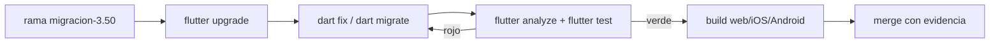
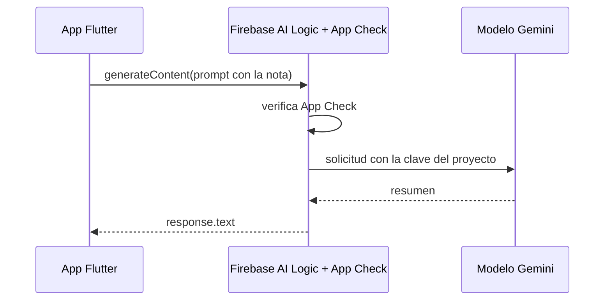

# Módulo 15: Flutter Master: calidad, arquitectura y despliegue

## Aprende construyendo


### Tema 1: flutter test y WidgetTester · Intermedio · 30 min

<details open>
<summary><strong>Capa 1 — Lectura</strong></summary>

#### ► DE QUÉ TRATA
Al finalizar vas a escribir un widget test con WidgetTester que confirme que ListaEnvios muestra "Sin envíos" cuando la lista está vacía, sin levantar un emulador. Prerrequisitos: Flutter estable y Dart; confirma flutter doctor.

#### ► LA IDEA EN UNA FRASE
**Al finalizar vas a escribir un widget test con WidgetTester que confirme que ListaEnvios muestra "Sin envíos" cuando la lista está vacía, sin levantar un emulador.**

#### ► POR QUÉ EXISTE ESTO
Resuelve un problema real de diseño o implementación y evita decisiones a ciegas.

#### ► LA ANALOGÍA
Piensa en flutter test y widgettester como una herramienta de taller: útil cuando conoces su propósito y sus límites.
**Dónde se rompe la analogía:** en software, los efectos dependen del contexto, la escala y los trade-offs.

#### ► CÓMO FUNCIONA
1. Identifica el problema que flutter test y widgettester resuelve.
2. Observa sus componentes y relaciones.
3. Aplica la opción más simple que funcione.
4. Verifica el resultado y los límites.

#### ► LO QUE PUEDE SALIR MAL
| Síntoma | Causa probable | Arreglo |
|---|---|---|
| flutter test y WidgetTester se aplica pero el resultado no mejora | Se usó sin medir el problema real | Mide antes y compara contra la alternativa simple |
| Aparece complejidad inesperada | Se adoptó la técnica sin comprender sus trade-offs | Vuelve a la sección de trade-offs y reduce el alcance |
| Falla en un caso límite | Se asumió un contexto que no se cumple | Prueba el caso límite y documenta cuándo NO usarlo |

#### ► TRADE-OFFS
| Opción | Cuándo usarla | Cuándo NO usarla |
|---|---|---|
| Usar flutter test y WidgetTester | Cuando el problema coincide con su propósito y el beneficio es observable | Cuando agrega complejidad sin resolver un problema real |
| Alternativa más simple | Cuando el contexto es pequeño, estable o fácil de razonar | Cuando ya demostró no escalar o no cumplir el requisito |
| Postergar la decisión | Cuando falta evidencia del problema | Cuando el costo de esperar es mayor que el costo de probar |

#### ► CUÁNDO NO USAR ESTO
No uses flutter test y widgettester por defecto. Aplícalo cuando el problema lo justifique y puedas verificar el beneficio; si una alternativa más simple resuelve igual, prefiérela.

#### ► DE VUELTA A LA ANALOGÍA
Volviendo a la analogía: flutter test y widgettester funciona como el modelo inicial, pero recuerda dónde se rompe: en producción importan la evidencia, la escala y el costo de equivocarte.

#### ► LO QUE DEBES RECORDAR
- flutter test y WidgetTester existe para resolver un problema específico.
- Mide antes de adoptar complejidad.
- Conoce el caso donde NO usarlo.
- Verifica con evidencia observable.

#### ► PREGUNTAS PARA PENSAR
1. ¿Qué problema concreto resuelve flutter test y widgettester en tu contexto?
2. ¿Cómo sabrías que flutter test y widgettester no está funcionando bien?
3. ¿Qué alternativa más simple considerarías antes de usar flutter test y widgettester?

</details>

<details>
<summary><strong>Capa 2 — Construcción</strong></summary>

#### Código y verificación
```bash
flutter create ejemplo_flutter_testing
cd ejemplo_flutter_testing
```

```dart
import 'package:flutter/material.dart';

class ListaEnvios extends StatelessWidget {
  final List<String> envios;
  const ListaEnvios({super.key, required this.envios});

  @override
  Widget build(BuildContext context) {
    if (envios.isEmpty) return const Center(child: Text('Sin envíos'));
    return ListView(
      children: envios.map((id) => ListTile(title: Text(id))).toList(),
    );
  }
}
```

```dart
import 'package:flutter/material.dart';
import 'package:flutter_test/flutter_test.dart';
import 'package:ejemplo_flutter_testing/buscador_envios.dart';

void main() {
  testWidgets('muestra "Sin envíos" cuando la lista está vacía', (tester) async {
    await tester.pumpWidget(const MaterialApp(home: ListaEnvios(envios: [])));
    expect(find.text('Sin envíos'), findsOneWidget);
  });
}
```

```bash
flutter test test/lista_envios_test.dart
```

</details>

### Tema 2: pumpAndSettle, golden e integration tests · Avanzado · 40 min

<details open>
<summary><strong>Capa 1 — Lectura</strong></summary>

#### ► DE QUÉ TRATA
Al finalizar vas a usar pumpAndSettle() para esperar a que una animación de carga termine antes de verificar el resultado, y vas a reproducir el fallo clásico de un test que verifica demasiado pronto. Prerrequisitos: Tema 1 de este módulo.

#### ► LA IDEA EN UNA FRASE
**Al finalizar vas a usar pumpAndSettle() para esperar a que una animación de carga termine antes de verificar el resultado, y vas a reproducir el fallo clásico de un test que verifica demasiado pronto.**

#### ► POR QUÉ EXISTE ESTO
Resuelve un problema real de diseño o implementación y evita decisiones a ciegas.

#### ► LA ANALOGÍA
Piensa en pumpandsettle, golden e integration tests como una herramienta de taller: útil cuando conoces su propósito y sus límites.
**Dónde se rompe la analogía:** en software, los efectos dependen del contexto, la escala y los trade-offs.

#### ► CÓMO FUNCIONA
1. Identifica el problema que pumpandsettle, golden e integration tests resuelve.
2. Observa sus componentes y relaciones.
3. Aplica la opción más simple que funcione.
4. Verifica el resultado y los límites.

#### ► LO QUE PUEDE SALIR MAL
| Síntoma | Causa probable | Arreglo |
|---|---|---|
| pumpAndSettle, golden e integration tests se aplica pero el resultado no mejora | Se usó sin medir el problema real | Mide antes y compara contra la alternativa simple |
| Aparece complejidad inesperada | Se adoptó la técnica sin comprender sus trade-offs | Vuelve a la sección de trade-offs y reduce el alcance |
| Falla en un caso límite | Se asumió un contexto que no se cumple | Prueba el caso límite y documenta cuándo NO usarlo |

#### ► TRADE-OFFS
| Opción | Cuándo usarla | Cuándo NO usarla |
|---|---|---|
| Usar pumpAndSettle, golden e integration tests | Cuando el problema coincide con su propósito y el beneficio es observable | Cuando agrega complejidad sin resolver un problema real |
| Alternativa más simple | Cuando el contexto es pequeño, estable o fácil de razonar | Cuando ya demostró no escalar o no cumplir el requisito |
| Postergar la decisión | Cuando falta evidencia del problema | Cuando el costo de esperar es mayor que el costo de probar |

#### ► CUÁNDO NO USAR ESTO
No uses pumpandsettle, golden e integration tests por defecto. Aplícalo cuando el problema lo justifique y puedas verificar el beneficio; si una alternativa más simple resuelve igual, prefiérela.

#### ► DE VUELTA A LA ANALOGÍA
Volviendo a la analogía: pumpandsettle, golden e integration tests funciona como el modelo inicial, pero recuerda dónde se rompe: en producción importan la evidencia, la escala y el costo de equivocarte.

#### ► LO QUE DEBES RECORDAR
- pumpAndSettle, golden e integration tests existe para resolver un problema específico.
- Mide antes de adoptar complejidad.
- Conoce el caso donde NO usarlo.
- Verifica con evidencia observable.

#### ► PREGUNTAS PARA PENSAR
1. ¿Qué problema concreto resuelve pumpandsettle, golden e integration tests en tu contexto?
2. ¿Cómo sabrías que pumpandsettle, golden e integration tests no está funcionando bien?
3. ¿Qué alternativa más simple considerarías antes de usar pumpandsettle, golden e integration tests?

</details>

<details>
<summary><strong>Capa 2 — Construcción</strong></summary>

#### Código y verificación
```bash
flutter create ejemplo_flutter_testing_async
cd ejemplo_flutter_testing_async
```

```dart
import 'package:flutter/material.dart';

class ListaEnvios extends StatelessWidget {
  final List<String> envios;
  const ListaEnvios({super.key, required this.envios});
  @override
  Widget build(BuildContext context) => envios.isEmpty
      ? const Center(child: Text('Sin envíos'))
      : ListView(children: envios.map((id) => Text(id)).toList());
}

class BuscadorEnvios extends StatefulWidget {
  final Future<String> Function(String guia) buscar;
  const BuscadorEnvios({super.key, required this.buscar});
  @override
  State<BuscadorEnvios> createState() => _BuscadorEnviosState();
}

class _BuscadorEnviosState extends State<BuscadorEnvios> {
  final controller = TextEditingController();
  bool cargando = false;
  String? resultado;
  String? error;

  Future<void> consultar() async {
    setState(() { cargando = true; resultado = null; error = null; });
    try {
      final valor = await widget.buscar(controller.text);
      if (!mounted) return;
      setState(() { resultado = valor; cargando = false; });
    } catch (_) {
      if (!mounted) return;
      setState(() { error = 'No se pudo cargar'; cargando = false; });
    }
  }

  @override
  Widget build(BuildContext context) => Scaffold(
    body: Column(children: [
      TextField(controller: controller),
      if (cargando)
        const CircularProgressIndicator()
      else
        IconButton(icon: const Icon(Icons.search), onPressed: consultar),
      if (resultado != null) Text(resultado!),
      if (error != null) Text(error!),
    ]),
  );

  @override
  void dispose() { controller.dispose(); super.dispose(); }
}
```

```dart
import 'dart:async';
import 'package:flutter/material.dart';
import 'package:flutter_test/flutter_test.dart';
import 'package:ejemplo_flutter_testing_async/buscador_envios.dart';
void main() {
  testWidgets('respuesta controlada después de mostrar carga', (tester) async {
    final respuesta = Completer<String>();
    await tester.pumpWidget(MaterialApp(home: BuscadorEnvios(buscar: (_) => respuesta.future)));
    await tester.enterText(find.byType(TextField), 'RF-4471');
    await tester.tap(find.byIcon(Icons.search));
    await tester.pump();
    expect(find.byType(CircularProgressIndicator), findsOneWidget);
    expect(find.text('Envío RF-4471'), findsNothing);
    respuesta.complete('Envío RF-4471');
    await tester.pump(); // Procesa el Future completado y el cambio de estado.
    await tester.pumpAndSettle(); // Ahora solo esperamos frames/animaciones pendientes.
    expect(find.byType(CircularProgressIndicator), findsNothing);
    expect(find.text('Envío RF-4471'), findsOneWidget);
  });
  testWidgets('error de consulta se muestra y permite reintentar', (tester) async {
    await tester.pumpWidget(MaterialApp(home: BuscadorEnvios(buscar: (_) async => throw StateError('sin red'))));
    await tester.tap(find.byIcon(Icons.search));
    await tester.pumpAndSettle();
    expect(find.text('No se pudo cargar'), findsOneWidget);
    expect(tester.widget<IconButton>(find.byType(IconButton)).onPressed, isNotNull);
  });
  testWidgets('lista vacía tiene texto visible', (tester) async {
    await tester.pumpWidget(const MaterialApp(home: ListaEnvios(envios: [])));
    expect(find.text('Sin envíos'), findsOneWidget);
  });
}
```

</details>

### Tema 3: Rendimiento, RepaintBoundary y Keys · Avanzado · 30 min

<details open>
<summary><strong>Capa 1 — Lectura</strong></summary>

#### ► DE QUÉ TRATA
Al finalizar vas a medir con DevTools cuántos widgets se repintan al actualizar un ítem de una lista de envíos, y vas a reducirlo con RepaintBoundary y una Key correcta. Prerrequisitos: Tema 2 de este módulo.

#### ► LA IDEA EN UNA FRASE
**Al finalizar vas a medir con DevTools cuántos widgets se repintan al actualizar un ítem de una lista de envíos, y vas a reducirlo con RepaintBoundary y una Key correcta.**

#### ► POR QUÉ EXISTE ESTO
Resuelve un problema real de diseño o implementación y evita decisiones a ciegas.

#### ► LA ANALOGÍA
Piensa en rendimiento, repaintboundary y keys como una herramienta de taller: útil cuando conoces su propósito y sus límites.
**Dónde se rompe la analogía:** en software, los efectos dependen del contexto, la escala y los trade-offs.

#### ► CÓMO FUNCIONA
1. Identifica el problema que rendimiento, repaintboundary y keys resuelve.
2. Observa sus componentes y relaciones.
3. Aplica la opción más simple que funcione.
4. Verifica el resultado y los límites.

#### ► LO QUE PUEDE SALIR MAL
| Síntoma | Causa probable | Arreglo |
|---|---|---|
| Rendimiento, RepaintBoundary y Keys se aplica pero el resultado no mejora | Se usó sin medir el problema real | Mide antes y compara contra la alternativa simple |
| Aparece complejidad inesperada | Se adoptó la técnica sin comprender sus trade-offs | Vuelve a la sección de trade-offs y reduce el alcance |
| Falla en un caso límite | Se asumió un contexto que no se cumple | Prueba el caso límite y documenta cuándo NO usarlo |

#### ► TRADE-OFFS
| Opción | Cuándo usarla | Cuándo NO usarla |
|---|---|---|
| Usar Rendimiento, RepaintBoundary y Keys | Cuando el problema coincide con su propósito y el beneficio es observable | Cuando agrega complejidad sin resolver un problema real |
| Alternativa más simple | Cuando el contexto es pequeño, estable o fácil de razonar | Cuando ya demostró no escalar o no cumplir el requisito |
| Postergar la decisión | Cuando falta evidencia del problema | Cuando el costo de esperar es mayor que el costo de probar |

#### ► CUÁNDO NO USAR ESTO
No uses rendimiento, repaintboundary y keys por defecto. Aplícalo cuando el problema lo justifique y puedas verificar el beneficio; si una alternativa más simple resuelve igual, prefiérela.

#### ► DE VUELTA A LA ANALOGÍA
Volviendo a la analogía: rendimiento, repaintboundary y keys funciona como el modelo inicial, pero recuerda dónde se rompe: en producción importan la evidencia, la escala y el costo de equivocarte.

#### ► LO QUE DEBES RECORDAR
- Rendimiento, RepaintBoundary y Keys existe para resolver un problema específico.
- Mide antes de adoptar complejidad.
- Conoce el caso donde NO usarlo.
- Verifica con evidencia observable.

#### ► PREGUNTAS PARA PENSAR
1. ¿Qué problema concreto resuelve rendimiento, repaintboundary y keys en tu contexto?
2. ¿Cómo sabrías que rendimiento, repaintboundary y keys no está funcionando bien?
3. ¿Qué alternativa más simple considerarías antes de usar rendimiento, repaintboundary y keys?

</details>

<details>
<summary><strong>Capa 2 — Construcción</strong></summary>

#### Código y verificación
```dart
import 'package:flutter/material.dart';

void main() => runApp(const MaterialApp(home: ListaEnvios()));

class Envio {
  const Envio(this.id);
  final String id;
}

class ListaEnvios extends StatefulWidget {
  const ListaEnvios({super.key});

  @override
  State<ListaEnvios> createState() => _ListaEnviosState();
}

class _ListaEnviosState extends State<ListaEnvios> {
  final envios = [for (var i = 1; i <= 50; i++) Envio('RF-${4400 + i}')];

  // Los entregados pasan al final: la lista se reordena.
  void marcar(Envio envio) => setState(() => envios..remove(envio)..add(envio));

  @override
  Widget build(BuildContext context) => Scaffold(
        appBar: AppBar(title: const Text('Envíos')),
        body: ListView(children: [
          for (final envio in envios)
            RepaintBoundary(
              key: ValueKey(envio.id),
              child: TarjetaEnvio(envio: envio, onEntregado: () => marcar(envio)),
            ),
        ]),
      );
}

class TarjetaEnvio extends StatefulWidget {
  const TarjetaEnvio({required this.envio, required this.onEntregado, super.key});
  final Envio envio;
  final VoidCallback onEntregado;

  @override
  State<TarjetaEnvio> createState() => _TarjetaEnvioState();
}

class _TarjetaEnvioState extends State<TarjetaEnvio> {
  bool entregado = false; // estado visual propio de la fila

  @override
  Widget build(BuildContext context) => CheckboxListTile(
        title: Text(widget.envio.id),
        value: entregado,
        onChanged: entregado
            ? null
            : (_) {
                setState(() => entregado = true);
                widget.onEntregado();
              },
      );
}
```

```bash
flutter create demo_flutter
cd demo_flutter
flutter run --profile
```

</details>

### Tema 4: Clean Architecture · Avanzado · 35 min

<details open>
<summary><strong>Capa 1 — Lectura</strong></summary>

#### ► DE QUÉ TRATA
Al finalizar vas a estructurar el dominio de envíos en capas (domain, application, data) con dependencias que solo apuntan hacia adentro, y vas a reproducir el error de que domain dependa de un detalle de infraestructura. Prerrequisitos: Tema 3 de este módulo.

#### ► LA IDEA EN UNA FRASE
**Al finalizar vas a estructurar el dominio de envíos en capas (domain, application, data) con dependencias que solo apuntan hacia adentro, y vas a reproducir el error de que domain dependa de un detalle de infraestructura.**

#### ► POR QUÉ EXISTE ESTO
Resuelve un problema real de diseño o implementación y evita decisiones a ciegas.

#### ► LA ANALOGÍA
Piensa en clean architecture como una herramienta de taller: útil cuando conoces su propósito y sus límites.
**Dónde se rompe la analogía:** en software, los efectos dependen del contexto, la escala y los trade-offs.

#### ► CÓMO FUNCIONA
1. Identifica el problema que clean architecture resuelve.
2. Observa sus componentes y relaciones.
3. Aplica la opción más simple que funcione.
4. Verifica el resultado y los límites.

#### ► LO QUE PUEDE SALIR MAL
| Síntoma | Causa probable | Arreglo |
|---|---|---|
| Clean Architecture se aplica pero el resultado no mejora | Se usó sin medir el problema real | Mide antes y compara contra la alternativa simple |
| Aparece complejidad inesperada | Se adoptó la técnica sin comprender sus trade-offs | Vuelve a la sección de trade-offs y reduce el alcance |
| Falla en un caso límite | Se asumió un contexto que no se cumple | Prueba el caso límite y documenta cuándo NO usarlo |

#### ► TRADE-OFFS
| Opción | Cuándo usarla | Cuándo NO usarla |
|---|---|---|
| Usar Clean Architecture | Cuando el problema coincide con su propósito y el beneficio es observable | Cuando agrega complejidad sin resolver un problema real |
| Alternativa más simple | Cuando el contexto es pequeño, estable o fácil de razonar | Cuando ya demostró no escalar o no cumplir el requisito |
| Postergar la decisión | Cuando falta evidencia del problema | Cuando el costo de esperar es mayor que el costo de probar |

#### ► CUÁNDO NO USAR ESTO
No uses clean architecture por defecto. Aplícalo cuando el problema lo justifique y puedas verificar el beneficio; si una alternativa más simple resuelve igual, prefiérela.

#### ► DE VUELTA A LA ANALOGÍA
Volviendo a la analogía: clean architecture funciona como el modelo inicial, pero recuerda dónde se rompe: en producción importan la evidencia, la escala y el costo de equivocarte.

#### ► LO QUE DEBES RECORDAR
- Clean Architecture existe para resolver un problema específico.
- Mide antes de adoptar complejidad.
- Conoce el caso donde NO usarlo.
- Verifica con evidencia observable.

#### ► PREGUNTAS PARA PENSAR
1. ¿Qué problema concreto resuelve clean architecture en tu contexto?
2. ¿Cómo sabrías que clean architecture no está funcionando bien?
3. ¿Qué alternativa más simple considerarías antes de usar clean architecture?

</details>

<details>
<summary><strong>Capa 2 — Construcción</strong></summary>

#### Código y verificación
```bash
flutter create ejemplo
```

```dart
// lib/domain/envio.dart — SIN ningún import de Dio, http, ni UI
class Envio { final String id; final String estado; Envio(this.id, this.estado); }
abstract class EnvioRepository { Future<Envio> obtener(String id); }
```

```dart
// lib/application/marcar_entregado.dart
import '../domain/envio.dart';

class MarcarEntregadoUseCase {
  final EnvioRepository repo;
  MarcarEntregadoUseCase(this.repo);
}
```

```bash
flutter test
```

</details>

### Tema 5: Internacionalización completa · Avanzado · 40 min

<details open>
<summary><strong>Capa 1 — Lectura</strong></summary>

#### ► DE QUÉ TRATA
Al finalizar vas a traducir la pantalla de estado de un envío al español y al inglés con archivos .arb, y vas a reproducir el error de una clave de traducción faltante en un idioma. Prerrequisitos: Tema 4 de este módulo.

#### ► LA IDEA EN UNA FRASE
**Al finalizar vas a traducir la pantalla de estado de un envío al español y al inglés con archivos .arb, y vas a reproducir el error de una clave de traducción faltante en un idioma.**

#### ► POR QUÉ EXISTE ESTO
Resuelve un problema real de diseño o implementación y evita decisiones a ciegas.

#### ► LA ANALOGÍA
Piensa en internacionalización completa como una herramienta de taller: útil cuando conoces su propósito y sus límites.
**Dónde se rompe la analogía:** en software, los efectos dependen del contexto, la escala y los trade-offs.

#### ► CÓMO FUNCIONA
1. Identifica el problema que internacionalización completa resuelve.
2. Observa sus componentes y relaciones.
3. Aplica la opción más simple que funcione.
4. Verifica el resultado y los límites.

#### ► LO QUE PUEDE SALIR MAL
| Síntoma | Causa probable | Arreglo |
|---|---|---|
| Internacionalización completa se aplica pero el resultado no mejora | Se usó sin medir el problema real | Mide antes y compara contra la alternativa simple |
| Aparece complejidad inesperada | Se adoptó la técnica sin comprender sus trade-offs | Vuelve a la sección de trade-offs y reduce el alcance |
| Falla en un caso límite | Se asumió un contexto que no se cumple | Prueba el caso límite y documenta cuándo NO usarlo |

#### ► TRADE-OFFS
| Opción | Cuándo usarla | Cuándo NO usarla |
|---|---|---|
| Usar Internacionalización completa | Cuando el problema coincide con su propósito y el beneficio es observable | Cuando agrega complejidad sin resolver un problema real |
| Alternativa más simple | Cuando el contexto es pequeño, estable o fácil de razonar | Cuando ya demostró no escalar o no cumplir el requisito |
| Postergar la decisión | Cuando falta evidencia del problema | Cuando el costo de esperar es mayor que el costo de probar |

#### ► CUÁNDO NO USAR ESTO
No uses internacionalización completa por defecto. Aplícalo cuando el problema lo justifique y puedas verificar el beneficio; si una alternativa más simple resuelve igual, prefiérela.

#### ► DE VUELTA A LA ANALOGÍA
Volviendo a la analogía: internacionalización completa funciona como el modelo inicial, pero recuerda dónde se rompe: en producción importan la evidencia, la escala y el costo de equivocarte.

#### ► LO QUE DEBES RECORDAR
- Internacionalización completa existe para resolver un problema específico.
- Mide antes de adoptar complejidad.
- Conoce el caso donde NO usarlo.
- Verifica con evidencia observable.

#### ► PREGUNTAS PARA PENSAR
1. ¿Qué problema concreto resuelve internacionalización completa en tu contexto?
2. ¿Cómo sabrías que internacionalización completa no está funcionando bien?
3. ¿Qué alternativa más simple considerarías antes de usar internacionalización completa?

</details>

<details>
<summary><strong>Capa 2 — Construcción</strong></summary>

#### Código y verificación
```bash
flutter create ejemplo_flutter_l10n
cd ejemplo_flutter_l10n
flutter pub add flutter_localizations --sdk=flutter
flutter pub add intl
```

```yaml
arb-dir: lib/l10n
template-arb-file: app_es.arb
output-localization-file: app_localizations.dart
output-class: AppLocalizations
```

```json
{ "estadoEnRuta": "En ruta" }
```

```json
{ "estadoEnRuta": "In transit" }
```

```dart
import 'package:flutter/material.dart';
import 'package:ejemplo_flutter_l10n/l10n/app_localizations.dart';

void main() => runApp(const App());
class App extends StatelessWidget {
  const App({super.key});
  @override
  Widget build(BuildContext context) => MaterialApp(
    localizationsDelegates: AppLocalizations.localizationsDelegates,
    supportedLocales: AppLocalizations.supportedLocales,
    home: Builder(builder: (context) => Scaffold(
      body: Center(child: Text(AppLocalizations.of(context)!.estadoEnRuta)),
    )),
  );
}
```

```dart
import 'package:flutter/material.dart';
import 'package:flutter_test/flutter_test.dart';
import 'package:ejemplo_flutter_l10n/l10n/app_localizations.dart';

Future<void> probarIdioma(WidgetTester tester, Locale locale, String texto) async {
  await tester.pumpWidget(MaterialApp(
    locale: locale,
    localizationsDelegates: AppLocalizations.localizationsDelegates,
    supportedLocales: AppLocalizations.supportedLocales,
    home: Builder(builder: (context) =>
      Text(AppLocalizations.of(context)!.estadoEnRuta)),
  ));
  expect(find.text(texto), findsOneWidget);
}
void main() {
  testWidgets('español', (tester) => probarIdioma(tester, const Locale('es'), 'En ruta'));
  testWidgets('inglés', (tester) => probarIdioma(tester, const Locale('en'), 'In transit'));
}
```

</details>

### Tema 6: Builds, firma y despliegue · Avanzado · 40 min

<details open>
<summary><strong>Capa 1 — Lectura</strong></summary>

#### ► DE QUÉ TRATA
Al finalizar generarás y verificarás un APK de laboratorio firmado explícitamente. Prerrequisitos: proyecto Flutter Android, JDK con keytool y Android SDK Build Tools con apksigner en PATH; confirma flutter doctor y apksigner version. No necesitas publicar nada en una tienda para…

#### ► LA IDEA EN UNA FRASE
**Al finalizar generarás y verificarás un APK de laboratorio firmado explícitamente.**

#### ► POR QUÉ EXISTE ESTO
Resuelve un problema real de diseño o implementación y evita decisiones a ciegas.

#### ► LA ANALOGÍA
Piensa en builds, firma y despliegue como una herramienta de taller: útil cuando conoces su propósito y sus límites.
**Dónde se rompe la analogía:** en software, los efectos dependen del contexto, la escala y los trade-offs.

#### ► CÓMO FUNCIONA
1. Identifica el problema que builds, firma y despliegue resuelve.
2. Observa sus componentes y relaciones.
3. Aplica la opción más simple que funcione.
4. Verifica el resultado y los límites.

#### ► LO QUE PUEDE SALIR MAL
| Síntoma | Causa probable | Arreglo |
|---|---|---|
| Builds, firma y despliegue se aplica pero el resultado no mejora | Se usó sin medir el problema real | Mide antes y compara contra la alternativa simple |
| Aparece complejidad inesperada | Se adoptó la técnica sin comprender sus trade-offs | Vuelve a la sección de trade-offs y reduce el alcance |
| Falla en un caso límite | Se asumió un contexto que no se cumple | Prueba el caso límite y documenta cuándo NO usarlo |

#### ► TRADE-OFFS
| Opción | Cuándo usarla | Cuándo NO usarla |
|---|---|---|
| Usar Builds, firma y despliegue | Cuando el problema coincide con su propósito y el beneficio es observable | Cuando agrega complejidad sin resolver un problema real |
| Alternativa más simple | Cuando el contexto es pequeño, estable o fácil de razonar | Cuando ya demostró no escalar o no cumplir el requisito |
| Postergar la decisión | Cuando falta evidencia del problema | Cuando el costo de esperar es mayor que el costo de probar |

#### ► CUÁNDO NO USAR ESTO
No uses builds, firma y despliegue por defecto. Aplícalo cuando el problema lo justifique y puedas verificar el beneficio; si una alternativa más simple resuelve igual, prefiérela.

#### ► DE VUELTA A LA ANALOGÍA
Volviendo a la analogía: builds, firma y despliegue funciona como el modelo inicial, pero recuerda dónde se rompe: en producción importan la evidencia, la escala y el costo de equivocarte.

#### ► LO QUE DEBES RECORDAR
- Builds, firma y despliegue existe para resolver un problema específico.
- Mide antes de adoptar complejidad.
- Conoce el caso donde NO usarlo.
- Verifica con evidencia observable.

#### ► PREGUNTAS PARA PENSAR
1. ¿Qué problema concreto resuelve builds, firma y despliegue en tu contexto?
2. ¿Cómo sabrías que builds, firma y despliegue no está funcionando bien?
3. ¿Qué alternativa más simple considerarías antes de usar builds, firma y despliegue?

</details>

<details>
<summary><strong>Capa 2 — Construcción</strong></summary>

#### Código y verificación
```bash
flutter create ejemplo
```

```bash
keytool -genkeypair -keystore "$HOME/rutaflow-upload-lab.jks" \
  -storetype JKS -alias rutaflow-lab -keyalg RSA -keysize 2048 -validity 10000
```

```properties
storeFile=/ruta/absoluta/rutaflow-upload-lab.jks
storePassword=REEMPLAZAR_LOCALMENTE
keyAlias=rutaflow-lab
keyPassword=REEMPLAZAR_LOCALMENTE
```

```kotlin
import java.util.Properties

// Después del bloque plugins existente:
val signingProperties = Properties().apply {
    rootProject.file("key.properties").inputStream().use { load(it) }
}
```

```kotlin
signingConfigs {
    create("release") {
        storeFile = file(requireNotNull(signingProperties.getProperty("storeFile")))
        storePassword = requireNotNull(signingProperties.getProperty("storePassword"))
        keyAlias = requireNotNull(signingProperties.getProperty("keyAlias"))
        keyPassword = requireNotNull(signingProperties.getProperty("keyPassword"))
    }
}
buildTypes {
    release {
        signingConfig = signingConfigs.getByName("release")
    }
}
```

```bash
flutter build apk --release
apksigner verify --verbose --print-certs build/app/outputs/flutter-apk/app-release.apk
keytool -list -v -keystore "$HOME/rutaflow-upload-lab.jks" -alias rutaflow-lab
```

</details>

### Tema 7: Migrar una app a Flutter 3.50 y Dart 3.14 sin romper la entrega · Avanzado · 45 min

<details open>
<summary><strong>Capa 1 — Lectura</strong></summary>

#### ► DE QUÉ TRATA
Al finalizar vas a actualizar la app de entregas a Flutter 3.50 (estable desde el 11 de noviembre de 2026, junto con Dart 3.14), aplicar las migraciones automáticas y comprobar con evidencia que no se rompió nada. Prerrequisitos: el Tema 1 de este módulo (pruebas con flutter test…

#### ► LA IDEA EN UNA FRASE
**Al finalizar vas a actualizar la app de entregas a Flutter 3.50 (estable desde el 11 de noviembre de 2026, junto con Dart 3.14), aplicar las migraciones automáticas y comprobar con evidencia que no se rompió nada.**

#### ► POR QUÉ EXISTE ESTO
Resuelve un problema real de diseño o implementación y evita decisiones a ciegas.

#### ► LA ANALOGÍA
Piensa en migrar una app a flutter 3.50 y dart 3.14 sin romper la entrega como una herramienta de taller: útil cuando conoces su propósito y sus límites.
**Dónde se rompe la analogía:** en software, los efectos dependen del contexto, la escala y los trade-offs.

#### ► CÓMO FUNCIONA


#### ► LO QUE PUEDE SALIR MAL
| Síntoma | Causa probable | Arreglo |
|---|---|---|
| Migrar una app a Flutter 3.50 y Dart 3.14 sin romper la entrega se aplica pero el resultado no mejora | Se usó sin medir el problema real | Mide antes y compara contra la alternativa simple |
| Aparece complejidad inesperada | Se adoptó la técnica sin comprender sus trade-offs | Vuelve a la sección de trade-offs y reduce el alcance |
| Falla en un caso límite | Se asumió un contexto que no se cumple | Prueba el caso límite y documenta cuándo NO usarlo |

#### ► TRADE-OFFS
| Opción | Cuándo usarla | Cuándo NO usarla |
|---|---|---|
| Usar Migrar una app a Flutter 3.50 y Dart 3.14 sin romper la entrega | Cuando el problema coincide con su propósito y el beneficio es observable | Cuando agrega complejidad sin resolver un problema real |
| Alternativa más simple | Cuando el contexto es pequeño, estable o fácil de razonar | Cuando ya demostró no escalar o no cumplir el requisito |
| Postergar la decisión | Cuando falta evidencia del problema | Cuando el costo de esperar es mayor que el costo de probar |

#### ► CUÁNDO NO USAR ESTO
No uses migrar una app a flutter 3.50 y dart 3.14 sin romper la entrega por defecto. Aplícalo cuando el problema lo justifique y puedas verificar el beneficio; si una alternativa más simple resuelve igual, prefiérela.

#### ► DE VUELTA A LA ANALOGÍA
Volviendo a la analogía: migrar una app a flutter 3.50 y dart 3.14 sin romper la entrega funciona como el modelo inicial, pero recuerda dónde se rompe: en producción importan la evidencia, la escala y el costo de equivocarte.

#### ► LO QUE DEBES RECORDAR
- Migrar una app a Flutter 3.50 y Dart 3.14 sin romper la entrega existe para resolver un problema específico.
- Mide antes de adoptar complejidad.
- Conoce el caso donde NO usarlo.
- Verifica con evidencia observable.

#### ► PREGUNTAS PARA PENSAR
1. ¿Qué problema concreto resuelve migrar una app a flutter 3.50 y dart 3.14 sin romper la entrega en tu contexto?
2. ¿Cómo sabrías que migrar una app a flutter 3.50 y dart 3.14 sin romper la entrega no está funcionando bien?
3. ¿Qué alternativa más simple considerarías antes de usar migrar una app a flutter 3.50 y dart 3.14 sin romper la entrega?

</details>

<details>
<summary><strong>Capa 2 — Construcción</strong></summary>

#### Código y verificación


```bash
git switch -c migracion-3.50
flutter upgrade
flutter --version
flutter test > evidencia-antes.txt || true
dart migrate --dry-run
dart fix --apply --code=migrate_design_widgets
flutter pub add material_ui   # si dart fix no lo agregó a pubspec.yaml (y cupertino_ui si usas Cupertino)
git diff --stat
flutter analyze
flutter test
flutter build web --no-deprecated-js-interop
```

```javascript
_flutter.loader.load({
  config: {
    wasmAllowList: {
      blink: true,   // Chrome y Edge (ya era el valor por defecto)
      webkit: true,  // Safari 26.2+, opcional desde 3.50
      gecko: true,   // Firefox 147+, opcional desde 3.50
    },
  },
});
```

```bash
flutter build web --wasm
```

</details>

### Tema 8: Integrar IA generativa en una app Flutter con Firebase AI Logic · Avanzado · 40 min

<details open>
<summary><strong>Capa 1 — Lectura</strong></summary>

#### ► DE QUÉ TRATA
Al finalizar vas a agregar a la app de entregas un asistente que resume las novedades de un envío con un modelo Gemini, usando el plugin oficial firebase_ai, y a proteger su uso. Prerrequisitos: Tema 7 de este módulo (app en Flutter 3.50), un proyecto de Firebase y el CLI flutter…

#### ► LA IDEA EN UNA FRASE
**Al finalizar vas a agregar a la app de entregas un asistente que resume las novedades de un envío con un modelo Gemini, usando el plugin oficial firebase_ai, y a proteger su uso.**

#### ► POR QUÉ EXISTE ESTO
Resuelve un problema real de diseño o implementación y evita decisiones a ciegas.

#### ► LA ANALOGÍA
Piensa en integrar ia generativa en una app flutter con firebase ai logic como una herramienta de taller: útil cuando conoces su propósito y sus límites.
**Dónde se rompe la analogía:** en software, los efectos dependen del contexto, la escala y los trade-offs.

#### ► CÓMO FUNCIONA


#### ► LO QUE PUEDE SALIR MAL
| Síntoma | Causa probable | Arreglo |
|---|---|---|
| Integrar IA generativa en una app Flutter con Firebase AI Logic se aplica pero el resultado no mejora | Se usó sin medir el problema real | Mide antes y compara contra la alternativa simple |
| Aparece complejidad inesperada | Se adoptó la técnica sin comprender sus trade-offs | Vuelve a la sección de trade-offs y reduce el alcance |
| Falla en un caso límite | Se asumió un contexto que no se cumple | Prueba el caso límite y documenta cuándo NO usarlo |

#### ► TRADE-OFFS
| Opción | Cuándo usarla | Cuándo NO usarla |
|---|---|---|
| Usar Integrar IA generativa en una app Flutter con Firebase AI Logic | Cuando el problema coincide con su propósito y el beneficio es observable | Cuando agrega complejidad sin resolver un problema real |
| Alternativa más simple | Cuando el contexto es pequeño, estable o fácil de razonar | Cuando ya demostró no escalar o no cumplir el requisito |
| Postergar la decisión | Cuando falta evidencia del problema | Cuando el costo de esperar es mayor que el costo de probar |

#### ► CUÁNDO NO USAR ESTO
No uses integrar ia generativa en una app flutter con firebase ai logic por defecto. Aplícalo cuando el problema lo justifique y puedas verificar el beneficio; si una alternativa más simple resuelve igual, prefiérela.

#### ► DE VUELTA A LA ANALOGÍA
Volviendo a la analogía: integrar ia generativa en una app flutter con firebase ai logic funciona como el modelo inicial, pero recuerda dónde se rompe: en producción importan la evidencia, la escala y el costo de equivocarte.

#### ► LO QUE DEBES RECORDAR
- Integrar IA generativa en una app Flutter con Firebase AI Logic existe para resolver un problema específico.
- Mide antes de adoptar complejidad.
- Conoce el caso donde NO usarlo.
- Verifica con evidencia observable.

#### ► PREGUNTAS PARA PENSAR
1. ¿Qué problema concreto resuelve integrar ia generativa en una app flutter con firebase ai logic en tu contexto?
2. ¿Cómo sabrías que integrar ia generativa en una app flutter con firebase ai logic no está funcionando bien?
3. ¿Qué alternativa más simple considerarías antes de usar integrar ia generativa en una app flutter con firebase ai logic?

</details>

<details>
<summary><strong>Capa 2 — Construcción</strong></summary>

#### Código y verificación


```bash
flutter pub add firebase_core firebase_ai
flutterfire configure
```

```dart
import 'package:firebase_core/firebase_core.dart';
import 'package:flutter/material.dart';
import 'firebase_options.dart'; // generado por flutterfire configure

Future<void> main() async {
  WidgetsFlutterBinding.ensureInitialized();
  await Firebase.initializeApp(options: DefaultFirebaseOptions.currentPlatform);
  runApp(const App());
}

class App extends StatelessWidget {
  const App({super.key});

  @override
  Widget build(BuildContext context) =>
      const MaterialApp(home: Scaffold(body: Center(child: Text('RutaFlow'))));
}
```

```dart
import 'package:firebase_ai/firebase_ai.dart';

class ResumidorNotas {
  // El nombre del modelo cambia con el tiempo: tómalo de la consola de Firebase AI Logic.
  ResumidorNotas({String modelo = 'gemini-2.5-flash'})
      : _model = FirebaseAI.googleAI().generativeModel(model: modelo);

  final GenerativeModel _model;

  Future<String> resumir(String nota) async {
    if (nota.trim().isEmpty) {
      throw ArgumentError('La nota está vacía'); // no gastes una llamada en nada
    }
    final respuesta = await _model.generateContent([
      Content.text('Resume en una línea, para un conductor, esta nota de entrega: $nota'),
    ]);
    // El modelo puede no devolver texto (por ejemplo, si bloquea el contenido).
    return respuesta.text ?? 'Sin resumen: revisa la nota completa';
  }
}
```

</details>
