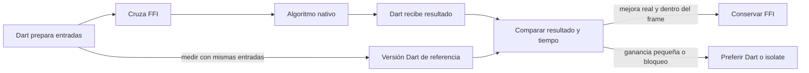

# Módulo 16: Flutter FFI: conectar Dart con código nativo

## Aprende construyendo

Este módulo crea una pequeña biblioteca nativa para calcular el costo de una ruta y la llama desde Dart. Trabajarás primero con C porque Dart FFI enlaza directamente con interfaces C; luego revisarás Rust detrás de una ABI C. **FFI no está disponible en Flutter Web**: allí corresponde usar interoperabilidad con JavaScript/Wasm. Desde Flutter 3.38, el punto de partida recomendado para un paquete FFI nuevo es `flutter create --template=package_ffi` con build hooks. Usa la plantilla antigua `plugin_ffi` solo si necesitas Flutter Plugin API, enlazado estático u otro caso específico que documenta Flutter.

---

### Tema 1: reconocer cuándo usar FFI y crear el paquete

#### Paso 1 · Objetivo y preparación
Al finalizar tendrás una biblioteca `native_add` que Dart puede importar y una primera función nativa comprobable. **Prerrequisitos:** Flutter, Dart (`flutter doctor`, `dart --version`) y un compilador C para tu plataforma. **Ejemplo independiente en proyecto nuevo:** crea el paquete desde una carpeta vacía:

```bash
flutter create --template=package_ffi native_add
cd native_add
flutter test
```

#### Paso 2 · Contexto y caso real
RutaFlow ya calcula distancias con Dart. El proveedor de mapas entrega una biblioteca C optimizada para calcular una matriz de costos. Un plugin existente es la primera opción; si no cubre la función y existe una API C, FFI permite llamarla sin convertir cada dato en mensajes de plataforma.

#### Paso 3 · Teoría, modelo mental, analogía y decisión
FFI conecta una función de Dart con una función exportada por una biblioteca nativa. **La analogía del enchufe:** nombre exportado, tipos, orden, memoria y errores deben coincidir en ambos lados. Usa plugin o `MethodChannel` para APIs propias de Android/iOS; usa FFI para una biblioteca C compartible o una API nativa de bajo nivel. FFI no hace que una biblioteca exclusiva de una plataforma funcione mágicamente en las demás y no está disponible en Flutter Web.

La plantilla genera `src/native_add.c`, `src/native_add.h`, `hook/build.dart`, `ffigen.yaml` y bindings Dart. Los build hooks compilan y empaquetan el código nativo. Así evitamos copiar una receta vieja de CMake/Gradle como si fuera el flujo recomendado actual.

#### Paso 4 · Demostración guiada
Inspecciona `src/native_add.h` y `src/native_add.c`, y comprueba que `lib/native_add.dart` expone el binding generado. Guarda este test en `test/native_add_test.dart`:

```dart
import 'package:test/test.dart';
import 'package:native_add/native_add.dart';

void main() {
  test('la suma nativa devuelve 42', () {
    expect(sum(24, 18), 42);
  });
}
```

Desde la raíz de `native_add/` ejecuta:

```bash
dart pub get
dart test
```

**Resultado esperado:** el test devuelve `42` y el build hook compiló el código nativo. Explica parte por parte cómo la plantilla conecta header, build hook y test. **Qué observar:** El nombre del test y la firma real varían con la versión de la plantilla; usa los archivos generados como fuente de verdad antes de copiar una firma.

#### Paso 5 · Práctica guiada
**Pista:** el nombre del símbolo debe ser idéntico en header, implementación y binding. **Fallo deliberado:** cambia el nombre exportado y no regeneres; el test produce un error de símbolo. Diagnostica el error y restaura el nombre; el test debe pasar otra vez. Comprueba que el binding generado corresponde al header, no a una función con un nombre parecido.

#### Paso 6 · Práctica independiente
Crea `src/route_cost.h` con `double route_cost(double km, double rate);` y `src/route_cost.c` con `double route_cost(double km, double rate) { return km * rate; }`. Enlázalos con `hook/build.dart` y expón `costForRoute` en Dart. Prueba 12.5 km a 2.0 por kilómetro. Escribe también un caso para distancia cero y define cómo se rechazan valores negativos.

#### Paso 7 · Cierre y evidencia
Errores comunes: elegir FFI solo por velocidad, confundir una llamada C con un plugin y suponer que funciona en Web.
Entrega la estructura del paquete, el test que obtiene `42`, el error por símbolo incorrecto y tu función de tarifa. Explica cuándo preferirías un plugin o un canal de plataforma. **Proyecto integrador RutaFlow:** la biblioteca solo calcula; Dart valida los datos y muestra el precio en `lib/native_add.dart`. Siguiente tema: generar bindings tipados desde el header. Fuentes oficiales: [Flutter: enlazar código nativo](https://docs.flutter.dev/platform-integration/bind-native-code) y [desarrollo de paquetes FFI](https://docs.flutter.dev/packages-and-plugins/developing-packages#developing-ffi-packages).

**¿Por qué es importante?** Elegir la frontera correcta evita cargar código nativo cuando un paquete existente ya resuelve la necesidad.
**Evidencia:** paquete creado, test verde, símbolo roto reproducido y comparación razonada entre plugin, canal y FFI.

---

### Tema 2: generar bindings C seguros para Dart

#### Paso 1 · Objetivo y preparación
Al finalizar llamarás una función C con argumentos y retorno tipados mediante bindings generados. **Prerrequisitos:** Tema 1, Dart FFI y un header C. **Ejemplo independiente:** en una carpeta vacía ejecuta `flutter create --template=package_ffi ffi_bindings_lab`; trabaja en `src/route_cost.h` dentro de ese paquete. Revisa `src/native_add.h` y `ffigen.yaml` antes de editar. Ejecuta `dart run ffigen --config ffigen.yaml` si la plantilla dejó la generación lista.

#### Paso 2 · Contexto y caso real
Escribir a mano decenas de declaraciones FFI a partir de un SDK de mapas es propenso a errores: un `int` con anchura incorrecta puede compilar y corromper el resultado. `ffigen` lee headers C y genera declaraciones de bindings para reducir ese trabajo repetitivo.

#### Paso 3 · Teoría, modelo mental, analogía y ejemplo
La firma debe coincidir a ambos lados. Un `int32_t` de C se enlaza con `Int32` en la firma nativa y `int` en Dart; un `double` con `Double` y `double`. Los typedefs generados separan la forma que entiende C de la forma cómoda en Dart. No traduzcas tipos “por intuición”: confirma el header y la tabla oficial de tipos.

```c
// src/route_cost.h
#include <stdint.h>
int32_t route_zone(int32_t kilometers);
```

El binding equivalente usa una firma nativa `Int32 Function(Int32)` y una firma Dart `int Function(int)`. En el facade público valida el argumento antes de llamar la función generada.

#### Paso 4 · Demostración guiada
Crea `src/route_cost.h` con `int32_t route_zone(int32_t kilometers);` y `src/route_cost.c` con esta implementación:

```c
#include "route_cost.h"

int32_t route_zone(int32_t kilometers) {
  return kilometers <= 10 ? 0 : 1;
}
```

En `hook/build.dart`, agrega `src/route_cost.c` al arreglo `sources` de `CBuilder.library`. En `ffigen.yaml`, incluye `src/route_cost.h` en `headers.entry-points`; regenera los bindings. En `lib/native_add.dart`, expón `zoneFor(int kilometers)` sobre el binding y valida que kilómetros no sea negativo. En `test/native_add_test.dart`, comprueba las entradas 10 y 11.

```bash
dart run ffigen --config ffigen.yaml
dart format lib test
dart test
```

**Resultado esperado:** se regeneran los bindings y el test asigna zona 0 hasta 10 y zona 1 desde 11. Explica línea por línea cómo el header determina los tipos Dart. **Qué observar:** Si la plantilla usa una anotación `@Native` en vez de lookup manual, conserva su mecanismo: no mezcles a ciegas ambos estilos.

#### Paso 5 · Práctica guiada
**Pista:** compara primero la anchura y signo de cada tipo. **Fallo deliberado:** declara `uint32_t` en el header pero conserva la lógica como si aceptara negativos. Pasa `-1` desde Dart. La conversión ya no expresa la misma regla de negocio. Decide y documenta si el parámetro debe ser sin signo o si corresponde validar un entero con signo antes de convertir.

#### Paso 6 · Práctica independiente
Agrega `double route_total(double km, double price_per_km)` al header, implementación, configuración de generación y fachada Dart. Añade pruebas para un valor normal, cero y una entrada inválida. Ejecuta el generador después de cambiar el header y revisa el diff para asegurarte de que no editaste a mano el archivo generado.

#### Paso 7 · Cierre y evidencia
Errores comunes: editar el archivo generado a mano, desalinear signed/unsigned o cambiar el header sin regenerar.
Entrega header, implementación, configuración, binding regenerado y pruebas de los límites. Explica con tus palabras por qué se mantienen separadas la firma C, la firma Dart y la API pública. **Proyecto integrador RutaFlow:** llama `route_zone` desde la fachada `lib/native_add.dart` y valida el parámetro antes de cruzar la frontera. Siguiente tema: usar una implementación escrita en Rust detrás de la misma ABI C. Fuentes oficiales: [Dart: interoperabilidad C](https://dart.dev/interop/c-interop) y [Flutter: generar bindings FFI](https://docs.flutter.dev/platform-integration/bind-native-code).

**¿Por qué es importante?** Los bindings generan una traducción consistente y revisable entre las firmas del header y los tipos de Dart.
**Evidencia:** generación repetible y pruebas de frontera en las que Dart rechaza entradas inválidas antes de la llamada nativa.

---

### Tema 3: conectar una biblioteca Rust mediante una ABI C

#### Paso 1 · Objetivo y preparación
Al finalizar tendrás una función Rust exportada con ABI C y una nota de build para empaquetarla como código nativo. **Prerrequisitos:** Rust (`rustc --version`, `cargo --version`), Flutter y ABI C. **Ejemplo independiente:** crea `ffi_rust_lab` con `flutter create --template=package_ffi ffi_rust_lab` en una carpeta vacía. Trabaja en `src/lib.rs` del crate Rust que integra ese paquete. Si no tienes Rust instalado, estudia el contrato y entrega el header equivalente; no afirmes que ejecutaste el build.

#### Paso 2 · Contexto y caso real
Un equipo tiene un algoritmo de ruteo en Rust que desea reutilizar desde la app Flutter. Dart FFI no llama directamente a cualquier función Rust: ambas partes deben acordar una ABI estable, convenciones de nombres, tipos simples y reglas de memoria.

#### Paso 3 · Teoría, modelo mental y analogía: una frontera pequeña
`extern "C"` expone una firma con convención compatible con C. `#[no_mangle]` conserva el símbolo esperado en los toolchains que lo requieren. No devuelvas `String`, `Vec` ni estructuras Rust directamente como si fueran tipos C: usa buffers y funciones de creación/liberación acordadas. El build hook de Dart puede compilar code assets; cada plataforma todavía requiere toolchain, target y empaquetado compatibles.

#### Paso 4 · Demostración guiada
Crea un crate de biblioteca con `crate-type = ["cdylib"]` y añade en `src/lib.rs` una función mínima:

```rust
#[unsafe(no_mangle)]
pub extern "C" fn route_zone(kilometers: i32) -> i32 {
    if kilometers <= 10 { 0 } else { 1 }
}
```

La sintaxis del atributo depende de la edición/versión de Rust del proyecto; sigue el compilador fijado en `rust-toolchain.toml`. Define en `include/route_core.h` la misma función como `int32_t route_zone(int32_t kilometers);`. Comprueba el crate con `cargo test`; luego configura el build hook para producir una biblioteca del target que estás usando y añade el header a FFIgen.

```bash
cargo test
cargo build --release
```

**Resultado esperado:** test de Rust pasa; la biblioteca exporta `route_zone` y su firma coincide con el header. Explica la parte `extern "C"` y el tipo de retorno. `cargo build` por sí solo no prueba que Flutter empaquete el artefacto ni que el binding lo cargue; valida cada etapa por separado.

#### Paso 5 · Práctica guiada
**Pista:** lee juntos el tipo del header y el tipo del retorno Rust. **Fallo deliberado:** cambia el retorno Rust a `i64` y deja el header como `int32_t`. La discrepancia de anchura hace inválido el contrato aunque un test pequeño parezca pasar. Alinea ambos tipos y agrega un test con el límite `i32::MAX` apropiado para la regla.

#### Paso 6 · Práctica independiente
Elige una operación del algoritmo de rutas que solo use enteros y flotantes. Expón la versión Rust con ABI C, escribe el header, genera bindings y documenta cómo se compila en Android, iOS y desktop del proyecto. Para cada target marca “compilado”, “empaquetado” y “ejecutado” por separado; no extrapoles el resultado de Linux a iOS.

#### Paso 7 · Cierre y evidencia
Errores comunes: exportar tipos propios de Rust, olvidar la ABI C o declarar que todas las plataformas funcionan tras un solo build.
Entrega la función Rust, header, configuración de crate, test de Rust y matriz de targets con evidencia disponible. Explica qué parte es Rust y qué parte es contrato C. **Proyecto integrador RutaFlow:** conecta la operación con `lib/route_core.dart`, manteniendo tipos C simples y el dueño de memoria documentado. Siguiente tema: compilar y distribuir bibliotecas nativas según el target. Fuentes oficiales: [Dart: build hooks y code assets](https://dart.dev/tools/hooks), [Flutter: FFI y build hooks](https://docs.flutter.dev/platform-integration/bind-native-code) y [Rust: referencia del lenguaje](https://doc.rust-lang.org/reference/).

**¿Por qué es importante?** La ABI C permite reutilizar código Rust sin exponer detalles internos del lenguaje al runtime Dart.
**Evidencia:** función exportada, header coincidente y estados de build/runtime separados por plataforma.

---

### Tema 4: compilar y empaquetar bibliotecas por plataforma

#### Paso 1 · Objetivo y preparación
Al finalizar podrás identificar qué target produce tu build y qué biblioteca se empaqueta en ella. **Prerrequisitos:** build hooks, un target Flutter y su toolchain nativo. **Ejemplo independiente:** crea `ffi_target_lab` con `flutter create --template=package_ffi ffi_target_lab` en una carpeta vacía; inspecciona `hook/build.dart` y `pubspec.yaml`. Registra `flutter --version` y los targets disponibles con `flutter devices`.

#### Paso 2 · Contexto y caso real
La prueba funciona en macOS, pero Android falla al instalar y el build iOS no contiene el símbolo. Compilar una sola vez para tu computadora no crea bibliotecas válidas para ARM64 Android, simulador iOS y desktop: cada ABI y empaquetado tiene su propio target.

#### Paso 3 · Teoría, modelo mental y analogía
Un build hook describe cómo construir y declarar assets de código; el toolchain selecciona el target. Un plugin FFI legado mantiene configuración nativa por sistema (Gradle, CocoaPods, CMake); el flujo `package_ffi` con build hooks reduce esa configuración manual para paquetes nuevos. La elección depende del requisito de Plugin API, linking y versiones. Flutter Web no consume una biblioteca FFI nativa de esta forma.

```text
src/ + header -> build hook/toolchain -> biblioteca del target -> asset del paquete -> binding Dart
```

#### Paso 4 · Demostración guiada
Crea `lib/ffi_target_probe.dart` para llamar a la función del paquete y, en la máquina del laboratorio, ejecuta el test y un build para un target instalado. Inspecciona `hook/build.dart` y conserva salida del hook y del compilador:

```bash
dart test
cd example
flutter build apk --debug
```

La plantilla crea una app consumidora en `example/`; si ese target no aparece en `flutter devices`, elige un target instalado y anota cuál fue. **Resultado esperado:** el paquete se compila para el target del dispositivo. Explica parte por parte qué hace el build hook en `hook/build.dart`. **Qué observar:** Comprueba el artefacto final con la herramienta del sistema; que Dart compile no demuestra por sí solo que cada ABI requerida fue incluida.

#### Paso 5 · Práctica guiada
**Pista:** conserva el mensaje completo del compilador. **Fallo deliberado:** configura temporalmente un target para el que no tengas compilador instalado; el build falla por toolchain ausente. Diagnostica la diferencia entre toolchain y binding. Guarda el error completo y distingue “toolchain ausente” de “función FFI incompatible”. Restaura el target soportado y vuelve a ejecutar el build. No conviertas la falta de entorno en un fallo del código fuente.

#### Paso 6 · Práctica independiente
Prepara una tabla con Android ARM64, iOS dispositivo, simulador iOS y desktop que sí use el producto. Para cada uno anota compilador, arquitectura, formato de biblioteca, dónde queda empaquetada y un comando verificable. Construye al menos el target disponible y deja los demás como pendientes con razón concreta.

#### Paso 7 · Cierre y evidencia
Errores comunes: tomar el artefacto del host como si fuera el de Android/iOS y contar una compilación como runtime probado.
Entrega la salida de un target compilado y la matriz de targets restantes. Explica por qué `DynamicLibrary.open` manual no siempre es necesario con los code assets actuales. **Límite:** compilar un target solo acredita ese target; registra cada ABI en `docs/ffi-targets.md`. **Proyecto integrador RutaFlow:** incluye el dispositivo Android objetivo y deja como pendiente cualquier sistema que no hayas compilado. Siguiente tema: medir el costo de cruzar la frontera nativa y agrupar trabajo. Fuentes oficiales: [Flutter: bind native code](https://docs.flutter.dev/platform-integration/bind-native-code), [legacy FFI plugin y sus usos](https://docs.flutter.dev/platform-integration/legacy-ffi-plugin) y [Dart hooks](https://dart.dev/tools/hooks).

**¿Por qué es importante?** Cada sistema operativo y arquitectura necesita un artefacto compatible que termine incluido en la app distribuida.
**Evidencia:** build observado en un target y matriz explícita de cobertura pendiente por ABI.

---

### Tema 5: medir rendimiento y evitar bloquear la interfaz

#### Paso 1 · Objetivo y preparación
Al finalizar compararás una operación Dart con una nativa, medirás el tiempo y decidirás si FFI aporta valor. **Prerrequisitos:** Dart, una función FFI equivalente y Flutter DevTools. **Ejemplo independiente:** crea `ffi_benchmark_lab` con `flutter create --template=package_ffi ffi_benchmark_lab` en una carpeta vacía. Ejecuta el perfil en dispositivo físico cuando sea posible; una build debug no es una medida de rendimiento de producción.

#### Paso 2 · Contexto y caso real
Calcular una ruta por cada parada puede cruzar Dart/C miles de veces. Aunque el algoritmo nativo sea veloz, el costo de preparar argumentos y cambiar de runtime puede borrar la ganancia. Una lista de precios pequeña probablemente no necesita FFI.

#### Paso 3 · Teoría, modelo mental, analogía y modelo simple
El tiempo total incluye preparar datos, cruzar la frontera y ejecutar el algoritmo. Para miles de cálculos, suele ser mejor pasar un bloque de datos en una llamada que llamar una vez por elemento. Una llamada FFI síncrona ejecutada desde el isolate de UI también puede frenar frames; FFI no significa “automáticamente en otro hilo”. Primero mide, luego mueve trabajo pesado a un isolate si el modelo/API lo permite.



#### Paso 4 · Demostración guiada
Crea `lib/benchmark/route_cost_benchmark.dart` con dos funciones equivalentes que calculen el costo de 100 000 segmentos: una en Dart y otra en C. Usa el mismo conjunto de entradas, calienta las funciones, cronometra varias iteraciones y muestra mediana, no solo el mejor resultado. Ejecuta en modo profile en un dispositivo compatible:

```bash
flutter run --profile
```

**Resultado esperado:** las versiones Dart y C producen el mismo total; el perfil registra tiempo por llamada y lote y el frame chart de DevTools. Explica qué mide cada bloque de `lib/benchmark/route_cost_benchmark.dart`. **Qué observar:** No compares compilación debug de Dart con release nativo, ni midas una sola ejecución.

#### Paso 5 · Práctica guiada
**Pista:** no compares tiempos hasta confirmar que ambas funciones calculan lo mismo. **Fallo deliberado:** cambia la fórmula C para que omita el último segmento; la prueba de equivalencia falla. Diagnostica el resultado y corrige el bucle. Implementa primero una llamada FFI por segmento y luego una sola función `route_costs` que reciba punteros a los arrays y procese todo el lote. Compara ambas con el camino Dart y confirma que devuelven los mismos valores antes de comparar tiempo.

#### Paso 6 · Práctica independiente
Genera una entrada más grande y perfílala. Si el trabajo bloquea la interfaz, prueba una estrategia con isolate y registra cómo compartes o copias buffers. Si la versión Dart queda dentro del presupuesto de frame y es más sencilla, justifica mantenerla. Incluye tamaño de muestra, dispositivo, modo build y variación entre mediciones.

#### Paso 7 · Cierre y evidencia
Errores comunes: medir debug, usar entradas distintas y confundir una llamada síncrona con trabajo en segundo plano. **Límite:** si el algoritmo es pequeño o la llamada bloquea el isolate de UI, conserva Dart o mueve el trabajo a un isolate en vez de asumir que FFI siempre acelera la pantalla.
Entrega el benchmark reproducible, resultados Dart/FFI por llamada y lote, captura del perfil y una decisión basada en datos. **Resultado esperado:** las dos implementaciones producen el mismo resultado numérico; reportas si el lote reduce tiempo sin exceder el presupuesto de frame. **Proyecto integrador RutaFlow:** conserva el perfil en `docs/ffi-benchmark.md` y decide si el cálculo del precio debe permanecer en Dart o pasar a nativo. Siguiente tema: hacer explícita la propiedad de memoria y evitar fugas. Fuentes oficiales: [Flutter DevTools: performance](https://docs.flutter.dev/tools/devtools/performance) y [Dart FFI](https://dart.dev/interop/c-interop).

**¿Por qué es importante?** La frontera nativa aporta valor solo si el costo medido mejora un problema real sin dañar la fluidez.
**Evidencia:** benchmarks equivalentes y decisión documentada sobre lote, isolate o implementación Dart.

---

### Tema 6: propiedad de memoria, liberación y errores

#### Paso 1 · Objetivo y preparación
Al finalizar envolverás un buffer nativo con liberación explícita y comprobarás que cada asignación tiene un camino de cierre. **Prerrequisitos:** tipos de puntero de `dart:ffi` y el paquete `ffi`. **Ejemplo independiente:** crea `ffi_memory_lab` con `flutter create --template=package_ffi ffi_memory_lab` en una carpeta vacía; luego crea `lib/native_int_buffer.dart`. Revisa las firmas del código generado antes de copiar imports.

#### Paso 2 · Contexto y caso real
El cálculo funciona, pero la app llama `calloc` al recibir cada ruta y nunca libera los buffers. La memoria nativa no está administrada por el recolector de Dart; una app puede crecer en uso hasta cerrarse aunque no haya referencias Dart a los datos.

#### Paso 3 · Teoría, modelo mental y analogía
Cada `allocate` requiere un `free` por la misma convención y una sola vez. Es como pedir prestada una caja con un depósito: dejar de usarla no la devuelve al almacén. Encapsula el puntero en un objeto que implemente `close`, evita exponer punteros sin necesidad y usa `try/finally` para liberar aunque falle la operación. `NativeFinalizer` puede ayudar a cerrar recursos abandonados, pero no reemplaza el cierre determinista ni es un lugar para reentrar en Dart.

#### Paso 4 · Demostración guiada
Crea `lib/native_int_buffer.dart` con una clase pequeña que reserve tres enteros con el allocator disponible en tu plantilla. Escribe valores, llama a `route_costs`, y libera en `finally`:

```dart
import 'dart:ffi';
import 'package:ffi/ffi.dart';

final input = calloc<Int32>(3);
try {
  input[0] = 2;
  input[1] = 5;
  input[2] = 7;
  // Llama al binding con el puntero y cantidad 3.
} finally {
  calloc.free(input);
}
```

Usa `calloc` y `calloc.free` como pareja; si eliges `malloc`, libera con `malloc.free`. En la raíz del paquete ejecuta:

```bash
dart test
```

**Resultado esperado:** pasan los casos de tres elementos y validación; error y éxito liberan el buffer una sola vez. **Qué observar:** todos los caminos salen del `finally` y pasan por una sola liberación. Explica línea por línea cuándo el buffer queda reservado y quién lo libera.

#### Paso 5 · Práctica guiada
**Pista:** usa una excepción controlada dentro del `try`. **Fallo deliberado:** omite temporalmente el `finally` y provoca un error antes de liberar; el test de memoria revela la asignación sin cierre. Diagnostica el camino y restaura el cierre. Mueve la llamada nativa dentro del bloque y provoca una excepción Dart antes de finalizarlo. Comprueba que `finally` se ejecuta. Luego intenta liberar dos veces y revisa tu wrapper: debe marcarse cerrado y rechazar un segundo `close` antes de tocar el puntero.

#### Paso 6 · Práctica independiente
Diseña una API de buffer con constructor, acceso acotado y `close`; impide leer después de cerrar. Añade un test para el ciclo correcto y otro para el acceso después de cierre. Documenta si el buffer pertenece a Dart o a C y quién lo libera. Si agregas `NativeFinalizer`, prueba también la ruta de cierre explícito y explica sus límites.

#### Paso 7 · Cierre y evidencia
Errores comunes: liberar con un allocator distinto, usar el puntero después de close y creer que el GC libera memoria C.
Entrega wrapper, prueba de liberación en éxito y error, y el contrato de propiedad del puntero. Explica por qué no basta con confiar en el garbage collector de Dart. Siguiente módulo: generación avanzada de código Dart, macros y diseño de paquetes. **Proyecto integrador RutaFlow:** en `lib/native_int_buffer.dart` conserva buffers solo durante el cálculo de la matriz de costos y devuelve a Dart resultados simples. Fuentes oficiales: [Dart FFI](https://dart.dev/interop/c-interop), [NativeFinalizer API](https://api.dart.dev/dart-ffi/NativeFinalizer/NativeFinalizer.html) y [finalizers en Dart](https://dart.dev/language/concurrency#finalizers).

**¿Por qué es importante?** Un error de propiedad nativa puede producir fugas, corrupción o cierres inesperados fuera de las garantías normales de Dart.
**Evidencia:** prueba del wrapper, liberación en todas las rutas y explicación de quién es dueño de cada buffer. Consulta también la [API de Finalizer de Dart](https://api.dart.dev/dart-core/Finalizer-class.html).

---

## Proyecto integrador del módulo

Implementa `route_costs` en C o Rust detrás de ABI C, genera los bindings, invócalo desde una fachada Dart y compílalo para un target Flutter disponible. Compara resultado y velocidad con Dart, administra memoria de forma explícita y escribe una tabla de estado por plataforma. Incluye el error de símbolo o firma que diagnosticase, las pruebas y qué entornos siguen sin ejecutar.

**Criterio de salida:** el proyecto no se declara multiplataforma por haber pasado un test en una sola máquina. Debe indicar claramente cada target compilado, empaquetado y ejecutado.
