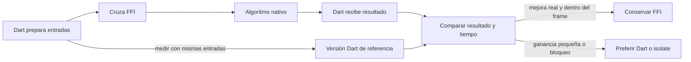

# Módulo 16: Flutter FFI: conectar Dart con código nativo

## Aprende construyendo

Este módulo crea una pequeña biblioteca nativa para calcular el costo de una ruta y la llama desde Dart. Trabajarás primero con C porque Dart FFI enlaza directamente con interfaces C; luego revisarás Rust detrás de una ABI C. **FFI no está disponible en Flutter Web**: allí corresponde usar interoperabilidad con JavaScript/Wasm. Desde Flutter 3.38, el punto de partida recomendado para un paquete FFI nuevo es `flutter create --template=package_ffi` con build hooks. Usa la plantilla antigua `plugin_ffi` solo si necesitas Flutter Plugin API, enlazado estático u otro caso específico que documenta Flutter.

---


### Tema 1: reconocer cuándo usar FFI y crear el paquete · Avanzado · 30 min

<details open>
<summary><strong>Capa 1 — Lectura</strong></summary>

#### ► DE QUÉ TRATA
Al finalizar tendrás una biblioteca native_add que Dart puede importar y una primera función nativa comprobable. Prerrequisitos: Flutter, Dart (flutter doctor, dart --version) y un compilador C para tu plataforma. Ejemplo independiente en proyecto nuevo: crea el paquete desde una…

#### ► LA IDEA EN UNA FRASE
**Al finalizar tendrás una biblioteca native_add que Dart puede importar y una primera función nativa comprobable.**

#### ► POR QUÉ EXISTE ESTO
Resuelve un problema real de diseño o implementación y evita decisiones a ciegas.

#### ► LA ANALOGÍA
Piensa en reconocer cuándo usar ffi y crear el paquete como una herramienta de taller: útil cuando conoces su propósito y sus límites.
**Dónde se rompe la analogía:** en software, los efectos dependen del contexto, la escala y los trade-offs.

#### ► CÓMO FUNCIONA
1. Identifica el problema que reconocer cuándo usar ffi y crear el paquete resuelve.
2. Observa sus componentes y relaciones.
3. Aplica la opción más simple que funcione.
4. Verifica el resultado y los límites.

#### ► LO QUE PUEDE SALIR MAL
| Síntoma | Causa probable | Arreglo |
|---|---|---|
| reconocer cuándo usar FFI y crear el paquete se aplica pero el resultado no mejora | Se usó sin medir el problema real | Mide antes y compara contra la alternativa simple |
| Aparece complejidad inesperada | Se adoptó la técnica sin comprender sus trade-offs | Vuelve a la sección de trade-offs y reduce el alcance |
| Falla en un caso límite | Se asumió un contexto que no se cumple | Prueba el caso límite y documenta cuándo NO usarlo |

#### ► TRADE-OFFS
| Opción | Cuándo usarla | Cuándo NO usarla |
|---|---|---|
| Usar reconocer cuándo usar FFI y crear el paquete | Cuando el problema coincide con su propósito y el beneficio es observable | Cuando agrega complejidad sin resolver un problema real |
| Alternativa más simple | Cuando el contexto es pequeño, estable o fácil de razonar | Cuando ya demostró no escalar o no cumplir el requisito |
| Postergar la decisión | Cuando falta evidencia del problema | Cuando el costo de esperar es mayor que el costo de probar |

#### ► CUÁNDO NO USAR ESTO
No uses reconocer cuándo usar ffi y crear el paquete por defecto. Aplícalo cuando el problema lo justifique y puedas verificar el beneficio; si una alternativa más simple resuelve igual, prefiérela.

#### ► DE VUELTA A LA ANALOGÍA
Volviendo a la analogía: reconocer cuándo usar ffi y crear el paquete funciona como el modelo inicial, pero recuerda dónde se rompe: en producción importan la evidencia, la escala y el costo de equivocarte.

#### ► LO QUE DEBES RECORDAR
- reconocer cuándo usar FFI y crear el paquete existe para resolver un problema específico.
- Mide antes de adoptar complejidad.
- Conoce el caso donde NO usarlo.
- Verifica con evidencia observable.

#### ► PREGUNTAS PARA PENSAR
1. ¿Qué problema concreto resuelve reconocer cuándo usar ffi y crear el paquete en tu contexto?
2. ¿Cómo sabrías que reconocer cuándo usar ffi y crear el paquete no está funcionando bien?
3. ¿Qué alternativa más simple considerarías antes de usar reconocer cuándo usar ffi y crear el paquete?

</details>

<details>
<summary><strong>Capa 2 — Construcción</strong></summary>

#### Código y verificación
```bash
flutter create --template=package_ffi native_add
cd native_add
flutter test
```

```dart
import 'package:test/test.dart';
import 'package:native_add/native_add.dart';

void main() {
  test('la suma nativa devuelve 42', () {
    expect(sum(24, 18), 42);
  });
}
```

```bash
dart pub get
dart test
```

</details>

### Tema 2: generar bindings C seguros para Dart · Avanzado · 35 min

<details open>
<summary><strong>Capa 1 — Lectura</strong></summary>

#### ► DE QUÉ TRATA
Al finalizar llamarás una función C con argumentos y retorno tipados mediante bindings generados. Prerrequisitos: Tema 1, Dart FFI y un header C. Ejemplo independiente: en una carpeta vacía ejecuta flutter create --template=package_ffi ffi_bindings_lab; trabaja en src/route_cost.…

#### ► LA IDEA EN UNA FRASE
**Al finalizar llamarás una función C con argumentos y retorno tipados mediante bindings generados.**

#### ► POR QUÉ EXISTE ESTO
Resuelve un problema real de diseño o implementación y evita decisiones a ciegas.

#### ► LA ANALOGÍA
Piensa en generar bindings c seguros para dart como una herramienta de taller: útil cuando conoces su propósito y sus límites.
**Dónde se rompe la analogía:** en software, los efectos dependen del contexto, la escala y los trade-offs.

#### ► CÓMO FUNCIONA
1. Identifica el problema que generar bindings c seguros para dart resuelve.
2. Observa sus componentes y relaciones.
3. Aplica la opción más simple que funcione.
4. Verifica el resultado y los límites.

#### ► LO QUE PUEDE SALIR MAL
| Síntoma | Causa probable | Arreglo |
|---|---|---|
| generar bindings C seguros para Dart se aplica pero el resultado no mejora | Se usó sin medir el problema real | Mide antes y compara contra la alternativa simple |
| Aparece complejidad inesperada | Se adoptó la técnica sin comprender sus trade-offs | Vuelve a la sección de trade-offs y reduce el alcance |
| Falla en un caso límite | Se asumió un contexto que no se cumple | Prueba el caso límite y documenta cuándo NO usarlo |

#### ► TRADE-OFFS
| Opción | Cuándo usarla | Cuándo NO usarla |
|---|---|---|
| Usar generar bindings C seguros para Dart | Cuando el problema coincide con su propósito y el beneficio es observable | Cuando agrega complejidad sin resolver un problema real |
| Alternativa más simple | Cuando el contexto es pequeño, estable o fácil de razonar | Cuando ya demostró no escalar o no cumplir el requisito |
| Postergar la decisión | Cuando falta evidencia del problema | Cuando el costo de esperar es mayor que el costo de probar |

#### ► CUÁNDO NO USAR ESTO
No uses generar bindings c seguros para dart por defecto. Aplícalo cuando el problema lo justifique y puedas verificar el beneficio; si una alternativa más simple resuelve igual, prefiérela.

#### ► DE VUELTA A LA ANALOGÍA
Volviendo a la analogía: generar bindings c seguros para dart funciona como el modelo inicial, pero recuerda dónde se rompe: en producción importan la evidencia, la escala y el costo de equivocarte.

#### ► LO QUE DEBES RECORDAR
- generar bindings C seguros para Dart existe para resolver un problema específico.
- Mide antes de adoptar complejidad.
- Conoce el caso donde NO usarlo.
- Verifica con evidencia observable.

#### ► PREGUNTAS PARA PENSAR
1. ¿Qué problema concreto resuelve generar bindings c seguros para dart en tu contexto?
2. ¿Cómo sabrías que generar bindings c seguros para dart no está funcionando bien?
3. ¿Qué alternativa más simple considerarías antes de usar generar bindings c seguros para dart?

</details>

<details>
<summary><strong>Capa 2 — Construcción</strong></summary>

#### Código y verificación
```c
// src/route_cost.h
#include <stdint.h>
int32_t route_zone(int32_t kilometers);
```

```c
#include "route_cost.h"

int32_t route_zone(int32_t kilometers) {
  return kilometers <= 10 ? 0 : 1;
}
```

```bash
dart run ffigen --config ffigen.yaml
dart format lib test
dart test
```

</details>

### Tema 3: conectar una biblioteca Rust mediante una ABI C · Avanzado · 35 min

<details open>
<summary><strong>Capa 1 — Lectura</strong></summary>

#### ► DE QUÉ TRATA
Al finalizar tendrás una función Rust exportada con ABI C y una nota de build para empaquetarla como código nativo. Prerrequisitos: Rust (rustc --version, cargo --version), Flutter y ABI C. Ejemplo independiente: crea ffi_rust_lab con flutter create --template=package_ffi ffi_rus…

#### ► LA IDEA EN UNA FRASE
**Al finalizar tendrás una función Rust exportada con ABI C y una nota de build para empaquetarla como código nativo.**

#### ► POR QUÉ EXISTE ESTO
Resuelve un problema real de diseño o implementación y evita decisiones a ciegas.

#### ► LA ANALOGÍA
Piensa en conectar una biblioteca rust mediante una abi c como una herramienta de taller: útil cuando conoces su propósito y sus límites.
**Dónde se rompe la analogía:** en software, los efectos dependen del contexto, la escala y los trade-offs.

#### ► CÓMO FUNCIONA
1. Identifica el problema que conectar una biblioteca rust mediante una abi c resuelve.
2. Observa sus componentes y relaciones.
3. Aplica la opción más simple que funcione.
4. Verifica el resultado y los límites.

#### ► LO QUE PUEDE SALIR MAL
| Síntoma | Causa probable | Arreglo |
|---|---|---|
| conectar una biblioteca Rust mediante una ABI C se aplica pero el resultado no mejora | Se usó sin medir el problema real | Mide antes y compara contra la alternativa simple |
| Aparece complejidad inesperada | Se adoptó la técnica sin comprender sus trade-offs | Vuelve a la sección de trade-offs y reduce el alcance |
| Falla en un caso límite | Se asumió un contexto que no se cumple | Prueba el caso límite y documenta cuándo NO usarlo |

#### ► TRADE-OFFS
| Opción | Cuándo usarla | Cuándo NO usarla |
|---|---|---|
| Usar conectar una biblioteca Rust mediante una ABI C | Cuando el problema coincide con su propósito y el beneficio es observable | Cuando agrega complejidad sin resolver un problema real |
| Alternativa más simple | Cuando el contexto es pequeño, estable o fácil de razonar | Cuando ya demostró no escalar o no cumplir el requisito |
| Postergar la decisión | Cuando falta evidencia del problema | Cuando el costo de esperar es mayor que el costo de probar |

#### ► CUÁNDO NO USAR ESTO
No uses conectar una biblioteca rust mediante una abi c por defecto. Aplícalo cuando el problema lo justifique y puedas verificar el beneficio; si una alternativa más simple resuelve igual, prefiérela.

#### ► DE VUELTA A LA ANALOGÍA
Volviendo a la analogía: conectar una biblioteca rust mediante una abi c funciona como el modelo inicial, pero recuerda dónde se rompe: en producción importan la evidencia, la escala y el costo de equivocarte.

#### ► LO QUE DEBES RECORDAR
- conectar una biblioteca Rust mediante una ABI C existe para resolver un problema específico.
- Mide antes de adoptar complejidad.
- Conoce el caso donde NO usarlo.
- Verifica con evidencia observable.

#### ► PREGUNTAS PARA PENSAR
1. ¿Qué problema concreto resuelve conectar una biblioteca rust mediante una abi c en tu contexto?
2. ¿Cómo sabrías que conectar una biblioteca rust mediante una abi c no está funcionando bien?
3. ¿Qué alternativa más simple considerarías antes de usar conectar una biblioteca rust mediante una abi c?

</details>

<details>
<summary><strong>Capa 2 — Construcción</strong></summary>

#### Código y verificación
```rust
#[unsafe(no_mangle)]
pub extern "C" fn route_zone(kilometers: i32) -> i32 {
    if kilometers <= 10 { 0 } else { 1 }
}
```

```bash
cargo test
cargo build --release
```

</details>

#### Caso real: AppFlowy, Flutter con núcleo en Rust

[AppFlowy](https://github.com/appflowy-io/appflowy) es una alternativa open source a Notion. La interfaz está hecha en Flutter y toda la lógica de negocio vive en Rust: el mismo reparto que acabas de construir, llevado a una app completa.

**Cómo hablan los dos lados.** En vez de exponer muchas funciones sueltas, AppFlowy pasa mensajes asíncronos serializados con Protobuf:

- **Eventos (Flutter → Rust):** la interfaz emite un evento con un payload Protobuf; Rust tiene un handler por evento, deserializa el payload y puede descartar peticiones inválidas sin ejecutar nada.
- **Notificaciones (Rust → Flutter):** mensajes de una sola vía para avisar cambios de estado; la interfaz los escucha y deserializa.
- El backend define todos los eventos y **genera** la interfaz FFI, así que Dart nunca escribe bindings a mano.


**Por qué importa.** Con un solo punto de entrada (evento + bytes) la ABI C se mantiene mínima y estable, y la propiedad de memoria queda clara: cada lado libera lo que reservó (Tema 6).

**Ejercicio.** Compara este diseño con tu biblioteca del tema: ¿cuántas funciones `extern "C"` expones tú? ¿Cómo cambiaría si todo pasara por una sola función `dispatch(bytes)`?

Fuente: [comunicación entre procesos en AppFlowy](https://docs.appflowy.io/docs/documentation/software-contributions/architecture/frontend/inter-process-communication).

### Tema 4: compilar y empaquetar bibliotecas por plataforma · Avanzado · 30 min

<details open>
<summary><strong>Capa 1 — Lectura</strong></summary>

#### ► DE QUÉ TRATA
Al finalizar podrás identificar qué target produce tu build y qué biblioteca se empaqueta en ella. Prerrequisitos: build hooks, un target Flutter y su toolchain nativo. Ejemplo independiente: crea ffi_target_lab con flutter create --template=package_ffi ffi_target_lab en una carp…

#### ► LA IDEA EN UNA FRASE
**Al finalizar podrás identificar qué target produce tu build y qué biblioteca se empaqueta en ella.**

#### ► POR QUÉ EXISTE ESTO
Resuelve un problema real de diseño o implementación y evita decisiones a ciegas.

#### ► LA ANALOGÍA
Piensa en compilar y empaquetar bibliotecas por plataforma como una herramienta de taller: útil cuando conoces su propósito y sus límites.
**Dónde se rompe la analogía:** en software, los efectos dependen del contexto, la escala y los trade-offs.

#### ► CÓMO FUNCIONA
1. Identifica el problema que compilar y empaquetar bibliotecas por plataforma resuelve.
2. Observa sus componentes y relaciones.
3. Aplica la opción más simple que funcione.
4. Verifica el resultado y los límites.

#### ► LO QUE PUEDE SALIR MAL
| Síntoma | Causa probable | Arreglo |
|---|---|---|
| compilar y empaquetar bibliotecas por plataforma se aplica pero el resultado no mejora | Se usó sin medir el problema real | Mide antes y compara contra la alternativa simple |
| Aparece complejidad inesperada | Se adoptó la técnica sin comprender sus trade-offs | Vuelve a la sección de trade-offs y reduce el alcance |
| Falla en un caso límite | Se asumió un contexto que no se cumple | Prueba el caso límite y documenta cuándo NO usarlo |

#### ► TRADE-OFFS
| Opción | Cuándo usarla | Cuándo NO usarla |
|---|---|---|
| Usar compilar y empaquetar bibliotecas por plataforma | Cuando el problema coincide con su propósito y el beneficio es observable | Cuando agrega complejidad sin resolver un problema real |
| Alternativa más simple | Cuando el contexto es pequeño, estable o fácil de razonar | Cuando ya demostró no escalar o no cumplir el requisito |
| Postergar la decisión | Cuando falta evidencia del problema | Cuando el costo de esperar es mayor que el costo de probar |

#### ► CUÁNDO NO USAR ESTO
No uses compilar y empaquetar bibliotecas por plataforma por defecto. Aplícalo cuando el problema lo justifique y puedas verificar el beneficio; si una alternativa más simple resuelve igual, prefiérela.

#### ► DE VUELTA A LA ANALOGÍA
Volviendo a la analogía: compilar y empaquetar bibliotecas por plataforma funciona como el modelo inicial, pero recuerda dónde se rompe: en producción importan la evidencia, la escala y el costo de equivocarte.

#### ► LO QUE DEBES RECORDAR
- compilar y empaquetar bibliotecas por plataforma existe para resolver un problema específico.
- Mide antes de adoptar complejidad.
- Conoce el caso donde NO usarlo.
- Verifica con evidencia observable.

#### ► PREGUNTAS PARA PENSAR
1. ¿Qué problema concreto resuelve compilar y empaquetar bibliotecas por plataforma en tu contexto?
2. ¿Cómo sabrías que compilar y empaquetar bibliotecas por plataforma no está funcionando bien?
3. ¿Qué alternativa más simple considerarías antes de usar compilar y empaquetar bibliotecas por plataforma?

</details>

<details>
<summary><strong>Capa 2 — Construcción</strong></summary>

#### Código y verificación
```text
src/ + header -> build hook/toolchain -> biblioteca del target -> asset del paquete -> binding Dart
```

```bash
dart test
cd example
flutter build apk --debug
```

</details>

### Tema 5: medir rendimiento y evitar bloquear la interfaz · Avanzado · 35 min

<details open>
<summary><strong>Capa 1 — Lectura</strong></summary>

#### ► DE QUÉ TRATA
Al finalizar compararás una operación Dart con una nativa, medirás el tiempo y decidirás si FFI aporta valor. Prerrequisitos: Dart, una función FFI equivalente y Flutter DevTools. Ejemplo independiente: crea ffi_benchmark_lab con flutter create --template=package_ffi ffi_benchmar…

#### ► LA IDEA EN UNA FRASE
**Al finalizar compararás una operación Dart con una nativa, medirás el tiempo y decidirás si FFI aporta valor.**

#### ► POR QUÉ EXISTE ESTO
Resuelve un problema real de diseño o implementación y evita decisiones a ciegas.

#### ► LA ANALOGÍA
Piensa en medir rendimiento y evitar bloquear la interfaz como una herramienta de taller: útil cuando conoces su propósito y sus límites.
**Dónde se rompe la analogía:** en software, los efectos dependen del contexto, la escala y los trade-offs.

#### ► CÓMO FUNCIONA


#### ► LO QUE PUEDE SALIR MAL
| Síntoma | Causa probable | Arreglo |
|---|---|---|
| medir rendimiento y evitar bloquear la interfaz se aplica pero el resultado no mejora | Se usó sin medir el problema real | Mide antes y compara contra la alternativa simple |
| Aparece complejidad inesperada | Se adoptó la técnica sin comprender sus trade-offs | Vuelve a la sección de trade-offs y reduce el alcance |
| Falla en un caso límite | Se asumió un contexto que no se cumple | Prueba el caso límite y documenta cuándo NO usarlo |

#### ► TRADE-OFFS
| Opción | Cuándo usarla | Cuándo NO usarla |
|---|---|---|
| Usar medir rendimiento y evitar bloquear la interfaz | Cuando el problema coincide con su propósito y el beneficio es observable | Cuando agrega complejidad sin resolver un problema real |
| Alternativa más simple | Cuando el contexto es pequeño, estable o fácil de razonar | Cuando ya demostró no escalar o no cumplir el requisito |
| Postergar la decisión | Cuando falta evidencia del problema | Cuando el costo de esperar es mayor que el costo de probar |

#### ► CUÁNDO NO USAR ESTO
No uses medir rendimiento y evitar bloquear la interfaz por defecto. Aplícalo cuando el problema lo justifique y puedas verificar el beneficio; si una alternativa más simple resuelve igual, prefiérela.

#### ► DE VUELTA A LA ANALOGÍA
Volviendo a la analogía: medir rendimiento y evitar bloquear la interfaz funciona como el modelo inicial, pero recuerda dónde se rompe: en producción importan la evidencia, la escala y el costo de equivocarte.

#### ► LO QUE DEBES RECORDAR
- medir rendimiento y evitar bloquear la interfaz existe para resolver un problema específico.
- Mide antes de adoptar complejidad.
- Conoce el caso donde NO usarlo.
- Verifica con evidencia observable.

#### ► PREGUNTAS PARA PENSAR
1. ¿Qué problema concreto resuelve medir rendimiento y evitar bloquear la interfaz en tu contexto?
2. ¿Cómo sabrías que medir rendimiento y evitar bloquear la interfaz no está funcionando bien?
3. ¿Qué alternativa más simple considerarías antes de usar medir rendimiento y evitar bloquear la interfaz?

</details>

<details>
<summary><strong>Capa 2 — Construcción</strong></summary>

#### Código y verificación


```bash
flutter run --profile
```

</details>

### Tema 6: propiedad de memoria, liberación y errores · Experto · 40 min

<details open>
<summary><strong>Capa 1 — Lectura</strong></summary>

#### ► DE QUÉ TRATA
Al finalizar envolverás un buffer nativo con liberación explícita y comprobarás que cada asignación tiene un camino de cierre. Prerrequisitos: tipos de puntero de dart:ffi y el paquete ffi. Ejemplo independiente: crea ffi_memory_lab con flutter create --template=package_ffi ffi_m…

#### ► LA IDEA EN UNA FRASE
**Al finalizar envolverás un buffer nativo con liberación explícita y comprobarás que cada asignación tiene un camino de cierre.**

#### ► POR QUÉ EXISTE ESTO
Resuelve un problema real de diseño o implementación y evita decisiones a ciegas.

#### ► LA ANALOGÍA
Piensa en propiedad de memoria, liberación y errores como una herramienta de taller: útil cuando conoces su propósito y sus límites.
**Dónde se rompe la analogía:** en software, los efectos dependen del contexto, la escala y los trade-offs.

#### ► CÓMO FUNCIONA
1. Identifica el problema que propiedad de memoria, liberación y errores resuelve.
2. Observa sus componentes y relaciones.
3. Aplica la opción más simple que funcione.
4. Verifica el resultado y los límites.

#### ► LO QUE PUEDE SALIR MAL
| Síntoma | Causa probable | Arreglo |
|---|---|---|
| propiedad de memoria, liberación y errores se aplica pero el resultado no mejora | Se usó sin medir el problema real | Mide antes y compara contra la alternativa simple |
| Aparece complejidad inesperada | Se adoptó la técnica sin comprender sus trade-offs | Vuelve a la sección de trade-offs y reduce el alcance |
| Falla en un caso límite | Se asumió un contexto que no se cumple | Prueba el caso límite y documenta cuándo NO usarlo |

#### ► TRADE-OFFS
| Opción | Cuándo usarla | Cuándo NO usarla |
|---|---|---|
| Usar propiedad de memoria, liberación y errores | Cuando el problema coincide con su propósito y el beneficio es observable | Cuando agrega complejidad sin resolver un problema real |
| Alternativa más simple | Cuando el contexto es pequeño, estable o fácil de razonar | Cuando ya demostró no escalar o no cumplir el requisito |
| Postergar la decisión | Cuando falta evidencia del problema | Cuando el costo de esperar es mayor que el costo de probar |

#### ► CUÁNDO NO USAR ESTO
No uses propiedad de memoria, liberación y errores por defecto. Aplícalo cuando el problema lo justifique y puedas verificar el beneficio; si una alternativa más simple resuelve igual, prefiérela.

#### ► DE VUELTA A LA ANALOGÍA
Volviendo a la analogía: propiedad de memoria, liberación y errores funciona como el modelo inicial, pero recuerda dónde se rompe: en producción importan la evidencia, la escala y el costo de equivocarte.

#### ► LO QUE DEBES RECORDAR
- propiedad de memoria, liberación y errores existe para resolver un problema específico.
- Mide antes de adoptar complejidad.
- Conoce el caso donde NO usarlo.
- Verifica con evidencia observable.

#### ► PREGUNTAS PARA PENSAR
1. ¿Qué problema concreto resuelve propiedad de memoria, liberación y errores en tu contexto?
2. ¿Cómo sabrías que propiedad de memoria, liberación y errores no está funcionando bien?
3. ¿Qué alternativa más simple considerarías antes de usar propiedad de memoria, liberación y errores?

</details>

<details>
<summary><strong>Capa 2 — Construcción</strong></summary>

#### Código y verificación
```dart
import 'dart:ffi';
import 'package:ffi/ffi.dart';

final input = calloc<Int32>(3);
try {
  input[0] = 2;
  input[1] = 5;
  input[2] = 7;
  // Llama al binding con el puntero y cantidad 3.
} finally {
  calloc.free(input);
}
```

```bash
dart test
```

</details>
