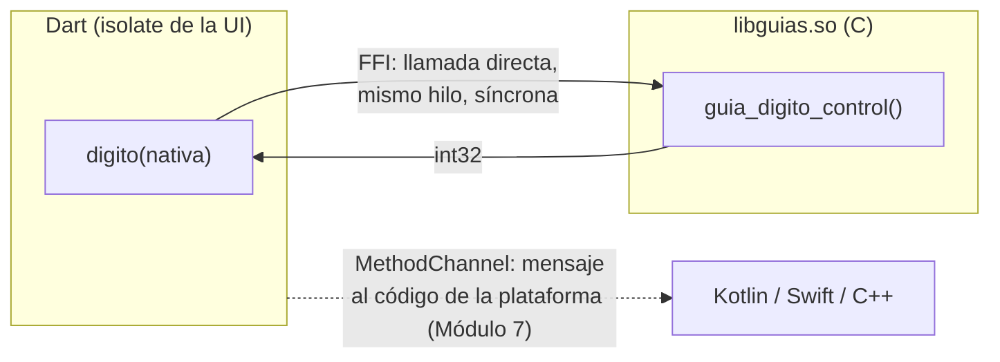
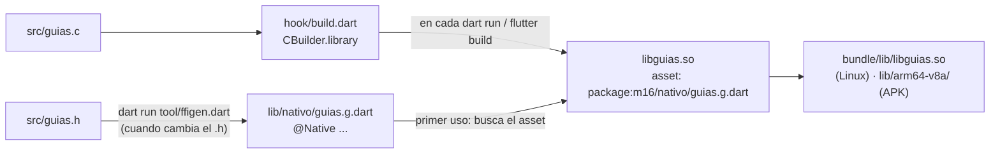
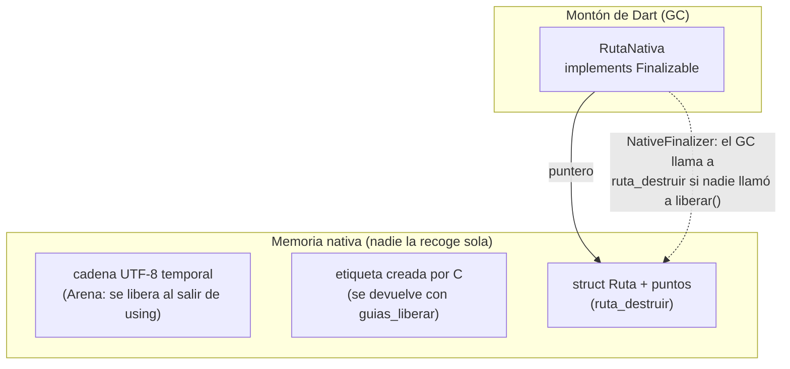
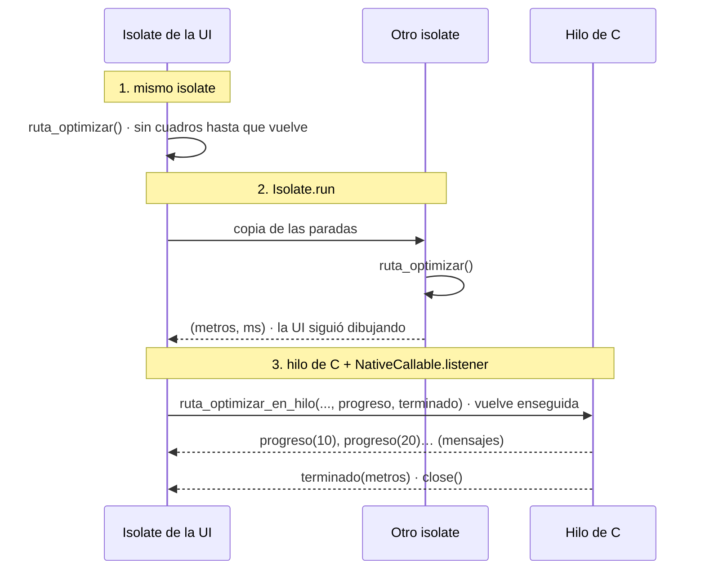

# Módulo 16: Flutter FFI: conectar Dart con código nativo

**Entorno comprobado para esta edición (2026-11-25):** Flutter 3.50.1 (canal estable) con Dart 3.14.0 en Linux
x86_64, con `ffi` 2.2.0, `ffigen` 23.0.0, `hooks` 2.2.0, `code_assets` 2.2.0, `native_toolchain_c` 0.19.6 y
`material_ui` 1.11.1; del sistema, gcc 13.3.0, libclang 18.1.3 (paquete `libclang-dev`) y valgrind 3.22.0. Todo el
código se analizó con `flutter analyze` (`No issues found!`) y se ejecutó ese día, en
`/home/estudiante/labs/flutter/m16` (tu `~/labs/flutter/m16`). La biblioteca en C es propia y se compila de verdad:
a mano con gcc en el Tema 1 y con un *build hook* desde el Tema 2, que la empaqueta sola en `flutter build linux` y,
con el NDK 28.2, en `flutter build apk` (el APK se compiló y se inspeccionó, pero no se instaló: no hay teléfono ni
emulador).
Las fugas y los accesos inválidos del Tema 3 son reales, medidos con un contador de bytes y con valgrind. Las capturas
del Tema 4 son de la app de escritorio real en release, en una pantalla virtual. Dos límites honestos: el equipo de
pruebas tiene 2 núcleos compartidos con otros trabajos y dibuja por software, así que los tiempos absolutos son más
lentos y ruidosos que en un teléfono (las comparaciones entre modos sí se sostienen); y no hay Xcode, así que iOS y
macOS no se compilaron.

Hay trabajo que Dart no hace o no hace a tiempo: una biblioteca de C que ya existe (un lector de códigos, un motor de
rutas, un códec), un cálculo pesado afinado durante años o una función del sistema sin plugin. FFI permite llamar a ese
código directamente, sin canales ni mensajes, desde Dart. A cambio, entras en el mundo de C: punteros, memoria que
nadie recoge por ti y errores que no lanzan excepciones, sino que cierran la app.

**Al terminar este módulo podrás:**
- decidir cuándo conviene FFI y escribir a mano el binding de una biblioteca de C propia;
- generar los bindings con `ffigen` y compilar y empaquetar la biblioteca con un *build hook*;
- reservar y liberar memoria nativa sin fugas, y encontrar los accesos inválidos con herramientas;
- llamar a trabajo nativo pesado sin congelar la interfaz, con isolates o con un hilo de C y callbacks.

**Esquema del módulo:** Tema 1 (el primer binding a mano) → Tema 2 (`ffigen` y *build hooks*) → Tema 3 (memoria y
errores) → Tema 4 (rendimiento sin bloquear la interfaz) → Proyecto 33.

**Qué necesitas saber antes:** del Módulo 7, **`MethodChannel`** (Tema 1), para comparar; del Módulo 8, **medir los
cuadros** (Tema 3) e **isolates** (Tema 4); del Módulo 11, **las compilaciones de Linux y Android** y **la app de
escritorio en pantalla virtual**; del Módulo 0, **`Future` y asincronía** (Tema 3) y **records** (Tema 6). No hace
falta saber C a fondo: el código C del módulo está comentado línea a línea donde importa.

**Qué no se repite:** los canales de plataforma y Pigeon (Módulo 7), la teoría de isolates y `compute` (Módulo 8,
Tema 4) y la firma y publicación de los binarios (Módulo 11). Aquí se trata de lo que cambia cuando el código del otro
lado es C y la memoria es tuya.

**Prepara el proyecto:**

```text
$ sudo apt install gcc libclang-dev valgrind
$ cd ~/labs/flutter
$ flutter create --org com.academia --platforms=linux,android m16
$ cd m16
$ flutter pub add ffi material_ui hooks code_assets native_toolchain_c
$ flutter pub add dev:ffigen
```

Agrega `formatter: page_width: 120` a `analysis_options.yaml` (con `avoid_print: false`, porque los scripts de `bin/`
imprimen a propósito, y `lib/nativo/*.g.dart` en `analyzer: exclude`) y deja la ventana de Linux en 480 × 420.


## Aprende construyendo


### Tema 1: Cuándo usar FFI y el primer binding a mano · Avanzado · 45 min

<details open>
<summary><strong>Capa 1 — Lectura</strong></summary>

#### Objetivos
Al terminar este tema podrás:
- decidir entre Dart puro, un canal de plataforma y FFI para una tarea concreta;
- compilar una biblioteca de C como `.so` y ver qué símbolos exporta;
- abrirla con `DynamicLibrary.open` y convertir sus funciones en funciones de Dart con `lookupFunction`;
- pasar números y cadenas UTF-8, y reconocer los tres errores típicos del binding a mano.

**Conceptos clave:** FFI, biblioteca compartida, `DynamicLibrary`, `lookupFunction`, tipos nativos

#### El problema
La empresa de envíos tiene una biblioteca en C que usan las básculas y las impresoras de etiquetas: calcula el dígito
de control de cada guía (`EN-4471` → `7`) y la distancia entre dos paradas. La app la reescribió en Dart «para no
complicarse», y ahora hay guías que la impresora rechaza porque las dos versiones no calculan igual. Lo sensato es
llamar a **la misma** biblioteca desde la app. Un `MethodChannel` exigiría escribir código de Kotlin, Swift y C++ que
la envuelva en cada plataforma, y cada llamada viajaría como un mensaje; con FFI, Dart llama a la función de C
directamente.

Este tema usa **`MethodChannel`** (Módulo 7, Tema 1) como punto de comparación y **los records** (Módulo 0, Tema 6).

#### Glosario del tema

**FFI**
- **Definición técnica:** *foreign function interface*: el mecanismo de `dart:ffi` para llamar a funciones que siguen la convención de llamada de C, en el mismo proceso y de forma síncrona, y para leer y escribir memoria nativa.
- **En palabras sencillas:** marcar directo a la extensión de C, sin pasar por la recepción.
- **Dónde se rompe la comparación:** la llamada es tan directa que no hay red de seguridad: si C escribe donde no debe, la app se cae, sin excepción que atrapar.
- **Ejemplo:** `digito(nativa)` devuelve `7` para `EN-4471`.
- **Error típico:** usar FFI para algo que Dart hace bien (una suma, un formato de texto): pagas la complejidad sin ganar nada.

**biblioteca compartida**
- **Definición técnica:** archivo de código compilado que se carga al ejecutar (`.so` en Linux y Android, `.dylib` o *framework* en macOS e iOS, `.dll` en Windows) y exporta símbolos con nombre.
- **En palabras sencillas:** una caja de herramientas con etiquetas que cualquier programa puede abrir.
- **Dónde se rompe la comparación:** se compila para un sistema y un procesador concretos; la `.so` de Linux x86_64 no sirve en un teléfono ARM.
- **Ejemplo:** `build_nativo/libguias.so`, con 12 símbolos exportados.
- **Error típico:** compilar sin `-fPIC -shared` y obtener un ejecutable en vez de una biblioteca.

**`DynamicLibrary`**
- **Definición técnica:** clase de `dart:ffi` que representa una biblioteca cargada; `DynamicLibrary.open(ruta)` la carga con el cargador del sistema (`dlopen` en Linux) y `lookup` busca un símbolo.
- **En palabras sencillas:** abrir la caja de herramientas.
- **Dónde se rompe la comparación:** un nombre sin directorio (`libguias.so`) no se busca en tu proyecto, sino en las rutas del sistema.
- **Ejemplo:** `DynamicLibrary.open('build_nativo/libguias.so')`.
- **Error típico:** una ruta relativa que solo funciona si ejecutas desde la raíz del proyecto.

**`lookupFunction`**
- **Definición técnica:** busca un símbolo y lo convierte en una función de Dart; recibe dos firmas: la nativa (`Int32 Function(Pointer<Utf8>)`) y la de Dart (`int Function(Pointer<Utf8>)`).
- **En palabras sencillas:** sacar una herramienta de la caja y ponerle un mango de Dart.
- **Dónde se rompe la comparación:** Dart comprueba que las dos firmas sean compatibles **entre sí**, pero no puede comprobar que la nativa coincida con la de C: si te equivocas, recibes basura.
- **Ejemplo:** `lib.lookupFunction<_DigitoC, _DigitoDart>('guia_digito_control')`.
- **Error típico:** buscar el símbolo en cada llamada en vez de una sola vez.

**tipos nativos**
- **Definición técnica:** tipos de `dart:ffi` que describen la memoria de C (`Int32`, `Int64`, `Double`, `Pointer<T>`, `Void`; `Utf8` viene de `package:ffi`); en la firma de Dart se corresponden con `int`, `double`, `Pointer<T>` y `void`.
- **En palabras sencillas:** el idioma en que se ponen de acuerdo los dos lados.
- **Dónde se rompe la comparación:** un `String` de Dart no existe en C: hay que copiarlo a memoria nativa como UTF-8 terminado en cero, y esa copia hay que liberarla.
- **Ejemplo:** `'EN-4471'.toNativeUtf8()` reserva 8 bytes; `malloc.free` los libera.
- **Error típico:** declarar `Int32` donde C usa `double`.

#### ► CÓMO FUNCIONA
Con FFI, la llamada no sale del proceso ni del hilo: Dart prepara los argumentos según la convención de C, salta a la
función y recibe el resultado. Por eso es rápida y síncrona, y por eso un error de C es un error del proceso entero.



| Necesitas… | Usa |
|---|---|
| lógica que Dart hace bien (formatos, validaciones, la mayoría de cálculos) | Dart puro |
| una API de la plataforma (cámara, permisos, notificaciones) | `MethodChannel` o un plugin (Módulo 7) |
| una biblioteca de C, C++, Rust o Go, o cálculo pesado ya escrito en C | FFI |

#### Problema resuelto 1.1
Escribe la biblioteca de guías en C, compílala como `libguias.so` y llámala desde Dart con un binding escrito a mano:
la distancia entre la bodega de Puente Aranda y un cliente en Chapinero, el dígito de control de varias guías
(comparado con la misma regla en Dart) y una etiqueta que crea C.

**Razonamiento:**
1. El encabezado `guias.h` es el contrato: tipos de tamaño fijo (`int32_t`, `double`) y comentarios que dicen quién
   libera cada cosa. Se usará entero en los temas siguientes.
2. `compilar.sh` compila con `-fPIC -shared` y lista los símbolos exportados con `nm -D`, para ver qué nombres puede
   buscar Dart.
3. Cada función necesita dos `typedef`: la firma nativa y la de Dart. Los símbolos se buscan una sola vez.
4. Las cadenas se copian a memoria nativa con `toNativeUtf8` y se liberan en un `finally`.
5. La etiqueta la reserva C, así que la libera C (`guias_liberar`), no `malloc.free`.

```cpp
// guias.h: biblioteca nativa de la ruta de reparto (C puro, sin dependencias).
#ifndef GUIAS_H
#define GUIAS_H

#include <stdint.h>

#ifdef __cplusplus
extern "C" {
#endif

/// Un punto geográfico, en grados.
typedef struct {
  double lat;
  double lon;
} Punto;

/// Ruta opaca: Dart solo ve un puntero, nunca sus campos.
typedef struct Ruta Ruta;

/// Función que recibe el avance (0 a 100) de un trabajo largo.
typedef void (*ProgresoFn)(int32_t porcentaje);

/// Función que recibe la longitud final (en metros) de una ruta optimizada.
typedef void (*TerminadoFn)(double metros);

/// Dígito de control (módulo 11) de una guía como "EN-4471"; -1 si el formato no es válido.
int32_t guia_digito_control(const char *guia);

/// Distancia en metros entre dos puntos (fórmula del haversine).
double distancia_m(double lat1, double lon1, double lat2, double lon2);

/// Longitud total, en metros, de un arreglo de n puntos recorridos en orden.
double ruta_longitud_m(const Punto *puntos, int32_t n);

/// Crea una etiqueta nueva, p. ej. "EN-4471-7 · 3,21 km". El llamador la libera con guias_liberar.
char *etiqueta_crear(const char *guia, double metros);

/// Libera lo que la biblioteca entregó (etiquetas).
void guias_liberar(void *puntero);

/// Crea una ruta vacía con espacio para `capacidad` puntos.
Ruta *ruta_crear(int32_t capacidad);

/// Agrega un punto (pasado por valor). Devuelve la cantidad de puntos, o -1 si no cabe.
int32_t ruta_agregar(Ruta *ruta, Punto punto);

/// Longitud total de la ruta, en metros.
double ruta_total_m(const Ruta *ruta);

/// Libera la ruta y sus puntos.
void ruta_destruir(Ruta *ruta);

/// Bytes que la biblioteca tiene reservados en este momento (para detectar fugas).
int64_t guias_bytes_vivos(void);

/// Trabajo pesado: mejora el orden de visita con `pasadas` barridos 2-opt.
/// Escribe en `orden` (n enteros) el orden final y devuelve su longitud en metros.
double ruta_optimizar(const Punto *puntos, int32_t n, int32_t *orden, int32_t pasadas);

/// Igual que ruta_optimizar, pero en un hilo propio: copia los puntos, vuelve enseguida
/// y avisa con `progreso` después de cada pasada y con `terminado` al final.
void ruta_optimizar_en_hilo(const Punto *puntos, int32_t n, int32_t pasadas, ProgresoFn progreso,
                            TerminadoFn terminado);

#ifdef __cplusplus
}
#endif

#endif
```

```c
// guias.c: implementación de guias.h.
#include "guias.h"

#include <math.h>
#include <pthread.h>
#include <stdio.h>
#include <stdlib.h>
#include <string.h>

// --- Reservas contadas: cada bloque guarda su tamaño delante, para saber cuántos bytes siguen vivos.
static int64_t bytes_vivos = 0;

static void *reservar(size_t bytes) {
  size_t *bloque = malloc(sizeof(size_t) + bytes);
  if (bloque == NULL) return NULL;
  bloque[0] = bytes;
  __atomic_add_fetch(&bytes_vivos, (int64_t)bytes, __ATOMIC_RELAXED);
  return bloque + 1;
}

static void soltar(void *puntero) {
  if (puntero == NULL) return;
  size_t *bloque = (size_t *)puntero - 1;
  __atomic_sub_fetch(&bytes_vivos, (int64_t)bloque[0], __ATOMIC_RELAXED);
  free(bloque);
}

int64_t guias_bytes_vivos(void) { return __atomic_load_n(&bytes_vivos, __ATOMIC_RELAXED); }

void guias_liberar(void *puntero) { soltar(puntero); }

// --- Guías
int32_t guia_digito_control(const char *guia) {
  if (guia == NULL || strncmp(guia, "EN-", 3) != 0) return -1;
  const char *numero = guia + 3;
  size_t largo = strlen(numero);
  if (largo == 0 || largo > 9) return -1;
  int suma = 0;
  for (size_t i = 0; i < largo; i++) {
    char c = numero[largo - 1 - i];  // de derecha a izquierda
    if (c < '0' || c > '9') return -1;
    suma += (c - '0') * (int)(i + 2);  // pesos 2, 3, 4...
  }
  int resto = 11 - suma % 11;
  return resto == 11 ? 0 : (resto == 10 ? 1 : resto);
}

// --- Distancias
static const double RADIO_TIERRA_M = 6371000.0;

double distancia_m(double lat1, double lon1, double lat2, double lon2) {
  const double rad = M_PI / 180.0;
  double dlat = (lat2 - lat1) * rad, dlon = (lon2 - lon1) * rad;
  double a = sin(dlat / 2) * sin(dlat / 2) + cos(lat1 * rad) * cos(lat2 * rad) * sin(dlon / 2) * sin(dlon / 2);
  return 2 * RADIO_TIERRA_M * asin(sqrt(a));
}

static double tramo(Punto a, Punto b) { return distancia_m(a.lat, a.lon, b.lat, b.lon); }

double ruta_longitud_m(const Punto *puntos, int32_t n) {
  double total = 0;
  for (int32_t i = 1; i < n; i++) total += tramo(puntos[i - 1], puntos[i]);
  return total;
}

char *etiqueta_crear(const char *guia, double metros) {
  char texto[64];
  int digito = guia_digito_control(guia);
  int largo = snprintf(texto, sizeof texto, "%s-%d · %.2f km", guia, digito, metros / 1000.0);
  char *coma = strchr(texto, '.');  // decimal con coma, como en Colombia
  if (coma != NULL) *coma = ',';
  char *copia = reservar((size_t)largo + 1);
  memcpy(copia, texto, (size_t)largo + 1);
  return copia;
}

// --- Ruta opaca
struct Ruta {
  int32_t cantidad;
  int32_t capacidad;
  Punto *puntos;
};

Ruta *ruta_crear(int32_t capacidad) {
  Ruta *ruta = reservar(sizeof(Ruta));
  ruta->cantidad = 0;
  ruta->capacidad = capacidad;
  ruta->puntos = reservar(sizeof(Punto) * (size_t)capacidad);
  return ruta;
}

int32_t ruta_agregar(Ruta *ruta, Punto punto) {
  if (ruta->cantidad == ruta->capacidad) return -1;
  ruta->puntos[ruta->cantidad++] = punto;
  return ruta->cantidad;
}

double ruta_total_m(const Ruta *ruta) { return ruta_longitud_m(ruta->puntos, ruta->cantidad); }

void ruta_destruir(Ruta *ruta) {
  if (ruta == NULL) return;
  soltar(ruta->puntos);
  soltar(ruta);
}

// --- Optimización 2-opt (trabajo pesado a propósito: cada pasada revisa todos los pares)
static double optimizar(const Punto *puntos, int32_t n, int32_t *orden, int32_t pasadas, ProgresoFn progreso) {
  for (int32_t i = 0; i < n; i++) orden[i] = i;
  for (int32_t p = 0; p < pasadas; p++) {
    for (int32_t i = 1; i < n - 2; i++) {
      for (int32_t j = i + 1; j < n - 1; j++) {
        Punto a = puntos[orden[i - 1]], b = puntos[orden[i]];
        Punto c = puntos[orden[j]], d = puntos[orden[j + 1]];
        if (tramo(a, c) + tramo(b, d) < tramo(a, b) + tramo(c, d) - 1e-9) {
          for (int32_t x = i, y = j; x < y; x++, y--) {  // invierte el tramo i..j
            int32_t t = orden[x];
            orden[x] = orden[y];
            orden[y] = t;
          }
        }
      }
    }
    if (progreso != NULL) progreso((p + 1) * 100 / pasadas);
  }
  double total = 0;
  for (int32_t i = 1; i < n; i++) total += tramo(puntos[orden[i - 1]], puntos[orden[i]]);
  return total;
}

double ruta_optimizar(const Punto *puntos, int32_t n, int32_t *orden, int32_t pasadas) {
  return optimizar(puntos, n, orden, pasadas, NULL);
}

typedef struct {
  Punto *puntos;
  int32_t n, pasadas;
  ProgresoFn progreso;
  TerminadoFn terminado;
} Trabajo;

static void *correr_trabajo(void *arg) {
  Trabajo *t = arg;
  int32_t *orden = reservar(sizeof(int32_t) * (size_t)t->n);
  double metros = optimizar(t->puntos, t->n, orden, t->pasadas, t->progreso);
  soltar(orden);
  soltar(t->puntos);
  TerminadoFn terminado = t->terminado;
  soltar(t);
  terminado(metros);
  return NULL;
}

void ruta_optimizar_en_hilo(const Punto *puntos, int32_t n, int32_t pasadas, ProgresoFn progreso,
                            TerminadoFn terminado) {
  Trabajo *t = reservar(sizeof(Trabajo));
  t->puntos = reservar(sizeof(Punto) * (size_t)n);
  memcpy(t->puntos, puntos, sizeof(Punto) * (size_t)n);  // los puntos de Dart pueden liberarse ya
  t->n = n;
  t->pasadas = pasadas;
  t->progreso = progreso;
  t->terminado = terminado;
  pthread_t hilo;
  pthread_create(&hilo, NULL, correr_trabajo, t);
  pthread_detach(hilo);
}
```

```bash
#!/bin/bash
# Compila la biblioteca para el Tema 1 (a mano, sin hooks) en build_nativo/libguias.so
set -e
cd "$(dirname "$0")/.."
mkdir -p build_nativo
gcc -O2 -Wall -Wextra -fPIC -shared src/guias.c -o build_nativo/libguias.so -lm -lpthread
nm -D --defined-only build_nativo/libguias.so | awk '{print $3}' | grep -E '^(guia|ruta|distancia|etiqueta|guias)_' | sort
```

```text
$ src/compilar.sh
distancia_m
etiqueta_crear
guia_digito_control
guias_bytes_vivos
guias_liberar
ruta_agregar
ruta_crear
ruta_destruir
ruta_longitud_m
ruta_optimizar
ruta_optimizar_en_hilo
ruta_total_m
```

```dart
// Tema 1: el primer binding escrito a mano, con DynamicLibrary.open y lookupFunction.
import 'dart:ffi';

import 'package:ffi/ffi.dart'; // Utf8, toNativeUtf8, malloc

// 1. Firmas: la nativa (tipos de C) y la de Dart (tipos de Dart), una pareja por función.
typedef _DigitoC = Int32 Function(Pointer<Utf8> guia);
typedef _DigitoDart = int Function(Pointer<Utf8> guia);
typedef _DistanciaC = Double Function(Double lat1, Double lon1, Double lat2, Double lon2);
typedef _DistanciaDart = double Function(double lat1, double lon1, double lat2, double lon2);
typedef _EtiquetaC = Pointer<Utf8> Function(Pointer<Utf8> guia, Double metros);
typedef _EtiquetaDart = Pointer<Utf8> Function(Pointer<Utf8> guia, double metros);
typedef _LiberarC = Void Function(Pointer<Void> puntero);
typedef _LiberarDart = void Function(Pointer<Void> puntero);

void main() {
  // 2. Abrir la biblioteca: la ruta es relativa al directorio desde donde ejecutas.
  final lib = DynamicLibrary.open('build_nativo/libguias.so');

  // 3. Buscar cada símbolo una sola vez y guardarlo como función de Dart.
  final digito = lib.lookupFunction<_DigitoC, _DigitoDart>('guia_digito_control');
  final distancia = lib.lookupFunction<_DistanciaC, _DistanciaDart>('distancia_m', isLeaf: true);
  final etiquetaCrear = lib.lookupFunction<_EtiquetaC, _EtiquetaDart>('etiqueta_crear');
  final liberar = lib.lookupFunction<_LiberarC, _LiberarDart>('guias_liberar');

  // 4. Números: pasan por valor, sin conversión.
  const bodega = (lat: 4.6230, lon: -74.1190); // Puente Aranda
  const cliente = (lat: 4.6486, lon: -74.0628); // Chapinero
  final metros = distancia(bodega.lat, bodega.lon, cliente.lat, cliente.lon);
  print('bodega → cliente: ${metros.toStringAsFixed(1)} m');

  // 5. Cadenas: Dart las copia a memoria nativa (UTF-8 terminada en 0) y tú la liberas.
  for (final guia in ['EN-4471', 'EN-4472', 'EN-4473', 'EN-44X1', 'XX-1']) {
    final nativa = guia.toNativeUtf8(); // malloc de package:ffi
    try {
      print('$guia → dígito ${digito(nativa)} (Dart: ${digitoEnDart(guia)})');
    } finally {
      malloc.free(nativa);
    }
  }

  // 6. Una cadena que devuelve C: la lees con toDartString y la libera quien la reservó (C).
  final guia = 'EN-4471'.toNativeUtf8();
  final etiqueta = etiquetaCrear(guia, metros);
  print('etiqueta: ${etiqueta.toDartString()}');
  liberar(etiqueta.cast()); // nunca malloc.free: no la reservó package:ffi
  malloc.free(guia);
}

/// La misma regla escrita en Dart, para comparar resultados.
int digitoEnDart(String guia) {
  final m = RegExp(r'^EN-(\d{1,9})$').firstMatch(guia);
  if (m == null) return -1;
  final cifras = m[1]!.split('').reversed.map(int.parse).toList();
  var suma = 0;
  for (var i = 0; i < cifras.length; i++) {
    suma += cifras[i] * (i + 2);
  }
  final resto = 11 - suma % 11;
  return resto == 11 ? 0 : (resto == 10 ? 1 : resto);
}
```

```text
$ dart run bin/tema1.dart
bodega → cliente: 6848.4 m
EN-4471 → dígito 7 (Dart: 7)
EN-4472 → dígito 5 (Dart: 5)
EN-4473 → dígito 3 (Dart: 3)
EN-44X1 → dígito -1 (Dart: -1)
XX-1 → dígito -1 (Dart: -1)
etiqueta: EN-4471-7 · 6,85 km
```

Tres errores reales del binding a mano, provocados a propósito:

```dart
// Tema 1: tres errores reales del binding a mano. Uso: dart run bin/tema1_errores.dart <ruta|simbolo|firma>
import 'dart:ffi';

void main(List<String> args) {
  switch (args.first) {
    case 'ruta': // el nombre sin directorio se busca en las rutas del sistema (LD_LIBRARY_PATH), no aquí
      DynamicLibrary.open('libguias.so');
    case 'simbolo': // un nombre que no existe en la biblioteca
      final lib = DynamicLibrary.open('build_nativo/libguias.so');
      lib.lookupFunction<Int32 Function(Pointer<Void>), int Function(Pointer<Void>)>('guia_digito');
    case 'firma': // la firma no coincide con la de C: Dart no puede comprobarlo
      final lib = DynamicLibrary.open('build_nativo/libguias.so');
      final mal = lib.lookupFunction<Int32 Function(Int32, Int32, Int32, Int32), int Function(int, int, int, int)>(
        'distancia_m',
      );
      print('distancia con la firma equivocada: ${mal(4, -74, 5, -74)}');
      final bien = lib
          .lookupFunction<
            Double Function(Double, Double, Double, Double),
            double Function(double, double, double, double)
          >('distancia_m');
      print('distancia con la firma correcta:   ${bien(4, -74, 5, -74).toStringAsFixed(1)}');
  }
}
```

```text
$ dart run bin/tema1_errores.dart ruta
Unhandled exception:
Invalid argument(s): Failed to load dynamic library 'libguias.so': libguias.so: cannot open shared object file: No such file or directory
#0      _open (dart:ffi-patch/ffi_dynamic_library_patch.dart:11:43)
#1      new DynamicLibrary.open (dart:ffi-patch/ffi_dynamic_library_patch.dart:24:12)
#2      main (file:///home/estudiante/labs/flutter/m16/bin/tema1_errores.dart:7:22)
#3      _delayEntrypointInvocation.<anonymous closure> (dart:isolate-patch/isolate_patch.dart:311:33)
#4      _RawReceivePort._handleMessage (dart:isolate-patch/isolate_patch.dart:192:12)
[código de salida: 255]
```

```text
$ dart run bin/tema1_errores.dart simbolo
Unhandled exception:
Invalid argument(s): Failed to lookup symbol 'guia_digito': build_nativo/libguias.so: undefined symbol: guia_digito
#0      DynamicLibrary.lookup (dart:ffi-patch/ffi_dynamic_library_patch.dart:40:70)
#1      main (file:///home/estudiante/labs/flutter/m16/bin/tema1_errores.dart)
#2      _delayEntrypointInvocation.<anonymous closure> (dart:isolate-patch/isolate_patch.dart:311:33)
#3      _RawReceivePort._handleMessage (dart:isolate-patch/isolate_patch.dart:192:12)
[código de salida: 255]
```

```text
$ dart run bin/tema1_errores.dart firma
distancia con la firma equivocada: 1072068704
distancia con la firma correcta:   111194.9
```

**Explicación por partes.**
- `nm -D` lista los 12 símbolos que exporta la biblioteca. Son los únicos nombres que `lookupFunction` puede
  encontrar; las funciones `static` de C (`reservar`, `tramo`) no aparecen.
- La distancia (6848,4 m) y los dígitos (7, 5, 3) coinciden con la regla escrita en Dart. Las guías mal formadas
  (`EN-44X1`, `XX-1`) devuelven `-1` en los dos lados: el contrato incluye los casos de error.
- La etiqueta `EN-4471-7 · 6,85 km` la armó C, con coma decimal y el carácter `·` en UTF-8; `toDartString` la
  decodificó bien porque los dos lados usan UTF-8.
- **`libguias.so` sin directorio** falla con `cannot open shared object file`: el cargador del sistema la busca en
  `LD_LIBRARY_PATH` y en las rutas del sistema, no en tu proyecto.
- **El símbolo `guia_digito`** no existe: `undefined symbol`. El error llega al buscar, no al compilar Dart.
- **La firma equivocada** no da ningún error: declarar `distancia_m` con `Int32` devolvió `1072068704` en lugar de
  `111194.9` m. Dart puso los argumentos en registros de enteros y leyó el resultado de un registro de enteros, pero C
  usó los de punto flotante. Es el error más peligroso de los tres, porque parece funcionar.

> **Error común.** Copiar la firma de C «de memoria». `double distancia_m(double, double, double, double)` se declara
> `Double Function(Double, Double, Double, Double)`, y `int32_t` es `Int32`, no `Int` (que es el `int` de C y puede
> cambiar de tamaño). Una firma mal copiada no avisa: devuelve números sin sentido, como el `1072068704` de arriba.

> **Error común.** Liberar con el liberador equivocado. Lo que reservó `toNativeUtf8` se libera con `malloc.free`; lo
> que devolvió C se libera con la función que C ofrece (`guias_liberar`). En el Tema 3 verás qué pasa si los cruzas.

> **Buena práctica.** Escribe en el `.h`, junto a cada función que devuelve memoria, quién la libera y con qué. Ese
> comentario es parte del contrato tanto como los tipos.

> **Prevenir errores.** Compara la función nativa con una versión de referencia (aquí, `digitoEnDart`) sobre casos
> válidos e inválidos. Si alguien cambia la regla en C, la diferencia aparece enseguida.

#### Checkpoint 1.1
¿Por qué `DynamicLibrary.open('build_nativo/libguias.so')` funciona con `dart run bin/tema1.dart` desde la raíz del
proyecto y deja de funcionar si ejecutas desde `bin/`?

Respuesta: porque una ruta con directorio pero relativa se resuelve desde el directorio actual del proceso, no desde
el archivo `.dart`. Desde `bin/` no existe `bin/build_nativo/libguias.so`. En una app empaquetada no puedes confiar en
el directorio actual: por eso el Tema 2 deja que el *build hook* coloque la biblioteca y que Dart la encuentre solo.

</details>

<details>
<summary><strong>Capa 2 — Construcción</strong></summary>

#### Paso 1 · Escribe y compila la biblioteca
Crea `src/guias.h`, `src/guias.c` y `src/compilar.sh`, y ejecuta el script. Comprueba que aparecen los 12 símbolos.

#### Paso 2 · El binding a mano
Crea `bin/tema1.dart` y ejecútalo desde la raíz del proyecto con `dart run bin/tema1.dart`.

#### Paso 3 · Provoca los tres errores
Crea `bin/tema1_errores.dart` y ejecuta los casos `ruta`, `simbolo` y `firma`. Después ejecuta el caso `ruta` con
`LD_LIBRARY_PATH=build_nativo dart run bin/tema1_errores.dart ruta`. ¿Qué cambia?

#### Paso 4 · Una función nueva
Agrega a C `int32_t guia_es_valida(const char *guia)` (1 o 0, usando `guia_digito_control`), recompila y escribe su
binding a mano. Pruébala con `EN-4471` y `XX-1`.

#### Paso 5 · Desde otro directorio
Ejecuta `cd bin && dart run tema1.dart` y lee el error. Corrígelo construyendo la ruta a partir de
`Platform.script` (de `dart:io`).

#### Resumen
- **FFI** llama a C directamente, en el mismo hilo y de forma síncrona; conviene para bibliotecas existentes y
  cálculo nativo, no para lo que Dart ya hace bien.
- Una **biblioteca compartida** exporta símbolos con nombre; `nm -D` muestra cuáles.
- **`DynamicLibrary.open`** la carga y **`lookupFunction`** convierte un símbolo en función de Dart con dos firmas.
- Los **tipos nativos** deben coincidir con los de C: nadie lo comprueba por ti.

#### Ejercicio verificable 1
Básico. ¿Qué dígito de control tiene `EN-4473` y cuál devuelve `XX-1`?

Respuesta esperada: `3` y `-1` (formato inválido), iguales en C y en Dart.

#### Ejercicio verificable 2
Intermedio. En el Paso 3, ¿qué pasa con `LD_LIBRARY_PATH=build_nativo`?

Respuesta esperada: el caso `ruta` deja de fallar: el cargador del sistema busca `libguias.so` también en
`build_nativo`, la abre y el programa termina sin error (ese caso no imprime nada más).

#### Ejercicio verificable 3
Reto. ¿Por qué la firma equivocada devolvió un número entero enorme y no un error?

Respuesta esperada: porque en x86_64 los enteros y los `double` viajan en registros distintos. Dart puso `4, -74, 5,
-74` en registros de enteros y leyó el resultado de `eax`; C leyó sus argumentos de los registros de punto flotante
(con lo que hubiera en ellos) y dejó el resultado en `xmm0`. Ninguno de los dos lados puede detectar el desacuerdo.

#### En el trabajo
FFI aparece cuando hay una biblioteca de C que no conviene reescribir: lectores de códigos de barras, SQLite (el
paquete `sqlite3` es FFI puro), motores de mapas, criptografía o el SDK de un proveedor de básculas. Antes de escribir
el binding, el equipo acuerda el `.h`: tipos de tamaño fijo, quién libera cada cosa y cómo se informan los errores.

</details>

### Tema 2: Bindings generados con ffigen y una biblioteca que se compila sola · Avanzado · 50 min

<details open>
<summary><strong>Capa 1 — Lectura</strong></summary>

#### Objetivos
Al terminar este tema podrás:
- generar los bindings de un `.h` con `ffigen` usando su API de Dart y filtrar lo que no es tuyo;
- explicar qué son las funciones `@Native` y cómo encuentran su biblioteca;
- escribir un *build hook* (`hook/build.dart`) que compile el C con `native_toolchain_c`;
- comprobar que `dart run`, `dart build cli` y `flutter build linux` compilan y empaquetan la `.so` sin pasos manuales.

**Conceptos clave:** `ffigen`, `@Native`, *build hook*, *code asset*, `CBuilder`

#### El problema
El binding a mano del Tema 1 tiene 8 `typedef` para 4 funciones, y la biblioteca completa tiene 12. Cada vez que
alguien cambia el `.h`, hay que acordarse de cambiar las firmas de Dart, y ya viste que una firma equivocada no avisa.
Además, `libguias.so` se compiló a mano en una carpeta: para la app de escritorio, para Android y para el CI habría que
compilarla y copiarla a mano en cada caso.

Este tema usa **el `.h` del Tema 1**, **las compilaciones de release** (Módulo 11) y **las dependencias de desarrollo**
(Módulo 9).

#### Glosario del tema

**`ffigen`**
- **Definición técnica:** paquete de desarrollo que lee encabezados de C con libclang y genera el código de Dart de los bindings: funciones, `Struct`, `Opaque`, `typedef` de *callbacks* y constantes.
- **En palabras sencillas:** un traductor que copia las firmas del `.h` sin equivocarse.
- **Dónde se rompe la comparación:** traduce todo lo que ve, incluidos los encabezados del sistema que el tuyo incluye, si no le dices qué quieres.
- **Ejemplo:** `dart run tool/ffigen.dart` genera `lib/nativo/guias.g.dart` (85 líneas).
- **Error típico:** editar a mano el archivo generado y perder el cambio en la siguiente generación.

**`@Native`**
- **Definición técnica:** anotación de `dart:ffi` sobre una función `external` que declara su firma nativa; el símbolo se resuelve en el primer uso dentro del *asset* cuyo identificador es, por defecto, la URI de la propia biblioteca de Dart.
- **En palabras sencillas:** una función de Dart que ya sabe en qué caja de herramientas está su herramienta.
- **Dónde se rompe la comparación:** si ningún *asset* tiene ese identificador, el error llega al llamar, no al compilar.
- **Ejemplo:** `@ffi.Native<ffi.Int32 Function(ffi.Pointer<ffi.Char>)>() external int guia_digito_control(...)`.
- **Error típico:** mover el archivo generado a otra carpeta sin cambiar el `assetName` del *hook*.

***build hook***
- **Definición técnica:** el script `hook/build.dart` de un paquete; Dart y Flutter lo ejecutan solos antes de `dart run`, `dart test`, `dart build` y `flutter build`, con la plataforma de destino como entrada, y él declara los archivos nativos que produjo.
- **En palabras sencillas:** la receta que se cocina sola cada vez que alguien usa el paquete.
- **Dónde se rompe la comparación:** se ejecuta en la máquina que compila, con sus herramientas: si falta el compilador de C (o el NDK para Android), falla ahí.
- **Ejemplo:** `CBuilder.library(name: 'guias', ...)` produce `libguias.so`.
- **Error típico:** descargar binarios desde el *hook*: la compilación deja de ser reproducible y falla sin red.

***code asset***
- **Definición técnica:** archivo nativo (biblioteca dinámica) declarado por un *hook* con un identificador (`package:m16/nativo/guias.g.dart`); la herramienta lo copia al paquete final y el VM lo usa para resolver los `@Native` con ese identificador.
- **En palabras sencillas:** la herramienta etiquetada con el nombre de quien la va a usar.
- **Dónde se rompe la comparación:** el identificador es un texto: no tiene que coincidir con el nombre del archivo `.so`, sino con la biblioteca de Dart que lo usa.
- **Ejemplo:** `Available native assets: package:m16/guias.g.dart` cuando el nombre no coincide.
- **Error típico:** usar `assetName: 'guias.g.dart'` cuando el archivo está en `lib/nativo/`.

**`CBuilder`**
- **Definición técnica:** clase de `native_toolchain_c` que compila fuentes de C con el compilador que encuentre para el destino (gcc o clang en Linux, el del NDK en Android, el de Xcode en Apple, MSVC en Windows) y declara el resultado como *code asset*.
- **En palabras sencillas:** el cocinero que conoce las cocinas de cada plataforma.
- **Dónde se rompe la comparación:** en Linux también busca Visual Studio e imprime una advertencia sin consecuencias.
- **Ejemplo:** `libraries: ['m']` agrega `-lm` para `sin`, `cos` y `asin`.
- **Error típico:** olvidar una biblioteca del sistema y obtener `undefined symbol` al cargar.

#### ► CÓMO FUNCIONA
`ffigen` corre cuando cambias el `.h` y deja un archivo `.g.dart` en el repositorio. El *hook* corre en cada
compilación, para el destino que toque, y entrega la `.so` con un identificador. En ejecución, la primera llamada a un
`@Native` busca el *asset* con su identificador y resuelve el símbolo.



#### Problema resuelto 2.1
Genera los bindings de `guias.h` con `ffigen`, compila la biblioteca con un *build hook* y úsala desde un script de
Dart y desde la app de escritorio en release, sin compilar nada a mano.

**Razonamiento:**
1. Primero, el camino que aparece en casi todos los tutoriales: `ffigen.yaml`. Se ejecuta para ver qué pasa.
2. `ffigen` 23 marca el YAML como obsoleto y recomienda su API de Dart: un script `tool/ffigen.dart` con un
   `Visitor` que incluye solo lo de `guias.h`.
3. El script le dice a `ffigen` dónde está libclang: la versión 23 la busca en `llvm-9` a `llvm-15` y después con
   `ldconfig`.
4. El *hook* usa `assetName: 'nativo/guias.g.dart'`, que se convierte en `package:m16/nativo/guias.g.dart`: el mismo
   identificador que usan por defecto los `@Native` de `lib/nativo/guias.g.dart`.
5. `guias.dart` envuelve los bindings en funciones de Dart sin punteros, para que el resto de la app no los vea.

El intento con YAML:

```yaml
# Configuración de ffigen: lee src/guias.h y escribe los bindings en lib/nativo/guias_bindings.g.dart
name: GuiasNativas
description: Bindings de la biblioteca de guías (generados; no editar a mano).
output: lib/nativo/guias_bindings.g.dart
headers:
  entry-points:
    - src/guias.h
preamble: |
  // ignore_for_file: type=lint
llvm-path:
  - /usr/lib/llvm-18 # ffigen 23 solo busca solo hasta llvm-15; Ubuntu 24.04 trae la 18
```

Sin la línea `llvm-path` (se quita en una copia del archivo), en este equipo:

```text
$ sed '/llvm-path/,$d' ffigen.yaml > build/ffigen_sin_llvm.yaml && dart run ffigen --config build/ffigen_sin_llvm.yaml 2>&1 | head -6
[INFO]   : Running in Directory: '/home/estudiante/labs/flutter/m16'
Unhandled exception:
ProcessException: No such file or directory
  Command: ldconfig -p
#0      _ProcessImpl._runAndWait (dart:io-patch/process_patch.dart:509:7)
#1      _runNonInteractiveProcessSync (dart:io-patch/process_patch.dart:674:18)
```

Con `llvm-path` pero sin el paquete `libclang-dev`:

```text
$ dart run ffigen --config ffigen.yaml
[INFO]   : Running in Directory: '/home/estudiante/labs/flutter/m16'
[SEVERE] : Couldn't find lib/libclang.so in specified locations.
[código de salida: 1]
```

Con los dos, genera, pero mira qué genera:

```text
$ dart run ffigen --config ffigen.yaml 2>&1 | grep -E 'deprecated|Finished'; dart run ffigen --config ffigen.yaml 2>&1 | grep -c 'starts with'; wc -l lib/nativo/guias_bindings.g.dart; grep -c '^const int' lib/nativo/guias_bindings.g.dart
[WARNING]: The YAML configuration format is deprecated and will be removed in a future release. Please migrate to the programmatic Dart generator API. See skills/ffigen-migrate-yaml-to-dart for migration instructions.
[INFO]   : Finished, Bindings generated in /home/estudiante/labs/flutter/m16/lib/nativo/guias_bindings.g.dart
126
555 lib/nativo/guias_bindings.g.dart
114
```

El camino recomendado, con la API de Dart:

```dart
// Genera lib/nativo/guias.g.dart a partir de src/guias.h. Uso: dart run tool/ffigen.dart
import 'dart:io';

import 'package:ffigen/ffigen.dart';

/// Lo que sí queremos de guias.h; todo lo demás (stdint.h, glibc) queda fuera.
const _funciones = {'guia_', 'distancia_', 'ruta_', 'etiqueta_', 'guias_'};
const _tipos = {'Punto', 'Ruta', 'ProgresoFn', 'TerminadoFn'};

Future<void> main() async {
  final raiz = Platform.script.resolve('../');
  final generador = FfiGenerator(
    input: Input(entryPoints: [raiz.resolve('src/guias.h')]),
    output: Output(
      dart: DartOutput(path: raiz.resolve('lib/nativo/guias.g.dart')),
      preamble: '// ignore_for_file: type=lint',
    ),
    visitors: [
      Visitor(
        func: (f) => f.isIncluded = _funciones.any(f.originalName.startsWith),
        struct: (s) => s.isIncluded = _tipos.contains(s.originalName),
        typealias: (t) =>
            t.isIncluded = _tipos.contains(t.originalName) ? TypealiasInclude.always : TypealiasInclude.never,
      ),
    ],
  );
  // ffigen 23 busca libclang en llvm-9…15 y luego con `ldconfig`; se la damos explícita (paquete libclang-dev).
  await generador.generate(libclangDylib: Uri.file('/usr/lib/llvm-18/lib/libclang.so'));
}
```

```text
$ dart run tool/ffigen.dart
[INFO]   : Input Headers: [file:///home/estudiante/labs/flutter/m16/src/guias.h]
[WARNING]: No definition found for declaration -(Cursor) spelling: Ruta, kind: 2, kindSpelling: StructDecl, type: 105, typeSpelling: struct Ruta, usr: c:@S@Ruta
[WARNING]: No definition found for declaration -(Cursor) spelling: Ruta, kind: 2, kindSpelling: StructDecl, type: 105, typeSpelling: struct Ruta, usr: c:@S@Ruta
[INFO]   : Finished, Bindings generated in /home/estudiante/labs/flutter/m16/lib/nativo/guias.g.dart
```

Un extracto del archivo generado:

```text
$ wc -l lib/nativo/guias.g.dart && grep -c '@ffi.Native' lib/nativo/guias.g.dart && sed -n -e '/Dígito de control/,+2p' -e '/Agrega un punto/,+2p' -e '/^typedef ProgresoFn/p' -e '/^final class Punto/,/^}/p' -e '/^final class Ruta/p' lib/nativo/guias.g.dart
85 lib/nativo/guias.g.dart
12
/// Dígito de control (módulo 11) de una guía como "EN-4471"; -1 si el formato no es válido.
@ffi.Native<ffi.Int32 Function(ffi.Pointer<ffi.Char>)>()
external int guia_digito_control(ffi.Pointer<ffi.Char> guia);
/// Agrega un punto (pasado por valor). Devuelve la cantidad de puntos, o -1 si no cabe.
@ffi.Native<ffi.Int32 Function(ffi.Pointer<Ruta>, Punto)>()
external int ruta_agregar(ffi.Pointer<Ruta> ruta, Punto punto);
typedef ProgresoFn = ffi.Pointer<ffi.NativeFunction<ffi.Void Function(ffi.Int32 porcentaje)>>;
final class Punto extends ffi.Struct {
  @ffi.Double()
  external double lat;

  @ffi.Double()
  external double lon;

  static ffi.Pointer<Punto> $allocate(ffi.Allocator $allocator, {required double lat, required double lon}) =>
      $allocator<Punto>()
        ..ref.lat = lat
        ..ref.lon = lon;
}
final class Ruta extends ffi.Opaque {}
```

```dart
// Build hook: Dart y Flutter lo ejecutan solos antes de correr o compilar la app.
// Compila src/guias.c con el compilador de C del sistema (o del NDK en Android) y declara la .so como asset.
import 'package:code_assets/code_assets.dart';
import 'package:hooks/hooks.dart';
import 'package:native_toolchain_c/native_toolchain_c.dart';

void main(List<String> args) async {
  await build(args, (input, output) async {
    if (!input.config.buildCodeAssets) return;
    final constructor = CBuilder.library(
      name: 'guias', // libguias.so
      assetName: 'nativo/guias.g.dart', // = package:m16/nativo/guias.g.dart, la biblioteca con los @Native
      sources: ['src/guias.c'],
      libraries: ['m'], // -lm (sin, cos, asin)
      flags: ['-O2', '-Wall'],
    );
    await constructor.run(input: input, output: output);
  });
}
```

```dart
// API de Dart sobre los bindings generados: el resto de la app no ve punteros.
import 'dart:ffi';

import 'package:ffi/ffi.dart';

import 'guias.g.dart' as c;

export 'guias.g.dart' show Punto;

/// Dígito de control de una guía («EN-4471» → 7); -1 si no es válida.
int digitoControl(String guia) => using((arena) {
  final nativa = guia.toNativeUtf8(allocator: arena); // se libera al salir de using
  return c.guia_digito_control(nativa.cast<Char>()); // ffigen usa Pointer<Char>; Utf8 se convierte con cast
});

/// Distancia en metros entre dos puntos.
double distanciaM(double lat1, double lon1, double lat2, double lon2) => c.distancia_m(lat1, lon1, lat2, lon2);

/// Etiqueta lista para imprimir; la memoria la reserva C y la libera C.
String etiqueta(String guia, double metros) => using((arena) {
  final texto = c.etiqueta_crear(guia.toNativeUtf8(allocator: arena).cast(), metros);
  try {
    return texto.cast<Utf8>().toDartString();
  } finally {
    c.guias_liberar(texto.cast());
  }
});

/// Longitud de una ruta de puntos (lat, lon): copia los puntos a un arreglo nativo de structs.
double longitudRutaM(List<(double, double)> puntos) => using((arena) {
  final arreglo = arena<c.Punto>(puntos.length); // calloc de n structs contiguos
  for (var i = 0; i < puntos.length; i++) {
    arreglo[i]
      ..lat = puntos[i].$1
      ..lon = puntos[i].$2;
  }
  return c.ruta_longitud_m(arreglo, puntos.length);
});

/// Bytes que la biblioteca nativa tiene reservados ahora.
int bytesVivosNativos() => c.guias_bytes_vivos();
```

```dart
// Tema 2: los mismos cálculos, ahora con bindings generados (@Native) y la .so compilada por el build hook.
import 'package:m16/nativo/guias.dart';

void main() {
  const paradas = [(4.6230, -74.1190), (4.6486, -74.0628), (4.6097, -74.0817), (4.6230, -74.1190)];
  print('dígito EN-4471: ${digitoControl('EN-4471')}');
  final metros = longitudRutaM(paradas);
  print('ruta bodega → Chapinero → Centro → bodega: ${(metros / 1000).toStringAsFixed(2)} km');
  print(etiqueta('EN-4472', metros));
  print('bytes vivos en C: ${bytesVivosNativos()}');
}
```

```text
$ rm -rf .dart_tool/hooks_runner && dart run bin/tema2.dart && find .dart_tool -name libguias.so
No Visual Studio installation found with the requested Microsoft.VisualStudio.Component.VC.Tools.x86.x64 component.

dígito EN-4471: 7
ruta bodega → Chapinero → Centro → bodega: 16.05 km
EN-4472-5 · 16,05 km
bytes vivos en C: 0
.dart_tool/hooks_runner/shared/m16/build/6b4ebf10e7/libguias.so
```

La segunda vez, el *hook* no recompila:

```text
$ time dart run bin/tema2.dart
dígito EN-4471: 7
ruta bodega → Chapinero → Centro → bodega: 16.05 km
EN-4472-5 · 16,05 km
bytes vivos en C: 0

real	0m1.281s
user	0m0.737s
sys	0m0.183s
```

Si el `assetName` del *hook* no coincide con la biblioteca que tiene los `@Native` (aquí, `'guias.g.dart'` en vez
de `'nativo/guias.g.dart'`):

```text
$ dart run bin/tema2.dart
No Visual Studio installation found with the requested Microsoft.VisualStudio.Component.VC.Tools.x86.x64 component.

Unhandled exception:
Invalid argument(s): Couldn't resolve native function 'guia_digito_control' in 'package:m16/nativo/guias.g.dart' : No asset with id 'package:m16/nativo/guias.g.dart' found. Available native assets: package:m16/guias.g.dart. Attempted to fallback to process lookup. /home/estudiante/sdk/flutter/bin/cache/dart-sdk/bin/dartvm: undefined symbol: guia_digito_control.

#0      Native._ffi_resolver.#ffiClosure0 (dart:ffi-patch/ffi_patch.dart)
#1      Native._ffi_resolver_function (dart:ffi-patch/ffi_patch.dart:1962:20)
#2      guia_digito_control (package:m16/nativo/guias.g.dart)
#3      digitoControl.<anonymous closure> (package:m16/nativo/guias.dart:13:12)
#4      using (package:ffi/src/arena.dart:127:31)
#5      digitoControl (package:m16/nativo/guias.dart:11:35)
#6      main (file:///home/estudiante/labs/flutter/m16/bin/tema2.dart:6:28)
#7      _delayEntrypointInvocation.<anonymous closure> (dart:isolate-patch/isolate_patch.dart:313:19)
#8      _RawReceivePort._handleMessage (dart:isolate-patch/isolate_patch.dart:192:12)
[código de salida: 255]
```

Y la app de escritorio en release (la del Tema 4), sin tocar `linux/CMakeLists.txt`:

```text
$ flutter build linux --release 2>&1 | grep -v '^\s*$'
Building Linux application...                                   
✓ Built build/linux/x64/release/bundle/m16
```

```text
$ ls build/linux/x64/release/bundle/lib && readelf -d build/linux/x64/release/bundle/lib/libguias.so | grep -E 'NEEDED|SONAME' && nm -D --defined-only build/linux/x64/release/bundle/lib/libguias.so | grep -c ' T '
libapp.so
libflutter_linux_gtk.so
libguias.so
 0x0000000000000001 (NEEDED)             Shared library: [libm.so.6]
 0x0000000000000001 (NEEDED)             Shared library: [libc.so.6]
12
```

Y para Android, el mismo *hook*, ahora con el compilador del NDK, sin tocar Gradle ni escribir un `CMakeLists.txt`:

```text
$ flutter build apk --release --target-platform android-arm64,android-x64 2>&1 | grep -v '^\s*$' | tail -8
Running Gradle task 'assembleRelease'...                          198.7s
✓ Built build/app/outputs/flutter-apk/app-release.apk (31.0MB)
```

```text
$ unzip -l build/app/outputs/flutter-apk/app-release.apk | grep -E '\.so$' && unzip -o -q build/app/outputs/flutter-apk/app-release.apk 'lib/arm64-v8a/libguias.so' -d build/apk && file -b build/apk/lib/arm64-v8a/libguias.so | cut -d, -f1-2 && readelf -d build/apk/lib/arm64-v8a/libguias.so | grep NEEDED
  3277784  1981-01-01 01:01   lib/arm64-v8a/libapp.so
 11346352  1981-01-01 01:01   lib/arm64-v8a/libflutter.so
    11624  1981-01-01 01:01   lib/arm64-v8a/libguias.so
  3408856  1981-01-01 01:01   lib/x86_64/libapp.so
 12467088  1981-01-01 01:01   lib/x86_64/libflutter.so
     9888  1981-01-01 01:01   lib/x86_64/libguias.so
ELF 64-bit LSB shared object, ARM aarch64
 0x0000000000000001 (NEEDED)             Shared library: [libm.so]
 0x0000000000000001 (NEEDED)             Shared library: [libdl.so]
 0x0000000000000001 (NEEDED)             Shared library: [libc.so]
```

**Explicación por partes.**
- **El YAML.** El primer error no es de tu código: `ffigen` no encontró `libclang.so` en su lista (que llega hasta
  `llvm-15`; Ubuntu 24.04 trae la 18) e intentó `ldconfig -p`, que en este equipo no está en el `PATH` del usuario
  (vive en `/sbin`). En una terminal normal de Ubuntu, `ldconfig` sí está y lo encuentra. Con `llvm-path` el error
  cambia: `lib/libclang.so` solo existe si instalas `libclang-dev`.
- **Lo que genera el YAML:** 555 líneas, 114 constantes `INT8_MAX`, `__GLIBC__`… y 126 advertencias, porque
  `guias.h` incluye `stdint.h` y la configuración no filtraba. Además, la primera advertencia dice que el formato YAML
  está obsoleto.
- **La API de Dart** genera 85 líneas: las 12 funciones como `@Native`, `Punto` como `Struct`, `Ruta` como `Opaque` y
  los dos tipos de *callback*. En la API de Dart, lo que no incluye un `Visitor` queda fuera; en el YAML era al revés.
  La advertencia sobre `Ruta` («no definition found») es esperada: es opaca a propósito.
- **`Pointer<Char>` en vez de `Pointer<Utf8>`:** `ffigen` traduce `const char *` literalmente. `guias.dart` lo resuelve
  con `cast()`, en un solo lugar.
- **El *hook* en acción:** `dart run` compiló `libguias.so` en `.dart_tool/hooks_runner/` antes de ejecutar, y la
  segunda vez tardó 1,3 s en total porque no hubo cambios. La línea de Visual Studio la imprime `native_toolchain_c`
  en Linux al buscar compiladores; no tiene efecto.
- **El identificador.** Con el `assetName` equivocado, el mensaje lo dice todo: buscó
  `package:m16/nativo/guias.g.dart`, solo había `package:m16/guias.g.dart`, y como último recurso buscó el símbolo en
  el propio ejecutable de Dart.
- **La app empaquetada.** `flutter build linux` ejecutó el mismo *hook* y dejó `libguias.so` en `bundle/lib/`, junto a
  `libapp.so`, con solo `libm` y `libc` como dependencias. No hubo que tocar CMake.
- **El APK.** `flutter build apk` volvió a ejecutar el *hook*, una vez por arquitectura: `CBuilder` encontró el NDK
  y compiló `libguias.so` para ARM de 64 bits (`aarch64`) y para `x86_64`, y Gradle las puso en `lib/<abi>/` junto a
  `libflutter.so` y `libapp.so`. La de ARM depende de `libm.so`, `libdl.so` y `libc.so` de Android (Bionic), no de
  las de glibc. En este equipo compartido, las dos primeras compilaciones murieron con `Gradle build daemon
  disappeared unexpectedly`: el sistema mató a Gradle por falta de memoria. Se bajó `-Xmx` a 2 GB en
  `android/gradle.properties` y se compilaron solo dos arquitecturas. El APK no se instaló en un teléfono: el equipo
  no tiene emulador ni dispositivo.

> **Error común.** Generar con la configuración YAML sin filtros y subir 555 líneas de constantes de glibc al
> repositorio. Además de ruido, esos `typedef` cambian entre sistemas, así que el archivo generado cambia según quién
> lo genere.

> **Error común.** Cambiar de lugar el archivo de bindings (o el nombre del paquete) y no el `assetName`. Todo compila;
> falla la primera llamada, con `No asset with id`. Ejecuta siempre algo que llame a la biblioteca después de mover
> archivos.

> **Buena práctica.** Versiona `tool/ffigen.dart` y el `.g.dart` generado, y regenera en el CI para comprobar que no
> hay diferencias: si alguien cambió el `.h` sin regenerar, el CI lo detecta.

> **Prevenir errores.** Prohíbe en el *hook* cualquier descarga: compila desde fuentes que están en el repositorio con
> el compilador del sistema o del NDK. Una compilación que descarga binarios no es reproducible y falla sin red.

#### Checkpoint 2.1
¿Qué une a la función `guia_digito_control` de `guias.g.dart` con el archivo `libguias.so` que produjo el *hook*, si
en ninguna parte del código de Dart aparece `libguias.so`?

Respuesta: el identificador del *asset*. Los `@Native` sin `assetId` usan la URI de su biblioteca,
`package:m16/nativo/guias.g.dart`; el *hook* declaró la `.so` con ese mismo identificador (`assetName:
'nativo/guias.g.dart'` dentro del paquete `m16`). El nombre del archivo `.so` lo decide el *hook* y Dart no lo
necesita.

</details>

<details>
<summary><strong>Capa 2 — Construcción</strong></summary>

#### Paso 1 · Genera los bindings
Instala `libclang-dev`, crea `tool/ffigen.dart` y ejecútalo. Comprueba que `lib/nativo/guias.g.dart` tiene las 12
funciones y nada de `stdint.h`.

#### Paso 2 · El *hook*
Agrega `hooks`, `code_assets` y `native_toolchain_c`, crea `hook/build.dart` y ejecuta `bin/tema2.dart`. Busca la `.so`
en `.dart_tool`.

#### Paso 3 · Cambia el `.h`
Agrega `guia_es_valida` (del Tema 1) a `guias.h` y a `guias.c`, regenera y úsala desde `guias.dart` sin escribir
ninguna firma a mano.

#### Paso 4 · Rompe el identificador
Cambia el `assetName` a `'guias.g.dart'`, ejecuta y lee el error. Vuelve a dejarlo bien.

#### Paso 5 · Empaqueta
Ejecuta `flutter build linux --release` y lista `build/linux/x64/release/bundle/lib`. Ejecuta también
`dart build cli -t bin/tema2.dart` y lista `build/cli/linux_x64/bundle/lib`.

#### Resumen
- **`ffigen`** genera los bindings del `.h`; con su API de Dart, un `Visitor` decide qué entra.
- Las funciones **`@Native`** se resuelven por el identificador del *asset*, no por una ruta.
- El ***build hook*** compila el C con **`CBuilder`** en cada compilación y declara un ***code asset***.
- `dart run`, `dart build cli` y `flutter build` empaquetan la biblioteca sin pasos manuales.

#### Ejercicio verificable 1
Básico. ¿Cuántas líneas generó la configuración YAML y cuántas la API de Dart?

Respuesta esperada: 555 y 85.

#### Ejercicio verificable 2
Intermedio. En el Paso 4, ¿qué *assets* dice el mensaje que hay disponibles?

Respuesta esperada: `package:m16/guias.g.dart`, el identificador que formó el `assetName` equivocado.

#### Ejercicio verificable 3
Reto. En el Paso 5, ¿qué hay en `build/cli/linux_x64/bundle/lib`?

Respuesta esperada: `libdartaottema2.so` (el programa compilado AOT) y `libguias.so` (el *asset* del *hook*); el
ejecutable está en `bundle/bin/tema2`.

#### En el trabajo
Los paquetes de pub.dev que envuelven C (por ejemplo, `sqlite3`) usan *build hooks*: quien los agrega no instala nada
más que el compilador. Un equipo que mantiene una biblioteca propia la pone en `src/` del paquete, regenera los
bindings con un script versionado y deja que el *hook* compile para cada plataforma en el CI.

</details>

### Tema 3: Memoria y errores: quién reserva, quién libera y cómo se detecta · Experto · 50 min

<details open>
<summary><strong>Capa 1 — Lectura</strong></summary>

#### Objetivos
Al terminar este tema podrás:
- decidir quién libera cada bloque de memoria nativa según quién lo reservó;
- usar `malloc`, `calloc`, `Arena` y `using` para que la memoria temporal se libere sola;
- pasar *structs* por valor y por puntero, y arreglos de *structs*, entre Dart y C;
- atar memoria nativa a un objeto de Dart con `NativeFinalizer`, y medir fugas y accesos inválidos de verdad.

**Conceptos clave:** propiedad de la memoria, `Allocator` (`malloc`, `calloc`), `Arena`, `Struct` y `Opaque`,
`NativeFinalizer`

#### El problema
La app de la ruta lleva una semana en pruebas y el equipo de soporte reporta dos cosas: en jornadas largas la app
ocupa cada vez más memoria hasta que el sistema la cierra, y de vez en cuando se cierra sola al terminar una ruta, sin
ningún error en los reportes del Módulo 13. Las dos vienen del mismo lugar: la memoria nativa. El recolector de basura
de Dart no la ve, así que no la libera, y un acceso a memoria ya liberada no lanza una excepción: tumba el proceso, o
peor, devuelve un número equivocado.

Este tema usa **los bindings y el *hook* del Tema 2**, **`try`/`finally`** (Módulo 0) y **la captura de errores**
(Módulo 13, Tema 1), para ver qué alcanza a capturar y qué no.

#### Glosario del tema

**propiedad de la memoria**
- **Definición técnica:** regla que dice qué parte del programa debe liberar cada bloque de memoria nativa; en la frontera Dart–C, en general, libera quien reservó y con su propio liberador.
- **En palabras sencillas:** quien saca la herramienta del armario es quien la devuelve.
- **Dónde se rompe la comparación:** una función puede **transferir** la propiedad (`etiqueta_crear` entrega un bloque que el llamador debe devolver con `guias_liberar`); eso tiene que estar escrito en el contrato.
- **Ejemplo:** la etiqueta la reserva C y la libera `guias_liberar`; la copia de la guía la reserva `package:ffi` y la libera `malloc.free` o la `Arena`.
- **Error típico:** liberar con `malloc.free` algo que reservó C con otro esquema.

**`Allocator` (`malloc`, `calloc`)**
- **Definición técnica:** interfaz de `dart:ffi` con `allocate` y `free`; `package:ffi` ofrece `malloc` (memoria sin inicializar) y `calloc` (memoria en ceros), que usan el `malloc` del sistema.
- **En palabras sencillas:** el armario de donde sacas memoria y al que la devuelves.
- **Dónde se rompe la comparación:** el GC de Dart no sabe nada de lo que sacaste: si no lo devuelves, queda reservado hasta que el proceso termine.
- **Ejemplo:** `AsignadorContado` envuelve `malloc` y cuenta los bytes vivos.
- **Error típico:** reservar en un bucle y liberar solo en el camino feliz, sin `finally`.

**`Arena`**
- **Definición técnica:** `Allocator` de `package:ffi` que recuerda todo lo que reservó y lo libera de una vez con `releaseAll`; `using((arena) {...})` crea una, ejecuta el bloque y la libera al salir, también si hay excepción.
- **En palabras sencillas:** una bandeja: pones ahí lo temporal y al final se vacía entera.
- **Dónde se rompe la comparación:** solo sirve para memoria que no debe sobrevivir al bloque; un puntero que guardas para después no puede venir de una `Arena`.
- **Ejemplo:** `digitoControl` copia la guía con `toNativeUtf8(allocator: arena)`.
- **Error típico:** devolver desde `using` un puntero reservado con la `arena`: queda liberado al salir.

**`Struct` y `Opaque`**
- **Definición técnica:** `Struct` describe en Dart un `struct` de C con campos `external` anotados con su tipo nativo; se pasa por puntero (`Pointer<Punto>`, arreglos con `arena<Punto>(n)`) o por valor (`Struct.create<Punto>()`). `Opaque` representa un tipo cuyos campos Dart no conoce y solo maneja por puntero.
- **En palabras sencillas:** `Struct` es un formulario con casillas que los dos lados saben leer; `Opaque` es un sobre cerrado que solo C abre.
- **Dónde se rompe la comparación:** el orden y el tamaño de los campos tienen que coincidir con C; `ffigen` los copia del `.h`.
- **Ejemplo:** `Punto` (dos `double`, 16 bytes) y `Ruta` (opaca).
- **Error típico:** guardar en Dart un `Pointer<Punto>` de una `Arena` y leerlo después.

**`NativeFinalizer`**
- **Definición técnica:** finalizador de `dart:ffi` que llama a una función nativa (aquí, `ruta_destruir`) con un puntero cuando el GC recoge un objeto de Dart; el objeto debe implementar `Finalizable`, que además lo mantiene vivo mientras dura cualquier llamada nativa que use sus campos.
- **En palabras sencillas:** una nota pegada al objeto: «cuando me boten, devuelvan esto al armario».
- **Dónde se rompe la comparación:** el GC decide **cuándo**; puede tardar o no ocurrir antes de que el proceso termine. Es una red de seguridad, no un reemplazo de liberar a tiempo.
- **Ejemplo:** `RutaNativa`, con `externalSize` para que el GC sepa cuánta memoria nativa cuelga de cada objeto.
- **Error típico:** liberar a mano y no llamar a `detach`: el finalizador libera otra vez el mismo puntero.

#### ► CÓMO FUNCIONA
La memoria de Dart la gestiona el GC; la nativa, quien la reservó. Hay tres patrones: memoria temporal en una `Arena`
(se libera al salir del bloque), memoria que entrega C y devuelve con su función de liberar, y memoria que vive tanto
como un objeto de Dart, atada con un `NativeFinalizer`.



#### Problema resuelto 3.1
Provoca y mide los errores de memoria más comunes con la biblioteca de guías: fugas en C y en Dart, una ruta nativa
que se libera sola, un `free` equivocado y un acceso después de liberar. Después, usa valgrind para encontrar el
acceso inválido que no se cae.

**Razonamiento:**
1. La biblioteca de C ya cuenta sus bytes vivos (`guias_bytes_vivos`): cada bloque guarda su tamaño en una cabecera
   de 8 bytes delante de los datos. Ese contador es el detector de fugas del lado de C.
2. Del lado de Dart, `AsignadorContado` hace lo mismo con lo que reserva `package:ffi`, y además rechaza liberar un
   puntero que no reservó.
3. `RutaNativa` envuelve la ruta opaca: liberación explícita con `liberar()` y, si se olvida, el `NativeFinalizer`.
4. Cada caso de `bin/tema3.dart` aísla un error; los que tumban el proceso se ejecutan solos.
5. valgrind necesita un ejecutable: `dart build cli` compila el script AOT y copia `libguias.so` (el *hook* otra vez).

```dart
// Un Allocator que envuelve a malloc y cuenta los bytes vivos: el detector de fugas más simple.
import 'dart:ffi';

import 'package:ffi/ffi.dart';

class AsignadorContado implements Allocator {
  final _tamanos = <int, int>{}; // dirección → bytes
  int get bytesVivos => _tamanos.values.fold(0, (a, b) => a + b);
  int get bloquesVivos => _tamanos.length;

  @override
  Pointer<T> allocate<T extends NativeType>(int bytes, {int? alignment}) {
    final p = malloc.allocate<T>(bytes, alignment: alignment);
    _tamanos[p.address] = bytes;
    return p;
  }

  @override
  void free(Pointer<NativeType> pointer) {
    if (_tamanos.remove(pointer.address) == null) {
      throw StateError('free de un puntero que este asignador no reservó: 0x${pointer.address.toRadixString(16)}');
    }
    malloc.free(pointer);
  }
}
```

```dart
// Una ruta que vive en memoria de C, envuelta en un objeto de Dart que la libera solo.
import 'dart:ffi';

import 'guias.g.dart' as c;

class RutaNativa implements Finalizable {
  // El finalizador llama a ruta_destruir(puntero) cuando el GC recoge el objeto de Dart.
  static final _finalizador = NativeFinalizer(
    Native.addressOf<NativeFunction<Void Function(Pointer<c.Ruta>)>>(c.ruta_destruir).cast(),
  );

  Pointer<c.Ruta> _ruta;
  final int capacidad;

  RutaNativa(this.capacidad) : _ruta = c.ruta_crear(capacidad) {
    // externalSize le dice al GC cuánta memoria nativa cuelga de este objeto, para que recoja antes.
    _finalizador.attach(this, _ruta.cast(), detach: this, externalSize: bytesReservados);
  }

  /// Lo que reserva ruta_crear en C: la cabecera de la ruta (16 bytes) más los puntos (16 bytes cada uno).
  int get bytesReservados => 16 + 16 * capacidad;

  int agregar(double lat, double lon) {
    _comprobarViva();
    final punto =
        Struct.create<c.Punto>() // struct en memoria de Dart; se copia por valor a C
          ..lat = lat
          ..lon = lon;
    return c.ruta_agregar(_ruta, punto);
  }

  double get totalM {
    _comprobarViva();
    return c.ruta_total_m(_ruta);
  }

  /// Liberación explícita (lo preferible): suelta la memoria ya y desactiva el finalizador.
  void liberar() {
    if (_ruta == nullptr) return;
    _finalizador.detach(this);
    c.ruta_destruir(_ruta);
    _ruta = nullptr; // un segundo liberar() no hace nada; usarla después lanza StateError
  }

  void _comprobarViva() {
    if (_ruta == nullptr) throw StateError('la ruta ya se liberó');
  }
}
```

```dart
// Tema 3: fugas, liberaciones equivocadas y el finalizador, medidos de verdad.
// Uso: dart run bin/tema3.dart <fuga_c|fuga_dart|sin_finalizador|finalizador|liberar_mal|despues N>
import 'dart:ffi';

import 'package:ffi/ffi.dart';
import 'package:m16/nativo/asignador_contado.dart';
import 'package:m16/nativo/guias.dart';
import 'package:m16/nativo/guias.g.dart' as c;
import 'package:m16/nativo/ruta_nativa.dart';

void main(List<String> args) {
  switch (args.first) {
    case 'fuga_c':
      // 1. Una cadena que reservó C y nadie liberó.
      for (var vuelta = 1; vuelta <= 3; vuelta++) {
        for (var i = 0; i < 100000; i++) {
          final texto = c.etiqueta_crear('EN-4471'.toNativeUtf8().cast(), 6848.4); // ¡dos fugas!
          texto.cast<Utf8>().toDartString();
        }
        print('sin liberar, vuelta $vuelta: bytes vivos en C = ${bytesVivosNativos()}');
      }
      final antes = bytesVivosNativos();
      for (var i = 0; i < 300000; i++) {
        etiqueta('EN-4471', 6848.4); // la versión de guias.dart: arena + guias_liberar
      }
      print('con etiqueta() correcta, 300000 más: bytes vivos en C = ${bytesVivosNativos()} (antes $antes)');
    case 'fuga_dart':
      // 2. toNativeUtf8 reserva con malloc: el GC de Dart no la ve. Un asignador que cuenta lo hace visible.
      final contado = AsignadorContado();
      for (var i = 0; i < 100000; i++) {
        c.guia_digito_control('EN-4471'.toNativeUtf8(allocator: contado).cast());
      }
      print('100000 llamadas sin free:  ${contado.bloquesVivos} bloques, ${contado.bytesVivos} bytes vivos');
      final otro = AsignadorContado();
      for (var i = 0; i < 100000; i++) {
        final guia = 'EN-4471'.toNativeUtf8(allocator: otro);
        try {
          c.guia_digito_control(guia.cast());
        } finally {
          otro.free(guia);
        }
      }
      print('100000 llamadas con free:  ${otro.bloquesVivos} bloques, ${otro.bytesVivos} bytes vivos');
      try {
        otro.free(c.etiqueta_crear('EN-4471'.toNativeUtf8(allocator: otro).cast(), 1));
      } on StateError catch (e) {
        print(e);
      }
    case 'sin_finalizador':
      // 3a. Punteros crudos que nadie libera: la memoria de C solo crece.
      for (var lote = 1; lote <= 5; lote++) {
        for (var i = 0; i < 20000; i++) {
          c.ruta_crear(64);
        }
        print('lote $lote: 20000 rutas crudas · bytes vivos en C = ${bytesVivosNativos()}');
      }
    case 'finalizador':
      // 3b. Objetos de Dart que olvidan liberar: el NativeFinalizer lo hace cuando el GC los recoge.
      for (var lote = 1; lote <= 5; lote++) {
        for (var i = 0; i < 20000; i++) {
          RutaNativa(64).agregar(4.6230, -74.1190); // nadie llama a liberar()
        }
        print('lote $lote: 20000 rutas creadas · bytes vivos en C = ${bytesVivosNativos()}');
      }
      final ruta = RutaNativa(4)
        ..agregar(4.6230, -74.1190)
        ..agregar(4.6486, -74.0628);
      print('ruta explícita: ${ruta.totalM.toStringAsFixed(1)} m');
      ruta.liberar();
      try {
        ruta.totalM;
      } on StateError catch (e) {
        print('usarla después de liberar(): $e');
      }
    case 'liberar_mal':
      // 4. Liberar con el free equivocado: la etiqueta la reservó C (con cabecera), no package:ffi.
      final texto = c.etiqueta_crear('EN-4471'.toNativeUtf8().cast(), 6848.4);
      print('etiqueta: ${texto.cast<Utf8>().toDartString()}');
      malloc.free(texto);
      print('esta línea no se imprime');
    case 'despues':
      // 5. Usar un puntero crudo después de liberarlo (N puntos).
      final n = int.parse(args[1]);
      final ruta = c.ruta_crear(n);
      for (var i = 0; i < n; i++) {
        c.ruta_agregar(
          ruta,
          Struct.create<c.Punto>()
            ..lat = 4.6 + i / 10000
            ..lon = -74.1,
        );
      }
      print('antes de liberar: ${c.ruta_total_m(ruta).toStringAsFixed(1)} m');
      c.ruta_destruir(ruta);
      print('después de liberar: ${c.ruta_total_m(ruta).toStringAsFixed(1)} m');
  }
}
```

Fugas, primero del lado de C y después del de Dart:

```text
$ dart run bin/tema3.dart fuga_c
sin liberar, vuelta 1: bytes vivos en C = 2100000
sin liberar, vuelta 2: bytes vivos en C = 4200000
sin liberar, vuelta 3: bytes vivos en C = 6300000
con etiqueta() correcta, 300000 más: bytes vivos en C = 6300000 (antes 6300000)
```

```text
$ dart run bin/tema3.dart fuga_dart
100000 llamadas sin free:  100000 bloques, 800000 bytes vivos
100000 llamadas con free:  0 bloques, 0 bytes vivos
Bad state: free de un puntero que este asignador no reservó: 0x7f4e98029fb8
```

Rutas nativas que nadie libera, sin y con `NativeFinalizer`:

```text
$ dart run bin/tema3.dart sin_finalizador
lote 1: 20000 rutas crudas · bytes vivos en C = 20800000
lote 2: 20000 rutas crudas · bytes vivos en C = 41600000
lote 3: 20000 rutas crudas · bytes vivos en C = 62400000
lote 4: 20000 rutas crudas · bytes vivos en C = 83200000
lote 5: 20000 rutas crudas · bytes vivos en C = 104000000
```

```text
$ dart run bin/tema3.dart finalizador
lote 1: 20000 rutas creadas · bytes vivos en C = 541840
lote 2: 20000 rutas creadas · bytes vivos en C = 6529120
lote 3: 20000 rutas creadas · bytes vivos en C = 27329120
lote 4: 20000 rutas creadas · bytes vivos en C = 48129120
lote 5: 20000 rutas creadas · bytes vivos en C = 4843280
ruta explícita: 6848.4 m
usarla después de liberar(): Bad state: la ruta ya se liberó
```

Un `free` equivocado:

```text
$ dart run bin/tema3.dart liberar_mal
etiqueta: EN-4471-7 · 6,85 km
free(): invalid pointer
bash: line 1: 30651 Aborted                 dart run bin/tema3.dart liberar_mal
[código de salida: 134]
```

Usar una ruta después de liberarla, seis veces seguidas, y una de las caídas completa:

```text
$ for i in 1 2 3 4 5 6; do dart run bin/tema3.dart despues 4 2>&1 | grep -E -m1 'después|CRASH|si_signo' ; done
después de liberar: 0.0 m
===== CRASH =====
===== CRASH =====
===== CRASH =====
===== CRASH =====
después de liberar: 0.0 m
```

```text
$ dart run bin/tema3.dart despues 4 2>&1 | head -9
antes de liberar: 33.4 m

===== CRASH =====
si_signo=Segmentation fault(11), si_code=SEGV_ACCERR(2), si_addr=0x7f27c0049000
version=3.14.0 (stable) (Wed Nov 4 16:28:39 2026 -0800) on "linux_x64"
pid=31247, thread=31309, isolate_group=main(0x564ed5e74870), isolate=main(0x564ed5e9b170)
os=linux, arch=x64, comp=no, sim=no
isolate_instructions=564e9bf4df40, vm_instructions=0
fp=7f27f437e378, sp=7f27f437e310, pc=7f27f6dc979b
```

Con valgrind:

```text
$ dart build cli -t bin/tema3.dart 2>&1 | tail -1 && ls build/cli/linux_x64/bundle/lib && valgrind build/cli/linux_x64/bundle/bin/tema3 despues 4 2>&1 | grep -E -m1 -A11 'Invalid read' && valgrind build/cli/linux_x64/bundle/bin/tema3 despues 4 2>&1 | grep -E 'después|ERROR SUMMARY'
Generated: /home/estudiante/labs/flutter/m16/build/cli/linux_x64/bundle/lib/libdartaottema3.so
libdartaottema3.so
libguias.so
==30898== Invalid read of size 4
==30898==    at 0x485B729: ruta_total_m (in /home/estudiante/labs/flutter/m16/build/cli/linux_x64/bundle/lib/libguias.so)
==30898==    by 0x5003384: ruta_total_m (package:m16/nativo/guias.g.dart:0)
==30898==    by 0x5003327: ruta_total_m (package:m16/nativo/guias.g.dart:0)
==30898==    by 0x5002B92: main (file:///home/estudiante/labs/flutter/m16/bin/tema3.dart:95)
==30898==    by 0x5005B96: main (file:///home/estudiante/labs/flutter/m16/bin/tema3.dart:11)
==30898==  Address 0x4bb8528 is 8 bytes inside a block of size 24 free'd
==30898==    at 0x484988F: free (in /usr/libexec/valgrind/vgpreload_memcheck-amd64-linux.so)
==30898==    by 0x5003234: ruta_destruir (package:m16/nativo/guias.g.dart:0)
==30898==    by 0x50031D7: ruta_destruir (package:m16/nativo/guias.g.dart:0)
==30898==    by 0x5002B68: main (file:///home/estudiante/labs/flutter/m16/bin/tema3.dart:94)
==30898==    by 0x5005B96: main (file:///home/estudiante/labs/flutter/m16/bin/tema3.dart:11)
después de liberar: 33.4 m
==30917== ERROR SUMMARY: 14 errors from 6 contexts (suppressed: 0 from 0)
```

Y el camino correcto del Tema 2, también con valgrind, para comparar:

```text
$ dart build cli -t bin/tema2.dart 2>&1 | tail -1 && ls build/cli/linux_x64/bundle/lib && valgrind build/cli/linux_x64/bundle/bin/tema2 2>&1 | grep -v '^==[0-9]*== *$' | grep -E 'dígito|km|bytes vivos|ERROR SUMMARY|definitely'
Generated: /home/estudiante/labs/flutter/m16/build/cli/linux_x64/bundle/lib/libdartaottema2.so
libdartaottema2.so
libguias.so
dígito EN-4471: 7
ruta bodega → Chapinero → Centro → bodega: 16.05 km
EN-4472-5 · 16,05 km
bytes vivos en C: 0
==14334==    definitely lost: 0 bytes in 0 blocks
==14334== ERROR SUMMARY: 0 errors from 0 contexts (suppressed: 0 from 0)
```

**Explicación por partes.**
- **Fuga en C:** cada vuelta de 100 000 etiquetas sin `guias_liberar` deja 2 100 000 bytes vivos (21 por etiqueta:
  `EN-4471-7 · 6,85 km` son 20 bytes en UTF-8, porque `·` ocupa 2, más el cero final). Con `etiqueta()` de
  `guias.dart`, 300 000 etiquetas más no suben el contador: sigue en 6 300 000.
- **Fuga en Dart:** el comentario «¡dos fugas!» de la línea 17 se refiere también a la copia de la guía. El asignador
  que cuenta lo muestra: 100 000 bloques y 800 000 bytes (`EN-4471` más el cero). Con `free` en el `finally`, 0. Y
  cuando se le pide liberar la etiqueta que reservó C, lo rechaza con un `StateError` en vez de corromper memoria.
- **Sin finalizador:** cada ruta de 64 puntos reserva 1 040 bytes (16 de la ruta y 1 024 de los puntos); 100 000
  rutas, 104 000 000 bytes que solo se recuperan al cerrar la app.
- **Con `NativeFinalizer`:** el contador sube hasta 48 129 120 bytes en el lote 4 y baja a 4 843 280 en el lote 5:
  el GC recogió los objetos de Dart y el finalizador llamó a `ruta_destruir` por cada uno. `externalSize` hizo que el
  GC tuviera en cuenta esos 1 040 bytes por objeto. Después de `liberar()`, usar la ruta lanza un `StateError`
  controlado, no un acceso inválido.
- **`free` equivocado:** `malloc.free` recibió un puntero 8 bytes después del inicio real del bloque (la cabecera de
  C). glibc lo detectó, imprimió `free(): invalid pointer` y abortó el proceso: código 134 (señal 6, `SIGABRT`), sin
  excepción de Dart. Ningún `try` ni el `PlatformDispatcher.onError` del Módulo 13 lo habrían capturado.
- **Uso después de liberar:** el mismo programa, con los mismos datos, dio `0.0 m` dos veces y se cayó cuatro con
  `SEGV`. La pila nombra `ruta_total_m`, pero no dice que el error está en la línea anterior de Dart.
- **valgrind** sí lo dice: `Invalid read of size 4` en `ruta_total_m`, llamada desde `tema3.dart:95`, sobre un bloque
  de 24 bytes (16 de la ruta más la cabecera de 8) liberado por `ruta_destruir` desde `tema3.dart:94`. Bajo valgrind
  el programa imprimió `33.4 m`, el valor de antes: la memoria liberada no se había reutilizado. Tres ejecuciones,
  tres resultados distintos; por eso estos errores se buscan con herramientas, no a ojo.
- **El camino correcto** (`bin/tema2.dart`, que libera todo con `Arena` y `guias_liberar`) pasa por valgrind con
  `ERROR SUMMARY: 0 errors` y `definitely lost: 0 bytes`: en esta ejecución el VM de Dart no produjo ningún aviso, así que
  cualquier error que aparezca es tuyo.

> **Error común.** Usar `toNativeUtf8()` dentro de un bucle o de una función que se llama mucho sin liberar. Cada
> llamada deja unos bytes que el GC no ve; en una jornada de reparto son megas. Usa `using` con una `Arena`, o
> `try`/`finally` con `malloc.free`.

> **Error común.** Confiar en el `NativeFinalizer` para liberar a tiempo. En la salida, el contador llegó a 48 MB
> antes de que el GC actuara. Para memoria grande o recursos escasos (archivos, sockets, la cámara), libera
> explícitamente y deja el finalizador como respaldo.

> **Buena práctica.** Envuelve cada recurso nativo en una clase de Dart que implemente `Finalizable`, con un
> `liberar()` idempotente que llame a `detach` y ponga el puntero en `nullptr`. El resto de la app nunca toca
> punteros.

> **Prevenir errores.** Pasa la suite de pruebas de la biblioteca bajo valgrind (o compila la `.so` con
> `-fsanitize=address`) en el CI. Un acceso inválido que hoy devuelve `0.0 m` mañana tumba la app de un repartidor.

#### Checkpoint 3.1
`longitudRutaM` (en `guias.dart`) reserva el arreglo de puntos con `arena<Punto>(n)` y llama a `ruta_longitud_m`.
¿Podría guardar ese puntero en un campo para reutilizarlo en la siguiente llamada?

Respuesta: no. Al salir de `using`, la `Arena` libera el arreglo; el campo quedaría apuntando a memoria liberada, el
mismo error que el caso `despues`. Si quieres reutilizarlo, resérvalo con `calloc`, guárdalo en un objeto
`Finalizable` y libéralo con `liberar()` o con un `NativeFinalizer`.

</details>

<details>
<summary><strong>Capa 2 — Construcción</strong></summary>

#### Paso 1 · Mide las fugas
Crea `asignador_contado.dart` y ejecuta los casos `fuga_c` y `fuga_dart`.

#### Paso 2 · El finalizador
Crea `ruta_nativa.dart` y ejecuta `sin_finalizador` y `finalizador`. Después quita `externalSize` del `attach` y
vuelve a ejecutar `finalizador`. ¿Cuánto sube el contador antes de bajar?

#### Paso 3 · Los errores que tumban el proceso
Ejecuta `liberar_mal` y `despues 4` varias veces. Anota el código de salida de cada una.

#### Paso 4 · valgrind
Compila con `dart build cli -t bin/tema3.dart` y ejecuta `valgrind build/cli/linux_x64/bundle/bin/tema3 despues 4`.
Busca la línea de Dart que liberó y la que leyó.

#### Paso 5 · Corrige
Cambia el caso `despues` para usar `RutaNativa` en vez del puntero crudo. ¿Qué imprime ahora la línea después de
liberar?

#### Resumen
- La **propiedad de la memoria** dice quién libera: quien reservó, con su liberador.
- **`malloc`/`calloc`** reservan memoria que el GC no ve; la **`Arena`** con `using` libera lo temporal sola.
- Los **`Struct`** se pasan por puntero o por valor; los **`Opaque`** solo por puntero.
- El **`NativeFinalizer`** ata memoria nativa a un objeto de Dart; es respaldo, no sustituto de `liberar()`.
- Los errores de memoria no lanzan excepciones: se buscan con contadores y con valgrind.

#### Ejercicio verificable 1
Básico. ¿Cuántos bytes deja vivos cada etiqueta sin liberar, y por qué no son 19?

Respuesta esperada: 21; el texto `EN-4471-7 · 6,85 km` tiene 19 caracteres, pero `·` ocupa 2 bytes en UTF-8 y se
suma el cero final.

#### Ejercicio verificable 2
Intermedio. ¿Qué código de salida tiene `liberar_mal` y qué significa?

Respuesta esperada: 134, es decir, 128 + 6: el proceso terminó por la señal 6 (`SIGABRT`), que glibc envía al
detectar `free(): invalid pointer`.

#### Ejercicio verificable 3
Reto. En el Paso 5, ¿qué imprime la línea después de liberar y por qué es mejor que el `0.0 m`?

Respuesta esperada: la línea no se imprime; el programa termina con `Unhandled exception: Bad state: la ruta ya se
liberó` y una pila que apunta a `RutaNativa._comprobarViva`, porque `liberar()` puso el puntero en `nullptr` y
`totalM` lo comprueba. Es un error de Dart, con pila y capturable, en vez de un valor falso o una caída
del proceso.

#### En el trabajo
Los equipos que mantienen bindings revisan cada función del `.h` con la pregunta «¿quién libera esto?» y envuelven
cada recurso en una clase `Finalizable`. En el CI, la biblioteca se prueba con AddressSanitizer o valgrind, y en
producción se vigila la memoria nativa del proceso (no solo el montón de Dart que muestra DevTools).

</details>

### Tema 4: Rendimiento sin bloquear la interfaz: isolates y callbacks nativos · Avanzado · 50 min

<details open>
<summary><strong>Capa 1 — Lectura</strong></summary>

#### Objetivos
Al terminar este tema podrás:
- medir cuánto cuesta una llamada FFI corta y cuándo ayuda `isLeaf`;
- explicar por qué una llamada FFI larga congela la interfaz;
- mover el trabajo nativo a otro isolate con `Isolate.run`, o a un hilo de C con `NativeCallable.listener`;
- demostrar con la app real que la interfaz sigue dibujando mientras C trabaja.

**Conceptos clave:** llamada hoja (`isLeaf`), llamada bloqueante, `Isolate.run`, `NativeCallable.listener`,
`NativeCallable.isolateLocal`

#### El problema
El optimizador de rutas en C reordena 600 paradas en un par de segundos. La primera versión de la pantalla lo llama
al tocar un botón y la app se queda congelada: el camión no gira, el botón no responde y el sistema ofrece cerrar la
app. Alguien propone «hacerlo `async`», pero una función de C no se vuelve asíncrona por estar dentro de un `async`.

Este tema usa **medir los cuadros** (Módulo 8, Tema 3), **isolates** (Módulo 8, Tema 4), **`Future` y
`Completer`** (Módulo 0, Tema 3) y **la app de escritorio en pantalla virtual** (Módulo 11).

#### Glosario del tema

**llamada hoja (`isLeaf`)**
- **Definición técnica:** llamada FFI marcada con `isLeaf: true` en `@Native` o `lookupFunction`: el VM omite la transición completa a código nativo (no deja el isolate en un estado seguro para el GC ni para volver a Dart).
- **En palabras sencillas:** entrar a la oficina de al lado sin firmar el registro de salida.
- **Dónde se rompe la comparación:** solo vale para funciones cortas que no llaman de vuelta a Dart, no bloquean y no esperan nada: mientras dura, ese hilo no coopera con el VM, y si otro isolate del grupo necesita un GC, tiene que esperar a que la llamada vuelva (lo dice la documentación de `asFunction`).
- **Ejemplo:** `distanciaHoja`: 42,0 ns por llamada contra 54,8 de la normal.
- **Error típico:** marcar como hoja una función que puede tardar o que llama a un *callback*.

**llamada bloqueante**
- **Definición técnica:** toda llamada FFI es síncrona: el hilo del isolate que la hace espera a que C termine; si es el isolate de la UI, no hay `build`, ni animaciones, ni gestos durante ese tiempo.
- **En palabras sencillas:** quien atiende la ventanilla se fue a hacer un trámite largo y dejó la ventanilla cerrada.
- **Dónde se rompe la comparación:** envolverla en `async` o en un `Future` no cambia nada: sigue corriendo en el mismo hilo.
- **Ejemplo:** «mismo isolate»: 1 latido en 1 843 ms.
- **Error típico:** medir la llamada en una prueba unitaria y no en la app, donde se ve el congelamiento.

**`Isolate.run`**
- **Definición técnica:** crea un isolate, ejecuta en él una función, le devuelve el resultado al isolate que llamó y lo cierra; los argumentos y el resultado se copian (deben ser enviables).
- **En palabras sencillas:** mandar el trámite largo con otra persona y seguir atendiendo.
- **Dónde se rompe la comparación:** cada isolate tiene su propia memoria; un `Pointer` creado en uno sigue siendo una dirección del mismo proceso, pero la `Arena` o el objeto que lo poseía no viajan con él.
- **Ejemplo:** `optimizarEnIsolate` copia la lista de paradas al otro isolate y allí reserva y libera los punteros.
- **Error típico:** mandar un cierre que captura un objeto grande (o no enviable) sin darse cuenta.

**`NativeCallable.listener`**
- **Definición técnica:** crea un puntero a función de C que puede llamarse desde **cualquier** hilo; cada llamada se convierte en un mensaje que se ejecuta después en el isolate que lo creó; no devuelve valor (solo `Void`). Hay que llamar a `close()` cuando ya no se use.
- **En palabras sencillas:** un buzón: C deja notas desde su hilo y Dart las lee cuando le toca.
- **Dónde se rompe la comparación:** mientras esté abierto, mantiene vivo el isolate; sin `close()`, el programa no termina.
- **Ejemplo:** `progreso` y `terminado` en `optimizarEnHiloDeC`.
- **Error típico:** olvidar `close()`, o cerrar antes de que C deje de llamar.

**`NativeCallable.isolateLocal`**
- **Definición técnica:** puntero a función que ejecuta el cierre de Dart en el momento, de forma síncrona, y puede devolver un valor; solo puede llamarse desde el hilo del isolate que lo creó, durante una llamada nativa de ese isolate.
- **En palabras sencillas:** un teléfono interno: contesta al instante, pero solo desde dentro de la oficina.
- **Dónde se rompe la comparación:** desde un hilo de C propio, el VM aborta el proceso.
- **Ejemplo:** `Cannot invoke native callback outside an isolate.`
- **Error típico:** usarlo para avisos de progreso desde un hilo de trabajo.

#### ► CÓMO FUNCIONA
El isolate de la UI dibuja un cuadro cada 16 ms (a 60 Hz) si tiene el hilo libre. Hay tres lugares donde puede correr
el trabajo de C: en ese mismo hilo (lo congela), en el hilo de otro isolate (`Isolate.run`) o en un hilo creado por C,
que avisa con `NativeCallable.listener`.



#### Problema resuelto 4.1
Mide el costo de las llamadas cortas (normales y hoja) y el efecto de una llamada larga en tres lugares, primero con
un programa de consola y después con la app de escritorio real: un camión que gira y un contador de cuadros mientras
C optimiza 600 paradas.

**Razonamiento:**
1. Las llamadas cortas se miden un millón de veces, en 5 rondas, y se toma la mejor: el equipo es compartido y las
   rondas lentas son ruido. Se compila AOT (`dart build cli`), como una app en release.
2. `distanciaHoja` declara el mismo símbolo con `isLeaf: true` y el mismo `assetId`.
3. Para la llamada larga, un `Timer` de 16 ms hace de «cuadro»: si el isolate está ocupado, no late.
4. `optimizarEnHiloDeC` usa dos `NativeCallable.listener` y los cierra al terminar, en el propio `terminado`.
5. La app cuenta los cuadros con un `Ticker` y mide con un reloj de pared la mayor pausa entre dos cuadros;
   `demo_app.sh` la arranca en un modo, captura dos veces durante el trabajo (con 1 s de diferencia) y una al final.

```dart
// La misma función de C declarada como «hoja» (isLeaf): sin transición completa del VM. Solo para llamadas
// muy cortas que no vuelven a Dart, no reservan objetos de Dart y no bloquean.
import 'dart:ffi';

@Native<Double Function(Double, Double, Double, Double)>(
  symbol: 'distancia_m',
  assetId: 'package:m16/nativo/guias.g.dart', // el mismo asset que compila hook/build.dart
  isLeaf: true,
)
external double distanciaHoja(double lat1, double lon1, double lat2, double lon2);
```

```dart
// Tres formas de correr el trabajo pesado de C: en el isolate actual, en otro isolate o en un hilo de C.
import 'dart:async';
import 'dart:ffi';
import 'dart:isolate';

import 'package:ffi/ffi.dart';

import 'guias.g.dart' as c;

typedef Resultado = ({double metros, int milisegundos});

/// Paradas de prueba repartidas por Bogotá, siempre las mismas (generador congruencial con semilla fija).
List<(double, double)> paradasDePrueba(int n) {
  var semilla = 4471;
  double siguiente() => (semilla = (semilla * 1103515245 + 12345) & 0x7fffffff) / 0x7fffffff;
  return [for (var i = 0; i < n; i++) (4.55 + 0.20 * siguiente(), -74.20 + 0.18 * siguiente())];
}

Pointer<c.Punto> _copiar(List<(double, double)> puntos, Allocator asignador) {
  final arreglo = asignador<c.Punto>(puntos.length);
  for (var i = 0; i < puntos.length; i++) {
    arreglo[i]
      ..lat = puntos[i].$1
      ..lon = puntos[i].$2;
  }
  return arreglo;
}

/// 1. Llamada síncrona: bloquea el isolate que la hace hasta que C termina.
Resultado optimizar(List<(double, double)> puntos, int pasadas) => using((arena) {
  final reloj = Stopwatch()..start();
  final orden = arena<Int32>(puntos.length);
  final metros = c.ruta_optimizar(_copiar(puntos, arena), puntos.length, orden, pasadas);
  return (metros: metros, milisegundos: reloj.elapsedMilliseconds);
});

/// 2. La misma llamada en un isolate nuevo: el isolate de la UI queda libre.
Future<Resultado> optimizarEnIsolate(List<(double, double)> puntos, int pasadas) =>
    Isolate.run(() => optimizar(puntos, pasadas)); // la lista se copia al otro isolate; los punteros, no

/// 3. C crea su propio hilo y avisa con callbacks; NativeCallable.listener los entrega en este isolate.
Future<Resultado> optimizarEnHiloDeC(List<(double, double)> puntos, int pasadas, {void Function(int)? alProgreso}) {
  final reloj = Stopwatch()..start();
  final listo = Completer<Resultado>();
  late final NativeCallable<Void Function(Int32)> progreso;
  late final NativeCallable<Void Function(Double)> terminado;
  progreso = NativeCallable<Void Function(Int32)>.listener((int porcentaje) => alProgreso?.call(porcentaje));
  terminado = NativeCallable<Void Function(Double)>.listener((double metros) {
    progreso.close(); // sin close(), el isolate nunca termina: los listeners lo mantienen vivo
    terminado.close();
    listo.complete((metros: metros, milisegundos: reloj.elapsedMilliseconds));
  });
  using((arena) {
    // C copia los puntos antes de volver, así que el arreglo se puede liberar enseguida.
    c.ruta_optimizar_en_hilo(
      _copiar(puntos, arena),
      puntos.length,
      pasadas,
      progreso.nativeFunction,
      terminado.nativeFunction,
    );
  });
  return listo.future;
}
```

```dart
// Tema 4: cuánto cuesta cruzar a C y qué pasa con el isolate mientras C trabaja.
import 'dart:async';
import 'dart:math';

import 'package:m16/nativo/guias.dart';
import 'package:m16/nativo/hoja.dart';
import 'package:m16/nativo/optimizador.dart';

double distanciaEnDart(double lat1, double lon1, double lat2, double lon2) {
  const rad = pi / 180;
  final dlat = (lat2 - lat1) * rad, dlon = (lon2 - lon1) * rad;
  final a = pow(sin(dlat / 2), 2) + cos(lat1 * rad) * cos(lat2 * rad) * pow(sin(dlon / 2), 2);
  return 2 * 6371000.0 * asin(sqrt(a));
}

/// Repite 5 rondas y se queda con la mejor: el equipo es compartido y las rondas lentas son ruido.
void medir(String nombre, int veces, double Function(int i) f) {
  var mejor = double.infinity, suma = 0.0;
  for (var ronda = 0; ronda < 5; ronda++) {
    suma = 0;
    final reloj = Stopwatch()..start();
    for (var i = 0; i < veces; i++) {
      suma += f(i);
    }
    mejor = min(mejor, reloj.elapsedMicroseconds * 1000 / veces);
  }
  print('${nombre.padRight(34)} ${mejor.toStringAsFixed(1).padLeft(6)} ns/llamada  (suma ${suma.toStringAsFixed(0)})');
}

/// Cuenta los «latidos» de un Timer de 16 ms (como un cuadro a 60 Hz) mientras corre el trabajo.
Future<void> conLatidos(String nombre, FutureOr<Resultado> Function() trabajo) async {
  var latidos = 0, mayorPausa = 0;
  final reloj = Stopwatch()..start();
  var ultimo = 0;
  final timer = Timer.periodic(const Duration(milliseconds: 16), (_) {
    latidos++;
    mayorPausa = max(mayorPausa, reloj.elapsedMilliseconds - ultimo);
    ultimo = reloj.elapsedMilliseconds;
  });
  await Future<void>.delayed(const Duration(milliseconds: 100)); // el timer ya late
  latidos = 0;
  mayorPausa = 0;
  ultimo = reloj.elapsedMilliseconds;
  final r = await trabajo();
  await Future<void>.delayed(Duration.zero); // deja correr los latidos atrasados
  mayorPausa = max(mayorPausa, reloj.elapsedMilliseconds - ultimo);
  timer.cancel();
  print(
    '${nombre.padRight(16)} ${r.milisegundos} ms · ${(r.metros / 1000).toStringAsFixed(1)} km · '
    'latidos: $latidos · mayor pausa: $mayorPausa ms',
  );
}

Future<void> main() async {
  const n = 1000000;
  print('— llamadas cortas ($n veces) —');
  medir('Dart puro', n, (i) => distanciaEnDart(4.6230, -74.1190, 4.6486 + i * 1e-9, -74.0628));
  medir('FFI (@Native)', n, (i) => distanciaM(4.6230, -74.1190, 4.6486 + i * 1e-9, -74.0628));
  medir('FFI hoja (isLeaf)', n, (i) => distanciaHoja(4.6230, -74.1190, 4.6486 + i * 1e-9, -74.0628));
  medir('dígito en Dart', n, (i) => digitoEnDart('EN-4471').toDouble());
  medir('dígito en C (+ copia de la cadena)', n, (i) => digitoControl('EN-4471').toDouble());

  print('\n— trabajo pesado: 600 paradas, 30 pasadas 2-opt —');
  final paradas = paradasDePrueba(600);
  await conLatidos('mismo isolate', () => optimizar(paradas, 30));
  await conLatidos('Isolate.run', () => optimizarEnIsolate(paradas, 30));
  var avisos = 0;
  await conLatidos('hilo de C', () => optimizarEnHiloDeC(paradas, 30, alProgreso: (_) => avisos++));
  print('avisos de progreso recibidos: $avisos');
}

int digitoEnDart(String guia) {
  final m = RegExp(r'^EN-(\d{1,9})$').firstMatch(guia);
  if (m == null) return -1;
  final cifras = m[1]!.split('').reversed.map(int.parse).toList();
  var suma = 0;
  for (var i = 0; i < cifras.length; i++) {
    suma += cifras[i] * (i + 2);
  }
  final resto = 11 - suma % 11;
  return resto == 11 ? 0 : (resto == 10 ? 1 : resto);
}
```

```text
$ dart build cli -t bin/tema4.dart 2>&1 | tail -1 && build/cli/linux_x64/bundle/bin/tema4
Generated: /home/estudiante/labs/flutter/m16/build/cli/linux_x64/bundle/lib/libdartaottema4.so
— llamadas cortas (1000000 veces) —
Dart puro                            40.5 ns/llamada  (suma 6871706807)
FFI (@Native)                        54.8 ns/llamada  (suma 6871706807)
FFI hoja (isLeaf)                    42.0 ns/llamada  (suma 6871706807)
dígito en Dart                      529.5 ns/llamada  (suma 7000000)
dígito en C (+ copia de la cadena)  285.5 ns/llamada  (suma 7000000)

— trabajo pesado: 600 paradas, 30 pasadas 2-opt —
mismo isolate    1843 ms · 413.1 km · latidos: 1 · mayor pausa: 1848 ms
Isolate.run      1620 ms · 413.1 km · latidos: 101 · mayor pausa: 31 ms
hilo de C        1334 ms · 413.1 km · latidos: 83 · mayor pausa: 22 ms
avisos de progreso recibidos: 30
```

La parte de las llamadas cortas, repetida tres veces para ver cuánto varía:

```text
$ for i in 1 2 3; do build/cli/linux_x64/bundle/bin/tema4 | sed -n 2,4p; echo; done
Dart puro                            40.5 ns/llamada  (suma 6871706807)
FFI (@Native)                        54.8 ns/llamada  (suma 6871706807)
FFI hoja (isLeaf)                    45.3 ns/llamada  (suma 6871706807)

Dart puro                            38.5 ns/llamada  (suma 6871706807)
FFI (@Native)                        54.1 ns/llamada  (suma 6871706807)
FFI hoja (isLeaf)                    40.6 ns/llamada  (suma 6871706807)

Dart puro                            40.7 ns/llamada  (suma 6871706807)
FFI (@Native)                        54.3 ns/llamada  (suma 6871706807)
FFI hoja (isLeaf)                    42.2 ns/llamada  (suma 6871706807)
```

La app:

```dart
// La app de escritorio del Tema 4: el mismo trabajo de C en tres lugares, y si la interfaz sigue dibujando.
import 'dart:io';

import 'package:material_ui/material_ui.dart';

import 'nativo/guias.dart';
import 'nativo/optimizador.dart';

const _paradas = 600, _pasadas = 60;

/// `m16 ui|isolate|hilo` arranca la demostración sola (para capturarla en la pantalla virtual).
void main(List<String> args) => runApp(AppRuta(demo: args.isEmpty ? null : args.first));

enum Modo {
  ui('En el hilo de la UI'),
  isolate('En un isolate'),
  hilo('En un hilo de C');

  const Modo(this.texto);
  final String texto;
}

class AppRuta extends StatelessWidget {
  const AppRuta({super.key, this.demo});
  final String? demo;

  @override
  Widget build(BuildContext context) => MaterialApp(
    debugShowCheckedModeBanner: false,
    theme: ThemeData(colorSchemeSeed: const Color(0xFF1B5E20)),
    home: PantallaOptimizar(demo: Modo.values.where((m) => m.name == demo).firstOrNull),
  );
}

class PantallaOptimizar extends StatefulWidget {
  const PantallaOptimizar({super.key, this.demo});
  final Modo? demo;

  @override
  State<PantallaOptimizar> createState() => _PantallaOptimizarState();
}

class _PantallaOptimizarState extends State<PantallaOptimizar> with TickerProviderStateMixin {
  late final _giro = AnimationController(vsync: this, duration: const Duration(seconds: 1))..repeat();
  late final _cuadros = createTicker(_alCuadro)..start(); // se llama una vez por cada cuadro dibujado
  final _paradasBogota = paradasDePrueba(_paradas);
  final _reloj = Stopwatch()..start(); // tiempo de pared: lo que ve la persona
  int _totalCuadros = 0, _cuadrosEnTrabajo = 0, _mayorPausaMs = 0, _ultimoMs = 0;
  Modo? _trabajando;
  int? _porcentaje;
  String _resultado = 'Elige dónde correr el trabajo nativo.';

  void _alCuadro(Duration _) {
    final ahora = _reloj.elapsedMilliseconds;
    if (_trabajando != null) {
      _cuadrosEnTrabajo++;
      if (ahora - _ultimoMs > _mayorPausaMs) _mayorPausaMs = ahora - _ultimoMs;
    }
    _ultimoMs = ahora;
    setState(() => _totalCuadros++);
  }

  @override
  void initState() {
    super.initState();
    _cuadros; // arranca el contador
    if (widget.demo != null) Future.delayed(const Duration(seconds: 1), () => _correr(widget.demo!));
  }

  Future<void> _correr(Modo modo) async {
    setState(() {
      _trabajando = modo;
      _porcentaje = null;
      _cuadrosEnTrabajo = 0;
      _mayorPausaMs = 0;
    });
    await Future<void>.delayed(const Duration(milliseconds: 200)); // que «Trabajando…» llegue a la pantalla
    stdout.writeln('trabajando: ${modo.name}');
    final r = switch (modo) {
      Modo.ui => optimizar(_paradasBogota, _pasadas), // bloquea este isolate: no hay cuadros
      Modo.isolate => await optimizarEnIsolate(_paradasBogota, _pasadas),
      Modo.hilo => await optimizarEnHiloDeC(
        _paradasBogota,
        _pasadas,
        alProgreso: (p) => setState(() => _porcentaje = p),
      ),
    };
    await WidgetsBinding.instance.endOfFrame; // cuenta el primer cuadro después del trabajo (y su pausa)
    final texto =
        '${modo.texto}: ${r.milisegundos} ms · ${(r.metros / 1000).toStringAsFixed(1)} km\n'
        '$_cuadrosEnTrabajo cuadros durante el trabajo · mayor pausa $_mayorPausaMs ms';
    stdout.writeln(texto.replaceAll('\n', ' · '));
    setState(() {
      _trabajando = null;
      _resultado = texto;
    });
  }

  @override
  void dispose() {
    _cuadros.dispose();
    _giro.dispose();
    super.dispose();
  }

  @override
  Widget build(BuildContext context) {
    final tema = Theme.of(context);
    return Scaffold(
      appBar: AppBar(title: const Text('Optimizar la ruta (FFI)'), backgroundColor: tema.colorScheme.primaryContainer),
      body: Padding(
        padding: const EdgeInsets.all(16),
        child: Column(
          crossAxisAlignment: CrossAxisAlignment.stretch,
          children: [
            Row(
              children: [
                RotationTransition(turns: _giro, child: const Icon(Icons.local_shipping, size: 40)),
                const SizedBox(width: 16),
                Expanded(child: Text('Cuadros dibujados: $_totalCuadros', style: tema.textTheme.titleMedium)),
              ],
            ),
            const SizedBox(height: 8),
            Text(
              '$_paradas paradas en Bogotá · $_pasadas pasadas 2-opt · guía EN-4471-${digitoControl('EN-4471')}',
              style: tema.textTheme.bodySmall,
            ),
            const SizedBox(height: 12),
            for (final modo in Modo.values)
              Padding(
                padding: const EdgeInsets.only(bottom: 8),
                child: FilledButton.tonal(
                  onPressed: _trabajando == null ? () => _correr(modo) : null,
                  child: Text(modo.texto),
                ),
              ),
            const SizedBox(height: 4),
            LinearProgressIndicator(value: _trabajando == null ? 0 : (_porcentaje == null ? null : _porcentaje! / 100)),
            const SizedBox(height: 12),
            Text(
              _trabajando == null
                  ? _resultado
                  : 'Trabajando: ${_trabajando!.texto}${_porcentaje == null ? '' : ' · $_porcentaje %'}',
              style: tema.textTheme.bodyMedium,
            ),
          ],
        ),
      ),
    );
  }
}
```

```bash
#!/bin/bash
# demo_app.sh <ui|isolate|hilo> <prefijo_png>: corre la app en una pantalla virtual, captura dos veces durante el
# trabajo (con 1 s de diferencia) y una al final, e imprime lo que la app escribió en la consola.
modo="$1"; png="$2"; app=build/linux/x64/release/bundle/m16; log=$(mktemp)
xvfb-run -a -s "-screen 0 480x420x24" bash -c "
  $app $modo > $log 2>&1 & p=\$!
  until grep -q trabajando $log; do sleep 0.05; done
  sleep 0.5; import -window root ${png}-a.png
  sleep 1;   import -window root ${png}-b.png
  until grep -q 'mayor pausa' $log; do sleep 0.1; done
  sleep 0.5; import -window root ${png}-c.png
  kill \$p; wait \$p 2>/dev/null; true"
grep -E '^(trabajando|En )' $log; rm -f $log
```

```text
$ ./demo_app.sh ui /tmp/fl/m16/figuras/crudo-ui
trabajando: ui
En el hilo de la UI: 6062 ms · 413.1 km · 4 cuadros durante el trabajo · mayor pausa 6108 ms
```

```text
$ ./demo_app.sh isolate /tmp/fl/m16/figuras/crudo-isolate
trabajando: isolate
En un isolate: 5410 ms · 413.1 km · 158 cuadros durante el trabajo · mayor pausa 185 ms
```

```text
$ ./demo_app.sh hilo /tmp/fl/m16/figuras/crudo-hilo
trabajando: hilo
En un hilo de C: 4712 ms · 413.1 km · 137 cuadros durante el trabajo · mayor pausa 176 ms
```

![Nueve capturas de la app real «Optimizar la ruta (FFI)» en tres filas. Fila 1, mismo isolate: a los 0,5 s y 1 s después el contador dice «Cuadros dibujados: 26» en las dos, el camión está en la misma posición y el texto dice «Trabajando: En el hilo de la UI»; al terminar, «6062 ms · 413.1 km, 4 cuadros durante el trabajo, mayor pausa 6108 ms». Fila 2, Isolate.run: el contador pasa de 25 a 44 en un segundo, el camión gira y la barra de progreso indeterminada se mueve; al terminar, «5410 ms, 158 cuadros, mayor pausa 185 ms». Fila 3, hilo de C: el contador pasa de 28 a 59 y la barra avanza del 8 % al 40 %; al terminar, «4712 ms, 137 cuadros, mayor pausa 176 ms»](content/figures/flutter/m16-t4-ui-fluida.png)

Dos errores reales con *callbacks*:

```dart
// Tema 4: dos errores reales con callbacks nativos. Uso: dart run bin/tema4_errores.dart <sin_close|isolate_local>
import 'dart:ffi';

import 'package:ffi/ffi.dart';
import 'package:m16/nativo/guias.g.dart' as c;
import 'package:m16/nativo/optimizador.dart';

void main(List<String> args) {
  final paradas = paradasDePrueba(50);
  final puntos = calloc<c.Punto>(paradas.length);
  for (var i = 0; i < paradas.length; i++) {
    puntos[i]
      ..lat = paradas[i].$1
      ..lon = paradas[i].$2;
  }
  switch (args.first) {
    case 'sin_close': // funciona, pero el proceso no termina nunca: los listeners mantienen vivo el isolate
      final progreso = NativeCallable<Void Function(Int32)>.listener((int p) {});
      final terminado = NativeCallable<Void Function(Double)>.listener((double m) => print('terminó: ${m.round()} m'));
      c.ruta_optimizar_en_hilo(puntos, paradas.length, 2, progreso.nativeFunction, terminado.nativeFunction);
    case 'isolate_local': // isolateLocal solo puede llamarse desde el hilo del isolate que lo creó
      final progreso = NativeCallable<Void Function(Int32)>.isolateLocal((int p) => print('avance $p %'));
      final terminado = NativeCallable<Void Function(Double)>.isolateLocal((double m) => print('terminó'));
      c.ruta_optimizar_en_hilo(puntos, paradas.length, 2, progreso.nativeFunction, terminado.nativeFunction);
  }
  calloc.free(puntos); // C ya copió los puntos
}
```

```text
$ timeout 10 dart run bin/tema4_errores.dart sin_close
terminó: 124858 m
[código de salida: 124]
```

```text
$ dart run bin/tema4_errores.dart isolate_local 2>&1 | head -8
../../runtime/vm/runtime_entry.cc: 6169: error: Cannot invoke native callback outside an isolate.
version=3.14.0 (stable) (Wed Nov 4 16:28:39 2026 -0800) on "linux_x64"
pid=1090, thread=1128, isolate_group=(nil)((nil)), isolate=(nil)((nil))
os=linux, arch=x64, comp=no, sim=no
isolate_instructions=0, vm_instructions=0
fp=7fe5da9feb10, sp=7fe5da9feaf0, pc=55910d8603f2
  pc 0x000055910d8603f2 fp 0x00007fe5da9feb10 dart::Profiler::DumpStackTrace+0x22
  pc 0x000055910d586132 fp 0x00007fe5da9febf0 dart::Assert::Fail+0x82
```

**Explicación por partes.**
- **Llamadas cortas:** en las tres repeticiones, la llamada FFI normal costó unos 54 ns, la hoja entre 40,6 y 45,3, y
  la misma fórmula en Dart entre 38,5 y 40,7. Cruzar a C por una función de una línea no hace el código más rápido:
  la transición completa cuesta entre 9 y 14 ns más que la hoja, y la matemática es la misma. `isLeaf` recupera casi todo ese costo.
- **Cadenas:** el dígito en C, **incluida** la copia de la cadena con la `Arena`, costó 285,5 ns contra 529,5 de la
  versión en Dart, que usa una expresión regular y listas. La comparación es entre estas dos implementaciones;
  mide antes de decidir.
- **Mismo isolate:** 1 latido en 1 843 ms, con una pausa de 1 848 ms. Durante toda la llamada, el isolate no ejecutó
  nada más.
- **`Isolate.run` y el hilo de C:** 101 y 83 latidos, y pausas máximas de 31 y 22 ms: el isolate siguió libre. Los tres
  caminos dieron la misma ruta (413,1 km); el hilo de C mandó 30 avisos de progreso, uno por pasada.
- **La app.** En la fila 1 el contador está en 26 en las dos capturas, el camión no se movió y el botón conserva el
  sombreado del ratón: la ventana no se volvió a dibujar en 6 segundos (mayor pausa 6 108 ms). Los 4 cuadros que
  cuenta son los de la espera de 200 ms antes de llamar a C. En las filas 2 y 3, el contador avanzó 19 y 31 cuadros
  en un segundo y la barra se movió. Las pausas de 176 a 185 ms y los tiempos de 4,7 a 6 s son de este equipo: 2
  núcleos compartidos, dibujo por software en la pantalla virtual y la carga de otros trabajos; en un teléfono los
  tiempos son otros, pero la diferencia entre congelada y fluida es la misma.
- **Sin `close()`:** el trabajo terminó e imprimió el resultado, pero el proceso siguió vivo hasta que `timeout` lo
  mató a los 10 s (código 124). Según la documentación de `dart:ffi`, un `NativeCallable` mantiene vivo su isolate
  hasta `close()` (salvo que pongas `keepIsolateAlive = false`). En una app no se nota así; se nota como un isolate y
  su memoria que no se liberan.
- **`isolateLocal` desde un hilo de C:** el VM aborta en `runtime_entry.cc` con `Cannot invoke native callback outside
  an isolate.` (con `isolate=(nil)` en la cabecera). Ningún `try` lo captura.

> **Error común.** «Hacerlo `async`»: `Future(() => optimizar(paradas, 60))` sigue corriendo en el isolate de la UI,
> solo que un poco después. La llamada de C bloquea el hilo igual. Para no bloquear, el trabajo tiene que estar en
> otro hilo: otro isolate o un hilo de C.

> **Error común.** Llevar a C una función de una línea «para que sea más rápida». Medido: 54,8 ns en C contra 40,5 en
> Dart. FFI gana cuando el trabajo dentro de C es grande o cuando la biblioteca ya existe, no por cruzar.

> **Buena práctica.** Si la biblioteca puede hacer el trabajo en su propio hilo y avisar, como `ruta_optimizar_en_hilo`,
> prefiere eso con `NativeCallable.listener`: no copia los datos a otro isolate y permite mostrar el avance real. Si
> la función es síncrona y no puedes cambiarla, usa `Isolate.run`.

> **Prevenir errores.** Prueba cada pantalla que llame a C con la app real en release y un contador de cuadros como
> el de este tema (o el *overlay* de rendimiento del Módulo 8). Un congelamiento de 6 s no aparece en una prueba
> unitaria.

#### Checkpoint 4.1
¿Por qué `optimizarEnHiloDeC` puede liberar el arreglo de puntos (con la `Arena`) justo después de llamar a
`ruta_optimizar_en_hilo`, si C todavía no ha terminado de usarlo?

Respuesta: porque el contrato de `ruta_optimizar_en_hilo` dice que **copia** los puntos antes de volver (el `memcpy`
de `guias.c`), y el hilo trabaja sobre su copia, que libera él mismo. Si C guardara el puntero de Dart, liberarlo sería
un uso después de liberar del Tema 3, esta vez desde otro hilo.

</details>

<details>
<summary><strong>Capa 2 — Construcción</strong></summary>

#### Paso 1 · Mide las llamadas cortas
Crea `hoja.dart` y `bin/tema4.dart`, compila con `dart build cli -t bin/tema4.dart` y ejecuta tres veces. Anota la
mejor y la peor medida de cada fila.

#### Paso 2 · Los tres lugares
Crea `optimizador.dart` y comprueba en la salida que los tres modos dan los mismos kilómetros.

#### Paso 3 · La app
Crea `main.dart` y `demo_app.sh`, compila con `flutter build linux --release` y ejecuta `./demo_app.sh ui capturas/ui`,
y lo mismo con `isolate` e `hilo`. Compara las capturas `-a` y `-b` de cada modo.

#### Paso 4 · Rompe los *callbacks*
Ejecuta `bin/tema4_errores.dart` con `sin_close` (con `timeout 10`) y con `isolate_local`.

#### Paso 5 · Cancelar
Agrega a C un `int32_t` global `cancelar` que el bucle de pasadas consulte, y una función `ruta_cancelar()`. Agrega a
la app un botón «Cancelar» activo solo en el modo hilo de C. ¿Llega igual el *callback* `terminado`?

#### Resumen
- Una **llamada hoja** ahorra la transición en funciones cortas; nunca en funciones que tardan o llaman a Dart.
- Toda llamada FFI es una **llamada bloqueante** para el hilo que la hace.
- **`Isolate.run`** mueve una llamada síncrona a otro hilo; **`NativeCallable.listener`** recibe avisos desde un
  hilo de C y hay que cerrarlo.
- **`NativeCallable.isolateLocal`** solo sirve desde el hilo del isolate que lo creó.
- La prueba definitiva es la app real: cuadros y pausas medidos, no supuestos.

#### Ejercicio verificable 1
Básico. ¿Cuántos latidos hubo en el modo «mismo isolate» y cuántos con `Isolate.run`?

Respuesta esperada: 1 y 101.

#### Ejercicio verificable 2
Intermedio. En las capturas de la fila 3, ¿cuánto avanzó el contador de cuadros en un segundo y qué porcentaje
mostraba la barra?

Respuesta esperada: de 28 a 59 cuadros (31), y la barra pasó del 8 % al 40 %.

#### Ejercicio verificable 3
Reto. En el Paso 5, ¿qué debe pasar con los dos `NativeCallable` si se cancela el trabajo?

Respuesta esperada: C debe llamar igual a `terminado` (con la longitud parcial o un valor que indique cancelación),
para que Dart cierre los dos `NativeCallable` y complete el `Future`. Si C sale del hilo sin avisar, los *listeners*
quedan abiertos para siempre y el `Future` nunca se completa.

#### En el trabajo
Los paquetes que envuelven bibliotecas pesadas (procesamiento de imágenes, bases de datos, motores de ruteo) ofrecen
casi siempre las dos formas: una API síncrona para llamadas cortas y otra asíncrona que trabaja en un hilo nativo o en
un isolate. En las revisiones de código se pregunta, por cada llamada FFI, cuánto puede tardar en el peor caso y en
qué hilo corre.

</details>

### Proyecto 33: la biblioteca nativa de la ruta, empaquetada, segura y fluida

<details open>
<summary><strong>Capa 1 — Lectura</strong></summary>

Vas a convertir la biblioteca de guías en una pieza confiable de la app: con bindings generados, compilada y
empaquetada sola, sin fugas ni accesos inválidos, y llamada sin congelar la interfaz.

**Qué debe cumplir:**
- Una biblioteca en C con su `.h` documentado: tipos de tamaño fijo y, para cada función que devuelve memoria, quién
  la libera (Tema 1).
- Bindings generados con `tool/ffigen.dart` (API de Dart, sin nada de `stdint.h`) y un `hook/build.dart` que la
  compila con `native_toolchain_c`, sin descargas; `flutter build linux` la empaqueta sin tocar CMake (Tema 2).
- Una capa de Dart (`guias.dart`) sin punteros para el resto de la app; memoria temporal con `Arena`, recursos con
  clases `Finalizable` con `liberar()` y `NativeFinalizer`; cero bytes vivos al terminar las pruebas y valgrind sin
  errores (Tema 3).
- El trabajo pesado en otro isolate o en un hilo de C con `NativeCallable.listener` cerrado al terminar; la app real
  muestra cuadros durante el trabajo y una mayor pausa de un orden de magnitud menor que el modo bloqueante (Tema 4).

</details>

<details>
<summary><strong>Capa 2 — Construcción</strong></summary>

**Pruebas que debes ejecutar y su evidencia esperada:**

| Prueba | Cómo | Evidencia esperada |
|---|---|---|
| Contrato | `nm -D` sobre la `.so` y `dart run bin/tema1.dart` | los símbolos del `.h`; C y Dart dan el mismo dígito |
| Generación | `dart run tool/ffigen.dart` y `git diff` | sin diferencias si el `.h` no cambió |
| Empaquetado | `flutter build linux --release` | `bundle/lib/libguias.so` sin pasos manuales |
| Fugas | casos de `bin/tema3.dart` con los contadores | 0 bytes vivos en C y en Dart al terminar |
| Accesos | `valgrind` sobre `dart build cli` | `ERROR SUMMARY: 0 errors` en el camino correcto |
| Fluidez | `demo_app.sh` en los tres modos | cuadros que avanzan durante el trabajo salvo en el modo bloqueante |

**Entregables:** el proyecto; las salidas de `ffigen`, del *hook* y de `flutter build linux`; las salidas de los
contadores y de valgrind; la figura de las tres filas de la app; y `nativo.md`, con la tabla de funciones del `.h`
(quién reserva, quién libera, en qué hilo corre y cuánto tarda en el peor caso medido).

</details>
