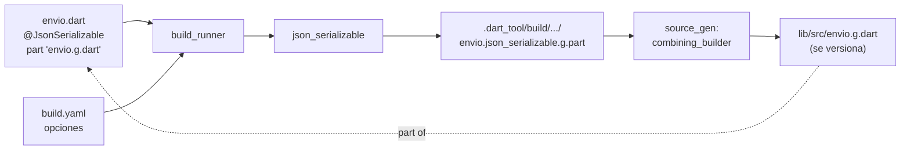
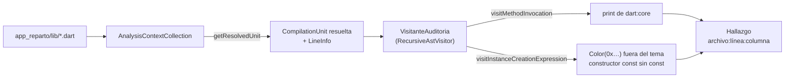
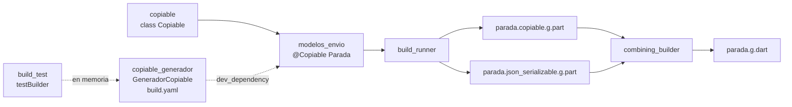
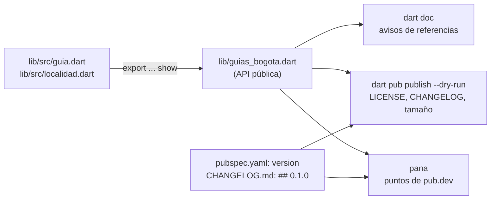

# Módulo 17: Dart avanzado: generación de código, AST y paquetes

**Entorno comprobado para esta edición (2026-11-24):** Flutter 3.50.1 (canal estable) con Dart 3.14.0 en Linux
x86_64, con `build_runner` 2.17.1, `json_serializable` 6.15.2 y `json_annotation` 4.12.0, `source_gen` 4.3.1,
`build` 5.0.0, `build_test` 3.5.23, `analyzer` 14.7.0, `pub_semver` 2.2.1 y `pana` 0.23.19. Todo se ejecutó en
`/home/estudiante/labs/flutter/m17` (tu `~/labs/flutter/m17`), que aquí es un *workspace* de pub con cinco paquetes
Dart y una app Flutter de muestra. Cada salida es de una ejecución real; los tiempos son de un equipo de pruebas de
2 núcleos compartido con otros trabajos, así que en el tuyo pueden ser menores. Las macros de Dart se probaron de
verdad y fallan: el Tema 1 muestra los errores. No se publicó nada en pub.dev: el Tema 4 llega hasta
`dart pub publish --dry-run`, que hace todas las comprobaciones locales sin subir el paquete.

Hasta ahora escribiste todo el código a mano. En un equipo hay código que se repite (leer y escribir JSON, `copyWith`),
reglas que nadie revisa a mano (no dejar `print`, no escribir colores fuera del tema) y código que otros proyectos
quieren reutilizar. Este módulo trata las tres cosas: generar código antes de compilar, leer el código como un árbol
para revisarlo con un programa y empaquetarlo para que otros lo usen sin sorpresas.

**Al terminar este módulo podrás:**
- generar la serialización JSON con `build_runner` y `json_serializable`, y saber qué pasó con las macros;
- recorrer el árbol sintáctico (AST) de un proyecto con `package:analyzer` y reportar problemas con archivo y línea;
- escribir tu propio generador con `source_gen`, configurarlo en `build.yaml` y probarlo;
- preparar un paquete para publicar: API pública, versiones, CHANGELOG, documentación, `--dry-run` y `pana`.

**Esquema del módulo:** Tema 1 (generación de código con `build_runner`) → Tema 2 (el AST con `package:analyzer`) →
Tema 3 (un generador propio con `source_gen`) → Tema 4 (diseñar, documentar y validar un paquete) → Proyecto 34.

**Qué necesitas saber antes:** del Módulo 0, **clases y constructores** (Tema 2), **el analizador y los lints**
(Tema 4), **patrones con `switch`** (Tema 6) y **extensiones** (Tema 7); del Módulo 5, **`json_serializable` y
`build_runner`** (Tema 2), que aquí se dan por sabidos; del Módulo 9, **pruebas unitarias** (Tema 1); del Módulo 12,
**las capas y su gráfico con Graphviz** (Tema 1).

**Qué no se repite:** anotar un modelo y generar su `fromJson` por primera vez (Módulo 5, Tema 2), configurar
reglas del linter en `analysis_options.yaml` (Módulo 0, Tema 4) y el CI de la app (Módulo 11, Tema 4). Aquí se trata
de lo que hay **debajo**: cómo se configura y comprueba la generación, cómo lee el analizador tu programa, cómo se
escribe un generador y cómo se entrega un paquete.

**Prepara el proyecto:**

```text
$ mkdir -p ~/labs/flutter/m17/paquetes && cd ~/labs/flutter/m17/paquetes
$ for p in modelos_envio auditor copiable copiable_generador guias_bogota; do dart create -t package $p --no-pub; done
$ cd .. && flutter create --org com.academia --platforms=linux app_reparto
$ cd paquetes/modelos_envio && dart pub add json_annotation dev:build_runner dev:json_serializable
$ cd ../auditor && dart pub add analyzer path
$ cd ../copiable_generador && dart pub add analyzer build source_gen 'copiable:{"path":"../copiable"}' dev:build_test
$ cd ../guias_bogota && dart pub add dev:pub_semver
```

Antes de los `dart pub add`, crea el `pubspec.yaml` raíz del Tema 1 y agrega `resolution: workspace` a cada
paquete. En cada `analysis_options.yaml` pon `formatter: page_width: 120`.


## Aprende construyendo


### Tema 1: Generación de código con `build_runner` y `json_serializable` (y qué pasó con las macros) · Avanzado · 50 min

<details open>
<summary><strong>Capa 1 — Lectura</strong></summary>

#### Objetivos
Al terminar este tema podrás:
- anotar modelos con `@JsonSerializable` y generar su `fromJson`/`toJson` con `build_runner`;
- explicar qué es una directiva `part` y por qué el código generado vive en otro archivo;
- configurar el generador en `build.yaml` y usar `build`, `watch` y `--only-check`;
- decidir qué se versiona y comprobar tú mismo el estado real de las macros de Dart.

**Conceptos clave:** generación de código, `build_runner`, `part`/`part of`, `build.yaml`, macros

#### El problema
El servidor de reparto manda las guías en JSON con claves `peso_kg` y `creado_en`, y estados como `en_ruta`. Cada
modelo necesita un `fromJson` y un `toJson` de 20 líneas que nadie quiere escribir. Cuando el servidor agrega un
campo, alguien actualiza el `fromJson` y olvida el `toJson`. Y en 2024 se anunció que las macros de Dart iban a
resolver esto «sin generar archivos»: ¿se puede usar eso hoy?

Este tema usa **`json_serializable` y `build_runner`** (Módulo 5, Tema 2), **enums y constructores `factory`**
(Módulo 0, Tema 2) y **la idea de capas** (Módulo 12, Tema 1): los modelos van en su propio paquete. En el Módulo 5
generaste un modelo; aquí configuras la generación para un paquete entero y la compruebas en el CI.

#### Glosario del tema

**generación de código**
- **Definición técnica:** un programa (el generador) lee tu código fuente, ya analizado, y escribe archivos `.dart` nuevos antes de compilar; el compilador nunca ve la diferencia entre código generado y escrito a mano.
- **En palabras sencillas:** un asistente que escribe por ti las partes repetitivas, siguiendo tus anotaciones.
- **Dónde se rompe la comparación:** el asistente no corre solo; si cambias el modelo y no vuelves a generar, el código queda viejo sin aviso del compilador.
- **Ejemplo:** `_$EnvioFromJson`, escrito por `json_serializable` en `envio.g.dart`.
- **Error típico:** editar a mano el `.g.dart`; la siguiente compilación lo deshace.

**`build_runner`**
- **Definición técnica:** la herramienta que encuentra los generadores (*builders*) de tus dependencias, los compila, los ejecuta sobre los archivos que cambiaron y guarda en `.dart_tool/build` qué produjo cada uno.
- **En palabras sencillas:** el capataz que llama a cada generador y lleva la cuenta de qué ya está hecho.
- **Dónde se rompe la comparación:** la primera vez compila los generadores (aquí, 55 s); después solo rehace lo que cambió (0 s).
- **Ejemplo:** `dart run build_runner build`.
- **Error típico:** usar `--delete-conflicting-outputs` por costumbre: en 2.17.1 esa opción ya no existe y se ignora.

**`part` / `part of`**
- **Definición técnica:** `part 'envio.g.dart';` declara que otro archivo forma parte de la misma biblioteca; ese archivo empieza con `part of 'envio.dart';` y puede usar lo privado (`_`) de la biblioteca.
- **En palabras sencillas:** dos hojas grapadas que se leen como un solo documento.
- **Dónde se rompe la comparación:** el generador solo escribe la hoja si la grapa ya está: sin el `part`, avisa y no genera nada.
- **Ejemplo:** `Envio.fromJson` llama a `_$EnvioFromJson`, que es privada y está en el `.g.dart`.
- **Error típico:** olvidar el `part` en un modelo nuevo y buscar el error en el generador.

**`build.yaml`**
- **Definición técnica:** archivo de configuración de `build_runner` por paquete: en qué archivos corre cada generador (`generate_for`) y con qué opciones.
- **En palabras sencillas:** las instrucciones que le dejas al capataz.
- **Dónde se rompe la comparación:** cambiar `build.yaml` rehace todo lo afectado, aunque no hayas tocado código.
- **Ejemplo:** `checked: true` para que los errores de lectura digan qué clave falló.
- **Error típico:** poner las opciones de un generador en `pubspec.yaml`, donde nadie las lee.

**macros**
- **Definición técnica:** propuesta de metaprogramación estática para Dart (`macro class`, `@JsonCodable` del paquete `json`) que generaba código durante la compilación, sin archivos aparte. El equipo de Dart detuvo el trabajo el 29 de enero de 2025.
- **En palabras sencillas:** la promesa de un asistente invisible que nunca llegó.
- **Dónde se rompe la comparación:** la bandera `macros` todavía aparece en la lista de experimentos del analizador, pero el SDK ya no trae lo que las macros necesitan.
- **Ejemplo:** `dart pub add json` falla con `_macros from sdk doesn't exist`.
- **Error típico:** seguir un tutorial de 2024 con `@JsonCodable` y perder una tarde.

#### ► CÓMO FUNCIONA
`build_runner` lee el `pubspec.yaml`, encuentra los generadores de tus `dev_dependencies` y los compila una vez. Cada
generador recorre las bibliotecas anotadas y produce un trozo (`.json_serializable.g.part`) en `.dart_tool`. Un
último paso, el `combining_builder` de `source_gen`, une todos los trozos de un archivo en un solo `.g.dart` junto a
tu código. `--only-check` hace todo eso sin escribir y falla si el disco no coincide.



#### Problema resuelto 1.1
Crea el *workspace* y el paquete `modelos_envio` con `Envio` y `Direccion` anotados. El JSON usa `snake_case`, la
ciudad es opcional (por defecto, Bogotá) y un estado desconocido no debe romper la app. Genera, lee dos envíos reales
y vuelve a escribirlos.

**Razonamiento:**
1. El `pubspec.yaml` raíz lista los paquetes en `workspace:`; así comparten una sola resolución de versiones y un solo
   `pubspec.lock`.
2. `fieldRename: FieldRename.snake` traduce `pesoKg` ↔ `peso_kg` sin escribir un `@JsonKey` por campo.
3. `unknownEnumValue` recoge cualquier estado nuevo del servidor en `desconocido`.
4. Antes de generar, el analizador ya avisa qué falta; después, `build_runner` escribe el `.g.dart`.
5. Se ejecuta dos veces `build` para ver la diferencia entre la primera compilación y una incremental.

```yaml
# pubspec.yaml (raíz) — el workspace: una sola resolución de versiones para los cinco paquetes
name: m17
publish_to: none
environment:
  sdk: ^3.14.0
workspace:
  - paquetes/modelos_envio
  - paquetes/auditor
  - paquetes/copiable
  - paquetes/copiable_generador
  - paquetes/guias_bogota
```

```dart
// lib/src/envio.dart — modelos de envío anotados; build_runner escribe envio.g.dart
import 'package:json_annotation/json_annotation.dart';

part 'envio.g.dart'; // el archivo que escribe build_runner; comparte la biblioteca con este

/// Estado de un envío tal como lo manda el servidor (`en_ruta`, `entregado`…).
@JsonEnum(fieldRename: FieldRename.snake)
enum EstadoEnvio { creado, enRuta, entregado, devuelto, desconocido }

/// Dirección de entrega.
@JsonSerializable(fieldRename: FieldRename.snake)
class Direccion {
  Direccion({required this.calle, required this.barrio, this.ciudad = 'Bogotá'});

  final String calle;
  final String barrio;
  final String ciudad; // si falta en el JSON, se usa el valor por defecto del constructor

  factory Direccion.fromJson(Map<String, dynamic> json) => _$DireccionFromJson(json);
  Map<String, dynamic> toJson() => _$DireccionToJson(this);
}

/// Un envío con su guía, su destino y su estado.
@JsonSerializable(fieldRename: FieldRename.snake, explicitToJson: true)
class Envio {
  Envio({
    required this.guia,
    required this.destinatario,
    required this.direccion,
    required this.estado,
    required this.pesoKg,
    required this.creadoEn,
    this.notas,
  });

  final String guia;
  final String destinatario;
  final Direccion direccion;
  @JsonKey(unknownEnumValue: EstadoEnvio.desconocido) // un estado nuevo del servidor no rompe la app
  final EstadoEnvio estado;
  final double pesoKg; // en el JSON: peso_kg
  final DateTime creadoEn; // en el JSON: creado_en, texto ISO 8601
  @JsonKey(includeIfNull: false) // si es nulo, no se escribe la clave
  final String? notas;

  factory Envio.fromJson(Map<String, dynamic> json) => _$EnvioFromJson(json);
  Map<String, dynamic> toJson() => _$EnvioToJson(this);

  @override
  String toString() => 'Envio($guia, ${estado.name}, $pesoKg kg, ${direccion.barrio})';
}
```

```dart
// bin/demo_envio.dart — lee dos envíos del servidor y los vuelve a escribir
import 'dart:convert';

import 'package:modelos_envio/modelos_envio.dart';

const respuesta = '''
[
  {"guia": "EN-4471", "destinatario": "Marta Gil", "estado": "en_ruta", "peso_kg": 2.5,
   "creado_en": "2026-11-24T08:15:00Z", "direccion": {"calle": "Cl 72 # 10-34", "barrio": "Chapinero"}},
  {"guia": "EN-4472", "destinatario": "Luis Pardo", "estado": "en_bodega", "peso_kg": 1,
   "creado_en": "2026-11-24T08:40:00Z", "notas": "portería",
   "direccion": {"calle": "Av 68 # 22-10", "barrio": "Fontibón", "ciudad": "Bogotá D.C."}}
]''';

void main() {
  final lista = (jsonDecode(respuesta) as List).cast<Map<String, dynamic>>();
  final envios = lista.map(Envio.fromJson).toList();
  for (final e in envios) {
    print(e);
  }
  print(jsonEncode(envios.first.toJson())); // de vuelta a JSON, con las claves en snake_case
  print(jsonEncode(envios.last.toJson()));
}
```

Antes de generar:

```text
$ cd paquetes/modelos_envio && dart analyze
Analyzing modelos_envio...

  error - lib/src/envio.dart:4:6 - Target of URI hasn't been generated: 'package:modelos_envio/src/envio.g.dart'. Try running the generator that will generate the file referenced by the URI. - uri_has_not_been_generated
  error - lib/src/envio.dart:19:60 - The method '_$DireccionFromJson' isn't defined for the type 'Direccion'. Try correcting the name to the name of an existing method, or defining a method named '_$DireccionFromJson'. - undefined_method
  error - lib/src/envio.dart:20:36 - The method '_$DireccionToJson' isn't defined for the type 'Direccion'. Try correcting the name to the name of an existing method, or defining a method named '_$DireccionToJson'. - undefined_method
  error - lib/src/envio.dart:46:56 - The method '_$EnvioFromJson' isn't defined for the type 'Envio'. Try correcting the name to the name of an existing method, or defining a method named '_$EnvioFromJson'. - undefined_method
  error - lib/src/envio.dart:47:36 - The method '_$EnvioToJson' isn't defined for the type 'Envio'. Try correcting the name to the name of an existing method, or defining a method named '_$EnvioToJson'. - undefined_method

5 issues found.
[código de salida: 3]
```

La primera generación y la segunda:

```text
$ cd paquetes/modelos_envio && dart run build_runner build
  compiling builders/aot
  55s compiling builders/aot
  0s json_serializable on 3 inputs; bin/demo_envio.dart
  3s json_serializable on 3 inputs: 1 no-op; spent 3s sdk; lib/modelos_envio.dart
  3s json_serializable on 3 inputs: 1 output, 2 no-op; spent 3s sdk
  0s source_gen:combining_builder on 3 inputs; bin/demo_envio.dart
  0s source_gen:combining_builder on 3 inputs: 1 output, 2 no-op
  Built with build_runner/aot in 59s; wrote 2 outputs.
```

```text
$ cd paquetes/modelos_envio && dart run build_runner build
  0s json_serializable on 3 inputs; bin/demo_envio.dart
  0s json_serializable on 3 inputs: 3 skipped
  0s source_gen:combining_builder on 3 inputs; bin/demo_envio.dart
  0s source_gen:combining_builder on 3 inputs: 3 skipped
  Built with build_runner/aot in 0s; wrote 0 outputs.
```

```text
$ cd paquetes/modelos_envio && dart run bin/demo_envio.dart
Envio(EN-4471, enRuta, 2.5 kg, Chapinero)
Envio(EN-4472, desconocido, 1.0 kg, Fontibón)
{"guia":"EN-4471","destinatario":"Marta Gil","direccion":{"calle":"Cl 72 # 10-34","barrio":"Chapinero","ciudad":"Bogotá"},"estado":"en_ruta","peso_kg":2.5,"creado_en":"2026-11-24T08:15:00.000Z"}
{"guia":"EN-4472","destinatario":"Luis Pardo","direccion":{"calle":"Av 68 # 22-10","barrio":"Fontibón","ciudad":"Bogotá D.C."},"estado":"desconocido","peso_kg":1.0,"creado_en":"2026-11-24T08:40:00.000Z","notas":"portería"}
```

El archivo generado, `envio.g.dart`, tiene 70 líneas; los fragmentos que importan se citan abajo (el Tema 3 muestra
uno completo).

**Explicación por partes.**
- Sin el `.g.dart` hay 5 errores: el `part` de la línea 4 apunta a un archivo que no existe
  (`uri_has_not_been_generated`) y las cuatro funciones `_$…` de las líneas 19, 20, 46 y 47 no están definidas.
- La primera compilación tardó 59 s, de los cuales 55 fueron compilar los generadores (`compiling builders/aot`). La
  segunda tardó 0 s y escribió 0 archivos: nada había cambiado (`3 skipped`).
- EN-4471 no traía `ciudad` y quedó `Bogotá`, el valor por defecto del constructor (el generador escribió
  `json['ciudad'] as String? ?? 'Bogotá'`). EN-4472 traía `"peso_kg": 1` y quedó `1.0`, porque el código hace
  `(json['peso_kg'] as num).toDouble()`.
- El estado `en_bodega` no existe en el enum y quedó `desconocido`: la app no se rompe. **Pero mira la última línea:**
  al volver a escribir el JSON sale `"estado":"desconocido"`. El valor original se perdió; si la app reenviara ese
  envío al servidor, le mandaría un estado que el servidor no conoce.
- `'notas': ?instance.notas` es un elemento de mapa con `?` (Dart 3.8): si `notas` es nulo, la clave no se escribe.
  Por eso EN-4471 no tiene `notas` en su JSON y EN-4472 sí.

> **Error común.** Usar `unknownEnumValue` en un modelo que también se envía al servidor. Lo leído se guarda como
> `desconocido` y se reenvía así, como se vio con EN-4472. Si el modelo va y vuelve, guarda también el texto original
> (un campo `String estadoOriginal`) o rechaza el dato.

> **Error común.** Olvidar `part 'envio.g.dart';` en un modelo nuevo. No es un error, es un aviso, y la compilación
> termina «bien» (código de salida 0) sin generar nada:

```text
$ cd paquetes/modelos_envio && dart run build_runner build
  0s json_serializable on 1 input; lib/src/envio.dart
  0s json_serializable on 1 input: 1 same
  0s source_gen:combining_builder on 4 inputs; bin/demo_envio.dart
W source_gen:combining_builder on lib/src/envio.dart:
  envio.g.dart must be included as a part directive in the input library with:
      part 'envio.g.dart';
  0s source_gen:combining_builder on 4 inputs: 3 skipped, 1 no-op
  Built with build_runner/aot in 0s; wrote 1 output.
```

> **Buena práctica.** Pon los modelos en su propio paquete del *workspace*. La app, las pruebas y las herramientas
> dependen de él, y `build_runner` solo corre ahí.

> **Prevenir errores.** Tras cambiar un modelo, ejecuta `build` antes de `dart analyze`. Los errores del analizador
> sobre funciones `_$…` casi siempre significan «falta generar», no «el código está mal».

#### Problema resuelto 1.2
Haz que los errores de lectura digan qué clave falló, deja el `.g.dart` intacto ante `dart format` (el proyecto usa
120 columnas), comprueba que una edición a mano se detecta y prueba el modo `watch`. Por último, intenta usar las
macros.

**Razonamiento:**
1. Por defecto, un JSON mal formado produce un `_TypeError` sin nombre de campo; `checked: true` lo envuelve.
2. `dart format --set-exit-if-changed` es lo que corre el CI: hay que ver si toca el código generado.
3. `--only-check` es la forma de comprobar en el CI que nadie olvidó generar ni editó a mano.
4. `watch` se deja abierto mientras programas; se edita el modelo y se mira qué rehace.
5. Para las macros: `dart pub add json` (el paquete de `@JsonCodable`), la bandera `--enable-experiment=macros` y el
   inventario de paquetes del SDK.

`bin/errores_json.dart` intenta leer dos envíos malos con `Envio.fromJson` dentro de un `try` e imprime el tipo y el
mensaje de cada excepción: uno sin `guia` y otro con `"peso_kg": "2,5"` (texto). Con la configuración por defecto:

```text
$ cd paquetes/modelos_envio && dart run bin/errores_json.dart
sin guía → _TypeError: type 'Null' is not a subtype of type 'String' in type cast
peso como texto → _TypeError: type 'String' is not a subtype of type 'num' in type cast
```

```yaml
# paquetes/modelos_envio/build.yaml — opciones de los generadores en este paquete
targets:
  $default:
    builders:
      source_gen:combining_builder:
        options:
          preamble: "// dart format width=80" # el código generado viene a 80 columnas; así dart format no lo cambia
      json_serializable:
        generate_for:
          - lib/src/** # solo busca anotaciones aquí: menos archivos que revisar en cada compilación
        options:
          checked: true # los errores de lectura dicen qué clave y qué clase fallaron
```

Con `checked: true`:

```text
$ cd paquetes/modelos_envio && dart run bin/errores_json.dart
sin guía → CheckedFromJsonException: CheckedFromJsonException
Could not create `Envio`.
There is a problem with "guia".
type 'Null' is not a subtype of type 'String' in type cast
peso como texto → CheckedFromJsonException: CheckedFromJsonException
Could not create `Envio`.
There is a problem with "peso_kg".
type 'String' is not a subtype of type 'num' in type cast
```

Antes de agregar `preamble` al `build.yaml`, el formateador cambiaba el archivo generado:

```text
$ cd paquetes/modelos_envio && dart format --output=none --set-exit-if-changed lib
Changed lib/src/envio.g.dart
Formatted 3 files (1 changed) in 0.07 seconds.
[código de salida: 1]
```

Con `preamble`:

```text
$ cd paquetes/modelos_envio && dart format --output=none --set-exit-if-changed lib
Formatted 3 files (0 changed) in 0.01 seconds.
```

Se editó a mano `envio.g.dart` (`'peso_kg'` → `'peso'`) y se comprobó:

```text
$ cd paquetes/modelos_envio && dart run build_runner build --only-check
  0s json_serializable on 1 input; lib/src/envio.dart
  0s json_serializable on 1 input: 1 skipped
  0s source_gen:combining_builder on 3 inputs; bin/demo_envio.dart
  0s source_gen:combining_builder on 3 inputs: 2 skipped, 1 fixed
E Verify failed due to Incorrect|Missing|Unexpected:
  
  I lib/src/envio.g.dart
  Failed to build with build_runner/aot in 0s; wrote 1 output.
[código de salida: 1]
```

```text
$ cd paquetes/modelos_envio && dart run build_runner build --delete-conflicting-outputs
W These options have been removed and were ignored: --delete-conflicting-outputs
  0s json_serializable on 1 input; lib/src/envio.dart
  0s json_serializable on 1 input: 1 skipped
  0s source_gen:combining_builder on 3 inputs; bin/demo_envio.dart
  0s source_gen:combining_builder on 3 inputs: 2 skipped, 1 fixed
  Built with build_runner/aot in 0s; wrote 1 output.
```

`watch`, con tres cambios mientras corría: agregar un campo `intentos` al modelo, escribir una línea a mano al final
del `.g.dart` y quitar el campo:

```text
$ cd paquetes/modelos_envio && dart run build_runner watch
  0s json_serializable on 1 input; lib/src/envio.dart
  0s json_serializable on 1 input: 1 skipped
  0s source_gen:combining_builder on 4 inputs; bin/demo_envio.dart
  0s source_gen:combining_builder on 4 inputs: 4 skipped
  Built with build_runner/aot in 0s; wrote 0 outputs.

Starting build #2.

  0s json_serializable on 1 input; lib/src/envio.dart
  0s json_serializable on 1 input: 1 output
  0s source_gen:combining_builder on 4 inputs; bin/demo_envio.dart
  0s source_gen:combining_builder on 4 inputs: 1 skipped; bin/errores_json.dart
  0s source_gen:combining_builder on 4 inputs: 3 skipped, 1 output
  Built with build_runner/aot in 0s; wrote 2 outputs.

Starting build #3.

  0s json_serializable on 1 input; lib/src/envio.dart
  0s json_serializable on 1 input: 1 skipped
  0s source_gen:combining_builder on 4 inputs; bin/demo_envio.dart
  0s source_gen:combining_builder on 4 inputs: 1 skipped; bin/errores_json.dart
  0s source_gen:combining_builder on 4 inputs: 3 skipped, 1 fixed
  Built with build_runner/aot in 0s; wrote 1 output.

Starting build #4.

  0s json_serializable on 1 input; lib/src/envio.dart
  0s json_serializable on 1 input: 1 output
  0s source_gen:combining_builder on 4 inputs; bin/demo_envio.dart
  0s source_gen:combining_builder on 4 inputs: 1 skipped; bin/errores_json.dart
  0s source_gen:combining_builder on 4 inputs: 3 skipped, 1 output
  Built with build_runner/aot in 0s; wrote 2 outputs.
```

Las macros:

```text
$ cd macros_prueba && dart pub add json
Because macros >=0.1.0-main.5 <0.1.0-main.6 depends on _macros 0.1.5 from sdk and macros >=0.1.0-main.6 <0.1.0-main.7 depends on _macros 0.1.6 from sdk, macros >=0.1.0-main.5 <0.1.0-main.7 requires _macros 0.1.5 or 0.1.6 from sdk.
And because macros >=0.1.0-main.7 <0.1.1-main.0 depends on _macros 0.1.7 from sdk, macros >=0.1.0-main.5 <0.1.1-main.0 requires _macros 0.1.5 or 0.1.6 or 0.1.7 from sdk.
And because macros >=0.1.1-main.0 <0.1.2-main.0 depends on _macros 0.2.0 from sdk and macros >=0.1.2-main.0 <0.1.2-main.2 depends on _macros 0.3.0 from sdk, macros >=0.1.0-main.5 <0.1.2-main.2 requires _macros 0.1.5 or 0.1.6 or 0.1.7 or 0.2.0 or 0.3.0 from sdk.
And because macros >=0.1.2-main.2 <0.1.2-main.4 depends on _macros 0.3.1 from sdk and macros >=0.1.2-main.4 <0.1.3-main.0 depends on _macros 0.3.2 from sdk, macros >=0.1.0-main.5 <0.1.3-main.0 requires _macros 0.1.5 or 0.1.6 or 0.1.7 or 0.2.0 or 0.3.0 or 0.3.1 or 0.3.2 from sdk.
Because json <0.20.2 depends on macros 0.1.0-main.5 and json >=0.20.2 depends on macros ^0.1.0-main.5, every version of json requires macros ^0.1.0-main.5.
Thus, every version of json requires _macros 0.1.5 or 0.1.6 or 0.1.7 or 0.2.0 or 0.3.0 or 0.3.1 or 0.3.2 from sdk or macros ^0.1.3-main.0.
And because macros >=0.1.3-main.0 depends on _macros 0.3.3 from sdk, every version of json requires _macros 0.1.5 or 0.1.6 or 0.1.7 or 0.2.0 or 0.3.0 or 0.3.1 or 0.3.2 or 0.3.3 from sdk.
So, because _macros from sdk doesn't exist (could not find package _macros in the Dart SDK) and macros_prueba depends on json any, version solving failed.
[código de salida: 65]
```

```text
$ cd macros_prueba && dart run --enable-experiment=macros bin/macros_prueba.dart
bin/macros_prueba.dart:2:1: Error: Variables must be declared using the keywords 'const', 'final', 'var' or a type name.
Try adding the name of the type of the variable or the keyword 'var'.
macro class Saludo {
^^^^^
bin/macros_prueba.dart:2:1: Error: Expected ';' after this.
macro class Saludo {
^^^^^
[código de salida: 254]
```

```text
$ cat ~/sdk/flutter/bin/cache/dart-sdk/sdk_packages.yaml
# Describes the SDK vendored packages shipped with the Dart SDK.
version: 1
sdk: dart
# Note that paths are relative to the root of the built SDK.
packages: []
```

**Explicación por partes.**
- Sin `checked`, los dos errores son el mismo `_TypeError` sin decir dónde. Con `checked: true`, cada uno dice la
  clase (`Envio`) y la clave (`guia`, `peso_kg`). En el Módulo 5 lo pusiste en la anotación de una clase; en
  `build.yaml` vale para todas las del paquete. El código generado cambia a `$checkedCreate`/`$checkedConvert`.
- **El hallazgo del formato:** el archivo combinado sale formateado a 80 columnas y sin el comentario
  `// dart format width=80`. En `source_gen` 4.3.1 ese comentario solo lo agregan `LibraryBuilder` y `PartBuilder`; el
  `combining_builder` no. Con `page_width: 120`, `dart format` lo reescribe y el CI falla. La opción `preamble` del
  `combining_builder` pone el comentario y el formateador lo respeta (`0 changed`).
- `--only-check` encontró la edición (`I lib/src/envio.g.dart`, *Incorrect*), terminó con código 1 y **no** escribió
  nada, aunque la última línea diga `wrote 1 output` (se comprobó con `grep` que la edición seguía ahí).
- `--delete-conflicting-outputs`, la opción que repiten casi todos los tutoriales, dio
  `These options have been removed and were ignored`. Desde `build_runner` 2.16.0, `build` siempre corrige los
  archivos generados incorrectos (`1 fixed`).
- En `watch`, la compilación #2 regeneró por el campo nuevo, la #3 deshizo la edición a mano (`1 fixed`) y la #4
  volvió al estado original. Todas en 0 s.
- **Las macros no existen en Dart 3.14.** `json` (el paquete de `@JsonCodable`) depende de `macros`, que necesita
  `_macros` del SDK, y el SDK declara `packages: []`. La bandera `--enable-experiment=macros` no da error, pero el
  analizador no entiende `macro class` (`Variables must be declared using the keywords…`). En el código de
  `_fe_analyzer_shared` 111.0.0 la bandera sigue declarada (`isExpired: false`): por eso no se queja de ella. El equipo
  de Dart anunció el 29 de enero de 2025 («An update on Dart macros & data serialization», en dart.dev) que dejaba
  el trabajo en las macros por su costo en el rendimiento del editor y de la compilación incremental, y que invertiría
  en mejorar los tiempos y la experiencia de la generación de código con `build_runner`.

> **Error común.** Comprobar en el CI con `build` y luego buscar cambios en el repositorio (como en el Módulo 5): si
> el paso olvida mirar el `git diff`, pasa aunque falte generar. `--only-check` no escribe, falla con código 1 y dice
> qué archivo no coincide.

> **Error común.** Formatear todo el repositorio con un ancho distinto de 80 sin el `preamble`. Cada formateo
> «cambia» los `.g.dart`, el CI falla y la siguiente generación los vuelve a cambiar.

> **Buena práctica.** Versiona los `.g.dart`. Quien clona el proyecto compila sin generar, el CI los compara con
> `--only-check` y, si publicas el paquete, deben ir dentro: pub.dev no ejecuta `build_runner` por ti.

> **Prevenir errores.** Activa `checked: true` en los modelos que vienen de la red. El mensaje
> `There is a problem with "peso_kg"` ahorra la búsqueda.

`freezed` (4.0.3) también se resuelve con estas versiones; no se usa aquí porque agrega clases inmutables y uniones,
que este módulo no necesita. Para `copyWith`, el Tema 3 escribe su propio generador.

```text
# .gitignore (raíz) — qué no se versiona en el workspace
# Cachés y compilaciones: se regeneran
.dart_tool/
build/
# Documentación de dart doc: pub.dev la genera al publicar
doc/api/
# Los *.g.dart SÍ se versionan: el paquete se publica con ellos y el CI los comprueba con --only-check
```

#### Checkpoint 1.1
En el CI, `dart run build_runner build --only-check` termina con código 1. ¿Qué dos situaciones lo explican, y por
qué no se arregla con `--delete-conflicting-outputs`?

Respuesta: alguien cambió un modelo y no volvió a generar (el `.g.dart` está viejo o falta), o alguien editó a mano un
`.g.dart`. `--delete-conflicting-outputs` ya no existe en `build_runner` 2.17.1: se ignora con un aviso. Lo que
arregla es ejecutar `build` y versionar el resultado.

</details>

<details>
<summary><strong>Capa 2 — Construcción</strong></summary>

#### Paso 1 · Crea el workspace
Crea el `pubspec.yaml` raíz y los cinco paquetes con `resolution: workspace`. Ejecuta `dart pub get` en la raíz y
comprueba que solo hay un `pubspec.lock`, en la raíz.

#### Paso 2 · Genera los modelos
Escribe `envio.dart` y `demo_envio.dart`. Ejecuta `dart analyze` (5 errores), `dart run build_runner build` y la
demostración.

#### Paso 3 · Configura el generador
Agrega `build.yaml` con `preamble`, `generate_for` y `checked`. Vuelve a generar, ejecuta `errores_json.dart` y
`dart format --output=none --set-exit-if-changed lib`.

#### Paso 4 · Rompe y comprueba
Edita a mano el `.g.dart` y ejecuta `build --only-check`. Después, quita el `part` de `envio.dart` y genera. Vuelve a
ponerlo.

#### Paso 5 · Prueba las macros
En una carpeta aparte (`macros_prueba`), ejecuta `dart pub add json` y un programa con `macro class` con
`--enable-experiment=macros`. Anota los dos errores.

#### Resumen
- La **generación de código** escribe archivos `.dart` antes de compilar; **`build_runner`** la coordina y solo rehace
  lo que cambió.
- El código generado se une a tu biblioteca con **`part`/`part of`**.
- **`build.yaml`** configura cada generador; `checked: true` y `preamble` evitan dos problemas reales.
- `--only-check` es la comprobación del CI; `--delete-conflicting-outputs` ya no existe.
- Las **macros** se cancelaron en 2025: en Dart 3.14, `json` no se resuelve y `macro class` no compila.

#### Ejercicio verificable 1
Básico. ¿Cuánto tardó la primera generación, cuánto la segunda y por qué?

Respuesta esperada: 59 s y 0 s; la primera compiló los generadores (55 s) y la segunda no tenía nada que rehacer
(`3 skipped`).

#### Ejercicio verificable 2
Intermedio. ¿Qué valor de `estado` tiene EN-4472 en el JSON que se vuelve a escribir, y por qué es un problema?

Respuesta esperada: `"desconocido"`; el servidor mandó `en_bodega`, se guardó como `desconocido` y se perdió el valor
original, así que un reenvío mandaría un estado que el servidor no conoce.

#### Ejercicio verificable 3
Reto. Sin `preamble`, ¿por qué `dart format --set-exit-if-changed` falla solo en `envio.g.dart`?

Respuesta esperada: el `combining_builder` de `source_gen` 4.3.1 formatea a 80 columnas pero no escribe el comentario
`// dart format width=80`; el proyecto usa `page_width: 120`, así que el formateador junta líneas de ese archivo. Los
archivos escritos a mano ya están a 120.

#### En el trabajo
Casi todos los proyectos Flutter grandes generan código: JSON, rutas, inyección de dependencias, traducciones. Los
equipos fijan la versión de `build_runner` en el `pubspec.lock`, versionan los `.g.dart`, ponen
`build_runner build --only-check` en el CI y revisan los `.g.dart` en las revisiones de código como cualquier otro
archivo.

</details>

### Tema 2: Recorrer el AST con `package:analyzer`: un auditor con archivo y línea · Avanzado · 50 min

<details open>
<summary><strong>Capa 1 — Lectura</strong></summary>

#### Objetivos
Al terminar este tema podrás:
- leer el AST de un archivo Dart sin resolver (`parseFile`) y resuelto (`getResolvedUnit`), y saber cuándo usar cada uno;
- escribir un `RecursiveAstVisitor` que detecte patrones y los reporte con archivo, línea y columna;
- dibujar el árbol con Graphviz para entenderlo;
- comparar tu herramienta con las reglas del analizador y medir lo que cuesta resolver tipos.

**Conceptos clave:** AST, análisis sin resolver y resuelto, visitante, elemento, `AnalysisContextCollection`

#### El problema
La guía de estilo de la app de reparto dice: nada de `print` en producción, los colores se escriben solo en
`tema.dart` y los widgets que pueden ser `const` deben serlo. En las revisiones de código siempre se escapa alguno. Y
`flutter analyze` solo encontró 2 problemas en una app que tiene 8.

Este tema usa **el analizador, los lints y `prefer_const_constructors`** (Módulo 0, Tema 4), **los colores del
tema** (Módulo 10, Tema 1), **los tres árboles y `const`** (Módulo 1, Tema 6) y **los patrones con `switch`**
(Módulo 0, Tema 6).

#### Glosario del tema

**AST (árbol sintáctico abstracto)**
- **Definición técnica:** representación del código como un árbol de nodos tipados (`MethodInvocation`, `ArgumentList`, `IntegerLiteral`…), cuyas hojas son los *tokens* del texto; cada nodo sabe su posición (`offset`) en el archivo.
- **En palabras sencillas:** el esquema gramatical de una frase, pero de tu código.
- **Dónde se rompe la comparación:** el mismo texto puede dar nodos distintos según si se conocen los tipos o no.
- **Ejemplo:** `Color(0xFFB26A00)` es un `MethodInvocation` sin resolver y un `InstanceCreationExpression` resuelto.
- **Error típico:** buscar con expresiones regulares lo que el AST ya distingue (un `print` en un comentario, un método propio llamado `print`).

**análisis sin resolver y resuelto**
- **Definición técnica:** `parseFile`/`parseString` solo leen la sintaxis de un archivo; `getResolvedUnit` además carga los `import`, decide qué es cada nombre y anota tipos y elementos en el árbol.
- **En palabras sencillas:** leer una frase sin diccionario o con diccionario.
- **Dónde se rompe la comparación:** el diccionario de una app Flutter es todo Flutter: resolver cuesta decenas de segundos y cerca de 1 GB de memoria la primera vez.
- **Ejemplo:** sin resolver no se sabe si `Color(…)` es una clase o una función.
- **Error típico:** resolver cuando solo necesitas sintaxis (por ejemplo, contar `TODO` o líneas largas).

**visitante (`RecursiveAstVisitor`)**
- **Definición técnica:** clase con un método `visitX` por tipo de nodo; `RecursiveAstVisitor` recorre todo el árbol y llama al tuyo cuando encuentra ese tipo. Debes llamar a `super.visitX(node)` para seguir bajando.
- **En palabras sencillas:** un inspector que pasa por cada habitación y solo se detiene en las que le interesan.
- **Dónde se rompe la comparación:** si no llamas a `super`, no entra a los hijos y pierdes hallazgos anidados.
- **Ejemplo:** `visitMethodInvocation` para `print`, `visitInstanceCreationExpression` para colores y `const`.
- **Error típico:** olvidar `super.visitX` y no ver el `print` que está dentro de otra llamada.

**elemento**
- **Definición técnica:** la declaración a la que apunta un nombre en el AST resuelto (`ConstructorElement`, `TopLevelFunctionElement`, `GetterElement`), con su biblioteca, si es `const`, sus parámetros, etc.
- **En palabras sencillas:** la ficha de identidad de cada nombre.
- **Dónde se rompe la comparación:** solo existe si el código compila; si no, `element` es `null`.
- **Ejemplo:** el `print` de `dart:core` tiene `library.isDartCore == true`; uno tuyo, no.
- **Error típico:** comparar solo el nombre (`name == 'print'`) y reportar un método propio.

**`AnalysisContextCollection`**
- **Definición técnica:** punto de entrada de `package:analyzer` que, a partir de unas carpetas, encuentra sus `pubspec.yaml` y `package_config.json`, crea los contextos de análisis y entrega unidades resueltas.
- **En palabras sencillas:** el analizador de `dart analyze`, pero como biblioteca.
- **Dónde se rompe la comparación:** a diferencia del servidor de análisis del editor, no guarda nada en disco entre ejecuciones (salvo que se lo pidas).
- **Ejemplo:** `AnalysisContextCollection(includedPaths: ['/…/app_reparto/lib'])`.
- **Error típico:** pasar rutas relativas: deben ser absolutas y normalizadas.

#### ► CÓMO FUNCIONA
El auditor crea una colección de contextos sobre `lib/` de la app, pide cada archivo resuelto y lo recorre con un
visitante. El visitante mira los nodos que le interesan, consulta sus elementos (¿es el `print` de `dart:core`?, ¿el
constructor es `const`?) y anota un hallazgo con la línea y la columna que da `LineInfo`.



#### Problema resuelto 2.1
Dibuja el árbol de `Color(0xFFB26A00)` sin resolver y resuelto, y explica la diferencia.

**Razonamiento:**
1. La muestra es una sola variable global en `app_reparto/tool/muestra_arbol.dart`, que importa `material_ui`.
2. `arbolEnTexto` recorre `childEntities`: los nodos y los *tokens* en orden. Si el nodo es una expresión resuelta,
   muestra su tipo estático.
3. `arbolEnDot` escribe el mismo árbol en DOT; Graphviz (`dot -Tpng`) lo dibuja.

```dart
// tool/muestra_arbol.dart — una línea para dibujar su árbol
import 'package:material_ui/material_ui.dart';

final pendiente = Color(0xFFB26A00);
```

`lib/src/arbol.dart` (en el laboratorio) tiene dos funciones recursivas sobre `childEntities`: `arbolEnTexto`, que
escribe cada nodo con su sangría (y `: tipo` si `staticType` no es nulo) y cada *token* entre comillas, y `arbolEnDot`,
que escribe lo mismo como nodos y flechas de Graphviz.

```dart
// bin/arbol.dart — el mismo código, sin resolver y resuelto
import 'dart:io';

import 'package:analyzer/dart/analysis/analysis_context_collection.dart';
import 'package:analyzer/dart/analysis/features.dart';
import 'package:analyzer/dart/analysis/results.dart';
import 'package:analyzer/dart/analysis/utilities.dart';
import 'package:analyzer/dart/ast/ast.dart';
import 'package:auditor/src/arbol.dart';
import 'package:path/path.dart' as p;

/// Imprime el AST del inicializador de la primera variable global de un archivo, sin resolver y resuelto,
/// y escribe los dos árboles en DOT.
Future<void> main(List<String> argumentos) async {
  final archivo = p.normalize(p.absolute(argumentos[0]));
  final carpetaDot = argumentos[1];

  // 1. Solo sintaxis: rápido, sin tipos ni imports.
  final sinResolver = parseFile(path: archivo, featureSet: FeatureSet.latestLanguageVersion()).unit;
  final expresion1 = _inicializador(sinResolver);
  print('--- sin resolver (parseFile) ---');
  print(arbolEnTexto(expresion1));

  // 2. Resuelto: carga los imports (aquí, Flutter) y reescribe los nodos que la sintaxis no podía decidir.
  final coleccion = AnalysisContextCollection(includedPaths: [archivo]);
  final resultado = await coleccion.contextFor(archivo).currentSession.getResolvedUnit(archivo);
  final expresion2 = _inicializador((resultado as ResolvedUnitResult).unit);
  print('--- resuelto (getResolvedUnit) ---');
  print(arbolEnTexto(expresion2));
  await coleccion.dispose();

  File(p.join(carpetaDot, 'sin_resolver.dot')).writeAsStringSync(arbolEnDot(expresion1, 'sin resolver'));
  File(p.join(carpetaDot, 'resuelto.dot')).writeAsStringSync(arbolEnDot(expresion2, 'resuelto'));
}

Expression _inicializador(CompilationUnit unidad) =>
    unidad.declarations.whereType<TopLevelVariableDeclaration>().first.variables.variables.first.initializer!;
```

```text
$ cd paquetes/auditor && dart run auditor:arbol ../../app_reparto/tool/muestra_arbol.dart /tmp/fl/m17/dot
--- sin resolver (parseFile) ---
MethodInvocation
  SimpleIdentifier
    "Color"
  ArgumentList
    "("
    IntegerLiteral
      "0xFFB26A00"
    ")"

--- resuelto (getResolvedUnit) ---
InstanceCreationExpression  : Color
  ConstructorName
    NamedType
      "Color"
  ArgumentList
    "("
    IntegerLiteral  : int
      "0xFFB26A00"
    ")"
```

```text
$ dot -Tpng sin_resolver.dot -o sin.png && dot -Tpng resuelto.dot -o res.png
```


**Explicación por partes.**
- Sin resolver, `Color(0xFFB26A00)` es un `MethodInvocation`: sin leer `material_ui`, el analizador no sabe si `Color`
  es una clase o una función. Sintácticamente, las dos se escriben igual.
- Al resolver, el analizador **reescribe** el nodo como `InstanceCreationExpression` con un `ConstructorName`, y anota
  los tipos (`Color`, `int`). Una regla que busque «creaciones de `Color`» en el árbol sin resolver no encuentra nada.
- Los *tokens* (`"("`, `"0xFFB26A00"`, `")"`) son las hojas; los nodos son la estructura. `childEntities` da los dos
  en orden de aparición.

> **Error común.** Escribir el auditor con `parseFile` porque es rápido y buscar `InstanceCreationExpression`. Solo
> encontrarías los `Color` escritos con `const` o `new`, que sí se reconocen sin tipos.

> **Error común.** Copiar código de un tutorial con `NamedExpression`. En `analyzer` 13.0.0 se eliminó: los argumentos
> con nombre ahora son `NamedArgument` y `ArgumentList.arguments` devuelve `NodeList<Argument>`. El primer intento de
> este tema falló así: `The argument type 'bool Function(Expression)' can't be assigned to the parameter type
> 'bool Function(Argument)'` y `Undefined class 'NamedExpression'`. Usa `argument.argumentExpression`.

> **Buena práctica.** Dibuja el árbol del caso que quieres detectar antes de escribir el visitante: te dice qué nodo
> visitar y qué propiedades leer.

> **Prevenir errores.** Fija la versión mayor de `analyzer` en el `pubspec.yaml` (`^14.7.0`) y lee su `CHANGELOG`
> antes de subirla: cada versión mayor trae varios cambios marcados **Breaking Change**.

#### Problema resuelto 2.2
Escribe el auditor: recorre `app_reparto/lib`, reporta `print`, colores escritos fuera de `lib/tema.dart` y
constructores `const` usados sin `const`, con archivo, línea y columna. Que el CI falle si hay hallazgos. Compáralo
con `flutter analyze`.

**Razonamiento:**
1. Hace falta el AST resuelto: para saber que `print` es el de `dart:core`, que `Color` es la clase de `dart:ui` y si
   un constructor es `const`.
2. «Podría ser `const`»: el constructor es `const`, no hay `const` ni contexto constante, y todos los argumentos son
   constantes (literales, variables `const`, otros constructores `const`). Solo se reporta el más externo.
3. `exitCode = 1` si hay hallazgos.
4. Resolver una app Flutter es caro; se mide con y sin una caché en disco.
5. Una prueba con un proyecto temporal sin Flutter comprueba la regla de `const` y el `print` propio.

`app_reparto/lib/tema.dart` define `ColoresMarca.primario`, `entregado` y `pendiente` como `static const Color(0x…)`:
es el único archivo donde los colores se escriben a mano.

```dart
// lib/widgets/tarjeta_envio.dart — una tarjeta con tres problemas a propósito: print, color a mano y falta const
import 'package:material_ui/material_ui.dart';

import '../tema.dart';

/// Tarjeta de una guía en la lista de la ruta.
class TarjetaEnvio extends StatelessWidget {
  const TarjetaEnvio({super.key, required this.guia, required this.barrio, required this.entregado});

  final String guia;
  final String barrio;
  final bool entregado;

  @override
  Widget build(BuildContext context) {
    print('construyendo $guia'); // depuración olvidada
    return Card(
      child: ListTile(
        leading: Icon(Icons.local_shipping, color: entregado ? ColoresMarca.entregado : Color(0xFFB26A00)),
        title: Text(guia),
        subtitle: Text(barrio),
        trailing: Padding(padding: EdgeInsets.all(8), child: Text('ver')),
      ),
    );
  }
}
```

```dart
// lib/pantallas/lista_envios.dart — la lista de la ruta, con un color a mano y un Text sin const
import 'package:material_ui/material_ui.dart';

import '../widgets/tarjeta_envio.dart';

/// Pantalla con las guías de la ruta del día.
class ListaEnvios extends StatelessWidget {
  const ListaEnvios({super.key});

  static const envios = [('EN-4471', 'Chapinero', true), ('EN-4472', 'Fontibón', false), ('EN-4473', 'Suba', false)];

  @override
  Widget build(BuildContext context) {
    return Scaffold(
      appBar: AppBar(title: Text('Ruta norte-3'), backgroundColor: Color.fromARGB(255, 11, 95, 255)),
      body: ListView(
        children: [
          for (final (guia, barrio, entregado) in envios)
            TarjetaEnvio(guia: guia, barrio: barrio, entregado: entregado),
          const SizedBox(height: 16),
        ],
      ),
    );
  }
}
```

`hallazgo.dart` define el `enum Regla` (`print`, `color-a-mano`, `falta-const`) y la clase `Hallazgo` (archivo,
línea, columna, regla y fragmento), cuyo `toString` da el formato `archivo:línea:columna  regla  código`.

```dart
// lib/src/visitante.dart — recorre el AST resuelto y anota los hallazgos de las tres reglas
import 'package:analyzer/dart/ast/ast.dart';
import 'package:analyzer/dart/ast/visitor.dart';
import 'package:analyzer/dart/element/element.dart';
import 'package:analyzer/source/line_info.dart';

import 'hallazgo.dart';

/// Recorre un AST **resuelto** y anota los hallazgos de las tres reglas.
class VisitanteAuditoria extends RecursiveAstVisitor<void> {
  VisitanteAuditoria(this._lineas, this._archivo, {this.permitirColores = false});

  final LineInfo _lineas;
  final String _archivo;
  final bool permitirColores; // true en el archivo del tema, donde sí se definen los colores
  final hallazgos = <Hallazgo>[];
  int _dentroDeConstPosible = 0; // > 0 mientras recorremos algo que ya se reportó como «podría ser const»

  void _anotar(AstNode nodo, Regla regla) {
    final pos = _lineas.getLocation(nodo.offset);
    var codigo = nodo.toSource();
    if (codigo.length > 60) codigo = '${codigo.substring(0, 57)}...';
    hallazgos.add(Hallazgo(_archivo, pos.lineNumber, pos.columnNumber, regla, codigo));
  }

  @override
  void visitMethodInvocation(MethodInvocation node) {
    final funcion = node.methodName.element;
    if (node.target == null &&
        node.methodName.name == 'print' &&
        funcion is TopLevelFunctionElement &&
        funcion.library.isDartCore) {
      _anotar(node, Regla.printOlvidado); // el print de dart:core, no un método propio que se llame igual
    }
    super.visitMethodInvocation(node);
  }

  @override
  void visitInstanceCreationExpression(InstanceCreationExpression node) {
    final constructor = node.constructorName.element; // null si el código no compila
    if (constructor != null) {
      final clase = constructor.enclosingElement;
      if (!permitirColores &&
          clase.name == 'Color' &&
          clase.library.uri.toString() == 'dart:ui' &&
          node.argumentList.arguments.every((a) => a is IntegerLiteral)) {
        _anotar(node, Regla.colorAMano);
      }
      if (_dentroDeConstPosible == 0 &&
          node.keyword == null &&
          !node.isConst && // en un contexto const ya lo es, aunque no lleve la palabra
          constructor.isConst &&
          node.argumentList.arguments.every((a) => _esConstante(a.argumentExpression))) {
        _anotar(node, Regla.faltaConst);
        _dentroDeConstPosible++; // solo el más externo: si él lleva const, los de dentro también
        super.visitInstanceCreationExpression(node);
        _dentroDeConstPosible--;
        return;
      }
    }
    super.visitInstanceCreationExpression(node);
  }

  /// ¿Esta expresión podría evaluarse en tiempo de compilación? (`argumentExpression` ya quita el `nombre:`)
  bool _esConstante(Expression e) => switch (e) {
    IntegerLiteral() || DoubleLiteral() || BooleanLiteral() || NullLiteral() || SimpleStringLiteral() => true,
    PrefixExpression(:final operand) => _esConstante(operand),
    InstanceCreationExpression() =>
      e.isConst ||
          (e.constructorName.element?.isConst ?? false) &&
              e.argumentList.arguments.every((a) => _esConstante(a.argumentExpression)),
    Identifier(:final element) => _esVariableConst(element), // ColoresMarca.entregado, Icons.local_shipping
    ConditionalExpression() =>
      _esConstante(e.condition) && _esConstante(e.thenExpression) && _esConstante(e.elseExpression),
    _ => false, // interpolaciones, llamadas, variables normales…
  };

  bool _esVariableConst(Element? elemento) => switch (elemento) {
    GetterElement(:final variable) => variable.isConst,
    VariableElement(:final isConst) => isConst,
    _ => false,
  };
}
```

```dart
// lib/src/auditar.dart — resuelve cada archivo de lib/ y le pasa el visitante
import 'dart:io';

import 'package:analyzer/dart/analysis/analysis_context_collection.dart';
import 'package:analyzer/dart/analysis/results.dart';
// La caché en disco no está en la API pública: se importa de src/ y puede cambiar en cualquier versión.
// ignore: implementation_imports
import 'package:analyzer/src/dart/analysis/analysis_context_collection.dart';
// ignore: implementation_imports
import 'package:analyzer/src/dart/analysis/file_byte_store.dart';
import 'package:path/path.dart' as p;

import 'hallazgo.dart';
import 'visitante.dart';

/// Analiza, con tipos resueltos, todos los `.dart` de `lib/` del proyecto en [raiz].
///
/// Si das [cache], los resúmenes de las bibliotecas (Flutter incluido) se guardan en esa carpeta
/// y la siguiente ejecución no los vuelve a calcular.
Future<List<Hallazgo>> auditar(String raiz, {String? cache}) async {
  final absoluta = p.normalize(p.absolute(raiz));
  final incluidas = [p.join(absoluta, 'lib')];
  FileByteStore? almacen;
  if (cache != null) {
    Directory(cache).createSync(recursive: true);
    almacen = FileByteStore(p.normalize(p.absolute(cache)));
  }
  final AnalysisContextCollection coleccion = almacen == null
      ? AnalysisContextCollection(includedPaths: incluidas) // API pública: todo en memoria
      : AnalysisContextCollectionImpl(includedPaths: incluidas, byteStore: almacen);
  final hallazgos = <Hallazgo>[];
  for (final contexto in coleccion.contexts) {
    final archivos =
        contexto.contextRoot.analyzedFiles().where((f) => f.endsWith('.dart') && !f.endsWith('.g.dart')).toList()
          ..sort();
    for (final archivo in archivos) {
      final resultado = await contexto.currentSession.getResolvedUnit(archivo);
      if (resultado is! ResolvedUnitResult) continue;
      final relativo = p.relative(archivo, from: absoluta);
      final visitante = VisitanteAuditoria(
        resultado.lineInfo,
        relativo,
        permitirColores: relativo == p.join('lib', 'tema.dart'),
      );
      resultado.unit.accept(visitante);
      hallazgos.addAll(visitante.hallazgos);
    }
  }
  await coleccion.dispose();
  await almacen?.flush(); // espera a que terminen de escribirse los archivos de la caché
  return hallazgos;
}
```

```dart
// bin/auditar.dart — la línea de comandos del auditor; código 1 si hay hallazgos
import 'dart:io';

import 'package:auditor/auditor.dart';

Future<void> main(List<String> argumentos) async {
  final cache = argumentos.contains('--cache') ? '.dart_tool/auditor_cache' : null;
  final rutas = argumentos.where((a) => !a.startsWith('--')).toList();
  if (rutas.length != 1) {
    stderr.writeln('uso: dart run auditor:auditar [--cache] <carpeta del proyecto>');
    exit(64);
  }
  final reloj = Stopwatch()..start();
  final hallazgos = await auditar(rutas.single, cache: cache);
  hallazgos.forEach(print);
  final porRegla = {for (final r in Regla.values) r.codigo: hallazgos.where((h) => h.regla == r).length};
  print('${hallazgos.length} hallazgos $porRegla en ${reloj.elapsedMilliseconds} ms');
  exitCode = hallazgos.isEmpty ? 0 : 1; // para que el CI falle si hay hallazgos
}
```

```text
$ cd paquetes/auditor && dart run auditor:auditar ../../app_reparto
lib/main.dart:8:3  print        print('inicio de la app')
lib/pantallas/lista_envios.dart:15:29  falta-const  Text('Ruta norte-3')
lib/pantallas/lista_envios.dart:15:68  color-a-mano Color.fromARGB(255, 11, 95, 255)
lib/pantallas/lista_envios.dart:15:68  falta-const  Color.fromARGB(255, 11, 95, 255)
lib/widgets/tarjeta_envio.dart:16:5  print        print('construyendo $guia')
lib/widgets/tarjeta_envio.dart:19:89  color-a-mano Color(0xFFB26A00)
lib/widgets/tarjeta_envio.dart:19:89  falta-const  Color(0xFFB26A00)
lib/widgets/tarjeta_envio.dart:22:19  falta-const  Padding(padding: EdgeInsets.all(8), child: Text('ver'))
8 hallazgos {print: 2, color-a-mano: 2, falta-const: 4} en 26913 ms
[código de salida: 1]
```

Con la caché, la primera vez (vacía) y la segunda:

```text
$ cd paquetes/auditor && dart run auditor:auditar --cache ../../app_reparto | tail -1
8 hallazgos {print: 2, color-a-mano: 2, falta-const: 4} en 27183 ms
```

```text
$ cd paquetes/auditor && dart run auditor:auditar --cache ../../app_reparto | tail -1
8 hallazgos {print: 2, color-a-mano: 2, falta-const: 4} en 3086 ms
```

`flutter analyze` sobre la misma app, con las reglas de `flutter_lints` 6.0.0:

```text
$ cd app_reparto && flutter analyze
Analyzing app_reparto...                                        

   info • Don't invoke 'print' in production code. Try using a logging framework • lib/main.dart:8:3 • avoid_print
   info • Don't invoke 'print' in production code. Try using a logging framework • lib/widgets/tarjeta_envio.dart:16:5 • avoid_print

2 issues found. (ran in 1.2s)
[código de salida: 1]
```

Y agregando `prefer_const_constructors` en `analysis_options.yaml`:

```text
$ cd app_reparto && flutter analyze
Analyzing app_reparto...                                        

   info • Don't invoke 'print' in production code. Try using a logging framework • lib/main.dart:8:3 • avoid_print
   info • Use 'const' with the constructor to improve performance. Try adding the 'const' keyword to the constructor invocation • lib/pantallas/lista_envios.dart:15:29 • prefer_const_constructors
   info • Use 'const' with the constructor to improve performance. Try adding the 'const' keyword to the constructor invocation • lib/pantallas/lista_envios.dart:15:68 • prefer_const_constructors
   info • Don't invoke 'print' in production code. Try using a logging framework • lib/widgets/tarjeta_envio.dart:16:5 • avoid_print
   info • Use 'const' with the constructor to improve performance. Try adding the 'const' keyword to the constructor invocation • lib/widgets/tarjeta_envio.dart:19:89 • prefer_const_constructors
   info • Use 'const' with the constructor to improve performance. Try adding the 'const' keyword to the constructor invocation • lib/widgets/tarjeta_envio.dart:22:19 • prefer_const_constructors
   info • Use 'const' with the constructor to improve performance. Try adding the 'const' keyword to the constructor invocation • lib/widgets/tarjeta_envio.dart:22:36 • prefer_const_constructors
   info • Use 'const' with the constructor to improve performance. Try adding the 'const' keyword to the constructor invocation • lib/widgets/tarjeta_envio.dart:22:62 • prefer_const_constructors
   info • Use 'const' with the constructor to improve performance. Try adding the 'const' keyword to the constructor invocation • tool/muestra_arbol.dart:4:19 • prefer_const_constructors

9 issues found. (ran in 1.1s)
[código de salida: 1]
```

```dart
// test/auditor_test.dart — la regla de const y el print propio, sobre un proyecto temporal sin Flutter
import 'dart:io';

import 'package:auditor/auditor.dart';
import 'package:path/path.dart' as p;
import 'package:test/test.dart';

void main() {
  late Directory proyecto;

  setUp(() {
    proyecto = Directory.systemTemp.createTempSync('auditor_');
    File(p.join(proyecto.path, 'lib', 'ruta.dart'))
      ..createSync(recursive: true)
      ..writeAsStringSync('''
class Punto {
  const Punto(this.x, this.y);
  final int x;
  final int y;
}

class Parada {
  Parada(this.punto); // constructor que no es const
  final Punto punto;
}

void print(Object o) {} // un print propio: no es el de dart:core

void cargar(int n) {
  print('cargando');
  final a = Punto(1, 2); // podría ser const
  final b = Punto(n, 2); // n no es constante
  final c = Parada(Punto(3, 4)); // Parada no es const, pero Punto(3, 4) sí
}
''');
  });

  tearDown(() => proyecto.deleteSync(recursive: true));

  test('encuentra los const posibles y no confunde un print propio', () async {
    final hallazgos = await auditar(proyecto.path);
    expect(hallazgos.map((h) => '${h.linea} ${h.regla.codigo} ${h.fragmento}'), [
      '16 falta-const Punto(1, 2)',
      '18 falta-const Punto(3, 4)',
    ]);
  });
}
```

```text
$ cd paquetes/auditor && dart test
00:00 +0: loading test/auditor_test.dart
00:00 +0: test/auditor_test.dart: encuentra los const posibles y no confunde un print propio
00:16 +1: All tests passed!
```

**Explicación por partes.**
- 8 hallazgos: 2 `print`, 2 colores y 4 «falta `const`». `tema.dart` no aparece: ahí los colores están permitidos y ya
  son `const`. El código de salida es 1, así que un paso de CI con este comando falla.
- `Color.fromARGB(255, 11, 95, 255)` (línea 15 de `lista_envios.dart`) también es un color a mano: la regla compara
  la clase del constructor (`Color` de `dart:ui`), no el texto.
- En la línea 22 de `tarjeta_envio.dart` se reporta solo `Padding(…)`: si lleva `const`, `EdgeInsets.all(8)` y
  `Text('ver')` también lo son. `prefer_const_constructors` reporta los tres (22:19, 22:36 y 22:62).
- `Icon(Icons.local_shipping, color: entregado ? … : …)` (línea 19) no se reporta como «falta `const`»: `entregado` es
  un campo, no una constante. El `Color(0xFFB26A00)` que hay dentro sí.
- **El hallazgo de las reglas:** `flutter analyze` con la configuración por defecto encontró 2 de 8. `flutter_lints`
  quitó `prefer_const_constructors` en la versión 5.0.0 (según su `CHANGELOG`), y ninguna regla del SDK prohíbe
  escribir colores fuera de un archivo. Con la regla activada, `flutter analyze` coincide en los `const`.
- **El hallazgo del costo:** sin caché, el auditor tardó 26 913 ms; con la caché vacía, 27 183; con la caché llena,
  3 086 ms. Casi todo el tiempo es resumir Flutter y el SDK (en una ejecución anterior, con el equipo ocupado, fueron
  73 s sin caché). `flutter analyze` tardó 1,2 s porque el servidor de análisis guarda esos resúmenes en
  `~/.dartServer`. La caché del auditor (60 MB en `.dart_tool/auditor_cache`)
  hace lo mismo, pero `FileByteStore` y el constructor con `byteStore` no son API pública: se importan de `src/`.
- En la prueba, `Punto(1, 2)` (línea 16) y el `Punto(3, 4)` dentro de `Parada(…)` (línea 18) se reportan; `Punto(n, 2)`
  no, porque `n` es un parámetro. El `print` de la línea 15 es una función propia del archivo, no la de `dart:core`, y
  no se reporta.

> **Error común.** Correr un análisis resuelto de una app Flutter en una máquina con poca memoria. En el equipo de
> pruebas, compartido con compilaciones de Gradle, el sistema mató el auditor dos veces (código 137); el registro del
> núcleo indicó 1 073 116 kB de memoria residente para el proceso. En el CI, dale al trabajo al menos 2 GB.

> **Error común.** Importar `src/` de otro paquete sin pensarlo. Sin los comentarios `// ignore:`, `dart analyze`
> avisa (las líneas son las del archivo sin esos comentarios):

```text
$ cd paquetes/auditor && dart analyze
Analyzing auditor...

   info - lib/src/auditar.dart:7:8 - Import of a library in the 'lib/src' directory of another package. Try importing a public library that exports this library, or removing the import. - implementation_imports
   info - lib/src/auditar.dart:8:8 - Import of a library in the 'lib/src' directory of another package. Try importing a public library that exports this library, or removing the import. - implementation_imports

2 issues found.
```

> Esa API puede cambiar en cualquier versión, incluso de parche. Aísla esos `import` en un archivo y ten una prueba
> que lo use.

> **Buena práctica.** Reporta en el formato `archivo:línea:columna`. Los editores y los sistemas de CI lo convierten
> en un enlace al código.

> **Prevenir errores.** Antes de escribir una regla propia, busca si ya existe una del linter (como
> `prefer_const_constructors`) y actívala. Escribe la tuya solo para reglas del equipo, como «colores solo en el
> tema».

#### Checkpoint 2.1
¿Por qué el auditor necesita el AST resuelto para la regla de los colores, si `Color(0x…)` se ve igual en el texto?

Respuesta: porque sin resolver `Color(0xFFB26A00)` es un `MethodInvocation` y no se sabe si `Color` es la clase de
`dart:ui`, otra clase con el mismo nombre o una función. Al resolver, el nodo se convierte en
`InstanceCreationExpression` y su constructor dice de qué biblioteca es la clase.

</details>

<details>
<summary><strong>Capa 2 — Construcción</strong></summary>

#### Paso 1 · Prepara la app de muestra
Crea `app_reparto` con `tema.dart`, `tarjeta_envio.dart`, `lista_envios.dart` y `main.dart`, y
`tool/muestra_arbol.dart`. Ejecuta `flutter analyze` y anota cuántos problemas encuentra.

#### Paso 2 · Dibuja el árbol
Crea `arbol.dart` (biblioteca y programa), ejecútalo y dibuja los dos `.dot` con `dot -Tpng`.

#### Paso 3 · Escribe el auditor
Crea `hallazgo.dart`, `visitante.dart`, `auditar.dart` y `bin/auditar.dart`. Ejecútalo sobre `app_reparto` y compara
con tu lista del Paso 1.

#### Paso 4 · Mide
Ejecuta el auditor sin caché, con `--cache` dos veces y `flutter analyze`. Anota los cuatro tiempos.

#### Paso 5 · Agrega una regla
Agrega `Regla.textoSinTraducir`: un `Text` cuyo primer argumento es un `SimpleStringLiteral`. Ejecútalo: ¿cuántos
hallazgos nuevos hay?

#### Resumen
- El **AST** representa el código como un árbol de nodos y *tokens* con posición.
- El **análisis sin resolver** es rápido pero no sabe qué es cada nombre; el **resuelto** reescribe nodos y anota
  tipos, a un costo alto en una app Flutter.
- Un **visitante** recorre el árbol; los **elementos** dicen qué declaración hay detrás de cada nombre.
- **`AnalysisContextCollection`** es el analizador como biblioteca; sin caché en disco, cada ejecución empieza de cero.

#### Ejercicio verificable 1
Básico. ¿Qué nodo es `Color(0xFFB26A00)` sin resolver y cuál resuelto?

Respuesta esperada: `MethodInvocation` sin resolver; `InstanceCreationExpression` (de tipo `Color`) resuelto.

#### Ejercicio verificable 2
Intermedio. ¿Cuántos hallazgos encontró el auditor y cuántos `flutter analyze` con la configuración por defecto? ¿Por
qué la diferencia en los `const`?

Respuesta esperada: 8 y 2; `flutter_lints` 5.0.0 quitó `prefer_const_constructors`, así que por defecto nadie revisa
los `const`.

#### Ejercicio verificable 3
Reto. En el Paso 5, ¿cuántos `Text` con texto literal hay en `lib/`, y por qué `Text(guia)` no cuenta?

Respuesta esperada: dos, `Text('Ruta norte-3')` (línea 15 de `lista_envios.dart`) y `Text('ver')` (línea 22 de
`tarjeta_envio.dart`); `Text(guia)` y `Text(barrio)` reciben una variable (`SimpleIdentifier`), no un literal.

#### En el trabajo
Los equipos grandes tienen reglas propias: no usar ciertos paquetes en la capa de dominio, no llamar a la red desde
widgets, nombres de eventos de analítica válidos. Se escriben con `package:analyzer` (como aquí, o como complementos
del analizador) y corren en el CI con salida `archivo:línea`. Las migraciones de código grandes («cambiar esta API en
400 archivos») también se hacen recorriendo el AST.

</details>

### Tema 3: Un generador propio con `source_gen`: anotación, `build.yaml` y pruebas · Avanzado · 55 min

<details open>
<summary><strong>Capa 1 — Lectura</strong></summary>

#### Objetivos
Al terminar este tema podrás:
- separar una anotación (paquete normal) de su generador (dependencia de desarrollo);
- escribir un `GeneratorForAnnotation` que lea la clase anotada y escriba una extensión;
- registrar el *builder* en `build.yaml` para que se combine con `json_serializable` en el mismo `.g.dart`;
- probar el generador en memoria con `build_test`, incluidos los mensajes de error.

**Conceptos clave:** anotación, `GeneratorForAnnotation`, `SharedPartBuilder`, `build.yaml` del generador, `build_test`

#### El problema
Cada modelo de la app necesita un `copyWith` para cambiar un campo sin tocar el resto (marcar una parada como
entregada) y un texto para los registros. Escribirlos a mano se olvida al agregar campos. Y el `toString` de una
parada imprime el teléfono del destinatario en los registros, que terminan en el reporte de errores (Módulo 13).

Este tema usa **las extensiones** (Módulo 0, Tema 7), **el `part` y `build.yaml` del Tema 1**, **los elementos del
analizador del Tema 2** y **las pruebas unitarias** (Módulo 9, Tema 1).

#### Glosario del tema

**anotación**
- **Definición técnica:** una expresión constante precedida de `@` (`@Copiable(ocultar: {'telefono'})`) que queda guardada en el elemento anotado; un generador la lee con `ConstantReader` sin ejecutar tu código.
- **En palabras sencillas:** una nota adhesiva para el generador.
- **Dónde se rompe la comparación:** debe ser constante: no puede depender de variables ni de llamadas.
- **Ejemplo:** `const copiable = Copiable();` permite escribir `@copiable`.
- **Error típico:** poner la anotación en el mismo paquete que el generador: la app termina dependiendo de `analyzer`.

**`GeneratorForAnnotation`**
- **Definición técnica:** clase de `source_gen` que recorre los elementos de primer nivel de una biblioteca, filtra los que llevan la anotación `T` y llama a `generateForAnnotatedElement` con el elemento y la anotación.
- **En palabras sencillas:** el generador recibe ya filtradas las clases que le interesan.
- **Dónde se rompe la comparación:** solo mira el primer nivel; una anotación sobre un campo no lo activa.
- **Ejemplo:** `GeneradorCopiable extends GeneratorForAnnotation<Copiable>`.
- **Error típico:** devolver código con errores: el generador «funciona», pero el proyecto no compila.

**`SharedPartBuilder`**
- **Definición técnica:** *builder* que escribe un trozo `.<id>.g.part` en `.dart_tool`; el `combining_builder` une los trozos de todos los generadores en el `.g.dart` de la biblioteca.
- **En palabras sencillas:** cada generador escribe su página y una grapadora las une.
- **Dónde se rompe la comparación:** el `id` (`copiable`) debe ser único entre todos los generadores del proyecto.
- **Ejemplo:** `parada.copiable.g.part` y `parada.json_serializable.g.part` → `parada.g.dart`.
- **Error típico:** usar `PartBuilder` y obligar a escribir un `part` distinto por cada generador.

**`build.yaml` del generador**
- **Definición técnica:** la sección `builders:` declara el *builder*: qué función lo crea, qué extensiones produce, a quién se aplica (`auto_apply`) y dónde escribe (`build_to`).
- **En palabras sencillas:** la ficha que `build_runner` lee para saber que tu generador existe.
- **Dónde se rompe la comparación:** cambiarla obliga a volver a compilar los generadores (minutos, no segundos).
- **Ejemplo:** `auto_apply: dependents` lo aplica a los paquetes que dependen de `copiable_generador`.
- **Error típico:** `build_to: source` en un `SharedPartBuilder`: los trozos deben ir a la caché.

**`build_test`**
- **Definición técnica:** paquete que ejecuta un *builder* en memoria con archivos de prueba (`testBuilder`) y devuelve lo escrito y los errores, sin tocar el disco.
- **En palabras sencillas:** un banco de pruebas para generadores.
- **Dónde se rompe la comparación:** por defecto solo «existen» los archivos que le das; los paquetes reales se cargan con `loadIsolateSources`.
- **Ejemplo:** `testBuilder(copiableBuilder(...), {'demo|lib/modelo.dart': ...})`.
- **Error típico:** comparar el texto exacto del código generado, con sus saltos de línea: dependen del formateador.

#### ► CÓMO FUNCIONA
La anotación vive en `copiable`, que la app usa en producción. El generador vive en `copiable_generador`, que solo es
dependencia de desarrollo. `build_runner` lee el `build.yaml` del generador, lo compila con los demás y, para cada
biblioteca con `@Copiable`, le pasa el elemento de la clase. El generador lee el constructor, escribe la extensión y
el `combining_builder` la junta con lo de `json_serializable`.



#### Problema resuelto 3.1
Escribe `@Copiable` con una opción `ocultar` y su generador. Para cada clase anotada debe generar `copiarCon(...)` y
`describir()`, que muestre `***` en los campos ocultos. Úsalo en `Parada`, que además tiene `@JsonSerializable`.

**Razonamiento:**
1. La anotación es una clase `const` sin dependencias: la app la usa y no arrastra `analyzer`.
2. El generador valida la entrada: solo clases, constructor sin nombre, parámetros con nombre y `ocultar` con campos
   que existen. Cada fallo es un `InvalidGenerationSource` con un mensaje que dice qué hacer.
3. Los tipos se escriben con `getDisplayString()`; si el tipo ya es nullable (`String?`), no se agrega otro `?`.
4. `SharedPartBuilder` con el id `copiable` permite que `Parada` tenga un solo `part 'parada.g.dart'`.
5. `build_to: cache` deja el trozo en `.dart_tool`; solo el `.g.dart` combinado llega a `lib/`.

```dart
// lib/copiable.dart — la anotación: un paquete sin dependencias que la app sí compila
/// Anotación `@Copiable`: pide a `copiable_generador` un `copiarCon` y un `describir` para la clase.
library;

/// Marca una clase para generar su extensión `copiarCon`/`describir`.
class Copiable {
  /// [ocultar]: campos que `describir()` muestra como `***` (teléfonos, documentos…).
  const Copiable({this.ocultar = const {}});

  final Set<String> ocultar;
}

/// Atajo para la forma sin opciones: `@copiable`.
const copiable = Copiable();
```

```dart
// lib/src/generador_copiable.dart — lee la clase anotada y escribe su extensión
import 'package:analyzer/dart/element/element.dart';
import 'package:build/build.dart';
import 'package:copiable/copiable.dart';
import 'package:source_gen/source_gen.dart';

/// Genera, para cada clase con `@Copiable`, una extensión con `copiarCon(...)` y `describir()`.
class GeneradorCopiable extends GeneratorForAnnotation<Copiable> {
  @override
  String generateForAnnotatedElement(Element element, ConstantReader annotation, BuildStep buildStep) {
    if (element is! ClassElement) {
      throw InvalidGenerationSource('@Copiable solo se puede usar en clases.', element: element);
    }
    final clase = element.name!;
    final constructor = element.unnamedConstructor;
    if (constructor == null) {
      throw InvalidGenerationSource('$clase necesita un constructor sin nombre.', element: element);
    }
    final parametros = constructor.formalParameters;
    final posicionales = parametros.where((p) => !p.isNamed).map((p) => p.name);
    if (posicionales.isNotEmpty) {
      throw InvalidGenerationSource(
        // source_gen 4.3.1 no imprime `todo`: la pista va en el mensaje
        'El constructor de $clase tiene parámetros posicionales: ${posicionales.join(', ')}. '
        'Usa solo parámetros con nombre, por ejemplo {required this.${posicionales.first}}.',
        element: element, // con el elemento de la clase, el error señala el código
      );
    }
    final ocultar = annotation.read('ocultar').setValue.map((v) => v.toStringValue()!).toSet();
    final desconocidos = ocultar.difference(parametros.map((p) => p.name).toSet());
    if (desconocidos.isNotEmpty) {
      throw InvalidGenerationSource(
        'ocultar menciona campos que $clase no tiene: ${desconocidos.join(', ')}.',
        element: element,
      );
    }

    final salida = StringBuffer()..writeln('extension ${clase}Copiable on $clase {');
    // copiarCon: cada parámetro es opcional; si no lo pasas, se conserva el valor actual
    salida.writeln('  $clase copiarCon({');
    for (final p in parametros) {
      final tipo = p.type.getDisplayString();
      salida.writeln('    ${tipo.endsWith('?') ? tipo : '$tipo?'} ${p.name},');
    }
    salida.writeln('  }) => $clase(');
    for (final p in parametros) {
      salida.writeln('    ${p.name}: ${p.name} ?? this.${p.name},');
    }
    salida.writeln('  );');
    // describir: como toString, pero sin mostrar los campos de ocultar
    final partes = parametros.map((p) => ocultar.contains(p.name) ? '${p.name}: ***' : '${p.name}: \$${p.name}');
    salida
      ..writeln("  String describir() => '$clase(${partes.join(', ')})';")
      ..writeln('}');
    return salida.toString();
  }
}
```

```dart
// lib/builder.dart — la función que build.yaml le indica a build_runner
/// Punto de entrada que lee build_runner (ver build.yaml).
library;

import 'package:build/build.dart';
import 'package:source_gen/source_gen.dart';

import 'src/generador_copiable.dart';

/// Escribe `.copiable.g.part`; el combining_builder de source_gen lo une al `.g.dart` de la biblioteca.
Builder copiableBuilder(BuilderOptions opciones) => SharedPartBuilder([GeneradorCopiable()], 'copiable');
```

```yaml
# paquetes/copiable_generador/build.yaml — declara el builder para quien dependa de este paquete
builders:
  copiable:
    import: "package:copiable_generador/builder.dart"
    builder_factories: ["copiableBuilder"]
    build_extensions: {".dart": [".copiable.g.part"]}
    auto_apply: dependents # se aplica a los paquetes que dependen de este
    build_to: cache # el .g.part queda en .dart_tool; solo el .g.dart combinado llega a lib/
    applies_builders: ["source_gen:combining_builder"]
```

```dart
// lib/src/parada.dart — un modelo con dos generadores: json_serializable y copiable
import 'package:copiable/copiable.dart';
import 'package:json_annotation/json_annotation.dart';

part 'parada.g.dart'; // un solo archivo con lo de json_serializable y lo de copiable

/// Una parada de la ruta: a quién se entrega y en qué orden.
@JsonSerializable(fieldRename: FieldRename.snake)
@Copiable(ocultar: {'telefono'}) // describir() no muestra el teléfono
class Parada {
  Parada({required this.guia, required this.orden, required this.telefono, this.entregada = false, this.nota});

  final String guia;
  final int orden;
  final String telefono;
  final bool entregada;
  final String? nota;

  factory Parada.fromJson(Map<String, dynamic> json) => _$ParadaFromJson(json);
  Map<String, dynamic> toJson() => _$ParadaToJson(this);
}
```

```dart
// bin/demo_parada.dart — usa el copiarCon y el describir generados
import 'package:modelos_envio/modelos_envio.dart';

void main() {
  final p = Parada(guia: 'EN-4471', orden: 1, telefono: '300 555 0101');
  final entregada = p.copiarCon(entregada: true, nota: 'recibió portería');
  print(p.describir());
  print(entregada.describir());
  print(entregada.toJson()); // el JSON sí lleva el teléfono: ocultar solo afecta a describir()
  print(entregada.copiarCon(nota: null).nota); // copiarCon no puede volver a poner null
}
```

```text
$ cd paquetes/modelos_envio && dart run build_runner build
  compiling builders/aot
  181s compiling builders/aot
  0s json_serializable on 2 inputs; lib/src/envio.dart
  0s json_serializable on 2 inputs: 2 output
  0s copiable_generador:copiable on 6 inputs; bin/demo_envio.dart
  0s copiable_generador:copiable on 6 inputs: 1 no-op; bin/demo_parada.dart
  0s copiable_generador:copiable on 6 inputs: 1 output, 5 no-op
  0s source_gen:combining_builder on 6 inputs; bin/demo_envio.dart
  0s source_gen:combining_builder on 6 inputs: 2 output, 4 no-op
  Built with build_runner/aot in 184s; wrote 5 outputs.
```

```dart
// GENERATED CODE - DO NOT MODIFY BY HAND

// dart format width=80

part of 'parada.dart';

// **************************************************************************
// Generator: GeneradorCopiable
// **************************************************************************

extension ParadaCopiable on Parada {
  Parada copiarCon({
    String? guia,
    int? orden,
    String? telefono,
    bool? entregada,
    String? nota,
  }) => Parada(
    guia: guia ?? this.guia,
    orden: orden ?? this.orden,
    telefono: telefono ?? this.telefono,
    entregada: entregada ?? this.entregada,
    nota: nota ?? this.nota,
  );
  String describir() =>
      'Parada(guia: $guia, orden: $orden, telefono: ***, entregada: $entregada, nota: $nota)';
}

// **************************************************************************
// JsonSerializableGenerator
// **************************************************************************

Parada _$ParadaFromJson(Map<String, dynamic> json) =>
    $checkedCreate('Parada', json, ($checkedConvert) {
      final val = Parada(
        guia: $checkedConvert('guia', (v) => v as String),
        orden: $checkedConvert('orden', (v) => (v as num).toInt()),
        telefono: $checkedConvert('telefono', (v) => v as String),
        entregada: $checkedConvert('entregada', (v) => v as bool? ?? false),
        nota: $checkedConvert('nota', (v) => v as String?),
      );
      return val;
    });

Map<String, dynamic> _$ParadaToJson(Parada instance) => <String, dynamic>{
  'guia': instance.guia,
  'orden': instance.orden,
  'telefono': instance.telefono,
  'entregada': instance.entregada,
  'nota': instance.nota,
};
```

```text
$ cd paquetes/modelos_envio && dart run bin/demo_parada.dart
Parada(guia: EN-4471, orden: 1, telefono: ***, entregada: false, nota: null)
Parada(guia: EN-4471, orden: 1, telefono: ***, entregada: true, nota: recibió portería)
{guia: EN-4471, orden: 1, telefono: 300 555 0101, entregada: true, nota: recibió portería}
recibió portería
```

Un modelo mal anotado (una clase `Ruta` con un parámetro posicional, agregada a `modelos_envio` y luego borrada):

```text
$ cd paquetes/modelos_envio && dart run build_runner build
  0s json_serializable on 3 inputs; lib/src/envio.dart
  0s json_serializable on 3 inputs: 2 skipped, 1 no-op
  0s copiable_generador:copiable on 7 inputs; bin/demo_envio.dart
E copiable_generador:copiable on lib/src/ruta.dart:
  El constructor de Ruta tiene parámetros posicionales: codigo. Usa solo parámetros con nombre, por ejemplo {required this.codigo}.
  package:modelos_envio/src/ruta.dart:6:7
    ╷
  6 │ class Ruta {
    │       ^^^^
    ╵
  0s copiable_generador:copiable on 7 inputs: 6 skipped, 1 no-op
  0s source_gen:combining_builder on 7 inputs; bin/demo_envio.dart
  0s source_gen:combining_builder on 7 inputs: 6 skipped, 1 no-op
  Failed to build with build_runner/aot in 0s; wrote 0 outputs.
[código de salida: 1]
```

**Explicación por partes.**
- Al agregar un generador nuevo, `build_runner` volvió a compilar los generadores: 181 s en el equipo de pruebas, que
  en ese momento compilaba otros proyectos. Cada cambio en el código del generador repite esa compilación (otra vez
  fueron 114 s). Por eso conviene probarlo con `build_test`, que no la necesita.
- `parada.g.dart` tiene dos secciones, `Generator: GeneradorCopiable` y `JsonSerializableGenerator`, en un solo
  archivo: eso hace el `combining_builder`.
- `describir()` muestra `telefono: ***`, pero `toJson()` sí lleva `300 555 0101`: `ocultar` solo afecta al texto para
  registros, y así debe ser, porque el servidor necesita el teléfono.
- **El hallazgo:** `entregada.copiarCon(nota: null).nota` imprimió `recibió portería`. Con `nota ?? this.nota`, pasar
  `null` y no pasar nada son lo mismo, así que un `copyWith` así no puede borrar un campo opcional. Es la limitación
  de casi todos los `copyWith` escritos a mano; `freezed` la resuelve con un valor centinela (en `freezed` 4.0.3, los
  parámetros nullables de `copyWith` tienen por defecto el objeto `freezed`, no `null`).
- El error de `Ruta` sale con el archivo, la línea (6:7), el código señalado y código de salida 1: el CI se detiene.

> **Error común.** Lanzar `InvalidGenerationSource` con `todo:` y el elemento del constructor. En `source_gen` 4.3.1,
> `toString()` no imprime `todo` (se comprobó en su código fuente), y con el constructor no pudo calcular la posición
> y mostró solo `Cause: Ruta(String codigo)`. El primer intento de este tema dio esto:

```text
$ cd paquetes/copiable_generador && dart test
(fragmento)
E Generating .copiable.g.part: GeneradorCopiable on lib/modelo.dart:
El constructor de Ruta tiene parámetros posicionales: codigo.
Cause: Ruta(String codigo)
```

> Pon la pista en el mensaje y usa el elemento de la clase, como en la versión final.

> **Error común.** Dar por hecho que `copiarCon(nota: null)` borra la nota. No la borra: conserva la anterior. Si el
> modelo necesita borrar campos, genera un parámetro aparte (`borrarNota: true`) o usa `freezed`.

> **Buena práctica.** Separa siempre la anotación (`copiable`, dependencia normal, sin dependencias) del generador
> (`copiable_generador`, dependencia de desarrollo). La app publicada no incluye `analyzer` ni `source_gen`.

> **Prevenir errores.** Valida la entrada del generador y falla con un mensaje que diga qué cambiar. Un generador que
> escribe código inválido produce errores en el `.g.dart` que nadie entiende.

#### Problema resuelto 3.2
Prueba el generador en memoria: el caso feliz y los tres errores. Después, comprueba qué pasa en el *workspace* al
agregar una dependencia incompatible y al generar todos los paquetes a la vez.

**Razonamiento:**
1. `testBuilder` recibe el *builder* y un mapa de archivos ficticios (`demo|lib/modelo.dart`).
2. Las expectativas buscan fragmentos con `contains`, no el texto completo.
3. Los errores se leen de `r.errors`.
4. En un *workspace* hay una sola resolución: una dependencia de un paquete limita a todos.

```dart
// test/generador_copiable_test.dart — el generador en memoria: el caso feliz y cada mensaje de error
@Timeout(Duration(minutes: 3)) // la primera vez, el analizador resume todo el SDK y tarda más de los 30 s por defecto
library;

import 'package:build_test/build_test.dart';
import 'package:copiable_generador/builder.dart';
import 'package:build/build.dart';
import 'package:test/test.dart';

/// Ejecuta el builder sobre un archivo de un paquete ficticio, sin escribir nada en disco.
Future<TestBuilderResult> generar(String codigo, {Map<String, Object>? esperado}) async {
  final archivos = TestReaderWriter(rootPackage: 'demo');
  await archivos.testing.loadIsolateSources(); // copia a memoria los lib/ reales: package:copiable incluido
  return testBuilder(
    copiableBuilder(BuilderOptions.empty),
    {'demo|lib/modelo.dart': "import 'package:copiable/copiable.dart';\npart 'modelo.g.dart';\n$codigo"},
    outputs: esperado,
    readerWriter: archivos,
  );
}

void main() {
  test('genera copiarCon y describir, y oculta los campos pedidos', () async {
    final r = await generar(
      '''
@Copiable(ocultar: {'telefono'})
class Parada {
  Parada({required this.guia, required this.telefono, this.nota});
  final String guia;
  final String telefono;
  final String? nota;
}''',
      esperado: {
        'demo|lib/modelo.copiable.g.part': decodedMatches(
          allOf(
            contains('extension ParadaCopiable on Parada {'),
            contains('String? nota'), // no queda String??; no compares saltos de línea: dependen del formateador
            contains('guia: guia ?? this.guia,'),
            contains("'Parada(guia: \$guia, telefono: ***, nota: \$nota)'"),
          ),
        ),
      },
    );
    expect(r.succeeded, isTrue);
  });

  test('rechaza parámetros posicionales con un mensaje que dice qué hacer', () async {
    final r = await generar('''
@copiable
class Ruta {
  Ruta(this.codigo);
  final String codigo;
}''');
    expect(r.succeeded, isFalse);
    expect(r.errors.single, contains('tiene parámetros posicionales: codigo'));
    expect(r.errors.single, contains('Usa solo parámetros con nombre'));
    print(r.errors.single); // para ver el mensaje completo en la salida de la prueba
  });

  test('rechaza la anotación fuera de una clase', () async {
    final r = await generar('@copiable\nvoid repartir() {}');
    expect(r.errors.single, contains('@Copiable solo se puede usar en clases.'));
  });

  test('rechaza ocultar un campo que no existe', () async {
    final r = await generar('''
@Copiable(ocultar: {'celular'})
class Parada {
  Parada({required this.guia});
  final String guia;
}''');
    expect(r.errors.single, contains('ocultar menciona campos que Parada no tiene: celular.'));
  });
}
```

El primer intento, sin `loadIsolateSources` (la salida, filtrada con `grep`):

```text
$ cd paquetes/copiable_generador && dart test 2>&1 | grep -E 'TimeoutException|Could not resolve annotation for .class Ruta|spent|tests failed'
4s Generating .copiable.g.part: GeneradorCopiable on 1 input: 1 no-op; spent 2s analyzing
    Actual: 'line 1, column 64 of package:demo/modelo.dart: Could not resolve annotation for `class Ruta`.\n'
0s Generating .copiable.g.part: GeneradorCopiable on 1 input; spent 2s analyzing; lib/modelo.dart
line 1, column 64 of package:demo/modelo.dart: Could not resolve annotation for `class Ruta`.
0s Generating .copiable.g.part: GeneradorCopiable on 1 input: 1 no-op; spent 3s analyzing
0s Generating .copiable.g.part: GeneradorCopiable on 1 input; spent 3s analyzing; lib/modelo.dart
0s Generating .copiable.g.part: GeneradorCopiable on 1 input: 1 no-op; spent 3s analyzing
0s Generating .copiable.g.part: GeneradorCopiable on 1 input; spent 3s analyzing; lib/modelo.dart
0s Generating .copiable.g.part: GeneradorCopiable on 1 input: 1 no-op; spent 3s analyzing, 1s building
00:05 +0 -4: Some tests failed.
```

Con `loadIsolateSources` y el `@Timeout`:

```text
$ cd paquetes/copiable_generador && dart test
00:00 +0: loading test/generador_copiable_test.dart
00:00 +0: test/generador_copiable_test.dart: genera copiarCon y describir, y oculta los campos pedidos
00:09 +1: test/generador_copiable_test.dart: rechaza parámetros posicionales con un mensaje que dice qué hacer
El constructor de Ruta tiene parámetros posicionales: codigo. Usa solo parámetros con nombre, por ejemplo {required this.codigo}.
package:demo/modelo.dart:4:7
  ╷
4 │ class Ruta {
  │       ^^^^
  ╵
00:16 +2: test/generador_copiable_test.dart: rechaza la anotación fuera de una clase
00:20 +3: test/generador_copiable_test.dart: rechaza ocultar un campo que no existe
00:23 +4: All tests passed!
```

Una versión antigua de `freezed` en `modelos_envio`:

```text
$ cd paquetes/modelos_envio && dart pub add --dry-run dev:freezed:^2.5.0
Because copiable_generador depends on build ^5.0.0 and freezed >=2.2.0 <3.0.0-0.0.dev depends on build ^2.3.1, freezed >=2.2.0 <3.0.0-0.0.dev is forbidden.
So, because modelos_envio depends on freezed ^2.5.0, version solving failed.
[código de salida: 65]
```

Todo el *workspace* de una vez, desde la raíz:

```text
$ dart run build_runner build --workspace
  compiling builders/aot
  79s compiling builders/aot
  0s build_test:test_bootstrap on 4 inputs; copiable_generador|$package$
  0s json_serializable on 2 inputs; modelos_envio|lib/src/envio.dart
  3s json_serializable on 2 inputs: 1 output; spent 3s sdk; modelos_envio|lib/src/parada.dart
  3s json_serializable on 2 inputs: 2 output; spent 3s sdk
  0s copiable_generador:copiable on 6 inputs; modelos_envio|bin/demo_envio.dart
  0s copiable_generador:copiable on 6 inputs: 1 output, 5 no-op
  0s source_gen:combining_builder on 6 inputs; modelos_envio|bin/demo_envio.dart
  0s source_gen:combining_builder on 6 inputs: 2 output, 4 no-op
  0s build_test:test_bootstrap on 4 inputs: 4 output
  Built with build_runner/aot in 83s; wrote 11 outputs.
```

**Explicación por partes.**
- Sin `loadIsolateSources`, en memoria solo existía `modelo.dart`: `package:copiable` no se encontró y cada prueba
  falló con `Could not resolve annotation`. `TestReaderWriter.testing.loadIsolateSources()` copia a memoria los
  `lib/` de todos los paquetes visibles para la prueba.
- En la primera ejecución de todas, la primera prueba también falló con
  `TimeoutException after 0:00:30.000000`: el analizador resumió el SDK (`spent 43s sdk`) y el límite por defecto de
  `package:test` es 30 s. En las siguientes, el resumen ya estaba guardado (`spent 2s analyzing`). El `@Timeout` de 3
  minutos evita que el CI falle la primera vez.
- Con los dos cambios, las 4 pruebas pasan en 23 s. La segunda imprime el mensaje completo, con la posición
  `package:demo/modelo.dart:4:7`.
- La primera prueba falló al principio por buscar `'String? nota,'` con coma: en la prueba, el generado salió en una
  sola línea (`copiarCon({String? guia, String? telefono, String? nota})`), y en `parada.g.dart`, en varias. La
  expectativa final busca `'String? nota'`.
- **El conflicto:** `freezed` 2.x necesita `build` 2.x, y `copiable_generador`, **otro** paquete del *workspace*,
  necesita `build` 5. Con paquetes separados se habría resuelto cada uno por su lado; en un *workspace*, no.
- `--workspace` usa su propia caché: volvió a compilar los generadores (79 s) y además ejecutó
  `build_test:test_bootstrap` en `copiable_generador` (11 archivos en total, todos en la caché).

> **Error común.** Dejar el límite de 30 s en las pruebas de generadores. Pasan en tu equipo, donde el SDK ya está
> resumido, y fallan en un CI limpio.

> **Error común.** Comparar el código generado completo en las pruebas. Una actualización de `dart_style` cambia los
> saltos de línea y rompe todas las pruebas sin que el generador haya cambiado.

> **Buena práctica.** Prueba cada mensaje de error del generador. Son la interfaz con quien lo usa.

> **Prevenir errores.** Antes de agregar un generador a un *workspace*, ejecuta `dart pub add --dry-run`: muestra el
> conflicto sin tocar nada.

#### Checkpoint 3.1
¿Por qué `copiable_generador` va en `dev_dependencies` de `modelos_envio`, y `copiable` en `dependencies`?

Respuesta: el generador solo se usa al generar, antes de compilar; la app compilada no lo necesita y así no arrastra
`analyzer`, `build` ni `source_gen`. La anotación `@Copiable` sí aparece en el código de `parada.dart`, que se compila,
así que su paquete debe estar disponible siempre.

</details>

<details>
<summary><strong>Capa 2 — Construcción</strong></summary>

#### Paso 1 · La anotación
Crea `copiable/lib/copiable.dart` con `Copiable` y `copiable`.

#### Paso 2 · El generador
Crea `generador_copiable.dart`, `builder.dart` y `build.yaml` en `copiable_generador`.

#### Paso 3 · Úsalo
Crea `parada.dart` en `modelos_envio`, genera y ejecuta `demo_parada.dart`. Abre `.dart_tool/build/generated` y busca
los dos `.g.part` de `parada`.

#### Paso 4 · Pruébalo
Crea la prueba, ejecútala sin `loadIsolateSources` y luego con él.

#### Paso 5 · Borrar campos
Agrega al generador un parámetro `bool borrar<Campo> = false` por cada campo nullable, de modo que
`copiarCon(borrarNota: true)` deje `nota` en `null`. Agrega una prueba.

#### Resumen
- Una **anotación** es una clase `const` en un paquete sin dependencias.
- **`GeneratorForAnnotation`** recibe ya filtrados los elementos anotados; valida y falla con mensajes útiles.
- **`SharedPartBuilder`** y el `combining_builder` juntan varios generadores en un `.g.dart`; el
  **`build.yaml` del generador** lo declara.
- **`build_test`** prueba el generador en memoria; necesita `loadIsolateSources` y un límite de tiempo mayor.

#### Ejercicio verificable 1
Básico. ¿Qué imprime `describir()` para la parada entregada?

Respuesta esperada: `Parada(guia: EN-4471, orden: 1, telefono: ***, entregada: true, nota: recibió portería)`.

#### Ejercicio verificable 2
Intermedio. ¿Por qué las pruebas fallaban con `Could not resolve annotation`?

Respuesta esperada: porque en memoria solo existía `demo|lib/modelo.dart`; `package:copiable` no estaba y la
anotación no se pudo resolver. `loadIsolateSources()` carga los paquetes reales.

#### Ejercicio verificable 3
Reto. En el Paso 5, ¿qué genera el *builder* para `nota` y qué devuelve `copiarCon(borrarNota: true).nota`?

Respuesta esperada: un parámetro `bool borrarNota = false` y, para ese campo, una asignación que elige `null` cuando
`borrarNota` es `true` y si no `nota ?? this.nota`; `copiarCon(borrarNota: true).nota` devuelve `null`, y tu prueba
nueva debe comprobarlo.

#### En el trabajo
Los equipos escriben generadores para lo que se repite en su dominio: registros de rutas, clientes de API a partir de
una especificación, mapeos entre capas. Se publican como dos paquetes (`algo` y `algo_generator`), igual que
`json_annotation` y `json_serializable`, y sus pruebas con `build_test` corren en el CI de la biblioteca.

</details>

### Tema 4: Diseñar, documentar y validar un paquete Dart · Avanzado · 45 min

<details open>
<summary><strong>Capa 1 — Lectura</strong></summary>

#### Objetivos
Al terminar este tema podrás:
- organizar un paquete con `lib/src` y una API pública controlada con `export ... show`;
- aplicar el versionado semántico y escribir un `CHANGELOG.md` útil;
- generar la documentación con `dart doc` y leer sus avisos;
- validar el paquete con `dart pub publish --dry-run` y `pana`, y corregir lo que reportan.

**Conceptos clave:** API pública, versionado semántico, `CHANGELOG.md`, `dart doc`, `dart pub publish --dry-run`, `pana`

#### El problema
Otros dos equipos quieren validar guías y saber la zona de reparto de cada localidad de Bogotá. Hoy copian el código
de la app. Cada copia tiene sus propios errores y nadie sabe cuál es la buena. Hay que convertirlo en un paquete con
una API clara, versiones que digan cuándo algo se rompe y documentación, antes de que lo usen.

Este tema usa **las clases y `factory`** (Módulo 0, Tema 2), **las pruebas** (Módulo 9, Tema 1) y **el
*workspace* del Tema 1**.

#### Glosario del tema

**API pública**
- **Definición técnica:** lo que exportan las bibliotecas de `lib/` fuera de `lib/src/`; lo de `lib/src/` es privado del paquete por convención, y el lint `implementation_imports` avisa a quien lo importe.
- **En palabras sencillas:** el mostrador de la tienda; la bodega está detrás.
- **Dónde se rompe la comparación:** nada impide técnicamente importar `src/`; es un acuerdo, y quien lo rompe se expone a cambios sin aviso.
- **Ejemplo:** `export 'src/guia.dart' show Guia;`.
- **Error típico:** `export 'src/guia.dart';` sin `show`: cualquier clase auxiliar que agregues después queda pública.

**versionado semántico**
- **Definición técnica:** versión `MAYOR.MENOR.PARCHE`: parche para correcciones, menor para funciones nuevas compatibles, mayor para cambios que rompen. En `0.x`, la convención de Dart corre todo un lugar: `0.2.0` rompe y `0.1.3` agrega. `^1.2.0` significa `>=1.2.0 <2.0.0`.
- **En palabras sencillas:** el número le dice a quien lo usa si puede actualizar sin mirar.
- **Dónde se rompe la comparación:** solo funciona si tú lo respetas; pub no detecta un cambio que rompe publicado como parche.
- **Ejemplo:** `^0.1.0` acepta `0.1.3` y no `0.2.0`.
- **Error típico:** empezar en `1.0.0` una API que todavía va a cambiar.

**`CHANGELOG.md`**
- **Definición técnica:** archivo en la raíz con una sección por versión (`## 0.1.0`) y la lista de cambios; pub.dev lo muestra y `pana` comprueba que mencione la versión actual.
- **En palabras sencillas:** el historial que lee quien va a actualizar.
- **Dónde se rompe la comparación:** pub no lee su contenido: «Initial version.» pasa las comprobaciones aunque no diga nada.
- **Ejemplo:** `## 0.1.0 - Primera versión: Guia.parse, Guia.tryParse, Localidad y Zona.`
- **Error típico:** dejar el `## 1.0.0` de la plantilla con `version: 0.1.0` en el `pubspec.yaml`.

**`dart doc`**
- **Definición técnica:** genera la documentación HTML de la API pública a partir de los comentarios `///` (en Markdown, con referencias entre corchetes como `[Guia.parse]`) en `doc/api`.
- **En palabras sencillas:** el manual sale del código.
- **Dónde se rompe la comparación:** pub.dev genera la suya al publicar; la local sirve para revisarla antes.
- **Ejemplo:** `[Ruta.agregar]` da `warning: unresolved doc reference`.
- **Error típico:** no versionar `doc/api` en `.gitignore` y publicarlo dentro del paquete.

**`pana`**
- **Definición técnica:** la herramienta con la que pub.dev puntúa los paquetes (160 puntos): convenciones, documentación, plataformas, análisis estático y dependencias; se ejecuta en local con `dart pub global activate pana`.
- **En palabras sencillas:** el examen de pub.dev antes del examen.
- **Dónde se rompe la comparación:** comprueba la forma, no el contenido: un README con «TODO» recibió 5 de 5.
- **Ejemplo:** `Points: 160/160.`
- **Error típico:** fiarse solo de `--dry-run`, que no revisa la descripción ni el formato.

#### ► CÓMO FUNCIONA
El paquete expone una sola biblioteca, `guias_bogota.dart`, que exporta solo `Guia`, `Localidad` y `Zona`. Antes de
publicar se ejecutan tres comprobaciones: `dart doc` (que la documentación se genera sin avisos),
`dart pub publish --dry-run` (que el paquete cumple los requisitos de pub.dev, sin subirlo) y `pana` (la puntuación
que tendrá).



#### Problema resuelto 4.1
Diseña el paquete `guias_bogota` (guías `EN-4471/KEN` y las 20 localidades con su zona), documéntalo y déjalo listo
para publicar. Corrige cada aviso real que salga.

**Razonamiento:**
1. El código va en `lib/src/` y la biblioteca pública exporta con `show`: así se decide qué es público.
2. `Guia.parse` lanza `FormatException`; `Guia.tryParse` devuelve `null`. El constructor real es privado (`Guia._`).
3. Primero se valida con los archivos de la plantilla de `dart create`, para ver qué se queja.
4. Se agrega lo que falta y se repite hasta `0 warnings`; después, `dart doc` y `pana`.
5. Las restricciones `^` se comprueban con `pub_semver`, la biblioteca que usa pub.

```dart
// lib/guias_bogota.dart — la API pública: solo lo que se exporta con show
/// Guías de envío (`EN-4471/KEN`) y localidades de Bogotá con su zona de reparto.
library;

export 'src/guia.dart' show Guia;
export 'src/localidad.dart' show Localidad, Zona;
```

```dart
// lib/src/guia.dart — el número de guía: leer, validar, comparar
import 'localidad.dart';

/// Número de guía de un envío, con el formato `EN-` seguido de cuatro dígitos.
///
/// ```dart
/// final guia = Guia.parse('EN-4471');
/// print(guia.numero); // 4471
/// ```
final class Guia implements Comparable<Guia> {
  const Guia._(this.numero, this.destino);

  /// Lee una guía como `EN-4471` o `EN-4471/KEN` (con la localidad de destino).
  ///
  /// Lanza [FormatException] si el texto no tiene ese formato.
  factory Guia.parse(String texto) =>
      tryParse(texto) ?? (throw FormatException('Guía no válida (se espera EN-0000 o EN-0000/ABC)', texto));

  /// Como [Guia.parse], pero devuelve `null` en lugar de lanzar.
  static Guia? tryParse(String texto) {
    final m = _formato.firstMatch(texto.trim().toUpperCase());
    if (m == null) return null;
    final destino = m.group(2) == null ? null : Localidad.porCodigo(m.group(2)!);
    if (m.group(2) != null && destino == null) return null; // código de localidad que no existe
    return Guia._(int.parse(m.group(1)!), destino);
  }

  static final _formato = RegExp(r'^EN-(\d{4})(?:/([A-Z]{3}))?$');

  /// Los cuatro dígitos de la guía.
  final int numero;

  /// Localidad de destino, si la guía la trae.
  final Localidad? destino;

  @override
  int compareTo(Guia other) => numero.compareTo(other.numero);

  @override
  bool operator ==(Object other) => other is Guia && other.numero == numero && other.destino == destino;

  @override
  int get hashCode => Object.hash(numero, destino);

  @override
  String toString() => 'EN-${numero.toString().padLeft(4, '0')}${destino == null ? '' : '/${destino!.codigo}'}';
}
```

`lib/src/localidad.dart` (en el laboratorio) es un `enum Localidad` con las 20 localidades (número oficial, código de
tres letras como `KEN`, nombre con tildes y `Zona`), un `static Localidad? porCodigo(String)` y el `enum Zona`
(`norte`, `centro`, `sur`, `occidente`, `rural`). Todo lo público tiene su comentario `///`.

```dart
// example/guias_bogota_example.dart — el ejemplo que pub.dev muestra en la pestaña Example
import 'package:guias_bogota/guias_bogota.dart';

void main() {
  final guias = ['EN-4472/fon', 'EN-4471/KEN', 'EN-0007', 'EN-4473/XYZ', '4474'];
  for (final texto in guias) {
    final guia = Guia.tryParse(texto);
    print(guia == null ? '$texto → no válida' : '$texto → $guia (${guia.destino?.zona.name ?? 'sin destino'})');
  }
}
```

```text
$ cd paquetes/guias_bogota && dart run example/guias_bogota_example.dart
EN-4472/fon → EN-4472/FON (occidente)
EN-4471/KEN → EN-4471/KEN (occidente)
EN-0007 → EN-0007 (sin destino)
EN-4473/XYZ → no válida
4474 → no válida
```

Con la plantilla de `dart create` (sin `LICENSE`, `CHANGELOG.md` en `1.0.0`):

```text
$ cd paquetes/guias_bogota && dart pub publish --dry-run
Resolving dependencies in `/home/estudiante/labs/flutter/m17`...
Downloading packages...
  built_collection 5.1.2 (6.0.0 available)
Got dependencies in `/home/estudiante/labs/flutter/m17`!
1 package has newer versions incompatible with dependency constraints.
Try `dart pub outdated` for more information.
Publishing guias_bogota 0.1.0 to https://pub.dev:
├── CHANGELOG.md (<1 KB)
├── README.md (1 KB)
├── analysis_options.yaml (<1 KB)
├── example
│   └── guias_bogota_example.dart (<1 KB)
├── lib
│   ├── guias_bogota.dart (<1 KB)
│   └── src
│       ├── guia.dart (1 KB)
│       └── localidad.dart (1 KB)
├── pubspec.yaml (<1 KB)
└── test
    └── guia_test.dart (<1 KB)

Total compressed archive size: 3 KB.
Package validation found the following error:
* You must have a LICENSE file in the root directory.
  An open-source license helps ensure people can legally use your code.

Package validation found the following 2 potential issues:
* It's strongly recommended to include a "homepage" or "repository" field in your pubspec.yaml

* ../../paquetes/guias_bogota/CHANGELOG.md doesn't mention current version (0.1.0).
  Consider updating it with notes on this version prior to publication.
Sorry, your package is missing a requirement and can't be published yet.
For more information, see: https://dart.dev/tools/pub/cmd/pub-lish.
[código de salida: 65]
```

Después de agregar `LICENSE` (MIT), `repository`, una descripción y el `CHANGELOG.md` de `0.1.0`:

```yaml
# paquetes/guias_bogota/pubspec.yaml — listo para publicar: sin publish_to, con descripción y repositorio
name: guias_bogota
description: Lee y valida guías de envío (EN-4471/KEN) y asigna a cada localidad de Bogotá su zona de reparto.
repository: https://example.com/academia/guias_bogota # dirección de ejemplo: pon la de tu repositorio
version: 0.1.0
resolution: workspace
environment:
  sdk: ^3.14.0

dev_dependencies:
  lints: ^6.0.0
  pub_semver: ^2.2.1
  test: ^1.25.6
```

Volvió a ejecutarse `dart pub publish --dry-run`: la lista de archivos sumó `LICENSE (1 KB)` y terminó con
`Package has 0 warnings.` (la misma última línea que se ve más abajo, después de ignorar `doc/api`).

La documentación, primero con una referencia a una clase que no existe (`[Ruta.agregar]`) y luego sin ella:

```text
$ cd paquetes/guias_bogota && dart doc
Documenting guias_bogota...
Discovering libraries...
Linking elements...
Precaching local docs for 138732 elements...
Initialized dartdoc with 53 libraries
Generating docs for library guias_bogota.dart from package:guias_bogota/guias_bogota.dart...
  warning: unresolved doc reference [Ruta.agregar]
    from guia.Guia.tryParse: (file:///home/estudiante/labs/flutter/m17/paquetes/guias_bogota/lib/src/guia.dart:20:16)
Found 1 warning and 0 errors.
Documented 1 public library in 6.4 seconds
Success! Docs generated into /home/estudiante/labs/flutter/m17/paquetes/guias_bogota/doc/api
```

```text
$ cd paquetes/guias_bogota && dart doc
Documenting guias_bogota...
Discovering libraries...
Linking elements...
Precaching local docs for 138732 elements...
Initialized dartdoc with 53 libraries
Generating docs for library guias_bogota.dart from package:guias_bogota/guias_bogota.dart...
Found 0 warnings and 0 errors.
Documented 1 public library in 6.2 seconds
Success! Docs generated into /home/estudiante/labs/flutter/m17/paquetes/guias_bogota/doc/api
```

![Página de la clase Guia en la documentación generada por dart doc, servida en local y abierta en Chrome. Arriba, la ruta guias_bogota › guias_bogota.dart › Guia class. A la izquierda, la lista de la biblioteca con la clase Guia y los enums Localidad y Zona. En el centro, el título «Guia class» con la etiqueta final, la descripción «Número de guía de un envío, con el formato EN- seguido de cuatro dígitos», el ejemplo de código con Guia.parse('EN-4471'), el constructor Guia.parse con su descripción y las propiedades destino, hashCode, numero y runtimeType. A la derecha, el índice: constructores, propiedades, métodos, operadores y el método estático tryParse](content/figures/flutter/m17-t4-doc-guia.png)

`dart doc` dejó la documentación en `doc/api`, dentro del paquete. Otra vez `--dry-run`:

```text
$ cd paquetes/guias_bogota && dart pub publish --dry-run 2>&1 | grep -E '^├── doc|Total|warnings'
├── doc
Total compressed archive size: 140 KB.
Package has 0 warnings.
```

Con `doc/api/` en `.gitignore`:

```text
$ cd paquetes/guias_bogota && dart pub publish --dry-run 2>&1 | grep -E '^├|^└|Total|warnings'
├── CHANGELOG.md (<1 KB)
├── LICENSE (1 KB)
├── README.md (<1 KB)
├── analysis_options.yaml (<1 KB)
├── example
├── lib
├── pubspec.yaml (<1 KB)
├── test
└── tool
Total compressed archive size: 3 KB.
Package has 0 warnings.
```

**Explicación por partes.**
- El ejemplo normaliza `fon` a `FON`, acepta `EN-0007` sin destino y rechaza `XYZ` (no es una localidad) y `4474`
  (sin `EN-`).
- El primer `--dry-run` dio **un error** (falta `LICENSE`) y **dos avisos** (sin `homepage`/`repository`, y el
  `CHANGELOG.md` no menciona `0.1.0`). Con el error, el código de salida es 65 y no se podría publicar.
- Ese `--dry-run` **no** se quejó de la descripción «Paquete del Módulo 17.» ni del `README.md` lleno de «TODO» de la
  plantilla.
- `dart doc` tardó 6,2 s (resume todo el SDK: «138732 elements»). El aviso `unresolved doc reference` dice el
  archivo y la línea (20:16), pero el comando terminó **con código 0**: en un CI hay que comprobar que la salida
  diga `Found 0 warnings`.
- **El hallazgo del tamaño:** la plantilla de `dart create` no ignora `doc/api`. Tras ejecutar `dart doc`, el paquete
  pasó de 3 KB a 140 KB, sin ningún aviso. Con `doc/api/` en `.gitignore`, vuelve a 3 KB (pub respeta `.gitignore`;
  para excluir algo solo del paquete existe `.pubignore`).

> **Error común.** Publicar la primera versión como `1.0.0` «porque está terminada». Con `1.x`, cualquier cambio que
> rompa obliga a `2.0.0`. Mientras la API cambie, usa `0.x`, donde `0.2.0` ya avisa del cambio.

> **Error común.** Exportar con `export 'src/guia.dart';` sin `show`. La expresión regular `_formato` es privada y no
> se ve, pero una función auxiliar pública que agregues mañana en ese archivo pasaría a la API sin que lo decidas.

> **Buena práctica.** Escribe un ejemplo de uso en el comentario `///` de cada clase pública, como el de `Guia`. Sale
> en la página de la clase y es lo primero que copia quien la usa.

> **Prevenir errores.** Ejecuta `dart pub publish --dry-run` en el CI de cada cambio al paquete, no solo el día que
> publicas: el `LICENSE` borrado o el `doc/api` olvidado aparecen en el momento.

#### Problema resuelto 4.2
Mide el paquete con `pana` antes y después de las correcciones, y comprueba qué aceptan las restricciones `^`.

**Razonamiento:**
1. Para el «antes» se usa una copia en `borradores/guias_bogota_inicial` con la descripción de la plantilla, sin
   `LICENSE`, con el `CHANGELOG.md` de la plantilla, casi sin comentarios `///`, un archivo sin formatear y una
   dependencia `path: ^1.0.0` que no se usa.
2. `pana` imprime mucho: se filtran con `grep` las líneas de títulos y de motivos.
3. `pub_semver` es la biblioteca que usa pub para leer restricciones.

```dart
// tool/rangos.dart — qué versiones acepta cada restricción con ^
import 'package:pub_semver/pub_semver.dart';

/// Qué versiones acepta una restricción con ^ (la que escribe `dart pub add`).
void main() {
  const restricciones = ['^0.1.0', '^1.2.0'];
  const versiones = ['0.1.3', '0.2.0', '1.2.5', '1.9.0', '2.0.0'];
  for (final r in restricciones) {
    final restriccion = VersionConstraint.parse(r) as VersionRange;
    final acepta = versiones.where((v) => restriccion.allows(Version.parse(v)));
    print('$r = >=${restriccion.min} <${restriccion.max}: acepta ${acepta.join(', ')}');
  }
}
```

```text
$ cd borradores/guias_bogota_inicial && pana --no-warning . 2>/dev/null | grep -E '^##|^### |^Points|too short|does not contain|No license|match the Dart|out of'
## ✗ Follow Dart file conventions (5 / 30)
### [x] 0/10 points: Provide a valid `pubspec.yaml`
The package description is too short.
### [*] 5/5 points: Provide a valid `README.md`
### [x] 0/5 points: Provide a valid `CHANGELOG.md`
`CHANGELOG.md` does not contain reference to the current version ("0.1.0").
### [x] 0/10 points: Use an OSI-approved license
No license was recognized.
## ✓ Provide documentation (20 / 20)
### [*] 10/10 points: 20% or more of the public API has dartdoc comments
5 out of 17 API elements (29.4 %) have documentation comments.
### [*] 10/10 points: Package has an example
## ✓ Platform support (20 / 20)
### [*] 20/20 points: Supports 6 of 6 possible platforms (**iOS**, **Android**, **Web**, **Windows**, **macOS**, **Linux**)
## ✗ Pass static analysis (40 / 50)
### [~] 40/50 points: code has no errors, warnings, lints, or formatting issues
lib/guias_bogota.dart doesn't match the Dart formatter.
lib/src/guia.dart doesn't match the Dart formatter.
## ✓ Support up-to-date dependencies (40 / 40)
### [*] 10/10 points: All of the package dependencies are supported in the latest version
### [*] 10/10 points: Package supports latest stable Dart and Flutter SDKs
### [*] 20/20 points: Compatible with dependency constraint lower bounds
Points: 125/160.
```

```text
$ cd paquetes/guias_bogota && pana --no-warning . 2>/dev/null | grep -E '^##|^### |^Points|unreachable|out of'
## ✓ Follow Dart file conventions (30 / 30)
### [~] 10/10 points: Provide a valid `pubspec.yaml`
At the time of the analysis `https://example.com/academia/guias_bogota` was unreachable. Make sure that the website is reachable via [`HEAD`](https://developer.mozilla.org/en-US/docs/Web/HTTP/Methods/HEAD) requests.
### [*] 5/5 points: Provide a valid `README.md`
### [*] 5/5 points: Provide a valid `CHANGELOG.md`
### [*] 10/10 points: Use an OSI-approved license
## ✓ Provide documentation (20 / 20)
### [*] 10/10 points: 20% or more of the public API has dartdoc comments
17 out of 17 API elements (100.0 %) have documentation comments.
### [*] 10/10 points: Package has an example
## ✓ Platform support (20 / 20)
### [*] 20/20 points: Supports 6 of 6 possible platforms (**iOS**, **Android**, **Web**, **Windows**, **macOS**, **Linux**)
## ✓ Pass static analysis (50 / 50)
### [*] 50/50 points: code has no errors, warnings, lints, or formatting issues
## ✓ Support up-to-date dependencies (40 / 40)
### [*] 10/10 points: All of the package dependencies are supported in the latest version
### [*] 10/10 points: Package supports latest stable Dart and Flutter SDKs
### [*] 20/20 points: Compatible with dependency constraint lower bounds
Points: 160/160.
```

```text
$ cd paquetes/guias_bogota && dart run tool/rangos.dart
^0.1.0 = >=0.1.0 <0.2.0-0: acepta 0.1.3
^1.2.0 = >=1.2.0 <2.0.0-0: acepta 1.2.5, 1.9.0
```

**Explicación por partes.**
- El borrador obtuvo 125 de 160: perdió los 10 del `pubspec.yaml` (descripción corta, pide de 50 a 180 caracteres,
  y sin `repository`), 5 por el `CHANGELOG.md`, 10 por la licencia y 10 del análisis estático (3 problemas; muestra
  los 2 de formato).
- Con solo 5 de 17 elementos documentados (29,4 %), la documentación tuvo 20 de 20: el umbral es 20 %. Documentar
  todo no da más puntos; da una API que se entiende.
- **El hallazgo de `pana`:** un `README.md` con solo el «TODO» de la plantilla recibió 5 de 5, y la dependencia
  `path: ^1.0.0`, que nadie usa, no restó puntos (`pub downgrade` no expuso errores porque ningún archivo la importa).
  `pana` comprueba la forma, no el contenido.
- El paquete final obtuvo 160 de 160. La dirección `https://example.com/academia/guias_bogota` no respondió y `pana`
  lo marcó (`[~]`) sin restar puntos; con la dirección real de tu repositorio, desaparece.
- `^0.1.0` es `>=0.1.0 <0.2.0-0`: acepta `0.1.3` pero no `0.2.0`. `^1.2.0` acepta `1.2.5` y `1.9.0` pero no `2.0.0`.
  El `-0` excluye también las versiones preliminares (`0.2.0-dev`).

> **Error común.** Dejar límites inferiores que nunca probaste (`path: ^1.0.0`). Aquí no restó porque no se usaba;
> en cuanto un archivo lo importe, `pana` ejecuta `pub downgrade` y analiza con la versión más vieja permitida.

> **Error común.** Correr `pana` sobre una carpeta con cambios a medias: copia el paquete a una carpeta temporal y
> analiza lo que hay en disco, no lo que está en el control de versiones.

> **Buena práctica.** Escribe el `CHANGELOG.md` en el mismo cambio que modifica el código, con la versión nueva, y
> sube la versión en el `pubspec.yaml` en ese mismo cambio.

> **Prevenir errores.** Agrega `pana` al CI con `--exit-code-threshold 0`: según su ayuda, el código de salida indica
> si los puntos perdidos superan ese umbral. Así el paquete no baja de puntos sin que nadie lo note.

#### Checkpoint 4.1
Cambias `Guia.numero` de `int` a `String`. ¿Qué versión publicas después de `0.1.0`, y qué pasa con quien tiene
`guias_bogota: ^0.1.0`?

Respuesta: `0.2.0`, porque es un cambio que rompe y en `0.x` el número menor hace de mayor. Quien tiene `^0.1.0`
(`>=0.1.0 <0.2.0-0`) no la recibe con `dart pub upgrade`: tiene que cambiar la restricción a propósito y leer el
`CHANGELOG.md`.

</details>

<details>
<summary><strong>Capa 2 — Construcción</strong></summary>

#### Paso 1 · La API
Crea `guia.dart`, `localidad.dart` y la biblioteca pública con `export ... show`. Escribe las pruebas y el ejemplo.

#### Paso 2 · El primer `--dry-run`
Quita `publish_to: none` del `pubspec.yaml` y ejecuta `dart pub publish --dry-run`. Corrige el error y los avisos uno
por uno.

#### Paso 3 · La documentación
Ejecuta `dart doc`, sirve `doc/api` en local y revisa la página de `Guia`. Agrega una referencia rota y mira el aviso.

#### Paso 4 · `pana`
Instala `pana` (`dart pub global activate pana`) y ejecútalo sobre el borrador y sobre el paquete final.

#### Paso 5 · Una versión nueva
Agrega `Localidad.porNombre(String)` (sin tildes ni mayúsculas: `ciudad bolivar` → `ciudadBolivar`). Decide la
versión, escribe el `CHANGELOG.md` y vuelve a pasar las tres comprobaciones.

#### Resumen
- La **API pública** se decide con `export ... show`; lo de `lib/src` es privado.
- El **versionado semántico** dice a quien usa el paquete qué puede actualizar; en `0.x`, el menor hace de mayor.
- El **`CHANGELOG.md`** debe mencionar la versión actual.
- **`dart doc`** genera la documentación y avisa de referencias rotas (sin fallar).
- **`dart pub publish --dry-run`** y **`pana`** validan sin publicar; ninguno revisa el contenido por ti.

#### Ejercicio verificable 1
Básico. ¿Qué error impedía publicar en el primer `--dry-run`?

Respuesta esperada: la falta del archivo `LICENSE` en la raíz del paquete.

#### Ejercicio verificable 2
Intermedio. ¿Por qué el paquete pasó de 3 KB a 140 KB, y cómo se corrigió?

Respuesta esperada: `dart doc` escribió `doc/api` dentro del paquete y la plantilla no lo ignora; se agregó `doc/api/`
a `.gitignore`.

#### Ejercicio verificable 3
Reto. En el Paso 5, ¿qué versión publicas y qué acepta `^0.1.0`?

Respuesta esperada: `0.1.1`. Es una función nueva que no rompe nada, y en `0.x` cada número se corre un lugar: el
menor marca lo que rompe y el parche, lo nuevo compatible. `^0.1.0` (`>=0.1.0 <0.2.0-0`) la acepta.

#### En el trabajo
Las empresas con varias apps Flutter extraen lo común a paquetes: modelos, cliente de API, componentes de diseño. Los
publican en pub.dev o en un repositorio privado de paquetes, con CI que corre pruebas, `dart doc`, `--dry-run` y
`pana`, y con un `CHANGELOG.md` que el equipo de cada app lee antes de actualizar.

</details>


### Proyecto 34: un kit de herramientas para el equipo de reparto

<details open>
<summary><strong>Capa 1 — Lectura</strong></summary>

Vas a entregar un *workspace* con lo que un equipo de reparto necesita para trabajar con calidad: modelos generados,
un generador propio probado, un auditor de código que corre en el CI y un paquete listo para que otros equipos lo
usen. Todo se comprueba con un solo script.

**Qué debe cumplir:**
- Un *workspace* de pub con los paquetes en `paquetes/` y un solo `pubspec.lock` (Tema 1).
- Modelos de envío con `json_serializable`, configurados en `build.yaml` (`checked`, `preamble`, `generate_for`), con
  los `.g.dart` versionados y comprobados con `--only-check` (Tema 1).
- Un auditor con `package:analyzer` que reporte `archivo:línea:columna` de al menos tres reglas del equipo, con una
  prueba y código de salida 1 si hay hallazgos (Tema 2).
- Un generador propio con `source_gen`, anotación y generador en paquetes separados, que falle con mensajes útiles y
  tenga pruebas con `build_test` de cada mensaje (Tema 3).
- Un paquete con API pública controlada, `CHANGELOG.md`, `LICENSE`, documentación sin avisos,
  `dart pub publish --dry-run` con 0 avisos y 160 puntos en `pana` (Tema 4).

</details>

<details>
<summary><strong>Capa 2 — Construcción</strong></summary>

El script que corre en el CI:

```bash
#!/bin/bash
# verificar.sh: lo que el CI ejecuta en cada cambio del workspace. Se detiene en el primer fallo.
set -euo pipefail
cd "$(dirname "$0")"

echo "== 1. código generado al día"
(cd paquetes/modelos_envio && dart run build_runner build --only-check > /dev/null)

echo "== 2. formato y análisis"
for p in paquetes/*/; do
  (cd "$p" && dart format --output=none --set-exit-if-changed . > /dev/null && dart analyze --fatal-infos > /dev/null)
  echo "   $(basename "$p"): sin avisos"
done

echo "== 3. pruebas"
for p in auditor copiable_generador guias_bogota; do
  (cd "paquetes/$p" && dart test --reporter=silent > /dev/null)
  echo "   $p: pruebas en verde"
done

echo "== 4. auditoría de la app"
(cd paquetes/auditor && dart run auditor:auditar --cache ../../app_reparto | tail -1) || echo "   (la app tiene hallazgos: el CI marcaría este paso en rojo)"

echo "== 5. paquete listo para publicar"
(cd paquetes/guias_bogota && dart pub publish --dry-run 2>&1 | tail -1)
```

```text
$ ./verificar.sh
== 1. código generado al día
== 2. formato y análisis
   auditor: sin avisos
   copiable: sin avisos
   copiable_generador: sin avisos
   guias_bogota: sin avisos
   modelos_envio: sin avisos
== 3. pruebas
   auditor: pruebas en verde
   copiable_generador: pruebas en verde
   guias_bogota: pruebas en verde
== 4. auditoría de la app
8 hallazgos {print: 2, color-a-mano: 2, falta-const: 4} en 3114 ms
   (la app tiene hallazgos: el CI marcaría este paso en rojo)
== 5. paquete listo para publicar
Package has 0 warnings.
```

En esta ejecución, el paso 4 encontró los 8 hallazgos de `app_reparto` a propósito: es la app de muestra del Tema 2.
En tu proyecto, ese paso debe terminar sin hallazgos o el CI queda en rojo.

**Pruebas que debes ejecutar y su evidencia esperada:**

| Prueba | Cómo | Evidencia esperada |
|---|---|---|
| Generación al día | `dart run build_runner build --only-check` | `wrote 0 outputs` y código 0 |
| Formato | `dart format --output=none --set-exit-if-changed .` en cada paquete | `0 changed`, también en los `.g.dart` |
| Auditor | `dart run auditor:auditar --cache <app>` y `dart test` | `archivo:línea:columna` por hallazgo; prueba en verde |
| Generador | `dart test` en el paquete del generador | caso feliz y un caso por cada mensaje de error |
| Paquete | `dart doc`, `dart pub publish --dry-run`, `pana` | `0 warnings`, `Package has 0 warnings.`, `160/160` |

**Entregables:** el *workspace* completo con `verificar.sh`; la salida de `verificar.sh`; la figura del AST de una
regla de tu auditor dibujada con Graphviz; la captura de la página principal de tu paquete en `dart doc`; y
`decisiones.md` con qué se versiona (y por qué), las reglas del auditor y su justificación, y la política de
versiones del paquete.

</details>
