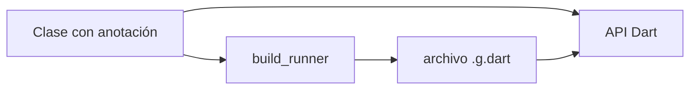
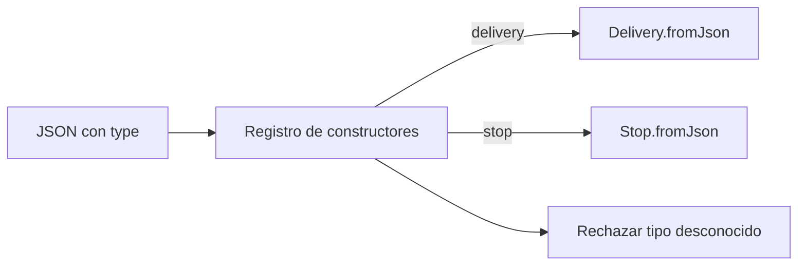
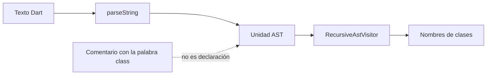
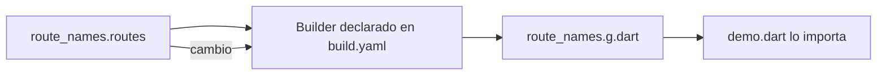

# Módulo 17: Dart avanzado: generación, AST y paquetes

## Aprende construyendo

Vas a generar serialización para RutaFlow, inspeccionar código Dart como árbol sintáctico, crear un builder pequeño y preparar una librería reutilizable. **Nota sobre macros:** el prompt los llama experimentales, pero el equipo de Dart detuvo ese trabajo en 2025; no los enseñamos como una función disponible. El reemplazo práctico actual es la generación de código durante el build. En Flutter no hay `dart:mirrors`; el análisis y la generación se hacen antes de ejecutar la app.

---

### Tema 1: macros de Dart y alternativas disponibles

#### Paso 1 · Objetivo y preparación
Al finalizar elegirás una herramienta disponible para generar serialización y explicarás el estado real de los macros. **Prerrequisitos:** Dart, clases y mapas JSON. **Ejemplo independiente en proyecto nuevo:** crea un paquete limpio:

```bash
dart create -t console-simple macros_status_lab
cd macros_status_lab
dart pub add json_annotation
dart pub add --dev build_runner json_serializable
mkdir -p lib
```

#### Paso 2 · Contexto y caso real
El equipo necesita convertir entregas a JSON y mantener tipos en vez de escribir mapas a mano. El prompt menciona macros experimentales, así que antes de diseñar la solución comprobamos si el lenguaje los publica como característica soportada.

#### Paso 3 · Teoría, modelo mental y analogía
Los macros de Dart intentaban inspeccionar y ampliar programas durante compilación; el equipo de Dart detuvo ese trabajo por sus dificultades técnicas y de rendimiento. **No escribas un `macro class` esperando que Flutter lo compile.** `build_runner` y generadores como `json_serializable` sí leen anotaciones y producen archivos antes de ejecutar. Es como preparar una lista de piezas antes de armar el vehículo, no pedir al vehículo en marcha que invente partes nuevas.

**Cuándo conviene:** usa generación con `build_runner` para modelos que se conocen al compilar; evita depender de macros experimentales detenidos y evita crear un generador propio si una anotación mantenida ya cumple el caso.



#### Paso 4 · Demostración guiada
Crea `lib/macros_status_lab.dart` con el modelo y `bin/demo.dart` para ejecutarlo:

```dart
// lib/macros_status_lab.dart
import 'package:json_annotation/json_annotation.dart';

part 'macros_status_lab.g.dart';

@JsonSerializable()
class Delivery {
  const Delivery({required this.id, required this.km});

  final String id;
  final double km;

  factory Delivery.fromJson(Map<String, Object?> json) =>
      _$DeliveryFromJson(json);

  Map<String, Object?> toJson() => _$DeliveryToJson(this);
}
```

Guarda `bin/demo.dart` con este contenido:

```dart
import 'package:macros_status_lab/macros_status_lab.dart';

void main() {
  final delivery = Delivery.fromJson({'id': 'RF-12', 'km': 4.5});
  print(delivery.toJson());
}
```

Genera y ejecuta:

```bash
dart run build_runner build
dart run bin/demo.dart
```

**Resultado esperado:** se crea `lib/macros_status_lab.g.dart` y el comando imprime el JSON con `id` y `km`. Explica parte por parte qué aporta la anotación y qué aporta el archivo generado. **Qué observar:** el `.g.dart` aparece antes de correr la app; no hay reflexión en runtime.

#### Paso 5 · Práctica guiada
**Pista:** busca la decisión oficial del equipo de Dart antes de copiar una demo antigua. **Fallo deliberado:** comenta `part 'macros_status_lab.g.dart';` y ejecuta `dart analyze`; aparece un error porque la función generada no se incluye. Diagnostica la conexión entre `part`, generador y archivo, y restaura la línea.

#### Paso 6 · Práctica independiente
Agrega el campo `status` a `Delivery`, regenera y comprueba la salida. Escribe en `README.md` una nota que distinga macros (trabajo detenido), generación con `build_runner` y reflexión en runtime (no disponible en Flutter). Añade una decisión sobre qué harías si el plugin necesita leer esa clase.

#### Paso 7 · Cierre y evidencia
Errores comunes: presentar macros como disponibles, editar el `.g.dart` manualmente y confundir generación de código con reflexión. Entrega el archivo generado, salida JSON, error del `part` eliminado y la nota de estado del lenguaje. **Proyecto integrador RutaFlow:** genera el JSON de `Entrega` antes de enviar la solicitud en `lib/macros_status_lab.dart`. Siguiente tema: controlar, depurar y configurar la generación de código. Fuentes oficiales: [actualización de macros Dart](https://dart.dev/blog/an-update-on-dart-macros-data-serialization), [Dart 3.7: estado de macros](https://dart.dev/blog/announcing-dart-3-7) y [build_runner](https://dart.dev/tools/build_runner).

**¿Por qué es importante?** Evita basar una app en una capacidad que el SDK no ofrece y enseña la alternativa que el equipo mantiene.
**Evidencia:** código generado por comando, JSON observado y explicación de por qué macros no son una opción de Flutter.

---

### Tema 2: generación avanzada con build_runner

#### Paso 1 · Objetivo y preparación
Al finalizar controlarás qué genera `build_runner`, qué archivos se reemplazan y cómo reproducir una generación limpia. **Prerrequisitos:** Tema 1 y una anotación `json_serializable`. **Ejemplo independiente:** crea `dart create -t console-simple generation_lab` en una carpeta vacía; instala las dependencias y `test`:

```bash
cd generation_lab
dart pub add json_annotation
dart pub add --dev build_runner json_serializable test
mkdir -p lib
```

#### Paso 2 · Contexto y caso real
Una actualización de `Delivery` deja el archivo generado desactualizado, por lo que un desarrollador arregla el `.g.dart` a mano. Al día siguiente, el generador borra ese arreglo. Necesitamos saber qué archivo editar y cuándo volver a generar.

#### Paso 3 · Teoría, modelo mental y analogía
La fuente de verdad son la clase, las anotaciones y las opciones de `build.yaml`; `.g.dart` es una salida derivada. `build` hace una pasada, `watch` actualiza al cambiar entradas y `clean` elimina la caché de generación. En la versión actual del laboratorio, `--delete-conflicting-outputs` ya no es una opción activa; si hay conflicto, inspecciona la salida y limpia la caché antes de regenerar. Es como regenerar el plano desde el modelo: el dibujo no se corrige directamente.

```yaml
# build.yaml
targets:
  $default:
    builders:
      json_serializable:
        options:
          explicit_to_json: true
```

#### Paso 4 · Demostración guiada
Guarda `lib/generation_lab.dart` con este modelo:

```dart
import 'package:json_annotation/json_annotation.dart';

part 'generation_lab.g.dart';

@JsonSerializable()
class Delivery {
  const Delivery({required this.id, required this.destination});
  final String id;
  @JsonKey(name: 'destination_name')
  final String destination;

  factory Delivery.fromJson(Map<String, Object?> json) =>
      _$DeliveryFromJson(json);
  Map<String, Object?> toJson() => _$DeliveryToJson(this);
}
```

Regenera y revisa `lib/generation_lab.g.dart`. Guarda `test/generation_lab_test.dart`:

```dart
import 'package:test/test.dart';
import 'package:generation_lab/generation_lab.dart';

void main() {
  test('el nombre JSON publicado coincide con el contrato', () {
    final delivery = Delivery.fromJson(
      {'id': 'RF-9', 'destination_name': 'Centro'},
    );
    expect(delivery.toJson()['destination_name'], 'Centro');
  });
}
```

Desde la raíz del paquete ejecuta:

```bash
dart run build_runner build
dart analyze
dart test
```

**Resultado esperado:** el JSON usa `destination_name`, el generado queda actualizado y análisis/tests pasan. Explica línea por línea por qué la anotación cambia el nombre serializado. **Qué observar:** el cambio se hace en `lib/generation_lab.dart`; no en el generado.

#### Paso 5 · Práctica guiada
**Pista:** ejecuta primero build sin tocar el archivo derivado. **Fallo deliberado:** edita a mano el valor devuelto por `toJson` dentro del `.g.dart`, y vuelve a ejecutar el generador; el cambio manual desaparece. Diagnostica qué fuente debías cambiar y corrige la anotación.

#### Paso 6 · Práctica independiente
Activa `dart run build_runner watch` y modifica un campo; observa cuándo se actualiza la salida. Detén el watcher, ejecuta `dart run build_runner clean`, vuelve a generar y compara resultado. Escribe una nota corta que distinga salida fuente confirmada en Git, caché de build y comando de CI.

#### Paso 7 · Cierre y evidencia
Errores comunes: modificar salida generada, dejar `watch` corriendo en CI y no regenerar tras editar la fuente. Entrega diff de entrada/salida, log de build limpio y test actualizado. **Proyecto integrador RutaFlow:** genera el adaptador JSON de la entrega y añade `dart run build_runner build` a las instrucciones de desarrollo. Siguiente tema: reemplazar la reflexión en runtime por un registro tipado. Fuentes oficiales: [build_runner](https://dart.dev/tools/build_runner), [opciones de builders](https://pub.dev/documentation/build_runner/latest/index.html) y [paquete json_serializable](https://pub.dev/packages/json_serializable).

**¿Por qué es importante?** Una salida reproducible evita que el código generado quede desfasado o sea una segunda fuente de verdad.
**Evidencia:** diff regenerado desde los modelos y ejecución limpia de analyzer y tests.

---

### Tema 3: reflexión limitada y registro tipado

#### Paso 1 · Objetivo y preparación
Al finalizar reemplazarás una idea de reflexión por un registro explícito de constructores. **Prerrequisitos:** tipos Dart, JSON y Tema 1. **Ejemplo independiente:** crea `dart create -t console-simple reflection_lab` en una carpeta limpia y agrega carpetas/dependencias:

```bash
cd reflection_lab
dart pub add --dev test
mkdir -p lib test
```

#### Paso 2 · Contexto y caso real
El backend devuelve varios tipos de eventos y el cliente intenta adivinar una clase por el nombre de `runtimeType`. Eso no construye objetos desde JSON ni permite enumerar campos. En Flutter no está disponible `dart:mirrors`.

#### Paso 3 · Teoría, modelo mental y analogía
`runtimeType` informa el tipo de un objeto que ya existe; no inspecciona todas las clases del programa ni crea una instancia desde texto. Flutter deshabilita `dart:mirrors` para favorecer compilación AOT y eliminación de código muerto. Un registro explícito es como una tabla de recepción: cada nombre aceptado apunta al constructor que sí sabe interpretar sus datos. **Cuándo conviene:** usa un registro pequeño frente a buscar tipos en runtime cuando el JSON contiene una etiqueta conocida; usa generación si la lista de modelos crece y se repite.



#### Paso 4 · Demostración guiada
Crea `lib/reflection_lab.dart` con modelos sencillos y un registro:

```dart
class Delivery {
  const Delivery(this.id);
  final String id;
  factory Delivery.fromJson(Map<String, Object?> json) =>
      Delivery(json['id']! as String);
}

class Stop {
  const Stop(this.name);
  final String name;
  factory Stop.fromJson(Map<String, Object?> json) =>
      Stop(json['name']! as String);
}

typedef Decoder = Object Function(Map<String, Object?> json);

final decoders = <String, Decoder>{
  'delivery': Delivery.fromJson,
  'stop': Stop.fromJson,
};

Object decode(Map<String, Object?> json) {
  final type = json['type'];
  if (type is! String || !decoders.containsKey(type)) {
    throw FormatException('Tipo no soportado: $type');
  }
  return decoders[type]!(json);
}
```

Guarda `test/reflection_lab_test.dart` con casos conocidos y desconocidos:

```dart
import 'package:test/test.dart';
import 'package:reflection_lab/reflection_lab.dart';

void main() {
  test('decodifica una entrega registrada', () {
    expect(decode({'type': 'delivery', 'id': 'RF-2'}), isA<Delivery>());
  });
  test('rechaza un tipo no registrado', () {
    expect(() => decode({'type': 'invoice'}), throwsFormatException);
  });
}
```

Ejecuta:

```bash
dart test
```

**Resultado esperado:** `delivery` produce `Delivery`; un `type` desconocido devuelve `FormatException`. Explica la parte del registro y la parte que rechaza la entrada. **Qué observar:** ninguna rama intenta buscar una clase por nombre en runtime.

#### Paso 5 · Práctica guiada
**Pista:** el valor externo `type` no debe elegir cualquier código de la app. **Fallo deliberado:** elimina la comprobación de `containsKey` y fuerza el tipo `invoice`; el acceso produce error de clave. Diagnostica el dato sin registro y vuelve a rechazarlo con una excepción entendible.

#### Paso 6 · Práctica independiente
Añade `invoice` con su decoder, prueba ambos tipos y prueba `type: 7`. Comprueba que la app muestra un error manejable y conserva un registro de tipos permitidos. Compara el registro escrito a mano con uno generado desde anotaciones; documenta cuál es más fácil de auditar.

#### Paso 7 · Cierre y evidencia
Errores comunes: creer que `runtimeType` deserializa JSON, aceptar cualquier nombre externo y ocultar errores de esquema. Entrega registro, tests y error desconocido diagnosticado. **Proyecto integrador RutaFlow:** despacha eventos de entrega a decoders conocidos antes de actualizarlos en `lib/reflection_lab.dart`. Siguiente tema: leer el AST cuando el código fuente de Dart, y no un objeto en runtime, es la entrada. Fuentes oficiales: [Flutter FAQ: reflection/mirrors](https://docs.flutter.dev/resources/faq) y [Dart: generación de código](https://dart.dev/tools/build_runner).

**¿Por qué es importante?** El registro limita de forma visible qué datos externos pueden convertirse en objetos de la aplicación.
**Evidencia:** tipos permitidos probados, tipo desconocido rechazado y explicación de por qué `runtimeType` no reemplaza reflexión.

---

### Tema 4: recorrer el AST de Dart con analyzer

#### Paso 1 · Objetivo y preparación
Al finalizar recorrerás el AST de un archivo y listarás sus clases con un visitor. **Prerrequisitos:** Dart, clases y listas. **Ejemplo independiente:** crea `dart create -t console-simple ast_lab` en una carpeta vacía y añade el analizador:

```bash
cd ast_lab
dart pub add --dev analyzer test
mkdir -p lib test
```

#### Paso 2 · Contexto y caso real
RutaFlow quiere migrar nombres de clases antiguos. Una búsqueda de texto encuentra `class Ruta` dentro de comentarios y no distingue declaraciones reales. El AST permite caminar nodos de código, no palabras parecidas.

#### Paso 3 · Teoría, modelo mental y analogía
El analizador convierte texto Dart en nodos tipados: unidad, clase, método, parámetro. `RecursiveAstVisitor` recorre descendientes y permite seleccionar lo que importa. Es como leer un mapa de calles: una clase es un nodo con relaciones, no una coincidencia suelta de letras. El AST y las APIs públicas de analyzer evolucionan; fija y actualiza la dependencia con análisis y pruebas. **Cuándo conviene AST frente a regex:** úsalo si necesitas distinguir declaraciones y comentarios; para encontrar una palabra literal en README, una búsqueda simple es más fácil.



#### Paso 4 · Demostración guiada
Crea `lib/list_classes.dart`:

```dart
import 'package:analyzer/dart/analysis/utilities.dart';
import 'package:analyzer/dart/ast/ast.dart';
import 'package:analyzer/dart/ast/visitor.dart';

class ClassNameVisitor extends RecursiveAstVisitor<void> {
  final names = <String>[];

  @override
  void visitClassDeclaration(ClassDeclaration node) {
    names.add(node.namePart.typeName.lexeme);
    super.visitClassDeclaration(node);
  }
}

List<String> classNames(String source) {
  final visitor = ClassNameVisitor();
  parseString(content: source).unit.accept(visitor);
  return visitor.names;
}
```

Crea `bin/list_classes.dart` para llamar la función pública:

```dart
import 'package:ast_lab/list_classes.dart';

void main() {
  print(classNames('class Delivery {} class Route {}').join(', '));
}
```

Ejecuta `dart run bin/list_classes.dart`. **Resultado esperado:** `Delivery, Route`. Explica línea por línea la llamada a `parseString`, la visita y el acceso a `node.name`. **Qué observar:** comentarios que mencionen `class` no se agregan a la lista.

#### Paso 5 · Práctica guiada
**Pista:** agrega un comentario `// class Fake {}` al texto fuente. **Fallo deliberado:** cambia el conteo esperado a tres; el test de AST devuelve dos y falla. Diagnostica que el comentario no es una declaración y restaura la expectativa correcta.

#### Paso 6 · Práctica independiente
Guarda `test/class_name_visitor_test.dart`:

```dart
import 'package:test/test.dart';
import 'package:ast_lab/list_classes.dart';

void main() {
  test('encuentra declaraciones y omite comentarios', () {
    expect(classNames('// class Fake {}\nclass Delivery {}'), ['Delivery']);
  });
}
```

Ejecuta `dart test`, agrega una clase abstracta y decide si el visitor la incluye. No reescribas texto fuente con reemplazos globales; para transformaciones, preserva offsets y formato con herramientas diseñadas para ello.

#### Paso 7 · Cierre y evidencia
Errores comunes: analizar código con regex, no fijar la versión de analyzer y asumir que el AST de todas las versiones es idéntico. Entrega visitor, salida, test y comentario que no produce falso positivo. **Proyecto integrador RutaFlow:** usa el visitor como herramienta de migración local para identificar clases `*Dto` y proponer nombres consistentes. Siguiente tema: convertir una regla propia en un builder de build_runner. Fuentes oficiales: [paquete analyzer](https://pub.dev/packages/analyzer), [AST visitors](https://pub.dev/documentation/analyzer/latest/dart_ast_visitor/) y [build_runner](https://dart.dev/tools/build_runner).

**¿Por qué es importante?** El AST distingue la estructura del programa del texto que solo se parece a código.
**Evidencia:** visitor ejecutado, resultado repetible y test que descarta una clase mencionada solo en comentario.

---

### Tema 5: crear un builder pequeño para build_runner

#### Paso 1 · Objetivo y preparación
Al finalizar crearás un builder que lee una lista de nombres y genera una constante Dart. **Prerrequisitos:** paquetes Dart, Tema 2 y colecciones. **Ejemplo independiente:** crea `dart create -t package route_catalog_lab` en una carpeta vacía:

```bash
cd route_catalog_lab
dart pub add build
dart pub add --dev build_runner
```

#### Paso 2 · Contexto y caso real
El equipo mantiene destinos permitidos para repartos en un archivo sencillo. La UI repite nombres en varios sitios y un cambio queda inconsistente. Un builder puede transformar un archivo fuente en una lista Dart actualizada antes de compilar.

#### Paso 3 · Teoría, modelo mental y analogía
Un `Builder` declara extensiones de entrada/salida y ejecuta `build` para cada archivo que coincide. `BuildStep` lee la entrada y escribe solo las salidas declaradas. Es una pequeña máquina de imprenta: recibe una hoja `.routes` y produce un catálogo `.g.dart` con el mismo nombre base. El builder debe ser determinista y no leer archivos fuera del control del build. **Cuándo conviene builder propio:** cuando hay una regla repetida y específica del proyecto; no conviene mantener uno para una conversión estándar que ya cubre `json_serializable`.



#### Paso 4 · Demostración guiada
Crea `lib/route_names.routes` con dos nombres, `delivery` y `pickup`. Crea `lib/route_catalog_builder.dart`:

```dart
import 'dart:convert';
import 'package:build/build.dart';

Builder routeCatalogBuilder(BuilderOptions options) => RouteCatalogBuilder();

class RouteCatalogBuilder implements Builder {
  @override
  final buildExtensions = const {'.routes': ['.g.dart']};

  @override
  Future<void> build(BuildStep buildStep) async {
    final source = await buildStep.readAsString(buildStep.inputId);
    final names = source
        .split('\n')
        .map((line) => line.trim())
        .where((line) => line.isNotEmpty)
        .toList();
    final output = buildStep.inputId.changeExtension('.g.dart');
    await buildStep.writeAsString(
      output,
      '// Generated file. Do not edit.\n'
      'const routeNames = <String>${jsonEncode(names)};\n',
    );
  }
}
```

Registra el builder en `build.yaml`:

```yaml
builders:
  route_catalog:
    import: "package:route_catalog_lab/route_catalog_builder.dart"
    builder_factories: ["routeCatalogBuilder"]
    build_extensions: {".routes": [".g.dart"]}
    auto_apply: root_package
    build_to: source
```

Crea `bin/` y guarda `bin/demo.dart` para importar `package:route_catalog_lab/route_names.g.dart` y mostrar `routeNames`:

```dart
import 'package:route_catalog_lab/route_names.g.dart';

void main() => print(routeNames);
```

Ejecuta:

```bash
dart run build_runner build
dart run bin/demo.dart
```

**Resultado esperado:** aparece `lib/route_names.g.dart` con `const routeNames = <String>["delivery","pickup"]`. Explica qué archivo declara la regla y cuál contiene la salida. **Qué observar:** al cambiar la lista y reconstruir, cambia la constante.

#### Paso 5 · Práctica guiada
**Pista:** la clave `.routes` y la salida `.g.dart` deben coincidir entre Dart y `build.yaml`. **Fallo deliberado:** escribe `.route` (sin s) en `build.yaml`; build_runner no selecciona la entrada y no aparece el archivo generado. Diagnostica la discrepancia y corrige la extensión.

#### Paso 6 · Práctica independiente
Añade test para la lista generada y una entrada con espacios al inicio; prueba limpieza y regeneración. Rechaza nombres que no cumplan `^[a-z][a-z0-9_]*$` antes de emitir código, y muestra el mensaje claro si una fila es inválida. Documenta cómo pasarías el builder a un paquete separado.

#### Paso 7 · Cierre y evidencia
Errores comunes: no declarar la extensión, escribir salidas fuera de `allowedOutputs` y generar código desde texto sin validar. Entrega builder, `build.yaml`, entrada, salida y fallo por extensión diagnosticado. **Proyecto integrador RutaFlow:** genera una lista de estados de entrega permitidos que comparta la app y el validador de solicitudes. Siguiente tema: organizar y preparar la distribución de un paquete Dart. Fuentes oficiales: [build_runner: crear builders](https://dart.dev/tools/build_runner), [interfaz Builder](https://pub.dev/documentation/build/latest/build/Builder-class.html) y [build package](https://pub.dev/packages/build).

**¿Por qué es importante?** Un builder convierte una regla repetible del proyecto en salida compilable y fácil de revisar.
**Evidencia:** builder registrado, salida generada, entrada inválida diagnosticada y regla de nombres probada.

---

### Tema 6: diseñar y validar un paquete Dart

#### Paso 1 · Objetivo y preparación
Al finalizar prepararás un paquete público pequeño con API, ejemplo, tests y documentación, y revisarás el archivo que se publicaría sin subirlo. **Prerrequisitos:** Dart y clases públicas/privadas. **Ejemplo independiente:** crea `dart create -t package route_labels` en una carpeta vacía.

#### Paso 2 · Contexto y caso real
Dos apps necesitan los mismos nombres y reglas de estado de ruta. Copiar la clase en ambas genera diferencias silenciosas; mover todo el código privado al API público dificulta cambiarlo luego. Un paquete pequeño define una frontera que ambos proyectos pueden probar.

#### Paso 3 · Teoría, modelo mental y analogía
El API importable vive bajo `lib/`; implementación que no prometes mantener va en `lib/src/`, y la fachada exporta solo lo necesario. `test/` verifica contrato, `example/` enseña uso, `README.md` explica instalación y `CHANGELOG.md` registra cambios. Es como una caja de herramientas: la tapa muestra piezas que prometes soportar, mientras el mecanismo interno puede cambiar.

#### Paso 4 · Demostración guiada
Crea `lib/route_labels.dart`:

```dart
enum RouteStatus { assigned, pickedUp, delivered }

String labelFor(RouteStatus status) => switch (status) {
      RouteStatus.assigned => 'Asignado',
      RouteStatus.pickedUp => 'Recogido',
      RouteStatus.delivered => 'Entregado',
    };
```

En `test/route_labels_test.dart`, comprueba los tres estados. Reemplaza el ejemplo creado por la plantilla en `example/route_labels_example.dart` con una importación pública y una impresión de `labelFor(RouteStatus.delivered)`:

```dart
import 'package:route_labels/route_labels.dart';

void main() => print(labelFor(RouteStatus.delivered));
```

```dart
import 'package:test/test.dart';
import 'package:route_labels/route_labels.dart';

void main() {
  test('cada estado tiene una etiqueta visible', () {
    expect(labelFor(RouteStatus.assigned), 'Asignado');
    expect(labelFor(RouteStatus.pickedUp), 'Recogido');
    expect(labelFor(RouteStatus.delivered), 'Entregado');
  });
}
```

Antes de publicar, crea `LICENSE` en la raíz con la licencia elegida para tu código. Revisa `pubspec.yaml`: usa una restricción de SDK estable compatible con el código y completa `repository` o `homepage` con la URL real si el paquete será público. Si el paquete depende de una versión prerelease de Dart, la versión del paquete también debe declararse prerelease o esperar a un SDK estable.

```bash
dart format lib test example
dart run example/route_labels_example.dart
dart analyze
dart test
dart doc
dart pub publish --dry-run
```

**Resultado esperado:** análisis y tests pasan; `dart doc` genera referencia y el dry run enumera archivos a publicar sin subirlos. Explica la parte pública de `lib/route_labels.dart` y la parte de ejemplo. **Qué observar:** si aparece un secreto o un archivo local en el dry run, exclúyelo antes de publicar.

#### Paso 5 · Práctica guiada
**Pista:** el paquete debe tener un nombre, descripción y licencia antes de que otro equipo pueda entenderlo. **Fallo deliberado:** elimina `README.md` o una prueba y vuelve a correr el dry run/análisis; observa el aviso y diagnostica qué falta para el consumidor.

#### Paso 6 · Práctica independiente
Agrega `CHANGELOG.md`, una guía de uso en `README.md` y un caso para cada estado. Examina la lista de archivos de `dart pub publish --dry-run`. No ejecutes `dart pub publish`: prepara la revisión, no publiques una versión real en el ejercicio.

#### Paso 7 · Cierre y evidencia
Errores comunes: exponer `lib/src`, publicar sin revisar el dry run y depender de un archivo de ejemplo que no compila. Entrega el paquete, salida de analyzer/tests/docs/dry run y lista de archivos que incluiría. **Proyecto integrador RutaFlow:** reemplaza copias de reglas de estado por la dependencia local `route_labels` y prueba ambas apps contra el mismo API. Siguiente módulo: aplicar lo aprendido a producción y entregas multiplataforma. Fuentes oficiales: [crear paquetes](https://dart.dev/tools/pub/create-packages), [convenciones del paquete](https://dart.dev/tools/pub/package-layout) y [publicación dry-run](https://dart.dev/tools/pub/publishing).

**¿Por qué es importante?** Un paquete bien delimitado comparte una regla útil sin convertir cada detalle interno en una promesa permanente.
**Evidencia:** paquete verificable, API pública pequeña, tests, ejemplo, documentación y dry run revisado.

---

## Proyecto integrador del módulo

Convierte el modelo de entrega de RutaFlow en una librería Dart: genera JSON, valida tipos de evento mediante un registro, inspecciona el código con AST, crea un catálogo con un builder propio y prepara el paquete para dry run. Entrega los archivos de fuente y generados, pruebas y comandos reproducibles. Los macros experimentales quedan documentados como tecnología detenida, no como dependencia del proyecto.
