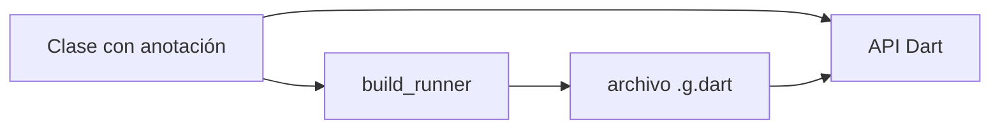
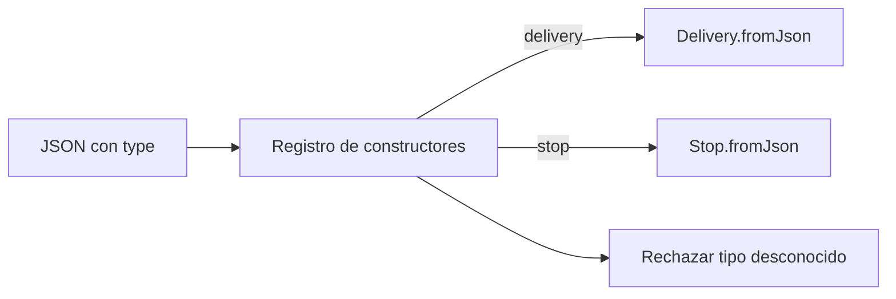
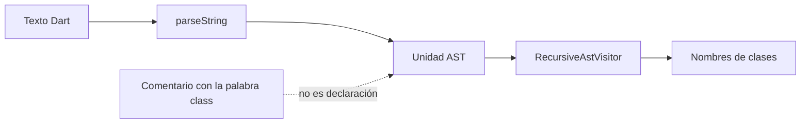
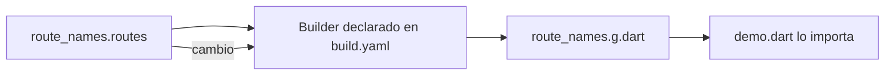

# Módulo 17: Dart avanzado: generación, AST y paquetes

## Aprende construyendo

Vas a generar serialización para RutaFlow, inspeccionar código Dart como árbol sintáctico, crear un builder pequeño y preparar una librería reutilizable. **Nota sobre macros:** el prompt los llama experimentales, pero el equipo de Dart detuvo ese trabajo en 2025; no los enseñamos como una función disponible. El reemplazo práctico actual es la generación de código durante el build. En Flutter no hay `dart:mirrors`; el análisis y la generación se hacen antes de ejecutar la app.

---


### Tema 1: macros de Dart y alternativas disponibles · Intermedio · 35 min

<details open>
<summary><strong>Capa 1 — Lectura</strong></summary>

#### ► DE QUÉ TRATA
Al finalizar elegirás una herramienta disponible para generar serialización y explicarás el estado real de los macros. Prerrequisitos: Dart, clases y mapas JSON. Ejemplo independiente en proyecto nuevo: crea un paquete limpio:

#### ► CÓMO FUNCIONA


</details>

<details>
<summary><strong>Capa 2 — Construcción</strong></summary>

#### Código y verificación
```bash
dart create -t console-simple macros_status_lab
cd macros_status_lab
dart pub add json_annotation
dart pub add --dev build_runner json_serializable
mkdir -p lib
```


```dart
// lib/macros_status_lab.dart
import 'package:json_annotation/json_annotation.dart';

part 'macros_status_lab.g.dart';

@JsonSerializable()
class Delivery {
  const Delivery({required this.id, required this.km});

  final String id;
  final double km;

  factory Delivery.fromJson(Map<String, Object?> json) =>
      _$DeliveryFromJson(json);

  Map<String, Object?> toJson() => _$DeliveryToJson(this);
}
```

```dart
import 'package:macros_status_lab/macros_status_lab.dart';

void main() {
  final delivery = Delivery.fromJson({'id': 'RF-12', 'km': 4.5});
  print(delivery.toJson());
}
```

```bash
dart run build_runner build
dart run bin/demo.dart
```

</details>

### Tema 2: generación avanzada con build_runner · Avanzado · 40 min

<details open>
<summary><strong>Capa 1 — Lectura</strong></summary>

#### ► DE QUÉ TRATA
Al finalizar controlarás qué genera build_runner, qué archivos se reemplazan y cómo reproducir una generación limpia. Prerrequisitos: Tema 1 y una anotación json_serializable. Ejemplo independiente: crea dart create -t console-simple generation_lab en una carpeta vacía; instala l…

</details>

<details>
<summary><strong>Capa 2 — Construcción</strong></summary>

#### Código y verificación
```bash
cd generation_lab
dart pub add json_annotation
dart pub add --dev build_runner json_serializable test
mkdir -p lib
```

```yaml
# build.yaml
targets:
  $default:
    builders:
      json_serializable:
        options:
          explicit_to_json: true
```

```dart
import 'package:json_annotation/json_annotation.dart';

part 'generation_lab.g.dart';

@JsonSerializable()
class Delivery {
  const Delivery({required this.id, required this.destination});
  final String id;
  @JsonKey(name: 'destination_name')
  final String destination;

  factory Delivery.fromJson(Map<String, Object?> json) =>
      _$DeliveryFromJson(json);
  Map<String, Object?> toJson() => _$DeliveryToJson(this);
}
```

```dart
import 'package:test/test.dart';
import 'package:generation_lab/generation_lab.dart';

void main() {
  test('el nombre JSON publicado coincide con el contrato', () {
    final delivery = Delivery.fromJson(
      {'id': 'RF-9', 'destination_name': 'Centro'},
    );
    expect(delivery.toJson()['destination_name'], 'Centro');
  });
}
```

```bash
dart run build_runner build
dart analyze
dart test
```

</details>

### Tema 3: reflexión limitada y registro tipado · Avanzado · 40 min

<details open>
<summary><strong>Capa 1 — Lectura</strong></summary>

#### ► DE QUÉ TRATA
Al finalizar reemplazarás una idea de reflexión por un registro explícito de constructores. Prerrequisitos: tipos Dart, JSON y Tema 1. Ejemplo independiente: crea dart create -t console-simple reflection_lab en una carpeta limpia y agrega carpetas/dependencias:

#### ► CÓMO FUNCIONA


</details>

<details>
<summary><strong>Capa 2 — Construcción</strong></summary>

#### Código y verificación
```bash
cd reflection_lab
dart pub add --dev test
mkdir -p lib test
```


```dart
class Delivery {
  const Delivery(this.id);
  final String id;
  factory Delivery.fromJson(Map<String, Object?> json) =>
      Delivery(json['id']! as String);
}

class Stop {
  const Stop(this.name);
  final String name;
  factory Stop.fromJson(Map<String, Object?> json) =>
      Stop(json['name']! as String);
}

typedef Decoder = Object Function(Map<String, Object?> json);

final decoders = <String, Decoder>{
  'delivery': Delivery.fromJson,
  'stop': Stop.fromJson,
};

Object decode(Map<String, Object?> json) {
  final type = json['type'];
  if (type is! String || !decoders.containsKey(type)) {
    throw FormatException('Tipo no soportado: $type');
  }
  return decoders[type]!(json);
}
```

```dart
import 'package:test/test.dart';
import 'package:reflection_lab/reflection_lab.dart';

void main() {
  test('decodifica una entrega registrada', () {
    expect(decode({'type': 'delivery', 'id': 'RF-2'}), isA<Delivery>());
  });
  test('rechaza un tipo no registrado', () {
    expect(() => decode({'type': 'invoice'}), throwsFormatException);
  });
}
```

```bash
dart test
```

</details>

### Tema 4: recorrer el AST de Dart con analyzer · Avanzado · 40 min

<details open>
<summary><strong>Capa 1 — Lectura</strong></summary>

#### ► DE QUÉ TRATA
Al finalizar recorrerás el AST de un archivo y listarás sus clases con un visitor. Prerrequisitos: Dart, clases y listas. Ejemplo independiente: crea dart create -t console-simple ast_lab en una carpeta vacía y añade el analizador:

#### ► CÓMO FUNCIONA


</details>

<details>
<summary><strong>Capa 2 — Construcción</strong></summary>

#### Código y verificación
```bash
cd ast_lab
dart pub add --dev analyzer test
mkdir -p lib test
```


```dart
import 'package:analyzer/dart/analysis/utilities.dart';
import 'package:analyzer/dart/ast/ast.dart';
import 'package:analyzer/dart/ast/visitor.dart';

class ClassNameVisitor extends RecursiveAstVisitor<void> {
  final names = <String>[];

  @override
  void visitClassDeclaration(ClassDeclaration node) {
    names.add(node.namePart.typeName.lexeme);
    super.visitClassDeclaration(node);
  }
}

List<String> classNames(String source) {
  final visitor = ClassNameVisitor();
  parseString(content: source).unit.accept(visitor);
  return visitor.names;
}
```

```dart
import 'package:ast_lab/list_classes.dart';

void main() {
  print(classNames('class Delivery {} class Route {}').join(', '));
}
```

```dart
import 'package:test/test.dart';
import 'package:ast_lab/list_classes.dart';

void main() {
  test('encuentra declaraciones y omite comentarios', () {
    expect(classNames('// class Fake {}\nclass Delivery {}'), ['Delivery']);
  });
}
```

</details>

### Tema 5: crear un builder pequeño para build_runner · Avanzado · 45 min

<details open>
<summary><strong>Capa 1 — Lectura</strong></summary>

#### ► DE QUÉ TRATA
Al finalizar crearás un builder que lee una lista de nombres y genera una constante Dart. Prerrequisitos: paquetes Dart, Tema 2 y colecciones. Ejemplo independiente: crea dart create -t package route_catalog_lab en una carpeta vacía:

#### ► CÓMO FUNCIONA


</details>

<details>
<summary><strong>Capa 2 — Construcción</strong></summary>

#### Código y verificación
```bash
cd route_catalog_lab
dart pub add build
dart pub add --dev build_runner
```


```text
delivery
pickup
```

```dart
import 'dart:convert';
import 'package:build/build.dart';

Builder routeCatalogBuilder(BuilderOptions options) => RouteCatalogBuilder();

class RouteCatalogBuilder implements Builder {
  @override
  final buildExtensions = const {'.routes': ['.g.dart']};

  @override
  Future<void> build(BuildStep buildStep) async {
    final source = await buildStep.readAsString(buildStep.inputId);
    final names = source
        .split('\n')
        .map((line) => line.trim())
        .where((line) => line.isNotEmpty)
        .toList();
    final output = buildStep.inputId.changeExtension('.g.dart');
    await buildStep.writeAsString(
      output,
      '// Generated file. Do not edit.\n'
      'const routeNames = <String>${jsonEncode(names)};\n',
    );
  }
}
```

```yaml
builders:
  route_catalog:
    import: "package:route_catalog_lab/route_catalog_builder.dart"
    builder_factories: ["routeCatalogBuilder"]
    build_extensions: {".routes": [".g.dart"]}
    auto_apply: root_package
    build_to: source
```

```dart
import 'package:route_catalog_lab/route_names.g.dart';

void main() => print(routeNames);
```

</details>

### Tema 6: diseñar y validar un paquete Dart · Avanzado · 35 min

<details open>
<summary><strong>Capa 1 — Lectura</strong></summary>

#### ► DE QUÉ TRATA
Al finalizar prepararás un paquete público pequeño con API, ejemplo, tests y documentación, y revisarás el archivo que se publicaría sin subirlo. Prerrequisitos: Dart y clases públicas/privadas. Ejemplo independiente: crea dart create -t package route_labels en una carpeta vacía.

</details>

<details>
<summary><strong>Capa 2 — Construcción</strong></summary>

#### Código y verificación
```dart
enum RouteStatus { assigned, pickedUp, delivered }

String labelFor(RouteStatus status) => switch (status) {
      RouteStatus.assigned => 'Asignado',
      RouteStatus.pickedUp => 'Recogido',
      RouteStatus.delivered => 'Entregado',
    };
```

```dart
import 'package:route_labels/route_labels.dart';

void main() => print(labelFor(RouteStatus.delivered));
```

```dart
import 'package:test/test.dart';
import 'package:route_labels/route_labels.dart';

void main() {
  test('cada estado tiene una etiqueta visible', () {
    expect(labelFor(RouteStatus.assigned), 'Asignado');
    expect(labelFor(RouteStatus.pickedUp), 'Recogido');
    expect(labelFor(RouteStatus.delivered), 'Entregado');
  });
}
```

```bash
dart format lib test example
dart run example/route_labels_example.dart
dart analyze
dart test
dart doc
dart pub publish --dry-run
```

</details>
