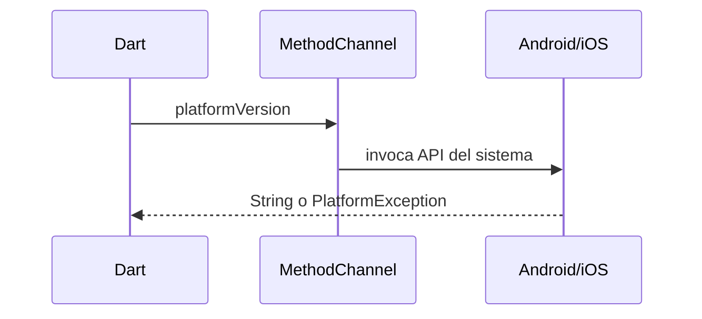
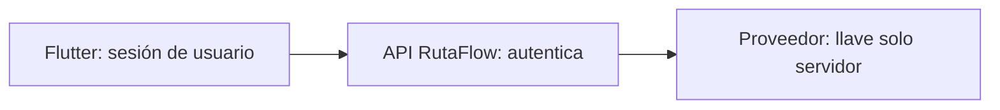
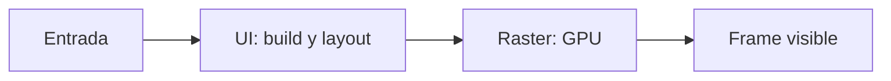
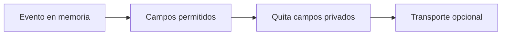
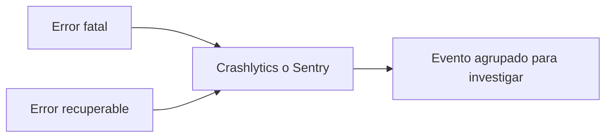
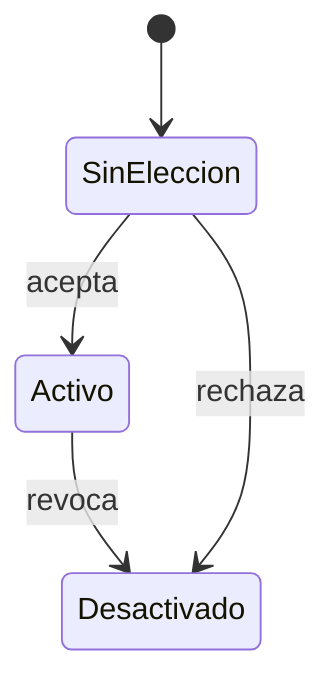
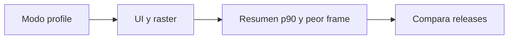

# Módulo 18: Flutter en producción: secretos, calidad y rendimiento

## Aprende construyendo

Vas a preparar una app que habla con servicios nativos, protege credenciales, mide fluidez y envía telemetría útil sin registrar datos personales. Trabajaremos en un proyecto Flutter llamado `rutaflow_mobile`. En cada tema queda claro qué archivo crear, qué comando correr y qué salida buscar. Firebase y Sentry necesitan proyectos externos; sus pasos se describen, pero no se cuentan como pruebas hechas aquí.

---


### Tema 1: la frontera entre Dart y el código nativo · Avanzado · 40 min

<details open>
<summary><strong>Capa 1 — Lectura</strong></summary>

#### ► DE QUÉ TRATA
Al finalizar, podrás decidir si una función va en Dart, en un plugin o detrás de una API nativa. Prerrequisitos: Dart básico y conocer async/await. Para un ejemplo independiente, crea un proyecto nuevo con flutter create rutaflow_mobile; entra con cd rutaflow_mobile; confirma el…

#### ► LA IDEA EN UNA FRASE
**Al finalizar, podrás decidir si una función va en Dart, en un plugin o detrás de una API nativa.**

#### ► POR QUÉ EXISTE ESTO
Resuelve un problema real de diseño o implementación y evita decisiones a ciegas.

#### ► LA ANALOGÍA
Piensa en la frontera entre dart y el código nativo como una herramienta de taller: útil cuando conoces su propósito y sus límites.
**Dónde se rompe la analogía:** en software, los efectos dependen del contexto, la escala y los trade-offs.

#### ► CÓMO FUNCIONA


#### ► LO QUE PUEDE SALIR MAL
| Síntoma | Causa probable | Arreglo |
|---|---|---|
| la frontera entre Dart y el código nativo se aplica pero el resultado no mejora | Se usó sin medir el problema real | Mide antes y compara contra la alternativa simple |
| Aparece complejidad inesperada | Se adoptó la técnica sin comprender sus trade-offs | Vuelve a la sección de trade-offs y reduce el alcance |
| Falla en un caso límite | Se asumió un contexto que no se cumple | Prueba el caso límite y documenta cuándo NO usarlo |

#### ► TRADE-OFFS
| Opción | Cuándo usarla | Cuándo NO usarla |
|---|---|---|
| Usar la frontera entre Dart y el código nativo | Cuando el problema coincide con su propósito y el beneficio es observable | Cuando agrega complejidad sin resolver un problema real |
| Alternativa más simple | Cuando el contexto es pequeño, estable o fácil de razonar | Cuando ya demostró no escalar o no cumplir el requisito |
| Postergar la decisión | Cuando falta evidencia del problema | Cuando el costo de esperar es mayor que el costo de probar |

#### ► CUÁNDO NO USAR ESTO
No uses la frontera entre dart y el código nativo por defecto. Aplícalo cuando el problema lo justifique y puedas verificar el beneficio; si una alternativa más simple resuelve igual, prefiérela.

#### ► DE VUELTA A LA ANALOGÍA
Volviendo a la analogía: la frontera entre dart y el código nativo funciona como el modelo inicial, pero recuerda dónde se rompe: en producción importan la evidencia, la escala y el costo de equivocarte.

#### ► LO QUE DEBES RECORDAR
- la frontera entre Dart y el código nativo existe para resolver un problema específico.
- Mide antes de adoptar complejidad.
- Conoce el caso donde NO usarlo.
- Verifica con evidencia observable.

#### ► PREGUNTAS PARA PENSAR
1. ¿Qué problema concreto resuelve la frontera entre dart y el código nativo en tu contexto?
2. ¿Cómo sabrías que la frontera entre dart y el código nativo no está funcionando bien?
3. ¿Qué alternativa más simple considerarías antes de usar la frontera entre dart y el código nativo?

</details>

<details>
<summary><strong>Capa 2 — Construcción</strong></summary>

#### Código y verificación
```dart
import 'package:flutter/services.dart';

class DeviceInfo {
  static const _channel = MethodChannel('rutaflow/device');

  Future<String> platformVersion() async {
    try {
      return await _channel.invokeMethod<String>('platformVersion') ?? 'desconocida';
    } on PlatformException catch (error) {
      return 'No disponible: ${error.code}';
    }
  }
}
```

```kotlin
MethodChannel(flutterEngine.dartExecutor.binaryMessenger, "rutaflow/device")
  .setMethodCallHandler { call, result ->
    if (call.method == "platformVersion") {
      result.success("Android ${android.os.Build.VERSION.RELEASE}")
    } else {
      result.notImplemented()
    }
  }
```

```swift
let channel = FlutterMethodChannel(
  name: "rutaflow/device",
  binaryMessenger: engineBridge.applicationRegistrar.messenger()
)
channel.setMethodCallHandler { call, result in
  guard call.method == "platformVersion" else {
    result(FlutterMethodNotImplemented)
    return
  }
  result("iOS \(UIDevice.current.systemVersion)")
}
```

```dart
import 'package:flutter/services.dart';
import 'package:flutter_test/flutter_test.dart';
import 'package:rutaflow_mobile/platform/device_info.dart';

void main() {
  TestWidgetsFlutterBinding.ensureInitialized();
  const channel = MethodChannel('rutaflow/device');
  test('lee versión del sistema por el canal', () async {
    TestDefaultBinaryMessengerBinding.instance.defaultBinaryMessenger
        .setMockMethodCallHandler(channel, (call) async => 'Android 15');
    expect(await DeviceInfo().platformVersion(), 'Android 15');
    TestDefaultBinaryMessengerBinding.instance.defaultBinaryMessenger
        .setMockMethodCallHandler(channel, null);
  });
}
```

```bash
flutter test
```


</details>

### Tema 2: secretos fuera del binario · Avanzado · 40 min

<details open>
<summary><strong>Capa 1 — Lectura</strong></summary>

#### ► DE QUÉ TRATA
Al finalizar, localizarás credenciales que no deben vivir en Flutter y moverás una operación privilegiada al servidor. Prerrequisitos: llamadas HTTP y variables de entorno. Crea un proyecto nuevo de Flutter con flutter create rutaflow_mobile, luego agrega lib/data/route_client.da…

#### ► LA IDEA EN UNA FRASE
**Al finalizar, localizarás credenciales que no deben vivir en Flutter y moverás una operación privilegiada al servidor.**

#### ► POR QUÉ EXISTE ESTO
Resuelve un problema real de diseño o implementación y evita decisiones a ciegas.

#### ► LA ANALOGÍA
Piensa en secretos fuera del binario como una herramienta de taller: útil cuando conoces su propósito y sus límites.
**Dónde se rompe la analogía:** en software, los efectos dependen del contexto, la escala y los trade-offs.

#### ► CÓMO FUNCIONA


#### ► LO QUE PUEDE SALIR MAL
| Síntoma | Causa probable | Arreglo |
|---|---|---|
| secretos fuera del binario se aplica pero el resultado no mejora | Se usó sin medir el problema real | Mide antes y compara contra la alternativa simple |
| Aparece complejidad inesperada | Se adoptó la técnica sin comprender sus trade-offs | Vuelve a la sección de trade-offs y reduce el alcance |
| Falla en un caso límite | Se asumió un contexto que no se cumple | Prueba el caso límite y documenta cuándo NO usarlo |

#### ► TRADE-OFFS
| Opción | Cuándo usarla | Cuándo NO usarla |
|---|---|---|
| Usar secretos fuera del binario | Cuando el problema coincide con su propósito y el beneficio es observable | Cuando agrega complejidad sin resolver un problema real |
| Alternativa más simple | Cuando el contexto es pequeño, estable o fácil de razonar | Cuando ya demostró no escalar o no cumplir el requisito |
| Postergar la decisión | Cuando falta evidencia del problema | Cuando el costo de esperar es mayor que el costo de probar |

#### ► CUÁNDO NO USAR ESTO
No uses secretos fuera del binario por defecto. Aplícalo cuando el problema lo justifique y puedas verificar el beneficio; si una alternativa más simple resuelve igual, prefiérela.

#### ► DE VUELTA A LA ANALOGÍA
Volviendo a la analogía: secretos fuera del binario funciona como el modelo inicial, pero recuerda dónde se rompe: en producción importan la evidencia, la escala y el costo de equivocarte.

#### ► LO QUE DEBES RECORDAR
- secretos fuera del binario existe para resolver un problema específico.
- Mide antes de adoptar complejidad.
- Conoce el caso donde NO usarlo.
- Verifica con evidencia observable.

#### ► PREGUNTAS PARA PENSAR
1. ¿Qué problema concreto resuelve secretos fuera del binario en tu contexto?
2. ¿Cómo sabrías que secretos fuera del binario no está funcionando bien?
3. ¿Qué alternativa más simple considerarías antes de usar secretos fuera del binario?

</details>

<details>
<summary><strong>Capa 2 — Construcción</strong></summary>

#### Código y verificación
```js
import { createServer } from 'node:http';

createServer((req, res) => {
  if (req.url !== '/api/route/quote' || req.method !== 'POST') {
    res.writeHead(404).end('not found');
    return;
  }
  if (req.headers.authorization !== 'Bearer demo-session') {
    res.writeHead(401).end('unauthorized');
    return;
  }
  // En producción, verificar la sesión y usar ROUTE_PROVIDER_KEY aquí.
  if (!process.env.ROUTE_PROVIDER_KEY) {
    res.writeHead(503).end('provider not configured');
    return;
  }
  res.writeHead(200, { 'content-type': 'application/json' });
  res.end(JSON.stringify({ estimate: 12, currency: 'USD' }));
}).listen(3000, '0.0.0.0', () => console.log('API lista en :3000'));
```

```dart
import 'dart:convert';
import 'package:http/http.dart' as http;

class RouteClient {
  RouteClient(this.baseUrl, this.client);
  final Uri baseUrl;
  final http.Client client;

  Future<Map<String, dynamic>> quote(String sessionToken) async {
    final response = await client.post(
      baseUrl.resolve('/api/route/quote'),
      headers: {
        'Authorization': 'Bearer $sessionToken',
        'Content-Type': 'application/json',
      },
      body: jsonEncode({'stops': 2}),
    );
    if (response.statusCode == 401) throw StateError('Sesión vencida');
    if (response.statusCode != 200) {
      throw StateError('No se pudo cotizar: ${response.statusCode}');
    }
    return jsonDecode(response.body) as Map<String, dynamic>;
  }
}
```

```bash
node server.mjs
curl -i -X POST http://localhost:3000/api/route/quote
curl -i -X POST -H 'Authorization: Bearer demo-session' http://localhost:3000/api/route/quote
```


</details>

### Tema 3: fluidez y presupuesto de frames · Avanzado · 30 min

<details open>
<summary><strong>Capa 1 — Lectura</strong></summary>

#### ► DE QUÉ TRATA
Al finalizar, encontrarás si una demora viene del trabajo Dart o de dibujar la escena. Prerrequisitos: widgets y lectura básica de DevTools. Crea un proyecto nuevo con flutter create frame_lab y agrega lib/screens/route_list.dart con una lista de entregas. Registra modelo, resolu…

#### ► LA IDEA EN UNA FRASE
**Al finalizar, encontrarás si una demora viene del trabajo Dart o de dibujar la escena.**

#### ► POR QUÉ EXISTE ESTO
Resuelve un problema real de diseño o implementación y evita decisiones a ciegas.

#### ► LA ANALOGÍA
Piensa en fluidez y presupuesto de frames como una herramienta de taller: útil cuando conoces su propósito y sus límites.
**Dónde se rompe la analogía:** en software, los efectos dependen del contexto, la escala y los trade-offs.

#### ► CÓMO FUNCIONA


#### ► LO QUE PUEDE SALIR MAL
| Síntoma | Causa probable | Arreglo |
|---|---|---|
| fluidez y presupuesto de frames se aplica pero el resultado no mejora | Se usó sin medir el problema real | Mide antes y compara contra la alternativa simple |
| Aparece complejidad inesperada | Se adoptó la técnica sin comprender sus trade-offs | Vuelve a la sección de trade-offs y reduce el alcance |
| Falla en un caso límite | Se asumió un contexto que no se cumple | Prueba el caso límite y documenta cuándo NO usarlo |

#### ► TRADE-OFFS
| Opción | Cuándo usarla | Cuándo NO usarla |
|---|---|---|
| Usar fluidez y presupuesto de frames | Cuando el problema coincide con su propósito y el beneficio es observable | Cuando agrega complejidad sin resolver un problema real |
| Alternativa más simple | Cuando el contexto es pequeño, estable o fácil de razonar | Cuando ya demostró no escalar o no cumplir el requisito |
| Postergar la decisión | Cuando falta evidencia del problema | Cuando el costo de esperar es mayor que el costo de probar |

#### ► CUÁNDO NO USAR ESTO
No uses fluidez y presupuesto de frames por defecto. Aplícalo cuando el problema lo justifique y puedas verificar el beneficio; si una alternativa más simple resuelve igual, prefiérela.

#### ► DE VUELTA A LA ANALOGÍA
Volviendo a la analogía: fluidez y presupuesto de frames funciona como el modelo inicial, pero recuerda dónde se rompe: en producción importan la evidencia, la escala y el costo de equivocarte.

#### ► LO QUE DEBES RECORDAR
- fluidez y presupuesto de frames existe para resolver un problema específico.
- Mide antes de adoptar complejidad.
- Conoce el caso donde NO usarlo.
- Verifica con evidencia observable.

#### ► PREGUNTAS PARA PENSAR
1. ¿Qué problema concreto resuelve fluidez y presupuesto de frames en tu contexto?
2. ¿Cómo sabrías que fluidez y presupuesto de frames no está funcionando bien?
3. ¿Qué alternativa más simple considerarías antes de usar fluidez y presupuesto de frames?

</details>

<details>
<summary><strong>Capa 2 — Construcción</strong></summary>

#### Código y verificación
```dart
import 'package:flutter/material.dart';

class Delivery {
  const Delivery(this.recipient, this.address);
  final String recipient;
  final String address;
}

final deliveries = List.generate(
  1000,
  (i) => Delivery('Destinatario $i', 'Calle ${i + 1} #${i % 90}-${i % 50}'),
);

class RouteList extends StatelessWidget {
  const RouteList({super.key});

  @override
  Widget build(BuildContext context) => ListView.builder(
        itemCount: deliveries.length,
        itemBuilder: (context, index) => ListTile(
          title: Text(deliveries[index].recipient),
          subtitle: Text(deliveries[index].address),
        ),
      );
}
```

```bash
flutter run --profile
```


</details>

### Tema 4: protocolo, telemetría y contención · Avanzado · 35 min

<details open>
<summary><strong>Capa 1 — Lectura</strong></summary>

#### ► DE QUÉ TRATA
Al finalizar, definirás qué evento enviar, qué campos quitar y qué hacer cuando la red o el servicio de telemetría falla. Prerrequisitos: mapas y excepciones de Dart. Crea un proyecto nuevo con flutter create telemetry_lab; agrega lib/telemetry/telemetry_event.dart y una prueba.

#### ► LA IDEA EN UNA FRASE
**Al finalizar, definirás qué evento enviar, qué campos quitar y qué hacer cuando la red o el servicio de telemetría falla.**

#### ► POR QUÉ EXISTE ESTO
Resuelve un problema real de diseño o implementación y evita decisiones a ciegas.

#### ► LA ANALOGÍA
Piensa en protocolo, telemetría y contención como una herramienta de taller: útil cuando conoces su propósito y sus límites.
**Dónde se rompe la analogía:** en software, los efectos dependen del contexto, la escala y los trade-offs.

#### ► CÓMO FUNCIONA


#### ► LO QUE PUEDE SALIR MAL
| Síntoma | Causa probable | Arreglo |
|---|---|---|
| protocolo, telemetría y contención se aplica pero el resultado no mejora | Se usó sin medir el problema real | Mide antes y compara contra la alternativa simple |
| Aparece complejidad inesperada | Se adoptó la técnica sin comprender sus trade-offs | Vuelve a la sección de trade-offs y reduce el alcance |
| Falla en un caso límite | Se asumió un contexto que no se cumple | Prueba el caso límite y documenta cuándo NO usarlo |

#### ► TRADE-OFFS
| Opción | Cuándo usarla | Cuándo NO usarla |
|---|---|---|
| Usar protocolo, telemetría y contención | Cuando el problema coincide con su propósito y el beneficio es observable | Cuando agrega complejidad sin resolver un problema real |
| Alternativa más simple | Cuando el contexto es pequeño, estable o fácil de razonar | Cuando ya demostró no escalar o no cumplir el requisito |
| Postergar la decisión | Cuando falta evidencia del problema | Cuando el costo de esperar es mayor que el costo de probar |

#### ► CUÁNDO NO USAR ESTO
No uses protocolo, telemetría y contención por defecto. Aplícalo cuando el problema lo justifique y puedas verificar el beneficio; si una alternativa más simple resuelve igual, prefiérela.

#### ► DE VUELTA A LA ANALOGÍA
Volviendo a la analogía: protocolo, telemetría y contención funciona como el modelo inicial, pero recuerda dónde se rompe: en producción importan la evidencia, la escala y el costo de equivocarte.

#### ► LO QUE DEBES RECORDAR
- protocolo, telemetría y contención existe para resolver un problema específico.
- Mide antes de adoptar complejidad.
- Conoce el caso donde NO usarlo.
- Verifica con evidencia observable.

#### ► PREGUNTAS PARA PENSAR
1. ¿Qué problema concreto resuelve protocolo, telemetría y contención en tu contexto?
2. ¿Cómo sabrías que protocolo, telemetría y contención no está funcionando bien?
3. ¿Qué alternativa más simple considerarías antes de usar protocolo, telemetría y contención?

</details>

<details>
<summary><strong>Capa 2 — Construcción</strong></summary>

#### Código y verificación
```dart
class TelemetryEvent {
  TelemetryEvent(this.name, Map<String, Object?> fields)
      : fields = Map.unmodifiable({
          for (final entry in fields.entries)
            if (!_privateFields.contains(entry.key)) entry.key: entry.value,
        });

  static const _privateFields = {
    'token', 'email', 'phone', 'address', 'recipient', 'photoUrl'
  };

  final String name;
  final Map<String, Object?> fields;
}
```

```bash
flutter test test/telemetry/telemetry_event_test.dart
```


</details>

### Tema 5: reportes de fallos con Crashlytics y Sentry · Avanzado · 35 min

<details open>
<summary><strong>Capa 1 — Lectura</strong></summary>

#### ► DE QUÉ TRATA
Al finalizar, distinguirás excepción fatal, error recuperable y evento esperado. Prerrequisitos: try/catch, stack traces y configuración de una app Flutter. Crea un proyecto nuevo con flutter create error_reporting_lab y lib/observability/error_reporting.dart. Para subir eventos…

#### ► LA IDEA EN UNA FRASE
**Al finalizar, distinguirás excepción fatal, error recuperable y evento esperado.**

#### ► POR QUÉ EXISTE ESTO
Resuelve un problema real de diseño o implementación y evita decisiones a ciegas.

#### ► LA ANALOGÍA
Crashlytics y Sentry reciben reportes y ayudan a agruparlos; no arreglan la causa. `recordFlutterFatalError` cubre errores del framework según la configuración de Firebase; `PlatformDispatcher.instance.onError` atiende errores asíncronos no manejados. Mantén la diferencia entre informar y manejar una excepción.

**Dónde se rompe la analogía:** el modelo simplifica la realidad; en producción influyen escala, fallos, costo y contexto.

#### ► CÓMO FUNCIONA


#### ► LO QUE PUEDE SALIR MAL
| Síntoma | Causa probable | Arreglo |
|---|---|---|
| reportes de fallos con Crashlytics y Sentry se aplica pero el resultado no mejora | Se usó sin medir el problema real | Mide antes y compara contra la alternativa simple |
| Aparece complejidad inesperada | Se adoptó la técnica sin comprender sus trade-offs | Vuelve a la sección de trade-offs y reduce el alcance |
| Falla en un caso límite | Se asumió un contexto que no se cumple | Prueba el caso límite y documenta cuándo NO usarlo |

#### ► TRADE-OFFS
| Opción | Cuándo usarla | Cuándo NO usarla |
|---|---|---|
| Usar reportes de fallos con Crashlytics y Sentry | Cuando el problema coincide con su propósito y el beneficio es observable | Cuando agrega complejidad sin resolver un problema real |
| Alternativa más simple | Cuando el contexto es pequeño, estable o fácil de razonar | Cuando ya demostró no escalar o no cumplir el requisito |
| Postergar la decisión | Cuando falta evidencia del problema | Cuando el costo de esperar es mayor que el costo de probar |

#### ► CUÁNDO NO USAR ESTO
No uses reportes de fallos con crashlytics y sentry por defecto. Aplícalo cuando el problema lo justifique y puedas verificar el beneficio; si una alternativa más simple resuelve igual, prefiérela.

#### ► DE VUELTA A LA ANALOGÍA
Volviendo a la analogía: reportes de fallos con crashlytics y sentry funciona como el modelo inicial, pero recuerda dónde se rompe: en producción importan la evidencia, la escala y el costo de equivocarte.

#### ► LO QUE DEBES RECORDAR
- reportes de fallos con Crashlytics y Sentry existe para resolver un problema específico.
- Mide antes de adoptar complejidad.
- Conoce el caso donde NO usarlo.
- Verifica con evidencia observable.

#### ► PREGUNTAS PARA PENSAR
1. ¿Qué problema concreto resuelve reportes de fallos con crashlytics y sentry en tu contexto?
2. ¿Cómo sabrías que reportes de fallos con crashlytics y sentry no está funcionando bien?
3. ¿Qué alternativa más simple considerarías antes de usar reportes de fallos con crashlytics y sentry?

</details>

<details>
<summary><strong>Capa 2 — Construcción</strong></summary>

#### Código y verificación
```dart
import 'dart:ui';

import 'package:firebase_core/firebase_core.dart';
import 'package:firebase_crashlytics/firebase_crashlytics.dart';
import 'package:flutter/material.dart';

import 'firebase_options.dart'; // generado por flutterfire configure

Future<void> main() async {
  WidgetsFlutterBinding.ensureInitialized();
  await Firebase.initializeApp(options: DefaultFirebaseOptions.currentPlatform);
  FlutterError.onError = FirebaseCrashlytics.instance.recordFlutterFatalError;
  PlatformDispatcher.instance.onError = (error, stack) {
    FirebaseCrashlytics.instance.recordError(error, stack, fatal: true);
    return true;
  };
  runApp(const MaterialApp(home: Scaffold(body: Center(child: Text('RutaFlow')))));
}
```

```dart
import 'package:flutter/material.dart';
import 'package:sentry_flutter/sentry_flutter.dart';

Future<void> main() async {
  await SentryFlutter.init(
    (options) => options.dsn = const String.fromEnvironment('SENTRY_DSN'),
    appRunner: () => runApp(const MyApp()),
  );
}

class MyApp extends StatelessWidget {
  const MyApp({super.key});

  @override
  Widget build(BuildContext context) => MaterialApp(
        home: Scaffold(
          body: Center(
            child: FilledButton(
              onPressed: () => throw StateError('Error de prueba para Sentry'),
              child: const Text('Provocar error de prueba'),
            ),
          ),
        ),
      );
}
```

```bash
flutter analyze
flutter test
```


</details>

### Tema 6: analítica con privacidad y consentimiento · Avanzado · 35 min

<details open>
<summary><strong>Capa 1 — Lectura</strong></summary>

#### ► DE QUÉ TRATA
Al finalizar, podrás describir el propósito de cada evento, retrasar captura hasta obtener la elección requerida y respetar una revocación. Prerrequisitos: futures, preferencias del usuario y eventos nombrados. Crea un proyecto nuevo con flutter create consent_lab y agrega lib/an…

#### ► LA IDEA EN UNA FRASE
**Al finalizar, podrás describir el propósito de cada evento, retrasar captura hasta obtener la elección requerida y respetar una revocación.**

#### ► POR QUÉ EXISTE ESTO
Resuelve un problema real de diseño o implementación y evita decisiones a ciegas.

#### ► LA ANALOGÍA
Piensa en analítica con privacidad y consentimiento como una herramienta de taller: útil cuando conoces su propósito y sus límites.
**Dónde se rompe la analogía:** en software, los efectos dependen del contexto, la escala y los trade-offs.

#### ► CÓMO FUNCIONA


#### ► LO QUE PUEDE SALIR MAL
| Síntoma | Causa probable | Arreglo |
|---|---|---|
| analítica con privacidad y consentimiento se aplica pero el resultado no mejora | Se usó sin medir el problema real | Mide antes y compara contra la alternativa simple |
| Aparece complejidad inesperada | Se adoptó la técnica sin comprender sus trade-offs | Vuelve a la sección de trade-offs y reduce el alcance |
| Falla en un caso límite | Se asumió un contexto que no se cumple | Prueba el caso límite y documenta cuándo NO usarlo |

#### ► TRADE-OFFS
| Opción | Cuándo usarla | Cuándo NO usarla |
|---|---|---|
| Usar analítica con privacidad y consentimiento | Cuando el problema coincide con su propósito y el beneficio es observable | Cuando agrega complejidad sin resolver un problema real |
| Alternativa más simple | Cuando el contexto es pequeño, estable o fácil de razonar | Cuando ya demostró no escalar o no cumplir el requisito |
| Postergar la decisión | Cuando falta evidencia del problema | Cuando el costo de esperar es mayor que el costo de probar |

#### ► CUÁNDO NO USAR ESTO
No uses analítica con privacidad y consentimiento por defecto. Aplícalo cuando el problema lo justifique y puedas verificar el beneficio; si una alternativa más simple resuelve igual, prefiérela.

#### ► DE VUELTA A LA ANALOGÍA
Volviendo a la analogía: analítica con privacidad y consentimiento funciona como el modelo inicial, pero recuerda dónde se rompe: en producción importan la evidencia, la escala y el costo de equivocarte.

#### ► LO QUE DEBES RECORDAR
- analítica con privacidad y consentimiento existe para resolver un problema específico.
- Mide antes de adoptar complejidad.
- Conoce el caso donde NO usarlo.
- Verifica con evidencia observable.

#### ► PREGUNTAS PARA PENSAR
1. ¿Qué problema concreto resuelve analítica con privacidad y consentimiento en tu contexto?
2. ¿Cómo sabrías que analítica con privacidad y consentimiento no está funcionando bien?
3. ¿Qué alternativa más simple considerarías antes de usar analítica con privacidad y consentimiento?

</details>

<details>
<summary><strong>Capa 2 — Construcción</strong></summary>

#### Código y verificación
```dart
abstract interface class AnalyticsSwitch {
  Future<void> setCollectionEnabled(bool enabled);
}

class AnalyticsConsent {
  AnalyticsConsent(this._analytics);
  final AnalyticsSwitch _analytics;

  Future<void> update({required bool accepted}) =>
      _analytics.setCollectionEnabled(accepted);
}
```

```bash
flutter test test/analytics/analytics_consent_test.dart
```


</details>

### Tema 7: monitoreo de rendimiento en una versión publicada · Avanzado · 40 min

<details open>
<summary><strong>Capa 1 — Lectura</strong></summary>

#### ► DE QUÉ TRATA
Al finalizar, definirás señales de arranque, frames y red que sirven para detectar regresiones sin guardar datos innecesarios. Prerrequisitos: modo profile, frame timing y trazas de red. Crea un proyecto nuevo con flutter create performance_monitor_lab; agrega lib/observability/f…

#### ► LA IDEA EN UNA FRASE
**Al finalizar, definirás señales de arranque, frames y red que sirven para detectar regresiones sin guardar datos innecesarios.**

#### ► POR QUÉ EXISTE ESTO
Resuelve un problema real de diseño o implementación y evita decisiones a ciegas.

#### ► LA ANALOGÍA
Piensa en monitoreo de rendimiento en una versión publicada como una herramienta de taller: útil cuando conoces su propósito y sus límites.
**Dónde se rompe la analogía:** en software, los efectos dependen del contexto, la escala y los trade-offs.

#### ► CÓMO FUNCIONA


#### ► LO QUE PUEDE SALIR MAL
| Síntoma | Causa probable | Arreglo |
|---|---|---|
| monitoreo de rendimiento en una versión publicada se aplica pero el resultado no mejora | Se usó sin medir el problema real | Mide antes y compara contra la alternativa simple |
| Aparece complejidad inesperada | Se adoptó la técnica sin comprender sus trade-offs | Vuelve a la sección de trade-offs y reduce el alcance |
| Falla en un caso límite | Se asumió un contexto que no se cumple | Prueba el caso límite y documenta cuándo NO usarlo |

#### ► TRADE-OFFS
| Opción | Cuándo usarla | Cuándo NO usarla |
|---|---|---|
| Usar monitoreo de rendimiento en una versión publicada | Cuando el problema coincide con su propósito y el beneficio es observable | Cuando agrega complejidad sin resolver un problema real |
| Alternativa más simple | Cuando el contexto es pequeño, estable o fácil de razonar | Cuando ya demostró no escalar o no cumplir el requisito |
| Postergar la decisión | Cuando falta evidencia del problema | Cuando el costo de esperar es mayor que el costo de probar |

#### ► CUÁNDO NO USAR ESTO
No uses monitoreo de rendimiento en una versión publicada por defecto. Aplícalo cuando el problema lo justifique y puedas verificar el beneficio; si una alternativa más simple resuelve igual, prefiérela.

#### ► DE VUELTA A LA ANALOGÍA
Volviendo a la analogía: monitoreo de rendimiento en una versión publicada funciona como el modelo inicial, pero recuerda dónde se rompe: en producción importan la evidencia, la escala y el costo de equivocarte.

#### ► LO QUE DEBES RECORDAR
- monitoreo de rendimiento en una versión publicada existe para resolver un problema específico.
- Mide antes de adoptar complejidad.
- Conoce el caso donde NO usarlo.
- Verifica con evidencia observable.

#### ► PREGUNTAS PARA PENSAR
1. ¿Qué problema concreto resuelve monitoreo de rendimiento en una versión publicada en tu contexto?
2. ¿Cómo sabrías que monitoreo de rendimiento en una versión publicada no está funcionando bien?
3. ¿Qué alternativa más simple considerarías antes de usar monitoreo de rendimiento en una versión publicada?

</details>

<details>
<summary><strong>Capa 2 — Construcción</strong></summary>

#### Código y verificación
```dart
import 'package:flutter/widgets.dart';

class FrameMetrics {
  static void start() {
    WidgetsBinding.instance.addTimingsCallback((frames) {
      for (final frame in frames) {
        final buildMs = frame.buildDuration.inMilliseconds;
        final rasterMs = frame.rasterDuration.inMilliseconds;
        debugPrint('frame build=${buildMs}ms raster=${rasterMs}ms');
      }
    });
  }
}
```

```dart
import 'package:firebase_performance/firebase_performance.dart';

Future<void> measureQuote(Future<void> Function() loadQuote) async {
  final trace = FirebasePerformance.instance.newTrace('route_quote');
  await trace.start();
  try {
    await loadQuote();
    trace.incrementMetric('success', 1);
  } finally {
    await trace.stop();
  }
}
```

```bash
flutter run --profile
```


</details>
