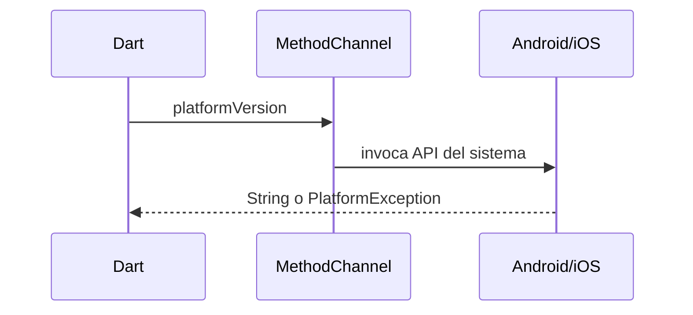
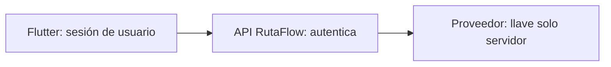
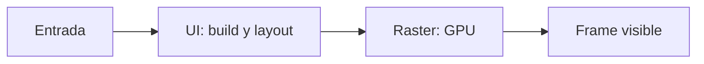
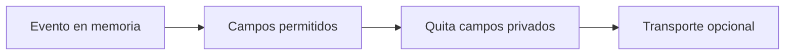
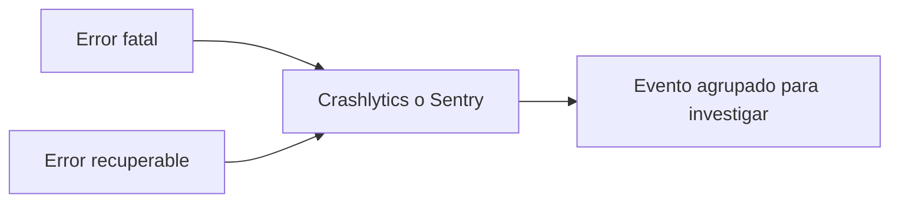
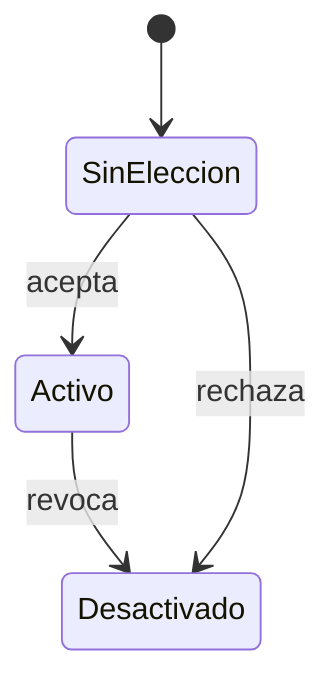
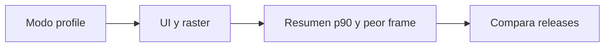

# Módulo 18: Flutter en producción: secretos, calidad y rendimiento

## Aprende construyendo

Vas a preparar una app que habla con servicios nativos, protege credenciales, mide fluidez y envía telemetría útil sin registrar datos personales. Trabajaremos en un proyecto Flutter llamado `rutaflow_mobile`. En cada tema queda claro qué archivo crear, qué comando correr y qué salida buscar. Firebase y Sentry necesitan proyectos externos; sus pasos se describen, pero no se cuentan como pruebas hechas aquí.

---


### Tema 1: la frontera entre Dart y el código nativo · Avanzado · 40 min

<details open>
<summary><strong>Capa 1 — Lectura</strong></summary>

#### ► DE QUÉ TRATA
Al finalizar, podrás decidir si una función va en Dart, en un plugin o detrás de una API nativa. Prerrequisitos: Dart básico y conocer async/await. Para un ejemplo independiente, crea un proyecto nuevo con flutter create rutaflow_mobile; entra con cd rutaflow_mobile; confirma el…

#### ► CÓMO FUNCIONA


</details>

<details>
<summary><strong>Capa 2 — Construcción</strong></summary>

#### Código y verificación
```dart
import 'package:flutter/services.dart';

class DeviceInfo {
  static const _channel = MethodChannel('rutaflow/device');

  Future<String> platformVersion() async {
    try {
      return await _channel.invokeMethod<String>('platformVersion') ?? 'desconocida';
    } on PlatformException catch (error) {
      return 'No disponible: ${error.code}';
    }
  }
}
```

```kotlin
MethodChannel(flutterEngine.dartExecutor.binaryMessenger, "rutaflow/device")
  .setMethodCallHandler { call, result ->
    if (call.method == "platformVersion") {
      result.success("Android ${android.os.Build.VERSION.RELEASE}")
    } else {
      result.notImplemented()
    }
  }
```

```swift
let channel = FlutterMethodChannel(
  name: "rutaflow/device",
  binaryMessenger: engineBridge.applicationRegistrar.messenger()
)
channel.setMethodCallHandler { call, result in
  guard call.method == "platformVersion" else {
    result(FlutterMethodNotImplemented)
    return
  }
  result("iOS \(UIDevice.current.systemVersion)")
}
```

```dart
import 'package:flutter/services.dart';
import 'package:flutter_test/flutter_test.dart';
import 'package:rutaflow_mobile/platform/device_info.dart';

void main() {
  TestWidgetsFlutterBinding.ensureInitialized();
  const channel = MethodChannel('rutaflow/device');
  test('lee versión del sistema por el canal', () async {
    TestDefaultBinaryMessengerBinding.instance.defaultBinaryMessenger
        .setMockMethodCallHandler(channel, (call) async => 'Android 15');
    expect(await DeviceInfo().platformVersion(), 'Android 15');
    TestDefaultBinaryMessengerBinding.instance.defaultBinaryMessenger
        .setMockMethodCallHandler(channel, null);
  });
}
```

```bash
flutter test
```


</details>

### Tema 2: secretos fuera del binario · Avanzado · 40 min

<details open>
<summary><strong>Capa 1 — Lectura</strong></summary>

#### ► DE QUÉ TRATA
Al finalizar, localizarás credenciales que no deben vivir en Flutter y moverás una operación privilegiada al servidor. Prerrequisitos: llamadas HTTP y variables de entorno. Crea un proyecto nuevo de Flutter con flutter create rutaflow_mobile, luego agrega lib/data/route_client.da…

#### ► CÓMO FUNCIONA


</details>

<details>
<summary><strong>Capa 2 — Construcción</strong></summary>

#### Código y verificación
```js
import { createServer } from 'node:http';

createServer((req, res) => {
  if (req.url !== '/api/route/quote' || req.method !== 'POST') {
    res.writeHead(404).end('not found');
    return;
  }
  if (req.headers.authorization !== 'Bearer demo-session') {
    res.writeHead(401).end('unauthorized');
    return;
  }
  // En producción, verificar la sesión y usar ROUTE_PROVIDER_KEY aquí.
  if (!process.env.ROUTE_PROVIDER_KEY) {
    res.writeHead(503).end('provider not configured');
    return;
  }
  res.writeHead(200, { 'content-type': 'application/json' });
  res.end(JSON.stringify({ estimate: 12, currency: 'USD' }));
}).listen(3000, '0.0.0.0', () => console.log('API lista en :3000'));
```

```dart
import 'dart:convert';
import 'package:http/http.dart' as http;

class RouteClient {
  RouteClient(this.baseUrl, this.client);
  final Uri baseUrl;
  final http.Client client;

  Future<Map<String, dynamic>> quote(String sessionToken) async {
    final response = await client.post(
      baseUrl.resolve('/api/route/quote'),
      headers: {
        'Authorization': 'Bearer $sessionToken',
        'Content-Type': 'application/json',
      },
      body: jsonEncode({'stops': 2}),
    );
    if (response.statusCode == 401) throw StateError('Sesión vencida');
    if (response.statusCode != 200) {
      throw StateError('No se pudo cotizar: ${response.statusCode}');
    }
    return jsonDecode(response.body) as Map<String, dynamic>;
  }
}
```

```bash
node server.mjs
curl -i -X POST http://localhost:3000/api/route/quote
curl -i -X POST -H 'Authorization: Bearer demo-session' http://localhost:3000/api/route/quote
```


</details>

### Tema 3: fluidez y presupuesto de frames · Avanzado · 30 min

<details open>
<summary><strong>Capa 1 — Lectura</strong></summary>

#### ► DE QUÉ TRATA
Al finalizar, encontrarás si una demora viene del trabajo Dart o de dibujar la escena. Prerrequisitos: widgets y lectura básica de DevTools. Crea un proyecto nuevo con flutter create frame_lab y agrega lib/screens/route_list.dart con una lista de entregas. Registra modelo, resolu…

#### ► CÓMO FUNCIONA


</details>

<details>
<summary><strong>Capa 2 — Construcción</strong></summary>

#### Código y verificación
```dart
import 'package:flutter/material.dart';

class Delivery {
  const Delivery(this.recipient, this.address);
  final String recipient;
  final String address;
}

final deliveries = List.generate(
  1000,
  (i) => Delivery('Destinatario $i', 'Calle ${i + 1} #${i % 90}-${i % 50}'),
);

class RouteList extends StatelessWidget {
  const RouteList({super.key});

  @override
  Widget build(BuildContext context) => ListView.builder(
        itemCount: deliveries.length,
        itemBuilder: (context, index) => ListTile(
          title: Text(deliveries[index].recipient),
          subtitle: Text(deliveries[index].address),
        ),
      );
}
```

```bash
flutter run --profile
```


</details>

### Tema 4: protocolo, telemetría y contención · Avanzado · 35 min

<details open>
<summary><strong>Capa 1 — Lectura</strong></summary>

#### ► DE QUÉ TRATA
Al finalizar, definirás qué evento enviar, qué campos quitar y qué hacer cuando la red o el servicio de telemetría falla. Prerrequisitos: mapas y excepciones de Dart. Crea un proyecto nuevo con flutter create telemetry_lab; agrega lib/telemetry/telemetry_event.dart y una prueba.

#### ► CÓMO FUNCIONA


</details>

<details>
<summary><strong>Capa 2 — Construcción</strong></summary>

#### Código y verificación
```dart
class TelemetryEvent {
  TelemetryEvent(this.name, Map<String, Object?> fields)
      : fields = Map.unmodifiable({
          for (final entry in fields.entries)
            if (!_privateFields.contains(entry.key)) entry.key: entry.value,
        });

  static const _privateFields = {
    'token', 'email', 'phone', 'address', 'recipient', 'photoUrl'
  };

  final String name;
  final Map<String, Object?> fields;
}
```

```bash
flutter test test/telemetry/telemetry_event_test.dart
```


</details>

### Tema 5: reportes de fallos con Crashlytics y Sentry · Avanzado · 35 min

<details open>
<summary><strong>Capa 1 — Lectura</strong></summary>

#### ► DE QUÉ TRATA
Al finalizar, distinguirás excepción fatal, error recuperable y evento esperado. Prerrequisitos: try/catch, stack traces y configuración de una app Flutter. Crea un proyecto nuevo con flutter create error_reporting_lab y lib/observability/error_reporting.dart. Para subir eventos…

#### ► LA ANALOGÍA
Crashlytics y Sentry reciben reportes y ayudan a agruparlos; no arreglan la causa. `recordFlutterFatalError` cubre errores del framework según la configuración de Firebase; `PlatformDispatcher.instance.onError` atiende errores asíncronos no manejados. Mantén la diferencia entre informar y manejar una excepción.

#### ► CÓMO FUNCIONA


</details>

<details>
<summary><strong>Capa 2 — Construcción</strong></summary>

#### Código y verificación
```dart
import 'dart:ui';

import 'package:firebase_core/firebase_core.dart';
import 'package:firebase_crashlytics/firebase_crashlytics.dart';
import 'package:flutter/material.dart';

import 'firebase_options.dart'; // generado por flutterfire configure

Future<void> main() async {
  WidgetsFlutterBinding.ensureInitialized();
  await Firebase.initializeApp(options: DefaultFirebaseOptions.currentPlatform);
  FlutterError.onError = FirebaseCrashlytics.instance.recordFlutterFatalError;
  PlatformDispatcher.instance.onError = (error, stack) {
    FirebaseCrashlytics.instance.recordError(error, stack, fatal: true);
    return true;
  };
  runApp(const MaterialApp(home: Scaffold(body: Center(child: Text('RutaFlow')))));
}
```

```dart
import 'package:flutter/material.dart';
import 'package:sentry_flutter/sentry_flutter.dart';

Future<void> main() async {
  await SentryFlutter.init(
    (options) => options.dsn = const String.fromEnvironment('SENTRY_DSN'),
    appRunner: () => runApp(const MyApp()),
  );
}

class MyApp extends StatelessWidget {
  const MyApp({super.key});

  @override
  Widget build(BuildContext context) => MaterialApp(
        home: Scaffold(
          body: Center(
            child: FilledButton(
              onPressed: () => throw StateError('Error de prueba para Sentry'),
              child: const Text('Provocar error de prueba'),
            ),
          ),
        ),
      );
}
```

```bash
flutter analyze
flutter test
```


</details>

### Tema 6: analítica con privacidad y consentimiento · Avanzado · 35 min

<details open>
<summary><strong>Capa 1 — Lectura</strong></summary>

#### ► DE QUÉ TRATA
Al finalizar, podrás describir el propósito de cada evento, retrasar captura hasta obtener la elección requerida y respetar una revocación. Prerrequisitos: futures, preferencias del usuario y eventos nombrados. Crea un proyecto nuevo con flutter create consent_lab y agrega lib/an…

#### ► CÓMO FUNCIONA


</details>

<details>
<summary><strong>Capa 2 — Construcción</strong></summary>

#### Código y verificación
```dart
abstract interface class AnalyticsSwitch {
  Future<void> setCollectionEnabled(bool enabled);
}

class AnalyticsConsent {
  AnalyticsConsent(this._analytics);
  final AnalyticsSwitch _analytics;

  Future<void> update({required bool accepted}) =>
      _analytics.setCollectionEnabled(accepted);
}
```

```bash
flutter test test/analytics/analytics_consent_test.dart
```


</details>

### Tema 7: monitoreo de rendimiento en una versión publicada · Avanzado · 40 min

<details open>
<summary><strong>Capa 1 — Lectura</strong></summary>

#### ► DE QUÉ TRATA
Al finalizar, definirás señales de arranque, frames y red que sirven para detectar regresiones sin guardar datos innecesarios. Prerrequisitos: modo profile, frame timing y trazas de red. Crea un proyecto nuevo con flutter create performance_monitor_lab; agrega lib/observability/f…

#### ► CÓMO FUNCIONA


</details>

<details>
<summary><strong>Capa 2 — Construcción</strong></summary>

#### Código y verificación
```dart
import 'package:flutter/widgets.dart';

class FrameMetrics {
  static void start() {
    WidgetsBinding.instance.addTimingsCallback((frames) {
      for (final frame in frames) {
        final buildMs = frame.buildDuration.inMilliseconds;
        final rasterMs = frame.rasterDuration.inMilliseconds;
        debugPrint('frame build=${buildMs}ms raster=${rasterMs}ms');
      }
    });
  }
}
```

```dart
import 'package:firebase_performance/firebase_performance.dart';

Future<void> measureQuote(Future<void> Function() loadQuote) async {
  final trace = FirebasePerformance.instance.newTrace('route_quote');
  await trace.start();
  try {
    await loadQuote();
    trace.incrementMetric('success', 1);
  } finally {
    await trace.stop();
  }
}
```

```bash
flutter run --profile
```


</details>
