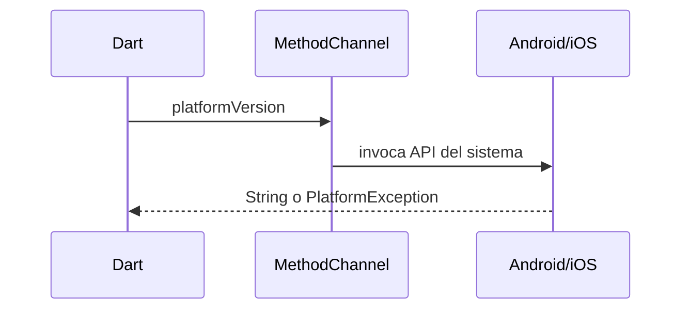
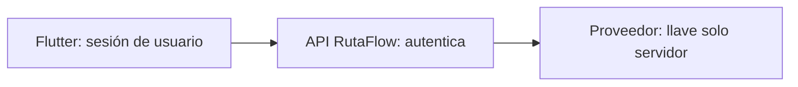
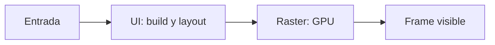
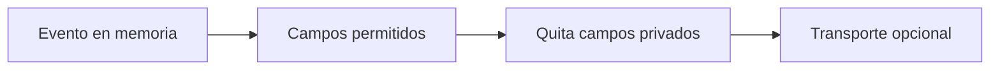
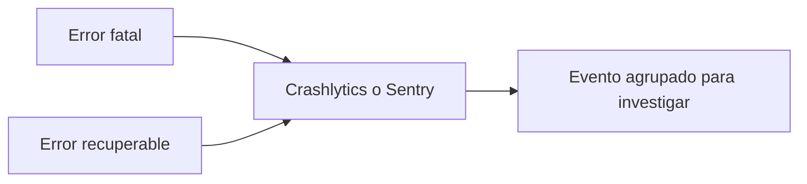
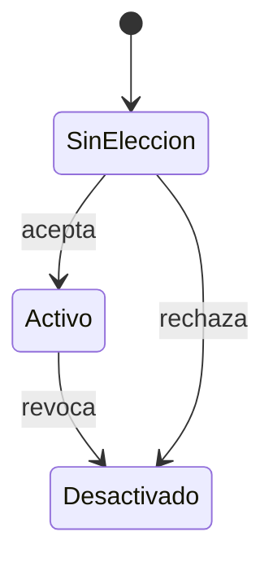
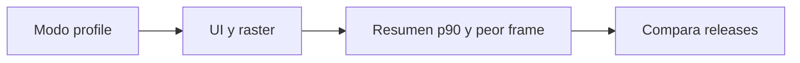

# Módulo 18: Flutter en producción: secretos, calidad y rendimiento

## Aprende construyendo

Vas a preparar una app que habla con servicios nativos, protege credenciales, mide fluidez y envía telemetría útil sin registrar datos personales. Trabajaremos en un proyecto Flutter llamado `rutaflow_mobile`. En cada tema queda claro qué archivo crear, qué comando correr y qué salida buscar. Firebase y Sentry necesitan proyectos externos; sus pasos se describen, pero no se cuentan como pruebas hechas aquí.

---

### Tema 1: la frontera entre Dart y el código nativo

#### Paso 1 · Objetivo y preparación
Al finalizar, podrás decidir si una función va en Dart, en un plugin o detrás de una API nativa. **Prerrequisitos:** Dart básico y conocer `async`/`await`. Para un ejemplo independiente, crea un proyecto nuevo con `flutter create rutaflow_mobile`; entra con `cd rutaflow_mobile`; confirma el entorno con `flutter doctor`. Necesitas Flutter y un emulador Android o simulador iOS.

#### Paso 2 · Contexto y caso real
RutaFlow debe leer el nivel de batería. Dart coordina la pantalla; Android/iOS conoce esa API del dispositivo. Un plugin existente suele ser la opción sencilla. Escribe un canal propio solo si el plugin falta o no cubre una capacidad que necesitas.

#### ¿Por qué es importante?
Si el contrato entre Dart y la plataforma se rompe, la función puede fallar solo en una plataforma y ser difícil de reproducir. Un ejemplo pequeño y testeado hace visible ese límite antes de integrar una función crítica.

#### Paso 3 · Teoría, modelo mental y analogía
Un `MethodChannel` funciona como una ventanilla: Dart manda un nombre de operación y datos; el lado nativo responde con un valor o error. Los dos lados deben usar el mismo nombre y respetar los mismos tipos. El mensaje es una frontera de datos, no una llamada directa a cualquier objeto nativo.

#### Paso 4 · Demostración guiada
Crea `lib/platform/device_info.dart`:

```dart
import 'package:flutter/services.dart';

class DeviceInfo {
  static const _channel = MethodChannel('rutaflow/device');

  Future<String> platformVersion() async {
    try {
      return await _channel.invokeMethod<String>('platformVersion') ?? 'desconocida';
    } on PlatformException catch (error) {
      return 'No disponible: ${error.code}';
    }
  }
}
```

Integra el handler en el proyecto nativo creado por Flutter: en Android, `android/app/src/main/kotlin/.../MainActivity.kt`; en iOS, `ios/Runner/AppDelegate.swift`. En `configureFlutterEngine` registra el canal Android:

```kotlin
MethodChannel(flutterEngine.dartExecutor.binaryMessenger, "rutaflow/device")
  .setMethodCallHandler { call, result ->
    if (call.method == "platformVersion") {
      result.success("Android ${android.os.Build.VERSION.RELEASE}")
    } else {
      result.notImplemented()
    }
  }
```

Para iOS registra el handler desde `didInitializeImplicitFlutterEngine` en `AppDelegate.swift` (plantilla Flutter 3.41+ con scene lifecycle):

```swift
let channel = FlutterMethodChannel(
  name: "rutaflow/device",
  binaryMessenger: engineBridge.applicationRegistrar.messenger()
)
channel.setMethodCallHandler { call, result in
  guard call.method == "platformVersion" else {
    result(FlutterMethodNotImplemented)
    return
  }
  result("iOS \(UIDevice.current.systemVersion)")
}
```

Agrega `import UIKit` si hace falta. Ejecuta `flutter run` y muestra el valor en una pantalla.

#### Paso 5 · Práctica guiada
Agrega `test/platform/device_info_test.dart` con un handler simulado que responda `Android 15`; verifica que Dart recibe ese texto sin depender del teléfono:

```dart
TestWidgetsFlutterBinding.ensureInitialized();
const channel = MethodChannel('rutaflow/device');
test('lee versión del sistema por el canal', () async {
  TestDefaultBinaryMessengerBinding.instance.defaultBinaryMessenger
      .setMockMethodCallHandler(channel, (call) async => 'Android 15');
  expect(await DeviceInfo().platformVersion(), 'Android 15');
  TestDefaultBinaryMessengerBinding.instance.defaultBinaryMessenger
      .setMockMethodCallHandler(channel, null);
});
```

**Pista:** importa `flutter/services.dart` y `flutter_test`; limpia el mock handler para que una prueba no afecte a la siguiente.

#### Paso 6 · Práctica independiente
Agrega la operación `deviceName`. Define el tipo de retorno, el comportamiento si el sistema no lo entrega y el caso de operación desconocida. No devuelvas números de serie ni identificadores de hardware.

#### Paso 7 · Cierre y evidencia
Guarda `lib/platform/device_info.dart`, el handler nativo y el test. Evidencia local: `flutter test` termina con todas las pruebas verdes y la app muestra la versión del SO. Si solo compila Android, registra iOS como pendiente; no lo infieras. El siguiente tema mueve la credencial privilegiada fuera del cliente.

**Prueba de diagnóstico.** En `test/platform/device_info_test.dart`, provoca deliberadamente un error cambiando el nombre del canal a `rutaflow/device-v2`; el resultado debe ser una `MissingPluginException`, porque el handler escucha el nombre anterior. Corrige el nombre y vuelve a ejecutar `flutter test`.

```bash
flutter test
```

**Resultado esperado:** todas las pruebas pasan y el fake devuelve `Android 15`. Error común: registrar el handler con un canal o método distinto al que invoca Dart. Diagrama del recorrido: `Dart -> MethodChannel -> Android/iOS -> respuesta`. Fuente oficial: [platform channels](https://docs.flutter.dev/platform-integration/platform-channels).

**Proyecto propio:** la app `rutaflow_mobile` iniciada arriba. **Cuándo usarlo:** cuando una API nativa no existe en un plugin mantenido y el contrato puede ser pequeño. **Errores comunes:** canal con nombre distinto y tipos incompatibles. Evidencia de aprendizaje: entrega el test del Paso 4 que prueba la respuesta y el error.



---

### Tema 2: secretos fuera del binario

#### Paso 1 · Objetivo y preparación
Al finalizar, localizarás credenciales que no deben vivir en Flutter y moverás una operación privilegiada al servidor. **Prerrequisitos:** llamadas HTTP y variables de entorno. Crea un proyecto nuevo de Flutter con `flutter create rutaflow_mobile`, luego agrega `lib/data/route_client.dart` y el servidor `server.mjs`; requiere Dart, Flutter y Node.js.

#### Paso 2 · Contexto y caso real
Una app descargada se puede inspeccionar. Un token de servicio incluido como constante o variable de compilación termina dentro del paquete y puede extraerse. La ofuscación cambia nombres; no cifra secretos ni elimina esa posibilidad.

#### ¿Por qué es importante?
Una clave extraída puede permitir que otra persona consuma el servicio o acceda a datos con permisos más amplios que los del usuario. Moverla al servidor permite rotarla y controlar su uso.

#### Paso 3 · Teoría, modelo mental y analogía
La app debe llevar solo credenciales públicas o de usuario con permisos limitados. Una llave maestra pertenece al servidor. La app solicita una acción con su sesión; el servidor autentica, autoriza y usa allí la credencial privada. Un `.env` que se empaqueta en Flutter sigue estando en el cliente.

#### Paso 4 · Demostración guiada
Crea en el backend `server.mjs`:

```js
import { createServer } from 'node:http';

createServer((req, res) => {
  if (req.url !== '/api/route/quote' || req.method !== 'POST') {
    res.writeHead(404).end('not found');
    return;
  }
  if (req.headers.authorization !== 'Bearer demo-session') {
    res.writeHead(401).end('unauthorized');
    return;
  }
  // En producción, verificar la sesión y usar ROUTE_PROVIDER_KEY aquí.
  if (!process.env.ROUTE_PROVIDER_KEY) {
    res.writeHead(503).end('provider not configured');
    return;
  }
  res.writeHead(200, { 'content-type': 'application/json' });
  res.end(JSON.stringify({ estimate: 12, currency: 'USD' }));
}).listen(3000, '0.0.0.0', () => console.log('API lista en :3000'));
```

En Flutter añade `http` con `flutter pub add http` y crea `lib/data/route_client.dart`:

```dart
import 'dart:convert';
import 'package:http/http.dart' as http;

class RouteClient {
  RouteClient(this.baseUrl, this.client);
  final Uri baseUrl;
  final http.Client client;

  Future<Map<String, dynamic>> quote(String sessionToken) async {
    final response = await client.post(
      baseUrl.resolve('/api/route/quote'),
      headers: {
        'Authorization': 'Bearer $sessionToken',
        'Content-Type': 'application/json',
      },
      body: jsonEncode({'stops': 2}),
    );
    if (response.statusCode == 401) throw StateError('Sesión vencida');
    if (response.statusCode != 200) {
      throw StateError('No se pudo cotizar: ${response.statusCode}');
    }
    return jsonDecode(response.body) as Map<String, dynamic>;
  }
}
```

Arranca con `ROUTE_PROVIDER_KEY=local-demo node server.mjs` (usa una credencial ficticia solo en local). En Flutter llama `POST /api/route/quote` con el token de sesión del usuario, nunca con `ROUTE_PROVIDER_KEY`. Prueba `curl -i -X POST http://localhost:3000/api/route/quote` y observa `401`; repite con `-H 'Authorization: Bearer demo-session'` y observa `200` con `{ "estimate": 12, "currency": "USD" }`.

#### Paso 5 · Práctica guiada
Añade autenticación de sesión al backend, verifica que falta de token produce `401` y que la clave del proveedor aparece únicamente en el entorno del servidor. Usa un emulador Android: para acceder al host suele usarse `10.0.2.2`; no lo confundas con la dirección del teléfono físico. **Pista:** primero prueba `curl` desde el host; luego cambia la base URL para el emulador.

#### Paso 6 · Práctica independiente
Busca en el código, configuración, historial y artefactos compilados una cadena `sk_live_` ficticia. Diseña una respuesta de error segura y un plan de rotación si alguien filtrara una clave real. No subas credenciales a Git.

#### Paso 7 · Cierre y evidencia
Entrega el diff de backend y `lib/data/route_client.dart`; observa un `401` sin sesión y un `200` con usuario autorizado. El ejemplo anterior es una carcasa didáctica: hasta añadir verificación real de sesión y proveedor no es una API lista para producción. El siguiente tema perfila la app que consume esta API.

**Prueba de diagnóstico.** Provoca deliberadamente una falla de autorización al ejecutar la petición sin `Authorization`: debe responder `401 unauthorized`. Luego agrega `Bearer demo-session`; observa `200`. En el ejemplo local esa sesión es fija y solo sirve para aprender el flujo; reemplázala por validación real antes de producción.

```bash
node server.mjs
curl -i -X POST http://localhost:3000/api/route/quote
curl -i -X POST -H 'Authorization: Bearer demo-session' http://localhost:3000/api/route/quote
```

**Resultado esperado:** primero `401`, después `200` y JSON de estimación. Error común: enviar la llave del proveedor en una cabecera desde Flutter. Diagrama: `Flutter + sesión -> API propia -> proveedor con secreto`. Fuente oficial: [Flutter y credenciales de servicio](https://docs.flutter.dev/data-and-backend/google-apis).

**Proyecto propio:** `server.mjs` y `lib/data/route_client.dart`. **Cuándo mover lógica:** cuando una operación requiere clave privada o permiso administrativo. **Errores comunes:** considerar `.env` seguro después de empaquetarlo y usar el mismo host del emulador en un teléfono. Evidencia de aprendizaje: entrega ambas respuestas `curl` del Paso 4.



---

### Tema 3: fluidez y presupuesto de frames

#### Paso 1 · Objetivo y preparación
Al finalizar, encontrarás si una demora viene del trabajo Dart o de dibujar la escena. **Prerrequisitos:** widgets y lectura básica de DevTools. Crea un proyecto nuevo con `flutter create frame_lab` y agrega `lib/screens/route_list.dart` con una lista de entregas. Registra modelo, resolución y frecuencia de pantalla.

#### Paso 2 · Contexto y caso real
Al desplazarse por muchas paradas, recalcular filtros, crear todos los elementos de golpe y animar efectos costosos puede provocar saltos. A 60 Hz cada frame tiene cerca de 16,7 ms; pantallas de 120 Hz tienen menos de 8,4 ms.

#### ¿Por qué es importante?
Una pantalla que salta dificulta completar una entrega mientras se camina o conduce. Medir antes de optimizar evita cambios que añadan complejidad sin mejorar la experiencia.

#### Paso 3 · Teoría, modelo mental y analogía
La tubería tiene una parte que prepara widgets y otra que rasteriza píxeles. En DevTools mira ambas. Un frame lento en UI apunta al trabajo Dart/build/layout; uno lento en raster apunta al costo de dibujar. Mide en `profile`: el modo debug añade trabajo y no representa el rendimiento final.

#### Paso 4 · Demostración guiada
En `lib/screens/route_list.dart`, usa `ListView.builder` en lugar de construir todos los renglones:

```dart
ListView.builder(
  itemCount: deliveries.length,
  itemBuilder: (context, index) => ListTile(
    title: Text(deliveries[index].recipient),
    subtitle: Text(deliveries[index].address),
  ),
)
```

Corre `flutter run --profile`, abre DevTools Performance y graba un desplazamiento repetible. Anota los frames lentos. Para 60 Hz busca tiempos por debajo de 16 ms; no conviertas ese número en garantía para otros teléfonos.

#### Paso 5 · Práctica guiada
Introduce temporalmente un cálculo de ordenamiento costoso dentro de `build()`. Compara el timeline. Mueve el trabajo fuera de `build` o a un isolate si es CPU-bound; vuelve a grabar con el mismo recorrido y equipo. **Pista:** registra el perfil del mismo scroll antes y después, sin cambiar dispositivo ni cantidad de filas.

#### Paso 6 · Práctica independiente
Compara la lista completa con `ListView.builder`; evalúa `const`, imágenes y efectos de opacidad solo donde la medición señale costo. Guarda promedio, p90, peor frame y versión de Flutter. Evita reportar un porcentaje sin incluir método y dispositivo.

#### Paso 7 · Cierre y evidencia
Entrega `lib/screens/route_list.dart` y dos capturas o exportaciones de DevTools (antes/después). Evidencia: el mismo recorrido, en modo profile, con UI y raster revisados. Si no hay dispositivo físico, dilo y marca el resultado como referencia de emulador. El siguiente tema controla qué información sale del dispositivo.

**Prueba de diagnóstico.** Provoca deliberadamente trabajo CPU en `build()` y observa si las barras UI superan el presupuesto. Después retíralo y repite el mismo gesto.

```bash
flutter run --profile
```

**Resultado esperado:** el timeline permite comparar UI/raster; `ListView.builder` crea elementos visibles bajo demanda. Error común: sacar conclusiones de modo debug. Diagrama: `entrada -> build/layout (UI) -> raster (GPU) -> pantalla`. Fuente oficial: [Flutter performance](https://docs.flutter.dev/perf/ui-performance).

**Proyecto propio:** `frame_lab`. **Cuándo optimizar:** solo cuando profile muestre un costo que afecte el dispositivo objetivo. **Errores comunes:** medir en debug o atribuir una barra lenta a la GPU sin mirar la pista UI. Evidencia: entrega el perfil del mismo scroll en ambas corridas.



---

### Tema 4: protocolo, telemetría y contención

#### Paso 1 · Objetivo y preparación
Al finalizar, definirás qué evento enviar, qué campos quitar y qué hacer cuando la red o el servicio de telemetría falla. **Prerrequisitos:** mapas y excepciones de Dart. Crea un proyecto nuevo con `flutter create telemetry_lab`; agrega `lib/telemetry/telemetry_event.dart` y una prueba.

#### Paso 2 · Contexto y caso real
Durante una entrega fallida, un evento puede ayudar a ver si el fallo ocurrió al cargar ruta o subir evidencia. Enviar el cuerpo entero de la solicitud también podría exponer dirección, teléfono o token. La telemetría debe tener un contrato pequeño y controlado.

#### ¿Por qué es importante?
Los eventos pueden ayudar a diagnosticar un incidente, pero una filtración los convierte en otra copia de los datos del usuario. Reducir campos y contener fallos evita que observabilidad empeore el incidente original.

#### Paso 3 · Teoría, modelo mental y analogía
Piensa en la telemetría como una etiqueta de envío: código de evento, versión, plataforma y una referencia aleatoria limitada. No incluyas contenido de negocio. El transporte puede fallar; el error de telemetría no debe tumbar el flujo principal.

#### Paso 4 · Demostración guiada
Crea `lib/telemetry/telemetry_event.dart`:

```dart
class TelemetryEvent {
  TelemetryEvent(this.name, Map<String, Object?> fields)
      : fields = Map.unmodifiable({
          for (final entry in fields.entries)
            if (!_privateFields.contains(entry.key)) entry.key: entry.value,
        });

  static const _privateFields = {
    'token', 'email', 'phone', 'address', 'recipient', 'photoUrl'
  };

  final String name;
  final Map<String, Object?> fields;
}
```

Prueba con `TelemetryEvent('route_failed', {'attempt': 2, 'address': 'Calle 1', 'token': 'fake'})`. Crea `test/telemetry/telemetry_event_test.dart`; ejecuta `flutter test test/telemetry/telemetry_event_test.dart` y comprueba que sobreviva `attempt` pero no `address` ni `token`.

#### Paso 5 · Práctica guiada
Envuelve el envío con `try/catch` en `lib/telemetry/telemetry_client.dart`; ante fallo escribe una marca local sin datos personales y continúa mostrando el error real de RutaFlow. Limita tamaño, nombres de eventos y frecuencia para que un bucle no cree una tormenta de eventos. **Pista:** prueba con un transporte fake que arroje `SocketException`.

#### Paso 6 · Práctica independiente
Redacta el contrato de `delivery_completed`: campos permitidos, campos prohibidos, propósito, retención definida por el equipo y cómo desactivar captura. Revisa también breadcrumbs y mensajes de error; los datos pueden aparecer allí aunque el evento esté limpio.

#### Paso 7 · Cierre y evidencia
Entrega modelo, test y tabla de datos permitidos/prohibidos. Evidencia: la prueba demuestra la eliminación de dos campos privados y una caída del transporte no interrumpe la pantalla. El filtro local reduce riesgos, pero no reemplaza controles del SDK y revisión de privacidad. El siguiente tema configura captura de fallos con un proveedor.

**Prueba de diagnóstico.** En `test/telemetry/telemetry_event_test.dart`, quita deliberadamente `address` del conjunto de exclusión; la expectativa debe fallar y mostrar por qué no se permite ese campo.

```bash
flutter test test/telemetry/telemetry_event_test.dart
```

**Resultado esperado:** `attempt` se conserva; `address` y `token` no aparecen. Error común: redacción en el evento principal y fuga del mismo dato en breadcrumbs. Diagrama: `evento -> lista permitida -> redacción -> transporte`. Fuente oficial: [recomendaciones de Flutter security](https://docs.flutter.dev/security).

**Proyecto propio:** `telemetry_lab`. **Cuándo enviar:** cuando existe propósito claro y campos mínimos; si no hace falta para responder una pregunta, no lo registres. **Errores comunes:** reintentar sin límite y dejar datos personales en breadcrumbs. Provoca deliberadamente un fallo de privacidad quitando `address` del filtro; el test debe mostrar error. Evidencia de aprendizaje: entrega el test del Paso 4 que falla y vuelve a pasar después de corregirlo.



---

### Tema 5: reportes de fallos con Crashlytics y Sentry

#### Paso 1 · Objetivo y preparación
Al finalizar, distinguirás excepción fatal, error recuperable y evento esperado. **Prerrequisitos:** `try/catch`, stack traces y configuración de una app Flutter. Crea un proyecto nuevo con `flutter create error_reporting_lab` y `lib/observability/error_reporting.dart`. Para subir eventos se requieren un proyecto de Firebase o Sentry, configuración nativa y autorización del equipo.

#### Paso 2 · Contexto y caso real
Un crash al confirmar entrega debe poder agruparse por versión y stack trace. Un rechazo de dirección es una respuesta de negocio, no un crash. Si se reporta todo como fatal, las alertas dejan de señalar fallos reales.

#### ¿Por qué es importante?
Los equipos necesitan distinguir un fallo que bloquea a muchas personas de un rechazo esperado. Esa separación permite priorizar correcciones y no llenar alertas con casos normales.

#### Paso 3 · Teoría, modelo mental y analogía
Crashlytics y Sentry reciben reportes y ayudan a agruparlos; no arreglan la causa. `recordFlutterFatalError` cubre errores del framework según la configuración de Firebase; `PlatformDispatcher.instance.onError` atiende errores asíncronos no manejados. Mantén la diferencia entre informar y manejar una excepción.

#### Paso 4 · Demostración guiada
En la app de práctica configura Firebase con `flutterfire configure`, inicializa `firebase_core` y añade `firebase_crashlytics`. En `lib/main.dart`, después de inicializar Firebase:

```dart
FlutterError.onError = FirebaseCrashlytics.instance.recordFlutterFatalError;
PlatformDispatcher.instance.onError = (error, stack) {
  FirebaseCrashlytics.instance.recordError(error, stack, fatal: true);
  return true;
};
```

Para una excepción recuperable, llama `recordError(error, stack, fatal: false)` en el `catch` correspondiente y sigue mostrando un mensaje útil. Agrega `sentry_flutter` como alternativa de backend, no dupliques reportes sin política de deduplicación. Ejecuta solo el crash de prueba en un build de desarrollo con proyecto autorizado; confirma recepción en el panel.

Para probar Sentry en una app separada, corre `flutter pub add sentry_flutter` y usa en `lib/main.dart` el inicializador oficial; el DSN identifica el proyecto y no debe confundirse con una llave de servicio:

```dart
await SentryFlutter.init(
  (options) => options.dsn = const String.fromEnvironment('SENTRY_DSN'),
  appRunner: () => runApp(const MyApp()),
);
```

Ejecuta con `flutter run --dart-define=SENTRY_DSN=<DSN-del-proyecto-de-prueba>`. El SDK captura errores no manejados; para reportar un error recuperable desde un `catch`, usa `await Sentry.captureException(error, stackTrace: stack)`. Elige un solo SDK como dueño de los handlers globales, salvo que hayas diseñado y comprobado la deduplicación.

#### Paso 5 · Práctica guiada
Añade un identificador interno aleatorio de sesión y la versión de app a un reporte, nunca token, correo, teléfono, coordenadas ni texto de formulario. Configura y prueba que el release obfuscado conserve y suba los símbolos requeridos antes de depender de un stack trace legible. **Pista:** diferencia error recuperable (`fatal: false`) del handler superior de errores no manejados.

#### Paso 6 · Práctica independiente
Provoca un error recuperable controlado y un crash de prueba en un proyecto de desarrollo. Escribe qué aparece en cada panel, cuánto demora y cómo se distingue un evento esperado de un fallo que requiere alerta. Elimina el botón de crash antes de compilar release.

#### Paso 7 · Cierre y evidencia
Guarda `lib/observability/error_reporting.dart`, la configuración no secreta y evidencia del evento de prueba en el panel. Sin acceso a una cuenta externa, reporta `flutter analyze`/tests del adapter local, y deja claramente pendiente la recepción remota; no afirmes integración validada. El siguiente tema decide qué datos de uso se registran con consentimiento.

**Prueba de diagnóstico.** Provoca deliberadamente un error no manejado en el botón de test de desarrollo; comprueba que llega como fatal. Luego captura una excepción recuperable y observa que no se agrupa como crash fatal. Quita el botón antes de release.

```bash
flutter analyze
flutter test
```

**Resultado esperado:** análisis y pruebas locales pasan; el panel remoto solo cuenta como probado cuando se recibe el evento. Error común: confundir configuración local con recepción del servicio. Diagrama: `FlutterError / PlatformDispatcher -> SDK -> evento agrupado`. Fuente oficial: [Crashlytics para Flutter](https://firebase.google.com/docs/crashlytics/flutter/get-started).

**Proyecto propio:** `error_reporting_lab`, configurado con proyecto de desarrollo autorizado. **Cuándo enviar:** crash o error técnico accionable, no validación esperada de negocio. **Errores comunes:** dejar el botón de crash de prueba en release, reportar dos veces o perder símbolos de una build ofuscada. Evidencia: entrega el adapter y el recibo del panel, o registra explícitamente que falta cuenta externa.



---

### Tema 6: analítica con privacidad y consentimiento

#### Paso 1 · Objetivo y preparación
Al finalizar, podrás describir el propósito de cada evento, retrasar captura hasta obtener la elección requerida y respetar una revocación. **Prerrequisitos:** futures, preferencias del usuario y eventos nombrados. Crea un proyecto nuevo con `flutter create consent_lab` y agrega `lib/analytics/analytics_consent.dart`. Los requisitos legales dependen del lugar y del uso; valida el flujo con el responsable de privacidad.

#### Paso 2 · Contexto y caso real
El equipo quiere saber dónde abandonan el alta de una entrega. El evento `delivery_form_opened` puede servir; enviar nombre, dirección, imagen o texto introducido no es necesario para responder esa pregunta.

#### ¿Por qué es importante?
Una métrica útil no justifica recolectar todos los datos disponibles. Consentimiento, propósito y minimización reducen la exposición y ayudan a que las personas entiendan qué mide la app.

#### Paso 3 · Teoría, modelo mental y analogía
Un evento es una fila de observación: acción, momento y pocos atributos permitidos. Define el propósito antes del campo. Si la colección debe esperar una decisión de usuario, desactívala al inicio y actívala solo después de registrar el consentimiento; la app también debe poder detenerla al revocarse.

#### Paso 4 · Demostración guiada
Añade `firebase_analytics`. Empieza con la recolección desactivada según la configuración oficial de Android/iOS y no llames a eventos antes de resolver consentimiento. En la capa Dart, centraliza la transición:

```dart
abstract interface class AnalyticsSwitch {
  Future<void> setCollectionEnabled(bool enabled);
}

class AnalyticsConsent {
  AnalyticsConsent(this._analytics);
  final AnalyticsSwitch _analytics;

  Future<void> update({required bool accepted}) =>
      _analytics.setCollectionEnabled(accepted);
}
```

Adapta `AnalyticsSwitch` al método `setAnalyticsCollectionEnabled` de la versión instalada. Prueba el adapter con un fake: antes de aceptar, no envía; al aceptar, habilita; al revocar, deshabilita. No guardes una elección ficticia como consentimiento real.

#### Paso 5 · Práctica guiada
Registra `delivery_step_viewed` con `step: 'address'` y una versión de esquema. Verifica que no se registren el valor escrito ni el id de usuario directo. Documenta eventos automáticos del SDK y revisa la configuración de cada plataforma. **Pista:** inyecta `AnalyticsSwitch`; así puedes comprobar el orden sin enviar información a Firebase.

#### Paso 6 · Práctica independiente
Crea una tabla de cinco eventos con nombre, propósito, atributos mínimos, dato excluido, condición de consentimiento y equipo responsable. Añade un test de revocación y uno de fallo de almacenamiento de preferencia.

#### Paso 7 · Cierre y evidencia
Entrega `lib/analytics/analytics_consent.dart`, pruebas y el inventario de eventos. Evidencia: fake sin eventos antes de aceptar y después de revocar. La revisión legal, la configuración nativa efectiva y la inspección de datos reales son una etapa separada. El siguiente tema medirá rendimiento local y de una release.

**Prueba de diagnóstico.** Desactiva deliberadamente Analytics y luego intenta enviar `delivery_step_viewed`; el fake debe registrar cero eventos. Acepta y prueba; revoca y vuelve a probar. **Resultado esperado:** la colección se habilita solo entre aceptación y revocación. Error común: detener eventos propios pero olvidar la recopilación automática. Diagrama: `sin elección -> desactivado -> acepta -> activo -> revoca -> desactivado`.

```bash
flutter test test/analytics/analytics_consent_test.dart
```

Fuente oficial: [control de recopilación Analytics en Android](https://firebase.google.com/docs/analytics/android/configure-data-collection) e [iOS](https://firebase.google.com/docs/analytics/ios/configure-data-collection).

**Proyecto propio:** `consent_lab`. **Cuándo recopilar:** solo con propósito definido y elección aplicable ya resuelta. **Errores comunes:** olvidar eventos automáticos, no persistir la revocación o aceptar por defecto. Provoca deliberadamente el error de enviar mientras está desactivado y confirma que el fake recibe cero eventos. Evidencia de aprendizaje: entrega el test de revocación del Paso 4.



---

### Tema 7: monitoreo de rendimiento en una versión publicada

#### Paso 1 · Objetivo y preparación
Al finalizar, definirás señales de arranque, frames y red que sirven para detectar regresiones sin guardar datos innecesarios. **Prerrequisitos:** modo profile, frame timing y trazas de red. Crea un proyecto nuevo con `flutter create performance_monitor_lab`; agrega `lib/observability/frame_metrics.dart` y `docs/performance-runbook.md`. Necesitas DevTools y acceso al backend de monitorización que el equipo elija.

#### Paso 2 · Contexto y caso real
Una pantalla puede sentirse lenta aunque no falle. Una medición aislada del portátil no muestra qué pasa con teléfonos modestos ni si la última release empeoró. Compara versiones con el mismo recorrido y dispositivo.

#### ¿Por qué es importante?
La línea base permite detectar una regresión antes de que afecte a muchas personas. Las mediciones comparables también ayudan a escoger el cambio que conviene revisar primero.

#### Paso 3 · Teoría, modelo mental y analogía
Define indicadores antes de instalar otro SDK: tiempo al primer frame, duración UI, raster y latencia de una operación representativa. Resume promedio, p90, p99 y peor caso. Un promedio bueno puede ocultar que muchas personas esperan demasiado.

#### Paso 4 · Demostración guiada
En `lib/observability/frame_metrics.dart`, añade un observador de tiempos:

```dart
import 'dart:ui';
import 'package:flutter/widgets.dart';

class FrameMetrics {
  static void start() {
    WidgetsBinding.instance.addTimingsCallback((frames) {
      for (final frame in frames) {
        final buildMs = frame.buildDuration.inMilliseconds;
        final rasterMs = frame.rasterDuration.inMilliseconds;
        debugPrint('frame build=${buildMs}ms raster=${rasterMs}ms');
      }
    });
  }
}
```

Llama `FrameMetrics.start()` una vez durante el inicio de la app de laboratorio. Corre `flutter run --profile`, repite el recorrido de la lista y compara con DevTools. No envíes cada frame como evento de red: agrega en el dispositivo y reporta resúmenes con límites.

#### Paso 5 · Práctica guiada
En `docs/performance-runbook.md`, agrega versión, teléfono, modo, pasos, tiempo de primera pantalla, p90 UI/raster, número de frames sobre el presupuesto y resultado esperado. El mecanismo de timings registra datos locales para el ejercicio; el envío remoto requiere adaptación y configuración del SDK elegido.

#### Paso 6 · Práctica independiente
Establece una línea base en dos dispositivos disponibles y define una alarma que requiera confirmar una regresión antes de revertir. Si integras Firebase Performance Monitoring, ejecuta `flutter pub add firebase_performance` y `flutterfire configure`; verifica en el panel que recibió la traza. Para una operación de negocio crea una traza acotada en `lib/observability/route_trace.dart`:

```dart
import 'package:firebase_performance/firebase_performance.dart';

Future<void> measureQuote(Future<void> Function() loadQuote) async {
  final trace = FirebasePerformance.instance.newTrace('route_quote');
  await trace.start();
  try {
    await loadQuote();
    trace.incrementMetric('success', 1);
  } finally {
    await trace.stop();
  }
}
```

No añadas dirección o identidad a atributos. Firebase Performance recoge automáticamente tiempo de inicio y solicitudes de red en las plataformas soportadas, pero no mide de forma automática el render de cada pantalla Flutter. Si usas Sentry, valida el rendimiento con la versión del SDK y funciones habilitadas por tu proyecto. **Pista:** no compares debug en un teléfono con profile en otro.

#### Paso 7 · Cierre y evidencia
Entrega `lib/observability/frame_metrics.dart` y `docs/performance-runbook.md`, con medición reproducible y límites explícitos. Evidencia de perfil local y evidencia de panel remoto se informan por separado; sin datos de dos versiones no concluyas que hubo mejora. Este resultado sirve de entrada para el siguiente ciclo: comparar una release nueva con la línea base.

**Prueba de diagnóstico.** Introduce deliberadamente una carga de CPU durante el scroll y comprueba que la medición local detecta frames lentos. Quita la carga y repite el mismo recorrido.

```bash
flutter run --profile
```

**Resultado esperado:** se registran timings UI/raster sin enviar cada frame. Error común: llamar monitoreo a `debugPrint` o a una sola corrida. Diagrama: `buildDuration + rasterDuration -> resumen -> umbral -> revisión de release`. Fuente oficial: [métricas de rendimiento Flutter](https://docs.flutter.dev/perf/metrics).

**Proyecto propio:** `performance_monitor_lab`. **Cuándo alertar:** al confirmar regresión en cohortes comparables, no por una sola corrida. **Errores comunes:** comparar debug y profile, o subir cada frame como evento. Provoca deliberadamente una carga CPU, comprueba el frame lento y quítala. Evidencia de aprendizaje: entrega el runbook del Paso 4 y dos mediciones con el mismo recorrido.



---

## Referencias oficiales consultadas

- Flutter, [Google APIs y credenciales de servicio](https://docs.flutter.dev/data-and-backend/google-apis) y [obfuscación y límites de seguridad](https://docs.flutter.dev/deployment/obfuscate).
- Flutter, [buenas prácticas de rendimiento](https://docs.flutter.dev/perf/best-practices), [perfil de UI](https://docs.flutter.dev/perf/ui-performance) y [vista Performance de DevTools](https://docs.flutter.dev/tools/devtools/performance).
- Firebase, [Crashlytics para Flutter](https://firebase.google.com/docs/crashlytics/flutter/get-started), [configuración Firebase Flutter](https://firebase.google.com/docs/flutter/setup) y [eventos de Analytics Flutter](https://firebase.google.com/docs/analytics/flutter/events).
- Firebase Performance, [inicio rápido Flutter](https://firebase.google.com/docs/perf-mon/flutter/get-started) y [trazas personalizadas](https://firebase.google.com/docs/perf-mon/custom-code-traces?platform=flutter).
- Google Analytics for Firebase, [control de recopilación Android](https://firebase.google.com/docs/analytics/android/configure-data-collection) e [iOS](https://firebase.google.com/docs/analytics/ios/configure-data-collection).
- Sentry, [guía Flutter](https://docs.sentry.io/platforms/dart/guides/flutter/) y [receta oficial Flutter de reporte de errores](https://docs.flutter.dev/cookbook/maintenance/error-reporting).
