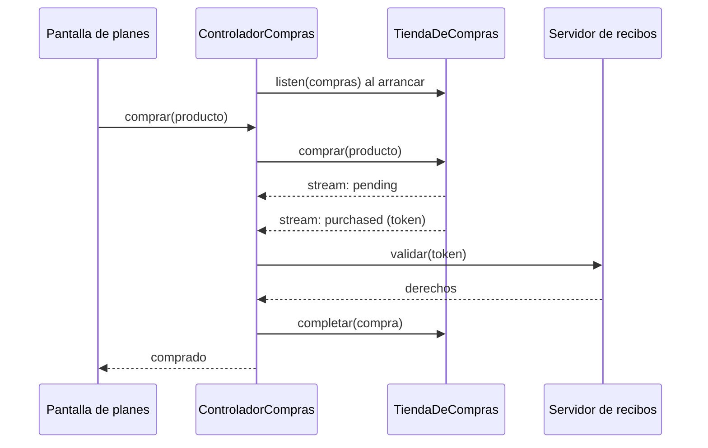
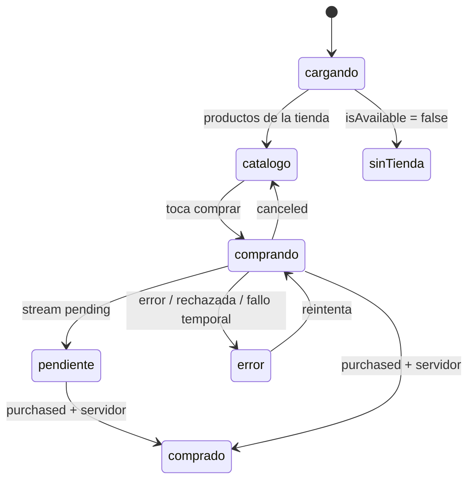
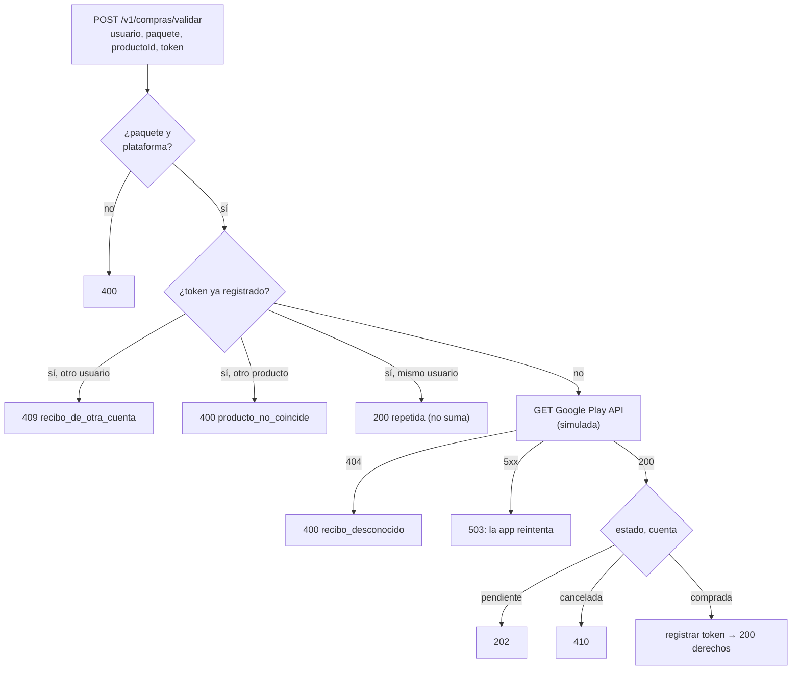
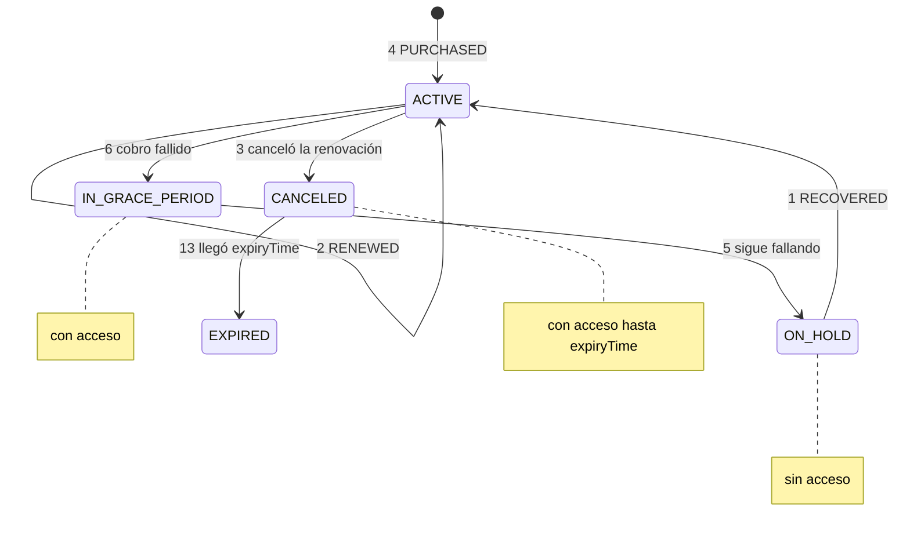

# Módulo 18: Compras dentro de la app (IAP) en Flutter

**Entorno comprobado para esta edición (2026-11-24):** Flutter 3.50.1 (canal estable) con Dart 3.14.0 en Linux
x86_64, con `material_ui` 1.11.1, `in_app_purchase` 3.3.1 (con `in_app_purchase_android` 0.5.5, que trae Google Play
Billing Library 9.1.0, e `in_app_purchase_storekit` 0.4.17), `http` 1.6.0 e `intl` 0.20.3. Todo el código se analizó
con `flutter analyze` (`No issues found!`) y se ejecutó ese día, en `/home/estudiante/labs/flutter/m18` (tu
`~/labs/flutter/m18`). **Límite honesto:** el equipo de pruebas no tiene cuenta de Google Play Console ni de App Store
Connect, ni un teléfono, así que aquí no se hizo ninguna compra real. Lo que sí es real: el plugin `in_app_purchase`
integrado y compilado en un APK de Android (Tema 4, con el permiso de facturación leído del APK con `aapt2`), toda la
lógica de compra probada con una tienda falsa que implementa la misma interfaz y se comporta como el plugin de
Android (leído en su código fuente), y un servidor de validación en Dart que habla por HTTP con un **Google Play
Developer API simulado**: las rutas y los campos son los documentados por Google, pero las respuestas las produce un
programa local. iOS no se compiló (no hay Xcode).

Vender dentro de la app es fácil de programar mal: el pago ocurre en la tienda, el resultado llega más tarde por un
*stream*, el teléfono no es de fiar y una compra que no se cierra se reembolsa sola. Este módulo construye la
monetización de la app de reparto con una regla central: **la app nunca se da un derecho a sí misma; lo da el
servidor después de preguntarle a la tienda.**

**Al terminar este módulo podrás:**
- integrar `in_app_purchase` detrás de una interfaz propia y probar todo el flujo con una tienda falsa;
- diseñar una pantalla de planes con sus estados, precios que vienen de la tienda y sin patrones engañosos;
- validar recibos en un servidor propio, guardar los derechos y resistir reintentos, recibos repetidos y alterados;
- mantener las suscripciones al día con los avisos de la tienda, restaurar compras y compilar la app para Android.

**Esquema del módulo:** Tema 1 (catálogo y flujo de compra) → Tema 2 (la pantalla de planes) → Tema 3 (validación en
servidor y derechos) → Tema 4 (suscripciones, restauración y compilación) → Proyecto 35.

**Qué necesitas saber antes:** el Módulo 12 (capas, interfaces y dobles de prueba); del Módulo 5, **`http`** y **los
reintentos** (Temas 1 y 4); del Módulo 9, **las pruebas golden** (Tema 4); del Módulo 10, **contraste y tamaño
táctil** (Temas 2 y 3); del Módulo 11, **compilar y firmar para Android** (Tema 4); del Módulo 0, **`Stream`** (Tema 8).

**Qué no se repite:** la firma del APK y el CI (Módulo 11, Tema 4), la fijación de certificados para hablar con tu
servidor (Módulo 13, Tema 4) y la analítica de conversión (Módulo 13, Tema 3). Aquí se trata de lo que es propio de
cobrar.

**Prepara el proyecto:**

```text
$ cd ~/labs/flutter
$ flutter create --org com.academia --platforms=android,linux m18
$ cd m18
$ flutter pub add in_app_purchase in_app_purchase_android material_ui http meta intl
```

Agrega `formatter: page_width: 120` a `analysis_options.yaml`, copia `test/pantallazo.dart` del Módulo 10 y deja la
ventana de Linux en 480 × 420. La salida real de `flutter pub add` lista lo que trae el plugin: `in_app_purchase
3.3.1`, `in_app_purchase_android 0.5.5`, `in_app_purchase_platform_interface 1.4.1` e `in_app_purchase_storekit
0.4.17`. Un solo paquete trae cuatro: la fachada, la interfaz común y las dos implementaciones de plataforma. No hay
implementación para Linux, Windows ni web (lo verás en el Tema 1).


## Aprende construyendo


### Tema 1: Catálogo y flujo de compra con `in_app_purchase` · Avanzado · 50 min

<details open>
<summary><strong>Capa 1 — Lectura</strong></summary>

#### Objetivos
Al terminar este tema podrás:
- distinguir productos consumibles, no consumibles y suscripciones, y cómo se compra cada uno;
- escuchar `purchaseStream` desde el arranque y atender sus cinco estados;
- envolver el plugin en una interfaz propia y probar el flujo con una tienda falsa;
- explicar qué pasa cuando una compra no se completa y por qué `autoConsume` puede perder dinero.

**Conceptos clave:** producto consumible, no consumible y suscripción, `purchaseStream`, `PurchaseStatus`,
`completePurchase`, tienda falsa

#### El problema
La app de reparto quiere vender tres cosas: paquetes de 10 envíos exprés, etiquetas con la marca del negocio y el
Plan Pro (rutas sin límite). La primera versión llamaba a `buyConsumable` y, al ver `purchased`, sumaba 10 créditos en
el teléfono. En pruebas «funcionaba». En producción, algunos repartidores tenían créditos de más, Google devolvía el
dinero de compras que sí se habían entregado y nadie sabía por qué.

Este tema usa **los `Stream`** (Módulo 0, Tema 8), **las interfaces y los dobles de prueba** (Módulo 12, Tema 2) y
**el estado con `ChangeNotifier`** (Módulo 4).

#### Glosario del tema

**consumible, no consumible y suscripción**
- **Definición técnica:** los tres tipos de producto. El consumible se gasta y se vuelve a comprar (hay que consumirlo para poder comprarlo de nuevo); el no consumible se compra una vez y es para siempre; la suscripción da acceso por periodos que se renuevan solos.
- **En palabras sencillas:** gasolina, la llanta de repuesto y el parqueadero mensual.
- **Dónde se rompe la comparación:** la tienda no sabe qué tipo es cada uno en tiempo de ejecución; lo decides tú al llamar a `buyConsumable` o `buyNonConsumable`, y equivocarte cambia el comportamiento.
- **Ejemplo:** `creditos_expres_10`, `etiquetas_marca` y `plan_pro` (con planes base `mensual` y `anual`).
- **Error típico:** comprar un consumible con `buyNonConsumable`: nunca se consume y la segunda compra falla.

**`purchaseStream`**
- **Definición técnica:** el `Stream<List<PurchaseDetails>>` del plugin por el que llegan **todas** las novedades de compra: las que inicia la app, las restauradas, las aprobadas después (pago pendiente) y las que quedaron sin completar en una sesión anterior.
- **En palabras sencillas:** el buzón donde la tienda deja los recibos, cuando quiere.
- **Dónde se rompe la comparación:** `buyConsumable` solo devuelve si **se pudo abrir** la hoja de pago, no el resultado.
- **Ejemplo:** `stream: creditos_expres_10 purchased`.
- **Error típico:** suscribirse en la pantalla de planes y no en `main`: lo que llega antes se pierde.

**`PurchaseStatus`**
- **Definición técnica:** el estado de cada `PurchaseDetails`: `pending`, `purchased`, `error`, `restored` o `canceled`.
- **En palabras sencillas:** en qué va el pago.
- **Dónde se rompe la comparación:** en Android, una cancelación o un error llegan con `productID` vacío; el estado no dice qué producto se estaba comprando.
- **Ejemplo:** `stream: (vacío) canceled`.
- **Error típico:** tratar `canceled` como error y mostrar un mensaje rojo a quien solo cerró la hoja de pago.

**`completePurchase`**
- **Definición técnica:** cierra la transacción después de entregar el producto: en Android confirma (*acknowledge*) la compra; en iOS la saca de la cola de transacciones sin terminar. Para un consumible en Android, consumir también confirma.
- **En palabras sencillas:** firmar el recibido.
- **Dónde se rompe la comparación:** se firma **después** de entregar, no antes; y no se firma una compra `pending` (el plugin lanza).
- **Ejemplo:** `completada: creditos_expres_10` aparece después de `comprado`, no antes.
- **Error típico:** olvidarlo: la compra vuelve a llegar en cada arranque y, en Google Play, se reembolsa a los 3 días.

**tienda falsa**
- **Definición técnica:** una implementación de la interfaz `TiendaDeCompras` que no habla con ninguna tienda y reproduce, con un guion, lo que haría la real: aprobar, cancelar, rechazar, dejar pendiente, reentregar lo no completado y reembolsar.
- **En palabras sencillas:** un simulador de vuelo para el pago.
- **Dónde se rompe la comparación:** solo es tan fiel como lo que sabes de la tienda real; aquí se copió el comportamiento del código del plugin, y aun así no reemplaza probar con cuentas de prueba.
- **Ejemplo:** `tienda.guion = Guion.pendiente`.
- **Error típico:** una tienda falsa que siempre aprueba: las pruebas pasan y los casos difíciles quedan sin probar.

#### ► CÓMO FUNCIONA
`main` crea el controlador, que se suscribe al *stream* de inmediato. Comprar solo abre la hoja de pago; el resultado
llega por el *stream*. Con `purchased` o `restored`, el controlador pregunta al servidor (Tema 3) y, **solo si el
servidor guardó el derecho**, completa la compra. Si el servidor no responde, no completa: la tienda la volverá a
entregar.



#### Problema resuelto 1.1
Define el catálogo, una interfaz propia sobre el plugin, una tienda falsa y el controlador. Prueba el catálogo, una
compra aprobada, una pendiente, una cancelada y una rechazada, el error de no completar y un servidor caído.

**Razonamiento:**
1. El catálogo solo tiene identificadores y tipos; los precios vienen siempre de la tienda (Tema 2).
2. `TiendaDeCompras` tiene lo que la app usa del plugin. `TiendaPlugin` lo implementa con `InAppPurchase.instance`;
   `TiendaFalsa`, en memoria.
3. Para la tienda falsa se leyó el código de `in_app_purchase_android` 0.5.5: una suscripción llega como un
   `ProductDetails` por plan base, una cancelación llega con `productID` vacío y `restorePurchases` no devuelve lo
   consumido. La tienda falsa hace lo mismo.
4. El controlador valida antes de completar, y no completa si el servidor tuvo un fallo temporal.
5. Las pruebas usan un validador en memoria; el servidor real llega en el Tema 3.

```dart
// lib/compras/catalogo.dart — los productos de la app: identificadores y tipos (los precios NO están aquí)
import 'package:in_app_purchase/in_app_purchase.dart';

/// Cómo se compra y cómo se entrega cada producto.
enum TipoProducto { consumible, noConsumible, suscripcion }

/// Identificadores tal como se crean en Play Console y App Store Connect.
abstract final class Ids {
  static const creditosExpres = 'creditos_expres_10'; // consumible: 10 envíos exprés
  static const etiquetasMarca = 'etiquetas_marca'; // no consumible: etiquetas con tu marca, para siempre
  static const planPro = 'plan_pro'; // suscripción con dos planes base: mensual y anual

  static const todos = {creditosExpres, etiquetasMarca, planPro};

  static TipoProducto tipoDe(String id) => switch (id) {
    creditosExpres => TipoProducto.consumible,
    etiquetasMarca => TipoProducto.noConsumible,
    _ => TipoProducto.suscripcion,
  };
}

/// Un producto tal como lo devolvió la tienda. `precio` es el texto formateado por la tienda.
class Producto {
  Producto({required this.detalles, this.planBase});

  final ProductDetails detalles; // el objeto original del plugin (hace falta para comprar)
  final String? planBase; // solo suscripciones de Google Play: 'mensual' o 'anual'

  String get id => detalles.id;
  String get titulo => detalles.title;
  String get precio => detalles.price; // «9.900 $», «$49.00»…: nunca se arma a mano
  TipoProducto get tipo => Ids.tipoDe(id);
  String get clave => planBase == null ? id : '$id:$planBase'; // única aunque el id se repita

  @override
  String toString() => '$clave (${tipo.name}) ${detalles.price}';
}
```

```dart
// lib/compras/tienda.dart — la interfaz propia sobre la tienda y su implementación con in_app_purchase
import 'package:flutter/foundation.dart';
import 'package:in_app_purchase/in_app_purchase.dart';
import 'package:in_app_purchase_android/in_app_purchase_android.dart';

import 'catalogo.dart';

/// Lo único que la app necesita de una tienda. La real usa el plugin; las pruebas, una falsa.
abstract interface class TiendaDeCompras {
  Stream<List<PurchaseDetails>> get compras; // el purchaseStream: llega TODO por aquí
  Future<bool> disponible();
  Future<List<Producto>> consultar(Set<String> ids);
  Future<bool> comprar(Producto producto, {required String cuenta}); // cuenta: id ofuscado del usuario
  Future<void> completar(PurchaseDetails compra); // entregar y cerrar la transacción
  Future<void> restaurar({required String cuenta});
}

/// La tienda real: Google Play en Android, StoreKit en iOS.
class TiendaPlugin implements TiendaDeCompras {
  TiendaPlugin([InAppPurchase? iap]) : _iap = iap ?? InAppPurchase.instance;
  final InAppPurchase _iap;

  @override
  Stream<List<PurchaseDetails>> get compras => _iap.purchaseStream;

  @override
  Future<bool> disponible() => _iap.isAvailable();

  @override
  Future<List<Producto>> consultar(Set<String> ids) async {
    final respuesta = await _iap.queryProductDetails(ids);
    if (respuesta.error != null) throw StateError('catálogo: ${respuesta.error!.message}');
    return [
      for (final d in respuesta.productDetails)
        Producto(
          detalles: d,
          // En Google Play una suscripción llega repetida: un ProductDetails por cada plan base u oferta.
          planBase: d is GooglePlayProductDetails && d.subscriptionIndex != null
              ? d.productDetails.subscriptionOfferDetails![d.subscriptionIndex!].basePlanId
              : null,
        ),
    ];
  }

  @override
  Future<bool> comprar(Producto producto, {required String cuenta}) {
    final param = PurchaseParam(productDetails: producto.detalles, applicationUserName: cuenta);
    return switch (producto.tipo) {
      // autoConsume: false → el plugin no consume antes de que el servidor valide (ver Tema 1).
      TipoProducto.consumible => _iap.buyConsumable(purchaseParam: param, autoConsume: false),
      _ => _iap.buyNonConsumable(purchaseParam: param),
    };
  }

  @override
  Future<void> completar(PurchaseDetails compra) async {
    final esAndroid = defaultTargetPlatform == TargetPlatform.android;
    if (esAndroid && Ids.tipoDe(compra.productID) == TipoProducto.consumible) {
      final android = _iap.getPlatformAddition<InAppPurchaseAndroidPlatformAddition>();
      await android.consumePurchase(compra); // consumir también confirma la compra en Google Play
      return;
    }
    if (compra.pendingCompletePurchase) await _iap.completePurchase(compra);
  }

  @override
  Future<void> restaurar({required String cuenta}) => _iap.restorePurchases(applicationUserName: cuenta);
}
```

```dart
// lib/compras/tienda_falsa.dart — una tienda falsa que se comporta como Google Play (según el plugin 0.5.5)
import 'dart:async';
import 'dart:convert';

import 'package:in_app_purchase/in_app_purchase.dart';
import 'package:intl/intl.dart';

import 'catalogo.dart';
import 'tienda.dart';

/// Qué hará la próxima compra en la hoja de pago falsa.
enum Guion { aprobar, cancelar, rechazar, pendiente }

/// Lo que la tienda falsa le «cuenta» a Google Play simulado cuando se paga algo.
typedef CompraRegistrada = ({String token, String productoId, String? planBase, String cuenta, bool pendiente});

class TiendaFalsa implements TiendaDeCompras {
  TiendaFalsa({this.pais = 'CO', this.alRegistrar, DateTime Function()? reloj}) : _reloj = reloj ?? DateTime.now;

  final String pais; // 'CO' o 'MX': cambia moneda y formato, como la tienda real según la cuenta
  final FutureOr<void> Function(CompraRegistrada)? alRegistrar;
  final DateTime Function() _reloj;
  final _controlador = StreamController<List<PurchaseDetails>>.broadcast();

  Guion guion = Guion.aprobar;
  Duration demoraCatalogo = Duration.zero;
  bool hayTienda = true;
  final registro = <String>[]; // lo que pasó, para leerlo en las pruebas
  final _sinConfirmar = <PurchaseDetails, DateTime>{}; // compras entregadas al stream y no completadas
  final _poseidas = <String, PurchaseDetails>{}; // productoId → compra vigente (no consumida)
  PurchaseDetails? _pendiente;
  var _n = 0;

  static const _precios = {
    'CO': ('es_CO', 'COP', {'creditos_expres_10': 4900, 'etiquetas_marca': 14900, 'mensual': 9900, 'anual': 89900}),
    'MX': ('es_MX', 'MXN', {'creditos_expres_10': 25, 'etiquetas_marca': 79, 'mensual': 49, 'anual': 449}),
  };

  @override
  Stream<List<PurchaseDetails>> get compras => _controlador.stream;

  @override
  Future<bool> disponible() async => hayTienda;

  @override
  Future<List<Producto>> consultar(Set<String> ids) async {
    await Future<void>.delayed(demoraCatalogo);
    final (locale, moneda, valores) = _precios[pais]!;
    final formato = NumberFormat.simpleCurrency(locale: locale, name: moneda);
    ProductDetails detalle(String id, String titulo, num valor) => ProductDetails(
      id: id,
      title: titulo,
      description: titulo,
      price: formato.format(valor), // la tienda real ya entrega este texto formateado
      rawPrice: valor.toDouble(),
      currencyCode: moneda,
      currencySymbol: formato.currencySymbol,
    );
    return [
      if (ids.contains(Ids.planPro)) ...[
        // Como en Google Play: un detalle por plan base, todos con el mismo id.
        Producto(detalles: detalle(Ids.planPro, 'Plan Pro mensual', valores['mensual']!), planBase: 'mensual'),
        Producto(detalles: detalle(Ids.planPro, 'Plan Pro anual', valores['anual']!), planBase: 'anual'),
      ],
      if (ids.contains(Ids.etiquetasMarca))
        Producto(detalles: detalle(Ids.etiquetasMarca, 'Etiquetas con tu marca', valores['etiquetas_marca']!)),
      if (ids.contains(Ids.creditosExpres))
        Producto(detalles: detalle(Ids.creditosExpres, '10 envíos exprés', valores['creditos_expres_10']!)),
    ];
  }

  @override
  Future<bool> comprar(Producto producto, {required String cuenta}) async {
    registro.add('hoja de pago: ${producto.clave} (${guion.name})');
    if (_poseidas.containsKey(producto.id)) {
      // Google Play no deja volver a comprar lo que no se consumió: itemAlreadyOwned.
      _emitir(_vacia(PurchaseStatus.error, 'BillingResponse.itemAlreadyOwned'));
      return true;
    }
    switch (guion) {
      case Guion.cancelar:
        _emitir(_vacia(PurchaseStatus.canceled, 'BillingResponse.userCanceled'));
      case Guion.rechazar:
        _emitir(_vacia(PurchaseStatus.error, 'BillingResponse.error'));
      case Guion.aprobar || Guion.pendiente:
        final pendiente = guion == Guion.pendiente;
        final compra = _nueva(producto, pendiente ? PurchaseStatus.pending : PurchaseStatus.purchased);
        await alRegistrar?.call((
          token: compra.verificationData.serverVerificationData,
          productoId: producto.id,
          planBase: producto.planBase,
          cuenta: cuenta,
          pendiente: pendiente,
        ));
        if (pendiente) _pendiente = compra;
        _entregar(compra);
    }
    return true;
  }

  /// El pago en efectivo (o con una tarjeta lenta) se aprobó después.
  void aprobarPendiente() {
    final p = _pendiente!..status = PurchaseStatus.purchased;
    p.pendingCompletePurchase = true;
    _pendiente = null;
    _entregar(p);
  }

  @override
  Future<void> completar(PurchaseDetails compra) async {
    if (compra.status == PurchaseStatus.pending) {
      throw StateError('completar una compra pendiente lanza una excepción en el plugin real');
    }
    _sinConfirmar.remove(compra);
    compra.pendingCompletePurchase = false;
    if (Ids.tipoDe(compra.productID) == TipoProducto.consumible) _poseidas.remove(compra.productID);
    registro.add('completada: ${compra.productID}');
  }

  @override
  Future<void> restaurar({required String cuenta}) async {
    // Como queryPurchases: solo lo poseído; lo consumido no vuelve.
    final restauradas = [
      for (final c in _poseidas.values)
        PurchaseDetails(
          purchaseID: c.purchaseID,
          productID: c.productID,
          verificationData: c.verificationData,
          transactionDate: c.transactionDate,
          status: PurchaseStatus.restored,
        ),
    ];
    registro.add('restaurar: ${restauradas.length} compras');
    _emitir(restauradas);
  }

  /// Una sesión nueva de la app: lo que no se completó vuelve a llegar al stream.
  void reiniciarApp() {
    registro.add('reinicio: ${_sinConfirmar.length} sin completar vuelven a llegar');
    if (_sinConfirmar.isNotEmpty) _emitir(_sinConfirmar.keys.toList());
  }

  /// Pasa el tiempo: lo no confirmado en 3 días se reembolsa y se revoca (regla de Google Play).
  List<String> reembolsarVencidas() {
    final ahora = _reloj();
    final vencidas = [
      for (final e in _sinConfirmar.entries)
        if (ahora.difference(e.value) > const Duration(days: 3)) e.key,
    ];
    for (final c in vencidas) {
      _sinConfirmar.remove(c);
      _poseidas.remove(c.productID);
      registro.add('reembolsada sin confirmar: ${c.productID} (${c.purchaseID})');
    }
    return [for (final c in vencidas) c.verificationData.serverVerificationData];
  }

  void cerrar() => _controlador.close();

  void _entregar(PurchaseDetails compra) {
    if (compra.status == PurchaseStatus.purchased) {
      _sinConfirmar[compra] = _reloj();
      _poseidas[compra.productID] = compra;
    }
    _emitir([compra]);
  }

  void _emitir(List<PurchaseDetails> lista) => scheduleMicrotask(() => _controlador.add(lista));

  PurchaseDetails _nueva(Producto p, PurchaseStatus estado) {
    _n++;
    final token = 'tok-${p.id}-$_n';
    final ahora = _reloj().millisecondsSinceEpoch;
    return PurchaseDetails(
      purchaseID: 'GPA.3301-0000-0000-000$_n',
      productID: p.id,
      verificationData: PurchaseVerificationData(
        localVerificationData: jsonEncode({'orderId': 'GPA.3301-0000-0000-000$_n', 'productId': p.id}),
        serverVerificationData: token, // en Android: el purchaseToken
        source: 'google_play',
      ),
      transactionDate: '$ahora',
      status: estado,
    )..pendingCompletePurchase = estado == PurchaseStatus.purchased;
  }

  // Igual que el plugin cuando Google Play responde sin compras: productID vacío.
  List<PurchaseDetails> _vacia(PurchaseStatus estado, String mensaje) => [
    PurchaseDetails(
      purchaseID: '',
      productID: '',
      verificationData: PurchaseVerificationData(
        localVerificationData: '',
        serverVerificationData: '',
        source: 'google_play',
      ),
      transactionDate: null,
      status: estado,
    )..error = IAPError(source: 'google_play', code: 'purchase_error', message: mensaje),
  ];
}
```

```dart
// lib/compras/validador.dart — la app le pregunta al servidor; el servidor decide los derechos
import 'dart:async';
import 'dart:convert';

import 'package:http/http.dart' as http;
import 'package:in_app_purchase/in_app_purchase.dart';

/// Lo que el usuario tiene, según el servidor. La app solo lo muestra.
class Derechos {
  const Derechos({this.activos = const {}, this.creditos = 0, this.proHasta, this.planPro});

  factory Derechos.desdeJson(Map<String, Object?> j) => Derechos(
    activos: {...(j['activos'] as List).cast<String>()},
    creditos: j['creditos'] as int,
    proHasta: j['proHasta'] == null ? null : DateTime.parse(j['proHasta'] as String),
    planPro: j['planPro'] as String?,
  );

  final Set<String> activos; // 'etiquetas_marca', 'plan_pro'
  final int creditos; // envíos exprés disponibles
  final DateTime? proHasta;
  final String? planPro; // 'mensual' o 'anual'

  @override
  String toString() =>
      'activos=${activos.isEmpty ? '[]' : activos.join(',')} creditos=$creditos'
      '${proHasta == null ? '' : ' pro=$planPro hasta ${proHasta!.toIso8601String().substring(0, 10)}'}';
}

sealed class Validacion {}

class Valida extends Validacion {
  Valida(this.derechos, {this.repetida = false});
  final Derechos derechos;
  final bool repetida; // el servidor ya conocía ese recibo: no sumó nada
}

class Pendiente extends Validacion {} // la tienda aún no cobró: no hay derecho

class Rechazada extends Validacion {
  Rechazada(this.motivo);
  final String motivo; // recibo desconocido, de otra cuenta, cancelado…
}

class FalloTemporal extends Validacion {
  FalloTemporal(this.motivo);
  final String motivo; // sin red, 5xx: NO completar, se reintentará
}

abstract interface class ValidadorRecibos {
  Future<Validacion> validar(PurchaseDetails compra, {required String usuario});
  Future<Derechos> derechos(String usuario);
}

/// Habla con el servidor de recibos por HTTP, con reintentos para los fallos temporales.
class ValidadorHttp implements ValidadorRecibos {
  ValidadorHttp(this.base, {http.Client? cliente, this.paquete = 'com.academia.m18', this.esperas = _esperas})
    : _cliente = cliente ?? http.Client();

  static const _esperas = [Duration(milliseconds: 200), Duration(milliseconds: 400)];
  final Uri base;
  final String paquete;
  final List<Duration> esperas; // un intento más que esperas
  final http.Client _cliente;
  int intentos = 0; // para verlo en las pruebas

  @override
  Future<Validacion> validar(PurchaseDetails compra, {required String usuario}) async {
    final cuerpo = jsonEncode({
      'usuario': usuario,
      'plataforma': compra.verificationData.source, // google_play o app_store
      'paquete': paquete,
      'productoId': compra.productID,
      'token': compra.verificationData.serverVerificationData,
    });
    for (var i = 0; ; i++) {
      intentos++;
      try {
        final r = await _cliente
            .post(base.resolve('/v1/compras/validar'), headers: {'content-type': 'application/json'}, body: cuerpo)
            .timeout(const Duration(seconds: 5));
        final j = jsonDecode(r.body) as Map<String, Object?>;
        if (r.statusCode == 200) {
          return Valida(Derechos.desdeJson(j['derechos'] as Map<String, Object?>), repetida: j['repetida'] == true);
        }
        if (r.statusCode == 202) return Pendiente();
        if (r.statusCode < 500) return Rechazada(j['error'] as String);
        if (i == esperas.length) return FalloTemporal('HTTP ${r.statusCode}');
      } on Exception catch (e) {
        if (i == esperas.length) return FalloTemporal('$e');
      }
      await Future<void>.delayed(esperas[i]); // reintenta: el servidor es idempotente por token
    }
  }

  @override
  Future<Derechos> derechos(String usuario) async {
    final r = await _cliente.get(base.resolve('/v1/derechos/$usuario'));
    return Derechos.desdeJson(jsonDecode(r.body) as Map<String, Object?>);
  }
}
```

```dart
// lib/compras/controlador_compras.dart — escucha el stream, valida en el servidor y completa cada compra
import 'dart:async';

import 'package:flutter/foundation.dart';
import 'package:in_app_purchase/in_app_purchase.dart';

import 'catalogo.dart';
import 'tienda.dart';
import 'validador.dart';

enum Fase { cargando, sinTienda, catalogo, comprando, pendiente, error, comprado }

@immutable
class EstadoPlanes {
  const EstadoPlanes(this.fase, {this.productos = const [], this.enCurso, this.mensaje, this.derechos});

  final Fase fase;
  final List<Producto> productos;
  final Producto? enCurso;
  final String? mensaje;
  final Derechos? derechos;

  EstadoPlanes copia(Fase fase, {Producto? enCurso, String? mensaje, Derechos? derechos}) =>
      EstadoPlanes(fase, productos: productos, enCurso: enCurso, mensaje: mensaje, derechos: derechos ?? this.derechos);

  @override
  String toString() => '${fase.name}${mensaje == null ? '' : ' «$mensaje»'}';
}

class ControladorCompras extends ChangeNotifier {
  /// Se crea al arrancar la app: así se suscribe al stream antes de que lleguen compras viejas.
  ControladorCompras({required this.tienda, required this.validador, required this.usuario}) {
    _suscripcion = tienda.compras.listen(_alLlegar);
  }

  final TiendaDeCompras tienda;
  final ValidadorRecibos validador;
  final String usuario; // el id del usuario en tu sistema; a la tienda le llega igual (ofuscado)
  late final StreamSubscription<List<PurchaseDetails>> _suscripcion;
  final historial = <String>[]; // cada estado por el que pasó, para las pruebas

  EstadoPlanes _estado = const EstadoPlanes(Fase.cargando);
  EstadoPlanes get estado => _estado;
  set estado(EstadoPlanes e) {
    _estado = e;
    historial.add('$e');
    notifyListeners();
  }

  Future<void> iniciar() async {
    estado = const EstadoPlanes(Fase.cargando);
    if (!await tienda.disponible()) {
      estado = const EstadoPlanes(Fase.sinTienda, mensaje: 'La tienda no está disponible en este dispositivo.');
      return;
    }
    final productos = await tienda.consultar(Ids.todos);
    final derechos = await validador.derechos(usuario);
    estado = EstadoPlanes(Fase.catalogo, productos: productos, derechos: derechos);
  }

  Future<void> comprar(Producto p) async {
    estado = _estado.copia(Fase.comprando, enCurso: p);
    await tienda.comprar(p, cuenta: usuario); // el resultado NO llega aquí: llega por el stream
  }

  Future<void> restaurar() => tienda.restaurar(cuenta: usuario);

  Future<void> _alLlegar(List<PurchaseDetails> compras) async {
    for (final c in compras) {
      historial.add('stream: ${c.productID.isEmpty ? '(vacío)' : c.productID} ${c.status.name}');
      switch (c.status) {
        case PurchaseStatus.pending:
          estado = _estado.copia(
            Fase.pendiente,
            enCurso: _estado.enCurso,
            mensaje: 'Esperando la confirmación del pago',
          );
        case PurchaseStatus.canceled:
          if (c.pendingCompletePurchase) await tienda.completar(c);
          estado = _estado.copia(Fase.catalogo); // cancelar no es un error: se vuelve sin mensaje
        case PurchaseStatus.error:
          if (c.pendingCompletePurchase) await tienda.completar(c);
          estado = _estado.copia(Fase.error, mensaje: _mensajeDeError(c.error));
        case PurchaseStatus.purchased || PurchaseStatus.restored:
          await _validarYEntregar(c);
      }
    }
  }

  Future<void> _validarYEntregar(PurchaseDetails c) async {
    final r = await validador.validar(c, usuario: usuario);
    switch (r) {
      case Valida(:final derechos):
        await tienda.completar(c); // solo después de que el servidor guardó el derecho
        estado = _estado.copia(Fase.comprado, derechos: derechos);
      case Pendiente():
        estado = _estado.copia(Fase.pendiente, mensaje: 'Esperando la confirmación del pago');
      case Rechazada(:final motivo):
        await tienda.completar(c); // se cierra la transacción, pero no se entrega nada
        estado = _estado.copia(Fase.error, mensaje: 'No pudimos validar la compra ($motivo).');
      case FalloTemporal():
        // NO se completa: la tienda la volverá a entregar y se validará entonces.
        estado = _estado.copia(Fase.error, mensaje: 'Tu pago está a salvo. Lo confirmaremos al recuperar la conexión.');
    }
  }

  static String _mensajeDeError(IAPError? e) => switch (e?.message) {
    'BillingResponse.itemAlreadyOwned' => 'Ya tienes esta compra. Toca «Restaurar compras».',
    _ => 'No se pudo completar el pago. No se te cobró nada.',
  };

  @override
  void dispose() {
    _suscripcion.cancel();
    super.dispose();
  }
}
```

```dart
// test/compras_test.dart — el flujo de compra completo con la tienda falsa y un validador de prueba
import 'package:flutter/foundation.dart';
import 'package:flutter_test/flutter_test.dart';
import 'package:in_app_purchase/in_app_purchase.dart';
import 'package:m18/compras/catalogo.dart';
import 'package:m18/compras/controlador_compras.dart';
import 'package:m18/compras/tienda_falsa.dart';
import 'package:m18/compras/validador.dart';

/// Un validador en memoria: suma cada recibo una sola vez. (El real es el servidor del Tema 3.)
class ValidadorDePrueba implements ValidadorRecibos {
  final vistos = <String>{};
  var creditos = 0;
  final activos = <String>{};
  bool caido = false;

  @override
  Future<Validacion> validar(PurchaseDetails compra, {required String usuario}) async {
    if (caido) return FalloTemporal('sin red');
    if (vistos.add(compra.verificationData.serverVerificationData)) {
      if (Ids.tipoDe(compra.productID) == TipoProducto.consumible) {
        creditos += 10;
      } else {
        activos.add(compra.productID);
      }
    }
    return Valida(await derechos(usuario));
  }

  @override
  Future<Derechos> derechos(String usuario) async => Derechos(activos: {...activos}, creditos: creditos);
}

void main() {
  var ahora = DateTime(2026, 11, 24, 9);
  late TiendaFalsa tienda;
  late ValidadorDePrueba validador;
  late ControladorCompras c;

  Future<void> listo() => Future<void>.delayed(Duration.zero); // deja correr el stream
  Producto producto(String clave) => c.estado.productos.firstWhere((p) => p.clave == clave);

  setUp(() async {
    ahora = DateTime(2026, 11, 24, 9);
    tienda = TiendaFalsa(reloj: () => ahora);
    validador = ValidadorDePrueba();
    c = ControladorCompras(tienda: tienda, validador: validador, usuario: 'rep-0193');
    await c.iniciar();
  });

  test('catálogo: tres tipos y la suscripción repetida por plan base', () {
    for (final p in c.estado.productos) {
      debugPrint('$p');
    }
  });

  test('aprobada: el servidor da el derecho y después se completa', () async {
    await c.comprar(producto('creditos_expres_10'));
    await listo();
    debugPrint(c.historial.join(' → '));
    debugPrint('tienda: ${tienda.registro.join(' | ')}');
    debugPrint('derechos: ${c.estado.derechos}');
  });

  test('pendiente: no hay derecho hasta que se paga', () async {
    tienda.guion = Guion.pendiente;
    await c.comprar(producto('etiquetas_marca'));
    await listo();
    debugPrint('antes de pagar: ${c.estado} · ${c.estado.derechos}');
    tienda.aprobarPendiente();
    await listo();
    debugPrint('después:        ${c.estado} · ${c.estado.derechos}');
  });

  test('cancelada y rechazada llegan con productID vacío', () async {
    tienda.guion = Guion.cancelar;
    await c.comprar(producto('plan_pro:mensual'));
    await listo();
    tienda.guion = Guion.rechazar;
    await c.comprar(producto('plan_pro:mensual'));
    await listo();
    debugPrint(c.historial.skip(1).join(' → '));
  });

  test('ERROR: entregar sin servidor y sin completar', () async {
    // Lo que hace mucho código de ejemplo: sumar en el teléfono al ver «purchased» y olvidar completePurchase.
    var creditosLocales = 0;
    var ultimo = '';
    final ingenuo = tienda.compras.listen((lista) {
      for (final compra in lista) {
        ultimo = '${compra.status.name} ${compra.error?.message ?? ''}';
        if (compra.status == PurchaseStatus.purchased) creditosLocales += 10;
      }
    });
    c.dispose(); // fuera el controlador correcto: solo queda el ingenuo
    await tienda.comprar(producto('creditos_expres_10'), cuenta: 'rep-0193');
    await listo();
    debugPrint('compra 1: créditos locales $creditosLocales');
    await tienda.comprar(producto('creditos_expres_10'), cuenta: 'rep-0193');
    await listo();
    debugPrint('compra 2 del mismo consumible: $ultimo');
    tienda.reiniciarApp();
    await listo();
    debugPrint('tras reiniciar: créditos locales $creditosLocales (${tienda.registro.last})');
    ahora = ahora.add(const Duration(days: 3, hours: 1));
    tienda.reembolsarVencidas();
    debugPrint('3 días después: ${tienda.registro.last}; créditos locales $creditosLocales');
    await ingenuo.cancel();
  });

  test('BIEN: validar, completar y reiniciar no repite nada', () async {
    await c.comprar(producto('creditos_expres_10'));
    await listo();
    await c.comprar(producto('creditos_expres_10'));
    await listo();
    tienda.reiniciarApp();
    await listo();
    ahora = ahora.add(const Duration(days: 4));
    final reembolsadas = tienda.reembolsarVencidas();
    debugPrint('2 compras: ${c.estado.derechos}; ${tienda.registro.last}; reembolsadas: $reembolsadas');
  });

  test('fallo temporal: no se completa, vuelve a llegar y entonces se entrega', () async {
    validador.caido = true;
    await c.comprar(producto('etiquetas_marca'));
    await listo();
    debugPrint('servidor caído: ${c.estado} · ${c.estado.derechos}');
    validador.caido = false;
    tienda.reiniciarApp();
    await listo();
    debugPrint('al reiniciar: ${tienda.registro.last} → ${c.estado} · ${c.estado.derechos}');
  });
}
```

```text
$ flutter test test/compras_test.dart
00:00 +0: loading /home/estudiante/labs/flutter/m18/test/compras_test.dart
00:00 +0: catálogo: tres tipos y la suscripción repetida por plan base
plan_pro:mensual (suscripcion) 9.900 $
plan_pro:anual (suscripcion) 89.900 $
etiquetas_marca (noConsumible) 14.900 $
creditos_expres_10 (consumible) 4.900 $
00:00 +1: aprobada: el servidor da el derecho y después se completa
cargando → catalogo → comprando → stream: creditos_expres_10 purchased → comprado
tienda: hoja de pago: creditos_expres_10 (aprobar) | completada: creditos_expres_10
derechos: activos=[] creditos=10
00:00 +2: pendiente: no hay derecho hasta que se paga
antes de pagar: pendiente «Esperando la confirmación del pago» · activos=[] creditos=0
después:        comprado · activos=etiquetas_marca creditos=0
00:00 +3: cancelada y rechazada llegan con productID vacío
catalogo → comprando → stream: (vacío) canceled → catalogo → comprando → stream: (vacío) error → error «No se pudo completar el pago. No se te cobró nada.»
00:00 +4: ERROR: entregar sin servidor y sin completar
compra 1: créditos locales 10
compra 2 del mismo consumible: error BillingResponse.itemAlreadyOwned
tras reiniciar: créditos locales 20 (reinicio: 1 sin completar vuelven a llegar)
3 días después: reembolsada sin confirmar: creditos_expres_10 (GPA.3301-0000-0000-0001); créditos locales 20
00:00 +5: BIEN: validar, completar y reiniciar no repite nada
2 compras: activos=[] creditos=20; reinicio: 0 sin completar vuelven a llegar; reembolsadas: []
00:00 +6: fallo temporal: no se completa, vuelve a llegar y entonces se entrega
servidor caído: error «Tu pago está a salvo. Lo confirmaremos al recuperar la conexión.» · activos=[] creditos=0
al reiniciar: completada: etiquetas_marca → comprado · activos=etiquetas_marca creditos=0
00:00 +7: All tests passed!
```

**Explicación por partes.**
- **Catálogo:** cuatro productos para tres identificadores: `plan_pro` aparece dos veces, una por plan base. Si
  guardas el catálogo en un `Map` por `id`, pierdes un plan sin ningún error; por eso `Producto.clave` es
  `plan_pro:mensual`. Los precios (`9.900 $`) los pone la tienda.
- **Aprobada:** el orden es `comprando → stream purchased → comprado`, y en la tienda `completada` va después: primero
  el servidor da los 10 créditos y luego se firma el recibido.
- **Pendiente:** mientras se espera el pago (efectivo, tarjeta lenta) no hay derecho (`creditos=0`, `activos=[]`);
  cuando la tienda avisa `purchased`, se entrega.
- **Cancelada y rechazada:** las dos llegan con `productID` vacío (`(vacío)`). El controlador sabe qué se estaba
  comprando porque guardó `enCurso`; cancelar vuelve al catálogo sin mensaje y el error muestra uno que no culpa.
- **El error:** el código ingenuo sumó 10 créditos en el teléfono y no completó. La segunda compra del mismo
  consumible falló con `BillingResponse.itemAlreadyOwned` (no se había consumido); al reiniciar, la compra volvió a
  llegar y sumó otra vez (`20` créditos por un solo pago); y a los 3 días la tienda la reembolsó. El repartidor se
  quedó con 20 créditos y con su dinero.
- **Bien:** dos compras, 20 créditos, nada vuelve al reiniciar y nada se reembolsa.
- **Servidor caído:** la compra no se completó; al reiniciar, la tienda la entregó de nuevo, el servidor ya respondió y
  se entregó. El pago nunca se perdió.

El plugin real, en esta máquina, muestra por qué hace falta la interfaz. En `flutter test` la plataforma por defecto
es Android, pero no hay lado nativo; en Linux (`plugin_en_linux_test.dart`, igual pero con
`debugDefaultTargetPlatformOverride = TargetPlatform.linux`), el plugin no registra ninguna implementación:

```dart
// test/plugin_sin_tienda_test.dart — qué hace el plugin real cuando no hay Google Play (aquí, en la máquina de pruebas)
import 'package:flutter/foundation.dart';
import 'package:flutter_test/flutter_test.dart';
import 'package:m18/compras/tienda.dart';

void main() {
  TestWidgetsFlutterBinding.ensureInitialized();

  test('TiendaPlugin sin el lado nativo de Android', () async {
    debugPrint('plataforma simulada: $defaultTargetPlatform');
    try {
      debugPrint('disponible: ${await TiendaPlugin().disponible()}');
    } catch (e) {
      debugPrint('${e.runtimeType}: $e');
    }
  });
}
```

```text
$ flutter test test/plugin_sin_tienda_test.dart test/plugin_en_linux_test.dart
00:00 +0: loading /home/estudiante/labs/flutter/m18/test/plugin_sin_tienda_test.dart
00:00 +0: /home/estudiante/labs/flutter/m18/test/plugin_sin_tienda_test.dart: TiendaPlugin sin el lado nativo de Android
plataforma simulada: TargetPlatform.android
PlatformException: PlatformException(channel-error, Unable to establish connection on channel: "dev.flutter.pigeon.in_app_purchase_android.InAppPurchaseApi.startConnection"., null, null)
00:00 +1: loading /home/estudiante/labs/flutter/m18/test/plugin_en_linux_test.dart
00:00 +1: /home/estudiante/labs/flutter/m18/test/plugin_en_linux_test.dart: TiendaPlugin en Linux
LateError: LateInitializationError: Field '_instance@335396890' has not been initialized.
00:00 +2: All tests passed!
```

> **Error común.** Dejar `autoConsume` en `true` (el valor por defecto de `buyConsumable`). En el código de
> `in_app_purchase_android` 0.5.5, `_maybeAutoConsumePurchase` consume la compra **antes** de entregarla al *stream*.
> Si tu servidor falla en ese momento, la compra ya está consumida y confirmada: Google no la volverá a entregar y
> el cliente pagó sin recibir nada. Usa `autoConsume: false` y consume después de que el servidor la registró.

> **Error común.** Llamar a `InAppPurchase.instance` en una plataforma sin implementación. En Linux, la primera
> llamada falla con `LateInitializationError: Field '_instance@…' has not been initialized.`, un mensaje que no dice
> nada de compras. Decide la tienda en `main` según la plataforma, como hace `lib/main.dart`.

> **Buena práctica.** Crea el controlador antes de `runApp` y mantenlo vivo toda la sesión. Las compras sin completar
> de la sesión anterior, las aprobadas en segundo plano y las hechas desde la tienda (un código promocional) llegan
> cuando quieren.

> **Prevenir errores.** Escribe una prueba por cada estado y por cada comportamiento raro de la tienda (reentrega,
> reembolso a los 3 días, `itemAlreadyOwned`). Son los casos que con una cuenta de prueba cuestan horas reproducir.

#### Checkpoint 1.1
`buyNonConsumable` devolvió `true`. ¿Ya se cobró? ¿Puedes entregar el producto?

Respuesta: no se sabe. `true` solo significa que la hoja de pago se abrió. El resultado llega después por
`purchaseStream`, y solo con `purchased` (y la validación del servidor) se entrega.

</details>

<details>
<summary><strong>Capa 2 — Construcción</strong></summary>

#### Paso 1 · El catálogo y la interfaz
Crea `catalogo.dart` y `tienda.dart`. Fíjate en cómo `TiendaPlugin.consultar` saca el `basePlanId` de cada
`GooglePlayProductDetails`.

#### Paso 2 · La tienda falsa y el controlador
Crea `tienda_falsa.dart`, `validador.dart` y `controlador_compras.dart`, y ejecuta `compras_test.dart`.

#### Paso 3 · Comprueba el reembolso
En la prueba «BIEN», cambia `ahora.add(const Duration(days: 4))` por `days: 2` y luego quita la llamada a
`tienda.completar` del controlador. ¿Qué compras se reembolsan en cada caso?

#### Paso 4 · Un consumible comprado como no consumible
En `TiendaPlugin.comprar`, compra todo con `buyNonConsumable`. ¿Qué método de `completar` se ejecuta para los
créditos en Android, y qué pasaría con la segunda compra?

#### Paso 5 · El plugin sin tienda
Ejecuta `plugin_sin_tienda_test.dart` y `plugin_en_linux_test.dart` y compara los dos errores.

#### Resumen
- Hay tres tipos de producto: **consumible, no consumible y suscripción**; tú eliges el método de compra.
- Todo llega por **`purchaseStream`**, con cinco **`PurchaseStatus`**; comprar no devuelve el resultado.
- **`completePurchase`** va después de entregar, y solo cuando el servidor guardó el derecho.
- Una **tienda falsa** detrás de una interfaz propia permite probar los casos difíciles.

#### Ejercicio verificable 1
Básico. ¿Cuántos `Producto` devuelve el catálogo y por qué no son tres?

Respuesta esperada: cuatro; `plan_pro` llega una vez por plan base (`mensual` y `anual`).

#### Ejercicio verificable 2
Intermedio. En la prueba «ERROR», ¿cuántos créditos tenía el repartidor y cuántos pagos se cobraron al final?

Respuesta esperada: 20 créditos y ningún pago: la única compra aprobada se reembolsó a los 3 días por no estar
confirmada (y la segunda falló con `itemAlreadyOwned`).

#### Ejercicio verificable 3
Reto. En el Paso 3, ¿qué se reembolsa con `days: 2` y qué sin `completar`?

Respuesta esperada: con 2 días y `completar`, nada se reembolsa. Sin `completar`: la segunda compra del consumible
falla con `itemAlreadyOwned` (la primera no se consumió), la primera vuelve a llegar al reiniciar y a los 4 días se
reembolsa (`reembolsadas: [tok-creditos_expres_10-1]`), mientras el validador ya había dado `creditos=10`: entregaste
sin cobrar.

#### En el trabajo
Los equipos que cobran dentro de la app tienen un módulo de compras con una interfaz como `TiendaDeCompras`, pruebas
de cada estado con una tienda falsa y, aparte, una lista de verificación manual con cuentas de prueba (Tema 4). Los
reembolsos automáticos por compras sin confirmar aparecen en los informes de Play Console y son un síntoma clásico de
este error.

</details>

### Tema 2: La pantalla de planes: estados, precios de la tienda y sin engaños · Intermedio · 40 min

<details open>
<summary><strong>Capa 1 — Lectura</strong></summary>

#### Objetivos
Al terminar este tema podrás:
- dibujar la pantalla de planes en sus estados: cargando, catálogo, comprando, error y comprado;
- mostrar solo precios que vienen de la tienda, en la moneda de cada cuenta;
- escribir los términos de renovación junto al botón de compra;
- reconocer un *paywall* engañoso y comprobarlo con pruebas.

**Conceptos clave:** *paywall*, precio localizado, términos de renovación, patrón engañoso, prueba golden por estado

#### El problema
El diseño inicial de la pantalla de planes tenía el precio escrito en el código («$89.900»), el plan anual marcado
de antemano, un «¡PRUEBA GRATIS!» gigante y la renovación en letra diminuta gris. La app se lanzó también en México:
allí la tienda cobra en pesos mexicanos y el texto «$89.900» no tiene nada que ver con el cargo. Las dos tiendas
revisan estas pantallas y rechazan versiones por ellas.

Este tema usa **las pruebas golden** (Módulo 9), **contraste y tamaño táctil** (Módulo 10, Temas 2 y 3) y **la vista
por estados** (Módulo 12, Tema 4).

#### Glosario del tema

***paywall* (pantalla de planes)**
- **Definición técnica:** la pantalla que presenta lo que se vende, sus precios y periodos, y lanza la compra; es una función pura del estado del controlador.
- **En palabras sencillas:** la vitrina con los precios.
- **Dónde se rompe la comparación:** la vitrina no cobra: el cobro y su resultado ocurren en la tienda y llegan después.
- **Ejemplo:** `PantallaPlanes(estado: compras.estado)`.
- **Error típico:** que la pantalla decida si el usuario «ya pagó»; eso lo dice el servidor.

**precio localizado**
- **Definición técnica:** el texto `ProductDetails.price` que entrega la tienda, ya formateado en la moneda y el formato de la cuenta del usuario; `rawPrice` y `currencyCode` sirven para calcular, no para mostrar.
- **En palabras sencillas:** la etiqueta de precio que pone la tienda, no la que imprimes tú.
- **Dónde se rompe la comparación:** varias monedas usan el mismo símbolo: `$` es peso colombiano y también mexicano.
- **Ejemplo:** `9.900 $` en Colombia y `$49.00` en México, para el mismo plan.
- **Error típico:** escribir el precio en el código o en la traducción.

**términos de renovación**
- **Definición técnica:** el texto que dice cuánto se cobra, cada cuánto, que se renueva solo y cómo cancelar; las dos tiendas piden que esté claro antes de comprar.
- **En palabras sencillas:** la letra que no debe ser pequeña.
- **Dónde se rompe la comparación:** no basta con que exista: debe leerse (contraste) y estar cerca del botón.
- **Ejemplo:** «Se renueva cada mes por 9.900 $ hasta que canceles.».
- **Error típico:** «Ver términos» en un enlace gris de 9 puntos.

**patrón engañoso**
- **Definición técnica:** diseño que empuja a comprar algo que la persona no elegiría informada: opción cara preseleccionada, precio por día, cierre escondido, renovación oculta.
- **En palabras sencillas:** vender con trampa.
- **Dónde se rompe la comparación:** a corto plazo sube la conversión; después llegan reembolsos, cancelaciones, reseñas y rechazos de la tienda.
- **Ejemplo:** la «X» de 14 puntos en gris claro.
- **Error típico:** medir solo cuántos compran, no cuántos piden reembolso.

**prueba golden por estado**
- **Definición técnica:** una prueba de widget que dibuja la pantalla con un estado fijo y compara (o genera con `--update-goldens`) la imagen.
- **En palabras sencillas:** una foto de cada momento de la pantalla.
- **Dónde se rompe la comparación:** no prueba el flujo; para eso están las pruebas del Tema 1.
- **Ejemplo:** `test/pantallazos/m18-planes-comprando.png`.
- **Error típico:** fotografiar solo el estado bonito (el catálogo).

#### ► CÓMO FUNCIONA
El controlador produce un `EstadoPlanes`; la pantalla elige qué dibujar con un `switch` sobre la fase. Todos los
precios salen de `Producto.precio`; el ahorro del plan anual se calcula con `rawPrice`, también de la tienda.



#### Problema resuelto 2.1
Construye la pantalla de planes, fotografíala en sus cinco estados con productos de una cuenta colombiana, comprueba
que todos los precios visibles vienen de la tienda en Colombia y en México, y compárala con una versión engañosa.

**Razonamiento:**
1. Un `StatefulWidget` solo para el plan elegido; todo lo demás viene del estado.
2. El plan mensual va primero y marcado: nada caro preseleccionado.
3. El botón dice el precio y el periodo, y debajo están los términos con el mismo precio.
4. En `comprando` y `pendiente`, todos los botones se desactivan para no lanzar dos compras.
5. La prueba recorre todos los `Text` y comprueba que cada texto con un precio contenga un `price` de la tienda.

```dart
// lib/ui/pantalla_planes.dart — la pantalla de planes: un widget por estado, precios siempre de la tienda
import 'package:material_ui/material_ui.dart';

import '../compras/catalogo.dart';
import '../compras/controlador_compras.dart';
import 'piezas_planes.dart';

class PantallaPlanes extends StatefulWidget {
  const PantallaPlanes({super.key, required this.estado, this.alComprar, this.alRestaurar, this.alCerrar});

  final EstadoPlanes estado;
  final ValueChanged<Producto>? alComprar;
  final VoidCallback? alRestaurar;
  final VoidCallback? alCerrar;

  @override
  State<PantallaPlanes> createState() => _PantallaPlanesState();
}

class _PantallaPlanesState extends State<PantallaPlanes> {
  String _elegido = 'mensual'; // nada preseleccionado «a escondidas»: el plan más barato va primero

  @override
  Widget build(BuildContext context) {
    final e = widget.estado;
    return Scaffold(
      appBar: AppBar(
        title: const Text('Plan Pro'),
        leading: IconButton(icon: const Icon(Icons.close), tooltip: 'Cerrar', onPressed: widget.alCerrar),
      ),
      body: switch (e.fase) {
        Fase.cargando => const CentroPlanes(icono: null, texto: 'Consultando precios en la tienda…'),
        Fase.sinTienda => CentroPlanes(icono: Icons.storefront_outlined, texto: e.mensaje!),
        Fase.comprado => CompradoPlanes(estado: e),
        _ => _catalogo(context, e),
      },
    );
  }

  Widget _catalogo(BuildContext context, EstadoPlanes e) {
    final texto = Theme.of(context).textTheme;
    final planes = {for (final p in e.productos.where((p) => p.tipo == TipoProducto.suscripcion)) p.planBase!: p};
    final mensual = planes['mensual']!, anual = planes['anual']!;
    final elegido = planes[_elegido]!;
    final ahorro = (100 - anual.detalles.rawPrice * 100 / (mensual.detalles.rawPrice * 12)).round();
    final ocupado = e.fase == Fase.comprando || e.fase == Fase.pendiente;
    final periodo = _elegido == 'mensual' ? 'mes' : 'año';
    return ListView(
      padding: const EdgeInsets.fromLTRB(16, 4, 16, 16),
      children: [
        if (e.fase == Fase.error || e.fase == Fase.pendiente) AvisoPlanes(e.mensaje!, error: e.fase == Fase.error),
        Text('Reparte más con el Plan Pro', style: texto.titleLarge),
        const SizedBox(height: 8),
        for (final v in [
          'Rutas optimizadas sin límite',
          'Seguimiento en vivo para tus clientes',
          'Soporte prioritario',
        ])
          Padding(
            padding: const EdgeInsets.symmetric(vertical: 2),
            child: Row(
              children: [
                Icon(Icons.check_circle, size: 20, color: Theme.of(context).colorScheme.primary),
                const SizedBox(width: 8),
                Text(v),
              ],
            ),
          ),
        const SizedBox(height: 12),
        RadioGroup<String>(
          groupValue: _elegido,
          onChanged: (v) {
            if (!ocupado) setState(() => _elegido = v!);
          },
          child: Column(
            children: [
              TarjetaPlan(producto: mensual, periodo: 'mes'),
              TarjetaPlan(producto: anual, periodo: 'año', etiqueta: 'Ahorra $ahorro %'),
            ],
          ),
        ),
        const SizedBox(height: 8),
        FilledButton(
          onPressed: ocupado ? null : () => widget.alComprar?.call(elegido),
          style: FilledButton.styleFrom(minimumSize: const Size.fromHeight(48)),
          child: e.fase == Fase.comprando
              ? const Row(
                  mainAxisSize: MainAxisSize.min,
                  children: [
                    SizedBox.square(dimension: 18, child: CircularProgressIndicator(strokeWidth: 2)),
                    SizedBox(width: 12),
                    Text('Abriendo el pago…'),
                  ],
                )
              : Text('Suscribirme por ${elegido.precio} al $periodo'),
        ),
        const SizedBox(height: 6),
        Text(
          'Se renueva cada $periodo por ${elegido.precio} hasta que canceles. Cancela cuando quieras desde '
          'Google Play; sigues con el plan hasta el final del periodo pagado.',
          style: texto.bodySmall,
        ),
        const Divider(height: 24),
        Text('Compras sueltas', style: texto.titleSmall),
        for (final p in e.productos.where((p) => p.tipo != TipoProducto.suscripcion))
          ListTile(
            contentPadding: EdgeInsets.zero,
            title: Text(p.titulo),
            subtitle: Text(p.tipo == TipoProducto.consumible ? 'Se gastan al usarlos' : 'Pago único, para siempre'),
            trailing: OutlinedButton(
              onPressed: ocupado ? null : () => widget.alComprar?.call(p),
              child: Text(p.precio),
            ),
          ),
        TextButton(onPressed: ocupado ? null : widget.alRestaurar, child: const Text('Restaurar compras')),
      ],
    );
  }
}
```

Las piezas (`TarjetaPlan`, `AvisoPlanes`, `CentroPlanes` y `CompradoPlanes`) están en `lib/ui/piezas_planes.dart`, y
el contraejemplo `PlanesEnganoso` en `test/planes_enganoso.dart`: solo existe en las pruebas.

```dart
// test/planes_test.dart — pantallazos de la pantalla de planes en cada estado, y un contraejemplo engañoso
import 'package:flutter_test/flutter_test.dart';
import 'package:m18/compras/catalogo.dart';
import 'package:m18/compras/controlador_compras.dart';
import 'package:m18/compras/tienda_falsa.dart';
import 'package:m18/compras/validador.dart';
import 'package:m18/ui/pantalla_planes.dart';
import 'package:material_ui/material_ui.dart';

import 'planes_enganoso.dart';
import 'pantallazo.dart';

void main() {
  setUpAll(cargarFuentes);
  late List<Producto> co;
  late List<Producto> mx;

  setUpAll(() async {
    co = await TiendaFalsa(pais: 'CO').consultar(Ids.todos);
    mx = await TiendaFalsa(pais: 'MX').consultar(Ids.todos);
  });

  Widget app(Widget hijo) => MaterialApp(
    debugShowCheckedModeBanner: false,
    theme: ThemeData(colorSchemeSeed: const Color(0xFF00696B)),
    home: hijo,
  );

  Widget planes(EstadoPlanes e, {Key? key}) =>
      PantallaPlanes(key: key, estado: e, alComprar: (_) {}, alRestaurar: () {}, alCerrar: () {});

  final estados = <String, EstadoPlanes Function(List<Producto>)>{
    'cargando': (_) => const EstadoPlanes(Fase.cargando),
    'catalogo': (p) => EstadoPlanes(Fase.catalogo, productos: p),
    'comprando': (p) => EstadoPlanes(Fase.comprando, productos: p, enCurso: p.first),
    'error': (p) => EstadoPlanes(
      Fase.error,
      productos: p,
      mensaje: 'Tu pago está a salvo. Lo confirmaremos al recuperar la conexión.',
    ),
    'comprado': (p) => EstadoPlanes(
      Fase.comprado,
      productos: p,
      derechos: Derechos(activos: {Ids.planPro}, proHasta: DateTime(2026, 12, 24), planPro: 'mensual'),
    ),
  };

  for (final MapEntry(key: nombre, value: estado) in estados.entries) {
    testWidgets('planes: $nombre', (tester) async {
      tamanoPantalla(tester, tamano: const Size(390, 760));
      await tester.pumpWidget(app(planes(estado(co))));
      await tester.pump(const Duration(milliseconds: 300)); // sin pumpAndSettle: el indicador gira siempre
      await pantallazo('m18-planes-$nombre');
    });
  }

  testWidgets('precios: cada precio visible viene de la tienda (CO y MX)', (tester) async {
    tamanoPantalla(tester, tamano: const Size(390, 760));
    for (final (pais, productos) in [('CO', co), ('MX', mx)]) {
      await tester.pumpWidget(app(planes(EstadoPlanes(Fase.catalogo, productos: productos), key: ValueKey(pais))));
      final textos = tester.widgetList<Text>(find.byType(Text)).map((t) => t.data ?? '').toList();
      final conPrecio = textos.where((t) => RegExp(r'\d\.\d{3}|\d+\.\d\d|\$').hasMatch(t)).toList();
      final deTienda = conPrecio.where((t) => productos.any((p) => t.contains(p.precio))).length;
      debugPrint('$pais: ${conPrecio.length} textos con precio, $deTienda con el precio de la tienda');
      debugPrint('    ${conPrecio.join(' | ')}');
      if (pais == 'MX') await pantallazo('m18-planes-mx');
    }
  });

  testWidgets('contraejemplo: precio a mano y pautas de accesibilidad', (tester) async {
    tamanoPantalla(tester, tamano: const Size(390, 760));
    final semantica = tester.ensureSemantics();
    for (final (nombre, pantalla) in [
      ('bien', planes(EstadoPlanes(Fase.catalogo, productos: mx))),
      ('enganoso', const PlanesEnganoso()),
    ]) {
      await tester.pumpWidget(app(pantalla));
      final precios = tester
          .widgetList<Text>(find.byType(Text))
          .map((t) => t.data ?? '')
          .where((t) => t.contains('\$'));
      final ajenos = precios.where((t) => !mx.any((p) => t.contains(p.precio))).toList();
      final pautas = <String>[];
      for (final (n, g) in [('contraste', textContrastGuideline), ('tamaño táctil', androidTapTargetGuideline)]) {
        final r = await g.evaluate(tester);
        pautas.add('$n ${r.passed ? 'pasa' : 'FALLA'}');
      }
      debugPrint('$nombre (cuenta MX): precios que no son de la tienda $ajenos; ${pautas.join(', ')}');
      if (nombre == 'enganoso') await pantallazo('m18-planes-enganoso');
    }
    semantica.dispose();
  });
}
```

```text
$ flutter test --update-goldens test/planes_test.dart
00:00 +0: loading /home/estudiante/labs/flutter/m18/test/planes_test.dart
00:00 +0: (setUpAll)
00:00 +0: planes: cargando
00:00 +1: planes: catalogo
00:01 +2: planes: comprando
00:01 +3: planes: error
00:01 +4: planes: comprado
00:01 +5: precios: cada precio visible viene de la tienda (CO y MX)
CO: 6 textos con precio, 6 con el precio de la tienda
    9.900 $ al mes | 89.900 $ al año | Suscribirme por 9.900 $ al mes | Se renueva cada mes por 9.900 $ hasta que canceles. Cancela cuando quieras desde Google Play; sigues con el plan hasta el final del periodo pagado. | 14.900 $ | 4.900 $
MX: 6 textos con precio, 6 con el precio de la tienda
    $49.00 al mes | $449.00 al año | Suscribirme por $49.00 al mes | Se renueva cada mes por $49.00 hasta que canceles. Cancela cuando quieras desde Google Play; sigues con el plan hasta el final del periodo pagado. | $79.00 | $25.00
00:01 +6: contraejemplo: precio a mano y pautas de accesibilidad
bien (cuenta MX): precios que no son de la tienda []; contraste pasa, tamaño táctil pasa
enganoso (cuenta MX): precios que no son de la tienda [Solo $246 al día, $89.900, Después de 3 días se cobra $89.900 cada año. Renovación automática. Ver términos.]; contraste FALLA, tamaño táctil FALLA
00:02 +7: (tearDownAll)
00:02 +7: All tests passed!
```

![Cinco capturas de la pantalla «Plan Pro» de 390 × 760. Cargando: un indicador circular y el texto «Consultando precios en la tienda…», sin ningún precio. Catálogo: título «Reparte más con el Plan Pro», tres ventajas con marcas de verificación, las tarjetas «Mensual 9.900 $ al mes» (marcada) y «Anual 89.900 $ al año» con la etiqueta «Ahorra 24 %», el botón «Suscribirme por 9.900 $ al mes», los términos de renovación, las compras sueltas «Etiquetas con tu marca 14.900 $» y «10 envíos exprés 4.900 $», y «Restaurar compras». Comprando: lo mismo con el botón gris que dice «Abriendo el pago…» con un indicador, y los demás botones desactivados. Error: arriba, un recuadro rojo claro con «Tu pago está a salvo. Lo confirmaremos al recuperar la conexión.» y el catálogo usable debajo. Comprado: un sello de verificación, «¡Listo!», «Plan Pro mensual activo hasta el 24/12/2026.» y «Confirmado por nuestro servidor.»](content/figures/flutter/m18-t2-estados.png)

![Dos pantallas para una cuenta de México. A la izquierda, la correcta: los precios de la tienda en pesos mexicanos, «Mensual $49.00 al mes», «Anual $449.00 al año», el botón «Suscribirme por $49.00 al mes», los términos, «Etiquetas con tu marca $79.00» y «10 envíos exprés $25.00». A la derecha, la engañosa: una X casi invisible arriba a la derecha, «¡PRUEBA GRATIS!» en letra enorme, «Solo $246 al día», una sola tarjeta «Anual — el más popular $89.900» ya marcada, un botón enorme «CONTINUAR» y debajo, en gris muy claro y letra diminuta, «Después de 3 días se cobra $89.900 cada año. Renovación automática. Ver términos.»](content/figures/flutter/m18-t2-enganoso.png)

**Explicación por partes.**
- **Cinco estados, cinco fotos.** En `cargando` no hay ni un precio: no hay nada que mostrar hasta que la tienda
  responde. En `comprando`, el botón dice «Abriendo el pago…» y todo lo demás está desactivado. En `error`, el
  mensaje tranquiliza (el pago está a salvo) y el catálogo sigue usable. En `comprado`, la pantalla dice quién lo
  confirmó.
- **Precios de la tienda.** En las dos cuentas, los 6 textos con precio contienen un `price` de la tienda (`6 con el
  precio de la tienda`). El mismo código muestra `9.900 $` en Colombia y `$49.00` en México.
- **El hallazgo de las monedas.** Con `intl`, el peso colombiano (`es_CO`) se escribe `9.900 $` y el mexicano
  (`es_MX`) `$49.00`: los dos con `$`. Un precio escrito a mano como «$89.900» se lee igual de «bien» en México, y es
  falso: la tienda cobrará `$449.00`. La prueba lo detecta: `precios que no son de la tienda [Solo $246 al día,
  $89.900, …]`.
- **Accesibilidad.** La pantalla correcta pasa contraste y tamaño táctil; la engañosa falla las dos: la «X» de 14
  puntos y los términos en gris claro de 9 puntos.
- **El ahorro se calcula, no se escribe.** `Ahorra 24 %` sale de `rawPrice`: 12 × 9 900 = 118 800 contra 89 900.

> **Error común.** Escribir los precios en el código o en los textos traducidos. Cambian por país, por impuestos, por
> ofertas y cuando decides subirlos en la consola; además, `$` no dice la moneda. Usa siempre `ProductDetails.price`.

> **Error común.** Mostrar el catálogo con precios «de respaldo» mientras la tienda responde. Si la consulta falla,
> la persona vio un precio que no es el que se cobrará. En `cargando` no se muestra ningún precio.

> **Buena práctica.** Sigue las pautas de las tiendas. La política de suscripciones de Google Play pide mostrar el
> costo y la frecuencia de cobro sin que la persona tenga que hacer nada más para verlos, decir cómo gestionar o
> cancelar, y en una prueba gratis, cuánto dura, cuándo pasa a ser de pago y cuánto costará. Las pautas de revisión de
> Apple (3.1.2(c)) piden describir con claridad qué se obtiene por el precio antes de pedir la suscripción.

> **Prevenir errores.** Deja en el CI la prueba que compara cada texto con precio contra el catálogo de la tienda,
> con al menos dos países. Si alguien escribe un precio a mano, falla.

#### Checkpoint 2.1
¿Por qué el botón «Restaurar compras» está en la pantalla de planes y no solo en Ajustes?

Respuesta: porque quien ya pagó (en otro teléfono o antes de reinstalar) llega a la pantalla de planes al intentar
usar la función Pro, y las pautas de Apple (3.1.1) piden un mecanismo de restauración para toda compra
restaurable. Si no lo encuentra ahí, pagará dos veces o pedirá un reembolso.

</details>

<details>
<summary><strong>Capa 2 — Construcción</strong></summary>

#### Paso 1 · La pantalla
Crea `pantalla_planes.dart` y ejecuta `flutter test --update-goldens test/planes_test.dart`. Abre las cinco imágenes.
Después ejecútala sin `--update-goldens` varias veces. En este equipo, la foto `error` falló a veces con `Pixel test
failed, 0.00%, 1px diff detected.`: un solo píxel en el borde de la sombra de la tarjeta «Mensual» (las sombras se
activan en `tamanoPantalla`). Si te pasa en el CI, compara con una tolerancia pequeña o desactiva las sombras en las
fotos que comparas.

#### Paso 2 · El estado pendiente
Agrega `pendiente` a las fotos (`EstadoPlanes(Fase.pendiente, mensaje: 'Esperando la confirmación del pago')`). ¿Qué
color tiene el aviso y qué botones quedan activos?

#### Paso 3 · Un tercer país
Agrega a `TiendaFalsa._precios` una cuenta de España (`es_ES`, `EUR`) y repite la prueba de precios.

#### Paso 4 · La pantalla sin tienda
Fotografía `Fase.sinTienda`. ¿Qué debería ofrecer esa pantalla además del mensaje?

#### Paso 5 · Rompe la regla
Cambia el subtítulo del plan anual por el texto fijo `'\$89.900 al año'` y ejecuta la prueba de precios con México.

#### Resumen
- La **pantalla de planes** es una función del estado: una foto por estado.
- Solo se muestran **precios localizados** que vienen de la tienda.
- Los **términos de renovación** van junto al botón, con el mismo precio.
- Un **patrón engañoso** se puede detectar con pruebas: precios ajenos, contraste y tamaño táctil.
- Una **prueba golden por estado** cubre también los estados feos.

#### Ejercicio verificable 1
Básico. ¿Qué precio muestra el botón para una cuenta mexicana con el plan mensual?

Respuesta esperada: «Suscribirme por $49.00 al mes».

#### Ejercicio verificable 2
Intermedio. En el Paso 3, ¿cómo se ve el precio mensual en España?

Respuesta esperada: el que dé `intl` para `es_ES` y `EUR` (con el símbolo `€` después del número); lo importante es
que la prueba siga diciendo «6 con el precio de la tienda».

#### Ejercicio verificable 3
Reto. En el Paso 5, ¿qué imprime la prueba de precios para México?

Respuesta esperada: `MX: 6 textos con precio, 5 con el precio de la tienda`, y también `CO: … 5 con el precio de la
tienda`. En México, porque la tienda cobra `$449.00`; en Colombia, porque la tienda escribe `89.900 $`, con el
símbolo después: ni siquiera en el país «correcto» coincide el texto escrito a mano.

#### En el trabajo
La pantalla de planes es la más revisada de una app de pago: producto, diseño, legal y las dos tiendas. Los equipos
hacen pruebas A/B de textos y orden, pero nunca de los precios escritos a mano, y guardan las fotos de cada versión
por si una tienda rechaza la app.

</details>
### Tema 3: Validación en servidor y derechos: la app nunca se da el derecho sola · Avanzado · 55 min

<details open>
<summary><strong>Capa 1 — Lectura</strong></summary>

#### Objetivos
Al terminar este tema podrás:
- enviar el token de compra a tu servidor y dejar que él decida los derechos;
- consultar la Google Play Developer API (`purchases.products.get` y `purchases.subscriptionsv2.get`) e interpretar
  sus campos;
- hacer la validación idempotente para que los reintentos y los reinicios no dupliquen nada;
- rechazar recibos inventados, repetidos desde otra cuenta o alterados.

**Conceptos clave:** token de compra, validación en servidor, derecho (*entitlement*), idempotencia, fraude de recibos

#### El problema
Con la regla del Tema 1 la app ya valida antes de completar, pero el validador era de prueba. Sin un servidor, la
app decide sola: basta un cliente modificado que emita un `purchased` falso, o un token copiado de otra cuenta, para
tener el Plan Pro gratis. Y si el repartidor cambia de teléfono, el teléfono nuevo no sabe nada.

Este tema usa **`http` y los reintentos** (Módulo 5, Temas 1 y 4), **el servidor local en Dart** (Módulo 12, Tema 4)
y **los `switch` con patrones** (Módulo 0).

#### Glosario del tema

**token de compra**
- **Definición técnica:** en Android, el `purchaseToken` que Google entrega al dispositivo y que identifica una compra; en el plugin es `verificationData.serverVerificationData`. En iOS con StoreKit 2 (`in_app_purchase_storekit` 0.4.17), ese campo trae la transacción firmada en formato JWS (lo dice un comentario del código del plugin); el servidor puede verificarla o consultar el App Store Server API (`GET /inApps/v1/transactions/{transactionId}`).
- **En palabras sencillas:** el número del recibo, que solo la tienda puede confirmar.
- **Dónde se rompe la comparación:** el token no prueba nada por sí solo; prueba algo cuando la tienda dice que existe y de qué es.
- **Ejemplo:** `tok-A1`.
- **Error típico:** «validarlo» en el teléfono revisando que no esté vacío.

**validación en servidor**
- **Definición técnica:** tu servidor recibe el token, consulta la API de la tienda con credenciales propias (en Google, una cuenta de servicio con el alcance `androidpublisher`) y revisa estado, producto, paquete y cuenta antes de dar el derecho.
- **En palabras sencillas:** llamar al banco para confirmar el cheque.
- **Dónde se rompe la comparación:** aquí la «llamada al banco» va a un Google Play **simulado** en `127.0.0.1:8182`, con las mismas rutas y campos documentados; no hay OAuth ni datos reales.
- **Ejemplo:** `GET /androidpublisher/v3/applications/com.academia.m18/purchases/products/creditos_expres_10/tokens/tok-A1`.
- **Error típico:** poner las credenciales de la API dentro de la app.

**derecho (*entitlement*)**
- **Definición técnica:** lo que un usuario de **tu** sistema puede usar, calculado por el servidor a partir de las compras válidas: funciones activas, créditos, fecha de fin de la suscripción.
- **En palabras sencillas:** la lista de lo que te toca, guardada en la oficina, no en tu bolsillo.
- **Dónde se rompe la comparación:** una compra no es un derecho: una compra reembolsada sigue existiendo, pero ya no da derecho.
- **Ejemplo:** `{"activos":["etiquetas_marca"],"creditos":10,…}`.
- **Error típico:** guardar `esPro = true` en las preferencias del teléfono.

**idempotencia**
- **Definición técnica:** repetir la misma operación con los mismos datos deja el mismo resultado; aquí, validar dos veces el mismo token no suma dos veces, porque el token es la llave del registro.
- **En palabras sencillas:** sellar dos veces el mismo recibo no te da dos productos.
- **Dónde se rompe la comparación:** no basta con «ya lo vi»: hay que comprobar que la segunda vez viene del mismo usuario y para el mismo producto.
- **Ejemplo:** `→ 200 repetida`.
- **Error típico:** sumar créditos con cada llamada exitosa.

**fraude de recibos**
- **Definición técnica:** intentos de obtener derechos sin pagar: tokens inventados, tokens reales usados desde otra cuenta, tokens de un producto barato presentados como de otro, compras reembolsadas.
- **En palabras sencillas:** recibos falsos, prestados o adulterados.
- **Dónde se rompe la comparación:** no todo es mala fe: una familia que comparte una cuenta de Google también produce «tokens de otra cuenta».
- **Ejemplo:** `→ 409 recibo_de_otra_cuenta`.
- **Error típico:** confiar en el `productoId` que manda la app.

#### ► CÓMO FUNCIONA
La app manda usuario, paquete, producto y token. El servidor primero mira si ya conoce el token (idempotencia y
cuenta); si no, pregunta a la tienda, revisa la respuesta, guarda el registro y devuelve los derechos completos. La
app solo los muestra.



#### Problema resuelto 3.1
Escribe el servidor de recibos y un Google Play simulado, y prueba con `curl` una compra válida, el mismo recibo
repetido, desde otra cuenta, inventado, presentado como otro producto, y con la API de Google fallando una vez. Luego
conecta la app (tienda falsa + controlador + `ValidadorHttp`) al servidor real por HTTP.

**Razonamiento:**
1. `GooglePlaySimulado` guarda cada compra con los campos documentados de `ProductPurchase` (`purchaseState`,
   `consumptionState`, `acknowledgementState`, `purchaseType`, `obfuscatedExternalAccountId`…) y de
   `SubscriptionPurchaseV2`, y responde en las mismas rutas que la API real. Solo incluye los campos que se usan.
2. La app manda `applicationUserName` al comprar; el plugin lo pasa a Google como `accountId` y vuelve en
   `obfuscatedExternalAccountId`. El servidor lo compara con el usuario que pide validar.
3. El token es la llave: un `Map<String, Registro>`. En producción sería una tabla con el token como clave única.
4. Un 5xx de Google se devuelve como 503 a la app, que reintenta con espera (`ValidadorHttp`); como la validación es
   idempotente, reintentar no duplica.
5. El servidor devuelve siempre los derechos completos, no «lo que se sumó»: la app no tiene que llevar cuentas.

```dart
// lib/servidor/google_play_simulado.dart — SIMULA la Google Play Developer API (androidpublisher v3) en local.
// Devuelve los campos documentados de ProductPurchase (purchases.products.get) y SubscriptionPurchaseV2
// (purchases.subscriptionsv2.get) que usa este módulo. No es Google: no hay OAuth ni datos reales.
import 'dart:convert';
import 'dart:io';

class GooglePlaySimulado {
  GooglePlaySimulado({DateTime Function()? reloj}) : reloj = reloj ?? DateTime.now;

  DateTime Function() reloj;
  final productos = <String, Map<String, Object?>>{}; // token → ProductPurchase
  final suscripciones = <String, Map<String, Object?>>{}; // token → SubscriptionPurchaseV2
  int fallarProximas = 0; // para simular que la API responde 503
  var _orden = 0, _mensaje = 0;

  static const _diasPorPlan = {'mensual': 30, 'anual': 365};

  /// Lo que en la realidad pasa dentro de Google Play cuando alguien paga.
  void registrar({
    required String token,
    required String productoId,
    String? planBase,
    required String cuenta,
    bool pendiente = false,
    String? tokenAnterior, // cambio de plan
  }) {
    _orden++;
    final ahora = reloj().toUtc();
    if (planBase == null) {
      productos[token] = {
        'purchaseTimeMillis': '${ahora.millisecondsSinceEpoch}',
        'purchaseState': pendiente ? 2 : 0, // 0 comprado, 1 cancelado, 2 pendiente
        'consumptionState': 0,
        'orderId': 'GPA.3301-0000-0000-$_orden',
        'purchaseType': 0, // 0 = compra de prueba (cuenta de prueba de licencias)
        'acknowledgementState': 0,
        'productId': productoId,
        'quantity': 1,
        'obfuscatedExternalAccountId': cuenta,
        'regionCode': 'CO',
      };
    } else {
      suscripciones[token] = {
        'regionCode': 'CO',
        'startTime': ahora.toIso8601String(),
        'subscriptionState': pendiente ? 'SUBSCRIPTION_STATE_PENDING' : 'SUBSCRIPTION_STATE_ACTIVE',
        'linkedPurchaseToken': ?tokenAnterior,
        'testPurchase': <String, Object?>{},
        'acknowledgementState': 'ACKNOWLEDGEMENT_STATE_PENDING',
        'externalAccountIdentifiers': {'obfuscatedExternalAccountId': cuenta},
        'lineItems': [
          {
            'productId': productoId,
            'expiryTime': ahora.add(Duration(days: _diasPorPlan[planBase]!)).toIso8601String(),
            'autoRenewingPlan': {'autoRenewEnabled': true},
            'offerDetails': {'basePlanId': planBase},
            'latestSuccessfulOrderId': 'GPA.3301-0000-0000-$_orden',
          },
        ],
      };
      if (tokenAnterior != null) _estado(tokenAnterior, 'SUBSCRIPTION_STATE_EXPIRED');
    }
  }

  // --- Lo que pasa con una suscripción a lo largo del tiempo. Cada cambio devuelve la notificación (RTDN). ---

  Map<String, Object?> renovar(String token) {
    final item = _item(token);
    final plan = (item['offerDetails'] as Map)['basePlanId'] as String;
    item['expiryTime'] = DateTime.parse(item['expiryTime'] as String)
        .add(Duration(days: _diasPorPlan[plan]!))
        .toIso8601String();
    return _estado(token, 'SUBSCRIPTION_STATE_ACTIVE', tipo: 2); // SUBSCRIPTION_RENEWED
  }

  Map<String, Object?> cancelar(String token) {
    (_item(token)['autoRenewingPlan'] as Map)['autoRenewEnabled'] = false;
    return _estado(token, 'SUBSCRIPTION_STATE_CANCELED', tipo: 3); // sigue con acceso hasta expiryTime
  }

  Map<String, Object?> periodoDeGracia(String token) =>
      _estado(token, 'SUBSCRIPTION_STATE_IN_GRACE_PERIOD', tipo: 6); // falló el cobro; conserva el acceso

  Map<String, Object?> suspender(String token) => _estado(token, 'SUBSCRIPTION_STATE_ON_HOLD', tipo: 5);

  Map<String, Object?> recuperar(String token) {
    _item(token)['expiryTime'] = reloj().toUtc().add(const Duration(days: 30)).toIso8601String();
    return _estado(token, 'SUBSCRIPTION_STATE_ACTIVE', tipo: 1); // SUBSCRIPTION_RECOVERED
  }

  Map<String, Object?> expirar(String token) => _estado(token, 'SUBSCRIPTION_STATE_EXPIRED', tipo: 13);

  Map<String, Object?> comprada(String token) => _pubsub({'subscriptionNotification': _sub(4, token)});

  /// Reembolso: la compra queda anulada (voidedPurchaseNotification).
  Map<String, Object?> reembolsar(String token) {
    final p = productos[token];
    if (p != null) p['purchaseState'] = 1;
    if (suscripciones.containsKey(token)) _estado(token, 'SUBSCRIPTION_STATE_EXPIRED');
    return _pubsub({
      'voidedPurchaseNotification': {
        'purchaseToken': token,
        'orderId': p?['orderId'] ?? 'GPA.sub',
        'productType': p == null ? 1 : 2, // 1 suscripción, 2 compra única
        'refundType': 1, // reembolso completo
      },
    });
  }

  Map<String, Object?> _item(String token) =>
      (suscripciones[token]!['lineItems'] as List).first as Map<String, Object?>;

  Map<String, Object?> _estado(String token, String estado, {int? tipo}) {
    suscripciones[token]!['subscriptionState'] = estado;
    return tipo == null ? {} : _pubsub({'subscriptionNotification': _sub(tipo, token)});
  }

  Map<String, Object?> _sub(int tipo, String token) => {
    'version': '1.0',
    'notificationType': tipo,
    'purchaseToken': token,
  };

  /// El sobre de Pub/Sub tal como llega al endpoint push: los datos van en base64.
  Map<String, Object?> _pubsub(Map<String, Object?> cuerpo) {
    final notificacion = {
      'version': '1.0',
      'packageName': 'com.academia.m18',
      'eventTimeMillis': '${reloj().millisecondsSinceEpoch}',
      ...cuerpo,
    };
    return {
      'message': {'data': base64.encode(utf8.encode(jsonEncode(notificacion))), 'messageId': '${++_mensaje}'},
      'subscription': 'projects/academia/subscriptions/play-rtdn',
    };
  }

  /// Las dos rutas GET de la API real, con la misma forma de URL.
  Future<void> atender(HttpRequest req) async {
    final s = req.uri.pathSegments; // androidpublisher/v3/applications/{pkg}/purchases/…/tokens/{token}
    Object? cuerpo;
    if (fallarProximas > 0) {
      fallarProximas--;
      req.response.statusCode = 503;
      cuerpo = {'error': 'servicio no disponible (simulado)'};
    } else if (s.length == 9 && s[4] == 'purchases' && s[5] == 'products') {
      final p = productos[s[8]];
      cuerpo = p != null && p['productId'] == s[6] ? p : null; // el token debe ser de ESE producto
    } else if (s.length == 8 && s[5] == 'subscriptionsv2') {
      cuerpo = suscripciones[s[7]];
    }
    if (cuerpo == null) req.response.statusCode = 404;
    req.response
      ..headers.contentType = ContentType.json
      ..write(jsonEncode(cuerpo ?? {'error': 'no encontrado (simulado)'}));
    await req.response.close();
  }
}
```

```dart
// lib/servidor/servidor_recibos.dart — tu servidor: valida cada recibo con la tienda y guarda los derechos
import 'dart:convert';
import 'dart:io';

import 'package:http/http.dart' as http;

/// Lo que el servidor recuerda de cada token. El token es la llave: con él la validación es idempotente.
class Registro {
  Registro(this.usuario, this.productoId);
  final String usuario;
  final String productoId;
  String? estado; // solo suscripciones: SUBSCRIPTION_STATE_…
  DateTime? hasta;
  String? planBase;
  String? reemplazadoPor; // cambio de plan: el token nuevo
  bool anulado = false; // reembolsado
}

class ServidorRecibos {
  ServidorRecibos({required this.google, this.paquete = 'com.academia.m18', DateTime Function()? reloj, this.eco})
    : reloj = reloj ?? DateTime.now;

  final void Function(String)? eco; // para imprimir la bitácora en la consola del servidor

  final Uri google; // en producción: https://androidpublisher.googleapis.com (con OAuth de una cuenta de servicio)
  final String paquete;
  DateTime Function() reloj;
  final tokens = <String, Registro>{};
  final creditos = <String, int>{};
  final _mensajesVistos = <String>{};
  final bitacora = <String>[];

  static const _conAcceso = {
    'SUBSCRIPTION_STATE_ACTIVE',
    'SUBSCRIPTION_STATE_CANCELED', // canceló la renovación: tiene acceso hasta expiryTime
  };

  Future<void> atender(HttpRequest req) async {
    final (codigo, cuerpo) = switch ((req.method, req.uri.pathSegments)) {
      ('POST', ['v1', 'compras', 'validar']) => await validar(await _json(req)),
      ('POST', ['v1', 'notificaciones', 'google']) => await notificacion(await _json(req)),
      ('GET', ['v1', 'derechos', final usuario]) => (200, derechos(usuario)),
      _ => (404, {'error': 'ruta desconocida'}),
    };
    req.response
      ..statusCode = codigo
      ..headers.contentType = ContentType.json
      ..write(jsonEncode(cuerpo));
    await req.response.close();
  }

  Future<(int, Map<String, Object?>)> validar(Map<String, Object?> s) async {
    final (usuario, productoId, token) = (s['usuario'] as String, s['productoId'] as String, s['token'] as String);
    (int, Map<String, Object?>) responder(int codigo, String motivo, {bool repetida = false}) {
      _anotar('validar $usuario $productoId ${_corto(token)} → $codigo $motivo');
      return codigo == 200
          ? (codigo, {'derechos': derechos(usuario), 'repetida': repetida})
          : (codigo, {'error': motivo});
    }

    if (s['plataforma'] != 'google_play') return responder(400, 'plataforma_no_soportada');
    if (s['paquete'] != paquete) return responder(400, 'paquete_incorrecto');
    final previo = tokens[token];
    if (previo != null) {
      // Idempotencia: el mismo recibo otra vez (reintento, reinicio, restaurar) no suma nada.
      if (previo.usuario != usuario) return responder(409, 'recibo_de_otra_cuenta');
      if (previo.productoId != productoId) return responder(400, 'producto_no_coincide');
      return responder(200, 'repetida', repetida: true);
    }
    final suscripcion = productoId == 'plan_pro';
    final ruta = suscripcion ? 'subscriptionsv2/tokens/$token' : 'products/$productoId/tokens/$token';
    final http.Response r;
    try {
      r = await http.get(google.resolve('/androidpublisher/v3/applications/$paquete/purchases/$ruta'));
    } on Exception {
      return responder(503, 'tienda_no_responde');
    }
    if (r.statusCode >= 500) return responder(503, 'tienda_no_responde'); // la app reintentará
    if (r.statusCode == 404) return responder(400, 'recibo_desconocido'); // inventado o alterado
    final g = jsonDecode(r.body) as Map<String, Object?>;

    if (suscripcion) {
      final cuenta = (g['externalAccountIdentifiers'] as Map?)?['obfuscatedExternalAccountId'];
      if (cuenta != null && cuenta != usuario) return responder(409, 'recibo_de_otra_cuenta');
      if (g['subscriptionState'] == 'SUBSCRIPTION_STATE_PENDING') return responder(202, 'pendiente');
      final registro = tokens[token] = Registro(usuario, productoId);
      _actualizarSuscripcion(token, g);
      return responder(200, 'nueva ${registro.estado} hasta ${registro.hasta!.toIso8601String().substring(0, 10)}');
    }
    if (g['obfuscatedExternalAccountId'] != null && g['obfuscatedExternalAccountId'] != usuario) {
      return responder(409, 'recibo_de_otra_cuenta');
    }
    switch (g['purchaseState']) {
      case 2:
        return responder(202, 'pendiente'); // no se registra: se volverá a validar cuando se pague
      case 1:
        return responder(410, 'compra_cancelada');
    }
    tokens[token] = Registro(usuario, productoId);
    if (productoId == 'creditos_expres_10') {
      creditos[usuario] = (creditos[usuario] ?? 0) + 10 * (g['quantity'] as int);
    }
    return responder(200, g['purchaseType'] == 0 ? 'nueva (compra de prueba)' : 'nueva');
  }

  /// Google avisa que algo cambió; el aviso no trae el estado: hay que volver a preguntar a la API.
  Future<(int, Map<String, Object?>)> notificacion(Map<String, Object?> pubsub) async {
    final mensaje = pubsub['message'] as Map<String, Object?>;
    if (!_mensajesVistos.add(mensaje['messageId'] as String)) {
      _anotar('aviso ${mensaje['messageId']} repetido: se ignora');
      return (200, <String, Object?>{}); // 200 igual: si no, Pub/Sub lo reenvía
    }
    final n = jsonDecode(utf8.decode(base64.decode(mensaje['data'] as String))) as Map<String, Object?>;
    if (n['voidedPurchaseNotification'] case {'purchaseToken': final String token}) {
      final reg = tokens[token];
      if (reg != null && !reg.anulado) {
        reg.anulado = true;
        if (reg.productoId == 'creditos_expres_10') creditos[reg.usuario] = creditos[reg.usuario]! - 10;
      }
      _anotar('aviso ${mensaje['messageId']}: reembolso de ${_corto(token)} → derecho retirado');
      return (200, <String, Object?>{});
    }
    if (n['subscriptionNotification'] case {'notificationType': final int tipo, 'purchaseToken': final String token}) {
      final r = await http.get(
        google.resolve('/androidpublisher/v3/applications/$paquete/purchases/subscriptionsv2/tokens/$token'),
      );
      if (r.statusCode != 200) return (500, {'error': 'reintentar'}); // Pub/Sub lo reenviará
      final g = jsonDecode(r.body) as Map<String, Object?>;
      if (!tokens.containsKey(token)) {
        // La app no llegó a validarla (se cerró, sin red…): el id de cuenta dice de quién es.
        final cuenta = (g['externalAccountIdentifiers'] as Map?)?['obfuscatedExternalAccountId'] as String?;
        if (cuenta == null) return (200, <String, Object?>{});
        tokens[token] = Registro(cuenta, 'plan_pro');
      }
      _actualizarSuscripcion(token, g);
      final reg = tokens[token]!;
      _anotar(
        'aviso ${mensaje['messageId']}: tipo $tipo ${_corto(token)} → ${reg.estado!.replaceFirst('SUBSCRIPTION_STATE_', '')}'
        ' hasta ${reg.hasta!.toIso8601String().substring(0, 10)}',
      );
    }
    return (200, <String, Object?>{});
  }

  void _actualizarSuscripcion(String token, Map<String, Object?> g) {
    final item = (g['lineItems'] as List).first as Map<String, Object?>;
    tokens[token]!
      ..estado = g['subscriptionState'] as String
      ..hasta = DateTime.parse(item['expiryTime'] as String)
      ..planBase = (item['offerDetails'] as Map)['basePlanId'] as String;
    // Cambio de plan: el token viejo deja de dar acceso aunque su fecha siga vigente.
    if (g['linkedPurchaseToken'] case final String viejo when tokens[viejo] != null) {
      tokens[viejo]!.reemplazadoPor = token;
    }
  }

  /// La única fuente de verdad de lo que el usuario puede usar.
  Map<String, Object?> derechos(String usuario) {
    final ahora = reloj().toUtc();
    final propios = tokens.values.where((r) => r.usuario == usuario && !r.anulado);
    final pro = propios.where(
      (r) =>
          r.productoId == 'plan_pro' &&
          r.reemplazadoPor == null &&
          // En gracia, el cobro de la renovación falló y Google sigue intentando: el acceso se conserva
          // aunque expiryTime ya pasó. Por eso se decide por el estado, no solo por la fecha.
          (r.estado == 'SUBSCRIPTION_STATE_IN_GRACE_PERIOD' ||
              (_conAcceso.contains(r.estado) && r.hasta!.isAfter(ahora))),
    );
    return {
      'activos': [
        if (propios.any((r) => r.productoId == 'etiquetas_marca')) 'etiquetas_marca',
        if (pro.isNotEmpty) 'plan_pro',
      ],
      'creditos': creditos[usuario] ?? 0,
      'proHasta': pro.isEmpty ? null : pro.first.hasta!.toIso8601String(),
      'planPro': pro.isEmpty ? null : pro.first.planBase,
    };
  }

  void _anotar(String linea) {
    bitacora.add(linea);
    eco?.call(linea);
  }

  static String _corto(String token) => token.length > 22 ? '${token.substring(0, 22)}…' : token;

  static Future<Map<String, Object?>> _json(HttpRequest req) async =>
      jsonDecode(await utf8.decodeStream(req)) as Map<String, Object?>;
}
```

```dart
// bin/servidor.dart — levanta tu servidor de recibos (8181) y Google Play SIMULADO (8182)
import 'dart:convert';
import 'dart:io';

import 'package:m18/servidor/google_play_simulado.dart';
import 'package:m18/servidor/servidor_recibos.dart';

Future<void> main() async {
  final google = GooglePlaySimulado();
  final recibos = ServidorRecibos(
    google: Uri.parse('http://127.0.0.1:8182'),
    eco: (l) => stdout.writeln('[recibos] $l'),
  );

  final sGoogle = await HttpServer.bind(InternetAddress.loopbackIPv4, 8182);
  sGoogle.listen((req) async {
    final s = req.uri.pathSegments;
    if (req.method == 'POST' && s.first == 'simulador') {
      // Solo para el laboratorio: hacer «como si» alguien pagara o Google cambiara un estado.
      final c = jsonDecode(await utf8.decodeStream(req)) as Map<String, Object?>;
      Object? aviso;
      switch (s[1]) {
        case 'registrar':
          google.registrar(
            token: c['token'] as String,
            productoId: c['productoId'] as String,
            planBase: c['planBase'] as String?,
            cuenta: c['cuenta'] as String,
          );
        case 'fallar':
          google.fallarProximas = c['veces'] as int;
        case 'cancelar':
          aviso = google.cancelar(c['token'] as String);
      }
      req.response.write(jsonEncode(aviso ?? {'ok': true}));
      await req.response.close();
      return;
    }
    stdout.writeln('[google-simulado] ${req.method} ${req.uri.path}');
    await google.atender(req);
  });

  final sRecibos = await HttpServer.bind(InternetAddress.loopbackIPv4, 8181);
  sRecibos.listen(recibos.atender);
  stdout.writeln('recibos en http://127.0.0.1:8181 · Google Play simulado en http://127.0.0.1:8182');
}
```

```bash
#!/bin/bash
# demo_servidor.sh — valida recibos contra el servidor local: compra válida, repetida, de otra cuenta y alterada
cd "$(dirname "$0")"
dart run bin/servidor.dart & pid=$!
trap 'kill $pid' EXIT
until curl -s -o /dev/null http://127.0.0.1:8181/; do sleep 0.5; done
R=http://127.0.0.1:8181; G=http://127.0.0.1:8182
post() { curl -s -w '  [HTTP %{http_code}]\n' -H 'content-type: application/json' -d "$2" "$1"; }
validar() { post $R/v1/compras/validar "{\"usuario\":\"$1\",\"plataforma\":\"google_play\",\"paquete\":\"com.academia.m18\",\"productoId\":\"$2\",\"token\":\"$3\"}"; }

echo '--- alguien paga 10 envíos exprés (dentro de Google Play simulado)'
post $G/simulador/registrar '{"token":"tok-A1","productoId":"creditos_expres_10","cuenta":"rep-0193"}' >/dev/null
echo '--- lo que responde purchases.products.get (simulado):'
curl -s $G/androidpublisher/v3/applications/com.academia.m18/purchases/products/creditos_expres_10/tokens/tok-A1; echo
sleep 0.2
echo '--- 1. la app valida el recibo'; validar rep-0193 creditos_expres_10 tok-A1
echo '--- 2. el mismo recibo otra vez (reintento)'; validar rep-0193 creditos_expres_10 tok-A1
echo '--- 3. el mismo recibo desde otra cuenta'; validar rep-0777 creditos_expres_10 tok-A1
echo '--- 4. un token inventado'; validar rep-0193 creditos_expres_10 tok-FALSO
echo '--- 5. el token real, pero diciendo que es otro producto'; validar rep-0193 etiquetas_marca tok-A1
echo '--- 6. Google falla una vez (503) y la app reintenta'
post $G/simulador/registrar '{"token":"tok-B2","productoId":"etiquetas_marca","cuenta":"rep-0193"}' >/dev/null
post $G/simulador/fallar '{"veces":1}' >/dev/null
validar rep-0193 etiquetas_marca tok-B2; validar rep-0193 etiquetas_marca tok-B2
echo '--- derechos de rep-0193'; curl -s $R/v1/derechos/rep-0193; echo
sleep 0.3
```

```text
$ ./demo_servidor.sh
recibos en http://127.0.0.1:8181 · Google Play simulado en http://127.0.0.1:8182
--- alguien paga 10 envíos exprés (dentro de Google Play simulado)
--- lo que responde purchases.products.get (simulado):
[google-simulado] GET /androidpublisher/v3/applications/com.academia.m18/purchases/products/creditos_expres_10/tokens/tok-A1
{"purchaseTimeMillis":"1795593308228","purchaseState":0,"consumptionState":0,"orderId":"GPA.3301-0000-0000-1","purchaseType":0,"acknowledgementState":0,"productId":"creditos_expres_10","quantity":1,"obfuscatedExternalAccountId":"rep-0193","regionCode":"CO"}
--- 1. la app valida el recibo
[google-simulado] GET /androidpublisher/v3/applications/com.academia.m18/purchases/products/creditos_expres_10/tokens/tok-A1
[recibos] validar rep-0193 creditos_expres_10 tok-A1 → 200 nueva (compra de prueba)
{"derechos":{"activos":[],"creditos":10,"proHasta":null,"planPro":null},"repetida":false}  [HTTP 200]
--- 2. el mismo recibo otra vez (reintento)
[recibos] validar rep-0193 creditos_expres_10 tok-A1 → 200 repetida
{"derechos":{"activos":[],"creditos":10,"proHasta":null,"planPro":null},"repetida":true}  [HTTP 200]
--- 3. el mismo recibo desde otra cuenta
[recibos] validar rep-0777 creditos_expres_10 tok-A1 → 409 recibo_de_otra_cuenta
{"error":"recibo_de_otra_cuenta"}  [HTTP 409]
--- 4. un token inventado
[google-simulado] GET /androidpublisher/v3/applications/com.academia.m18/purchases/products/creditos_expres_10/tokens/tok-FALSO
[recibos] validar rep-0193 creditos_expres_10 tok-FALSO → 400 recibo_desconocido
{"error":"recibo_desconocido"}  [HTTP 400]
--- 5. el token real, pero diciendo que es otro producto
[recibos] validar rep-0193 etiquetas_marca tok-A1 → 400 producto_no_coincide
{"error":"producto_no_coincide"}  [HTTP 400]
--- 6. Google falla una vez (503) y la app reintenta
[google-simulado] GET /androidpublisher/v3/applications/com.academia.m18/purchases/products/etiquetas_marca/tokens/tok-B2
[recibos] validar rep-0193 etiquetas_marca tok-B2 → 503 tienda_no_responde
{"error":"tienda_no_responde"}  [HTTP 503]
[google-simulado] GET /androidpublisher/v3/applications/com.academia.m18/purchases/products/etiquetas_marca/tokens/tok-B2
[recibos] validar rep-0193 etiquetas_marca tok-B2 → 200 nueva (compra de prueba)
{"derechos":{"activos":["etiquetas_marca"],"creditos":10,"proHasta":null,"planPro":null},"repetida":false}  [HTTP 200]
--- derechos de rep-0193
{"activos":["etiquetas_marca"],"creditos":10,"proHasta":null,"planPro":null}
```

```dart
// test/servidor_test.dart — la app (tienda falsa + controlador) contra el servidor real por HTTP, en 8183/8184
import 'dart:io';

import 'package:flutter/foundation.dart';
import 'package:flutter_test/flutter_test.dart';
import 'package:m18/compras/controlador_compras.dart';
import 'package:m18/compras/tienda_falsa.dart';
import 'package:m18/compras/validador.dart';
import 'package:m18/servidor/google_play_simulado.dart';
import 'package:m18/servidor/servidor_recibos.dart';

void main() {
  late GooglePlaySimulado google;
  late ServidorRecibos recibos;
  late List<HttpServer> servidores;

  setUp(() async {
    google = GooglePlaySimulado();
    recibos = ServidorRecibos(google: Uri.parse('http://127.0.0.1:8184'));
    servidores = [
      await HttpServer.bind(InternetAddress.loopbackIPv4, 8183)
        ..listen(recibos.atender),
      await HttpServer.bind(InternetAddress.loopbackIPv4, 8184)
        ..listen(google.atender),
    ];
  });
  tearDown(() async {
    for (final s in servidores) {
      await s.close(force: true);
    }
  });

  Future<ControladorCompras> app(TiendaFalsa tienda, ValidadorHttp v) async {
    final c = ControladorCompras(tienda: tienda, validador: v, usuario: 'rep-0193');
    await c.iniciar();
    return c;
  }

  Future<void> esperar(ControladorCompras c) async {
    for (var i = 0; i < 100 && c.estado.fase != Fase.comprado && c.estado.fase != Fase.error; i++) {
      await Future<void>.delayed(const Duration(milliseconds: 20));
    }
  }

  test('de punta a punta, con un 503 de Google en medio', () async {
    final tienda = TiendaFalsa(
      alRegistrar: (r) => google.registrar(token: r.token, productoId: r.productoId, cuenta: r.cuenta),
    );
    final v = ValidadorHttp(Uri.parse('http://127.0.0.1:8183'));
    final c = await app(tienda, v);
    google.fallarProximas = 1;
    await c.comprar(c.estado.productos.firstWhere((p) => p.id == 'creditos_expres_10'));
    await esperar(c);
    debugPrint('intentos HTTP: ${v.intentos} · ${c.estado} · ${c.estado.derechos}');
    debugPrint(recibos.bitacora.join('\n'));
  });

  test('una compra fabricada en el teléfono (Google no la conoce)', () async {
    final tienda = TiendaFalsa(); // no registra nada en Google: como un cliente modificado
    final c = await app(tienda, ValidadorHttp(Uri.parse('http://127.0.0.1:8183')));
    await c.comprar(c.estado.productos.firstWhere((p) => p.id == 'etiquetas_marca'));
    await esperar(c);
    debugPrint('${c.estado} · ${c.estado.derechos}');
    debugPrint('tienda: ${tienda.registro.last}');
  });
}
```

```text
$ flutter test test/servidor_test.dart
00:00 +0: loading /home/estudiante/labs/flutter/m18/test/servidor_test.dart
00:00 +0: de punta a punta, con un 503 de Google en medio
intentos HTTP: 2 · comprado · activos=[] creditos=10
validar rep-0193 creditos_expres_10 tok-creditos_expres_10… → 503 tienda_no_responde
validar rep-0193 creditos_expres_10 tok-creditos_expres_10… → 200 nueva (compra de prueba)
00:00 +1: una compra fabricada en el teléfono (Google no la conoce)
error «No pudimos validar la compra (recibo_desconocido).» · activos=[] creditos=0
tienda: completada: etiquetas_marca
00:00 +2: All tests passed!
```

**Explicación por partes.**
- **La respuesta de «Google»:** `purchaseState: 0` (comprado), `consumptionState: 0` (sin consumir),
  `acknowledgementState: 0` (sin confirmar: el teléfono aún no completó), `purchaseType: 0` (compra de prueba de una
  cuenta de prueba de licencias) y la cuenta `rep-0193`. Son los valores documentados de `ProductPurchase`; aquí los
  pone el simulador.
- **1 y 2:** la primera validación suma 10 créditos (`nueva (compra de prueba)`); la segunda, con el mismo token, ni
  consulta a Google y devuelve `repetida: true` con los mismos 10 créditos.
- **3:** el mismo token desde `rep-0777` se rechaza con 409.
- **4:** un token inventado: Google responde 404 y el servidor, 400 `recibo_desconocido`.
- **5:** el token real presentado como `etiquetas_marca`: 400 `producto_no_coincide` (ver el error común, que lo
  dejaba pasar).
- **6:** Google falla con 503; el servidor responde 503 sin registrar nada, el segundo intento entra.
- **De punta a punta:** el controlador hizo 2 intentos HTTP (el primero recibió el 503) y terminó en `comprado` con
  10 créditos. La bitácora del servidor muestra los dos intentos.
- **Compra fabricada:** una tienda que dice `purchased` sin que Google la conozca termina en `error «No pudimos
  validar la compra (recibo_desconocido).»` y sin derechos. Es lo que vería un cliente modificado.

La primera versión del servidor revisaba «¿ya conozco este token?» antes que el producto, y el caso 5 respondía esto:

```text
--- 5. el token real, pero diciendo que es otro producto
[recibos] validar rep-0193 etiquetas_marca tok-A1 → 200 repetida
{"derechos":{"activos":[],"creditos":10,"proHasta":null,"planPro":null},"repetida":true}  [HTTP 200]
```

> **Error común.** Revisar «¿ya conozco este token?» antes que el producto. Como se ve arriba, el servidor no sumó
> nada, pero respondió 200 a una petición falsa: un cliente que solo mira el código de estado habría desbloqueado
> las etiquetas. La idempotencia tiene que comparar usuario **y** producto.

> **Error común.** Dar el derecho en el teléfono «mientras responde el servidor» para que se sienta rápido. Si el
> servidor rechaza, ya entregaste; y si responde tarde, el teléfono y el servidor no coinciden. Muestra «comprando»
> hasta que el servidor conteste.

> **Buena práctica.** Guarda en el registro del token el `orderId`, la fecha, el `purchaseType` y si es de prueba.
> Cuando un cliente reclame, o cuando Google avise de un reembolso (Tema 4), lo buscas por token u orden.

> **Prevenir errores.** Ten pruebas del servidor por cada caso de fraude, como `demo_servidor.sh`. Y protege la ruta
> de validación como cualquier otra de tu API: el usuario debe salir del token de sesión (Módulo 5), no del cuerpo.

#### Checkpoint 3.1
Un repartidor compra créditos, el servidor los registra, pero la respuesta se pierde por la red. La app no completa.
¿Qué pasa en el siguiente arranque y cuántos créditos tiene al final?

Respuesta: la tienda vuelve a entregar la compra, la app la valida otra vez, el servidor la reconoce
(`repetida: true`) y devuelve los mismos 10 créditos; la app completa. Tiene 10, no 20, gracias a la idempotencia.

</details>

<details>
<summary><strong>Capa 2 — Construcción</strong></summary>

#### Paso 1 · El simulador y el servidor
Crea `google_play_simulado.dart`, `servidor_recibos.dart` y `bin/servidor.dart`, y ejecuta `demo_servidor.sh`.

#### Paso 2 · Reproduce el error del producto
Quita la línea `if (previo.productoId != productoId) …` y vuelve a ejecutar el caso 5.

#### Paso 3 · Compra pendiente
Agrega al script una compra registrada con `"pendiente": true` (añade ese campo al endpoint del simulador). ¿Qué
código devuelve la validación y se registra el token?

#### Paso 4 · Reembolso de un no consumible
Usa `google.reembolsar(token)` y envía el aviso a `/v1/notificaciones/google`. ¿Qué derechos quedan?

#### Paso 5 · De punta a punta
Ejecuta `servidor_test.dart` y cambia `fallarProximas` a 3. ¿Cuántos intentos hace la app y en qué estado termina?

#### Resumen
- La app envía el **token de compra**; la **validación en servidor** consulta a la tienda.
- El servidor guarda y devuelve los **derechos**; la app solo los muestra.
- La **idempotencia** por token hace seguros los reintentos y los reinicios.
- El **fraude de recibos** se frena comparando token, usuario, producto y estado.

#### Ejercicio verificable 1
Básico. ¿Qué devuelve el caso 3 del script y por qué?

Respuesta esperada: `409 recibo_de_otra_cuenta`: el token ya estaba registrado a nombre de `rep-0193`.

#### Ejercicio verificable 2
Intermedio. En el Paso 3, ¿qué devuelve la validación?

Respuesta esperada: `202 pendiente`, y el token **no** se registra: cuando se pague, la siguiente validación lo
tratará como nuevo y dará el derecho.

#### Ejercicio verificable 3
Reto. En el Paso 5, con `fallarProximas = 3`, ¿qué pasa?

Respuesta esperada: la app hace 3 intentos (los de `esperas` más uno), los tres reciben 503, el resultado es
`FalloTemporal`, la compra **no** se completa y la pantalla muestra «Tu pago está a salvo…». Al reiniciar, la tienda
la entregará de nuevo.

#### En el trabajo
Validar en servidor es la práctica que recomiendan Google y Apple. Muchos equipos usan un servicio externo de
suscripciones (que hace este mismo trabajo y expone los derechos por API); otros lo construyen. En los dos casos, el
servidor es la única fuente de verdad, y el soporte busca las compras por token u orden.

</details>

### Tema 4: Suscripciones, restauración, cuentas de prueba y compilación para Android · Avanzado · 55 min

<details open>
<summary><strong>Capa 1 — Lectura</strong></summary>

#### Objetivos
Al terminar este tema podrás:
- seguir la vida de una suscripción (renovación, gracia, suspensión, cancelación, fin) con los avisos de Google;
- atender un cambio de plan y restaurar compras en otro teléfono sin duplicar ni prestar derechos;
- preparar las cuentas de prueba de Play Console y App Store Connect;
- compilar la app con el plugin para Android y comprobar el permiso de facturación en el APK.

**Conceptos clave:** notificaciones en tiempo real (RTDN), periodo de gracia y suspensión, cambio de plan
(`linkedPurchaseToken`), restaurar compras, cuentas de prueba

#### El problema
El Plan Pro se renueva cada mes, pero la app solo se entera de una compra cuando la persona compra. Si la tarjeta
falla, si cancela desde Google Play, si cambia al plan anual o si pide un reembolso, la app no vuelve a ver nada en
el *stream*. Un repartidor que canceló sigue con el plan meses después; otro, con la tarjeta vencida un día, pierde
las rutas en plena jornada.

Este tema usa **el servidor del Tema 3**, **la compilación y la firma para Android** (Módulo 11, Tema 4) y **las
pruebas con reloj fijo** (Módulo 12, Tema 2).

#### Glosario del tema

**notificaciones en tiempo real (RTDN)**
- **Definición técnica:** avisos de Google Play (Real-time developer notifications) que llegan a tu servidor por Cloud Pub/Sub cuando cambia una compra; el sobre trae `message.data` en base64 con un `DeveloperNotification` (`subscriptionNotification` con `notificationType` y `purchaseToken`, o `voidedPurchaseNotification` para reembolsos).
- **En palabras sencillas:** la tienda te avisa «algo cambió con este recibo».
- **Dónde se rompe la comparación:** el aviso no trae el estado; Google pide consultar la API (`subscriptionsv2.get`) después de cada aviso. Y el mismo mensaje puede llegar dos veces (`messageId`).
- **Ejemplo:** `aviso 1: tipo 2 tok-plan_pro-1 → ACTIVE hasta 2027-01-23` (2 = `SUBSCRIPTION_RENEWED`).
- **Error típico:** confiar en el tipo del aviso sin volver a consultar.

**periodo de gracia y suspensión**
- **Definición técnica:** cuando falla el cobro de una renovación, la suscripción pasa a `SUBSCRIPTION_STATE_IN_GRACE_PERIOD` (Google reintenta y la persona conserva el acceso) y, si sigue fallando, a `SUBSCRIPTION_STATE_ON_HOLD` (suspensión de la cuenta, sin acceso); si se paga, vuelve con `SUBSCRIPTION_RECOVERED` (1).
- **En palabras sencillas:** unos días de espera para pagar, y después se corta.
- **Dónde se rompe la comparación:** la gracia y la suspensión no las decide tu app: las aplica Google según la configuración de la suscripción en Play Console, y tu servidor se entera por los avisos.
- **Ejemplo:** `tipo 6 … → IN_GRACE_PERIOD`.
- **Error típico:** decidir el acceso solo por `expiryTime` (es el hallazgo de este tema).

**cambio de plan (`linkedPurchaseToken`)**
- **Definición técnica:** al pasar de mensual a anual (con `GooglePlayPurchaseParam(changeSubscriptionParam: …)` en Android), Google crea una compra con un token **nuevo** cuyo `linkedPurchaseToken` es el viejo.
- **En palabras sencillas:** te dan un recibo nuevo que dice a cuál reemplaza.
- **Dónde se rompe la comparación:** el token viejo puede seguir con fecha vigente; si no lo marcas como reemplazado, cuenta doble.
- **Ejemplo:** `token viejo: …, reemplazado por tok-plan_pro-anual`.
- **Error típico:** tratar el token nuevo como una segunda suscripción.

**restaurar compras**
- **Definición técnica:** `restorePurchases` pide a la tienda las compras vigentes de la cuenta de la tienda y las entrega al *stream* como `restored`; no devuelve los consumibles ya consumidos.
- **En palabras sencillas:** pedirle a la tienda una copia de tus recibos.
- **Dónde se rompe la comparación:** la cuenta de la tienda (Google, Apple) no es la cuenta de tu app; restaurar con otro usuario de la app es «prestar» la compra.
- **Ejemplo:** `B tras restaurar: activos=etiquetas_marca,plan_pro creditos=10`.
- **Error típico:** depender solo de restaurar: con un servidor, el teléfono nuevo ya sabe los derechos al iniciar sesión.

**cuentas de prueba**
- **Definición técnica:** en Google Play, los *license testers* (en la ayuda de Play Console: «Manage account > Play apps settings > Monetization settings > License testing»), que compran con instrumentos de prueba y ven suscripciones aceleradas; en Apple, las cuentas de Sandbox (App Store Connect → Usuarios y acceso → Sandbox).
- **En palabras sencillas:** tarjetas de juguete en la tienda de verdad.
- **Dónde se rompe la comparación:** la app debe tener el mismo nombre de paquete que en la consola, y los productos deben estar creados y activos allí.
- **Ejemplo:** una suscripción mensual de prueba se renueva cada 5 minutos, hasta 6 veces.
- **Error típico:** probar con una cuenta normal en una pista de prueba: según la documentación de Google, se cobra de verdad.

#### ► CÓMO FUNCIONA
Cada cambio de una suscripción sale de Google como un aviso; el servidor lo deduplica, vuelve a consultar la
suscripción y recalcula los derechos. El acceso se decide por estado **y** fecha.



#### Problema resuelto 4.1
Con el servidor y el simulador del Tema 3 y un reloj que avanza, recorre la vida del Plan Pro mensual con avisos de
Google, cambia de plan a anual, restaura en un teléfono nuevo y desde otro usuario. Después compila la app para
Android y comprueba en el APK el permiso de facturación.

**Razonamiento:**
1. El simulador cambia el estado de la suscripción y devuelve el aviso en un sobre de Pub/Sub; la prueba lo envía por
   HTTP a `/v1/notificaciones/google`, como lo haría Pub/Sub.
2. El servidor ignora un `messageId` repetido, vuelve a consultar `subscriptionsv2` y actualiza estado y fecha.
3. Para el cambio de plan, el aviso llega con un token que la app nunca validó: el servidor lo asigna por
   `obfuscatedExternalAccountId`.
4. «Otro teléfono» es otro controlador sobre la misma tienda falsa (la misma cuenta de Google).
5. La compilación es real: `flutter build apk --release`, y `aapt2 dump permissions` lee el manifiesto del APK.

```dart
// test/suscripciones_test.dart — la vida de una suscripción con avisos de Google (RTDN) y restaurar en otro equipo
import 'dart:convert';
import 'dart:io';

import 'package:flutter/foundation.dart';
import 'package:flutter_test/flutter_test.dart';
import 'package:http/http.dart' as http;
import 'package:m18/compras/controlador_compras.dart';
import 'package:m18/compras/tienda_falsa.dart';
import 'package:m18/compras/validador.dart';
import 'package:m18/servidor/google_play_simulado.dart';
import 'package:m18/servidor/servidor_recibos.dart';

void main() {
  var ahora = DateTime.utc(2026, 11, 24, 9);
  late GooglePlaySimulado google;
  late ServidorRecibos recibos;
  late List<HttpServer> servidores;
  late TiendaFalsa cuentaGoogle; // la cuenta de Google del repartidor: la misma en todos sus teléfonos
  final base = Uri.parse('http://127.0.0.1:8185');

  setUp(() async {
    ahora = DateTime.utc(2026, 11, 24, 9);
    google = GooglePlaySimulado(reloj: () => ahora);
    recibos = ServidorRecibos(google: Uri.parse('http://127.0.0.1:8186'), reloj: () => ahora);
    servidores = [
      await HttpServer.bind(InternetAddress.loopbackIPv4, 8185)
        ..listen(recibos.atender),
      await HttpServer.bind(InternetAddress.loopbackIPv4, 8186)
        ..listen(google.atender),
    ];
    cuentaGoogle = TiendaFalsa(
      reloj: () => ahora,
      alRegistrar: (r) =>
          google.registrar(token: r.token, productoId: r.productoId, planBase: r.planBase, cuenta: r.cuenta),
    );
  });
  tearDown(() async {
    for (final s in servidores) {
      await s.close(force: true);
    }
  });

  Future<ControladorCompras> telefono(String usuario) async {
    final c = ControladorCompras(tienda: cuentaGoogle, validador: ValidadorHttp(base), usuario: usuario);
    await c.iniciar();
    return c;
  }

  Future<void> pausa() => Future<void>.delayed(const Duration(milliseconds: 150));

  Future<String> derechos() async => '${await ValidadorHttp(base).derechos('rep-0193')}';

  Future<void> aviso(Map<String, Object?> pubsub) async {
    await http.post(base.resolve('/v1/notificaciones/google'), body: jsonEncode(pubsub));
    debugPrint('${recibos.bitacora.last}\n      derechos: ${await derechos()}');
  }

  test('renovación, gracia, suspensión, cancelación y fin', () async {
    final c = await telefono('rep-0193');
    await c.comprar(c.estado.productos.firstWhere((p) => p.clave == 'plan_pro:mensual'));
    await pausa();
    debugPrint('${recibos.bitacora.last}\n      derechos: ${await derechos()}');
    const token = 'tok-plan_pro-1';
    ahora = ahora.add(const Duration(days: 30));
    final renovada = google.renovar(token);
    await aviso(renovada);
    await aviso(renovada); // Pub/Sub puede entregar el mismo mensaje dos veces
    ahora = ahora.add(const Duration(days: 30));
    await aviso(google.periodoDeGracia(token));
    ahora = ahora.add(const Duration(days: 7));
    await aviso(google.suspender(token));
    await aviso(google.recuperar(token));
    await aviso(google.cancelar(token));
    ahora = ahora.add(const Duration(days: 31));
    debugPrint('31 días después, sin aviso todavía: ${await derechos()}');
    await aviso(google.expirar(token));
  });

  test('cambio de plan: el token viejo deja de dar acceso', () async {
    final c = await telefono('rep-0193');
    await c.comprar(c.estado.productos.firstWhere((p) => p.clave == 'plan_pro:mensual'));
    await pausa();
    // En Android: buyNonConsumable con GooglePlayPurchaseParam(changeSubscriptionParam: …). Google crea un
    // token nuevo con linkedPurchaseToken = el viejo. Aquí se simula ese resultado:
    google.registrar(
      token: 'tok-plan_pro-anual',
      productoId: 'plan_pro',
      planBase: 'anual',
      cuenta: 'rep-0193',
      tokenAnterior: 'tok-plan_pro-1',
    );
    await aviso(google.comprada('tok-plan_pro-anual')); // la app ni se enteró: llegó solo por el aviso
    final viejo = recibos.tokens['tok-plan_pro-1']!;
    debugPrint('token viejo: ${viejo.estado}, reemplazado por ${viejo.reemplazadoPor}');
  });

  test('restaurar en otro teléfono, y con otra cuenta de la app', () async {
    final a = await telefono('rep-0193');
    await a.comprar(a.estado.productos.firstWhere((p) => p.id == 'etiquetas_marca'));
    await pausa();
    await a.comprar(a.estado.productos.firstWhere((p) => p.clave == 'plan_pro:anual'));
    await pausa();
    await a.comprar(a.estado.productos.firstWhere((p) => p.id == 'creditos_expres_10'));
    await pausa();
    a.dispose();

    final b = await telefono('rep-0193'); // teléfono nuevo, mismo repartidor
    debugPrint('B al abrir (solo pregunta al servidor): ${b.estado.derechos}');
    await b.restaurar();
    await pausa();
    debugPrint('B tras restaurar: ${b.estado.derechos}');
    debugPrint(recibos.bitacora.skip(3).join('\n'));
    b.dispose();

    final otro = await telefono('rep-0777'); // la misma cuenta de Google, otro usuario de la app
    await otro.restaurar();
    await pausa();
    debugPrint('rep-0777: ${otro.estado} · ${otro.estado.derechos}');
  });
}
```

```text
$ flutter test test/suscripciones_test.dart
00:00 +0: loading /home/estudiante/labs/flutter/m18/test/suscripciones_test.dart
00:00 +0: renovación, gracia, suspensión, cancelación y fin
validar rep-0193 plan_pro tok-plan_pro-1 → 200 nueva SUBSCRIPTION_STATE_ACTIVE hasta 2026-12-24
      derechos: activos=plan_pro creditos=0 pro=mensual hasta 2026-12-24
aviso 1: tipo 2 tok-plan_pro-1 → ACTIVE hasta 2027-01-23
      derechos: activos=plan_pro creditos=0 pro=mensual hasta 2027-01-23
aviso 1 repetido: se ignora
      derechos: activos=plan_pro creditos=0 pro=mensual hasta 2027-01-23
aviso 2: tipo 6 tok-plan_pro-1 → IN_GRACE_PERIOD hasta 2027-01-23
      derechos: activos=plan_pro creditos=0 pro=mensual hasta 2027-01-23
aviso 3: tipo 5 tok-plan_pro-1 → ON_HOLD hasta 2027-01-23
      derechos: activos=[] creditos=0
aviso 4: tipo 1 tok-plan_pro-1 → ACTIVE hasta 2027-03-01
      derechos: activos=plan_pro creditos=0 pro=mensual hasta 2027-03-01
aviso 5: tipo 3 tok-plan_pro-1 → CANCELED hasta 2027-03-01
      derechos: activos=plan_pro creditos=0 pro=mensual hasta 2027-03-01
31 días después, sin aviso todavía: activos=[] creditos=0
aviso 6: tipo 13 tok-plan_pro-1 → EXPIRED hasta 2027-03-01
      derechos: activos=[] creditos=0
00:00 +1: cambio de plan: el token viejo deja de dar acceso
aviso 1: tipo 4 tok-plan_pro-anual → ACTIVE hasta 2027-11-24
      derechos: activos=plan_pro creditos=0 pro=anual hasta 2027-11-24
token viejo: SUBSCRIPTION_STATE_ACTIVE, reemplazado por tok-plan_pro-anual
00:00 +2: restaurar en otro teléfono, y con otra cuenta de la app
B al abrir (solo pregunta al servidor): activos=etiquetas_marca,plan_pro creditos=10 pro=anual hasta 2027-11-24
B tras restaurar: activos=etiquetas_marca,plan_pro creditos=10 pro=anual hasta 2027-11-24
validar rep-0193 etiquetas_marca tok-etiquetas_marca-1 → 200 repetida
validar rep-0193 plan_pro tok-plan_pro-2 → 200 repetida
rep-0777: error «No pudimos validar la compra (recibo_de_otra_cuenta).» · activos=[] creditos=0
00:01 +3: All tests passed!
```

**Explicación por partes.**
- **Compra y renovación:** `nueva SUBSCRIPTION_STATE_ACTIVE hasta 2026-12-24`; el aviso tipo 2 extiende a
  `2027-01-23`. El mismo aviso por segunda vez se ignora (`aviso 1 repetido`).
- **Gracia:** `IN_GRACE_PERIOD` con `expiryTime` ya alcanzado, y **con** acceso (`pro=mensual`). Ver el error común.
- **Suspensión y recuperación:** `ON_HOLD` quita el acceso; `RECOVERED` (tipo 1) lo devuelve con nueva fecha.
- **Cancelación:** `CANCELED` conserva el acceso hasta `2027-03-01`. A los 31 días, **sin ningún aviso**, el acceso ya
  no está: la fecha también cuenta. Luego llega `EXPIRED`.
- **Cambio de plan:** el aviso tipo 4 trae `tok-plan_pro-anual` y el servidor da `pro=anual hasta 2027-11-24`; el token
  viejo queda «reemplazado por» el nuevo y deja de contar, aunque en el registro diga `ACTIVE`.
- **Otro teléfono:** al abrir, sin restaurar, el teléfono B ya tiene las etiquetas, el plan anual y los 10 créditos:
  los pidió al servidor. Restaurar envía dos recibos (los créditos consumidos no vuelven) y el servidor responde
  `repetida` a los dos: nada se duplica.
- **Otro usuario:** `rep-0777`, con la misma cuenta de Google, restaura y recibe `recibo_de_otra_cuenta`.

La primera versión del servidor exigía `expiryTime` en el futuro para todos los estados. Esto fue lo que pasó al
entrar en gracia:

```text
$ flutter test test/suscripciones_test.dart --plain-name 'renovación'
aviso 2: tipo 6 tok-plan_pro-1 → IN_GRACE_PERIOD hasta 2027-01-23
      derechos: activos=[] creditos=0
```

> **Error común.** Decidir el acceso de una suscripción solo por fecha. Como se ve arriba, el repartidor perdió el
> plan en el momento en que Google empezaba a reintentar el cobro, que es justo cuando la gracia debe protegerlo. El
> acceso se decide por `subscriptionState` y, en los estados que dependen de la fecha (`ACTIVE`, `CANCELED`), también
> por `expiryTime`.

> **Error común.** Probar suscripciones solo con la app abierta. Las renovaciones, cancelaciones y reembolsos ocurren
> fuera de la app; sin avisos (RTDN) en el servidor, nada de esto se entera.

> **Buena práctica.** Ofrece «Gestionar suscripción» que abra la página de suscripciones de la tienda, y avisa en la
> app cuando el estado sea `IN_GRACE_PERIOD` («Actualiza tu forma de pago»): es la forma más barata de no perder a
> quien sí quiere pagar.

> **Prevenir errores.** Ten una prueba como `suscripciones_test.dart` con el reloj inyectado. Recorrer la vida de una
> suscripción con cuentas de prueba tarda (5 minutos por renovación, como máximo 6); con el reloj, segundos.

#### Las cuentas de prueba, paso a paso
Nada de esto se pudo hacer aquí (no hay cuentas de las tiendas); son los pasos documentados por Google y Apple.

**Google Play.**
1. Crea la app en Play Console con el mismo nombre de paquete (`com.academia.m18`) y sube una versión firmada a una
   pista de prueba (por ejemplo, prueba interna). La facturación necesita que la app exista en la consola.
2. Crea los productos con los mismos identificadores: `creditos_expres_10` y `etiquetas_marca` como productos únicos,
   y `plan_pro` como suscripción con los planes base `mensual` y `anual`. Actívalos.
3. Agrega las cuentas de Google de quienes prueban como *license testers*. La ayuda de Play Console da la ruta (en
   inglés): «Manage account > Play apps settings > Monetization settings > License testing».
4. Con una cuenta de prueba de licencias, la hoja de pago muestra instrumentos de prueba («Test instrument, always
   approves», «…always declines», tarjetas lentas que aprueban o rechazan después de unos minutos: el caso
   `pending`). Las respuestas de la API traen `purchaseType: 0` (productos) o `testPurchase` (suscripciones).
5. Las suscripciones de prueba se aceleran: mensual y semanal cada 5 minutos, anual cada 30, con un máximo de 6
   renovaciones. La app Play Billing Lab permite, entre otras cosas, cambiar el país de la cuenta y llevar una
   suscripción de prueba a gracia o a suspensión.
6. Configura las RTDN: un tema de Cloud Pub/Sub con una suscripción *push* hacia tu `/v1/notificaciones/google`, y
   su nombre en la configuración de monetización de la app en Play Console. Una cuenta de servicio con acceso a la
   API permite que el servidor consulte `androidpublisher`.

**App Store.**
1. En App Store Connect: **Usuarios y acceso** → **Sandbox** → botón **+** (la primera vez, «Create Test Accounts»):
   nombre, un correo que **nunca** haya sido una Apple Account, contraseña y país o región de la tienda.
2. En el dispositivo de prueba, inicia sesión con esa cuenta en la opción de Sandbox de Ajustes, no en la cuenta
   principal.
3. Las transacciones de Sandbox se consultan en el App Store Server API de Sandbox; el servidor debe distinguir el
   entorno.

#### La compilación real para Android
La máquina de pruebas tiene 8 GB compartidos entre varias compilaciones a la vez. Las primeras cuatro compilaciones
terminaron así (esta es la tercera, capturada):

```text
$ flutter build apk --release
Running Gradle task 'assembleRelease'...                        
The message received from the daemon indicates that the daemon has disappeared.
FAILURE: Build failed with an exception.
* What went wrong:
Gradle build daemon disappeared unexpectedly (it may have been killed or may have crashed)
* Try:
> Run with --stacktrace option to get the stack trace.
> Run with --info or --debug option to get more log output.
> Run with --scan to get full insights from a Build Scan (powered by Develocity).
> Get more help at https://help.gradle.org.
Running Gradle task 'assembleRelease'...                          542.2s
Gradle task assembleRelease failed with exit code 1
[código de salida: 1]
```

Gradle solo dice que su *daemon* «desapareció». La causa estaba en el registro del kernel (leído como administrador):
`Memory cgroup out of memory: Killed process … (java)`: el sistema lo mató por falta de memoria. El proyecto de
`flutter create` trae `org.gradle.jvmargs=-Xmx8G …`; se bajó la memoria de Gradle, se dejó un solo trabajador y el
compilador de Kotlin dentro del mismo proceso, y se repitió la compilación cuando había más de 3,5 GB libres. Compiló
al tercer intento de ese ciclo:

```text
org.gradle.jvmargs=-Xmx1536m -XX:MaxMetaspaceSize=768m -XX:ReservedCodeCacheSize=256m -XX:+HeapDumpOnOutOfMemoryError
org.gradle.workers.max=1
kotlin.compiler.execution.strategy=in-process
android.useAndroidX=true
# This newDsl flag was added by the Flutter template
android.newDsl=false
# This builtInKotlin flag was added by the Flutter template
android.builtInKotlin=false
```

```text
$ flutter build apk --release
Running Gradle task 'assembleRelease'...                          318.6s
✓ Built build/app/outputs/flutter-apk/app-release.apk (47.2MB)
```

```text
$ $ANDROID_HOME/build-tools/36.0.0/aapt2 dump permissions build/app/outputs/flutter-apk/app-release.apk
package: com.academia.m18
uses-permission: name='com.android.vending.BILLING'
permission: com.academia.m18.DYNAMIC_RECEIVER_NOT_EXPORTED_PERMISSION
uses-permission: name='com.academia.m18.DYNAMIC_RECEIVER_NOT_EXPORTED_PERMISSION'
uses-permission: name='android.permission.ACCESS_NETWORK_STATE'
uses-permission: name='android.permission.INTERNET'
```

```text
$ grep -A1 -E 'uses-permission#(com.android.vending.BILLING|android.permission.INTERNET)' build/app/outputs/logs/manifest-merger-release-report.txt | cut -c1-90; grep BILLING android/app/src/main/AndroidManifest.xml || echo 'android/app/src/main/AndroidManifest.xml: sin BILLING'
uses-permission#com.android.vending.BILLING
ADDED from [com.android.billingclient:billing:9.1.0] /home/estudiante/.gradle/caches/9.5.0
--
uses-permission#android.permission.INTERNET
ADDED from [com.google.android.datatransport:transport-backend-cct:3.1.8] /home/estudiante
android/app/src/main/AndroidManifest.xml: sin BILLING
```

**Explicación de la compilación.**
- El APK de release (47,2 MB, con las tres arquitecturas) se compiló con el plugin y Google Play Billing Library
  9.1.0 adentro, en 318,6 s.
- `aapt2 dump permissions` lee el manifiesto final dentro del APK: `com.android.vending.BILLING` está.
- Tu `AndroidManifest.xml` no lo declara (`sin BILLING`): el informe de la unión de manifiestos dice que lo agregó
  `com.android.billingclient:billing:9.1.0`. No hace falta escribirlo a mano.
- Sorpresa: el APK de release pide `INTERNET` y `ACCESS_NETWORK_STATE`, que el proyecto no declaraba; los trae una
  dependencia de la biblioteca de facturación (`com.google.android.datatransport:transport-backend-cct:3.1.8`).
  Revisa siempre los permisos del APK final antes de llenar la declaración de privacidad de la tienda.
- `minSdk` de `in_app_purchase_android` 0.5.5 es 23 (lo exige Billing Library 9); el de esta app es 24, el de Flutter.

> **Error común.** Leer «Gradle build daemon disappeared unexpectedly» y buscar el error en el código. Es casi
> siempre falta de memoria: revisa `dmesg` o el monitor del sistema y ajusta `org.gradle.jvmargs` en
> `android/gradle.properties` (y no compiles varias apps a la vez en una máquina pequeña).

#### Checkpoint 4.1
Un repartidor cancela el Plan Pro el día 10 de un periodo que termina el día 30. ¿Qué derechos tiene el día 20 y el
día 31, y qué avisos recibe tu servidor?

Respuesta: el día 20 conserva el Plan Pro (`CANCELED` con `expiryTime` en el futuro). El día 31 ya no, aunque no
haya llegado ningún aviso, porque el servidor también compara la fecha. Recibe `SUBSCRIPTION_CANCELED` (3) el día 10
y `SUBSCRIPTION_EXPIRED` (13) al vencer.

</details>

<details>
<summary><strong>Capa 2 — Construcción</strong></summary>

#### Paso 1 · La vida de la suscripción
Ejecuta `suscripciones_test.dart` y relaciona cada línea con el diagrama de estados.

#### Paso 2 · Reproduce el hallazgo
En `derechos()`, vuelve a la regla «estado con acceso **y** fecha futura» para todos los estados y ejecuta. ¿En qué
aviso se pierde el plan?

#### Paso 3 · Reembolso de la suscripción
Después de la renovación, llama a `google.reembolsar(token)` y envía el aviso. ¿Qué derechos quedan y qué campo del
registro cambia?

#### Paso 4 · Cambio de plan en la app
Agrega a `TiendaDeCompras` un método `cambiarPlan(Producto nuevo, PurchaseDetails actual)` que en `TiendaPlugin` use
`GooglePlayPurchaseParam(changeSubscriptionParam: ChangeSubscriptionParam(oldPurchaseDetails: …,
replacementMode: ReplacementMode.withTimeProration))`.

#### Paso 5 · Compila
Ejecuta `flutter build apk --release` y `aapt2 dump permissions` sobre el APK. Si Gradle «desaparece», revisa la
memoria y ajusta `gradle.properties`. Busca en `build/app/outputs/logs/manifest-merger-release-report.txt` de dónde
sale cada permiso.

#### Resumen
- Las **notificaciones en tiempo real (RTDN)** llevan los cambios al servidor; después se consulta la API.
- En **periodo de gracia** se conserva el acceso; en **suspensión**, no.
- Un **cambio de plan** trae un token nuevo con `linkedPurchaseToken`: el viejo deja de contar.
- **Restaurar compras** no duplica gracias al servidor, y no presta derechos a otra cuenta de la app.
- Las **cuentas de prueba** de cada tienda permiten probar con la tienda real sin cobrar.

#### Ejercicio verificable 1
Básico. ¿Hasta qué fecha queda el Plan Pro después de la primera renovación?

Respuesta esperada: hasta el 2027-01-23.

#### Ejercicio verificable 2
Intermedio. En el Paso 2, ¿en qué aviso se pierde el plan?

Respuesta esperada: en el tipo 6 (`IN_GRACE_PERIOD`): `derechos: activos=[] creditos=0`.

#### Ejercicio verificable 3
Reto. En el Paso 3, ¿qué cambia?

Respuesta esperada: el aviso es un `voidedPurchaseNotification`; el servidor marca el registro como `anulado` y
`derechos()` ya no cuenta ese token, así que el Plan Pro desaparece aunque la fecha siga vigente.

#### En el trabajo
Las suscripciones son la mayor parte de los ingresos de las apps de pago, y su soporte gira alrededor de estos
estados: «pagué y no tengo acceso» suele ser una gracia mal atendida o un cambio de plan contado mal. Los equipos
prueban con cuentas de prueba antes de cada versión y vigilan en el servidor los avisos que llegan y los que fallan.

</details>


### Proyecto 35: la app de reparto vende envíos exprés, etiquetas y el Plan Pro

<details open>
<summary><strong>Capa 1 — Lectura</strong></summary>

Vas a agregar a la app de reparto de los módulos anteriores la venta de un consumible, un no consumible y una
suscripción con dos planes base, con la validación en tu servidor como única fuente de verdad.

**Qué debe cumplir:**
- El plugin detrás de una interfaz propia; el controlador se crea antes de `runApp`; cada compra se valida en el
  servidor antes de completarla; los consumibles con `autoConsume: false` (Tema 1).
- Una pantalla de planes con fotos de cada estado, solo precios de la tienda, términos de renovación junto al botón y
  «Restaurar compras»; pasa contraste y tamaño táctil (Tema 2).
- Un servidor que valida contra la API de Google (simulada en el laboratorio), idempotente por token, que rechaza
  recibos desconocidos, de otra cuenta y de otro producto (Tema 3).
- Avisos de la tienda con deduplicación, acceso por estado y fecha, cambio de plan, restauración sin duplicados, y el
  APK de release compilado con el permiso de facturación (Tema 4).

</details>

<details>
<summary><strong>Capa 2 — Construcción</strong></summary>

**Pruebas que debes ejecutar y su evidencia esperada:**

| Prueba | Cómo | Evidencia esperada |
|---|---|---|
| Flujo de compra | `flutter test test/compras_test.dart` | cinco estados; el ingenuo duplica y se reembolsa; el correcto no |
| Plugin sin tienda | `plugin_sin_tienda_test.dart` y `plugin_en_linux_test.dart` | `PlatformException(channel-error…)` y `LateInitializationError` |
| Pantalla de planes | `flutter test --update-goldens test/planes_test.dart` | 5 fotos; 6 de 6 precios de la tienda en CO y MX; el engañoso falla |
| Servidor | `./demo_servidor.sh` | 200, 200 repetida, 409, 400, 400, 503 y 200 |
| De punta a punta | `flutter test test/servidor_test.dart` | 2 intentos y `comprado`; la compra fabricada, rechazada |
| Suscripciones | `flutter test test/suscripciones_test.dart` | gracia con acceso; cancelada hasta la fecha; restaurar sin duplicar |
| Android | `flutter build apk --release` + `aapt2 dump permissions` | APK y `com.android.vending.BILLING` |

**Entregables:** el proyecto; la salida de las pruebas y del script del servidor; las fotos de la pantalla de planes
(y la del contraejemplo); el APK y la lista de permisos; y `compras.md` con el catálogo (identificador, tipo, plan
base), qué derecho da cada producto, qué hace el servidor con cada aviso y la lista de verificación con cuentas de
prueba que harías antes de publicar.

</details>
