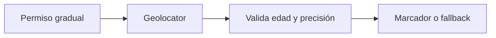
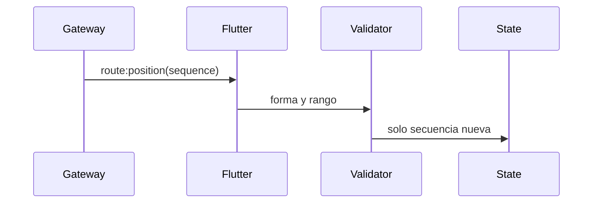
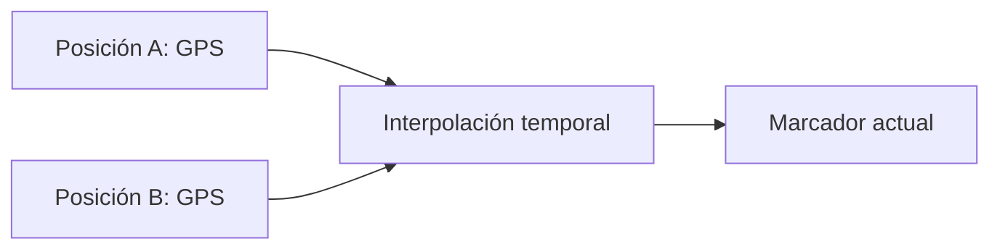
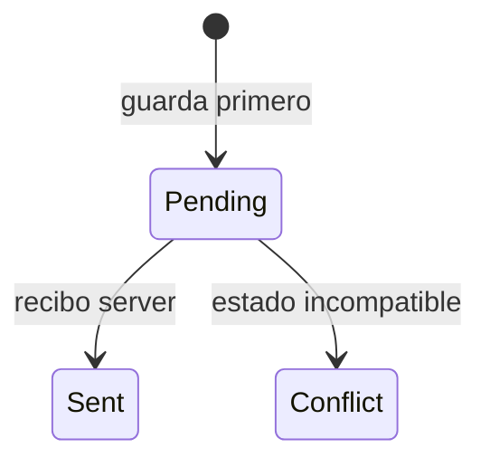
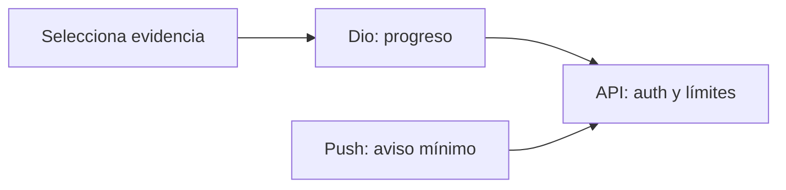

# Módulo 19: Flutter para entregas: mapa, conexión y trabajo offline

## Aprende construyendo

Construirás una app de conductor desde una lista vacía hasta una entrega sincronizada. El foco es operar con señal inestable y ubicaciones cambiantes, no repetir el mapa del módulo 14. Trabaja en el proyecto `rutaflow_driver`; no uses credenciales de producción.

---

### Tema 1: estado de la jornada con Riverpod

**Duración estimada:** 30 min.
**¿Por qué es importante?** Una sola fuente de estado evita que distintas pantallas muestren versiones distintas de la jornada.

**Prerrequisitos:** Flutter M1 T1 (widgets) y Dart M0 T3 (async/await). Proyecto continuo: `examples/flutter_rutaflow/`, la app de turnos del conductor.

#### Subtema 1.1: Representa paradas con estado inmutable · 10 min

**1. Contexto**
Si cada pantalla guarda su propia copia, una puede mostrar una parada entregada y otra pendiente. Un provider ofrece un solo estado compartido.

**2. Hazlo tú**
Abre `examples/flutter_rutaflow/lib/features/shift/shift_provider.dart`. Revisa `Stop`, `ShiftNotifier.build` y `load`; inicializan una lista vacía y guardan una copia que no se puede modificar desde afuera. Ejecuta desde `examples/flutter_rutaflow/`:

```bash
flutter test --no-pub test/features/shift/shift_provider_test.dart
```

**Resultado esperado:** las dos pruebas pasan; la lista inicial está vacía y la lista cargada no permite agregar paradas directamente.

**Fallo deliberado:** reemplaza `List.unmodifiable(stops)` por `stops`. **Resultado esperado:** la prueba de inmutabilidad falla al intentar agregar un elemento. **Diagnóstico:** el estado comparte la lista que recibió; conserva una copia inmutable.

**3. Entiende**
`Notifier` guarda el estado de una tarea y expone acciones que lo cambian. `NotifierProvider` permite que pantallas y pruebas lean la misma fuente.

**4. Cierra**
Escribe qué estado inicial tiene una jornada y por qué `load` no conserva la lista que recibió.

#### Subtema 1.2: Completa una parada por su id · 10 min

**1. Contexto**
La lista puede cambiar de orden. Identificar una parada por su id evita completar la dirección incorrecta.

**2. Hazlo tú**
Abre `examples/flutter_rutaflow/lib/features/shift/shift_provider.dart` y localiza `complete`. Ejecuta la prueba que carga dos paradas y completa `p-1`:

```bash
flutter test --no-pub test/features/shift/shift_provider_test.dart
```

**Resultado esperado:** `p-1` queda `done: true`; `p-2` sigue pendiente; la lista anterior no cambia.

**Fallo deliberado:** cambia `if (stop.id == id)` por `if (stop.id != id)`. **Resultado esperado:** la prueba muestra completada la parada equivocada. **Diagnóstico:** invertiste la comparación; el id recibido debe coincidir con el de la parada que cambia.

**3. Entiende**
La acción crea una lista nueva y conserva los objetos que no cambian. La interfaz puede volver a dibujar con el estado actualizado.

**4. Cierra**
Guarda el antes y el después y explica qué fila cambió.

#### Subtema 1.3: Prueba la acción y un id inexistente · 10 min

**1. Contexto**
La misma acción debe comportarse de forma previsible si el servidor envía un id desconocido.

**2. Hazlo tú**
Abre `examples/flutter_rutaflow/test/features/shift/shift_provider_test.dart` y ejecuta las dos pruebas del `ProviderContainer`:

```bash
flutter test --no-pub test/features/shift/shift_provider_test.dart
```

**Resultado esperado:** al completar `no-existe`, la misma lista queda en el estado; completar `p-1` cambia solo esa parada.

**Fallo deliberado:** quita `List.unmodifiable` del estado y vuelve a ejecutar. **Resultado esperado:** el test que intenta modificar la lista deja de recibir `UnsupportedError`. **Diagnóstico:** el estado quedó expuesto a cambios desde cualquier widget; restaura la copia inmutable.

**3. Entiende**
`ProviderContainer` permite probar el provider sin abrir una pantalla ni hacer una llamada de red. Las pruebas revisan el cambio observable del estado.

**4. Cierra**
Entrega las salidas de ambas pruebas y anota un caso que todavía falta, como cargar una jornada desde la API.

**Hito del tema:**

- [ ] Cargué dos paradas en `ShiftNotifier`.
- [ ] Completé una por id y conservé la otra.
- [ ] El id desconocido no cambia la lista.
- [ ] Las pruebas muestran que el estado es inmutable.

**Fuente oficial:** [Riverpod: providers y Notifier](https://riverpod.dev/docs/providers/notifier_provider).

**Proyecto integrador:** `ShiftNotifier` es el estado real que `examples/flutter_rutaflow/` comparte entre la pantalla de mapa, la lista de paradas y las notificaciones de entrega del conductor. **Límite:** usa un `NotifierProvider` compartido cuando varias pantallas necesitan leer y reaccionar al mismo estado; si el dato solo vive dentro de un único widget y nadie más lo consulta, un `StatefulWidget` local es más simple que levantar un provider global.

### Tema 2: mapa y permiso de ubicación

#### Paso 1 · Objetivo y preparación
Al finalizar mostrarás la posición del conductor con permiso gradual y un estado comprensible si se niega. **Prerrequisitos:** Flutter y geolocalización. En un proyecto nuevo `flutter create route_map_lab`, añade `google_maps_flutter` y `geolocator` con `flutter pub add google_maps_flutter geolocator`.

#### Paso 2 · Contexto y caso real
El mapa permite orientar al conductor, pero una ubicación precisa solo se solicita cuando la función la necesita. El usuario puede conceder ubicación aproximada, denegar o apagar servicios; la app debe conservar una alternativa para ver la parada en texto.

#### ¿Por qué es importante?
Pedir permisos al iniciar, sin explicar el uso, reduce confianza. Mostrar una pantalla vacía al recibir `denied` deja al conductor sin información necesaria para seguir.

#### Paso 3 · Teoría, modelo mental y analogía
El plugin obtiene una posición; Google Maps la dibuja. Son dos responsabilidades distintas. Una posición es `{latitud, longitud, precisión, hora}`: compara precisión y antigüedad antes de mover el marcador. La llave de Maps se restringe por plataforma y aplicación; no se reutiliza una llave maestra del servidor.

#### Paso 4 · Demostración guiada
Crea `lib/features/map/location_reader.dart`:

```dart
import 'package:geolocator/geolocator.dart';

Future<Position> readPosition() async {
  if (!await Geolocator.isLocationServiceEnabled()) {
    throw StateError('Activa los servicios de ubicación');
  }
  var permission = await Geolocator.checkPermission();
  if (permission == LocationPermission.denied) {
    permission = await Geolocator.requestPermission();
  }
  if (permission == LocationPermission.denied ||
      permission == LocationPermission.deniedForever) {
    throw StateError('No hay permiso de ubicación');
  }
  return Geolocator.getCurrentPosition();
}
```

Agrega permisos de Android/iOS siguiendo la guía del plugin. Crea `lib/features/map/route_map.dart` con `GoogleMap`, `initialCameraPosition` y un `Marker` solo después de recibir la posición. En consola observa el prompt; con permiso negado muestra dirección escrita.

#### Paso 5 · Práctica guiada
Prueba `readPosition` con el permiso concedido, denegado y con el servicio apagado. Simula las tres condiciones en emulador. **Pista:** no repitas el prompt si el sistema indica `deniedForever`; ofrece un botón hacia ajustes.

#### Paso 6 · Práctica independiente
Registra la llave de Maps con restricciones Android/iOS, límites de cuota y alertas de facturación. Añade atribución de Google Maps en la sección “Acerca de” o avisos legales.

#### Paso 7 · Cierre y evidencia
Entrega ambos archivos y una captura de cada estado (posición, permiso denegado). El siguiente tema recibe posiciones del gateway en vivo.

**Prueba de diagnóstico.** Provoca deliberadamente `deniedForever`; el flujo debe conservar la dirección de la parada y ofrecer ajustes, no quedar bloqueado. **Resultado esperado:** el mapa se muestra solo cuando hay una posición válida.

```bash
flutter run
```

**Errores comunes:** pedir permiso preciso sin justificarlo, olvidar declarar permiso nativo y exponer la API key sin restricciones. Diagrama: `solicitud -> permiso -> lectura -> validación -> marcador`. Fuentes: [Google Maps para Flutter](https://developers.google.com/maps/flutter-package/overview), [Geolocator](https://pub.dev/packages/geolocator).

**Proyecto propio:** `route_map_lab`. **Cuándo pedir precisión:** cuando la tarea depende de pocos metros y la persona recibió una explicación. **Fallos a vigilar:** tratar `deniedForever` como permiso temporal. Evidencia de aprendizaje: entrega el flujo de permiso y captura de fallback textual.

**Resultado esperado:** el mapa tiene marcador con posición; sin permiso muestra la dirección y ayuda contextual.



Fuente oficial: guía de [configuración Google Maps Flutter](https://developers.google.com/maps/flutter-package/config).

---

### Tema 3: posiciones en tiempo real con Socket.IO

#### Paso 1 · Objetivo y preparación
Al finalizar conectarás una app Flutter a eventos de posición y distinguirás reconexión de una nueva sesión. **Prerrequisitos:** streams y HTTP. Crea `live_route_lab` con `flutter create live_route_lab` y añade `socket_io_client`.

#### Paso 2 · Contexto y caso real
El gateway puede publicar varias veces la misma posición si el teléfono recupera señal. Un evento antiguo que llega después de uno nuevo no debe hacer retroceder al marcador. La clave de parada y la marca de tiempo ayudan a descartar mensajes repetidos o atrasados.

#### ¿Por qué es importante?
El mapa representa hechos en el tiempo. Sin orden e idempotencia, una demora de red puede mostrar al conductor en el punto equivocado.

#### Paso 3 · Teoría, modelo mental y analogía
Socket.IO reintenta la conexión, no garantiza que tu lógica de negocio haya aplicado cada evento una sola vez. Comprueba `eventId`/`sequence`, valida coordenadas y conserva la hora del servidor. Una reconexión debe volver a escuchar el canal autorizado y limpiar listeners anteriores.

#### Paso 4 · Demostración guiada
Crea `lib/features/live/route_socket.dart`:

```dart
import 'package:socket_io_client/socket_io_client.dart' as socket_io;

class RouteSocket {
  RouteSocket(String baseUrl, String token)
      : socket = socket_io.io(baseUrl, socket_io.OptionBuilder()
            .setTransports(['websocket'])
            .disableAutoConnect()
            .setAuth({'token': token})
            .build());

  final socket_io.Socket socket;
  void connect(void Function(Map<String, dynamic>) onPosition) {
    socket.on('route:position', (data) {
      if (data is Map) onPosition(Map<String, dynamic>.from(data));
    });
    socket.connect();
  }
  void close() => socket..off('route:position')..disconnect();
}
```

Conecta a un servidor Socket.IO de desarrollo accesible desde el emulador. Ejecuta la app y emite un fixture `{eventId, sequence, lat, lng, sentAt}`; observa el evento en el callback.

#### Paso 5 · Práctica guiada
En `lib/features/live/position_order.dart`, acepta solo `sequence > lastSequence` y coordenadas dentro de latitud/longitud válidas. Simula mensaje repetido y atrasado; ninguno debe reemplazar la posición actual. **Pista:** compara enteros monotónicos, no timestamps del reloj del teléfono.

#### Paso 6 · Práctica independiente
Desconecta el servidor durante el recorrido, reconecta y confirma que no se registró dos veces el listener. Añade cierre de sesión que desconecte el socket y borre el token de memoria.

#### Paso 7 · Cierre y evidencia
Guarda el cliente, filtro de orden y log con secuencia aceptada/descartada. El siguiente tema anima solo las posiciones aceptadas.

**Prueba de diagnóstico.** Provoca deliberadamente dos eventos con el mismo `sequence`; el segundo se debe descartar. **Resultado esperado:** el marcador conserva la ubicación más reciente y el log cuenta un duplicado.

```bash
flutter test test/features/live/position_order_test.dart
```

**Errores comunes:** llamar `connect()` varias veces o asumir entrega exactly-once. Diagrama: `socket -> validar forma -> deduplicar -> actualizar estado`. Fuente: [socket_io_client](https://pub.dev/packages/socket_io_client).

**Proyecto propio:** `live_route_lab`, con gateway de desarrollo configurado.
**Ejemplo independiente:** crea `live_route_lab` con `flutter create live_route_lab` y configura un gateway Socket.IO local. **Cuándo aceptar posición:** si formato, secuencia, timestamp y coordenadas son válidos. **Fallos a vigilar:** callback doble tras reconexión y recibir un payload que no sea Map. Evidencia de aprendizaje: entrega el test con el duplicado descartado.

**Resultado esperado:** secuencia mayor actualiza; duplicada o menor no cambia el estado.



Fuente oficial del paquete: [Socket.IO client Dart](https://pub.dev/packages/socket_io_client).

---

### Tema 4: animar el marcador sin saltos

#### Paso 1 · Objetivo y preparación
Al finalizar moverás un marcador entre puntos de manera legible y sin dibujar datos obsoletos. **Prerrequisitos:** `AnimationController`, `Tween` y coordenadas. En `live_route_lab`, crea `lib/features/map/position_tween.dart`.

#### Paso 2 · Contexto y caso real
El GPS emite a intervalos irregulares. Cambiar directamente de A a B puede saltar; animar cada evento sin cancelar el anterior puede dejar un marcador retrasado varios segundos.

#### ¿Por qué es importante?
Una animación debe ayudar a anticipar movimiento. Si acumula retraso o hace que el vehículo atraviese edificios, la suavidad engaña sobre la ubicación real.

#### Paso 3 · Teoría, modelo mental y analogía
Interpolar es dibujar puntos intermedios entre dos mediciones recientes. Limita duración, cancela la animación anterior al recibir un punto más nuevo y conserva el dato real separado del punto visual. No inventes una ruta curva si solo tienes dos coordenadas.

#### Paso 4 · Demostración guiada
Crea `lib/features/map/position_tween.dart`:

```dart
import 'package:flutter/animation.dart';
import 'package:google_maps_flutter/google_maps_flutter.dart';

class PositionTween extends Tween<LatLng> {
  PositionTween({required LatLng begin, required LatLng end})
      : super(begin: begin, end: end);

  @override
  LatLng lerp(double t) => LatLng(
        begin!.latitude + (end!.latitude - begin!.latitude) * t,
        begin!.longitude + (end!.longitude - begin!.longitude) * t,
      );
}
```

Al recibir una posición nueva, crea un controller corto, actualiza el marker en `AnimatedBuilder` y llama `dispose` al retirar el widget. Como ejemplo independiente, crea el proyecto nuevo `position_tween_lab` con `flutter create position_tween_lab`; ejecuta el mismo fixture de dos puntos en emulador.

#### Paso 5 · Práctica guiada
Comprueba que una posición más reciente cancela el controller activo. **Pista:** `CurvedAnimation` cambia la sensación, pero no debe ocultar datos viejos; compara el marker con el punto real.

#### Paso 6 · Práctica independiente
Prueba un punto idéntico, un salto mayor al umbral y una pausa de señal. Para una pausa larga, mueve al punto nuevo sin animación prolongada y muestra la hora de actualización.

#### Paso 7 · Cierre y evidencia
Entrega el tween y un video/captura del mismo recorrido. El siguiente tema guardará las confirmaciones mientras no haya conexión.

**Prueba de diagnóstico.** Provoca deliberadamente una duración de cinco segundos; la animación debe verse retrasada. Reduce el intervalo y comprueba que el marker alcanza el último dato.

```bash
flutter test test/features/map/position_tween_test.dart
```

**Errores comunes:** iniciar un controller por evento sin cancelar el anterior y tratar ubicación interpolada como GPS real. Diagrama: `punto real A -> interpolación visual -> punto real B`. Fuente: [Flutter animations](https://docs.flutter.dev/ui/animations).

**Proyecto propio:** `position_tween_lab`. **Cuándo animar:** si la nueva posición llega pronto y no se está mostrando una ubicación obsoleta. **Fallos a vigilar:** no liberar el `AnimationController` o seguir animando tras una actualización nueva. Evidencia de aprendizaje: entrega una prueba con fixture de dos puntos.

**Resultado esperado:** el marcador termina en el último dato aceptado; la animación solo cambia el dibujo intermedio.



Fuente oficial: [animaciones Flutter](https://docs.flutter.dev/ui/animations).

---

### Tema 5: confirmaciones offline y sincronización

#### Paso 1 · Objetivo y preparación
Al finalizar registrarás una confirmación sin red y la sincronizarás sin duplicarla. **Prerrequisitos:** Future, JSON e idempotencia. Crea `lib/features/sync/outbox.dart` y un test con almacenamiento temporal.

#### Paso 2 · Contexto y caso real
El conductor confirma una entrega en un sótano y pierde señal. La app debe conservar la evidencia, avisar “pendiente de enviar” y volver a intentar al recuperar conectividad. Un reintento puede llegar al servidor más de una vez.

#### ¿Por qué es importante?
Si el botón borra la confirmación local al fallar el servidor, se pierde trabajo. Si reenvía sin una clave estable, una entrega puede contarse dos veces.

#### Paso 3 · Teoría, modelo mental y analogía
La outbox local es una bandeja de salida: guarda un comando con `operationId`, contenido mínimo y estado. El servidor usa ese mismo id para idempotencia. En conflicto de estado, no sobrescribas en silencio; conserva respuesta y permite resolver según regla del dominio.

#### Paso 4 · Demostración guiada
Crea `lib/features/sync/delivery_command.dart`:

```dart
class DeliveryCommand {
  const DeliveryCommand({required this.operationId, required this.stopId});
  final String operationId;
  final String stopId;
  Map<String, Object?> toJson() => {
        'operationId': operationId,
        'stopId': stopId,
        'type': 'delivery.confirmed',
      };
}
```

Para practicar en una copia independiente crea `offline_delivery_lab` con `flutter create offline_delivery_lab`; implementa el repositorio local con SQLite/Drift o la base ya usada en la app: inserta la operación antes de llamar a red, marca `sent` solo en respuesta confirmada y elimina únicamente según la política de retención. Ejecuta `flutter test test/features/sync/outbox_test.dart`.

#### Paso 5 · Práctica guiada
Simula timeout, reinicio de app y dos intentos con el mismo `operationId`. **Pista:** la identidad del comando nace una vez al presionar confirmar y se reutiliza durante todos los reintentos.

#### Paso 6 · Práctica independiente
Diseña un conflicto cuando el servidor ya canceló la parada. Muestra “requiere revisión” y conserva la respuesta del servidor sin marcar la entrega como completada.

#### Paso 7 · Cierre y evidencia
Entrega la tabla outbox antes/después, con id estable y resultado de los reintentos. El siguiente tema enviará evidencia y avisará sobre nuevas tareas.

**Prueba de diagnóstico.** Provoca deliberadamente dos envíos con el mismo `operationId`; el backend de prueba debe responder el mismo resultado lógico y solo guardar una confirmación. **Resultado esperado:** offline conserva una operación pendiente.

```bash
flutter test test/features/sync/outbox_test.dart
```

**Errores comunes:** generar un nuevo id en cada reintento y descartar un registro al recibir timeout ambiguo. Diagrama: `guardar -> intentar -> confirmado / pendiente / conflicto`. Fuente: [Flutter persistence cookbook](https://docs.flutter.dev/cookbook/persistence).

**Proyecto propio:** `offline_delivery_lab`. **Cuándo borrar la outbox:** cuando el servidor confirmó la acción y la política de retención permite limpiarla. **Fallos a vigilar:** tratar timeout como rechazo y crear otra operación con un id distinto. Evidencia de aprendizaje: entrega la fila antes y después de dos intentos.

**Resultado esperado:** tras timeout conserva `pending`; tras respuesta confirmada cambia a `sent`.



Fuente oficial: [persistencia Flutter](https://docs.flutter.dev/cookbook/persistence).

---

### Tema 6: carga de evidencia con Dio y notificaciones

#### Paso 1 · Objetivo y preparación
Al finalizar subirás una evidencia con progreso y recibirás una asignación sin mezclar los dos flujos. **Prerrequisitos:** HTTP, permisos de archivo y push. Crea un proyecto nuevo de práctica con `flutter create evidence_delivery_lab`; añade `dio`, `image_picker` y `firebase_messaging` según las plataformas que vas a compilar.

#### Paso 2 · Contexto y caso real
Una foto de entrega puede ser grande y la red puede cortarse. El conductor necesita saber si se envía, se reintenta o requiere volver a elegir el archivo. Una notificación push puede avisar una asignación; el backend sigue siendo quien autoriza y guarda su estado.

#### ¿Por qué es importante?
La evidencia respalda la operación y puede incluir datos sensibles. Controlar tamaño, progreso, cancelación y acceso evita subir más información de la necesaria.

#### Paso 3 · Teoría, modelo mental y analogía
Dio transporta la petición; el servidor valida la sesión, extensión, MIME, tamaño y permisos antes de almacenar. FCM entrega una señal, no una fuente confiable del estado de la entrega. Al abrir una notificación, consulta el backend.

#### Paso 4 · Demostración guiada
Crea `lib/features/evidence/evidence_uploader.dart`:

```dart
import 'package:dio/dio.dart';

class EvidenceUploader {
  EvidenceUploader(this._dio);
  final Dio _dio;

  Future<void> upload({required String path, required String token,
      required void Function(double progress) onProgress}) async {
    await _dio.post<void>(
      '/api/deliveries/evidence',
      data: FormData.fromMap({'file': await MultipartFile.fromFile(path)}),
      options: Options(headers: {'Authorization': 'Bearer $token'}),
      onSendProgress: (sent, total) {
        if (total > 0) onProgress(sent / total);
      },
    );
  }
}
```

Usa un fixture local y backend de desarrollo. Ejecuta `flutter test test/features/evidence/evidence_uploader_test.dart` con Dio adapter fake. Para FCM inicializa Firebase, registra handler de foreground y tap; al abrir consulta `/api/deliveries/{id}` antes de navegar.

#### Paso 5 · Práctica guiada
Prueba archivo cancelado, `413` por tamaño, `401` por sesión vencida y pérdida de red. **Pista:** reintenta el upload solo si el backend usa una clave idempotente y no duplica archivos.

#### Paso 6 · Práctica independiente
Añade una política de retención local para fotos fallidas y documenta cómo borrar una evidencia enviada. En push muestra una notificación con datos mínimos, nunca dirección completa o token de acceso.

#### Paso 7 · Cierre y evidencia
Entrega `evidence_uploader.dart`, el test fake, progreso visible y flujo de notificación probado en dispositivo de desarrollo. Reporta por separado si el proyecto FCM o la credencial no estuvo disponible. El siguiente módulo practica testing e integración del curso completo.

**Prueba de diagnóstico.** Provoca deliberadamente una respuesta `401`; la app debe pedir iniciar sesión y no reintentar automáticamente con el mismo token. **Resultado esperado:** se observa progreso y el backend de prueba recibe una sola evidencia.

```bash
flutter test test/features/evidence/evidence_uploader_test.dart
```

**Errores comunes:** subir la foto completa sin límite y confiar en payload push para actualizar el dominio. Diagrama: `archivo -> validación local -> API autenticada -> recibo`. Fuentes: [Dio](https://pub.dev/packages/dio), [Firebase Messaging Flutter](https://firebase.google.com/docs/cloud-messaging/flutter/client).

**Proyecto propio:** `evidence_delivery_lab`. **Cuándo reintentar:** si la API define una operación idempotente; un `401` requiere renovar sesión y `413` requiere reducir el archivo. Evidencia de aprendizaje: entrega el test fake, progreso y estado de respuesta.

**Resultado esperado:** una carga produce un recibo; la notificación solo abre una consulta autenticada para obtener el estado vigente. Fuente oficial Firebase: [cliente FCM Flutter](https://firebase.google.com/docs/cloud-messaging/flutter/client).



---

## Referencias oficiales consultadas

- [Riverpod](https://riverpod.dev/docs/introduction/getting_started)
- [Google Maps for Flutter](https://developers.google.com/maps/flutter-package/overview) y [Geolocator](https://pub.dev/packages/geolocator)
- [socket_io_client](https://pub.dev/packages/socket_io_client)
- [Flutter animations](https://docs.flutter.dev/ui/animations)
- [Flutter persistence cookbook](https://docs.flutter.dev/cookbook/persistence)
- [Dio](https://pub.dev/packages/dio) y [Firebase Messaging Flutter](https://firebase.google.com/docs/cloud-messaging/flutter/client)
