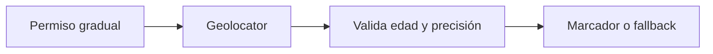
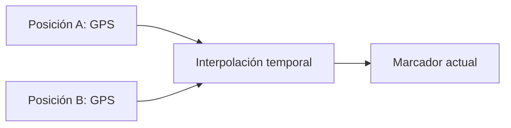
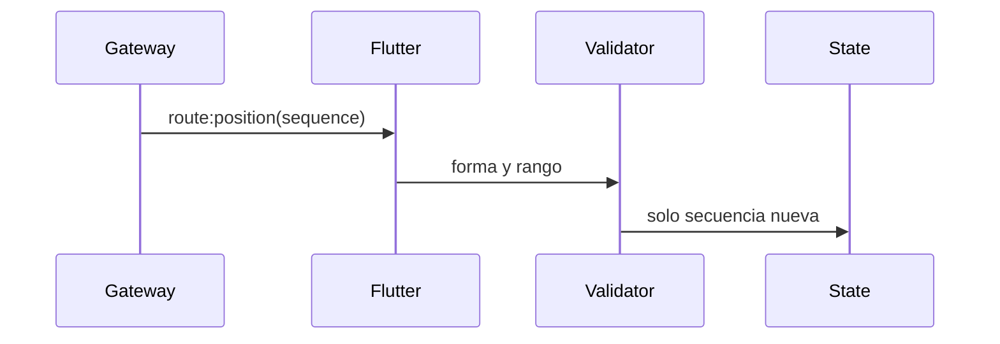
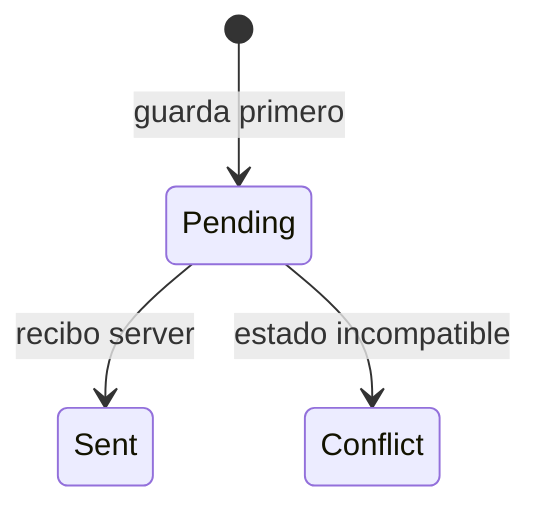
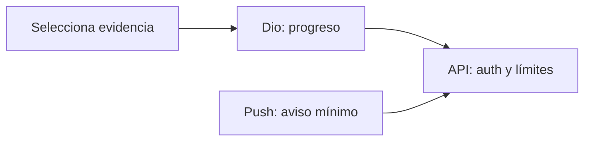

# Módulo 19: Flutter para entregas: mapa, conexión y trabajo offline

## Aprende construyendo

Construirás una app de conductor desde una lista vacía hasta una entrega sincronizada. El foco es operar con señal inestable y ubicaciones cambiantes, no repetir el mapa del módulo 14. Trabaja sobre el proyecto de referencia `flutter_rutaflow` (fija `flutter_riverpod: ^2.4.0`, por eso todavía usa `StateProvider` sin la importación `legacy.dart` de Riverpod 3); no uses credenciales de producción.

---


### Tema 1: estado de la jornada con Riverpod · Intermedio · 30 min

<details open>
<summary><strong>Capa 1 — Lectura</strong></summary>

#### ► DE QUÉ TRATA
Este tema te guía por estado de la jornada con riverpod con foco en comprensión antes de implementación.

#### ► LA IDEA EN UNA FRASE
**Entender estado de la jornada con riverpod te permite tomar mejores decisiones técnicas.**

#### ► POR QUÉ EXISTE ESTO
Resuelve un problema real de diseño o implementación y evita decisiones a ciegas.

#### ► LA ANALOGÍA
Piensa en estado de la jornada con riverpod como una herramienta de taller: útil cuando conoces su propósito y sus límites.
**Dónde se rompe la analogía:** en software, los efectos dependen del contexto, la escala y los trade-offs.

#### ► CÓMO FUNCIONA
1. Identifica el problema que estado de la jornada con riverpod resuelve.
2. Observa sus componentes y relaciones.
3. Aplica la opción más simple que funcione.
4. Verifica el resultado y los límites.

#### ► LO QUE PUEDE SALIR MAL
| Síntoma | Causa probable | Arreglo |
|---|---|---|
| estado de la jornada con Riverpod se aplica pero el resultado no mejora | Se usó sin medir el problema real | Mide antes y compara contra la alternativa simple |
| Aparece complejidad inesperada | Se adoptó la técnica sin comprender sus trade-offs | Vuelve a la sección de trade-offs y reduce el alcance |
| Falla en un caso límite | Se asumió un contexto que no se cumple | Prueba el caso límite y documenta cuándo NO usarlo |

#### ► TRADE-OFFS
| Opción | Cuándo usarla | Cuándo NO usarla |
|---|---|---|
| Usar estado de la jornada con Riverpod | Cuando el problema coincide con su propósito y el beneficio es observable | Cuando agrega complejidad sin resolver un problema real |
| Alternativa más simple | Cuando el contexto es pequeño, estable o fácil de razonar | Cuando ya demostró no escalar o no cumplir el requisito |
| Postergar la decisión | Cuando falta evidencia del problema | Cuando el costo de esperar es mayor que el costo de probar |

#### ► CUÁNDO NO USAR ESTO
No uses estado de la jornada con riverpod por defecto. Aplícalo cuando el problema lo justifique y puedas verificar el beneficio; si una alternativa más simple resuelve igual, prefiérela.

#### ► DE VUELTA A LA ANALOGÍA
Volviendo a la analogía: estado de la jornada con riverpod funciona como el modelo inicial, pero recuerda dónde se rompe: en producción importan la evidencia, la escala y el costo de equivocarte.

#### ► LO QUE DEBES RECORDAR
- estado de la jornada con Riverpod existe para resolver un problema específico.
- Mide antes de adoptar complejidad.
- Conoce el caso donde NO usarlo.
- Verifica con evidencia observable.

#### ► PREGUNTAS PARA PENSAR
1. ¿Qué problema concreto resuelve estado de la jornada con riverpod en tu contexto?
2. ¿Cómo sabrías que estado de la jornada con riverpod no está funcionando bien?
3. ¿Qué alternativa más simple considerarías antes de usar estado de la jornada con riverpod?

</details>

<details>
<summary><strong>Capa 2 — Construcción</strong></summary>

#### Código y verificación
```bash
flutter test --no-pub test/features/shift/shift_provider_test.dart
```

```bash
flutter test --no-pub test/features/shift/shift_provider_test.dart
```

```bash
flutter test --no-pub test/features/shift/shift_provider_test.dart
```

</details>

### Tema 2: mapa y permiso de ubicación · Intermedio · 35 min

<details open>
<summary><strong>Capa 1 — Lectura</strong></summary>

#### ► DE QUÉ TRATA
Al finalizar mostrarás la posición del conductor con permiso gradual y un estado comprensible si se niega. Prerrequisitos: Flutter y geolocalización. En un proyecto nuevo flutter create route_map_lab, añade google_maps_flutter y geolocator con flutter pub add google_maps_flutter…

#### ► LA IDEA EN UNA FRASE
**Al finalizar mostrarás la posición del conductor con permiso gradual y un estado comprensible si se niega.**

#### ► POR QUÉ EXISTE ESTO
Resuelve un problema real de diseño o implementación y evita decisiones a ciegas.

#### ► LA ANALOGÍA
Piensa en mapa y permiso de ubicación como una herramienta de taller: útil cuando conoces su propósito y sus límites.
**Dónde se rompe la analogía:** en software, los efectos dependen del contexto, la escala y los trade-offs.

#### ► CÓMO FUNCIONA


#### ► LO QUE PUEDE SALIR MAL
| Síntoma | Causa probable | Arreglo |
|---|---|---|
| mapa y permiso de ubicación se aplica pero el resultado no mejora | Se usó sin medir el problema real | Mide antes y compara contra la alternativa simple |
| Aparece complejidad inesperada | Se adoptó la técnica sin comprender sus trade-offs | Vuelve a la sección de trade-offs y reduce el alcance |
| Falla en un caso límite | Se asumió un contexto que no se cumple | Prueba el caso límite y documenta cuándo NO usarlo |

#### ► TRADE-OFFS
| Opción | Cuándo usarla | Cuándo NO usarla |
|---|---|---|
| Usar mapa y permiso de ubicación | Cuando el problema coincide con su propósito y el beneficio es observable | Cuando agrega complejidad sin resolver un problema real |
| Alternativa más simple | Cuando el contexto es pequeño, estable o fácil de razonar | Cuando ya demostró no escalar o no cumplir el requisito |
| Postergar la decisión | Cuando falta evidencia del problema | Cuando el costo de esperar es mayor que el costo de probar |

#### ► CUÁNDO NO USAR ESTO
No uses mapa y permiso de ubicación por defecto. Aplícalo cuando el problema lo justifique y puedas verificar el beneficio; si una alternativa más simple resuelve igual, prefiérela.

#### ► DE VUELTA A LA ANALOGÍA
Volviendo a la analogía: mapa y permiso de ubicación funciona como el modelo inicial, pero recuerda dónde se rompe: en producción importan la evidencia, la escala y el costo de equivocarte.

#### ► LO QUE DEBES RECORDAR
- mapa y permiso de ubicación existe para resolver un problema específico.
- Mide antes de adoptar complejidad.
- Conoce el caso donde NO usarlo.
- Verifica con evidencia observable.

#### ► PREGUNTAS PARA PENSAR
1. ¿Qué problema concreto resuelve mapa y permiso de ubicación en tu contexto?
2. ¿Cómo sabrías que mapa y permiso de ubicación no está funcionando bien?
3. ¿Qué alternativa más simple considerarías antes de usar mapa y permiso de ubicación?

</details>

<details>
<summary><strong>Capa 2 — Construcción</strong></summary>

#### Código y verificación
```dart
import 'package:geolocator/geolocator.dart';

Future<Position> readPosition() async {
  if (!await Geolocator.isLocationServiceEnabled()) {
    throw StateError('Activa los servicios de ubicación');
  }
  var permission = await Geolocator.checkPermission();
  if (permission == LocationPermission.denied) {
    permission = await Geolocator.requestPermission();
  }
  if (permission == LocationPermission.denied ||
      permission == LocationPermission.deniedForever) {
    throw StateError('No hay permiso de ubicación');
  }
  return Geolocator.getCurrentPosition();
}
```

```bash
flutter run
```


</details>

### Tema 3: animar el marcador sin saltos · Intermedio · 30 min

<details open>
<summary><strong>Capa 1 — Lectura</strong></summary>

#### ► DE QUÉ TRATA
Al finalizar moverás un marcador entre puntos de manera legible y sin dibujar datos obsoletos. Prerrequisitos: AnimationController, Tween y coordenadas. En live_route_lab, crea lib/features/map/position_tween.dart.

#### ► LA IDEA EN UNA FRASE
**Al finalizar moverás un marcador entre puntos de manera legible y sin dibujar datos obsoletos.**

#### ► POR QUÉ EXISTE ESTO
Resuelve un problema real de diseño o implementación y evita decisiones a ciegas.

#### ► LA ANALOGÍA
Piensa en animar el marcador sin saltos como una herramienta de taller: útil cuando conoces su propósito y sus límites.
**Dónde se rompe la analogía:** en software, los efectos dependen del contexto, la escala y los trade-offs.

#### ► CÓMO FUNCIONA


#### ► LO QUE PUEDE SALIR MAL
| Síntoma | Causa probable | Arreglo |
|---|---|---|
| animar el marcador sin saltos se aplica pero el resultado no mejora | Se usó sin medir el problema real | Mide antes y compara contra la alternativa simple |
| Aparece complejidad inesperada | Se adoptó la técnica sin comprender sus trade-offs | Vuelve a la sección de trade-offs y reduce el alcance |
| Falla en un caso límite | Se asumió un contexto que no se cumple | Prueba el caso límite y documenta cuándo NO usarlo |

#### ► TRADE-OFFS
| Opción | Cuándo usarla | Cuándo NO usarla |
|---|---|---|
| Usar animar el marcador sin saltos | Cuando el problema coincide con su propósito y el beneficio es observable | Cuando agrega complejidad sin resolver un problema real |
| Alternativa más simple | Cuando el contexto es pequeño, estable o fácil de razonar | Cuando ya demostró no escalar o no cumplir el requisito |
| Postergar la decisión | Cuando falta evidencia del problema | Cuando el costo de esperar es mayor que el costo de probar |

#### ► CUÁNDO NO USAR ESTO
No uses animar el marcador sin saltos por defecto. Aplícalo cuando el problema lo justifique y puedas verificar el beneficio; si una alternativa más simple resuelve igual, prefiérela.

#### ► DE VUELTA A LA ANALOGÍA
Volviendo a la analogía: animar el marcador sin saltos funciona como el modelo inicial, pero recuerda dónde se rompe: en producción importan la evidencia, la escala y el costo de equivocarte.

#### ► LO QUE DEBES RECORDAR
- animar el marcador sin saltos existe para resolver un problema específico.
- Mide antes de adoptar complejidad.
- Conoce el caso donde NO usarlo.
- Verifica con evidencia observable.

#### ► PREGUNTAS PARA PENSAR
1. ¿Qué problema concreto resuelve animar el marcador sin saltos en tu contexto?
2. ¿Cómo sabrías que animar el marcador sin saltos no está funcionando bien?
3. ¿Qué alternativa más simple considerarías antes de usar animar el marcador sin saltos?

</details>

<details>
<summary><strong>Capa 2 — Construcción</strong></summary>

#### Código y verificación
```dart
import 'package:flutter/animation.dart';
import 'package:google_maps_flutter/google_maps_flutter.dart';

class PositionTween extends Tween<LatLng> {
  PositionTween({required LatLng begin, required LatLng end})
      : super(begin: begin, end: end);

  @override
  LatLng lerp(double t) => LatLng(
        begin!.latitude + (end!.latitude - begin!.latitude) * t,
        begin!.longitude + (end!.longitude - begin!.longitude) * t,
      );
}
```

```bash
flutter test test/features/map/position_tween_test.dart
```


</details>

### Tema 4: posiciones en tiempo real con Socket.IO · Avanzado · 35 min

<details open>
<summary><strong>Capa 1 — Lectura</strong></summary>

#### ► DE QUÉ TRATA
Al finalizar conectarás una app Flutter a eventos de posición y distinguirás reconexión de una nueva sesión. Prerrequisitos: streams y HTTP. Crea live_route_lab con flutter create live_route_lab y añade socket_io_client.

#### ► LA IDEA EN UNA FRASE
**Al finalizar conectarás una app Flutter a eventos de posición y distinguirás reconexión de una nueva sesión.**

#### ► POR QUÉ EXISTE ESTO
Resuelve un problema real de diseño o implementación y evita decisiones a ciegas.

#### ► LA ANALOGÍA
Piensa en posiciones en tiempo real con socket.io como una herramienta de taller: útil cuando conoces su propósito y sus límites.
**Dónde se rompe la analogía:** en software, los efectos dependen del contexto, la escala y los trade-offs.

#### ► CÓMO FUNCIONA


#### ► LO QUE PUEDE SALIR MAL
| Síntoma | Causa probable | Arreglo |
|---|---|---|
| posiciones en tiempo real con Socket.IO se aplica pero el resultado no mejora | Se usó sin medir el problema real | Mide antes y compara contra la alternativa simple |
| Aparece complejidad inesperada | Se adoptó la técnica sin comprender sus trade-offs | Vuelve a la sección de trade-offs y reduce el alcance |
| Falla en un caso límite | Se asumió un contexto que no se cumple | Prueba el caso límite y documenta cuándo NO usarlo |

#### ► TRADE-OFFS
| Opción | Cuándo usarla | Cuándo NO usarla |
|---|---|---|
| Usar posiciones en tiempo real con Socket.IO | Cuando el problema coincide con su propósito y el beneficio es observable | Cuando agrega complejidad sin resolver un problema real |
| Alternativa más simple | Cuando el contexto es pequeño, estable o fácil de razonar | Cuando ya demostró no escalar o no cumplir el requisito |
| Postergar la decisión | Cuando falta evidencia del problema | Cuando el costo de esperar es mayor que el costo de probar |

#### ► CUÁNDO NO USAR ESTO
No uses posiciones en tiempo real con socket.io por defecto. Aplícalo cuando el problema lo justifique y puedas verificar el beneficio; si una alternativa más simple resuelve igual, prefiérela.

#### ► DE VUELTA A LA ANALOGÍA
Volviendo a la analogía: posiciones en tiempo real con socket.io funciona como el modelo inicial, pero recuerda dónde se rompe: en producción importan la evidencia, la escala y el costo de equivocarte.

#### ► LO QUE DEBES RECORDAR
- posiciones en tiempo real con Socket.IO existe para resolver un problema específico.
- Mide antes de adoptar complejidad.
- Conoce el caso donde NO usarlo.
- Verifica con evidencia observable.

#### ► PREGUNTAS PARA PENSAR
1. ¿Qué problema concreto resuelve posiciones en tiempo real con socket.io en tu contexto?
2. ¿Cómo sabrías que posiciones en tiempo real con socket.io no está funcionando bien?
3. ¿Qué alternativa más simple considerarías antes de usar posiciones en tiempo real con socket.io?

</details>

<details>
<summary><strong>Capa 2 — Construcción</strong></summary>

#### Código y verificación
```dart
import 'package:socket_io_client/socket_io_client.dart' as socket_io;

class RouteSocket {
  RouteSocket(String baseUrl, String token)
      : socket = socket_io.io(baseUrl, socket_io.OptionBuilder()
            .setTransports(['websocket'])
            .disableAutoConnect()
            .setAuth({'token': token})
            .build());

  final socket_io.Socket socket;
  void connect(void Function(Map<String, dynamic>) onPosition) {
    socket.on('route:position', (data) {
      if (data is Map) onPosition(Map<String, dynamic>.from(data));
    });
    socket.connect();
  }
  void close() => socket..off('route:position')..disconnect();
}
```

```bash
flutter test test/features/live/position_order_test.dart
```


</details>

### Tema 5: confirmaciones offline y sincronización · Avanzado · 35 min

<details open>
<summary><strong>Capa 1 — Lectura</strong></summary>

#### ► DE QUÉ TRATA
Al finalizar registrarás una confirmación sin red y la sincronizarás sin duplicarla. Prerrequisitos: Future, JSON e idempotencia. Crea lib/features/sync/outbox.dart y un test con almacenamiento temporal.

#### ► LA IDEA EN UNA FRASE
**Al finalizar registrarás una confirmación sin red y la sincronizarás sin duplicarla.**

#### ► POR QUÉ EXISTE ESTO
Resuelve un problema real de diseño o implementación y evita decisiones a ciegas.

#### ► LA ANALOGÍA
Piensa en confirmaciones offline y sincronización como una herramienta de taller: útil cuando conoces su propósito y sus límites.
**Dónde se rompe la analogía:** en software, los efectos dependen del contexto, la escala y los trade-offs.

#### ► CÓMO FUNCIONA


#### ► LO QUE PUEDE SALIR MAL
| Síntoma | Causa probable | Arreglo |
|---|---|---|
| confirmaciones offline y sincronización se aplica pero el resultado no mejora | Se usó sin medir el problema real | Mide antes y compara contra la alternativa simple |
| Aparece complejidad inesperada | Se adoptó la técnica sin comprender sus trade-offs | Vuelve a la sección de trade-offs y reduce el alcance |
| Falla en un caso límite | Se asumió un contexto que no se cumple | Prueba el caso límite y documenta cuándo NO usarlo |

#### ► TRADE-OFFS
| Opción | Cuándo usarla | Cuándo NO usarla |
|---|---|---|
| Usar confirmaciones offline y sincronización | Cuando el problema coincide con su propósito y el beneficio es observable | Cuando agrega complejidad sin resolver un problema real |
| Alternativa más simple | Cuando el contexto es pequeño, estable o fácil de razonar | Cuando ya demostró no escalar o no cumplir el requisito |
| Postergar la decisión | Cuando falta evidencia del problema | Cuando el costo de esperar es mayor que el costo de probar |

#### ► CUÁNDO NO USAR ESTO
No uses confirmaciones offline y sincronización por defecto. Aplícalo cuando el problema lo justifique y puedas verificar el beneficio; si una alternativa más simple resuelve igual, prefiérela.

#### ► DE VUELTA A LA ANALOGÍA
Volviendo a la analogía: confirmaciones offline y sincronización funciona como el modelo inicial, pero recuerda dónde se rompe: en producción importan la evidencia, la escala y el costo de equivocarte.

#### ► LO QUE DEBES RECORDAR
- confirmaciones offline y sincronización existe para resolver un problema específico.
- Mide antes de adoptar complejidad.
- Conoce el caso donde NO usarlo.
- Verifica con evidencia observable.

#### ► PREGUNTAS PARA PENSAR
1. ¿Qué problema concreto resuelve confirmaciones offline y sincronización en tu contexto?
2. ¿Cómo sabrías que confirmaciones offline y sincronización no está funcionando bien?
3. ¿Qué alternativa más simple considerarías antes de usar confirmaciones offline y sincronización?

</details>

<details>
<summary><strong>Capa 2 — Construcción</strong></summary>

#### Código y verificación
```dart
class DeliveryCommand {
  const DeliveryCommand({required this.operationId, required this.stopId});
  final String operationId;
  final String stopId;
  Map<String, Object?> toJson() => {
        'operationId': operationId,
        'stopId': stopId,
        'type': 'delivery.confirmed',
      };
}
```

```bash
flutter test test/features/sync/outbox_test.dart
```


</details>

### Tema 6: carga de evidencia con Dio y notificaciones · Avanzado · 40 min

<details open>
<summary><strong>Capa 1 — Lectura</strong></summary>

#### ► DE QUÉ TRATA
Al finalizar subirás una evidencia con progreso y recibirás una asignación sin mezclar los dos flujos. Prerrequisitos: HTTP, permisos de archivo y push. Crea un proyecto nuevo de práctica con flutter create evidence_delivery_lab; añade dio, image_picker y firebase_messaging según…

#### ► LA IDEA EN UNA FRASE
**Al finalizar subirás una evidencia con progreso y recibirás una asignación sin mezclar los dos flujos.**

#### ► POR QUÉ EXISTE ESTO
Resuelve un problema real de diseño o implementación y evita decisiones a ciegas.

#### ► LA ANALOGÍA
Piensa en carga de evidencia con dio y notificaciones como una herramienta de taller: útil cuando conoces su propósito y sus límites.
**Dónde se rompe la analogía:** en software, los efectos dependen del contexto, la escala y los trade-offs.

#### ► CÓMO FUNCIONA


#### ► LO QUE PUEDE SALIR MAL
| Síntoma | Causa probable | Arreglo |
|---|---|---|
| carga de evidencia con Dio y notificaciones se aplica pero el resultado no mejora | Se usó sin medir el problema real | Mide antes y compara contra la alternativa simple |
| Aparece complejidad inesperada | Se adoptó la técnica sin comprender sus trade-offs | Vuelve a la sección de trade-offs y reduce el alcance |
| Falla en un caso límite | Se asumió un contexto que no se cumple | Prueba el caso límite y documenta cuándo NO usarlo |

#### ► TRADE-OFFS
| Opción | Cuándo usarla | Cuándo NO usarla |
|---|---|---|
| Usar carga de evidencia con Dio y notificaciones | Cuando el problema coincide con su propósito y el beneficio es observable | Cuando agrega complejidad sin resolver un problema real |
| Alternativa más simple | Cuando el contexto es pequeño, estable o fácil de razonar | Cuando ya demostró no escalar o no cumplir el requisito |
| Postergar la decisión | Cuando falta evidencia del problema | Cuando el costo de esperar es mayor que el costo de probar |

#### ► CUÁNDO NO USAR ESTO
No uses carga de evidencia con dio y notificaciones por defecto. Aplícalo cuando el problema lo justifique y puedas verificar el beneficio; si una alternativa más simple resuelve igual, prefiérela.

#### ► DE VUELTA A LA ANALOGÍA
Volviendo a la analogía: carga de evidencia con dio y notificaciones funciona como el modelo inicial, pero recuerda dónde se rompe: en producción importan la evidencia, la escala y el costo de equivocarte.

#### ► LO QUE DEBES RECORDAR
- carga de evidencia con Dio y notificaciones existe para resolver un problema específico.
- Mide antes de adoptar complejidad.
- Conoce el caso donde NO usarlo.
- Verifica con evidencia observable.

#### ► PREGUNTAS PARA PENSAR
1. ¿Qué problema concreto resuelve carga de evidencia con dio y notificaciones en tu contexto?
2. ¿Cómo sabrías que carga de evidencia con dio y notificaciones no está funcionando bien?
3. ¿Qué alternativa más simple considerarías antes de usar carga de evidencia con dio y notificaciones?

</details>

<details>
<summary><strong>Capa 2 — Construcción</strong></summary>

#### Código y verificación
```dart
import 'package:dio/dio.dart';

class EvidenceUploader {
  EvidenceUploader(this._dio);
  final Dio _dio;

  Future<void> upload({required String path, required String token,
      required void Function(double progress) onProgress}) async {
    await _dio.post<void>(
      '/api/deliveries/evidence',
      data: FormData.fromMap({'file': await MultipartFile.fromFile(path)}),
      options: Options(headers: {'Authorization': 'Bearer $token'}),
      onSendProgress: (sent, total) {
        if (total > 0) onProgress(sent / total);
      },
    );
  }
}
```

```bash
flutter test test/features/evidence/evidence_uploader_test.dart
```


</details>
