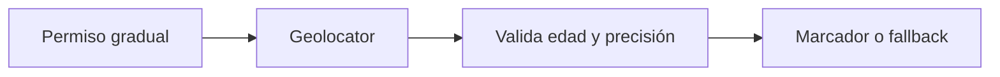
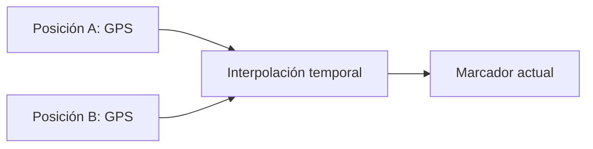
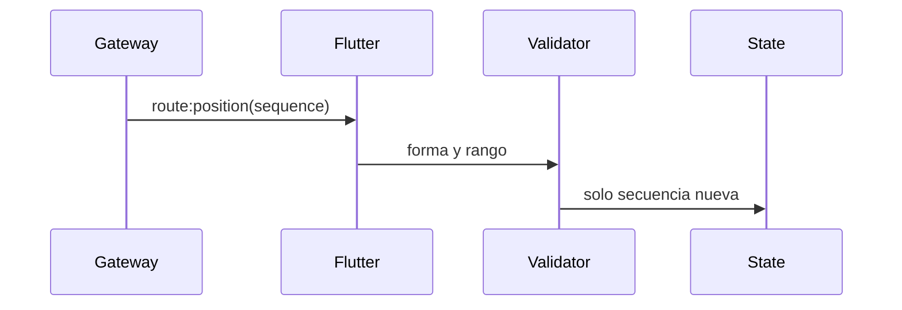
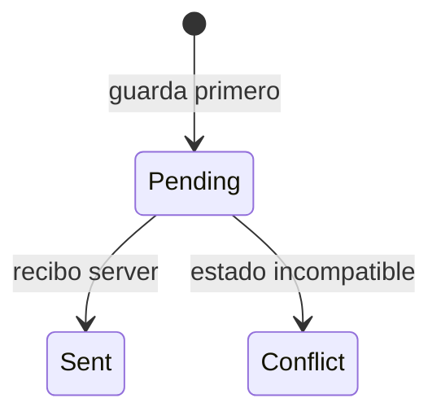
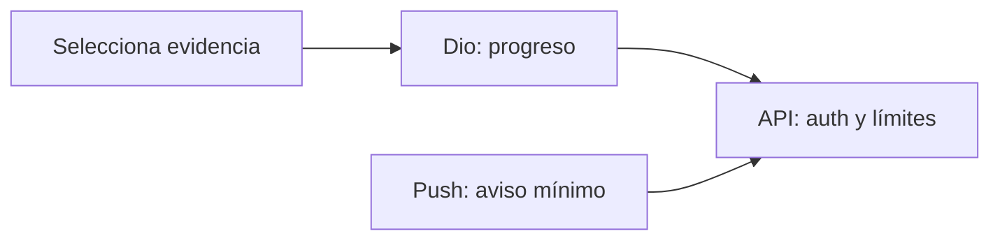

# Módulo 19: Flutter para entregas: mapa, conexión y trabajo offline

## Aprende construyendo

Construirás una app de conductor desde una lista vacía hasta una entrega sincronizada. El foco es operar con señal inestable y ubicaciones cambiantes, no repetir el mapa del módulo 14. Trabaja sobre el proyecto de referencia `flutter_rutaflow` (fija `flutter_riverpod: ^2.4.0`, por eso todavía usa `StateProvider` sin la importación `legacy.dart` de Riverpod 3); no uses credenciales de producción.

---


### Tema 1: estado de la jornada con Riverpod · Intermedio · 30 min

<details open>
<summary><strong>Capa 1 — Lectura</strong></summary>

</details>

<details>
<summary><strong>Capa 2 — Construcción</strong></summary>

#### Código y verificación
```bash
flutter test --no-pub test/features/shift/shift_provider_test.dart
```

```bash
flutter test --no-pub test/features/shift/shift_provider_test.dart
```

```bash
flutter test --no-pub test/features/shift/shift_provider_test.dart
```

</details>

### Tema 2: mapa y permiso de ubicación · Intermedio · 35 min

<details open>
<summary><strong>Capa 1 — Lectura</strong></summary>

#### ► DE QUÉ TRATA
Al finalizar mostrarás la posición del conductor con permiso gradual y un estado comprensible si se niega. Prerrequisitos: Flutter y geolocalización. En un proyecto nuevo flutter create route_map_lab, añade google_maps_flutter y geolocator con flutter pub add google_maps_flutter…

#### ► CÓMO FUNCIONA


</details>

<details>
<summary><strong>Capa 2 — Construcción</strong></summary>

#### Código y verificación
```dart
import 'package:geolocator/geolocator.dart';

Future<Position> readPosition() async {
  if (!await Geolocator.isLocationServiceEnabled()) {
    throw StateError('Activa los servicios de ubicación');
  }
  var permission = await Geolocator.checkPermission();
  if (permission == LocationPermission.denied) {
    permission = await Geolocator.requestPermission();
  }
  if (permission == LocationPermission.denied ||
      permission == LocationPermission.deniedForever) {
    throw StateError('No hay permiso de ubicación');
  }
  return Geolocator.getCurrentPosition();
}
```

```bash
flutter run
```


</details>

### Tema 3: animar el marcador sin saltos · Intermedio · 30 min

<details open>
<summary><strong>Capa 1 — Lectura</strong></summary>

#### ► DE QUÉ TRATA
Al finalizar moverás un marcador entre puntos de manera legible y sin dibujar datos obsoletos. Prerrequisitos: AnimationController, Tween y coordenadas. En live_route_lab, crea lib/features/map/position_tween.dart.

#### ► CÓMO FUNCIONA


</details>

<details>
<summary><strong>Capa 2 — Construcción</strong></summary>

#### Código y verificación
```dart
import 'package:flutter/animation.dart';
import 'package:google_maps_flutter/google_maps_flutter.dart';

class PositionTween extends Tween<LatLng> {
  PositionTween({required LatLng begin, required LatLng end})
      : super(begin: begin, end: end);

  @override
  LatLng lerp(double t) => LatLng(
        begin!.latitude + (end!.latitude - begin!.latitude) * t,
        begin!.longitude + (end!.longitude - begin!.longitude) * t,
      );
}
```

```bash
flutter test test/features/map/position_tween_test.dart
```


</details>

### Tema 4: posiciones en tiempo real con Socket.IO · Avanzado · 35 min

<details open>
<summary><strong>Capa 1 — Lectura</strong></summary>

#### ► DE QUÉ TRATA
Al finalizar conectarás una app Flutter a eventos de posición y distinguirás reconexión de una nueva sesión. Prerrequisitos: streams y HTTP. Crea live_route_lab con flutter create live_route_lab y añade socket_io_client.

#### ► CÓMO FUNCIONA


</details>

<details>
<summary><strong>Capa 2 — Construcción</strong></summary>

#### Código y verificación
```dart
import 'package:socket_io_client/socket_io_client.dart' as socket_io;

class RouteSocket {
  RouteSocket(String baseUrl, String token)
      : socket = socket_io.io(baseUrl, socket_io.OptionBuilder()
            .setTransports(['websocket'])
            .disableAutoConnect()
            .setAuth({'token': token})
            .build());

  final socket_io.Socket socket;
  void connect(void Function(Map<String, dynamic>) onPosition) {
    socket.on('route:position', (data) {
      if (data is Map) onPosition(Map<String, dynamic>.from(data));
    });
    socket.connect();
  }
  void close() => socket..off('route:position')..disconnect();
}
```

```bash
flutter test test/features/live/position_order_test.dart
```


</details>

### Tema 5: confirmaciones offline y sincronización · Avanzado · 35 min

<details open>
<summary><strong>Capa 1 — Lectura</strong></summary>

#### ► DE QUÉ TRATA
Al finalizar registrarás una confirmación sin red y la sincronizarás sin duplicarla. Prerrequisitos: Future, JSON e idempotencia. Crea lib/features/sync/outbox.dart y un test con almacenamiento temporal.

#### ► CÓMO FUNCIONA


</details>

<details>
<summary><strong>Capa 2 — Construcción</strong></summary>

#### Código y verificación
```dart
class DeliveryCommand {
  const DeliveryCommand({required this.operationId, required this.stopId});
  final String operationId;
  final String stopId;
  Map<String, Object?> toJson() => {
        'operationId': operationId,
        'stopId': stopId,
        'type': 'delivery.confirmed',
      };
}
```

```bash
flutter test test/features/sync/outbox_test.dart
```


</details>

### Tema 6: carga de evidencia con Dio y notificaciones · Avanzado · 40 min

<details open>
<summary><strong>Capa 1 — Lectura</strong></summary>

#### ► DE QUÉ TRATA
Al finalizar subirás una evidencia con progreso y recibirás una asignación sin mezclar los dos flujos. Prerrequisitos: HTTP, permisos de archivo y push. Crea un proyecto nuevo de práctica con flutter create evidence_delivery_lab; añade dio, image_picker y firebase_messaging según…

#### ► CÓMO FUNCIONA


</details>

<details>
<summary><strong>Capa 2 — Construcción</strong></summary>

#### Código y verificación
```dart
import 'package:dio/dio.dart';

class EvidenceUploader {
  EvidenceUploader(this._dio);
  final Dio _dio;

  Future<void> upload({required String path, required String token,
      required void Function(double progress) onProgress}) async {
    await _dio.post<void>(
      '/api/deliveries/evidence',
      data: FormData.fromMap({'file': await MultipartFile.fromFile(path)}),
      options: Options(headers: {'Authorization': 'Bearer $token'}),
      onSendProgress: (sent, total) {
        if (total > 0) onProgress(sent / total);
      },
    );
  }
}
```

```bash
flutter test test/features/evidence/evidence_uploader_test.dart
```


</details>
