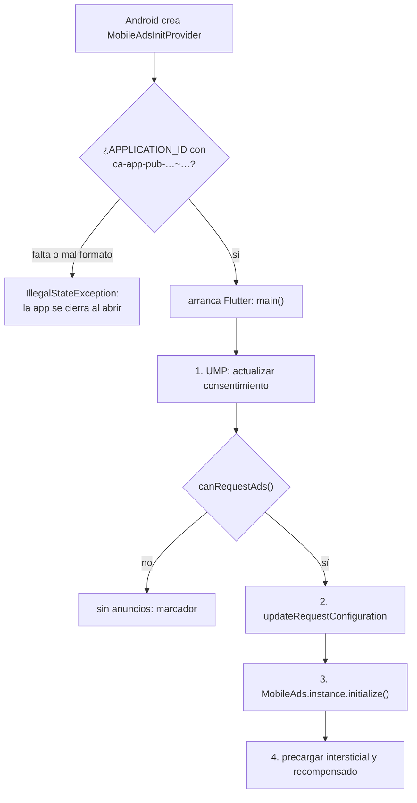
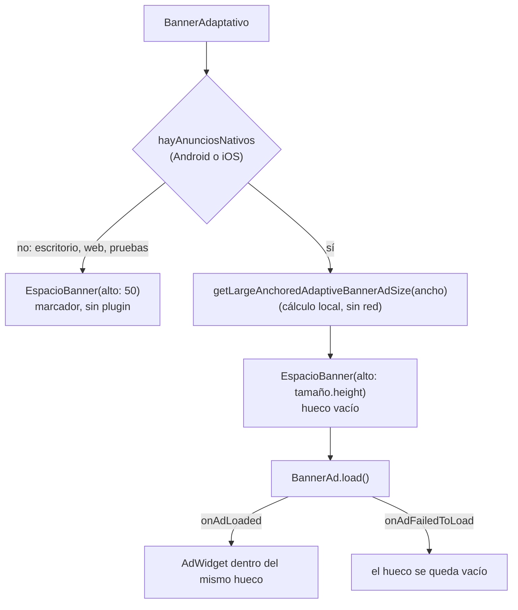
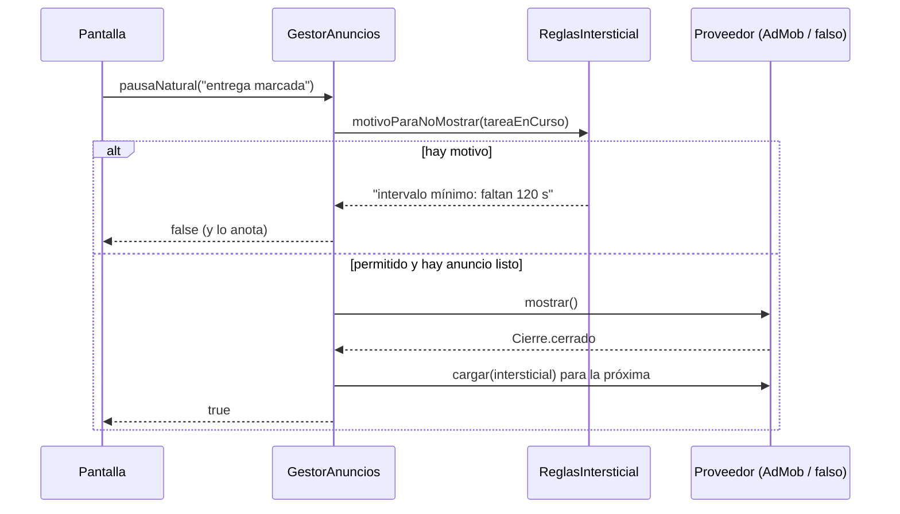
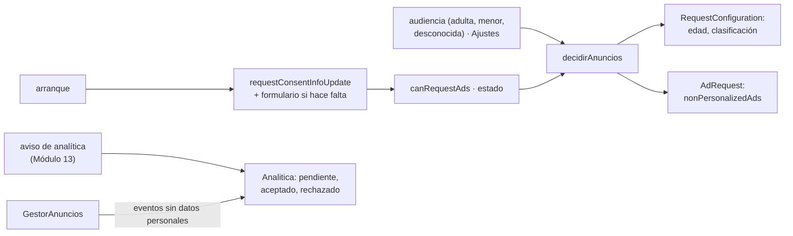

# Módulo 19: Anuncios y monetización en Flutter

**Entorno comprobado para esta edición (2026-11-25):** Flutter 3.50.1 (canal estable) con Dart 3.14.0 en Linux
x86_64, con `material_ui` 1.11.1 y `google_mobile_ads` 9.2.0, que trae el SDK de Google Mobile Ads para Android
25.5.0 y el SDK de consentimiento UMP 4.0.0. Todo el código se analizó con `flutter analyze` (`No issues found!`) y
las 11 pruebas se ejecutaron ese día, en `/home/estudiante/labs/flutter/m19` (tu `~/labs/flutter/m19`). Lo que sí es
real: el plugin integrado y compilado para Android con `flutter build apk --release`, el manifiesto final leído del
APK con `aapt2`, el código del SDK que decide qué pasa sin App ID (leído con `javap` en lo que Gradle descargó), los
IDs de prueba comparados con la documentación de Google y con el ejemplo del paquete, la app de escritorio en release
con su marcador de anuncio, y toda la lógica (reglas, recompensas, consentimiento) probada. **El límite:**
`google_mobile_ads` solo funciona en Android e iOS, y en el equipo de pruebas no hay teléfono ni emulador: el
emulador de Android se instaló y respondió que necesita aceleración por hardware (KVM), que este equipo no tiene
(se muestra la salida en el Tema 1). Por eso ningún anuncio real ni de prueba se cargó aquí, y lo que ocurre en el
teléfono se muestra leyendo el SDK, no ejecutándolo. iOS tampoco se compiló (no hay Xcode).

Una app gratuita se paga de alguna forma. El Módulo 18 cobró dentro de la app; este cobra con anuncios. Mostrar un
anuncio es fácil; lo difícil es que no rompa la pantalla, no interrumpa al repartidor en medio de una entrega, no
regale recompensas que la red no confirmó, no pida anuncios antes del consentimiento y no le muestre anuncios
personalizados a un menor. Este es el último módulo del curso: el Proyecto 36 cierra la app de seguimiento con
todo lo anterior.

**Al terminar este módulo podrás:**
- integrar `google_mobile_ads` con App ID e IDs de prueba, compilar para Android y leer qué agregó el SDK al APK;
- reservar el espacio del banner para que nada salte ni quede tapado, con un marcador en escritorio y en pruebas;
- mostrar intersticiales y recompensados con reglas propias de frecuencia, probadas con un proveedor falso;
- pedir el consentimiento con UMP, tratar a los menores como exige Google y comparar plataformas de mediación.

**Esquema del módulo:** Tema 1 (AdMob: App ID, IDs de prueba, inicialización y el APK) → Tema 2 (el espacio del
banner) → Tema 3 (intersticiales y recompensados con reglas) → Tema 4 (consentimiento, menores y mediación) →
Proyecto 36.

**Qué necesitas saber antes:** del Módulo 13, **la analítica con consentimiento** (Tema 3) y **la captura global de
errores** (Tema 1); del Módulo 12, **la inyección del reloj** (Tema 2) y **las interfaces entre capas** (Tema 1); del
Módulo 11, **las compilaciones de release y `--dart-define`** (Temas 1 y 2); del Módulo 10, **los pantallazos en
pruebas**; del Módulo 2, **`SafeArea` y lo que el sistema le quita a la pantalla**
(Tema 5).

**Qué no se repite:** firmar y publicar (Módulo 11), el consentimiento de analítica (Módulo 13, Tema 3) ni las
compras dentro de la app (Módulo 18). Aquí se trata de lo que cambia cuando el que paga es un anunciante.

**Prepara el proyecto:**

```text
$ cd ~/labs/flutter
$ flutter create --org com.academia --platforms=android,linux m19
$ cd m19
$ flutter pub add google_mobile_ads
```

Agrega `formatter: page_width: 120` a `analysis_options.yaml`, copia `test/pantallazo.dart` del Módulo 10 y
`lib/analitica/analitica.dart` del Módulo 13, y deja la ventana de Linux en 420 × 760
(`linux/runner/my_application.cc`).
Si tu equipo tiene 8 GB de RAM o menos, baja la memoria de Gradle en `android/gradle.properties`: la plantilla pide
`-Xmx8G` y, en el equipo de pruebas, el sistema mató el proceso de Gradle por falta de memoria (`Gradle build daemon
disappeared unexpectedly`). Con esta configuración compiló:

```text
org.gradle.jvmargs=-Xmx1536m -XX:MaxMetaspaceSize=768m -XX:ReservedCodeCacheSize=256m
org.gradle.workers.max=1
kotlin.compiler.execution.strategy=in-process
```

La estructura final del proyecto:

```text
lib/
├── main.dart                          orden de arranque: UMP → configuración → SDK → precarga
├── pantalla_ruta.dart                 la pantalla con el banner al pie
├── anuncios/
│   ├── ids_prueba.dart                IDs de prueba oficiales y los reales por --dart-define
│   ├── proveedor.dart                 la interfaz: cargar, mostrar, fallo de carga
│   ├── proveedor_admob.dart           la implementación con google_mobile_ads
│   ├── proveedor_escritorio.dart      la de escritorio y web: falla de forma explícita
│   ├── reglas_frecuencia.dart         gracia, intervalo mínimo, tope por hora, tarea en curso
│   ├── gestor_anuncios.dart           precarga, reglas, recompensa y bitácora
│   └── espacio_banner.dart            el hueco reservado y el banner adaptativo
├── privacidad/
│   ├── politica_anuncios.dart         de consentimiento y audiencia a configuración
│   └── consentimiento_ump.dart        el flujo real de UMP
└── analitica/analitica.dart           copiada del Módulo 13
```


## Aprende construyendo


### Tema 1: AdMob con `google_mobile_ads`: App ID, IDs de prueba y lo que llega al APK · Intermedio · 45 min

<details open>
<summary><strong>Capa 1 — Lectura</strong></summary>

#### Objetivos
Al terminar este tema podrás:
- distinguir el App ID de un ID de unidad de anuncio y ponerlos donde van;
- usar los IDs de prueba oficiales en desarrollo y los reales solo en la compilación de la tienda;
- inicializar el SDK en el orden correcto: consentimiento, configuración, inicialización, precarga;
- leer en el APK final lo que el SDK agregó (permisos y componentes) y saber qué pasa si falta el App ID.

**Conceptos clave:** App ID, unidad de anuncio, anuncio de prueba, actividad no válida, manifiesto fusionado

#### El problema
La app de seguimiento de envíos va a tener una versión gratuita con anuncios. Alguien del equipo crea la cuenta de
AdMob, copia «el ID» que ve en la consola y lo pega en el código. Para probar, toca varias veces su propio anuncio,
real, desde su teléfono. El APK compila sin un solo aviso. Una semana después, la cuenta tiene un aviso de
«actividad no válida» y la app recién instalada se cierra al abrirla en un teléfono de prueba.

Este tema usa **las compilaciones de release y `--dart-define`** (Módulo 11, Temas 1 y 2) y **las interfaces entre
capas** (Módulo 12, Tema 1).

#### Glosario del tema

**App ID**
- **Definición técnica:** identificador de la app en AdMob, con la forma `ca-app-pub-<16 dígitos>~<10 dígitos>`; va en el `AndroidManifest.xml` (`com.google.android.gms.ads.APPLICATION_ID`) y en el `Info.plist` de iOS (`GADApplicationIdentifier`).
- **En palabras sencillas:** el número de cliente de la app ante la red de anuncios.
- **Dónde se rompe la comparación:** no va en el código Dart: lo lee el SDK nativo al arrancar el proceso, antes de que Flutter exista.
- **Ejemplo:** `ca-app-pub-3940256099942544~3347511713`, el App ID de prueba de Android.
- **Error típico:** pegar un ID de unidad (con `/`) donde va el App ID (con `~`).

**unidad de anuncio**
- **Definición técnica:** identificador de un espacio concreto (un banner, un intersticial, un recompensado) dentro de la app, con la forma `ca-app-pub-<16 dígitos>/<10 dígitos>`; se pasa en cada petición desde Dart.
- **En palabras sencillas:** el número de cada vitrina dentro de la tienda.
- **Dónde se rompe la comparación:** cada formato tiene la suya, y Android e iOS tienen IDs distintos.
- **Ejemplo:** `ca-app-pub-3940256099942544/1033173712`, el intersticial de prueba de Android.
- **Error típico:** usar una sola unidad para todos los lugares y no poder saber cuál rinde y cuál molesta.

**anuncio de prueba**
- **Definición técnica:** anuncio que AdMob sirve para las unidades de prueba de Google o para dispositivos registrados como de prueba; sus peticiones, impresiones y clics no cuentan en los informes ni generan ingresos.
- **En palabras sencillas:** un maniquí en la vitrina: se ve igual, pero no se vende.
- **Dónde se rompe la comparación:** los anuncios que llegan por mediación de otras redes no muestran la etiqueta de prueba; cada red tiene su propio modo de prueba.
- **Ejemplo:** las unidades `ca-app-pub-3940256099942544/…` de `IdsPrueba`.
- **Error típico:** «probar un momento» con las unidades reales.

**actividad no válida**
- **Definición técnica:** clics o impresiones que no vienen de interés real (los del propio desarrollador, bots, toques accidentales); AdMob puede limitar o cerrar la cuenta que los acumula.
- **En palabras sencillas:** inflar el contador a mano.
- **Dónde se rompe la comparación:** no hace falta mala intención: un anuncio que aparece bajo el dedo (Tema 2) también la produce.
- **Ejemplo:** la documentación de Google advierte que hacer clic en muchos anuncios sin estar en modo de prueba puede marcar la cuenta.
- **Error típico:** registrar el teléfono de pruebas después de haber tocado anuncios reales.

**manifiesto fusionado**
- **Definición técnica:** el `AndroidManifest.xml` final del APK, que Gradle arma uniendo el de la app con el de cada biblioteca; ahí aparecen los permisos y componentes que agregó el SDK.
- **En palabras sencillas:** la lista final de lo que la app pide, con lo que trajeron los paquetes.
- **Dónde se rompe la comparación:** tu manifiesto no lo muestra; hay que leerlo en el APK.
- **Ejemplo:** `com.google.android.gms.permission.AD_ID` aparece sin que nadie lo escribiera.
- **Error típico:** declarar en la tienda que la app «no usa el ID de publicidad» sin mirar el manifiesto fusionado.

#### ► CÓMO FUNCIONA
Al abrir la app, Android crea primero los *content providers* declarados en el manifiesto. Uno de ellos lo agrega el
SDK (`MobileAdsInitProvider`) y lee el App ID: si falta o tiene mal formato, lanza `IllegalStateException` y el
proceso se cierra antes del primer cuadro de Flutter. Después, ya en Dart, el orden es: consentimiento (Tema 4),
configuración de la petición, `MobileAds.instance.initialize()` y precarga.



#### Problema resuelto 1.1
Integra `google_mobile_ads` con los IDs de prueba, compila el APK de release sin App ID, averigua qué pasaría al
abrirlo, agrega el App ID de prueba, vuelve a compilar y lee qué quedó en el manifiesto final.

**Razonamiento:**
1. Los IDs de prueba se copian de la documentación de Google y se comparan con el ejemplo que trae el paquete en
   `~/.pub-cache`: si los dos coinciden, no hay error de copia.
2. Los IDs reales no van en el código: llegan con `--dart-define` (Módulo 11) y, en debug, se ignoran siempre.
3. Sin teléfono ni emulador, lo que ocurre al arrancar se averigua leyendo el SDK que Gradle descargó: el manifiesto
   del AAR dice qué componente arranca con la app y `javap` muestra qué comprueba y qué lanza.
4. `aapt2 dump xmltree` lee el manifiesto que quedó dentro del APK.
5. `main.dart` fija el orden de arranque; las clases que usa se construyen en los Temas 2 a 4.

```dart
// lib/anuncios/ids_prueba.dart — IDs de PRUEBA oficiales de Google (nunca generan ingresos ni cuentan como tráfico)
import 'package:flutter/foundation.dart';

/// Unidades de prueba de AdMob. Fuente: developers.google.com/admob/android/test-ads (Android) y el ejemplo del
/// paquete google_mobile_ads 9.2.0 (`example/lib/snippets/*.dart`), comprobados el 2026-11-25.
abstract final class IdsPrueba {
  static const appAndroid = 'ca-app-pub-3940256099942544~3347511713'; // va en AndroidManifest.xml
  static const appIos = 'ca-app-pub-3940256099942544~1458002511'; // va en Info.plist (GADApplicationIdentifier)

  static String get bannerAdaptativo =>
      _segun(android: 'ca-app-pub-3940256099942544/9214589741', ios: 'ca-app-pub-3940256099942544/2435281174');
  static String get intersticial =>
      _segun(android: 'ca-app-pub-3940256099942544/1033173712', ios: 'ca-app-pub-3940256099942544/4411468910');
  static String get recompensado =>
      _segun(android: 'ca-app-pub-3940256099942544/5224354917', ios: 'ca-app-pub-3940256099942544/1712485313');

  static String _segun({required String android, required String ios}) =>
      defaultTargetPlatform == TargetPlatform.iOS ? ios : android;
}

/// Las unidades reales llegan por --dart-define en la compilación de la tienda; si faltan, se usan las de prueba.
abstract final class IdsAnuncios {
  static const _banner = String.fromEnvironment('AD_BANNER');
  static const _intersticial = String.fromEnvironment('AD_INTERSTICIAL');
  static const _recompensado = String.fromEnvironment('AD_RECOMPENSADO');

  static String get banner => _banner.isEmpty || kDebugMode ? IdsPrueba.bannerAdaptativo : _banner;
  static String get intersticial => _intersticial.isEmpty || kDebugMode ? IdsPrueba.intersticial : _intersticial;
  static String get recompensado => _recompensado.isEmpty || kDebugMode ? IdsPrueba.recompensado : _recompensado;
}
```

```text
$ cd ~/.pub-cache/hosted/pub.dev/google_mobile_ads-9.2.0/example
$ grep -HoE "ca-app-pub-3940256099942544[~/][0-9]+" android/app/src/main/AndroidManifest.xml ios/Runner/Info.plist lib/snippets/banner_ad_snippets.dart lib/snippets/interstitial_ad_snippets.dart lib/snippets/rewarded_ad_snippets.dart
android/app/src/main/AndroidManifest.xml:ca-app-pub-3940256099942544~3347511713
ios/Runner/Info.plist:ca-app-pub-3940256099942544~1458002511
lib/snippets/banner_ad_snippets.dart:ca-app-pub-3940256099942544/9214589741
lib/snippets/banner_ad_snippets.dart:ca-app-pub-3940256099942544/2435281174
lib/snippets/interstitial_ad_snippets.dart:ca-app-pub-3940256099942544/1033173712
lib/snippets/interstitial_ad_snippets.dart:ca-app-pub-3940256099942544/4411468910
lib/snippets/rewarded_ad_snippets.dart:ca-app-pub-3940256099942544/5224354917
lib/snippets/rewarded_ad_snippets.dart:ca-app-pub-3940256099942544/1712485313
```

```dart
// lib/main.dart — orden de arranque: consentimiento → configuración → inicialización → precarga
import 'package:google_mobile_ads/google_mobile_ads.dart';
import 'package:material_ui/material_ui.dart';

import 'anuncios/espacio_banner.dart';
import 'anuncios/gestor_anuncios.dart';
import 'anuncios/proveedor.dart';
import 'anuncios/proveedor_admob.dart';
import 'anuncios/proveedor_escritorio.dart';
import 'anuncios/reglas_frecuencia.dart';
import 'pantalla_ruta.dart';
import 'privacidad/consentimiento_ump.dart';
import 'privacidad/politica_anuncios.dart';

Future<void> main() async {
  WidgetsFlutterBinding.ensureInitialized();
  var politica = const ConfigAnuncios(pedir: false, motivo: 'plataforma sin anuncios');
  ProveedorAnuncios proveedor = ProveedorSinAnuncios();
  if (hayAnunciosNativos) {
    final ump = await actualizarConsentimiento(); // 1. primero el consentimiento (UMP)
    politica = decidirAnuncios(puedePedir: ump.puedePedir, estado: ump.estado, audiencia: Audiencia.adulta);
    if (politica.pedir) {
      await MobileAds.instance.updateRequestConfiguration(politica.configuracion); // 2. edad y clasificación
      await MobileAds.instance.initialize(); // 3. recién ahora el SDK
      proveedor = ProveedorAdMob(noPersonalizados: politica.noPersonalizados);
    }
  }
  final reloj = DateTime.now;
  final gestor = GestorAnuncios(proveedor, ReglasIntersticial(reloj: reloj), reloj: reloj);
  await gestor.precargar(Formato.intersticial); // 4. precarga: listo antes de la primera pausa
  await gestor.precargar(Formato.recompensado);
  runApp(AppRuta(gestor: gestor, politica: politica));
}

class AppRuta extends StatefulWidget {
  const AppRuta({super.key, required this.gestor, required this.politica});
  final GestorAnuncios gestor;
  final ConfigAnuncios politica;

  @override
  State<AppRuta> createState() => _AppRutaState();
}

class _AppRutaState extends State<AppRuta> {
  @override
  Widget build(BuildContext context) {
    final lineas = ['política: ${widget.politica.motivo}', ...widget.gestor.bitacora];
    return MaterialApp(
      debugShowCheckedModeBanner: false,
      theme: ThemeData(colorSchemeSeed: Colors.indigo),
      home: PantallaRuta(
        banner: widget.politica.pedir
            ? BannerAdaptativo(peticion: AdRequest(nonPersonalizedAds: widget.politica.noPersonalizados))
            : const EspacioBanner(alto: BannerAdaptativo.altoMinimo, etiqueta: 'Publicidad · marcador de escritorio'),
        alMarcar: () async {
          await widget.gestor.pausaNatural('entrega marcada');
          setState(() {});
        },
        alRecompensa: () async {
          await widget.gestor.ofrecerRecompensa('rastreo en vivo 1 h', () {});
          setState(() {});
        },
        pie: Container(
          width: double.infinity,
          color: Colors.black87,
          padding: const EdgeInsets.all(8),
          child: Text(
            lineas.join('\n'),
            style: const TextStyle(color: Colors.white, fontFamily: 'monospace', fontSize: 11),
          ),
        ),
      ),
    );
  }
}
```

Primero, sin App ID en el manifiesto:

```text
$ flutter build apk --release --target-platform android-arm64
Running Gradle task 'assembleRelease'...                        
Font asset "CupertinoIcons.ttf" was tree-shaken, reducing it from 257628 to 844 bytes (99.7% reduction). Tree-shaking can be disabled by providing the --no-tree-shake-icons flag when building your app.
Font asset "MaterialIcons-Regular.otf" was tree-shaken, reducing it from 1645184 to 1592 bytes (99.9% reduction). Tree-shaking can be disabled by providing the --no-tree-shake-icons flag when building your app.
Running Gradle task 'assembleRelease'...                          262.1s
✓ Built build/app/outputs/flutter-apk/app-release.apk (18.3MB)
```

```bash
#!/bin/bash
# inspeccionar_sdk.sh — lee en el SDK de Android ya descargado por Gradle qué pasa sin App ID y qué códigos de error hay
set -e
aar=$(find ~/.gradle/caches/modules-2 -name 'play-services-ads-api-25.5.0.aar' | head -1)
tmp=$(mktemp -d); trap 'rm -rf "$tmp"' EXIT
unzip -q -p "$aar" classes.jar > "$tmp/c.jar"
cd "$tmp" && unzip -q c.jar
export JAVA_TOOL_OPTIONS= _JAVA_OPTIONS=  # sin opciones globales de Java: javap no imprime «Picked up …»
echo "== proveedor que arranca con la app (AndroidManifest.xml del AAR):"
unzip -p "$aar" AndroidManifest.xml | grep -o 'com.google.android.gms.ads.MobileAdsInitProvider'
echo "== MobileAdsInitProvider.attachInfo delega en:"
javap -c -p com.google.android.gms.ads.MobileAdsInitProvider 2>/dev/null | grep -m1 -o 'class com/google/android/gms/ads/internal/client/zz[a-z]*'
echo "== lo que comprueba y lanza al arrancar:"
javap -c -p com.google.android.gms.ads.internal.client.zzev 2>/dev/null |
  grep -E 'String (com.google.android.gms.ads.APPLICATION_ID|\^ca-app)|IllegalStateException$|(Missing|Invalid) application|must have a String' |
  sed -E 's/^ +[0-9]+: (ldc|new) +#[0-9]+ +\/\/ //; s/(\\n)+\*+\\n//; s/\* (Missing|Invalid) application ID[^\\]*/&…/; s/\\n.*$//'
echo "== códigos de error de carga (AdRequest):"
javap -constants com.google.android.gms.ads.AdRequest 2>/dev/null | grep -E 'ERROR_CODE' | sed 's/^ *public static final //'
javap -constants com.google.android.gms.ads.MobileAds 2>/dev/null | grep -E 'ERROR_DOMAIN' | sed 's/^ *public static final //'
```

```text
$ ./inspeccionar_sdk.sh
== proveedor que arranca con la app (AndroidManifest.xml del AAR):
com.google.android.gms.ads.MobileAdsInitProvider
== MobileAdsInitProvider.attachInfo delega en:
class com/google/android/gms/ads/internal/client/zzev
== lo que comprueba y lanza al arrancar:
String com.google.android.gms.ads.APPLICATION_ID
String ^ca-app-pub-[0-9]{16}~[0-9]{10}$
class java/lang/IllegalStateException
String * Invalid application ID. Follow instructions here:                          *…
class java/lang/IllegalStateException
String * Missing application ID. AdMob publishers should follow the instructions    *…
class java/lang/IllegalStateException
String The com.google.android.gms.ads.APPLICATION_ID metadata must have a String value.
class java/lang/IllegalStateException
String The com.google.android.gms.ads.INTEGRATION_MANAGER metadata must have a String value.
== códigos de error de carga (AdRequest):
int ERROR_CODE_INTERNAL_ERROR = 0;
int ERROR_CODE_INVALID_REQUEST = 1;
int ERROR_CODE_NETWORK_ERROR = 2;
int ERROR_CODE_NO_FILL = 3;
int ERROR_CODE_APP_ID_MISSING = 8;
int ERROR_CODE_REQUEST_ID_MISMATCH = 10;
int ERROR_CODE_INVALID_AD_STRING = 11;
int ERROR_CODE_MEDIATION_NO_FILL = 9;
java.lang.String ERROR_DOMAIN = "com.google.android.gms.ads";
```

Ahora, con el App ID de prueba dentro de `<application>` en `android/app/src/main/AndroidManifest.xml`:

```text
        <!-- App ID de AdMob: el de PRUEBA de Google. Lleva «~», no «/» (eso es una unidad de anuncio). -->
        <meta-data
            android:name="com.google.android.gms.ads.APPLICATION_ID"
            android:value="ca-app-pub-3940256099942544~3347511713"/>
```

```text
$ flutter build apk --release --target-platform android-arm64
Running Gradle task 'assembleRelease'...                        
Font asset "CupertinoIcons.ttf" was tree-shaken, reducing it from 257628 to 844 bytes (99.7% reduction). Tree-shaking can be disabled by providing the --no-tree-shake-icons flag when building your app.
Font asset "MaterialIcons-Regular.otf" was tree-shaken, reducing it from 1645184 to 1592 bytes (99.9% reduction). Tree-shaking can be disabled by providing the --no-tree-shake-icons flag when building your app.
Running Gradle task 'assembleRelease'...                          478.3s
✓ Built build/app/outputs/flutter-apk/app-release.apk (18.3MB)
```

```bash
#!/bin/bash
# manifiesto.sh <apk> — lo que el APK final declara para anuncios: App ID, permisos y componentes que agregó el SDK
apk="${1:-build/app/outputs/flutter-apk/app-release.apk}"
aapt2="$ANDROID_HOME/build-tools/36.0.0/aapt2"
echo "== $apk ($(du -h "$apk" | cut -f1))"
"$aapt2" dump xmltree "$apk" --file AndroidManifest.xml > /tmp/manifiesto.txt
echo "-- App ID:"
id=$(grep -A2 'APPLICATION_ID' /tmp/manifiesto.txt | grep -o 'ca-app-pub[^"]*' | head -1)
echo "   ${id:-(no hay meta-data APPLICATION_ID)}"
echo "-- permisos:"
grep -A1 'E: uses-permission' /tmp/manifiesto.txt | grep -o '"[^"]*"' | tr -d '"' | grep -v '^$' | awk '!visto[$0]++' | sed 's/^/   /'
echo "-- componentes de com.google.android.gms.ads:"
grep -o '"com.google.android.gms.ads.[A-Za-z]*"' /tmp/manifiesto.txt | tr -d '"' | grep -v APPLICATION_ID | sort -u | sed 's/^/   /'
```

```text
$ ./manifiesto.sh build/app-sin-appid.apk && ./manifiesto.sh
== build/app-sin-appid.apk (18M)
-- App ID:
   (no hay meta-data APPLICATION_ID)
-- permisos:
   android.permission.INTERNET
   android.permission.ACCESS_NETWORK_STATE
   com.google.android.gms.permission.AD_ID
   android.permission.ACCESS_ADSERVICES_AD_ID
   android.permission.ACCESS_ADSERVICES_ATTRIBUTION
   android.permission.ACCESS_ADSERVICES_TOPICS
   android.permission.WAKE_LOCK
   android.permission.FOREGROUND_SERVICE
   com.academia.m19.DYNAMIC_RECEIVER_NOT_EXPORTED_PERMISSION
-- componentes de com.google.android.gms.ads:
   com.google.android.gms.ads.AdActivity
   com.google.android.gms.ads.AdService
   com.google.android.gms.ads.MobileAdsInitProvider
   com.google.android.gms.ads.NotificationHandlerActivity
   com.google.android.gms.ads.OutOfContextTestingActivity
== build/app/outputs/flutter-apk/app-release.apk (18M)
-- App ID:
   ca-app-pub-3940256099942544~3347511713
-- permisos:
   android.permission.INTERNET
   android.permission.ACCESS_NETWORK_STATE
   com.google.android.gms.permission.AD_ID
   android.permission.ACCESS_ADSERVICES_AD_ID
   android.permission.ACCESS_ADSERVICES_ATTRIBUTION
   android.permission.ACCESS_ADSERVICES_TOPICS
   android.permission.WAKE_LOCK
   android.permission.FOREGROUND_SERVICE
   com.academia.m19.DYNAMIC_RECEIVER_NOT_EXPORTED_PERMISSION
-- componentes de com.google.android.gms.ads:
   com.google.android.gms.ads.AdActivity
   com.google.android.gms.ads.AdService
   com.google.android.gms.ads.MobileAdsInitProvider
   com.google.android.gms.ads.NotificationHandlerActivity
   com.google.android.gms.ads.OutOfContextTestingActivity
```

¿De dónde salió cada permiso? Gradle lo dice en su informe de fusión:

```bash
#!/bin/bash
# origen_permisos.sh — de qué biblioteca vino cada permiso del manifiesto fusionado (informe de Gradle)
informe=build/app/outputs/logs/manifest-merger-release-report.txt
awk '/^uses-permission#/ { p = substr($0, 17); getline; if (match($0, /\[[^]]+\]/)) print p "  ←  " substr($0, RSTART + 1, RLENGTH - 2) }' "$informe" |
  grep -v '\${applicationId}'
```

```text
$ ./origen_permisos.sh
android.permission.INTERNET  ←  :google_mobile_ads
android.permission.ACCESS_NETWORK_STATE  ←  com.google.android.gms:play-services-ads-api:25.5.0
com.google.android.gms.permission.AD_ID  ←  com.google.android.gms:play-services-ads-api:25.5.0
android.permission.ACCESS_ADSERVICES_AD_ID  ←  com.google.android.gms:play-services-ads-api:25.5.0
android.permission.ACCESS_ADSERVICES_ATTRIBUTION  ←  com.google.android.gms:play-services-ads-api:25.5.0
android.permission.ACCESS_ADSERVICES_TOPICS  ←  com.google.android.gms:play-services-ads-api:25.5.0
android.permission.RECEIVE_BOOT_COMPLETED  ←  com.google.android.gms:play-services-ads-api:25.5.0
android.permission.WAKE_LOCK  ←  com.google.android.gms:play-services-measurement-sdk-api:20.1.2
android.permission.FOREGROUND_SERVICE  ←  androidx.work:work-runtime:2.7.0
com.academia.m19.DYNAMIC_RECEIVER_NOT_EXPORTED_PERMISSION  ←  androidx.core:core:1.13.1
```

Y el intento de tener un emulador en el equipo de pruebas. El paquete `emulator` (37.3.10, 853 MB instalado) se
instaló aparte, con `sdkmanager --sdk_root=/tmp/fl/m19/emu "emulator"`, para no tocar el SDK del curso:

```text
$ ls /dev/kvm; grep -c -E 'vmx|svm' /proc/cpuinfo; E=/tmp/fl/m19/emu/emulator; $E/emulator -version | head -1; $E/emulator -accel-check; grep -ao '%s emulation currently requires hardware acceleration!' $E/qemu/linux-x86_64/qemu-system-x86_64 $E/qemu/linux-x86_64/qemu-system-aarch64 | sed 's#.*/##'
ls: cannot access '/dev/kvm': No such file or directory
0
Android emulator version 37.3.10.0 (build_id 16970787) (CL:N/A)
accel:
3
KVM requires a CPU that supports vmx or svm
accel
qemu-system-x86_64:%s emulation currently requires hardware acceleration!
qemu-system-aarch64:%s emulation currently requires hardware acceleration!
```

**Explicación por partes.**
- Los ocho IDs del ejemplo del paquete coinciden con la tabla de la documentación de Google (*Enable test ads*,
  consultada el 2026-11-25): banner adaptativo `…/9214589741`, intersticial `…/1033173712` y recompensado
  `…/5224354917` en Android. La documentación lista también un banner de tamaño fijo, `…/6300978111`.
- **El hallazgo:** sin App ID, `flutter build apk` termina con `✓ Built` y sin ningún aviso. El error no es de
  compilación: `MobileAdsInitProvider` delega en una clase (`zzev`, el nombre está ofuscado) que lee
  `APPLICATION_ID` y lanza `IllegalStateException` con el recuadro «Missing application ID». Como es un *content
  provider*, Android lo crea al iniciar el proceso: la app se cierra antes de que `main()` se ejecute, y la captura
  de errores del Módulo 13 no llega a verlo.
- El mismo código compara el valor con la expresión `^ca-app-pub-[0-9]{16}~[0-9]{10}$`: si pegas una unidad
  (`…/1033173712`), el error es otro, «Invalid application ID».
- Los códigos de error de carga salen de `AdRequest`: el 3 es `ERROR_CODE_NO_FILL` (sin anuncio que servir) y el 9,
  `ERROR_CODE_MEDIATION_NO_FILL`. Se usan en el Tema 3.
- Los dos APK miden 18.3 MB y tienen los mismos permisos y componentes; solo cambia el App ID. Tu manifiesto no
  declara ningún permiso: `INTERNET` lo trae el plugin; `ACCESS_NETWORK_STATE`, `AD_ID` y los tres
  `ACCESS_ADSERVICES_*`, el SDK de anuncios (`play-services-ads-api`); `WAKE_LOCK` y `FOREGROUND_SERVICE`, bibliotecas
  que el SDK arrastra (`play-services-measurement-sdk-api` y `androidx.work`). El permiso `AD_ID` importa en el
  Tema 4.
- `RECEIVE_BOOT_COMPLETED` aparece en el informe pero no en el APK: el manifiesto del AAR lo declara con
  `tools:node="remove"`, que lo quita en la fusión. Por eso se lee el APK y no solo el informe.
- El SDK agregó también cinco componentes, entre ellos `AdActivity`, la que muestra los anuncios de pantalla
  completa.
- El emulador 37.3.10 contesta a `-accel-check` con `KVM requires a CPU that supports vmx or svm`: el procesador
  del equipo no expone virtualización (0 líneas con `vmx` o `svm`). Las dos variantes de QEMU que trae, x86_64 y
  arm64, contienen el mensaje `%s emulation currently requires hardware acceleration!`: sin KVM no hay emulador.

> **Error común.** Confiar en que «si compila, está bien». Sin App ID el APK se construye sin avisos y se cierra al
> abrir. Agrega a tu CI (Módulo 11) una revisión del manifiesto final, como `manifiesto.sh`, que falle si no hay
> `APPLICATION_ID`.

> **Error común.** Confundir el App ID con el ID de una unidad. Los dos empiezan igual; el App ID tiene `~` y va en
> el manifiesto, la unidad tiene `/` y va en Dart. El SDK rechaza el primero mal formado al arrancar; la unidad mal
> puesta solo falla al pedir un anuncio.

> **Buena práctica.** Haz que el modo debug use siempre los IDs de prueba, como `IdsAnuncios`, aunque alguien pase
> los reales por `--dart-define`. Así ningún desarrollador ve un anuncio real en su teléfono.

> **Prevenir errores.** Lee el manifiesto fusionado cada vez que agregues un paquete de anuncios o de mediación.
> Lo que ahí aparece es lo que declaras en la ficha de la tienda (permisos, ID de publicidad, datos recogidos).

#### Checkpoint 1.1
¿Por qué un `try`/`catch` alrededor de `MobileAds.instance.initialize()` no evita el cierre por falta de App ID?

Respuesta: porque la excepción no ocurre ahí. La lanza `MobileAdsInitProvider` cuando Android crea el proceso, antes
de que se ejecute `main()`; ningún código Dart ha corrido todavía.

</details>

<details>
<summary><strong>Capa 2 — Construcción</strong></summary>

#### Paso 1 · Agrega el plugin y los IDs
Ejecuta `flutter pub add google_mobile_ads` y crea `ids_prueba.dart`. Compara tus IDs con el ejemplo del paquete
con el `grep` de arriba.

#### Paso 2 · Compila sin App ID
Compila con `flutter build apk --release --target-platform android-arm64` y guarda una copia del APK como
`build/app-sin-appid.apk`.

#### Paso 3 · Lee el SDK
Ejecuta `inspeccionar_sdk.sh`. ¿Qué componente arranca con la app y qué excepción lanza?

#### Paso 4 · Agrega el App ID y compara
Agrega el `<meta-data>` de prueba, vuelve a compilar y ejecuta `manifiesto.sh` con los dos APK y
`origen_permisos.sh`.

#### Paso 5 · Si tienes un teléfono
Instala el APK sin App ID con `adb install` y ábrelo; luego mira `adb logcat | grep -A8 "Missing application ID"`.
Repite con el App ID bueno y busca en logcat la línea que imprime el SDK con el ID del dispositivo de prueba.

#### Resumen
- El **App ID** (`~`) va en el manifiesto; cada **unidad de anuncio** (`/`) va en Dart.
- En desarrollo solo se usan **anuncios de prueba**; los reales llegan por `--dart-define` a la compilación de la
  tienda.
- Tocar anuncios reales propios es **actividad no válida**.
- El **manifiesto fusionado** muestra los permisos y componentes que agregó el SDK; sin App ID, la app se cierra al
  abrir aunque compile.

#### Ejercicio verificable 1
Básico. ¿Cuál es el ID de prueba del intersticial de iOS?

Respuesta esperada: `ca-app-pub-3940256099942544/4411468910` (en `interstitial_ad_snippets.dart` del ejemplo).

#### Ejercicio verificable 2
Intermedio. ¿Qué excepción y qué texto produce un App ID sin `~` en Android, y en qué momento?

Respuesta esperada: `IllegalStateException` con el recuadro «Invalid application ID», al crear el proceso (el
*content provider* `MobileAdsInitProvider`), antes de `main()`.

#### Ejercicio verificable 3
Reto. ¿Cuántos permisos agregó el SDK al manifiesto que tu app no declaraba, y cuál de ellos tiene que ver con
menores de edad?

Respuesta esperada: nueve en el APK, y la app no declaraba ninguno: seis del plugin y del SDK de anuncios
(`INTERNET`, `ACCESS_NETWORK_STATE`, `AD_ID` y los tres `ACCESS_ADSERVICES_*`), dos de bibliotecas que arrastra el SDK
(`WAKE_LOCK`, `FOREGROUND_SERVICE`) y `DYNAMIC_RECEIVER_NOT_EXPORTED_PERMISSION` de `androidx.core`. El de menores es
`com.google.android.gms.permission.AD_ID` (Tema 4).

#### En el trabajo
La cuenta de AdMob es de la empresa, no de quien programa. El equipo de desarrollo trabaja solo con IDs de prueba y
registra sus teléfonos como dispositivos de prueba; los IDs reales viven en el sistema de CI, como los demás datos
de la compilación de la tienda.

</details>

### Tema 2: El espacio del banner: reservar el alto, no tapar nada y un marcador · Intermedio · 40 min

<details open>
<summary><strong>Capa 1 — Lectura</strong></summary>

#### Objetivos
Al terminar este tema podrás:
- reservar el alto del banner desde el primer cuadro para que el contenido no salte cuando llega el anuncio;
- poner el banner al pie, debajo de la acción principal y encima de la barra de gestos, sin tapar nada;
- pedir el tamaño adaptativo anclado y saber de dónde sale su alto;
- mostrar un marcador del mismo tamaño en escritorio, web y pruebas, sin tocar el plugin.

**Conceptos clave:** banner adaptativo anclado, salto de contenido, clic accidental, marcador de posición,
`MissingPluginException`

#### El problema
La primera versión pone el banner con `if (cargado) banner` debajo del botón «Marcar entregada». El anuncio tarda en
llegar; justo cuando el repartidor va a tocar el botón, el banner aparece, el botón sube y el dedo cae sobre el
anuncio. Otra versión «ahorra espacio» poniendo el banner en un `Stack` encima de la pantalla, y tapa el botón. En
el escritorio, donde el equipo diseña, la pantalla ni siquiera abre: el plugin no existe ahí.

Este tema usa **`SafeArea`** (Módulo 2, Tema 5), **los pantallazos en pruebas** (Módulo 10) y **la captura global de
errores** (Módulo 13, Tema 1).

#### Glosario del tema

**banner adaptativo anclado**
- **Definición técnica:** banner que ocupa todo el ancho y cuyo alto calcula el SDK para ese ancho y ese dispositivo (`AdSize.getLargeAnchoredAdaptiveBannerAdSize(ancho)`); va fijo arriba o abajo de la pantalla.
- **En palabras sencillas:** una franja a la medida del teléfono.
- **Dónde se rompe la comparación:** el alto no es fijo: según el código del plugin, nunca pasa del 15 % del alto de la pantalla ni baja de 50.
- **Ejemplo:** `BannerAdaptativo` pide el tamaño con el ancho de `MediaQuery` y reserva ese alto.
- **Error típico:** usar el tamaño fijo de 320 × 50 en una tableta y dejar franjas vacías a los lados.

**salto de contenido**
- **Definición técnica:** cambio de posición de elementos ya dibujados porque otro elemento aparece o cambia de tamaño después (en la web se mide como *Cumulative Layout Shift*).
- **En palabras sencillas:** la pantalla se mueve sola mientras la usas.
- **Dónde se rompe la comparación:** en una app no hay una métrica oficial; aquí se mide con `tester.getRect` antes y después.
- **Ejemplo:** el botón pasa de `y=704` a `y=654` cuando llega el banner.
- **Error típico:** mostrar el banner solo cuando carga, sin reservar su espacio.

**clic accidental**
- **Definición técnica:** toque sobre un anuncio que la persona no quería hacer, por cercanía o por movimiento de la interfaz; las políticas de AdMob prohíben las ubicaciones que los provocan.
- **En palabras sencillas:** tocar el anuncio queriendo tocar otra cosa.
- **Dónde se rompe la comparación:** para la red cuenta como clic, pero es actividad no válida (Tema 1): no suma, resta.
- **Ejemplo:** el toque en `(195, 728)` que iba al botón y cae en el anuncio.
- **Error típico:** poner el banner pegado a los botones de navegación o a la acción principal.

**marcador de posición**
- **Definición técnica:** widget del mismo tamaño que el anuncio, que se dibuja mientras el anuncio no ha llegado, si no llega, o en plataformas sin anuncios.
- **En palabras sencillas:** la silla reservada con un papel que dice «ocupado».
- **Dónde se rompe la comparación:** no debe imitar a un anuncio; dice «Publicidad» y nada más.
- **Ejemplo:** `EspacioBanner(alto: 50)` con el texto «Publicidad · marcador de escritorio».
- **Error típico:** quitar el marcador cuando el anuncio falla, y que la pantalla salte en sentido contrario.

**`MissingPluginException`**
- **Definición técnica:** error que lanza un `MethodChannel` cuando ninguna implementación nativa responde al método pedido, por ejemplo en pruebas, escritorio o web para un plugin solo de Android e iOS.
- **En palabras sencillas:** llamar a un número que no existe en ese país.
- **Dónde se rompe la comparación:** si la llamada no se espera con `await`, el error no se puede capturar donde ocurre: llega como error no atendido.
- **Ejemplo:** `No implementation found for method _init on channel plugins.flutter.io/google_mobile_ads`.
- **Error típico:** tocar `MobileAds.instance` en escritorio «solo para leer algo».

#### ► CÓMO FUNCIONA
El pie de la pantalla es una columna: primero el botón y, debajo, un `EspacioBanner` de alto fijo dentro de un
`SafeArea`. Nada flota encima de nada, y lo que cambia (vacío → anuncio) cambia **dentro** de una caja que ya tenía
su tamaño. En plataformas sin anuncios la caja es la misma, con un marcador.



#### Problema resuelto 2.1
Diseña el pie de la pantalla de la ruta con un banner que no mueva ni tape el botón, y demuéstralo con pantallazos y
medidas reales: la versión buena, la que salta y la que tapa. Después, ejecuta la app en el escritorio con el
marcador.

**Razonamiento:**
1. `EspacioBanner` es una caja de alto fijo: el anuncio llega a su interior, no al árbol.
2. El tamaño adaptativo lo calcula el SDK en el teléfono, sin red: en el plugin de Android,
   `FlutterAdSize.getLargeAnchoredAdaptiveBannerAdSize` solo llama a
   `AdSize.getLargeAnchoredAdaptiveBannerAdSize(context, width)`.
   Se conoce antes que el anuncio, así que fija el hueco desde el principio.
3. `hayAnunciosNativos` mira `Platform.isAndroid` e `isIOS`, no `defaultTargetPlatform`: en `flutter test`, la
   segunda dice `android` aunque no haya plugin.
4. En las pruebas, el anuncio se simula con un widget del mismo tamaño y una etiqueta que lo dice.
5. La prueba mide la posición del botón y qué hay bajo el punto donde estaba, y hace el toque real.

```dart
// lib/anuncios/espacio_banner.dart — el hueco del banner se reserva desde el primer cuadro; el anuncio llega después
import 'dart:io' show Platform;

import 'package:flutter/foundation.dart';
import 'package:google_mobile_ads/google_mobile_ads.dart';
import 'package:material_ui/material_ui.dart';

import 'ids_prueba.dart';

/// Android e iOS son las únicas plataformas con google_mobile_ads; en escritorio, web y pruebas no hay plugin.
bool get hayAnunciosNativos => !kIsWeb && (Platform.isAndroid || Platform.isIOS);

/// Caja de alto fijo: con anuncio o sin él, ocupa lo mismo, así que nada se mueve cuando el anuncio llega.
class EspacioBanner extends StatelessWidget {
  const EspacioBanner({super.key, required this.alto, this.anuncio, this.etiqueta = 'Publicidad'});
  final double alto;
  final Widget? anuncio;
  final String etiqueta;

  @override
  Widget build(BuildContext context) {
    final colores = Theme.of(context).colorScheme;
    return Semantics(
      label: anuncio == null ? 'Espacio reservado para publicidad' : null,
      child: SizedBox(
        height: alto,
        width: double.infinity,
        child: ColoredBox(
          color: colores.surfaceContainerHighest,
          child:
              anuncio ??
              Center(
                child: Text(etiqueta, style: TextStyle(color: colores.onSurfaceVariant, fontSize: 12)),
              ),
        ),
      ),
    );
  }
}

/// Banner adaptativo anclado al pie. En plataformas sin anuncios, deja el mismo hueco con un marcador.
class BannerAdaptativo extends StatefulWidget {
  const BannerAdaptativo({super.key, this.peticion = const AdRequest()});
  final AdRequest peticion;

  /// El SDK nunca devuelve menos de 50 de alto (documentación de getLargeAnchoredAdaptiveBannerAdSize).
  static const altoMinimo = 50.0;

  @override
  State<BannerAdaptativo> createState() => _BannerAdaptativoState();
}

class _BannerAdaptativoState extends State<BannerAdaptativo> {
  BannerAd? _banner;
  AdSize? _tamano;
  bool _cargado = false;
  int? _anchoPedido;

  @override
  void didChangeDependencies() {
    super.didChangeDependencies();
    final ancho = MediaQuery.sizeOf(context).width.truncate();
    if (hayAnunciosNativos && ancho != _anchoPedido) _cargar(ancho); // al girar, cambia el ancho: otro banner
  }

  Future<void> _cargar(int ancho) async {
    _anchoPedido = ancho;
    _banner?.dispose();
    _cargado = false;
    // El tamaño lo calcula el SDK en el teléfono (sin red): se conoce antes que el anuncio y fija el hueco.
    final tamano = await AdSize.getLargeAnchoredAdaptiveBannerAdSize(ancho);
    if (!mounted || tamano == null) return;
    setState(() => _tamano = tamano);
    _banner = BannerAd(
      adUnitId: IdsAnuncios.banner,
      size: tamano,
      request: widget.peticion,
      listener: BannerAdListener(
        onAdLoaded: (_) => setState(() => _cargado = true),
        onAdFailedToLoad: (ad, error) {
          ad.dispose(); // el hueco se queda: mejor un espacio vacío que un salto
          debugPrint('banner sin cargar: ${error.code} ${error.message}');
        },
      ),
    )..load();
  }

  @override
  void dispose() {
    _banner?.dispose();
    super.dispose();
  }

  @override
  Widget build(BuildContext context) {
    if (!hayAnunciosNativos) {
      return const EspacioBanner(alto: BannerAdaptativo.altoMinimo, etiqueta: 'Publicidad · marcador de escritorio');
    }
    final alto = _tamano?.height.toDouble() ?? BannerAdaptativo.altoMinimo;
    return EspacioBanner(
      alto: alto,
      anuncio: _cargado && _banner != null ? AdWidget(ad: _banner!) : null,
    );
  }
}
```

```dart
// lib/pantalla_ruta.dart — la pantalla de seguimiento con el banner al pie, sin tapar ni mover nada
import 'package:material_ui/material_ui.dart';

const guias = ['EN-4471', 'EN-4472', 'EN-4473', 'EN-4474', 'EN-4475', 'EN-4476', 'EN-4477', 'EN-4478'];

class PantallaRuta extends StatelessWidget {
  const PantallaRuta({super.key, required this.banner, this.alMarcar, this.alRecompensa, this.pie});
  final Widget banner; // EspacioBanner o BannerAdaptativo: siempre con alto fijo
  final VoidCallback? alMarcar;
  final VoidCallback? alRecompensa;
  final Widget? pie; // por ejemplo, la bitácora en la demostración de escritorio

  @override
  Widget build(BuildContext context) {
    return Scaffold(
      appBar: AppBar(
        title: const Text('Ruta norte-3 · Bogotá'),
        actions: [
          IconButton(
            tooltip: 'Rastreo en vivo (ver un anuncio)',
            onPressed: alRecompensa,
            icon: const Icon(Icons.play_circle_outline),
          ),
        ],
      ),
      body: Column(
        children: [
          Expanded(
            child: ListView(
              children: [
                for (final (i, g) in guias.indexed)
                  ListTile(
                    leading: const Icon(Icons.local_shipping_outlined),
                    title: Text(g),
                    subtitle: Text('Parada ${i + 1} · Calle ${26 + i * 3} # ${10 + i}-${20 + i}'),
                  ),
              ],
            ),
          ),
          ?pie,
        ],
      ),
      // El pie es una columna: primero la acción principal, debajo el banner. Nada flota encima de nada.
      bottomNavigationBar: Column(
        mainAxisSize: MainAxisSize.min,
        children: [
          Padding(
            padding: const EdgeInsets.fromLTRB(16, 8, 16, 8),
            child: SizedBox(
              width: double.infinity,
              child: FilledButton(onPressed: alMarcar, child: const Text('Marcar entregada')),
            ),
          ),
          SafeArea(top: false, child: banner), // el banner va por encima de la barra de gestos, no debajo
        ],
      ),
    );
  }
}
```

```dart
// test/banner_test.dart — el hueco reservado contra los dos errores clásicos: salto de contenido y botón tapado
// ignore_for_file: avoid_print
import 'package:flutter_test/flutter_test.dart';
import 'package:m19/anuncios/espacio_banner.dart';
import 'package:m19/pantalla_ruta.dart';
import 'package:material_ui/material_ui.dart';

import 'pantallazo.dart';

/// Lo que dibujaría el SDK. En flutter test no hay plugin, así que se simula (con su etiqueta).
class AnuncioSimulado extends StatelessWidget {
  const AnuncioSimulado({super.key});

  @override
  Widget build(BuildContext context) => Material(
    child: Container(
      height: 50,
      decoration: BoxDecoration(
        color: Colors.amber.shade100,
        border: Border.all(color: Colors.amber.shade700),
      ),
      padding: const EdgeInsets.symmetric(horizontal: 12),
      child: const Row(
        children: [
          DecoratedBox(
            decoration: BoxDecoration(color: Color(0xFFB26A00)),
            child: Padding(
              padding: EdgeInsets.symmetric(horizontal: 4, vertical: 2),
              child: Text('Anuncio', style: TextStyle(color: Colors.white, fontSize: 11)),
            ),
          ),
          SizedBox(width: 8),
          Expanded(child: Text('Anuncio simulado en la prueba · 390 × 50')),
        ],
      ),
    ),
  );
}

Widget app(Widget pantalla) => MaterialApp(
  debugShowCheckedModeBanner: false,
  theme: ThemeData(colorSchemeSeed: Colors.indigo),
  home: pantalla,
);

final boton = find.widgetWithText(FilledButton, 'Marcar entregada');

void main() {
  setUpAll(cargarFuentes);

  testWidgets('bien: el hueco existe desde el primer cuadro y nada se mueve', (tester) async {
    tamanoPantalla(tester);
    await tester.pumpWidget(app(PantallaRuta(alMarcar: () {}, banner: const EspacioBanner(alto: 50))));
    final antes = tester.getRect(boton);
    await pantallazo('bien_antes');
    await tester.pumpWidget(
      app(
        PantallaRuta(
          alMarcar: () {},
          banner: const EspacioBanner(alto: 50, anuncio: AnuncioSimulado()),
        ),
      ),
    );
    final despues = tester.getRect(boton);
    await pantallazo('bien_despues');
    print('bien:   botón en y=${antes.top} → y=${despues.top} (se movió ${antes.top - despues.top})');
    expect(despues, antes);
  });

  testWidgets('error: el banner aparece al cargar y empuja el botón', (tester) async {
    tamanoPantalla(tester);
    var toques = 0;
    Widget pantalla({required bool cargado}) => PantallaRuta(
      alMarcar: () => toques++,
      banner: cargado ? const AnuncioSimulado() : const SizedBox.shrink(), // sin reserva
    );
    await tester.pumpWidget(app(pantalla(cargado: false)));
    final antes = tester.getRect(boton);
    await pantallazo('salto_antes');
    await tester.pumpWidget(app(pantalla(cargado: true)));
    final despues = tester.getRect(boton);
    await pantallazo('salto_despues');
    // La persona iba a tocar el botón donde estaba: ¿qué hay ahora en ese punto?
    final debajoDelDedo = tester.hitTestOnBinding(antes.center).path.map((e) => e.target).whereType<RenderObject>();
    final anuncio = tester.renderObject(find.byType(AnuncioSimulado));
    print('salto:  botón en y=${antes.top} → y=${despues.top} (se movió ${antes.top - despues.top})');
    print('salto:  el toque en ${antes.center} cae en el anuncio: ${debajoDelDedo.contains(anuncio)}');
    expect(antes.top - despues.top, 50);
    expect(toques, 0);
  });

  testWidgets('error: el banner flota encima del botón', (tester) async {
    tamanoPantalla(tester);
    var toques = 0;
    await tester.pumpWidget(
      app(
        Stack(
          children: [
            PantallaRuta(alMarcar: () => toques++, banner: const SizedBox.shrink()),
            const Positioned(left: 0, right: 0, bottom: 0, child: AnuncioSimulado()),
          ],
        ),
      ),
    );
    await pantallazo('tapado');
    final rBoton = tester.getRect(boton);
    final rAnuncio = tester.getRect(find.byType(AnuncioSimulado));
    print('tapado: botón $rBoton · anuncio $rAnuncio · se cruzan: ${rBoton.overlaps(rAnuncio)}');
    await tester.tap(boton); // flutter_test avisa: el toque no llega al botón
    print('tapado: toques recibidos por el botón: $toques');
    expect(toques, 0);
  });
}
```

```text
$ flutter test test/banner_test.dart 2>&1 | grep -v -E '^(The hit test result|#[0-9]|<asynchronous|  FilledButton|The finder corresponds|To (silence|make)|$)'
00:00 +0: loading /home/estudiante/labs/flutter/m19/test/banner_test.dart
00:00 +0: (setUpAll)
00:00 +0: bien: el hueco existe desde el primer cuadro y nada se mueve
bien:   botón en y=654.0 → y=654.0 (se movió 0.0)
00:02 +1: error: el banner aparece al cargar y empuja el botón
salto:  botón en y=704.0 → y=654.0 (se movió 50.0)
salto:  el toque en Offset(195.0, 728.0) cae en el anuncio: true
00:03 +2: error: el banner flota encima del botón
tapado: botón Rect.fromLTRB(16.0, 704.0, 374.0, 752.0) · anuncio Rect.fromLTRB(0.0, 710.0, 390.0, 760.0) · se cruzan: true
Warning: A call to tap() with finder "Found 1 widget with type "FilledButton" that are ancestors of widget with text "Marcar entregada": [
]" derived an Offset (Offset(195.0, 728.0)) that would not hit test on the specified widget.
Maybe the widget is actually off-screen, or another widget is obscuring it, or the widget cannot receive pointer events.
tapado: toques recibidos por el botón: 0
00:04 +3: (tearDownAll)
00:04 +3: All tests passed!
```

![Cinco pantallazos de la pantalla «Ruta norte-3 · Bogotá» con la lista de guías EN-4471 a EN-4478. Los dos primeros son la versión buena: el botón «Marcar entregada» está a la misma altura, primero con una franja gris que dice «Publicidad» y después con el anuncio simulado amarillo en esa misma franja. El tercero y el cuarto son la versión que salta: sin anuncio el botón está abajo del todo y, al cargar el anuncio, el botón sube y el anuncio ocupa el lugar donde estaba. El quinto es la versión con el banner encima: el anuncio amarillo tapa el botón y solo se ve su borde superior](content/figures/flutter/m19-t2-espacios.png)

```dart
// test/plugin_test.dart — qué pasa al llamar al plugin donde no existe (pruebas, escritorio, web)
// ignore_for_file: avoid_print
import 'package:flutter/foundation.dart';
import 'package:flutter/services.dart';
import 'package:flutter_test/flutter_test.dart';
import 'package:google_mobile_ads/google_mobile_ads.dart';
import 'package:m19/anuncios/espacio_banner.dart';
import 'package:material_ui/material_ui.dart';

void main() {
  TestWidgetsFlutterBinding.ensureInitialized();

  Future<void> intentar(String que, Future<Object?> Function() llamada) async {
    try {
      print('$que → ${await llamada()}');
    } on MissingPluginException catch (e) {
      print('$que → $e');
    }
  }

  test('sin Android ni iOS, cada llamada al plugin falla', () async {
    // MobileAds.instance NO se toca aquí: al crearse llama a '_init' sin esperar y ese error no se puede capturar.
    await intentar('getLargeAnchoredAdaptiveBannerAdSize', () => AdSize.getLargeAnchoredAdaptiveBannerAdSize(390));
    await intentar('canRequestAds', () => ConsentInformation.instance.canRequestAds());
  });

  testWidgets('BannerAdaptativo no llama al plugin: deja el marcador con el mismo alto', (tester) async {
    await tester.pumpWidget(const MaterialApp(home: Scaffold(bottomNavigationBar: BannerAdaptativo())));
    print('hayAnunciosNativos: $hayAnunciosNativos · plataforma simulada: $defaultTargetPlatform');
    print('alto del espacio: ${tester.getSize(find.byType(EspacioBanner)).height}');
    expect(find.text('Publicidad · marcador de escritorio'), findsOneWidget);
  });
}
```

```text
$ flutter test test/plugin_test.dart
00:00 +0: loading /home/estudiante/labs/flutter/m19/test/plugin_test.dart
00:00 +0: sin Android ni iOS, cada llamada al plugin falla
getLargeAnchoredAdaptiveBannerAdSize → MissingPluginException(No implementation found for method AdSize#getLargeAnchoredAdaptiveBannerAdSize on channel plugins.flutter.io/google_mobile_ads)
canRequestAds → MissingPluginException(No implementation found for method ConsentInformation#canRequestAds on channel plugins.flutter.io/google_mobile_ads/ump)
00:00 +1: BannerAdaptativo no llama al plugin: deja el marcador con el mismo alto
hayAnunciosNativos: false · plataforma simulada: TargetPlatform.android
alto del espacio: 50.0
00:01 +2: All tests passed!
```

Con la línea `await intentar('MobileAds.initialize', () => MobileAds.instance.initialize());` dentro de la primera
prueba:

```text
$ flutter test test/plugin_test.dart 2>&1 | grep -v -E '^  (dart:async|package:flutter/src/services|package:google_mobile_ads/src/mobile_ads.dart  )|asynchronous gap|^ *$'
00:00 +0: loading /home/estudiante/labs/flutter/m19/test/plugin_test.dart
00:00 +0: sin Android ni iOS, cada llamada al plugin falla
00:00 +0 -1: sin Android ni iOS, cada llamada al plugin falla [E]
  MissingPluginException(No implementation found for method _init on channel plugins.flutter.io/google_mobile_ads)
  package:google_mobile_ads/src/mobile_ads.dart 151:29       MobileAds._init
  package:google_mobile_ads/src/mobile_ads.dart 40:53        MobileAds._instance
  package:google_mobile_ads/src/mobile_ads.dart 43:36        MobileAds.instance
  test/plugin_test.dart 22:60                                main.<fn>.<fn>
  test/plugin_test.dart 15:36                                main.intentar
  test/plugin_test.dart 22:11                                main.<fn>
MobileAds.initialize → MissingPluginException(No implementation found for method MobileAds#initialize on channel plugins.flutter.io/google_mobile_ads)
getLargeAnchoredAdaptiveBannerAdSize → MissingPluginException(No implementation found for method AdSize#getLargeAnchoredAdaptiveBannerAdSize on channel plugins.flutter.io/google_mobile_ads)
canRequestAds → MissingPluginException(No implementation found for method ConsentInformation#canRequestAds on channel plugins.flutter.io/google_mobile_ads/ump)
00:00 +0 -1: BannerAdaptativo no llama al plugin: deja el marcador con el mismo alto
hayAnunciosNativos: false · plataforma simulada: TargetPlatform.android
alto del espacio: 50.0
00:01 +1 -1: Some tests failed.
Failing tests:
  /home/estudiante/labs/flutter/m19/test/plugin_test.dart: sin Android ni iOS, cada llamada al plugin falla
```

La app real de escritorio, compilada en release (`flutter build linux --release`) y capturada con `correr_app.sh`:


**Explicación por partes.**
- **Bien:** el botón está en `y=654` antes y después de que llegue el anuncio. La franja gris «Publicidad» ocupa los
  mismos 50 puntos que después ocupa el anuncio.
- **Salto:** sin reserva, el botón está en `y=704` y sube a `y=654` al llegar el anuncio: 50 puntos, el alto del
  banner. El punto `(195, 728)`, el centro del botón antes de cargar, queda **dentro del anuncio**: ese toque sería un
  clic accidental.
- **Tapado:** el anuncio (`y` de 710 a 760) se cruza con el botón (`y` de 704 a 752). `tester.tap` lo avisa con
  `would not hit test on the specified widget` y el botón recibe 0 toques: la persona no puede marcar la entrega.
- **El hallazgo:** en pruebas, `getLargeAnchoredAdaptiveBannerAdSize` y `canRequestAds` fallan con
  `MissingPluginException` y se capturan bien. Pero `MobileAds.instance` es distinto: al crearse, el plugin llama
  a `_init` sin `await` (línea 151 de `mobile_ads.dart`, un arreglo para el *hot restart*). Ese error no lo atrapa el
  `try`: la prueba falla con `MissingPluginException(... method _init ...)` aunque el `catch` sí atrapó el de
  `MobileAds#initialize`. En la app de escritorio, ese mismo error llegaría a `PlatformDispatcher.onError` (Módulo
  13). Por eso `main.dart` solo toca `MobileAds` dentro de `if (hayAnunciosNativos)`.
- `defaultTargetPlatform` vale `TargetPlatform.android` en la prueba, y aun así `hayAnunciosNativos` es `false`: si
  el código hubiera usado `defaultTargetPlatform`, la prueba habría llamado al plugin.
- En el escritorio, la app arranca, la bitácora explica por qué no hay anuncios y el pie tiene el mismo alto que
  tendrá en el teléfono: el diseño se revisa sin emulador.

> **Error común.** `if (cargado) AdWidget(...)` sin espacio reservado. Además del salto de 50 puntos, el contenido
> vuelve a saltar en sentido contrario si el anuncio falla o se libera. Reserva el hueco siempre y deja que el
> anuncio llegue adentro.

> **Error común.** Llamar a algo de `google_mobile_ads` en escritorio, web o pruebas. Hasta leer `MobileAds.instance`
> produce un error no capturable. Encierra todo el plugin detrás de una comprobación de plataforma o de una interfaz
> (Tema 3).

> **Buena práctica.** Pon el banner al pie, dentro de `SafeArea(top: false)`, con la acción principal arriba y un
> margen entre los dos. Nunca en un `Stack` sobre el contenido ni pegado a la barra de navegación.

> **Prevenir errores.** Ten pantallazos del pie con el hueco vacío y con el anuncio simulado, y una prueba que
> compare la posición del botón en los dos. Si alguien cambia el banner, la prueba lo dice.

#### Checkpoint 2.1
Si el SDK devuelve un alto de 62 para el ancho del teléfono y el hueco se reservó con 50 antes de conocerlo, ¿qué
pasa y cómo se evita?

Respuesta: el contenido salta 12 puntos cuando llega el tamaño. Se evita pidiendo el tamaño apenas se conoce el
ancho (es un cálculo local, sin red, y llega antes que el anuncio) y no mostrando el contenido que depende de esa
posición hasta tenerlo, o reservando desde el principio el alto calculado.

</details>

<details>
<summary><strong>Capa 2 — Construcción</strong></summary>

#### Paso 1 · Crea el espacio y la pantalla
Crea `espacio_banner.dart` y `pantalla_ruta.dart`.

#### Paso 2 · Pantallazos y medidas
Crea `banner_test.dart` y ejecuta `flutter test test/banner_test.dart --update-goldens`. Compara las cinco imágenes.

#### Paso 3 · Toca el anuncio que saltó
En la prueba del salto, agrega `await tester.tapAt(antes.center)` después de cargar. ¿Cuántos toques recibe el
botón?

#### Paso 4 · Rompe la prueba del plugin
Agrega la línea de `MobileAds.instance.initialize()` a `plugin_test.dart` y ejecútala. Lee la pila: ¿en qué línea
del plugin se origina?

#### Paso 5 · El escritorio
Compila para Linux en release y captura la ventana con `correr_app.sh`. Comprueba que el marcador mide lo mismo que
en la prueba.

#### Resumen
- El **banner adaptativo anclado** ocupa el ancho y su alto lo calcula el SDK sin red.
- Reservar el alto evita el **salto de contenido** y el **clic accidental**.
- El banner va al pie, sin tapar la acción principal.
- Un **marcador de posición** del mismo tamaño sirve en escritorio, web y pruebas.
- Sin Android ni iOS, el plugin responde con **`MissingPluginException`**, y `MobileAds.instance` ni siquiera se puede
  tocar.

#### Ejercicio verificable 1
Básico. ¿Cuántos puntos sube el botón en la versión sin reserva?

Respuesta esperada: 50 (de `y=704` a `y=654`).

#### Ejercicio verificable 2
Intermedio. En el Paso 3, ¿cuántos toques recibe el botón y por qué?

Respuesta esperada: 0. El punto `(195, 728)` ahora es parte del anuncio simulado, que recibe el toque.

#### Ejercicio verificable 3
Reto. En el Paso 4, ¿por qué falla la prueba si el `catch` atrapó la excepción de `initialize`?

Respuesta esperada: porque leer `MobileAds.instance` crea la instancia, y su constructor llama a
`channel.invokeMethod('_init')` sin `await` (`MobileAds._init`, línea 151 de `mobile_ads.dart`). Esa excepción no
pasa por el `try`: queda como error no atendido y la prueba lo reporta.

#### En el trabajo
Las revisiones de diseño incluyen el pie con y sin anuncio. Los equipos de producto miden la tasa de clics de cada
ubicación: una tasa anormalmente alta suele ser una ubicación que provoca toques accidentales, y AdMob termina
limitando esa unidad.

</details>

### Tema 3: Intersticiales y recompensados con reglas propias: frecuencia, recompensa y sin relleno · Avanzado · 45 min

<details open>
<summary><strong>Capa 1 — Lectura</strong></summary>

#### Objetivos
Al terminar este tema podrás:
- esconder `google_mobile_ads` detrás de una interfaz y probar la lógica con un proveedor falso y un reloj fijo;
- mostrar intersticiales solo en pausas naturales, con gracia inicial, intervalo mínimo y tope por hora;
- dar la recompensa solo cuando la red la confirma, una sola vez, y nada si la persona cierra antes;
- registrar por qué no se mostró un anuncio, distinguiendo «sin relleno» de un error, en Android y en iOS.

**Conceptos clave:** intersticial, recompensado, tope de frecuencia, sin relleno (*no fill*), precarga

#### El problema
El equipo quiere más ingresos y pone un intersticial cada vez que se marca una entrega. A las dos horas, los
repartidores ven un anuncio de pantalla completa en medio de cada parada, y algunos lo cierran sin terminar el
escaneo de la guía. En la versión con recompensado («ver un anuncio para activar el rastreo en vivo una hora»), la
recompensa se da al abrir el anuncio, así que basta con abrirlo y cerrarlo. Y cuando no aparece ningún anuncio, nadie
sabe si es un error o simplemente no había anuncio que servir.

Este tema usa **la inyección del reloj** (Módulo 12, Tema 2), **las interfaces entre capas** (Módulo 12, Tema 1) y
**las clases `sealed` con `switch`** (Módulo 0).

#### Glosario del tema

**intersticial**
- **Definición técnica:** anuncio de pantalla completa (`InterstitialAd`) que se carga con anticipación y se muestra con `show()`; la app queda detrás hasta que la persona lo cierra (`onAdDismissedFullScreenContent`).
- **En palabras sencillas:** un cartel que tapa todo hasta que lo quitas.
- **Dónde se rompe la comparación:** cada objeto cargado se muestra una vez; después hay que cargar otro.
- **Ejemplo:** se muestra al marcar una entrega, si las reglas lo permiten.
- **Error típico:** mostrarlo en medio de una tarea o al abrir la app.

**recompensado**
- **Definición técnica:** anuncio de pantalla completa (`RewardedAd`) que la persona elige ver a cambio de algo; la red avisa con `onUserEarnedReward` cuando se ganó la recompensa.
- **En palabras sencillas:** un trato: miras el anuncio entero y recibes algo.
- **Dónde se rompe la comparación:** abrirlo no es ganarlo; solo el aviso de la red cuenta. Para premios valiosos, la verificación se hace en el servidor (`ServerSideVerificationOptions`).
- **Ejemplo:** «Rastreo en vivo 1 h» se activa solo con `confirmada por la red`.
- **Error típico:** dar el premio en `onAdShowedFullScreenContent` o al cerrar.

**tope de frecuencia**
- **Definición técnica:** límite de cuántas veces se muestra un formato en un periodo, más un intervalo mínimo entre dos; aquí: 2 minutos de gracia, 4 minutos entre intersticiales y 3 por hora.
- **En palabras sencillas:** no repetir la propaganda cada rato.
- **Dónde se rompe la comparación:** AdMob permite configurar topes en la consola; los de la app añaden lo que la red no sabe (si hay una tarea en curso).
- **Ejemplo:** `tope de 3 por hora` en el minuto 15.
- **Error típico:** contar por sesión y no por tiempo: quien abre y cierra la app reinicia el contador.

**sin relleno (*no fill*)**
- **Definición técnica:** la petición fue válida pero no había anuncio que servir; en Android es `ERROR_CODE_NO_FILL = 3` (y `9` si vino de la mediación) con dominio `com.google.android.gms.ads`; en iOS es `GADErrorNoFill = 1`.
- **En palabras sencillas:** fuiste a la tienda y no había de lo que buscabas.
- **Dónde se rompe la comparación:** no es un error del código; es normal con poco tráfico, en ciertos países o con IDs nuevos.
- **Ejemplo:** `código 3 (com.google.android.gms.ads): No fill.`
- **Error típico:** reintentar en bucle inmediato, que solo gasta batería y datos.

**precarga**
- **Definición técnica:** cargar el siguiente anuncio de pantalla completa con anticipación (al arrancar y justo después de mostrar uno), para tenerlo listo en la próxima pausa.
- **En palabras sencillas:** tener la siguiente hoja lista antes de necesitarla.
- **Dónde se rompe la comparación:** cargar no es gratis: cada carga es una petición a la red y, si nunca se muestra, baja la tasa de uso de tus solicitudes; se carga uno, no diez.
- **Ejemplo:** `intersticial: cargado` inmediatamente después de cada `mostrado`.
- **Error típico:** pedir el anuncio en el momento de mostrarlo y hacer esperar a la persona.

#### ► CÓMO FUNCIONA
La pantalla solo dice «estoy en una pausa» o «la persona quiere la recompensa». El gestor pregunta a las reglas, usa
el anuncio precargado si hay, anota en la bitácora por qué hizo lo que hizo y deja cargado el siguiente. El
proveedor es una interfaz: en el teléfono es AdMob; en las pruebas, un falso que puede devolver «sin relleno».



#### Problema resuelto 3.1
Escribe la interfaz del proveedor, la implementación con `google_mobile_ads`, las reglas de frecuencia y el gestor.
Pruébalos con un proveedor falso y un reloj que avanzas a mano: ocho pausas en una hora, «sin relleno», códigos de
Android y de iOS, y cuatro intentos de recompensa.

**Razonamiento:**
1. `ProveedorAnuncios.cargar` devuelve `Cargado` o `FalloCarga` (una clase `sealed`): el gestor no sabe nada de
   AdMob, y las pruebas no necesitan el plugin.
2. Las reglas reciben el reloj: el minuto 64 se prueba en milisegundos.
3. La recompensa se da dentro de `alRecompensar`, que solo llama la red, y con una bandera para no darla dos veces.
4. `sinRelleno` mira el dominio además del código, porque el mismo número significa cosas distintas en cada
   plataforma.
5. Cada decisión se anota con la hora relativa: la bitácora explica a soporte por qué no salió un anuncio.

```dart
// lib/anuncios/proveedor.dart — lo que la app necesita de una red de anuncios, sin depender de google_mobile_ads
enum Formato { intersticial, recompensado }

enum Cierre { cerrado, falloAlMostrar }

/// Un anuncio de pantalla completa ya cargado. Se muestra una sola vez.
abstract interface class AnuncioCompleto {
  /// Completa cuando la persona cierra el anuncio. [alRecompensar] solo lo llama la red cuando confirma la recompensa.
  Future<Cierre> mostrar({void Function(int cantidad, String tipo)? alRecompensar});
}

sealed class ResultadoCarga {
  const ResultadoCarga();
}

final class Cargado extends ResultadoCarga {
  const Cargado(this.anuncio);
  final AnuncioCompleto anuncio;
}

/// Lo que devuelve la red cuando no carga un anuncio. «Sin relleno» (no fill) es 3 en Android (9 si viene de la
/// mediación) y 1 en iOS (GADErrorNoFill); en iOS, el 3 es un error del servidor. Por eso se mira el dominio.
final class FalloCarga extends ResultadoCarga {
  const FalloCarga({required this.codigo, required this.dominio, required this.mensaje, this.idRespuesta});
  final int codigo;
  final String dominio;
  final String mensaje;
  final String? idRespuesta; // responseId: lo pide el soporte de AdMob para revisar una petición concreta

  bool get sinRelleno => dominio == 'com.google.android.gms.ads' ? (codigo == 3 || codigo == 9) : codigo == 1;

  @override
  String toString() => 'código $codigo ($dominio): $mensaje${idRespuesta == null ? '' : ' · respuesta $idRespuesta'}';
}

abstract interface class ProveedorAnuncios {
  Future<ResultadoCarga> cargar(Formato formato);
}
```

```dart
// lib/anuncios/proveedor_admob.dart — el proveedor real: google_mobile_ads (solo Android e iOS)
import 'dart:async';

import 'package:google_mobile_ads/google_mobile_ads.dart';

import 'ids_prueba.dart';
import 'proveedor.dart';

class ProveedorAdMob implements ProveedorAnuncios {
  ProveedorAdMob({this.noPersonalizados = false});
  final bool noPersonalizados; // lo decide la política de privacidad (Tema 4)

  AdRequest get _peticion => AdRequest(nonPersonalizedAds: noPersonalizados);

  @override
  Future<ResultadoCarga> cargar(Formato formato) {
    final resultado = Completer<ResultadoCarga>();
    void fallo(LoadAdError e) => resultado.complete(
      FalloCarga(codigo: e.code, dominio: e.domain, mensaje: e.message, idRespuesta: e.responseInfo?.responseId),
    );
    switch (formato) {
      case Formato.intersticial:
        InterstitialAd.load(
          adUnitId: IdsAnuncios.intersticial,
          request: _peticion,
          adLoadCallback: InterstitialAdLoadCallback(
            onAdLoaded: (ad) => resultado.complete(Cargado(_Intersticial(ad))),
            onAdFailedToLoad: fallo,
          ),
        );
      case Formato.recompensado:
        RewardedAd.load(
          adUnitId: IdsAnuncios.recompensado,
          request: _peticion,
          rewardedAdLoadCallback: RewardedAdLoadCallback(
            onAdLoaded: (ad) => resultado.complete(Cargado(_Recompensado(ad))),
            onAdFailedToLoad: fallo,
          ),
        );
    }
    return resultado.future;
  }
}

/// Espera al cierre del anuncio y lo libera (cada anuncio de pantalla completa se usa una vez).
FullScreenContentCallback<T> _alCerrar<T extends Ad>(Completer<Cierre> cierre) => FullScreenContentCallback<T>(
  onAdDismissedFullScreenContent: (ad) {
    ad.dispose();
    cierre.complete(Cierre.cerrado);
  },
  onAdFailedToShowFullScreenContent: (ad, error) {
    ad.dispose();
    cierre.complete(Cierre.falloAlMostrar);
  },
);

class _Intersticial implements AnuncioCompleto {
  _Intersticial(this._ad);
  final InterstitialAd _ad;

  @override
  Future<Cierre> mostrar({void Function(int cantidad, String tipo)? alRecompensar}) {
    final cierre = Completer<Cierre>();
    _ad.fullScreenContentCallback = _alCerrar<InterstitialAd>(cierre);
    _ad.show();
    return cierre.future;
  }
}

class _Recompensado implements AnuncioCompleto {
  _Recompensado(this._ad);
  final RewardedAd _ad;

  @override
  Future<Cierre> mostrar({void Function(int cantidad, String tipo)? alRecompensar}) {
    final cierre = Completer<Cierre>();
    _ad.fullScreenContentCallback = _alCerrar<RewardedAd>(cierre);
    _ad.show(onUserEarnedReward: (ad, premio) => alRecompensar?.call(premio.amount.toInt(), premio.type));
    return cierre.future;
  }
}
```

```dart
// lib/anuncios/proveedor_escritorio.dart — en escritorio y web no hay red de anuncios: falla de forma explícita
import 'proveedor.dart';

class ProveedorSinAnuncios implements ProveedorAnuncios {
  @override
  Future<ResultadoCarga> cargar(Formato formato) async =>
      const FalloCarga(codigo: -1, dominio: 'app', mensaje: 'esta plataforma no tiene red de anuncios');
}
```

```dart
// lib/anuncios/reglas_frecuencia.dart — cuándo se permite un intersticial (reglas propias, con reloj inyectado)
class ReglasIntersticial {
  ReglasIntersticial({
    required DateTime Function() reloj,
    this.gracia = const Duration(minutes: 2), // nada de anuncios apenas se abre la app
    this.intervaloMinimo = const Duration(minutes: 4),
    this.maximoPorHora = 3,
  }) : _reloj = reloj,
       _inicio = reloj();

  final DateTime Function() _reloj;
  final DateTime _inicio;
  final Duration gracia;
  final Duration intervaloMinimo;
  final int maximoPorHora;
  final _mostrados = <DateTime>[];

  /// null si se puede mostrar; si no, el motivo (va a la bitácora).
  String? motivoParaNoMostrar({required bool tareaEnCurso}) {
    final ahora = _reloj();
    if (tareaEnCurso) return 'hay una tarea en curso';
    if (ahora.difference(_inicio) < gracia) return 'gracia inicial (${gracia.inMinutes} min)';
    if (_mostrados.isNotEmpty) {
      final desde = ahora.difference(_mostrados.last);
      if (desde < intervaloMinimo) return 'intervalo mínimo: faltan ${(intervaloMinimo - desde).inSeconds} s';
    }
    final enLaHora = _mostrados.where((m) => ahora.difference(m) < const Duration(hours: 1)).length;
    if (enLaHora >= maximoPorHora) return 'tope de $maximoPorHora por hora';
    return null;
  }

  void registrarMostrado() => _mostrados.add(_reloj());
}
```

```dart
// lib/anuncios/gestor_anuncios.dart — precarga, reglas, recompensa solo tras el callback y bitácora de cada decisión
import 'proveedor.dart';
import 'reglas_frecuencia.dart';

/// Evento que el gestor entrega a la analítica (Tema 4): sin datos personales ni IDs de anuncio.
typedef AlEvento = void Function(String nombre, Map<String, Object> propiedades);

class GestorAnuncios {
  GestorAnuncios(this._proveedor, this._reglas, {required DateTime Function() reloj, AlEvento? alEvento})
    : _reloj = reloj,
      _inicio = reloj(),
      _alEvento = alEvento ?? ((_, _) {});

  final ProveedorAnuncios _proveedor;
  final ReglasIntersticial _reglas;
  final DateTime Function() _reloj;
  final DateTime _inicio;
  final AlEvento _alEvento;
  final bitacora = <String>[];
  final _listos = <Formato, AnuncioCompleto>{};

  bool listo(Formato f) => _listos.containsKey(f);

  void _anotar(String texto) {
    final t = _reloj().difference(_inicio);
    final mm = t.inMinutes.toString().padLeft(2, '0');
    final ss = (t.inSeconds % 60).toString().padLeft(2, '0');
    bitacora.add('$mm:$ss $texto');
  }

  /// Carga con anticipación: el anuncio tiene que estar listo ANTES de la pausa, no se pide en ese momento.
  Future<void> precargar(Formato f) async {
    if (listo(f)) return;
    final r = await _proveedor.cargar(f);
    switch (r) {
      case Cargado(:final anuncio):
        _listos[f] = anuncio;
        _anotar('${f.name}: cargado');
      case FalloCarga() when r.sinRelleno:
        _anotar('${f.name}: sin relleno · $r');
        _alEvento('anuncio_sin_relleno', {'formato': f.name, 'codigo': r.codigo});
      case FalloCarga():
        _anotar('${f.name}: error de carga · $r');
        _alEvento('anuncio_error_carga', {'formato': f.name, 'codigo': r.codigo});
    }
  }

  /// Se llama en una pausa natural (ruta cerrada, volver al inicio). Devuelve si se mostró.
  Future<bool> pausaNatural(String momento, {bool tareaEnCurso = false}) async {
    final motivo = _reglas.motivoParaNoMostrar(tareaEnCurso: tareaEnCurso);
    if (motivo != null) {
      _anotar('pausa «$momento»: no se muestra ($motivo)');
      return false;
    }
    final anuncio = _listos.remove(Formato.intersticial);
    if (anuncio == null) {
      _anotar('pausa «$momento»: no se muestra (no había anuncio listo)');
      await precargar(Formato.intersticial);
      return false;
    }
    _reglas.registrarMostrado();
    final cierre = await anuncio.mostrar();
    _anotar('pausa «$momento»: intersticial mostrado (${cierre.name})');
    _alEvento('anuncio_mostrado', {'formato': 'intersticial'});
    await precargar(Formato.intersticial); // el siguiente queda listo
    return cierre == Cierre.cerrado;
  }

  /// La persona eligió ver un anuncio a cambio de algo. [otorgar] se llama como mucho una vez y solo si la red
  /// confirmó la recompensa; cerrar antes de terminar no da nada.
  Future<bool> ofrecerRecompensa(String premio, void Function() otorgar) async {
    final anuncio = _listos.remove(Formato.recompensado);
    if (anuncio == null) {
      _anotar('recompensa «$premio»: no hay anuncio listo (se ofrece más tarde)');
      await precargar(Formato.recompensado);
      return false;
    }
    var otorgado = false;
    final cierre = await anuncio.mostrar(
      alRecompensar: (cantidad, tipo) {
        if (otorgado) return; // un segundo aviso de la red no da doble premio
        otorgado = true;
        otorgar();
        _anotar('recompensa «$premio»: confirmada por la red ($cantidad $tipo)');
      },
    );
    if (!otorgado) _anotar('recompensa «$premio»: cerrado sin terminar (${cierre.name}), no se otorga');
    _alEvento('anuncio_recompensa', {'otorgada': otorgado});
    await precargar(Formato.recompensado);
    return otorgado;
  }
}
```

```dart
// test/falsos.dart — proveedor de anuncios falso y reloj que se mueve a mano
import 'package:m19/anuncios/proveedor.dart';

class RelojFalso {
  DateTime ahora = DateTime(2026, 11, 25, 9);
  DateTime call() => ahora;
  void avanzar(Duration d) => ahora = ahora.add(d);
}

/// Cómo se comporta cada anuncio falso al mostrarse.
class AnuncioFalso implements AnuncioCompleto {
  AnuncioFalso({this.avisosRecompensa = 1, this.cierre = Cierre.cerrado});
  final int avisosRecompensa; // 0 = la persona cerró antes de terminar; 2 = la red avisa dos veces
  final Cierre cierre;
  int vecesMostrado = 0;

  @override
  Future<Cierre> mostrar({void Function(int cantidad, String tipo)? alRecompensar}) async {
    vecesMostrado++;
    for (var i = 0; i < avisosRecompensa; i++) {
      alRecompensar?.call(1, 'hora_rastreo');
    }
    return cierre;
  }
}

class ProveedorFalso implements ProveedorAnuncios {
  /// Respuestas en orden por formato; cuando se acaban, devuelve un anuncio normal.
  final respuestas = <Formato, List<ResultadoCarga>>{};
  final pedidos = <Formato>[];

  @override
  Future<ResultadoCarga> cargar(Formato formato) async {
    pedidos.add(formato);
    final cola = respuestas[formato];
    if (cola != null && cola.isNotEmpty) return cola.removeAt(0);
    return Cargado(AnuncioFalso());
  }
}

/// El error real que devuelve AdMob en Android cuando no hay anuncio (código 3, dominio de AdRequest).
const sinRellenoAndroid = FalloCarga(codigo: 3, dominio: 'com.google.android.gms.ads', mensaje: 'No fill.');
```

```dart
// test/gestor_test.dart — reglas de frecuencia, sin relleno y recompensa, con un proveedor falso y un reloj fijo
// ignore_for_file: avoid_print
import 'package:flutter_test/flutter_test.dart';
import 'package:m19/anuncios/gestor_anuncios.dart';
import 'package:m19/anuncios/proveedor.dart';
import 'package:m19/anuncios/reglas_frecuencia.dart';

import 'falsos.dart';

void main() {
  late RelojFalso reloj;
  late ProveedorFalso proveedor;
  late GestorAnuncios gestor;
  final eventos = <String>[];

  setUp(() {
    reloj = RelojFalso();
    proveedor = ProveedorFalso();
    eventos.clear();
    gestor = GestorAnuncios(
      proveedor,
      ReglasIntersticial(reloj: reloj.call),
      reloj: reloj.call,
      alEvento: (n, p) => eventos.add('$n $p'),
    );
  });

  void imprimir() => print(gestor.bitacora.map((l) => '  $l').join('\n'));

  test('intersticial: gracia, tarea en curso, intervalo mínimo y tope por hora', () async {
    await gestor.precargar(Formato.intersticial);
    final mostrados = <bool>[];
    Future<void> pausaEn(int minuto, {bool tarea = false}) async {
      reloj.ahora = DateTime(2026, 11, 25, 9).add(Duration(minutes: minuto));
      mostrados.add(await gestor.pausaNatural('entrega marcada', tareaEnCurso: tarea));
    }

    await pausaEn(1); // gracia
    await pausaEn(3, tarea: true); // está escaneando una guía
    await pausaEn(3); // 1.º
    await pausaEn(5); // intervalo
    await pausaEn(7); // 2.º
    await pausaEn(11); // 3.º
    await pausaEn(15); // tope por hora
    await pausaEn(64); // el de las 9:03 ya salió de la hora
    imprimir();
    expect(mostrados, [false, false, true, false, true, true, false, true]);
  });

  test('sin relleno: se registra con código y dominio, y la pausa sigue sin anuncio', () async {
    proveedor.respuestas[Formato.intersticial] = [sinRellenoAndroid, sinRellenoAndroid];
    await gestor.precargar(Formato.intersticial);
    reloj.avanzar(const Duration(minutes: 3));
    final mostrado = await gestor.pausaNatural('ruta cerrada');
    imprimir();
    print('  eventos: $eventos');
    expect(mostrado, isFalse);
    expect(proveedor.pedidos, [Formato.intersticial, Formato.intersticial]); // reintentó al no tener anuncio
  });

  test('el mismo código no significa lo mismo en Android y en iOS', () {
    const android3 = FalloCarga(codigo: 3, dominio: 'com.google.android.gms.ads', mensaje: 'No fill.');
    const android9 = FalloCarga(codigo: 9, dominio: 'com.google.android.gms.ads', mensaje: 'mediación');
    // En iOS el dominio es la constante GADErrorDomain: su texto no aparece en la referencia; anótalo en tu teléfono.
    const ios3 = FalloCarga(codigo: 3, dominio: 'GADErrorDomain', mensaje: 'error del servidor');
    const ios1 = FalloCarga(codigo: 1, dominio: 'GADErrorDomain', mensaje: 'sin relleno');
    print(
      '  Android 3: ${android3.sinRelleno} · Android 9: ${android9.sinRelleno} · '
      'iOS 3: ${ios3.sinRelleno} · iOS 1: ${ios1.sinRelleno}',
    );
    expect([android3.sinRelleno, android9.sinRelleno, ios3.sinRelleno, ios1.sinRelleno], [true, true, false, true]);
  });

  test('recompensa: solo tras el callback, una sola vez, y nada si cierra antes', () async {
    proveedor.respuestas[Formato.recompensado] = [
      Cargado(AnuncioFalso(avisosRecompensa: 2)), // la red avisa dos veces
      Cargado(AnuncioFalso(avisosRecompensa: 0)), // cerró a los 5 s
    ];
    var horasRastreo = 0;
    await gestor.precargar(Formato.recompensado);
    final primera = await gestor.ofrecerRecompensa('rastreo en vivo 1 h', () => horasRastreo++);
    final segunda = await gestor.ofrecerRecompensa('rastreo en vivo 1 h', () => horasRastreo++);
    proveedor.respuestas[Formato.recompensado] = [sinRellenoAndroid];
    final tercera = await gestor.ofrecerRecompensa('rastreo en vivo 1 h', () => horasRastreo++); // ya estaba cargado
    final cuarta = await gestor.ofrecerRecompensa('rastreo en vivo 1 h', () => horasRastreo++); // la recarga: no fill
    imprimir();
    print('  horas de rastreo otorgadas: $horasRastreo');
    expect([primera, segunda, tercera, cuarta], [true, false, true, false]);
    expect(horasRastreo, 2);
  });
}
```

```text
$ flutter test test/gestor_test.dart
00:00 +0: loading /home/estudiante/labs/flutter/m19/test/gestor_test.dart
00:00 +0: intersticial: gracia, tarea en curso, intervalo mínimo y tope por hora
  00:00 intersticial: cargado
  01:00 pausa «entrega marcada»: no se muestra (gracia inicial (2 min))
  03:00 pausa «entrega marcada»: no se muestra (hay una tarea en curso)
  03:00 pausa «entrega marcada»: intersticial mostrado (cerrado)
  03:00 intersticial: cargado
  05:00 pausa «entrega marcada»: no se muestra (intervalo mínimo: faltan 120 s)
  07:00 pausa «entrega marcada»: intersticial mostrado (cerrado)
  07:00 intersticial: cargado
  11:00 pausa «entrega marcada»: intersticial mostrado (cerrado)
  11:00 intersticial: cargado
  15:00 pausa «entrega marcada»: no se muestra (tope de 3 por hora)
  64:00 pausa «entrega marcada»: intersticial mostrado (cerrado)
  64:00 intersticial: cargado
00:00 +1: sin relleno: se registra con código y dominio, y la pausa sigue sin anuncio
  00:00 intersticial: sin relleno · código 3 (com.google.android.gms.ads): No fill.
  03:00 pausa «ruta cerrada»: no se muestra (no había anuncio listo)
  03:00 intersticial: sin relleno · código 3 (com.google.android.gms.ads): No fill.
  eventos: [anuncio_sin_relleno {formato: intersticial, codigo: 3}, anuncio_sin_relleno {formato: intersticial, codigo: 3}]
00:00 +2: el mismo código no significa lo mismo en Android y en iOS
  Android 3: true · Android 9: true · iOS 3: false · iOS 1: true
00:00 +3: recompensa: solo tras el callback, una sola vez, y nada si cierra antes
  00:00 recompensado: cargado
  00:00 recompensa «rastreo en vivo 1 h»: confirmada por la red (1 hora_rastreo)
  00:00 recompensado: cargado
  00:00 recompensa «rastreo en vivo 1 h»: cerrado sin terminar (cerrado), no se otorga
  00:00 recompensado: cargado
  00:00 recompensa «rastreo en vivo 1 h»: confirmada por la red (1 hora_rastreo)
  00:00 recompensado: sin relleno · código 3 (com.google.android.gms.ads): No fill.
  00:00 recompensa «rastreo en vivo 1 h»: no hay anuncio listo (se ofrece más tarde)
  00:00 recompensado: cargado
  horas de rastreo otorgadas: 2
00:00 +4: All tests passed!
```

**Explicación por partes.**
- **Frecuencia:** de 8 pausas en 64 minutos se mostraron 4. Minuto 1: gracia. Minuto 3: había una tarea en curso, y
  en el mismo minuto, ya sin tarea, se mostró. Minuto 5: faltaban 120 s para el intervalo. Minutos 7 y 11: se
  mostraron. Minuto 15: `tope de 3 por hora`. Minuto 64: el de las 9:03 ya salió de la ventana de una hora.
- Después de cada `mostrado` aparece `cargado` en el mismo minuto: la precarga deja listo el siguiente.
- **Sin relleno:** la precarga devolvió `código 3 (com.google.android.gms.ads): No fill.`, la pausa no mostró nada
  (`no había anuncio listo`) y el gestor volvió a pedir uno, sin bucle. Los dos fallos llegaron a la analítica como
  `anuncio_sin_relleno` con el formato y el código, sin IDs.
- **El hallazgo de los códigos:** `Android 3: true · iOS 3: false · iOS 1: true`. Según la referencia de iOS
  (`GADErrorCode`), el 3 es `GADErrorServerError` y el «sin relleno» es el 1. Un `if (codigo == 3)` copiado de un
  ejemplo de Android marcaría en iOS los errores del servidor como «no había anuncio», y los verdaderos «sin relleno»
  como errores.
- En escritorio y web, `ProveedorSinAnuncios` responde con `código -1 (app)`: es la línea que se veía en la bitácora
  de la app de escritorio del Tema 2. No es «sin relleno» y así se registra.
- **Recompensa:** la primera vez, la red avisó dos veces y se otorgó una sola; la segunda, la persona cerró antes
  (`cerrado sin terminar`) y no se otorgó; la tercera se otorgó; la cuarta no había anuncio (la recarga fue «sin
  relleno») y se dijo `se ofrece más tarde`. Total: 2 horas de rastreo, las dos confirmadas.

> **Error común.** Dar la recompensa al mostrar o al cerrar el anuncio. Solo `onUserEarnedReward` dice que se ganó;
> para algo con valor real (saldo, días de suscripción), confírmalo en tu servidor con la verificación del lado del
> servidor (`ServerSideVerificationOptions`).

> **Error común.** Interpretar los códigos de error sin mirar la plataforma. El 3 es «sin relleno» en Android y
> «error del servidor» en iOS. Compara siempre dominio y código, y registra los dos.

> **Buena práctica.** Muestra intersticiales solo en transiciones que la persona ya espera (terminar una ruta,
> volver al inicio), nunca al abrir la app ni durante una tarea. Si el botón de recompensa no tiene anuncio, dilo
> («disponible más tarde») en lugar de dejarlo sin respuesta.

> **Prevenir errores.** Guarda la bitácora de anuncios con la versión de la app (Módulo 13) y el `responseId` de los
> fallos: es lo que pide el soporte de AdMob para revisar una petición concreta.

#### Checkpoint 3.1
Con las mismas reglas, una persona marca entregas en los minutos 2, 6, 10, 14, 18 y 22. ¿En cuáles ve un
intersticial?

Respuesta: en los minutos 2 (la gracia de 2 minutos ya pasó), 6 y 10 (cada uno 4 minutos después del anterior). En
el 14, 18 y 22 no: ya hubo 3 en la última hora.

</details>

<details>
<summary><strong>Capa 2 — Construcción</strong></summary>

#### Paso 1 · La interfaz y AdMob
Crea `proveedor.dart` y `proveedor_admob.dart`. Compila el APK para comprobar que la implementación real compila.

#### Paso 2 · Reglas y gestor
Crea `reglas_frecuencia.dart` y `gestor_anuncios.dart`.

#### Paso 3 · Pruebas
Crea `falsos.dart` y `gestor_test.dart`, y ejecútalas.

#### Paso 4 · Cambia las reglas
Cambia `maximoPorHora` a 2. ¿Qué pausas cambian de resultado en la primera prueba? Ajusta el `expect`.

#### Paso 5 · Un tope diario
Agrega a las reglas un máximo de 8 intersticiales por día y una prueba que avance el reloj 25 horas.

#### Resumen
- El **intersticial** se muestra solo en pausas, con **tope de frecuencia**, intervalo y gracia.
- El **recompensado** da el premio solo con `onUserEarnedReward`, una vez.
- **Sin relleno** es normal: se registra con dominio y código y se vuelve a intentar después.
- La **precarga** deja el siguiente anuncio listo antes de la próxima pausa.
- Con una interfaz y un reloj inyectado, toda la lógica se prueba sin el plugin.

#### Ejercicio verificable 1
Básico. ¿En qué minuto se aplicó el tope por hora?

Respuesta esperada: en el 15 (`tope de 3 por hora`).

#### Ejercicio verificable 2
Intermedio. En el Paso 4, ¿qué cambia?

Respuesta esperada: el minuto 11 ya no muestra (`tope de 2 por hora`), y en el 64 sí, porque el de las 9:03 ya salió
de la ventana y en la última hora solo queda el de las 9:07. La lista esperada pasa a
`[false, false, true, false, true, false, false, true]`.

#### Ejercicio verificable 3
Reto. ¿Qué devolvería `sinRelleno` para un `FalloCarga(codigo: 9, dominio: 'com.google.android.gms.ads', …)` y por
qué importa con mediación?

Respuesta esperada: `true`. El 9 es `ERROR_CODE_MEDIATION_NO_FILL`: ninguna de las redes de la mediación tenía
anuncio. Si solo se mirara el 3, esos casos aparecerían como errores.

#### En el trabajo
Los equipos de monetización ajustan los topes con pruebas A/B, mirando a la vez ingresos y retención: un tope más
alto que hace que la gente desinstale cuesta más de lo que paga. La bitácora y los eventos de «sin relleno» por país
ayudan a decidir si conviene mediación (Tema 4).

</details>

### Tema 4: Consentimiento y privacidad: UMP, anuncios no personalizados, menores y mediación · Avanzado · 45 min

<details open>
<summary><strong>Capa 1 — Lectura</strong></summary>

#### Objetivos
Al terminar este tema podrás:
- pedir el consentimiento de anuncios con UMP en cada arranque y no pedir anuncios hasta que `canRequestAds()` lo
  permita;
- ofrecer en Ajustes la entrada a las opciones de privacidad cuando UMP la exige;
- configurar el trato a menores con `ageRestrictedTreatment` y la clasificación máxima, y pedir anuncios no
  personalizados;
- separar el consentimiento de anuncios del de analítica del Módulo 13, y comparar mediaciones con datos citados.

**Conceptos clave:** UMP, `canRequestAds`, anuncios no personalizados, trato por edad, mediación

#### El problema
La app se publica también para usuarios en Europa. El primer día pide anuncios antes de que la persona vea el
formulario de consentimiento. El aviso de analítica del Módulo 13 se reutiliza «para todo», así que quien rechaza la
analítica deja de ver anuncios y quien la acepta queda con anuncios personalizados sin haberlo elegido. Además, una
versión para colegios (seguimiento de los envíos de útiles escolares) se usa con estudiantes menores de edad.

Este tema usa **la analítica con consentimiento** (Módulo 13, Tema 3), **los entornos** (Módulo 11, Tema 2) y **la
inyección del reloj** (Módulo 12, Tema 2).

#### Glosario del tema

**UMP (User Messaging Platform)**
- **Definición técnica:** SDK de Google para mostrar los mensajes de privacidad configurados en la pestaña *Privacy & messaging* de AdMob y guardar la decisión; `google_mobile_ads` lo trae (`ConsentInformation`, `ConsentForm`).
- **En palabras sencillas:** el formulario oficial de permiso para anuncios.
- **Dónde se rompe la comparación:** el contenido del mensaje no está en tu código: se configura en la consola de AdMob, por región.
- **Ejemplo:** `ConsentForm.loadAndShowConsentFormIfRequired` en `actualizarConsentimiento`.
- **Error típico:** pedir la actualización solo la primera vez; la documentación pide hacerlo en cada arranque.

**`canRequestAds`**
- **Definición técnica:** método de `ConsentInformation` que dice si ya se puede pedir anuncios; según la documentación, devuelve `false` siempre hasta que se llama a `requestConsentInfoUpdate()`.
- **En palabras sencillas:** el semáforo antes de pedir anuncios.
- **Dónde se rompe la comparación:** no dice si los anuncios serán personalizados; solo si se pueden pedir.
- **Ejemplo:** `EEE, aún sin decidir → pide: no`.
- **Error típico:** inicializar el SDK y cargar anuncios en paralelo con el formulario.

**anuncios no personalizados**
- **Definición técnica:** anuncios elegidos por el contexto y no por el comportamiento previo de la persona; en el plugin, `AdRequest(nonPersonalizedAds: true)`.
- **En palabras sencillas:** publicidad «del barrio», no «de tu historial».
- **Dónde se rompe la comparación:** siguen siendo anuncios y siguen necesitando consentimiento donde la ley lo exige.
- **Ejemplo:** la persona activó «no personalizados» en Ajustes → `npa: true`.
- **Error típico:** creer que así ya no hace falta UMP.

**trato por edad**
- **Definición técnica:** señal en `RequestConfiguration` que pide tratar las peticiones como de niños o adolescentes (`ageRestrictedTreatment: AgeRestrictedTreatment.child`), más un techo de contenido (`maxAdContentRating: MaxAdContentRating.g`).
- **En palabras sencillas:** avisar a la red que quien mira es menor.
- **Dónde se rompe la comparación:** en 9.2.0, `tagForChildDirectedTreatment` y `tagForUnderAgeOfConsent` están marcados `@Deprecated('Use ageRestrictedTreatment instead.')`; muchos tutoriales usan todavía los viejos.
- **Ejemplo:** `menor → edad: child, clasif.: G, npa: true`.
- **Error típico:** marcar como adulto a quien no declaró su edad.

**mediación**
- **Definición técnica:** que una plataforma gestione varias fuentes de anuncios en una sola integración; con licitación (*bidding*), las fuentes compiten en una subasta en tiempo real; con cascada (*waterfall*), se llaman una a una según el eCPM que configuraste.
- **En palabras sencillas:** varios vendedores para la misma vitrina.
- **Dónde se rompe la comparación:** cada red agrega su SDK, sus permisos, su modo de prueba y su consentimiento.
- **Ejemplo:** `gma_mediation_applovin` hace que AdMob pueda servir anuncios de AppLovin.
- **Error típico:** agregar redes «por si acaso» y no revisar el manifiesto fusionado ni el formulario de UMP.

#### ► CÓMO FUNCIONA
En cada arranque, UMP actualiza la información y muestra el formulario si hace falta. Con su resultado y lo que la
app sabe de la audiencia, `decidirAnuncios` produce la configuración: pedir o no, personalizados o no, trato por
edad. La analítica sigue su propio consentimiento (Módulo 13): los dos caminos no se cruzan.



#### Problema resuelto 4.1
Escribe el flujo real de UMP, la política que decide cómo pedir anuncios y una prueba con seis casos. Conecta el
gestor de anuncios a la analítica del Módulo 13 y comprueba que los dos consentimientos son independientes. Termina
con los datos públicos de los SDK de mediación.

**Razonamiento:**
1. `actualizarConsentimiento` envuelve UMP con `Completer`, porque la API usa *callbacks*; no se puede ejecutar aquí
   (Tema 2), así que la lógica que se prueba es `decidirAnuncios`, que no toca el plugin.
2. «Edad desconocida» se trata igual que «menor»: es la decisión conservadora de esta app y coincide con lo que pide
   Google para «niños o usuarios de edad desconocida» en apps de familias.
3. El gestor emite eventos (`anuncio_mostrado`, `anuncio_sin_relleno`) a la `Analitica` del Módulo 13, que los
   valida y los guarda solo con su propio consentimiento.
4. Un solo reloj falso para los dos, para que las fechas de los eventos se puedan comprobar.
5. Para la mediación, `mediacion.sh` consulta la API pública de pub.dev; lo demás se cita de la documentación de cada
   proveedor, con la fecha de consulta.

```dart
// lib/privacidad/consentimiento_ump.dart — el flujo real de UMP que trae google_mobile_ads (solo Android e iOS)
import 'dart:async';

import 'package:google_mobile_ads/google_mobile_ads.dart';

import 'politica_anuncios.dart';

class ResultadoUmp {
  const ResultadoUmp(this.estado, {required this.puedePedir, required this.mostrarOpcionesPrivacidad, this.error});
  final EstadoUmp estado;
  final bool puedePedir;
  final bool mostrarOpcionesPrivacidad; // si es true, Ajustes debe tener «Opciones de privacidad de anuncios»
  final String? error;
}

/// En cada arranque: actualiza la información, muestra el formulario si hace falta y dice si se pueden pedir
/// anuncios. [depurarEee] simula estar en el Espacio Económico Europeo (solo en dispositivos de prueba).
Future<ResultadoUmp> actualizarConsentimiento({
  bool depurarEee = false,
  List<String> dispositivosPrueba = const [],
  bool? menorDeEdad,
}) async {
  final info = ConsentInformation.instance;
  final parametros = ConsentRequestParameters(
    tagForUnderAgeOfConsent: menorDeEdad,
    consentDebugSettings: depurarEee
        ? ConsentDebugSettings(debugGeography: DebugGeography.debugGeographyEea, testIdentifiers: dispositivosPrueba)
        : null,
  );
  final actualizado = Completer<String?>();
  info.requestConsentInfoUpdate(
    parametros,
    () => actualizado.complete(null),
    (FormError e) => actualizado.complete('${e.errorCode}: ${e.message}'),
  );
  var error = await actualizado.future;
  if (error == null) {
    final formulario = Completer<String?>();
    ConsentForm.loadAndShowConsentFormIfRequired((FormError? e) {
      formulario.complete(e == null ? null : '${e.errorCode}: ${e.message}');
    });
    error = await formulario.future;
  }
  // Aunque algo falle, se pregunta igual: canRequestAds() decide con lo que UMP tenga (false si nunca se actualizó).
  final estado = switch (await info.getConsentStatus()) {
    ConsentStatus.notRequired => EstadoUmp.noRequerido,
    ConsentStatus.obtained => EstadoUmp.obtenido,
    ConsentStatus.required => EstadoUmp.requerido,
    ConsentStatus.unknown => EstadoUmp.desconocido,
  };
  return ResultadoUmp(
    estado,
    puedePedir: await info.canRequestAds(),
    mostrarOpcionesPrivacidad:
        await info.getPrivacyOptionsRequirementStatus() == PrivacyOptionsRequirementStatus.required,
    error: error,
  );
}

/// Para el botón de Ajustes: vuelve a abrir el formulario y deja cambiar la decisión.
Future<String?> abrirOpcionesPrivacidad() {
  final listo = Completer<String?>();
  ConsentForm.showPrivacyOptionsForm((FormError? e) => listo.complete(e?.message));
  return listo.future;
}
```

```dart
// lib/privacidad/politica_anuncios.dart — de los estados de consentimiento y la audiencia, a cómo se piden anuncios
import 'package:google_mobile_ads/google_mobile_ads.dart';

/// Espejo de ConsentStatus de UMP, para poder probar la política sin el plugin.
enum EstadoUmp { noRequerido, obtenido, requerido, desconocido }

/// Lo que la app sabe de la edad de quien la usa. «desconocida» se trata como menor: decisión de ESTA app.
enum Audiencia { adulta, menor, desconocida }

class ConfigAnuncios {
  const ConfigAnuncios({
    required this.pedir,
    this.noPersonalizados = false,
    this.edad = AgeRestrictedTreatment.unspecified,
    this.clasificacionMaxima = '',
    required this.motivo,
  });
  final bool pedir; // false: ni se inicializa el SDK ni se pide nada
  final bool noPersonalizados; // AdRequest(nonPersonalizedAds: true)
  final AgeRestrictedTreatment edad; // RequestConfiguration(ageRestrictedTreatment: …)
  final String clasificacionMaxima; // RequestConfiguration(maxAdContentRating: …): '' = sin límite propio
  final String motivo;

  RequestConfiguration get configuracion =>
      RequestConfiguration(ageRestrictedTreatment: edad, maxAdContentRating: clasificacionMaxima);
}

ConfigAnuncios decidirAnuncios({
  required bool puedePedir, // ConsentInformation.canRequestAds() después de actualizar
  required EstadoUmp estado,
  required Audiencia audiencia,
  bool prefiereNoPersonalizados = false, // interruptor propio en Ajustes
}) {
  if (!puedePedir) {
    return ConfigAnuncios(pedir: false, motivo: 'UMP no permite pedir anuncios (estado ${estado.name})');
  }
  if (audiencia != Audiencia.adulta) {
    return ConfigAnuncios(
      pedir: true,
      noPersonalizados: true,
      edad: AgeRestrictedTreatment.child,
      clasificacionMaxima: MaxAdContentRating.g,
      motivo: 'audiencia ${audiencia.name}: trato infantil, contenido G, no personalizados',
    );
  }
  if (prefiereNoPersonalizados) {
    return const ConfigAnuncios(pedir: true, noPersonalizados: true, motivo: 'la persona pidió no personalizados');
  }
  return ConfigAnuncios(pedir: true, motivo: 'adulta con estado ${estado.name}: el SDK aplica lo elegido en UMP');
}
```

```dart
// test/politica_test.dart — consentimiento de anuncios (UMP), audiencia y analítica del Módulo 13: decisiones separadas
// ignore_for_file: avoid_print
import 'package:flutter_test/flutter_test.dart';
import 'package:m19/analitica/analitica.dart';
import 'package:m19/anuncios/gestor_anuncios.dart';
import 'package:m19/anuncios/proveedor.dart';
import 'package:m19/anuncios/reglas_frecuencia.dart';
import 'package:m19/privacidad/politica_anuncios.dart';

import 'falsos.dart';

void main() {
  test('tabla de decisiones', () {
    final casos = <(String, ConfigAnuncios)>[
      (
        'EEE, aún sin decidir',
        decidirAnuncios(puedePedir: false, estado: EstadoUmp.requerido, audiencia: Audiencia.adulta),
      ),
      ('EEE, ya decidió', decidirAnuncios(puedePedir: true, estado: EstadoUmp.obtenido, audiencia: Audiencia.adulta)),
      (
        'Colombia, no requerido',
        decidirAnuncios(puedePedir: true, estado: EstadoUmp.noRequerido, audiencia: Audiencia.adulta),
      ),
      (
        'adulta, pidió no personalizados',
        decidirAnuncios(
          puedePedir: true,
          estado: EstadoUmp.noRequerido,
          audiencia: Audiencia.adulta,
          prefiereNoPersonalizados: true,
        ),
      ),
      ('menor', decidirAnuncios(puedePedir: true, estado: EstadoUmp.noRequerido, audiencia: Audiencia.menor)),
      (
        'edad desconocida',
        decidirAnuncios(puedePedir: true, estado: EstadoUmp.noRequerido, audiencia: Audiencia.desconocida),
      ),
    ];
    print('caso                            | pide | npa   | edad        | clasif.');
    for (final (nombre, c) in casos) {
      print(
        '${nombre.padRight(31)} | ${c.pedir ? 'sí' : 'no'}   | ${'${c.noPersonalizados}'.padRight(5)} | '
        '${c.edad.name.padRight(11)} | ${c.clasificacionMaxima.isEmpty ? '—' : c.clasificacionMaxima}',
      );
    }
    expect(casos.map((c) => c.$2.pedir), [false, true, true, true, true, true]);
    expect(casos.last.$2.edad, casos[4].$2.edad);
  });

  test('anuncios y analítica: dos consentimientos que no dependen uno del otro', () async {
    final reloj = RelojFalso(); // UN reloj para los dos: si no, la analítica usa la hora real
    final enviados = <Map<String, Object>>[];
    final analitica = Analitica(
      (lote) async {
        enviados.addAll(lote);
        return true;
      },
      tamanoLote: 2,
      reloj: reloj.call,
    );
    final proveedor = ProveedorFalso();
    final gestor = GestorAnuncios(
      proveedor,
      ReglasIntersticial(reloj: reloj.call),
      reloj: reloj.call,
      alEvento: (n, p) => analitica.registrar(Evento(n, p)),
    );
    Future<bool> pausa(int minutos) {
      reloj.avanzar(Duration(minutes: minutos));
      return gestor.pausaNatural('ruta cerrada');
    }

    void estado(String fase, [bool? mostrado]) => print(
      '${fase.padRight(20)} anuncio mostrado: ${(mostrado?.toString() ?? '—').padRight(5)} · cola ${analitica.enCola} · '
      'enviados ${enviados.length}',
    );

    await gestor.precargar(Formato.intersticial);
    proveedor.respuestas[Formato.intersticial] = [sinRellenoAndroid]; // la recarga tras mostrar: no fill
    estado('analítica pendiente', await pausa(3)); // mostrado + sin relleno: 2 eventos, nada sale
    await analitica.decidir(Consentimiento.rechazado);
    estado('analítica rechazada', await pausa(5)); // no había anuncio (no fill); recarga
    estado('analítica rechazada', await pausa(5)); // los anuncios siguen: los decide UMP, no la analítica
    await analitica.decidir(Consentimiento.aceptado);
    estado('analítica aceptada', await pausa(5));
    await analitica.vaciar(); // al pasar a segundo plano (Módulo 13)
    estado('tras vaciar()');
    for (final e in enviados) {
      print('  enviado: $e');
    }
    print('rechazados por la validación del Módulo 13: ${analitica.rechazados}');
    expect(enviados.every((e) => !e.keys.any((k) => k.contains('id'))), isTrue);
  });
}
```

```text
$ flutter test test/politica_test.dart
00:00 +0: loading /home/estudiante/labs/flutter/m19/test/politica_test.dart
00:00 +0: tabla de decisiones
caso                            | pide | npa   | edad        | clasif.
EEE, aún sin decidir            | no   | false | unspecified | —
EEE, ya decidió                 | sí   | false | unspecified | —
Colombia, no requerido          | sí   | false | unspecified | —
adulta, pidió no personalizados | sí   | true  | unspecified | —
menor                           | sí   | true  | child       | G
edad desconocida                | sí   | true  | child       | G
00:00 +1: anuncios y analítica: dos consentimientos que no dependen uno del otro
analítica pendiente  anuncio mostrado: true  · cola 2 · enviados 0
analítica rechazada  anuncio mostrado: false · cola 0 · enviados 0
analítica rechazada  anuncio mostrado: true  · cola 0 · enviados 0
analítica aceptada   anuncio mostrado: true  · cola 1 · enviados 0
tras vaciar()        anuncio mostrado: —     · cola 0 · enviados 1
  enviado: {evento: anuncio_mostrado, cuando: 2026-11-25T09:18:00.000, formato: intersticial}
rechazados por la validación del Módulo 13: []
00:00 +2: All tests passed!
```

```bash
#!/bin/bash
# mediacion.sh — datos públicos de pub.dev sobre los SDK de anuncios y de mediación (versión, fecha, editor, plataformas)
printf '%-27s %-8s %-11s %-11s %s\n' paquete versión publicado editor plataformas
for p in google_mobile_ads gma_mediation_applovin gma_mediation_unity applovin_max unity_levelplay_mediation; do
  v=$(curl -s "https://pub.dev/api/packages/$p" | jq -r '.latest.version + " " + .latest.published[0:10]')
  e=$(curl -s "https://pub.dev/api/packages/$p/publisher" | jq -r '.publisherId // "(ninguno)"')
  pl=$(curl -s "https://pub.dev/api/packages/$p/score" | jq -r '[.tags[] | select(startswith("platform:")) | ltrimstr("platform:")] | join(",")')
  printf '%-27s %-8s %-11s %-11s %s\n' "$p" ${v} "$e" "$pl"
done
```

```text
$ ./mediacion.sh
paquete                     versión publicado   editor      plataformas
google_mobile_ads           9.2.0    2026-10-21  google.dev  android,ios
gma_mediation_applovin      2.7.0    2026-11-16  google.dev  android,ios
gma_mediation_unity         1.12.0   2026-11-04  google.dev  android,ios
applovin_max                4.6.4    2026-06-03  (ninguno)   android,ios
unity_levelplay_mediation   9.5.0    2026-11-11  unity.com   android,ios
```

**Explicación por partes.**
- **Tabla:** en el EEE sin decisión no se pide nada; con decisión, o donde no se requiere (Colombia), se pide y el SDK
  aplica lo que la persona eligió en UMP. Quien activó «no personalizados» en Ajustes recibe `npa: true`. Menor y
  edad desconocida reciben `child`, clasificación `G` y no personalizados.
- **Dos consentimientos:** con la analítica pendiente, el anuncio se mostró y sus dos eventos quedaron en cola, sin
  salir. Al rechazar la analítica, la cola se vació, y los anuncios siguieron (el tercer renglón muestra `true`): los
  decide UMP. Al aceptar, el siguiente evento entró a la cola y salió con `vaciar()`: `anuncio_mostrado` con el
  formato y la fecha del reloj falso, sin IDs. La validación del Módulo 13 no rechazó nada.
- **El hallazgo del reloj:** en la primera versión de la prueba, la `Analitica` se creó sin `reloj:` y el evento
  salió con la hora real del equipo (`2026-11-25T02:18:21.779147`), mientras el gestor usaba el reloj falso de las
  9:00. Dos relojes en la misma prueba producen fechas que no coinciden y pruebas que dependen de la hora.
- **Mediación** (datos de pub.dev, consultados el 2026-11-25): los adaptadores de AdMob para AppLovin y Unity
  (`gma_mediation_*`) los publica `google.dev`; `unity_levelplay_mediation` lo publica `unity.com`; `applovin_max`
  no tiene editor verificado en pub.dev. Los cinco son solo Android e iOS.

**Comparación breve de mediación** (solo lo que dicen las fuentes citadas):

| | AdMob (mediación de Google) | AppLovin MAX | Unity LevelPlay |
|---|---|---|---|
| Paquete Flutter | `google_mobile_ads` + un `gma_mediation_<red>` por red | `applovin_max` | `unity_levelplay_mediation` |
| Inicialización | `MobileAds.instance.initialize()` | `AppLovinMAX.initialize(«sdk-key»)`, una sola vez | `LevelPlay.init(initRequest: …)` con el *app key* |
| Herramienta de prueba | IDs de prueba; con mediación, el modo de prueba de cada red | (la página de integración no la menciona) | *integration test suite*: `LevelPlay.launchTestSuite()` |
| Licitación y cascada | las dos: licitación en subasta en tiempo real; cascada por el eCPM que configuras | (la página de integración no lo menciona) | (la página de integración no lo menciona) |
| Fuente | support.google.com/admob/faq/2994346 y developers.google.com/admob/android/test-ads | support.applovin.com/en/max/flutter/overview/integration | docs.unity.com/en-us/grow/levelplay/sdk/flutter/plugin-integration |

Requisitos de compilación que publica Unity para su plugin 9.3.0 o posterior: Kotlin 2.0 o superior en Android, y
Xcode 26 con iOS 13 como mínimo. Ninguno de los tres SDK se compiló en este módulo: la tabla dice lo que dicen sus
páginas, no lo que se comprobó.

> **Error común.** Usar el consentimiento de analítica para los anuncios (o al revés). Son decisiones distintas,
> con textos distintos; UMP muestra el mensaje que exige la ley para anuncios, y tu aviso del Módulo 13, el de la
> analítica. Rechazar una no apaga la otra.

> **Error común.** Copiar `tagForChildDirectedTreatment: TagForChildDirectedTreatment.yes` de un tutorial. En
> `google_mobile_ads` 9.2.0 está obsoleto y el análisis lo marca (salida de abajo); la ayuda de AdMob recomienda la
> señal de trato por edad, que en el plugin es `ageRestrictedTreatment`.

```text
$ cat lib/obsoleto.dart && flutter analyze lib/obsoleto.dart
import 'package:google_mobile_ads/google_mobile_ads.dart';

final configuracion = RequestConfiguration(tagForChildDirectedTreatment: TagForChildDirectedTreatment.yes);
Analyzing obsoleto.dart...                                      
   info • 'tagForChildDirectedTreatment' is deprecated and shouldn't be used. Use ageRestrictedTreatment instead. Try replacing the use of the deprecated member with the replacement • lib/obsoleto.dart:3:44 • deprecated_member_use
   info • 'TagForChildDirectedTreatment' is deprecated and shouldn't be used. Use AgeRestrictedTreatment instead. Try replacing the use of the deprecated member with the replacement • lib/obsoleto.dart:3:74 • deprecated_member_use
2 issues found. (ran in 16.6s)
[código de salida: 1]
```

> **Buena práctica.** Si `getPrivacyOptionsRequirementStatus()` devuelve `required`, pon en Ajustes un botón
> «Opciones de privacidad de anuncios» que llame a `ConsentForm.showPrivacyOptionsForm`. Si no es requerido, no lo
> muestres.

> **Prevenir errores.** Prueba el formulario como si estuvieras en el EEE con `DebugGeography.debugGeographyEea` y
> el ID de tu teléfono de prueba (`testIdentifiers`), y usa `ConsentInformation.instance.reset()` para volver a
> empezar. Según la documentación, `reset()` es solo para pruebas: nunca en producción.

#### Checkpoint 4.1
La app se usa en un colegio y no pregunta la edad. ¿Qué configuración debe usar y qué permiso del manifiesto
fusionado del Tema 1 hay que revisar?

Respuesta: tratarla como «edad desconocida»: `ageRestrictedTreatment: child`, `maxAdContentRating: G` y anuncios no
personalizados. El permiso es `com.google.android.gms.permission.AD_ID`: la ayuda de AdMob dice que la app no debe
transmitir el ID de publicidad de niños o usuarios de edad desconocida, y que desde el SDK de Android 20.6.0 no se
envía cuando la petición lleva la señal de trato por edad (este módulo usa la 25.5.0).

</details>

<details>
<summary><strong>Capa 2 — Construcción</strong></summary>

#### Paso 1 · El flujo de UMP
Crea `consentimiento_ump.dart`. Compila el APK para comprobar que compila.

#### Paso 2 · La política
Crea `politica_anuncios.dart` y `politica_test.dart`, y ejecútala.

#### Paso 3 · Un solo reloj
Quita `reloj: reloj.call` de la `Analitica` en la prueba y ejecútala. ¿Qué fecha tiene el evento enviado?

#### Paso 4 · Ajustes
Agrega a la pantalla un botón «Opciones de privacidad de anuncios» visible solo si `mostrarOpcionesPrivacidad` es
`true`, y un interruptor «Anuncios no personalizados» que llegue a `prefiereNoPersonalizados`.

#### Paso 5 · Mediación
Ejecuta `mediacion.sh`. Agrega `gma_mediation_applovin` a una copia del proyecto, compila el APK y compara el
manifiesto fusionado con `manifiesto.sh`. ¿Qué permisos o componentes nuevos aparecen?

#### Resumen
- **UMP** se actualiza en cada arranque y muestra el formulario si hace falta.
- Sin **`canRequestAds`** no se inicializa el SDK ni se pide nada.
- Los **anuncios no personalizados** y el **trato por edad** se configuran por petición y por app.
- La **mediación** suma redes, y con ellas SDK, permisos y modos de prueba.
- El consentimiento de anuncios y el de analítica son independientes.

#### Ejercicio verificable 1
Básico. ¿Qué configuración recibe «edad desconocida»?

Respuesta esperada: pide anuncios, `npa: true`, edad `child`, clasificación `G`.

#### Ejercicio verificable 2
Intermedio. En el Paso 3, ¿qué fecha tiene el evento y por qué?

Respuesta esperada: la hora real del equipo en ese momento, no `2026-11-25T09:18:00.000`, porque la `Analitica` usa
`DateTime.now` cuando no recibe un reloj.

#### Ejercicio verificable 3
Reto. ¿Por qué `decidirAnuncios` devuelve `pedir: false` en «EEE, aún sin decidir» aunque la persona no haya
rechazado nada?

Respuesta esperada: porque `canRequestAds()` es `false` hasta que UMP tiene la información y, en el EEE, hasta que la
persona responde el formulario. No decidir no es aceptar.

#### En el trabajo
La configuración de los mensajes de UMP la hace quien administra la cuenta de AdMob, con el área legal; quien
programa garantiza el orden (consentimiento antes de anuncios), la entrada a las opciones de privacidad y las señales
de edad. Antes de cada publicación se revisan juntos el manifiesto fusionado, la ficha de seguridad de datos de la
tienda y la lista de redes de mediación.

</details>


### Proyecto 36: la app de seguimiento, monetizada con respeto

<details open>
<summary><strong>Capa 1 — Lectura</strong></summary>

Este es el último proyecto del curso. Vas a tomar la app de seguimiento de envíos que construiste (la arquitectura
del Módulo 12, la producción del Módulo 13 y el seguimiento en vivo del Módulo 14) y a sostenerla con anuncios sin
romperla: nada salta, nada se tapa, nadie es interrumpido en una tarea, nada se pide antes del consentimiento y los
menores reciben el trato que corresponde.

**Qué debe cumplir:**
- `google_mobile_ads` integrado; IDs de prueba en debug y reales solo por `--dart-define` en la compilación de la
  tienda; el APK de release compila y su manifiesto fusionado tiene el App ID (Tema 1).
- Una revisión automática (script o paso del CI) que falle si el APK no tiene `APPLICATION_ID` (Tema 1).
- Banner adaptativo anclado al pie con el alto reservado desde el primer cuadro, y un marcador del mismo tamaño en
  escritorio y en pruebas; ningún acceso al plugin fuera de Android e iOS (Tema 2).
- Intersticial solo en pausas naturales con gracia, intervalo mínimo, tope por hora y sin tareas en curso;
  recompensado («rastreo en vivo 1 h», Módulo 14) otorgado solo tras `onUserEarnedReward`, una vez (Tema 3).
- Bitácora de decisiones y eventos de «sin relleno» con dominio y código, sin IDs ni datos personales (Tema 3).
- UMP en cada arranque, `canRequestAds` antes de inicializar, entrada a las opciones de privacidad si se requiere,
  `ageRestrictedTreatment` para menores y edad desconocida, y el consentimiento de analítica del Módulo 13 separado
  (Tema 4).

</details>

<details>
<summary><strong>Capa 2 — Construcción</strong></summary>

**Pruebas que debes ejecutar y su evidencia esperada:**

| Prueba | Cómo | Evidencia esperada |
|---|---|---|
| APK y manifiesto | `flutter build apk --release` + `manifiesto.sh` | `✓ Built`; App ID de prueba; permisos del SDK listados |
| Sin App ID | la revisión del CI contra un APK sin `<meta-data>` | la revisión falla con un mensaje claro |
| Espacio del banner | `flutter test test/banner_test.dart` | el botón no se mueve; la versión sin reserva salta 50 |
| Plataformas sin plugin | `flutter test test/plugin_test.dart` + app de escritorio | marcador de 50 de alto; ninguna excepción no atendida |
| Reglas y recompensa | `flutter test test/gestor_test.dart` | 4 de 8 pausas; recompensa solo confirmada y una vez |
| Privacidad | `flutter test test/politica_test.dart` | sin `canRequestAds` no se pide; menor → `child`, `G`, `npa` |
| En un teléfono (si tienes) | `adb install` + `adb logcat` | anuncios con la etiqueta de prueba; formulario de UMP con `debugGeographyEea` |

**Entregables:** el proyecto; las salidas de las pruebas y de `manifiesto.sh`; los pantallazos del pie (hueco vacío,
con anuncio) y de la app de escritorio; `monetizacion.md` con las ubicaciones de anuncios, las reglas de frecuencia y
por qué; y `privacidad-anuncios.md` con el orden de arranque, qué decide UMP y qué decide la app, el trato a menores,
los permisos que agrega el SDK y las redes de mediación (si las hay) con la fuente de cada dato.

</details>
