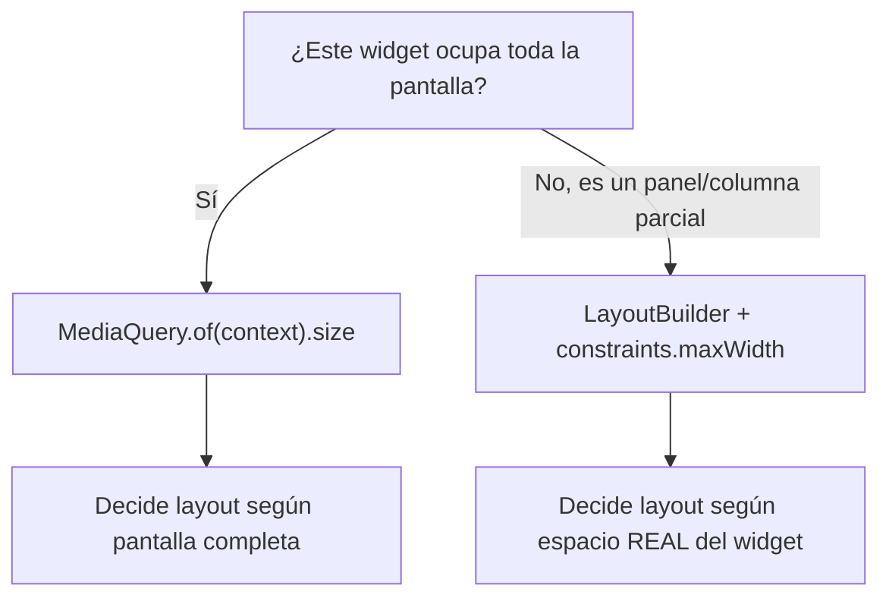
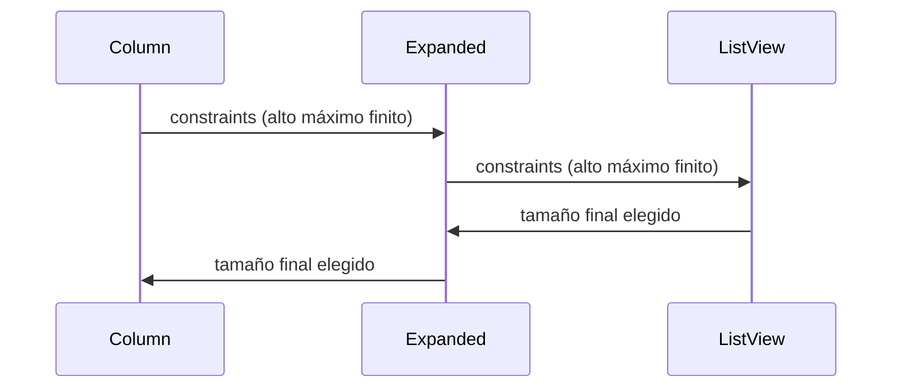
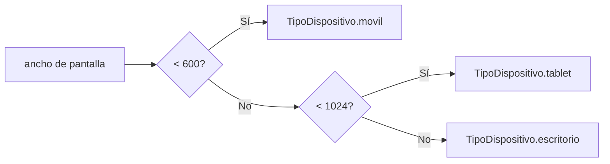

# Módulo 2: Layout y diseño responsive


## Aprende construyendo


### Tema 1: MediaQuery vs LayoutBuilder · Intermedio · 35 min

<details open>
<summary><strong>Capa 1 — Lectura</strong></summary>

#### ► DE QUÉ TRATA
Al finalizar vas a decidir el layout de PanelEnvios usando LayoutBuilder en vez de MediaQuery, porque el panel vive dentro de un Row lateral que no ocupa el ancho completo de la pantalla. Prerrequisitos: Módulo 1 completo.

#### ► LA IDEA EN UNA FRASE
**Al finalizar vas a decidir el layout de PanelEnvios usando LayoutBuilder en vez de MediaQuery, porque el panel vive dentro de un Row lateral que no ocupa el ancho completo de la pantalla.**

#### ► POR QUÉ EXISTE ESTO
Resuelve un problema real de diseño o implementación y evita decisiones a ciegas.

#### ► LA ANALOGÍA
Piensa en mediaquery vs layoutbuilder como una herramienta de taller: útil cuando conoces su propósito y sus límites.
**Dónde se rompe la analogía:** en software, los efectos dependen del contexto, la escala y los trade-offs.

#### ► CÓMO FUNCIONA


#### ► REGLA PRÁCTICA
Usa `MediaQuery` cuando necesites el tamaño de la pantalla completa; usa `LayoutBuilder` cuando el widget vive dentro de otro layout (un panel lateral, una columna parcial) y necesitas el espacio real disponible para ese widget, no el de toda la pantalla.

#### ► LO QUE PUEDE SALIR MAL
| Síntoma | Causa probable | Arreglo |
|---|---|---|
| MediaQuery vs LayoutBuilder se aplica pero el resultado no mejora | Se usó sin medir el problema real | Mide antes y compara contra la alternativa simple |
| Aparece complejidad inesperada | Se adoptó la técnica sin comprender sus trade-offs | Vuelve a la sección de trade-offs y reduce el alcance |
| Falla en un caso límite | Se asumió un contexto que no se cumple | Prueba el caso límite y documenta cuándo NO usarlo |

#### ► TRADE-OFFS
| Opción | Cuándo usarla | Cuándo NO usarla |
|---|---|---|
| Usar MediaQuery vs LayoutBuilder | Cuando el problema coincide con su propósito y el beneficio es observable | Cuando agrega complejidad sin resolver un problema real |
| Alternativa más simple | Cuando el contexto es pequeño, estable o fácil de razonar | Cuando ya demostró no escalar o no cumplir el requisito |
| Postergar la decisión | Cuando falta evidencia del problema | Cuando el costo de esperar es mayor que el costo de probar |

#### ► CUÁNDO NO USAR ESTO
No uses mediaquery vs layoutbuilder por defecto. Aplícalo cuando el problema lo justifique y puedas verificar el beneficio; si una alternativa más simple resuelve igual, prefiérela.

#### ► DE VUELTA A LA ANALOGÍA
Volviendo a la analogía: mediaquery vs layoutbuilder funciona como el modelo inicial, pero recuerda dónde se rompe: en producción importan la evidencia, la escala y el costo de equivocarte.

#### ► LO QUE DEBES RECORDAR
- MediaQuery vs LayoutBuilder existe para resolver un problema específico.
- Mide antes de adoptar complejidad.
- Conoce el caso donde NO usarlo.
- Verifica con evidencia observable.

#### ► PREGUNTAS PARA PENSAR
1. ¿Qué problema concreto resuelve mediaquery vs layoutbuilder en tu contexto?
2. ¿Cómo sabrías que mediaquery vs layoutbuilder no está funcionando bien?
3. ¿Qué alternativa más simple considerarías antes de usar mediaquery vs layoutbuilder?

</details>

<details>
<summary><strong>Capa 2 — Construcción</strong></summary>

#### Código y verificación
```dart
final ancho = MediaQuery.of(context).size.width;

LayoutBuilder(builder: (context, constraints) {
  return constraints.maxWidth > 600
      ? Row(children: [Expanded(child: ListaTareas()), Expanded(child: DetalleTarea())])
      : ListaTareas(); // una sola columna en pantallas angostas
});
```

```dart
MediaQuery.sizeOf(context).width       // tamaño de la VENTANA de la app
LayoutBuilder(builder: (context, constraints) => ...)  // espacio disponible para ESTE widget específico
```


```dart
import 'package:flutter/material.dart';

void main() => runApp(const MaterialApp(home: Scaffold(body: PanelEnvios())));

class PanelEnvios extends StatelessWidget {
  const PanelEnvios({super.key});

  @override
  Widget build(BuildContext context) {
    return Row(children: [
      Expanded(
        flex: 1,
        child: LayoutBuilder(builder: (context, constraints) {
          return constraints.maxWidth > 400
              ? const ListaEnviosExpandida()
              : const ListaEnviosCompacta();
        }),
      ),
      const Expanded(flex: 2, child: MapaRuta()),
    ]);
  }
}

class ListaEnviosExpandida extends StatelessWidget {
  const ListaEnviosExpandida({super.key});

  @override
  Widget build(BuildContext context) => ListView(children: const [
        ListTile(title: Text('RF-4471'), subtitle: Text('En ruta · Calle 80 #12-34')),
        ListTile(title: Text('RF-5002'), subtitle: Text('Asignado · Carrera 7 #45-10')),
      ]);
}

class ListaEnviosCompacta extends StatelessWidget {
  const ListaEnviosCompacta({super.key});

  @override
  Widget build(BuildContext context) => ListView(children: const [
        ListTile(dense: true, title: Text('RF-4471')),
        ListTile(dense: true, title: Text('RF-5002')),
      ]);
}

class MapaRuta extends StatelessWidget {
  const MapaRuta({super.key});

  @override
  Widget build(BuildContext context) => const ColoredBox(
        color: Color(0xFFE0E0E0),
        child: Center(child: Text('Mapa de la ruta')),
      );
}
```

```bash
flutter create demo_flutter
cd demo_flutter
flutter run
```

</details>

### Tema 2: Cómo Flutter calcula tamaños · Intermedio · 30 min

<details open>
<summary><strong>Capa 1 — Lectura</strong></summary>

#### ► DE QUÉ TRATA
Al finalizar vas a diagnosticar un error de "unbounded height" en ListaEnvios causado por anidar una Column dentro de otra sin límites, entendiendo el protocolo "constraints go down, sizes go up". Prerrequisitos: Tema 1 de este módulo.

#### ► LA IDEA EN UNA FRASE
**Al finalizar vas a diagnosticar un error de "unbounded height" en ListaEnvios causado por anidar una Column dentro de otra sin límites, entendiendo el protocolo "constraints go down, sizes go up".**

#### ► POR QUÉ EXISTE ESTO
Resuelve un problema real de diseño o implementación y evita decisiones a ciegas.

#### ► LA ANALOGÍA
Piensa en cómo flutter calcula tamaños como una herramienta de taller: útil cuando conoces su propósito y sus límites.
**Dónde se rompe la analogía:** en software, los efectos dependen del contexto, la escala y los trade-offs.

#### ► CÓMO FUNCIONA


#### ► LO QUE PUEDE SALIR MAL
| Síntoma | Causa probable | Arreglo |
|---|---|---|
| Cómo Flutter calcula tamaños se aplica pero el resultado no mejora | Se usó sin medir el problema real | Mide antes y compara contra la alternativa simple |
| Aparece complejidad inesperada | Se adoptó la técnica sin comprender sus trade-offs | Vuelve a la sección de trade-offs y reduce el alcance |
| Falla en un caso límite | Se asumió un contexto que no se cumple | Prueba el caso límite y documenta cuándo NO usarlo |

#### ► TRADE-OFFS
| Opción | Cuándo usarla | Cuándo NO usarla |
|---|---|---|
| Usar Cómo Flutter calcula tamaños | Cuando el problema coincide con su propósito y el beneficio es observable | Cuando agrega complejidad sin resolver un problema real |
| Alternativa más simple | Cuando el contexto es pequeño, estable o fácil de razonar | Cuando ya demostró no escalar o no cumplir el requisito |
| Postergar la decisión | Cuando falta evidencia del problema | Cuando el costo de esperar es mayor que el costo de probar |

#### ► CUÁNDO NO USAR ESTO
No uses cómo flutter calcula tamaños por defecto. Aplícalo cuando el problema lo justifique y puedas verificar el beneficio; si una alternativa más simple resuelve igual, prefiérela.

#### ► DE VUELTA A LA ANALOGÍA
Volviendo a la analogía: cómo flutter calcula tamaños funciona como el modelo inicial, pero recuerda dónde se rompe: en producción importan la evidencia, la escala y el costo de equivocarte.

#### ► LO QUE DEBES RECORDAR
- Cómo Flutter calcula tamaños existe para resolver un problema específico.
- Mide antes de adoptar complejidad.
- Conoce el caso donde NO usarlo.
- Verifica con evidencia observable.

#### ► PREGUNTAS PARA PENSAR
1. ¿Qué problema concreto resuelve cómo flutter calcula tamaños en tu contexto?
2. ¿Cómo sabrías que cómo flutter calcula tamaños no está funcionando bien?
3. ¿Qué alternativa más simple considerarías antes de usar cómo flutter calcula tamaños?

</details>

<details>
<summary><strong>Capa 2 — Construcción</strong></summary>

#### Código y verificación
```
Padre → constraints (min/max ancho, min/max alto) → Hijo
Hijo → tamaño final elegido dentro de esas constraints → Padre
```


```dart
import 'package:flutter/material.dart';

void main() => runApp(const MaterialApp(home: Scaffold(body: SafeArea(child: EnviosDeHoy()))));

class Envio {
  const Envio(this.guia, this.estado);
  final String guia;
  final String estado;
}

final envios = List.generate(30, (i) => Envio('RF-${4400 + i}', i.isEven ? 'En ruta' : 'Asignado'));

class EnviosDeHoy extends StatelessWidget {
  const EnviosDeHoy({super.key});

  @override
  Widget build(BuildContext context) {
    return Column(children: [
      const Text('Envíos de hoy'),
      Expanded(          // da un alto máximo finito al ListView
        child: ListView(children: envios.map((e) => TarjetaEnvio(envio: e)).toList()),
      ),
    ]);
  }
}

class TarjetaEnvio extends StatelessWidget {
  const TarjetaEnvio({required this.envio, super.key});
  final Envio envio;

  @override
  Widget build(BuildContext context) => ListTile(title: Text(envio.guia), subtitle: Text(envio.estado));
}
```

```bash
flutter create demo_flutter
cd demo_flutter
flutter run
```

</details>

### Tema 3: Breakpoints propios y SafeArea · Intermedio · 35 min

<details open>
<summary><strong>Capa 1 — Lectura</strong></summary>

#### ► DE QUÉ TRATA
Al finalizar vas a centralizar la lógica de breakpoints de RutaFlow en una función segunAncho() reutilizable, y a envolver la pantalla principal con SafeArea para proteger el contenido del notch. Prerrequisitos: Tema 2 de este módulo.

#### ► LA IDEA EN UNA FRASE
**Al finalizar vas a centralizar la lógica de breakpoints de RutaFlow en una función segunAncho() reutilizable, y a envolver la pantalla principal con SafeArea para proteger el contenido del notch.**

#### ► POR QUÉ EXISTE ESTO
Resuelve un problema real de diseño o implementación y evita decisiones a ciegas.

#### ► LA ANALOGÍA
Piensa en breakpoints propios y safearea como una herramienta de taller: útil cuando conoces su propósito y sus límites.
**Dónde se rompe la analogía:** en software, los efectos dependen del contexto, la escala y los trade-offs.

#### ► CÓMO FUNCIONA


#### ► LO QUE PUEDE SALIR MAL
| Síntoma | Causa probable | Arreglo |
|---|---|---|
| Breakpoints propios y SafeArea se aplica pero el resultado no mejora | Se usó sin medir el problema real | Mide antes y compara contra la alternativa simple |
| Aparece complejidad inesperada | Se adoptó la técnica sin comprender sus trade-offs | Vuelve a la sección de trade-offs y reduce el alcance |
| Falla en un caso límite | Se asumió un contexto que no se cumple | Prueba el caso límite y documenta cuándo NO usarlo |

#### ► TRADE-OFFS
| Opción | Cuándo usarla | Cuándo NO usarla |
|---|---|---|
| Usar Breakpoints propios y SafeArea | Cuando el problema coincide con su propósito y el beneficio es observable | Cuando agrega complejidad sin resolver un problema real |
| Alternativa más simple | Cuando el contexto es pequeño, estable o fácil de razonar | Cuando ya demostró no escalar o no cumplir el requisito |
| Postergar la decisión | Cuando falta evidencia del problema | Cuando el costo de esperar es mayor que el costo de probar |

#### ► CUÁNDO NO USAR ESTO
No uses breakpoints propios y safearea por defecto. Aplícalo cuando el problema lo justifique y puedas verificar el beneficio; si una alternativa más simple resuelve igual, prefiérela.

#### ► DE VUELTA A LA ANALOGÍA
Volviendo a la analogía: breakpoints propios y safearea funciona como el modelo inicial, pero recuerda dónde se rompe: en producción importan la evidencia, la escala y el costo de equivocarte.

#### ► LO QUE DEBES RECORDAR
- Breakpoints propios y SafeArea existe para resolver un problema específico.
- Mide antes de adoptar complejidad.
- Conoce el caso donde NO usarlo.
- Verifica con evidencia observable.

#### ► PREGUNTAS PARA PENSAR
1. ¿Qué problema concreto resuelve breakpoints propios y safearea en tu contexto?
2. ¿Cómo sabrías que breakpoints propios y safearea no está funcionando bien?
3. ¿Qué alternativa más simple considerarías antes de usar breakpoints propios y safearea?

</details>

<details>
<summary><strong>Capa 2 — Construcción</strong></summary>

#### Código y verificación
```dart
enum TipoDispositivo { movil, tablet, escritorio }

TipoDispositivo segunAncho(double ancho) {
  if (ancho < 600) return TipoDispositivo.movil;
  if (ancho < 1024) return TipoDispositivo.tablet;
  return TipoDispositivo.escritorio;
}
```

```dart
Scaffold(body: SafeArea(child: ContenidoPrincipal()))
```


```dart
import 'package:flutter/material.dart';

enum TipoDispositivo { movil, tablet, escritorio }

TipoDispositivo segunAncho(double ancho) {
  if (ancho < 600) return TipoDispositivo.movil;
  if (ancho < 1024) return TipoDispositivo.tablet;
  return TipoDispositivo.escritorio;
}

void main() => runApp(const MaterialApp(home: Scaffold(body: SafeArea(child: PanelEnvios()))));

class PanelEnvios extends StatelessWidget {
  const PanelEnvios({super.key});

  @override
  Widget build(BuildContext context) {
    return LayoutBuilder(builder: (context, constraints) {
      final tipo = segunAncho(constraints.maxWidth);
      final columnas = switch (tipo) {
        TipoDispositivo.movil => 1,
        TipoDispositivo.tablet => 2,
        TipoDispositivo.escritorio => 3,
      };
      return Column(crossAxisAlignment: CrossAxisAlignment.stretch, children: [
        Text('Dispositivo: ${tipo.name} · $columnas columna(s)'),
        Expanded(
          child: GridView.count(
            crossAxisCount: columnas,
            children: [
              for (var i = 1; i <= 6; i++) Card(child: Center(child: Text('RF-440$i'))),
            ],
          ),
        ),
      ]);
    });
  }
}
```

```bash
flutter create demo_flutter
cd demo_flutter
flutter run
```

</details>
