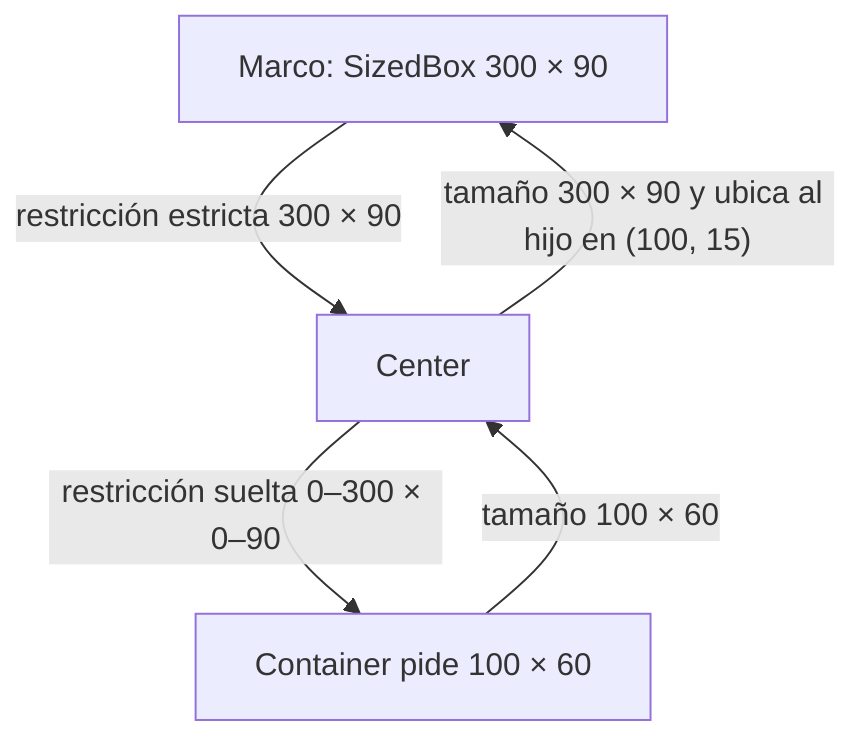
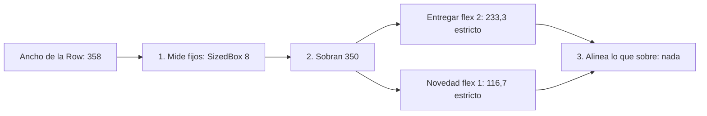
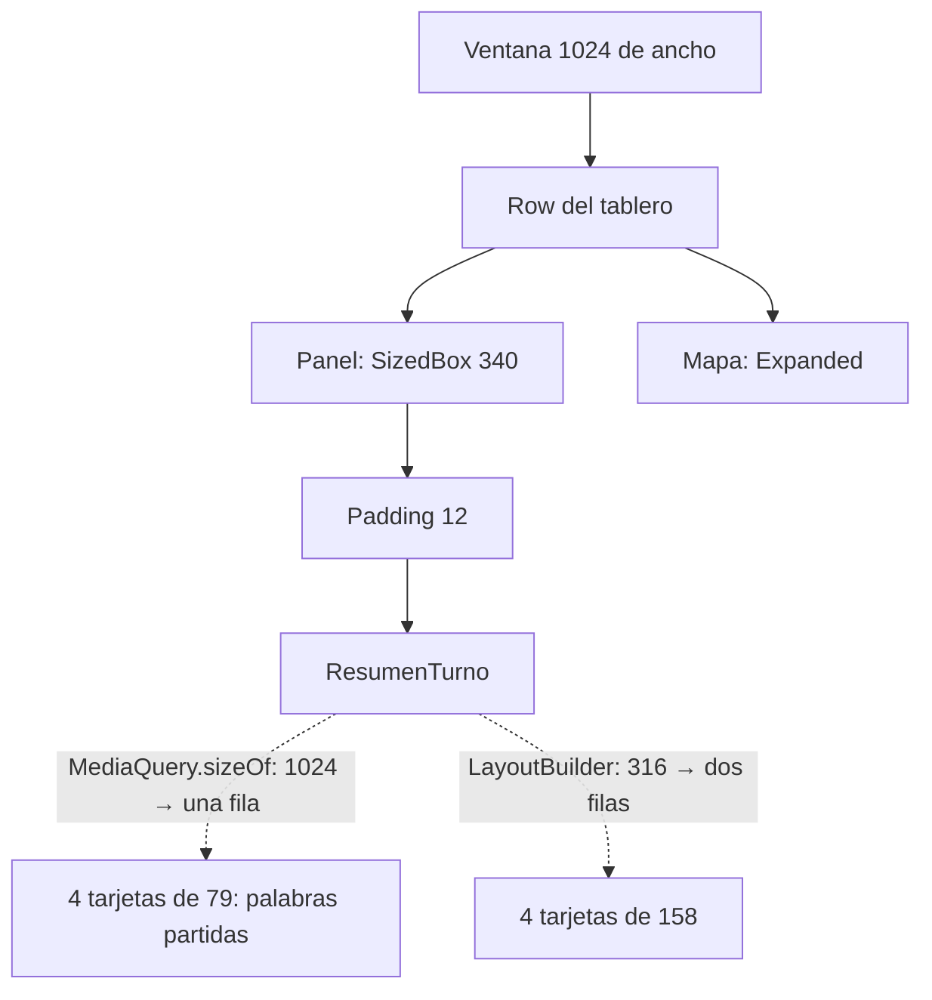
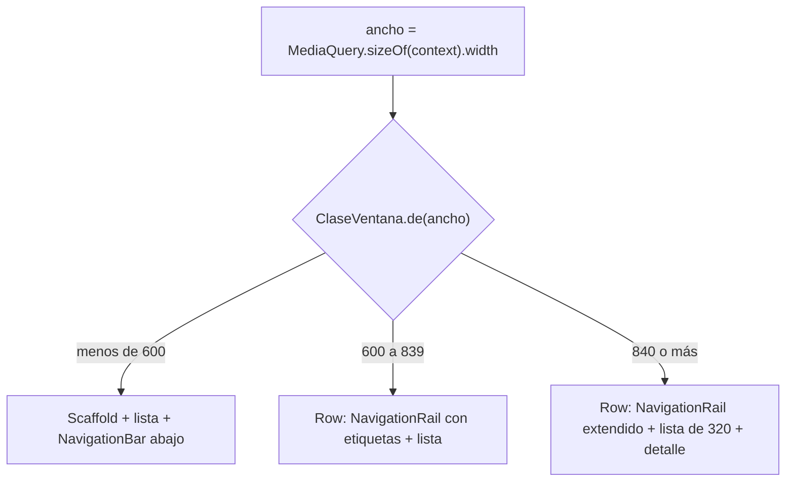
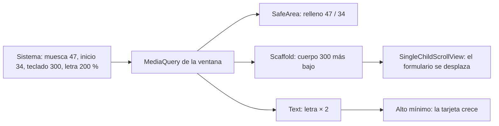
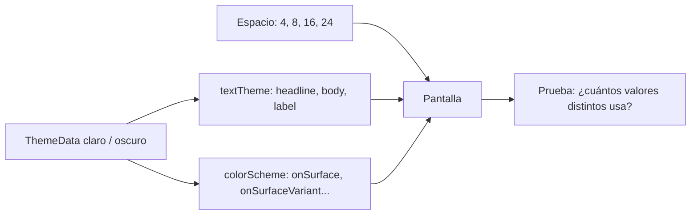

# Módulo 2: Maquetación responsive y diseño: restricciones, tamaños de ventana y sistema de diseño

**Entorno comprobado para esta edición (2026-11-24):** Flutter 3.50.1 (canal estable) con Dart 3.14.0 en Linux
x86_64, con el paquete `material_ui` 1.1. Todo el código se analizó con `flutter analyze` (`No issues found!`) y se
ejecutó con `flutter test` ese día, en `/home/estudiante/labs/flutter/m2` (tu `~/labs/flutter/m2`). **Los pantallazos
los dibujó Flutter** con la misma herramienta del Módulo 1 (`test/pantallazo.dart`); los de pantallas anchas usan
densidad 1 para que la imagen no sea enorme. Las salidas de texto son literales; los tiempos (`00:01`) y los números
con decimales largos pueden variar en el último dígito en tu equipo.

Una pantalla bien diseñada se ve bien en el teléfono del conductor, en la tableta del supervisor y en el computador
del despachador, con letra grande, con la muesca del teléfono y con el teclado abierto. Para lograrlo no basta con
saber qué widgets existen: hay que entender cómo Flutter decide el tamaño de cada caja, cómo cambiar la estructura
según el espacio disponible y cómo mantener la coherencia visual con una escala de espacios, de letra y de color. Este
módulo enseña las tres cosas, siempre con el pantallazo del resultado.

**Al terminar este módulo podrás:**
- predecir el tamaño de un widget a partir de las restricciones que recibe y corregir los dos errores de maquetación
  más comunes (desborde y altura sin límite);
- repartir el espacio de una `Row` o `Column` con alineaciones, `Expanded`, `Flexible`, `flex` y `Spacer`;
- elegir entre `MediaQuery` y `LayoutBuilder` según quién decide el espacio;
- adaptar una pantalla a las tres clases de tamaño de ventana de Material 3 con `NavigationBar` y `NavigationRail`;
- respetar la muesca, el teclado y el tamaño de letra que eligió el usuario;
- aplicar una escala de espacios, los estilos de texto y los roles de color del tema, y comprobarlo con una auditoría
  automática;
- construir una pantalla de detalle que funcione en tres tamaños, en modo claro y oscuro.

**Esquema del módulo:** Tema 1 (restricciones) → Tema 2 (`Row` y `Column` a fondo) → Tema 3 (`MediaQuery` y
`LayoutBuilder`) → Tema 4 (tamaños de ventana y navegación adaptable) → Tema 5 (muesca, teclado y texto grande) →
Tema 6 (sistema de diseño) → Proyecto 19.

**Qué necesitas saber antes:** el Módulo 1 completo, en especial **`Row`, `Column`, `Expanded` y el desborde**
(Temas 2 y 3), **`StatefulWidget`** (Tema 4) y **restricciones** (Tema 6). Del Módulo 0, **records y patrones**
(Tema 6), que se usan para recorrer listas de pares.

**Qué no se repite:** cómo crear el proyecto y la herramienta de pantallazos están en el Módulo 1 («Prepara el
proyecto una vez»); el árbol de render se explicó en el Módulo 1, Tema 6. Los temas (`ThemeData`) completos, el modo
oscuro configurable y la accesibilidad con `Semantics` se estudian en el Módulo 10; aquí se usan solo los estilos y
colores que trae el tema por defecto.

**Prepara el proyecto.** Igual que en el Módulo 1:

```text
$ cd ~/labs/flutter
$ flutter create --org com.academia --platforms=web,linux --empty m2
$ cd m2
```

Copia `test/pantallazo.dart` del Módulo 1. Al final del módulo, `lib/main.dart` abre la pantalla adaptable del
Tema 4: con `flutter run -d chrome` puedes estirar la ventana del navegador y ver cómo cambia el diseño.

```dart
// lib/main.dart — abre la pantalla adaptable del Tema 4; cambia el tamaño de la ventana para ver los tres diseños
import 'package:material_ui/material_ui.dart';

import 'tema4/adaptable.dart';

void main() => runApp(
      MaterialApp(
        debugShowCheckedModeBanner: false,
        theme: ThemeData(colorSchemeSeed: Colors.indigo),
        darkTheme: ThemeData(colorSchemeSeed: Colors.indigo, brightness: Brightness.dark),
        home: const PantallaEntregas(),
      ),
    );
```


## Aprende construyendo


### Tema 1: Restricciones: cómo decide Flutter el tamaño de cada caja · Intermedio · 50 min

<details open>
<summary><strong>Capa 1 — Lectura</strong></summary>

#### Objetivos
Al terminar este tema podrás:
- enunciar la regla de la maquetación de Flutter: las restricciones bajan, los tamaños suben, el padre ubica;
- distinguir una restricción estricta de una suelta y de una sin límite, y reconocer cuál recibe un widget;
- explicar por qué un `Container(width: 100)` a veces mide 300;
- corregir el error «Vertical viewport was given unbounded height».

**Conceptos clave:** restricción estricta, restricción suelta, restricción sin límite, `ConstrainedBox`,
`LayoutBuilder`, *viewport*

#### El problema
Pides un recuadro de 100 × 60 y Flutter dibuja uno de 300 × 90. Pones una lista debajo de un encabezado y la pantalla
queda en blanco con un error rojo. Los dos casos tienen la misma causa: el tamaño de un widget no lo decide solo él;
lo decide junto con su padre, y quien no conoce esa negociación diseña a prueba y error.

Este tema usa las **restricciones** y el **árbol de render** (Módulo 1, Tema 6) y **`Expanded`** (Módulo 1, Tema 3).

#### Glosario del tema

**restricción estricta**
- **Definición técnica:** `BoxConstraints` cuyo mínimo y máximo coinciden en una dimensión (o en las dos); el hijo no tiene más opción que ese tamaño.
- **En palabras sencillas:** «mides exactamente esto».
- **Dónde se rompe la comparación:** puede ser estricta solo en una dimensión, por ejemplo el ancho de un botón dentro de un `Expanded`.
- **Ejemplo:** `BoxConstraints(w=300.0, h=90.0)`: el Medidor 1 pidió 100 × 60 y midió 300 × 90.
- **Error típico:** fijar `width` y `height` en un hijo de una restricción estricta y pensar que Flutter los ignora «por un error».

**restricción suelta**
- **Definición técnica:** restricción con mínimo 0 y un máximo finito; el hijo elige cualquier tamaño hasta el máximo.
- **En palabras sencillas:** «mide lo que quieras, hasta aquí».
- **Dónde se rompe la comparación:** el hijo no puede pasarse del máximo aunque lo pida; Flutter lo recorta a ese valor.
- **Ejemplo:** `Center` convierte 300 × 90 estricto en `0.0<=w<=300.0, 0.0<=h<=90.0`.
- **Error típico:** usar `Center` o `Align` solo para centrar, sin notar que también liberan el tamaño del hijo.

**restricción sin límite**
- **Definición técnica:** restricción cuyo máximo es infinito en una dimensión; la reciben, por ejemplo, los hijos de una `Row` en el ancho y los de una lista en el alto.
- **En palabras sencillas:** «tienes todo el espacio que quieras»; y entonces el hijo debe saber cuánto quiere.
- **Dónde se rompe la comparación:** un widget que quiere ocupar todo (una lista, un `Expanded` mal puesto) no puede ocupar infinito, y falla.
- **Ejemplo:** `0.0<=w<=Infinity` en el caso 4 de la galería.
- **Error típico:** poner un `ListView` dentro de una `Column` sin darle una altura.

**`ConstrainedBox`**
- **Definición técnica:** widget que combina sus propias restricciones con las que recibe y entrega el resultado a su hijo.
- **En palabras sencillas:** un tope o un piso adicional.
- **Dónde se rompe la comparación:** no puede ampliar lo que el padre prohibió: dentro de una restricción estricta no hace nada.
- **Ejemplo:** `BoxConstraints(maxWidth: 160)` limita a 160 un hijo que pide 250.
- **Error típico:** usarlo para dar un tamaño mínimo y olvidar que en un padre estricto ese mínimo no se aplica.

**`LayoutBuilder`**
- **Definición técnica:** widget que llama a su función `builder` durante la maquetación, con las restricciones que recibió, para construir su hijo según ellas.
- **En palabras sencillas:** pregunta «¿cuánto espacio me dieron?» antes de decidir qué mostrar.
- **Dónde se rompe la comparación:** conoce el espacio disponible, no el tamaño final de sus hermanos.
- **Ejemplo:** el `Medidor` de este tema escribe dentro las restricciones que recibió.
- **Error típico:** leer `constraints.maxWidth` cuando vale infinito (dentro de una `Row`) y usarlo como ancho.

***viewport***
- **Definición técnica:** objeto de render de las listas y vistas desplazables (`RenderViewport`) que muestra una ventana de un contenido más largo; necesita un tamaño finito en el eje de desplazamiento.
- **En palabras sencillas:** la ventanilla por la que se ve una parte de la lista.
- **Dónde se rompe la comparación:** la ventanilla necesita medidas; si el padre le dice «lo que quieras», no tiene cómo decidir.
- **Ejemplo:** `Vertical viewport was given unbounded height.`
- **Error típico:** «arreglarlo» con `shrinkWrap: true`, que construye todas las filas y pierde la ventaja del Módulo 1, Tema 5.

#### ► CÓMO FUNCIONA
La maquetación recorre el árbol de render una vez: cada padre entrega restricciones a su hijo, el hijo elige un tamaño
dentro de ellas y lo devuelve, y el padre decide dónde ubicarlo. El hijo nunca elige su posición, y nunca puede
salirse de las restricciones.



#### Problema resuelto 1.1
Haz una galería que muestre, para cuatro padres distintos, qué restricciones recibe una caja y cuánto mide. Después
provoca y corrige el error de una lista dentro de una columna.

**Razonamiento:**
1. `Medidor` es una caja de color con un `LayoutBuilder` que escribe dentro las restricciones recibidas.
2. Cada caso pone el `Medidor` en un marco de 300 × 90 (estricto) y cambia lo que hay en medio: nada, `Center`,
   `Center` con `ConstrainedBox`, y una `Row`.
3. La prueba lee el `RenderBox` de cada medidor: sus restricciones y su tamaño.
4. Para el error de la lista, la prueba junta los mensajes de `FlutterError.onError` en lugar de dejarlos imprimir.

```dart
// lib/tema1/restricciones.dart — las restricciones bajan, los tamaños suben, el padre ubica
import 'package:material_ui/material_ui.dart';

String _n(double v) => v.isInfinite ? '∞' : v.toStringAsFixed(0);
String _rango(double min, double max) => min == max ? _n(min) : '${_n(min)}–${_n(max)}';

/// Caja de color que escribe dentro las restricciones que recibió de su padre.
class Medidor extends StatelessWidget {
  const Medidor({super.key, this.ancho, this.alto, required this.color});
  final double? ancho;
  final double? alto;
  final Color color;

  @override
  Widget build(BuildContext context) {
    return LayoutBuilder(
      builder: (context, c) => Container(
        width: ancho,
        height: alto,
        color: color,
        padding: const EdgeInsets.all(6),
        child: Text(
          'recibe ${_rango(c.minWidth, c.maxWidth)} × ${_rango(c.minHeight, c.maxHeight)}',
          style: const TextStyle(color: Colors.white, fontSize: 11),
        ),
      ),
    );
  }
}

/// Un caso de la galería: título y un marco gris de 300 × 90 que hace de padre.
class Caso extends StatelessWidget {
  const Caso(this.titulo, this.contenido, {super.key});
  final String titulo;
  final Widget contenido;

  @override
  Widget build(BuildContext context) {
    return Padding(
      padding: const EdgeInsets.fromLTRB(16, 12, 16, 0),
      child: Column(
        crossAxisAlignment: CrossAxisAlignment.start,
        children: [
          Text(titulo, style: Theme.of(context).textTheme.labelLarge),
          const SizedBox(height: 6),
          DecoratedBox(
            decoration: BoxDecoration(border: Border.all(color: Colors.grey.shade400)),
            child: SizedBox(width: 300, height: 90, child: contenido),
          ),
        ],
      ),
    );
  }
}

class GaleriaRestricciones extends StatelessWidget {
  const GaleriaRestricciones({super.key});

  @override
  Widget build(BuildContext context) {
    return Column(
      crossAxisAlignment: CrossAxisAlignment.start,
      children: [
        const Caso('1. Padre estricto: pide 100 × 60 y mide 300 × 90',
            Medidor(key: Key('c1'), ancho: 100, alto: 60, color: Colors.indigo)),
        const Caso('2. Center afloja: ahora sí mide 100 × 60',
            Center(child: Medidor(key: Key('c2'), ancho: 100, alto: 60, color: Colors.teal))),
        Caso('3. ConstrainedBox pone un tope de 160 de ancho',
            Center(                                    // ConstrainedBox no es const: valida sus límites
              child: ConstrainedBox(
                constraints: const BoxConstraints(maxWidth: 160),
                child: const Medidor(key: Key('c3'), ancho: 250, alto: 60, color: Colors.deepOrange),
              ),
            )),
        const Caso('4. Row: el ancho no tiene límite',
            Row(children: [Medidor(key: Key('c4'), ancho: 200, alto: 60, color: Colors.purple)])),
      ],
    );
  }
}

/// Una lista dentro de una columna: el error más común de maquetación en Flutter.
class ListaEnColumna extends StatelessWidget {
  const ListaEnColumna({super.key, required this.corregida});
  final bool corregida;

  @override
  Widget build(BuildContext context) {
    final lista = ListView(children: [for (var i = 1; i <= 20; i++) ListTile(title: Text('EN-${4470 + i}'))]);
    return Column(
      children: [
        const ListTile(title: Text('Paradas de hoy'), subtitle: Text('20 entregas')),
        corregida ? Expanded(child: lista) : lista,          // Expanded le da una altura con límite
      ],
    );
  }
}
```

```dart
import 'package:flutter_test/flutter_test.dart';
import 'package:m2/tema1/restricciones.dart';
import 'package:material_ui/material_ui.dart';

import 'pantallazo.dart';

Widget lienzo(Widget cuerpo, {String titulo = 'Restricciones'}) => MaterialApp(
      debugShowCheckedModeBanner: false,
      theme: ThemeData(colorSchemeSeed: Colors.indigo),
      home: Scaffold(appBar: AppBar(title: Text(titulo)), body: cuerpo),
    );

void main() {
  setUpAll(cargarFuentes);

  testWidgets('galería de restricciones', (tester) async {
    tamanoPantalla(tester, tamano: const Size(390, 600));
    await tester.pumpWidget(lienzo(const GaleriaRestricciones()));
    for (final caso in ['c1', 'c2', 'c3', 'c4']) {
      final caja = tester.renderObject<RenderBox>(find.byKey(Key(caso)));
      debugPrint('$caso: recibe ${caja.constraints}, mide ${caja.size}');
    }
    await pantallazo('m2-t1-galeria');
  });

  testWidgets('ListView dentro de Column, sin corregir', (tester) async {
    final errores = <String>[];
    final anterior = FlutterError.onError;
    FlutterError.onError = (d) => errores.add(d.exceptionAsString().split('\n').first);   // junta los mensajes
    await tester.pumpWidget(lienzo(const ListaEnColumna(corregida: false)));
    FlutterError.onError = anterior;
    debugPrint('errores: ${errores.length}; el primero: ${errores.first}');
  });

  testWidgets('ListView dentro de Column, con Expanded', (tester) async {
    tamanoPantalla(tester, tamano: const Size(390, 400));
    await tester.pumpWidget(lienzo(const ListaEnColumna(corregida: true)));
    final lista = tester.renderObject<RenderBox>(find.byType(ListView));
    debugPrint('con Expanded: la lista mide ${lista.size}');
    await pantallazo('m2-t1-lista-expanded');
  });
}
```

```text
$ flutter test test/tema1_test.dart
00:00 +0: loading /home/estudiante/labs/flutter/m2/test/tema1_test.dart
00:00 +0: (setUpAll)
00:00 +0: galería de restricciones
c1: recibe BoxConstraints(w=300.0, h=90.0), mide Size(300.0, 90.0)
c2: recibe BoxConstraints(0.0<=w<=300.0, 0.0<=h<=90.0), mide Size(100.0, 60.0)
c3: recibe BoxConstraints(0.0<=w<=160.0, 0.0<=h<=90.0), mide Size(160.0, 60.0)
c4: recibe BoxConstraints(0.0<=w<=Infinity, 0.0<=h<=90.0), mide Size(200.0, 60.0)
00:00 +1: ListView dentro de Column, sin corregir
errores: 14; el primero: Vertical viewport was given unbounded height.
00:00 +2: ListView dentro de Column, con Expanded
con Expanded: la lista mide Size(390.0, 272.0)
00:00 +3: (tearDownAll)
00:00 +3: All tests passed!
```


**Explicación por partes.**
- Caso 1 (líneas 64–65): el marco es estricto, así que el `Container` mide 300 × 90 aunque pidió 100 × 60. El
  `Container` no se equivocó: no tenía opción.
- Caso 2 (líneas 66–67): `Center` recibe 300 × 90 estricto, mide eso, y entrega a su hijo una restricción suelta.
  Ahora sí cuenta el `width: 100`.
- Caso 3 (líneas 68–74): el hijo pide 250, pero el tope es 160; mide 160. El texto lo confirma: `0–160`.
- Caso 4 (líneas 75–76): una `Row` no limita el ancho de sus hijos (`0–∞`) porque primero los mide y después reparte;
  el alto sí queda limitado a 90.
- La lista en columna produce 14 errores; el primero es la causa y los demás son consecuencias (cajas que no se
  pudieron maquetar). Lee siempre el primero.
- Con `Expanded` (línea 93) la lista recibe el alto que sobra: 400 de pantalla − 56 de la barra superior − 72 del
  encabezado = 272.

> **Error común.** «Arreglar» la lista en columna con `shrinkWrap: true`. Funciona con 20 filas, pero obliga a
> construirlas todas para medirlas; con 1000 entregas la pantalla se vuelve lenta. Usa `Expanded` o un alto fijo.

> **Error común.** Poner `Expanded` fuera de una `Row`, `Column` o `Flex`. Flutter lanza `Incorrect use of
> ParentDataWidget`: `Expanded` le habla a su padre flexible, y sin él no tiene a quién.

> **Buena práctica.** Cuando un tamaño te sorprenda, envuelve el widget en un `LayoutBuilder` temporal (como el
> `Medidor`) o usa el Widget Inspector de DevTools, que muestra las restricciones de cada caja.

> **Prevenir errores.** En las pruebas de pantallas, agrega `expect(tester.takeException(), isNull)`: un desborde o un
> error de maquetación hace fallar la prueba en lugar de pasar en silencio.

#### Checkpoint 1.1
En el caso 2, si quitas `alto: 60` del `Medidor`, ¿cuánto mide de alto?

Respuesta: el alto del texto más el relleno de 6 arriba y abajo. Sin alto propio, un `Container` con hijo se ajusta al
hijo, y la restricción suelta lo permite.

</details>

<details>
<summary><strong>Capa 2 — Construcción</strong></summary>

#### Paso 1 · Crea los archivos
Crea `lib/tema1/restricciones.dart` y `test/tema1_test.dart`.

#### Paso 2 · Genera el pantallazo
Ejecuta `flutter test --update-goldens test/tema1_test.dart` y abre `test/pantallazos/m2-t1-galeria.png`.

#### Paso 3 · Agrega un caso
Agrega un quinto caso con `Align(alignment: Alignment.bottomRight, child: Medidor(...))` y predice qué recibe antes de
ejecutar.

#### Paso 4 · Prueba un piso
Cambia el caso 3 por `BoxConstraints(minWidth: 200)` y un `Medidor` con `ancho: 100`. ¿Cuánto mide?

#### Paso 5 · Mira el error completo
En la prueba sin corregir, quita el `FlutterError.onError` y lee el mensaje completo de Flutter, incluida la parte que
sugiere soluciones.

#### Resumen
- Las restricciones bajan, los tamaños suben, el padre ubica.
- Una **restricción estricta** no deja opción; una **restricción suelta** deja elegir hasta un máximo; una
  **restricción sin límite** obliga al hijo a saber cuánto quiere.
- **`ConstrainedBox`** agrega topes y pisos; **`LayoutBuilder`** permite decidir según el espacio recibido.
- Un ***viewport*** necesita alto finito: dentro de una `Column`, usa `Expanded`.

#### Ejercicio verificable 1
Básico. ¿Qué restricciones recibe un `Medidor` puesto directamente como `body` de un `Scaffold` de 390 × 600 con barra
superior de 56?

Respuesta esperada: una restricción suelta, `BoxConstraints(0.0<=w<=390.0, 0.0<=h<=544.0)`: el `Scaffold` resta la
barra superior y deja elegir al cuerpo. Por eso un `Container` sin tamaño en el cuerpo se ajusta a su contenido.

#### Ejercicio verificable 2
Intermedio. Con el Paso 4, ¿cuánto mide el `Medidor` y por qué?

Respuesta esperada: 200 de ancho. `ConstrainedBox` exige un mínimo de 200 y el `Container` pidió 100; Flutter lleva
el pedido al rango permitido, que es de 200 a 300.

#### Ejercicio verificable 3
Reto. Escribe una prueba que ponga `const Row(children: [Expanded(child: Text('a')), Expanded(child: Text('b'))])`
dentro de una `Row` y lee el error.

Respuesta esperada: `RenderFlex children have non-zero flex but incoming width constraints are unbounded.` La `Row`
externa da ancho infinito a la interna, y la interna no puede repartir infinito entre sus `Expanded`. Se corrige
envolviendo la `Row` interna en `Expanded`.

#### En el trabajo
La mayoría de los errores rojos que ve un equipo de Flutter en sus primeras semanas son de restricciones: listas en
columnas, `Row` dentro de `Row`, textos que desbordan. En una revisión de código se pregunta: «¿qué restricción recibe
este widget?», y quien sabe responder corrige en minutos lo que otros arreglan con `shrinkWrap` y tamaños fijos.

</details>

### Tema 2: Row y Column a fondo: alinear y repartir el espacio · Básico · 40 min

<details open>
<summary><strong>Capa 1 — Lectura</strong></summary>

#### Objetivos
Al terminar este tema podrás:
- alinear los hijos de una `Row` o `Column` con `mainAxisAlignment` y `crossAxisAlignment`;
- elegir entre `Expanded` y `Flexible` según si el hijo debe ocupar todo el espacio o solo el que necesita;
- repartir el espacio en proporciones con `flex` y separar con `Spacer`;
- medir en una prueba dónde quedó y cuánto mide cada hijo.

**Conceptos clave:** eje principal, eje cruzado, `mainAxisAlignment`, `Flexible`, factor `flex`, `Spacer`

#### El problema
En el Módulo 1 la tarjeta usaba `Expanded` para que la dirección no empujara el estado fuera de la pantalla. Pero en
otras filas el ícono de «copiar» debe quedar pegado al texto y no al borde, los botones deben tener anchos
proporcionales y las etiquetas deben separarse a los extremos. ¿Qué herramienta corresponde a cada caso?

Este tema usa **restricción sin límite** (Tema 1) y **`Expanded`** (Módulo 1, Tema 3).

#### Glosario del tema

**eje principal**
- **Definición técnica:** dirección en la que una `Row` (horizontal) o `Column` (vertical) coloca a sus hijos; el **eje cruzado** es el perpendicular.
- **En palabras sencillas:** la dirección de la fila de personas; el eje cruzado es su estatura.
- **Dónde se rompe la comparación:** cambia con el widget: el eje principal de una `Column` es el vertical.
- **Ejemplo:** en `Row`, `mainAxisAlignment` mueve en horizontal y `crossAxisAlignment` en vertical.
- **Error típico:** usar `mainAxisAlignment.center` en una `Column` para centrar en horizontal; corresponde a `crossAxisAlignment`.

**`mainAxisAlignment`**
- **Definición técnica:** cómo distribuye una `Row` o `Column` el espacio que sobra en el eje principal: `start`, `end`, `center`, `spaceBetween`, `spaceAround`, `spaceEvenly`.
- **En palabras sencillas:** dónde va el espacio vacío.
- **Dónde se rompe la comparación:** si un hijo es `Expanded`, no sobra espacio y la alineación no tiene efecto.
- **Ejemplo:** `spaceBetween` pone A y C en los bordes y B al centro.
- **Error típico:** esperar que `spaceBetween` funcione en una `Row` con `mainAxisSize.min`: no hay espacio de sobra que repartir.

**`Flexible`**
- **Definición técnica:** envoltura que da a su hijo una parte del espacio sobrante con restricción suelta (`FlexFit.loose`): puede ocupar menos.
- **En palabras sencillas:** «puedes usar hasta esto»; `Expanded` dice «usa exactamente esto».
- **Dónde se rompe la comparación:** `Expanded` es un `Flexible` con `fit: FlexFit.tight`.
- **Ejemplo:** con `Flexible`, el ícono queda en x=121, justo después del texto; con `Expanded`, en x=356.
- **Error típico:** usar `Expanded` para un texto que debe quedar junto a un ícono; el ícono termina en el borde.

**factor `flex`**
- **Definición técnica:** entero que indica qué proporción del espacio sobrante recibe cada hijo flexible.
- **En palabras sencillas:** cuántas porciones del pastel le tocan.
- **Dónde se rompe la comparación:** se reparte solo lo que sobra después de los hijos de tamaño fijo, como el `SizedBox` de 8.
- **Ejemplo:** `flex: 2` y `flex: 1` sobre 350 puntos: 233,3 y 116,7.
- **Error típico:** calcular con el ancho de la pantalla en lugar del espacio que realmente sobra.

**`Spacer`**
- **Definición técnica:** widget vacío equivalente a `Expanded(child: SizedBox.shrink())`; ocupa el espacio sobrante.
- **En palabras sencillas:** un resorte que empuja a los vecinos hacia los extremos.
- **Dónde se rompe la comparación:** como cualquier `Expanded`, necesita espacio finito: dentro de un `ListView` horizontal falla.
- **Ejemplo:** `Row(children: [Text('EN-4471'), Spacer(), Bloque('Urgente')])`.
- **Error típico:** usar varios `SizedBox` de ancho «a ojo» para empujar, que se rompen al cambiar el ancho de pantalla.

#### ► CÓMO FUNCIONA
Una `Row` maqueta en dos pasadas. Primero mide a los hijos que no son flexibles, con ancho sin límite. Después reparte
lo que sobra entre los flexibles según su `flex`: a los `Expanded` les entrega una porción estricta y a los
`Flexible` una suelta. Por último aplica `mainAxisAlignment` al espacio que quedó libre.



#### Problema resuelto 2.1
Arma una galería con los casos típicos de una fila: tres alineaciones, `Flexible` contra `Expanded`, un texto largo y
dos botones en proporción 2:1. Mide en la prueba dónde quedó cada ícono y cuánto mide cada botón.

**Razonamiento:**
1. `Bloque` es una etiqueta de color para ver claramente el espacio vacío.
2. Las tres alineaciones se generan con un `for` dentro de la lista de hijos.
3. Las dos filas de dirección son iguales salvo `Flexible` o `Expanded`, con keys para encontrarlas en la prueba.
4. `tester.getTopLeft` y `tester.getSize` dan la posición y el tamaño ya maquetados.

```dart
// lib/tema2/flex.dart — cómo reparte el espacio una Row: alineación, Expanded, Flexible, flex y Spacer
import 'package:material_ui/material_ui.dart';

class Bloque extends StatelessWidget {
  const Bloque(this.texto, {super.key, this.color = Colors.indigo});
  final String texto;
  final Color color;

  @override
  Widget build(BuildContext context) => Container(
        padding: const EdgeInsets.symmetric(horizontal: 10, vertical: 6),
        decoration: BoxDecoration(color: color, borderRadius: BorderRadius.circular(6)),
        child: Text(texto, style: const TextStyle(color: Colors.white)),
      );
}

class _Titulo extends StatelessWidget {
  const _Titulo(this.texto);
  final String texto;

  @override
  Widget build(BuildContext context) => Padding(
        padding: const EdgeInsets.only(top: 14, bottom: 6),
        child: Text(texto, style: Theme.of(context).textTheme.labelLarge),
      );
}

class GaleriaFlex extends StatelessWidget {
  const GaleriaFlex({super.key});

  @override
  Widget build(BuildContext context) {
    const direccion = 'Calle 80 # 68-45, bodega 3, interior 2, frente a la portería';
    return Padding(
      padding: const EdgeInsets.symmetric(horizontal: 16),
      child: Column(
        crossAxisAlignment: CrossAxisAlignment.start,
        children: [
          for (final alineacion in [MainAxisAlignment.start, MainAxisAlignment.spaceBetween, MainAxisAlignment.spaceEvenly]) ...[
            _Titulo('mainAxisAlignment: ${alineacion.name}'),
            Container(
              color: Colors.grey.shade200,
              child: Row(
                mainAxisAlignment: alineacion,
                children: const [Bloque('A'), Bloque('B'), Bloque('C')],
              ),
            ),
          ],
          const _Titulo('Flexible: el ícono va justo después del texto'),
          const Row(
            key: Key('flexible'),
            children: [
              Flexible(child: Text('Calle 80 # 68-45', overflow: TextOverflow.ellipsis)),
              Icon(Icons.copy, size: 18),
            ],
          ),
          const _Titulo('Expanded: el texto ocupa todo y el ícono va al final'),
          const Row(
            key: Key('expanded'),
            children: [
              Expanded(child: Text('Calle 80 # 68-45', overflow: TextOverflow.ellipsis)),
              Icon(Icons.copy, size: 18),
            ],
          ),
          const _Titulo('Texto largo: Flexible lo corta con «…»'),
          const Row(
            children: [
              Flexible(child: Text(direccion, overflow: TextOverflow.ellipsis)),
              Icon(Icons.copy, size: 18),
            ],
          ),
          const _Titulo('Spacer separa; flex 2:1 reparte'),
          const Row(children: [Text('EN-4471'), Spacer(), Bloque('Urgente', color: Colors.red)]),
          const SizedBox(height: 10),
          Row(
            children: [
              Expanded(
                flex: 2,
                child: FilledButton(key: const Key('entregar'), onPressed: () {}, child: const Text('Entregar')),
              ),
              const SizedBox(width: 8),
              Expanded(
                child: OutlinedButton(key: const Key('novedad'), onPressed: () {}, child: const Text('Novedad')),
              ),
            ],
          ),
        ],
      ),
    );
  }
}
```

```dart
import 'package:flutter_test/flutter_test.dart';
import 'package:m2/tema2/flex.dart';
import 'package:material_ui/material_ui.dart';

import 'pantallazo.dart';

void main() {
  setUpAll(cargarFuentes);

  testWidgets('cómo reparte el espacio una Row', (tester) async {
    tamanoPantalla(tester, tamano: const Size(390, 600));
    await tester.pumpWidget(MaterialApp(
      debugShowCheckedModeBanner: false,
      theme: ThemeData(colorSchemeSeed: Colors.indigo),
      home: Scaffold(appBar: AppBar(title: const Text('Row y Column')), body: const GaleriaFlex()),
    ));
    double ancho(Finder f) => tester.getSize(f).width;
    final iconoFlexible = find.descendant(of: find.byKey(const Key('flexible')), matching: find.byType(Icon));
    final iconoExpanded = find.descendant(of: find.byKey(const Key('expanded')), matching: find.byType(Icon));
    debugPrint('ícono con Flexible empieza en x=${tester.getTopLeft(iconoFlexible).dx}');
    debugPrint('ícono con Expanded empieza en x=${tester.getTopLeft(iconoExpanded).dx}');
    debugPrint('Entregar mide ${ancho(find.byKey(const Key('entregar')))}, '
        'Novedad mide ${ancho(find.byKey(const Key('novedad')))}');
    expect(tester.takeException(), isNull);
    await pantallazo('m2-t2-flex');
  });
}
```

```text
$ flutter test test/tema2_test.dart
00:00 +0: loading /home/estudiante/labs/flutter/m2/test/tema2_test.dart
00:00 +0: (setUpAll)
00:00 +0: cómo reparte el espacio una Row
ícono con Flexible empieza en x=120.9873046875
ícono con Expanded empieza en x=356.0
Entregar mide 233.33333333333334, Novedad mide 116.66666666666667
00:00 +1: (tearDownAll)
00:00 +1: All tests passed!
```


**Explicación por partes.**
- `start`, `spaceBetween` y `spaceEvenly` reparten el mismo espacio libre de forma distinta; `spaceEvenly` deja huecos
  iguales también en los bordes.
- Con `Flexible`, el texto «Calle 80 # 68-45» mide lo que necesita y el ícono queda en x=121. Con `Expanded`, el texto
  ocupa todo lo que sobra y el ícono queda en x=356 (390 − 16 de margen − 18 del ícono).
- Con la dirección larga, `Flexible` sí se comporta como un límite: el texto no puede pasar del espacio sobrante y se
  corta con «…».
- Los botones miden 233,3 y 116,7: el espacio de la fila es 358 (390 − 2 × 16), menos el `SizedBox` de 8, son 350,
  repartidos 2:1.

> **Error común.** Un `Text` largo en una `Row` sin `Flexible` ni `Expanded`. La `Row` le da ancho sin límite (Tema 1),
> el texto mide lo que ocupa en una sola línea y la fila desborda.

> **Error común.** Proporciones con anchos fijos (`SizedBox(width: 233)`). Se ven bien en el teléfono de quien diseñó
> y desbordan en uno más angosto. Usa `flex`.

> **Buena práctica.** Para la acción principal y la secundaria de una pantalla, usa proporciones como 2:1 y estilos
> distintos (`FilledButton` y `OutlinedButton`): el tamaño y el peso visual dicen cuál es la principal.

> **Prevenir errores.** Prueba cada fila con el texto más largo que pueda llegar (direcciones reales, nombres
> compuestos), no con el del diseño.

#### Checkpoint 2.1
Si cambias el `Spacer` por `const SizedBox(width: 16)`, ¿dónde queda la etiqueta «Urgente»?

Respuesta: justo después de «EN-4471», a 16 puntos. Sin un hijo flexible, sobra espacio y la `Row` lo deja al final,
porque su `mainAxisAlignment` por defecto es `start`.

</details>

<details>
<summary><strong>Capa 2 — Construcción</strong></summary>

#### Paso 1 · Crea los archivos
Crea `lib/tema2/flex.dart` y `test/tema2_test.dart`.

#### Paso 2 · Genera el pantallazo
Ejecuta `flutter test --update-goldens test/tema2_test.dart` y compara las tres alineaciones.

#### Paso 3 · Agrega alineaciones
Agrega `MainAxisAlignment.center` y `spaceAround` a la lista del `for`. Agranda la pantalla de la prueba para que
quepan.

#### Paso 4 · Cambia proporciones
Cambia los botones a `flex: 3` y `flex: 1` y vuelve a ejecutar. Calcula antes los anchos.

#### Paso 5 · Alinea en el eje cruzado
En la fila de `Spacer`, pon `crossAxisAlignment: CrossAxisAlignment.start` y cambia el `Text` por uno de dos líneas.
Observa dónde queda la etiqueta.

#### Resumen
- El **eje principal** sigue la dirección de la `Row` o `Column`; el cruzado es el perpendicular.
- **`mainAxisAlignment`** decide dónde va el espacio sobrante.
- **`Flexible`** permite ocupar menos; `Expanded` obliga a ocupar su porción.
- El **factor `flex`** reparte proporciones; **`Spacer`** empuja.

#### Ejercicio verificable 1
Básico. ¿Cuánto mide cada bloque con `MainAxisAlignment.spaceBetween` si el ancho cambia de 358 a 500?

Respuesta esperada: lo mismo que antes. La alineación solo mueve los bloques; el espacio extra va a los huecos.

#### Ejercicio verificable 2
Intermedio. Con el Paso 4, ¿cuánto mide cada botón?

Respuesta esperada: 262,5 y 87,5: los 350 que sobran, divididos en 4 porciones (3 + 1).

#### Ejercicio verificable 3
Reto. En la fila de `Flexible`, cambia `Flexible` por `Flexible(fit: FlexFit.tight, ...)`. ¿Dónde queda el ícono?

Respuesta esperada: en x=356, igual que con `Expanded`: `Expanded` es exactamente un `Flexible` con
`fit: FlexFit.tight`.

#### En el trabajo
En una revisión de diseño, quien maqueta traduce cada indicación («el ícono pegado al texto», «los botones al mismo
ancho», «la etiqueta a la derecha») a una de estas herramientas. Saber cuál corresponde evita la mayoría de los
anchos fijos, que son la causa más común de pantallas que se rompen en teléfonos pequeños.

</details>

### Tema 3: MediaQuery o LayoutBuilder: ¿quién decide el espacio? · Intermedio · 40 min

<details open>
<summary><strong>Capa 1 — Lectura</strong></summary>

#### Objetivos
Al terminar este tema podrás:
- leer el tamaño de la ventana con `MediaQuery.sizeOf` y el espacio de un widget con `LayoutBuilder`;
- explicar por qué un componente que decide su forma con el tamaño de la ventana se rompe dentro de un panel;
- escribir un componente que se adapte al espacio que le dan, en cualquier lugar donde se use;
- comprobar la decisión de diseño en dos tamaños con una prueba.

**Conceptos clave:** `MediaQuery`, `MediaQuery.sizeOf`, componente adaptable, punto de quiebre

#### El problema
El resumen del turno muestra cuatro cifras: en una fila si hay espacio, en dos filas de dos si no. En el teléfono
funciona. Después el mismo resumen se pone en el panel lateral del tablero de despacho, en un computador de 1024
puntos de ancho, y las palabras se parten en sílabas. El componente no cambió; cambió el lugar donde vive.

Este tema usa **`LayoutBuilder`** y **restricciones** (Tema 1) y **`Expanded`** (Tema 2).

#### Glosario del tema

**`MediaQuery`**
- **Definición técnica:** widget heredado que expone a sus descendientes los datos de la ventana: tamaño, densidad, relleno del sistema, teclado, escala de texto, modo oscuro y más.
- **En palabras sencillas:** la ficha técnica de la pantalla donde corre la app.
- **Dónde se rompe la comparación:** habla de la ventana completa, no del rincón donde está tu widget.
- **Ejemplo:** `MediaQuery.sizeOf(context).width` vale 1024 en el tablero, aunque el panel mide 340.
- **Error típico:** usar el ancho de la ventana para decidir la forma de un componente que vive dentro de otro.

**`MediaQuery.sizeOf`**
- **Definición técnica:** método que lee solo el tamaño de la ventana y registra el widget para reconstruirse solo cuando ese dato cambia.
- **En palabras sencillas:** pedir solo el dato que necesitas, no la ficha completa.
- **Dónde se rompe la comparación:** `MediaQuery.of(context).size` devuelve lo mismo, pero reconstruye el widget cuando cambia cualquier dato (por ejemplo, al abrir el teclado).
- **Ejemplo:** `ClaseVentana.de(MediaQuery.sizeOf(context).width)` en el Tema 4.
- **Error típico:** usar `MediaQuery.of(context)` en toda la app y reconstruir pantallas enteras al abrir el teclado.

**componente adaptable**
- **Definición técnica:** widget que elige su estructura (no solo su escala) según el espacio que recibe, y por eso funciona igual en cualquier contenedor.
- **En palabras sencillas:** una pieza que mira su propio espacio antes de acomodarse.
- **Dónde se rompe la comparación:** adaptarse no es encoger: pasar de una fila a dos filas cambia el árbol de widgets.
- **Ejemplo:** `ResumenTurno` con `LayoutBuilder`: dos filas en el panel de 316 puntos, una fila en un espacio de 560 o más.
- **Error típico:** encoger letras y márgenes para que todo quepa en una fila, en lugar de cambiar la estructura.

**punto de quiebre**
- **Definición técnica:** ancho a partir del cual una interfaz cambia de estructura.
- **En palabras sencillas:** la medida donde el diseño «cambia de forma».
- **Dónde se rompe la comparación:** no hay valores universales: el de un componente depende de su contenido; el de una pantalla, de las clases de ventana (Tema 4).
- **Ejemplo:** `anchoMinimoFila = 560`: cuatro tarjetas de unos 130 puntos.
- **Error típico:** elegir el punto de quiebre por el modelo de teléfono en lugar de por el contenido que debe caber.

#### ► CÓMO FUNCIONA
`MediaQuery` responde con el tamaño de la ventana, que es el mismo para todos los widgets de la pantalla.
`LayoutBuilder` responde con las restricciones que recibió ese widget, que dependen de dónde está. Una pantalla
completa puede usar cualquiera de los dos; un componente reutilizable debe usar `LayoutBuilder`.



#### Problema resuelto 3.1
Escribe el resumen del turno en sus dos versiones, ponlo en el panel lateral del tablero y compara la decisión que toma
cada una. Comprueba que en un teléfono las dos coinciden.

**Razonamiento:**
1. `ResumenTurno` tiene un único método `_forma(ancho)` que decide: con 560 o más, una fila; si no, dos filas.
2. La diferencia está en de dónde sale el ancho: `MediaQuery.sizeOf` o `LayoutBuilder`.
3. La decisión se guarda en `ultimaDecision` solo para que la prueba la imprima.
4. La prueba usa 1024 × 420 con densidad 1 para el tablero, y 390 de ancho para el teléfono.

```dart
// lib/tema3/panel.dart — la misma tarjeta decide su forma con MediaQuery o con LayoutBuilder
import 'package:material_ui/material_ui.dart';

const _cifras = [('Entregadas', '18'), ('Pendientes', '6'), ('Novedades', '1'), ('Km', '42')];

class _Cifra extends StatelessWidget {
  const _Cifra(this.titulo, this.valor);
  final String titulo;
  final String valor;

  @override
  Widget build(BuildContext context) {
    final texto = Theme.of(context).textTheme;
    return Card.filled(
      child: Padding(
        padding: const EdgeInsets.all(12),
        child: Column(
          crossAxisAlignment: CrossAxisAlignment.start,
          children: [
            Text(valor, style: texto.headlineMedium),
            Text(titulo, style: texto.bodySmall),
          ],
        ),
      ),
    );
  }
}

/// Cuatro cifras del turno: en una fila si hay espacio, en dos filas si no.
class ResumenTurno extends StatelessWidget {
  const ResumenTurno({super.key, required this.conLayoutBuilder});
  final bool conLayoutBuilder;
  static const anchoMinimoFila = 560.0;
  static String ultimaDecision = '';

  Widget _forma(double ancho) {
    final enFila = ancho >= anchoMinimoFila;
    ultimaDecision = '${conLayoutBuilder ? 'LayoutBuilder' : 'MediaQuery'}: ancho $ancho → '
        '${enFila ? 'una fila de 4' : 'dos filas de 2'}';
    final tarjetas = [for (final (t, v) in _cifras) Expanded(child: _Cifra(t, v))];
    return enFila
        ? Row(children: tarjetas)
        : Column(children: [Row(children: tarjetas.sublist(0, 2)), Row(children: tarjetas.sublist(2))]);
  }

  @override
  Widget build(BuildContext context) {
    if (!conLayoutBuilder) return _forma(MediaQuery.sizeOf(context).width);   // ancho de la VENTANA
    return LayoutBuilder(builder: (context, c) => _forma(c.maxWidth));       // ancho que le dio su padre
  }
}

/// Tablero de despacho: panel lateral de 340 puntos con el resumen y el mapa a la derecha.
class TableroDespacho extends StatelessWidget {
  const TableroDespacho({super.key, required this.conLayoutBuilder});
  final bool conLayoutBuilder;

  @override
  Widget build(BuildContext context) {
    return Row(
      crossAxisAlignment: CrossAxisAlignment.start,
      children: [
        SizedBox(
          width: 340,
          child: Padding(
            padding: const EdgeInsets.all(12),
            child: Column(
              crossAxisAlignment: CrossAxisAlignment.start,
              children: [
                Text('Turno de Ana', style: Theme.of(context).textTheme.titleMedium),
                const SizedBox(height: 8),
                ResumenTurno(conLayoutBuilder: conLayoutBuilder),
              ],
            ),
          ),
        ),
        const VerticalDivider(width: 1),
        Expanded(
          child: Container(
            color: Theme.of(context).colorScheme.surfaceContainerHighest,
            alignment: Alignment.center,
            child: const Icon(Icons.map_outlined, size: 64),
          ),
        ),
      ],
    );
  }
}
```

```dart
import 'package:flutter_test/flutter_test.dart';
import 'package:m2/tema3/panel.dart';
import 'package:material_ui/material_ui.dart';

import 'pantallazo.dart';

Widget app(Widget cuerpo) => MaterialApp(
      debugShowCheckedModeBanner: false,
      theme: ThemeData(colorSchemeSeed: Colors.indigo),
      home: Scaffold(appBar: AppBar(title: const Text('Despacho')), body: cuerpo),
    );

void main() {
  setUpAll(cargarFuentes);

  for (final conLayoutBuilder in [false, true]) {
    testWidgets('panel lateral con ${conLayoutBuilder ? 'LayoutBuilder' : 'MediaQuery'}', (tester) async {
      tamanoPantalla(tester, tamano: const Size(1024, 420), densidad: 1);
      await tester.pumpWidget(app(TableroDespacho(conLayoutBuilder: conLayoutBuilder)));
      debugPrint(ResumenTurno.ultimaDecision);
      debugPrint('cada tarjeta mide ${tester.getSize(find.byType(Card).first).width} de ancho');
      await pantallazo(conLayoutBuilder ? 'm2-t3-layoutbuilder' : 'm2-t3-mediaquery');
    });
  }

  testWidgets('en un teléfono las dos versiones coinciden', (tester) async {
    tamanoPantalla(tester, tamano: const Size(390, 760));
    for (final conLayoutBuilder in [false, true]) {
      await tester.pumpWidget(app(ResumenTurno(conLayoutBuilder: conLayoutBuilder)));
      debugPrint(ResumenTurno.ultimaDecision);
    }
  });
}
```

```text
$ flutter test test/tema3_test.dart
00:00 +0: loading /home/estudiante/labs/flutter/m2/test/tema3_test.dart
00:00 +0: (setUpAll)
00:00 +0: panel lateral con MediaQuery
MediaQuery: ancho 1024.0 → una fila de 4
cada tarjeta mide 79.0 de ancho
00:00 +1: panel lateral con LayoutBuilder
LayoutBuilder: ancho 316.0 → dos filas de 2
cada tarjeta mide 158.0 de ancho
00:00 +2: en un teléfono las dos versiones coinciden
MediaQuery: ancho 390.0 → dos filas de 2
LayoutBuilder: ancho 390.0 → dos filas de 2
00:00 +3: (tearDownAll)
00:00 +3: All tests passed!
```


**Explicación por partes.**
- Línea 48: `MediaQuery.sizeOf(context).width` vale 1024 en el tablero. El componente cree que tiene espacio de sobra
  y elige una fila; cada tarjeta queda de 79 puntos y «Entregadas» se parte en «Entrega» y «das».
- Línea 49: `LayoutBuilder` recibe 316 (340 del panel − 2 × 12 de relleno) y elige dos filas; cada tarjeta mide 158.
- En el teléfono los dos valen 390: un error de este tipo **no aparece** si solo pruebas en el teléfono.
- Líneas 40–43: la forma cambia la estructura (una `Row` o una `Column` de dos `Row`), no el tamaño de la letra.

> **Error común.** Decidir la forma de un componente con `MediaQuery` y probarlo solo donde ocupa toda la pantalla. El
> error aparece meses después, cuando alguien lo reutiliza en un diálogo, una tarjeta o un panel.

> **Error común.** Usar `MediaQuery.of(context).size` en un widget grande. Cada vez que se abre el teclado cambia
> `viewInsets` y el widget se reconstruye entero. Pide solo lo que necesitas: `sizeOf`, `paddingOf`, `viewInsetsOf`.

> **Buena práctica.** Regla de bolsillo: las pantallas pueden mirar la ventana (`MediaQuery`); los componentes miran su
> espacio (`LayoutBuilder`).

> **Prevenir errores.** Prueba cada componente adaptable al menos en dos anchos: uno por debajo y otro por encima de su
> punto de quiebre, como hace este tema.

#### Checkpoint 3.1
Si el panel lateral midiera 640 puntos, ¿qué forma elegiría cada versión?

Respuesta: las dos elegirían una fila. `LayoutBuilder` recibiría 616 (640 − 24), que supera 560, y `MediaQuery`
seguiría viendo 1024.

</details>

<details>
<summary><strong>Capa 2 — Construcción</strong></summary>

#### Paso 1 · Crea los archivos
Crea `lib/tema3/panel.dart` y `test/tema3_test.dart`.

#### Paso 2 · Genera los pantallazos
Ejecuta `flutter test --update-goldens test/tema3_test.dart` y compara los dos PNG.

#### Paso 3 · Busca el punto de quiebre
Cambia el ancho del panel a 560, 584 y 600 y anota cuándo cambia la versión con `LayoutBuilder`.

#### Paso 4 · Agrega una forma
Agrega una tercera forma: si el ancho es menor que 240, una sola columna de cuatro tarjetas. Prueba con un panel de 250.

#### Paso 5 · Úsalo en otro lugar
Pon `ResumenTurno(conLayoutBuilder: true)` dentro de un `AlertDialog` y comprueba que elige su forma por el ancho del
diálogo.

#### Resumen
- **`MediaQuery`** describe la ventana; **`MediaQuery.sizeOf`** lee solo su tamaño.
- Un **componente adaptable** decide su estructura con el espacio que recibe (`LayoutBuilder`).
- El **punto de quiebre** de un componente depende de su contenido.

#### Ejercicio verificable 1
Básico. En el Paso 3, ¿con qué ancho de panel pasa la versión con `LayoutBuilder` a una fila?

Respuesta esperada: con 584: el espacio interior es 584 − 24 = 560, que cumple `ancho >= 560`.

#### Ejercicio verificable 2
Intermedio. ¿Qué imprime la prueba del teléfono si cambias `anchoMinimoFila` a 380?

Respuesta esperada: `MediaQuery: ancho 390.0 → una fila de 4` y `LayoutBuilder: ancho 390.0 → una fila de 4`: en el
teléfono las dos versiones siguen coincidiendo.

#### Ejercicio verificable 3
Reto. Escribe una prueba que falle si `ResumenTurno` parte alguna palabra: busca cada `Text` de título y comprueba que
su `RenderParagraph` tiene una sola línea.

Respuesta esperada: con la versión `MediaQuery` en el tablero, la prueba falla en «Entregadas»; con `LayoutBuilder`,
pasa. Una forma de medirlo es `tester.renderObject<RenderParagraph>(find.text('Entregadas')).size.height` comparado con
la altura de una línea de `bodySmall` (unos 16 puntos).

#### En el trabajo
En las apps grandes, los componentes de diseño (tarjetas, resúmenes, formularios) viven en una biblioteca compartida y
se usan en pantallas que su autor no conoce. En una revisión se pregunta: «¿este componente funciona en un panel de
300 puntos?». Si decide con `MediaQuery`, la respuesta es «depende de la pantalla», y eso es un defecto.

</details>

### Tema 4: Tamaños de ventana y navegación adaptable · Intermedio · 50 min

<details open>
<summary><strong>Capa 1 — Lectura</strong></summary>

#### Objetivos
Al terminar este tema podrás:
- clasificar una ventana como compacta, mediana o expandida según Material 3;
- mostrar una barra de navegación inferior en el teléfono y un riel lateral en tabletas y computadores;
- convertir una lista en una vista de lista y detalle cuando hay espacio;
- probar la misma pantalla en tres tamaños y obtener los tres pantallazos.

**Conceptos clave:** clase de tamaño de ventana, `NavigationBar`, `NavigationRail`, lista y detalle, diseño adaptable

#### El problema
La app de entregas corre en el teléfono del conductor, en la tableta del supervisor y en el navegador del
despachador. Estirar la pantalla del teléfono a 1100 puntos deja una lista de filas larguísimas con un botón diminuto
abajo y mucho espacio vacío. Cada tamaño necesita su estructura: dónde va la navegación y cuántos paneles caben.

Este tema usa **`MediaQuery.sizeOf`** (Tema 3), **`Expanded`** (Tema 2) y **`StatefulWidget`** (Módulo 1, Tema 4).

#### Glosario del tema

**clase de tamaño de ventana**
- **Definición técnica:** categoría de Material 3 según el ancho de la ventana: compacta (menos de 600), mediana (600 a 839) y expandida (840 o más); hay clases mayores (grande y extragrande) para pantallas muy anchas.
- **En palabras sencillas:** pequeño, mediano y grande, con medidas acordadas.
- **Dónde se rompe la comparación:** se mide la ventana, no el aparato: una tableta con la app en pantalla dividida puede ser compacta.
- **Ejemplo:** `599.0 → compacta`, `600.0 → mediana`, `840.0 → expandida`.
- **Error típico:** decidir por el tipo de dispositivo («si es tableta...») en lugar de por el ancho disponible.

**`NavigationBar`**
- **Definición técnica:** barra inferior de Material 3 con 3 a 5 destinos principales, cada uno con ícono y etiqueta.
- **En palabras sencillas:** las pestañas de abajo, al alcance del pulgar.
- **Dónde se rompe la comparación:** en una pantalla ancha queda lejos de la vista y de la mano.
- **Ejemplo:** Entregas, Mapa y Perfil en la ventana compacta.
- **Error típico:** usarla con más de cinco destinos; los demás van en un menú.

**`NavigationRail`**
- **Definición técnica:** riel vertical de navegación al costado; con `extended: true` muestra las etiquetas al lado de los íconos.
- **En palabras sencillas:** las mismas pestañas, pero en una columna a la izquierda.
- **Dónde se rompe la comparación:** necesita estar en una `Row` junto al contenido; no es una propiedad del `Scaffold`.
- **Ejemplo:** con etiquetas debajo (`labelType: all`) en la mediana y extendido en la expandida.
- **Error típico:** ponerlo sin `VerticalDivider` ni separación: el contenido parece pegado al menú.

**lista y detalle**
- **Definición técnica:** patrón en el que una lista y el detalle del elemento elegido se ven a la vez en paneles lado a lado cuando hay espacio, y en pantallas separadas cuando no.
- **En palabras sencillas:** la bandeja de correo con el mensaje abierto al lado.
- **Dónde se rompe la comparación:** en el teléfono el detalle es otra pantalla, y eso es navegación (Módulo 3).
- **Ejemplo:** en la expandida, lista de 320 puntos y detalle con el resto.
- **Error típico:** dar a los dos paneles `Expanded` iguales: la lista queda con filas demasiado anchas y el detalle, angosto.

**diseño adaptable**
- **Definición técnica:** diseño que cambia la estructura y los componentes según la clase de ventana; se distingue del *responsive* en sentido estricto, que reacomoda los mismos componentes.
- **En palabras sencillas:** no solo estirar, sino elegir otra disposición.
- **Dónde se rompe la comparación:** en la práctica se usan los dos a la vez, y muchos equipos llaman *responsive* a ambos.
- **Ejemplo:** `NavigationBar` en la compacta, `NavigationRail` en las demás.
- **Error típico:** perder el estado al cambiar de estructura: aquí la guía elegida vive en el `State`, por encima de las dos estructuras.

#### ► CÓMO FUNCIONA
La pantalla lee el ancho de la ventana (es una pantalla completa, así que puede usar `MediaQuery`), calcula la clase y
construye una de tres estructuras. Lo que debe sobrevivir al cambio, como la guía elegida, se guarda en el `State` que
contiene a las tres.



#### Problema resuelto 4.1
Construye la pantalla de entregas para las tres clases de ventana y obtén un pantallazo de cada una. Imprime en la
prueba qué componentes de navegación aparecen y comprueba los bordes de las clases.

**Razonamiento:**
1. `ClaseVentana` es un `enum` con un método estático que convierte un ancho en una clase.
2. La lista y el detalle son widgets separados, para reutilizarlos en cualquier estructura.
3. La guía elegida vive en `_PantallaEntregasState`, por encima de las tres estructuras.
4. La prueba recorre tres tamaños con un record `(nombre, tamaño, densidad)` y cuenta con `find` los widgets de cada
   tipo.

```dart
// lib/tema4/adaptable.dart — una pantalla, tres tamaños de ventana: compacto, mediano y expandido
import 'package:material_ui/material_ui.dart';

/// Clases de tamaño de ventana de Material 3 (en puntos lógicos de ancho).
enum ClaseVentana {
  compacta,   // menos de 600: teléfono vertical
  mediana,    // 600 a 839: tableta vertical, teléfono plegable abierto
  expandida;  // 840 o más: tableta horizontal, escritorio

  static ClaseVentana de(double ancho) => ancho < 600
      ? compacta
      : ancho < 840
          ? mediana
          : expandida;
}

const guias = ['EN-4471', 'EN-4472', 'EN-4475', 'EN-4478', 'EN-4480'];
const _destinos = [
  (Icons.local_shipping_outlined, 'Entregas'),
  (Icons.map_outlined, 'Mapa'),
  (Icons.person_outline, 'Perfil'),
];

class ListaGuias extends StatelessWidget {
  const ListaGuias({super.key, required this.seleccionada, required this.alElegir});
  final String? seleccionada;
  final ValueChanged<String> alElegir;

  @override
  Widget build(BuildContext context) => ListView(
        children: [
          for (final g in guias)
            ListTile(
              leading: const Icon(Icons.inventory_2_outlined),
              title: Text(g),
              subtitle: const Text('Calle 80 # 68-45'),
              selected: g == seleccionada,
              onTap: () => alElegir(g),
            ),
        ],
      );
}

class DetalleGuia extends StatelessWidget {
  const DetalleGuia(this.guia, {super.key});
  final String guia;

  @override
  Widget build(BuildContext context) {
    final texto = Theme.of(context).textTheme;
    return Padding(
      padding: const EdgeInsets.all(24),
      child: Column(
        crossAxisAlignment: CrossAxisAlignment.start,
        children: [
          Text(guia, style: texto.headlineSmall),
          const SizedBox(height: 8),
          Text('Calle 80 # 68-45 · Bogotá', style: texto.bodyLarge),
          const SizedBox(height: 24),
          FilledButton.icon(onPressed: () {}, icon: const Icon(Icons.check), label: const Text('Entregar')),
        ],
      ),
    );
  }
}

class PantallaEntregas extends StatefulWidget {
  const PantallaEntregas({super.key});

  @override
  State<PantallaEntregas> createState() => _PantallaEntregasState();
}

class _PantallaEntregasState extends State<PantallaEntregas> {
  String? _seleccionada = 'EN-4472';

  @override
  Widget build(BuildContext context) {
    final clase = ClaseVentana.de(MediaQuery.sizeOf(context).width);   // la pantalla ocupa toda la ventana
    final lista = ListaGuias(seleccionada: _seleccionada, alElegir: (g) => setState(() => _seleccionada = g));

    if (clase == ClaseVentana.compacta) {
      return Scaffold(
        appBar: AppBar(title: const Text('Entregas')),
        body: lista,
        bottomNavigationBar: NavigationBar(
          destinations: [for (final (i, t) in _destinos) NavigationDestination(icon: Icon(i), label: t)],
        ),
      );
    }
    return Scaffold(
      appBar: AppBar(title: const Text('Entregas')),
      body: Row(
        children: [
          NavigationRail(
            extended: clase == ClaseVentana.expandida,             // con etiquetas al lado si sobra espacio
            labelType: clase == ClaseVentana.mediana ? NavigationRailLabelType.all : null,
            selectedIndex: 0,
            destinations: [
              for (final (i, t) in _destinos) NavigationRailDestination(icon: Icon(i), label: Text(t)),
            ],
          ),
          const VerticalDivider(width: 1),
          if (clase == ClaseVentana.mediana) Expanded(child: lista),
          if (clase == ClaseVentana.expandida) ...[
            SizedBox(width: 320, child: lista),                    // lista de ancho fijo
            const VerticalDivider(width: 1),
            Expanded(child: DetalleGuia(_seleccionada ?? guias.first)),   // el detalle toma el resto
          ],
        ],
      ),
    );
  }
}
```

```dart
import 'package:flutter_test/flutter_test.dart';
import 'package:m2/tema4/adaptable.dart';
import 'package:material_ui/material_ui.dart';

import 'pantallazo.dart';

void main() {
  setUpAll(cargarFuentes);

  const casos = [
    ('compacta', Size(390, 700), 2.0),
    ('mediana', Size(720, 600), 1.0),
    ('expandida', Size(1100, 600), 1.0),
  ];

  for (final (nombre, tamano, densidad) in casos) {
    testWidgets('ventana $nombre', (tester) async {
      tamanoPantalla(tester, tamano: tamano, densidad: densidad);
      await tester.pumpWidget(MaterialApp(
        debugShowCheckedModeBanner: false,
        theme: ThemeData(colorSchemeSeed: Colors.indigo),
        home: const PantallaEntregas(),
      ));
      debugPrint('${tamano.width.toInt()} puntos → ${ClaseVentana.de(tamano.width).name}: '
          'NavigationBar ${find.byType(NavigationBar).evaluate().length}, '
          'NavigationRail ${find.byType(NavigationRail).evaluate().length}, '
          'detalle ${find.byType(DetalleGuia).evaluate().length}');
      expect(tester.takeException(), isNull);
      await pantallazo('m2-t4-$nombre');
    });
  }

  test('los bordes de las clases', () {
    for (final ancho in [599.0, 600.0, 839.0, 840.0]) {
      debugPrint('$ancho → ${ClaseVentana.de(ancho).name}');
    }
  });
}
```

```text
$ flutter test test/tema4_test.dart
00:00 +0: loading /home/estudiante/labs/flutter/m2/test/tema4_test.dart
00:00 +0: (setUpAll)
00:00 +0: ventana compacta
390 puntos → compacta: NavigationBar 1, NavigationRail 0, detalle 0
00:00 +1: ventana mediana
720 puntos → mediana: NavigationBar 0, NavigationRail 1, detalle 0
00:01 +2: ventana expandida
1100 puntos → expandida: NavigationBar 0, NavigationRail 1, detalle 1
00:01 +3: los bordes de las clases
599.0 → compacta
600.0 → mediana
839.0 → mediana
840.0 → expandida
00:01 +4: (tearDownAll)
00:01 +4: All tests passed!
```


**Explicación por partes.**
- Líneas 5–15 (el `enum` y su método `de`): los bordes son `< 600` y `< 840`; la salida de la última prueba confirma que 600 ya es mediana y 840 ya
  es expandida.
- Línea 79: esta es una pantalla completa, así que `MediaQuery` es correcto aquí (Tema 3).
- Líneas 82–89: en la compacta, la navegación va abajo, al alcance del pulgar.
- Líneas 95–102: en las otras dos, el riel va a la izquierda; `extended` muestra las etiquetas al lado solo cuando hay
  espacio.
- Líneas 105–109: en la expandida, la lista tiene ancho fijo (las filas no se estiran) y el detalle toma el resto.
- En la compacta no hay detalle: tocar una guía debería abrir otra pantalla, y eso se construye en el Módulo 3.

> **Error común.** Tratar una tableta como un teléfono grande: la misma lista estirada a 1100 puntos. Las filas largas
> son difíciles de leer, porque el ojo pierde la línea al volver a la izquierda.

> **Error común.** Guardar la selección dentro de `ListaGuias`. Al girar la tableta, la estructura cambia, la lista se
> crea en otra posición del árbol y la selección se pierde (Módulo 1, Temas 5 y 6).

> **Buena práctica.** Define las clases de ventana una sola vez (como `ClaseVentana`) y úsalas en toda la app. Así un
> cambio de criterio se hace en un lugar.

> **Prevenir errores.** Agrega a las pruebas de cada pantalla principal los tres tamaños de este tema. Un pantallazo
> por clase de ventana detecta en la revisión del pull request cualquier cambio de diseño no intencionado.

#### Checkpoint 4.1
¿Qué estructura muestra un teléfono plegable abierto, de 673 puntos de ancho?

Respuesta: la mediana: riel con etiquetas debajo y la lista. 673 está entre 600 y 839.

</details>

<details>
<summary><strong>Capa 2 — Construcción</strong></summary>

#### Paso 1 · Crea los archivos
Crea `lib/tema4/adaptable.dart` y `test/tema4_test.dart`.

#### Paso 2 · Genera los pantallazos
Ejecuta `flutter test --update-goldens test/tema4_test.dart` y abre los tres PNG uno al lado del otro.

#### Paso 3 · Pruébala en vivo
Ejecuta `flutter run -d chrome` con el `main.dart` del módulo y estrecha la ventana del navegador lentamente. Anota en
qué anchos cambia la estructura.

#### Paso 4 · Conecta la navegación
Agrega un `int _destino` al `State`, pásalo como `selectedIndex` a la barra y al riel, y actualízalo en
`onDestinationSelected`. Comprueba que el destino elegido se conserva al cambiar de tamaño.

#### Paso 5 · Agrega la clase grande
Agrega `grande` (1200 o más) y haz que el riel extendido muestre además un encabezado con el logo de la empresa.

#### Resumen
- La **clase de tamaño de ventana** se decide por el ancho: compacta, mediana o expandida.
- **`NavigationBar`** va abajo en la compacta; **`NavigationRail`** va al costado en las demás.
- La **lista y detalle** aprovecha el espacio de las ventanas expandidas.
- Un **diseño adaptable** cambia la estructura y conserva el estado por encima de ella.

#### Ejercicio verificable 1
Básico. ¿Cuántos `NavigationRail` hay en una ventana de 599 puntos y en una de 600?

Respuesta esperada: 0 y 1. 599 es compacta (barra inferior) y 600 es mediana (riel).

#### Ejercicio verificable 2
Intermedio. En la ventana expandida, toca `EN-4478` en una prueba. ¿Qué texto muestra el detalle?

Respuesta esperada: `EN-4478`. El `onTap` llama a `setState` en `_PantallaEntregasState` y el detalle se construye con
la guía nueva. Se comprueba con `await tester.tap(find.text('EN-4478')); await tester.pump();` y
`find.descendant(of: find.byType(DetalleGuia), matching: find.text('EN-4478'))`.

#### Ejercicio verificable 3
Reto. Con el Paso 4 hecho, escribe una prueba que elija «Mapa» en la ventana compacta, cambie el tamaño a 1100 y
compruebe que el riel tiene `selectedIndex: 1`.

Respuesta esperada: la prueba pasa porque `_destino` vive en el `State` de `PantallaEntregas`, que no se recrea al
cambiar de estructura: cambiar `tester.view.physicalSize` y llamar a `tester.pump()` reconstruye con el mismo `State`.

#### En el trabajo
Las guías de Android para pantallas grandes y las de Material 3 usan estas mismas clases de ventana, y los equipos
que publican en web y escritorio (Módulo 11) las necesitan desde el primer día. En las revisiones de diseño se presentan pantallazos
en los tres tamaños, como los de este tema.

</details>

### Tema 5: Lo que el sistema le quita a tu pantalla: muesca, teclado y texto grande · Intermedio · 45 min

<details open>
<summary><strong>Capa 1 — Lectura</strong></summary>

#### Objetivos
Al terminar este tema podrás:
- evitar que la muesca, la barra de estado y la barra de inicio tapen el contenido con `SafeArea`;
- hacer que un formulario siga usable con el teclado abierto;
- diseñar tarjetas que crezcan cuando el usuario elige letra grande, en lugar de desbordar;
- simular en pruebas la muesca, el teclado y la escala de texto.

**Conceptos clave:** relleno del sistema, `SafeArea`, inserciones de la vista (*view insets*), escala de texto,
alto mínimo

#### El problema
En el simulador de diseño la pantalla de confirmación se ve perfecta. En un teléfono real, el número de guía queda
debajo de la cámara, el botón queda pegado a la barra de inicio, el formulario de novedades se corta al abrir el
teclado, y un conductor que usa letra al doble de tamaño ve las cifras del turno encima de la tarjeta. Ninguno de esos
problemas aparece si se prueba solo con los valores por defecto.

Este tema usa **`MediaQuery`** (Tema 3), **restricciones** y **`ConstrainedBox`** (Tema 1) y la **prueba de desborde**
del Módulo 1, Tema 3.

#### Glosario del tema

**relleno del sistema**
- **Definición técnica:** zonas de la pantalla ocupadas o recortadas por el sistema operativo (barra de estado, muesca o isla, barra de inicio, esquinas redondeadas), que Flutter expone en `MediaQuery.paddingOf(context)`.
- **En palabras sencillas:** los bordes de la pantalla que no son tuyos.
- **Dónde se rompe la comparación:** cambia con el modelo y la orientación: en horizontal la muesca queda a un costado.
- **Ejemplo:** 47 puntos arriba y 34 abajo en la prueba, como en muchos teléfonos con isla.
- **Error típico:** sumar un margen superior fijo de 40 «para la barra de estado»: sobra en unos teléfonos y falta en otros.

**`SafeArea`**
- **Definición técnica:** widget que agrega a su hijo un relleno igual al relleno del sistema en cada lado y lo descuenta del `MediaQuery` que ven sus descendientes.
- **En palabras sencillas:** un marco que corre el contenido a la zona visible.
- **Dónde se rompe la comparación:** el `AppBar` y el `NavigationBar` ya se encargan de su borde; `SafeArea` se necesita en pantallas sin ellos, o para el contenido que llega al borde.
- **Ejemplo:** con `SafeArea`, el título pasa de y=16 a y=63 (47 + 16).
- **Error típico:** envolver toda la app en `SafeArea`: el fondo de color también se recorta y aparecen franjas en los bordes.

**inserciones de la vista (*view insets*)**
- **Definición técnica:** partes de la ventana tapadas por elementos del sistema que no son fijos, sobre todo el teclado; Flutter las expone en `MediaQuery.viewInsetsOf(context)`.
- **En palabras sencillas:** lo que el teclado le quita a la pantalla cuando aparece.
- **Dónde se rompe la comparación:** el `Scaffold` ya encoge su cuerpo para el teclado (`resizeToAvoidBottomInset`); el problema es que el contenido no quepa en el espacio que queda.
- **Ejemplo:** un teclado de 300 puntos deja al formulario sin 24 píxeles, y desborda.
- **Error típico:** quitar el desborde con `resizeToAvoidBottomInset: false`: el error desaparece y el teclado tapa el botón.

**escala de texto**
- **Definición técnica:** factor que el usuario elige en la configuración de accesibilidad del teléfono; Flutter lo aplica a cada `Text` con `MediaQuery.textScalerOf(context)`.
- **En palabras sencillas:** el tamaño de letra que eligió la persona, no el diseñador.
- **Dónde se rompe la comparación:** en Android puede aplicarse de forma no lineal: las letras grandes crecen menos que las pequeñas.
- **Ejemplo:** `textScaleFactorTestValue = 2` en la prueba.
- **Error típico:** fijar la escala a 1 en toda la app para que «no se rompa el diseño»; excluye a quien necesita letra grande.

**alto mínimo**
- **Definición técnica:** restricción con piso pero sin techo (`BoxConstraints(minHeight: 64)`), que da un tamaño de diseño sin impedir que el contenido crezca.
- **En palabras sencillas:** «por lo menos esto, más si hace falta».
- **Dónde se rompe la comparación:** dentro de un padre estricto el mínimo no tiene efecto (Tema 1).
- **Ejemplo:** `ConstrainedBox(constraints: BoxConstraints(minHeight: 64, ...))` en `CifraTurno`.
- **Error típico:** usar `SizedBox(height: 64)` para que todas las tarjetas «midan lo mismo».

#### ► CÓMO FUNCIONA
El sistema operativo informa a Flutter qué zonas están ocupadas y qué escala de texto quiere el usuario; Flutter lo
pone en el `MediaQuery` de la ventana. `SafeArea` y `Scaffold` leen esos datos y reducen el espacio del contenido. Si
el contenido no cabe en lo que queda, se desplaza (`SingleChildScrollView`) o crece (alto mínimo); si tiene tamaños
fijos, desborda.



#### Problema resuelto 5.1
Prueba tres pantallas con las condiciones de un teléfono real: muesca y barra de inicio, teclado abierto y letra al
200 %. Compara cada una sin y con la corrección.

**Razonamiento:**
1. La prueba simula la muesca con `tester.view.padding` y el teclado con `tester.view.viewInsets`, en píxeles físicos
   (por eso se multiplican por 2, la densidad).
2. La muesca no se dibuja sola en una prueba; `conMuesca`, pasado como `builder` de `MaterialApp`, dibuja una píldora
   negra y la barra de inicio donde el sistema las pondría.
3. La escala de texto se simula con `textScaleFactorTestValue` y se restablece al terminar.
4. Cada caso imprime una medida o el primer error, y los casos visuales guardan su pantallazo.

```dart
// lib/tema5/bordes.dart — lo que el sistema le quita a tu pantalla: muesca, teclado y texto grande
import 'package:material_ui/material_ui.dart';

/// Pantalla a sangre (sin AppBar): encabezado de color arriba y botón abajo.
class ConfirmarEntrega extends StatelessWidget {
  const ConfirmarEntrega({super.key, required this.conSafeArea});
  final bool conSafeArea;

  @override
  Widget build(BuildContext context) {
    final colores = Theme.of(context).colorScheme;
    final texto = Theme.of(context).textTheme;
    final contenido = Column(
      crossAxisAlignment: CrossAxisAlignment.stretch,
      children: [
        Padding(
          padding: const EdgeInsets.all(16),
          child: Text('EN-4472', style: texto.headlineMedium?.copyWith(color: colores.onPrimary)),
        ),
        const Spacer(),
        Padding(
          padding: const EdgeInsets.all(16),
          child: FilledButton.tonal(onPressed: () {}, child: const Text('Confirmar entrega')),
        ),
      ],
    );
    return Scaffold(
      backgroundColor: colores.primary,
      body: conSafeArea ? SafeArea(child: contenido) : contenido,   // SafeArea agrega el relleno del sistema
    );
  }
}

/// Formulario de novedad con el botón al final.
class FormularioNovedad extends StatelessWidget {
  const FormularioNovedad({super.key, required this.conScroll});
  final bool conScroll;

  @override
  Widget build(BuildContext context) {
    final campos = Padding(
      padding: const EdgeInsets.all(16),
      child: Column(
        children: [
          for (final etiqueta in ['Guía', 'Motivo', 'Quién recibe', 'Observaciones']) ...[
            TextField(decoration: InputDecoration(labelText: etiqueta, border: const OutlineInputBorder())),
            const SizedBox(height: 16),
          ],
          FilledButton(onPressed: () {}, child: const Text('Reportar novedad')),
        ],
      ),
    );
    return Scaffold(
      appBar: AppBar(title: const Text('Novedad')),
      body: conScroll ? SingleChildScrollView(child: campos) : campos,
    );
  }
}

/// Cifra del turno con alto fijo (mal) o con alto mínimo (bien).
class CifraTurno extends StatelessWidget {
  const CifraTurno({super.key, required this.altoFijo});
  final bool altoFijo;

  @override
  Widget build(BuildContext context) {
    final texto = Theme.of(context).textTheme;
    final columna = Column(
      mainAxisSize: MainAxisSize.min,
      crossAxisAlignment: CrossAxisAlignment.start,
      children: [Text('18', style: texto.headlineMedium), Text('Entregadas hoy', style: texto.bodyMedium)],
    );
    return Card.filled(
      child: Padding(
        padding: const EdgeInsets.all(12),
        child: altoFijo
            ? SizedBox(height: 64, width: double.infinity, child: columna)     // alto pensado para texto normal
            : ConstrainedBox(                                                   // mínimo, pero puede crecer
                constraints: const BoxConstraints(minHeight: 64, minWidth: double.infinity),
                child: columna,
              ),
      ),
    );
  }
}
```

```dart
import 'package:flutter_test/flutter_test.dart';
import 'package:m2/tema5/bordes.dart';
import 'package:material_ui/material_ui.dart';

import 'pantallazo.dart';

/// Dibuja una muesca y la barra de inicio donde el sistema las pondría, para verlas en el pantallazo.
Widget conMuesca(BuildContext context, Widget? hijo) {
  final relleno = MediaQuery.paddingOf(context);
  return Stack(children: [
    hijo!,
    Positioned(
      top: 10, left: 0, right: 0, height: relleno.top - 18,
      child: Center(child: Container(width: 120, decoration: BoxDecoration(color: Colors.black, borderRadius: BorderRadius.circular(20)))),
    ),
    Positioned(
      bottom: 8, left: 0, right: 0,
      child: Center(child: Container(width: 134, height: 5, decoration: BoxDecoration(color: Colors.black, borderRadius: BorderRadius.circular(3)))),
    ),
  ]);
}

Widget app(Widget pantalla, {TransitionBuilder? builder}) => MaterialApp(
      debugShowCheckedModeBanner: false,
      theme: ThemeData(colorSchemeSeed: Colors.indigo),
      builder: builder,
      home: pantalla,
    );

void main() {
  setUpAll(cargarFuentes);

  for (final conSafeArea in [false, true]) {
    testWidgets('muesca, ${conSafeArea ? 'con' : 'sin'} SafeArea', (tester) async {
      tamanoPantalla(tester, tamano: const Size(390, 500));
      tester.view.padding = const FakeViewPadding(top: 47 * 2, bottom: 34 * 2);   // en píxeles físicos
      await tester.pumpWidget(app(ConfirmarEntrega(conSafeArea: conSafeArea), builder: conMuesca));
      final titulo = tester.getTopLeft(find.text('EN-4472')).dy;
      final boton = tester.getBottomLeft(find.byType(FilledButton)).dy;
      debugPrint('${conSafeArea ? 'con' : 'sin'} SafeArea: título en y=$titulo, el botón termina en y=$boton');
      await pantallazo('m2-t5-${conSafeArea ? 'con' : 'sin'}-safearea');
    });
  }

  for (final conScroll in [false, true]) {
    testWidgets('teclado abierto, ${conScroll ? 'con' : 'sin'} scroll', (tester) async {
      tamanoPantalla(tester, tamano: const Size(390, 700));
      tester.view.viewInsets = const FakeViewPadding(bottom: 300 * 2);          // teclado de 300 puntos
      await tester.pumpWidget(app(FormularioNovedad(conScroll: conScroll)));
      final error = tester.takeException();
      debugPrint('${conScroll ? 'con' : 'sin'} scroll: ${error == null ? 'sin errores' : error.toString().split('\n').first}');
    });
  }

  for (final altoFijo in [true, false]) {
    testWidgets('texto al 200 %, ${altoFijo ? 'alto fijo' : 'alto mínimo'}', (tester) async {
      tamanoPantalla(tester, tamano: const Size(390, 260));
      tester.platformDispatcher.textScaleFactorTestValue = 2;                   // ajuste de accesibilidad del teléfono
      addTearDown(tester.platformDispatcher.clearTextScaleFactorTestValue);
      await tester.pumpWidget(app(Scaffold(
        appBar: AppBar(title: const Text('Turno')),
        body: Padding(padding: const EdgeInsets.all(8), child: CifraTurno(altoFijo: altoFijo)),
      )));
      final error = tester.takeException();
      debugPrint('${altoFijo ? 'alto fijo' : 'alto mínimo'}: ${error == null ? 'sin errores' : error.toString().split('\n').first}');
      await pantallazo('m2-t5-texto-${altoFijo ? 'fijo' : 'flexible'}');
    });
  }
}
```

```text
$ flutter test test/tema5_test.dart
00:00 +0: loading /home/estudiante/labs/flutter/m2/test/tema5_test.dart
00:00 +0: (setUpAll)
00:00 +0: muesca, sin SafeArea
sin SafeArea: título en y=16.0, el botón termina en y=484.0
00:00 +1: muesca, con SafeArea
con SafeArea: título en y=63.0, el botón termina en y=450.0
00:00 +2: teclado abierto, sin scroll
sin scroll: A RenderFlex overflowed by 24 pixels on the bottom.
00:01 +3: teclado abierto, con scroll
con scroll: sin errores
00:01 +4: texto al 200 %, alto fijo
alto fijo: A RenderFlex overflowed by 48 pixels on the bottom.
00:01 +5: texto al 200 %, alto mínimo
alto mínimo: sin errores
00:01 +6: (tearDownAll)
00:01 +6: All tests passed!
```


**Explicación por partes.**
- Línea 29: `SafeArea` mueve el título de y=16 a y=63 y hace que el botón termine en y=450 en lugar de y=484: 500 − 34
  de la barra de inicio − 16 de relleno.
- Línea 55: con el teclado, el `Scaffold` deja al cuerpo 344 puntos (700 − 56 − 300). Sin desplazamiento, la columna
  desborda 24 píxeles; con `SingleChildScrollView`, el formulario se desplaza y no hay error.
- Línea 77: el `SizedBox(height: 64)` está pensado para letra normal. Al 200 %, el contenido necesita 48 puntos más.
- Líneas 78–81: el `ConstrainedBox` con `minHeight: 64` mantiene el tamaño de diseño con letra normal y deja crecer
  la tarjeta con letra grande.

> **Error común.** Probar con el simulador sin muesca o con un teléfono sin isla. El error aparece solo en algunos
> modelos, y el equipo lo recibe como un reporte imposible de reproducir.

> **Error común.** Limitar la escala de texto con `MediaQuery.withClampedTextScaling(maxScaleFactor: 1.0)` en toda la
> app. Si una pantalla concreta no admite más de 1,3 (un tablero denso), limita solo esa y nunca por debajo de lo que
> necesitan los usuarios con baja visión.

> **Buena práctica.** En los formularios, envuelve los campos en `SingleChildScrollView` desde el principio, aunque
> hoy quepan: el teclado, la letra grande y un campo más los harán no caber.

> **Prevenir errores.** Agrega a las pruebas de cada pantalla principal un caso con `textScaleFactorTestValue = 2` y
> `expect(tester.takeException(), isNull)`. Es la prueba de accesibilidad más barata que existe.

#### Checkpoint 5.1
Con `SafeArea` y el teléfono en horizontal, la muesca queda a la izquierda. ¿Qué relleno agrega `SafeArea`?

Respuesta: un relleno a la izquierda igual al ancho de la muesca, y ninguno arriba (en horizontal la barra de estado
suele ocultarse). `SafeArea` lee los cuatro lados del relleno del sistema.

</details>

<details>
<summary><strong>Capa 2 — Construcción</strong></summary>

#### Paso 1 · Crea los archivos
Crea `lib/tema5/bordes.dart` y `test/tema5_test.dart`.

#### Paso 2 · Genera los pantallazos
Ejecuta `flutter test --update-goldens test/tema5_test.dart` y compara los pares.

#### Paso 3 · Gira el teléfono
Agrega un caso de 760 × 390 con `FakeViewPadding(left: 47 * 2, bottom: 21 * 2)` y obtén el pantallazo con y sin
`SafeArea`.

#### Paso 4 · Lleva el botón al pie
En el formulario, saca el botón de la columna y ponlo en `bottomNavigationBar` del `Scaffold`, dentro de un
`Padding(padding: EdgeInsets.all(16))`. Abre el teclado en la prueba y mide dónde termina el botón.

#### Paso 5 · Revisa toda la app
Agrega el caso de letra al 200 % a las pruebas de los Temas 3 y 4. Anota qué pantalla falla primero.

#### Resumen
- El **relleno del sistema** cambia con cada teléfono: usa **`SafeArea`** donde el contenido llega al borde.
- Las **inserciones de la vista** (el teclado) encogen el cuerpo: el contenido debe poder desplazarse.
- La **escala de texto** la elige el usuario; diseña con **alto mínimo**, no con alto fijo.

#### Ejercicio verificable 1
Básico. ¿Qué imprime el caso con SafeArea si cambias la muesca a 59 puntos?

Respuesta esperada: `con SafeArea: título en y=75.0, el botón termina en y=450.0`: el título baja 59 + 16; el borde
inferior no cambió.

#### Ejercicio verificable 2
Intermedio. Con el Paso 4, ¿queda visible el botón con el teclado abierto?

Respuesta esperada: no. El botón termina en y=684 y el teclado empieza en y=400: `bottomNavigationBar` se queda en el
borde inferior de la ventana, detrás del teclado; `resizeToAvoidBottomInset` encoge solo el cuerpo. Para que suba,
envuelve el `Padding` en un `Builder` y suma el teclado al relleno inferior:
`EdgeInsets.fromLTRB(16, 16, 16, 16 + MediaQuery.viewInsetsOf(context).bottom)`. Así el botón termina en y=384,
justo encima del teclado.

#### Ejercicio verificable 3
Reto. Con letra al 200 %, ¿desborda o parte palabras el `ResumenTurno` del Tema 3 en el panel lateral (dos filas de
dos tarjetas de 158 puntos)?

Respuesta esperada: ninguna de las dos cosas: `tester.takeException()` es `null` y «Entregadas» mide 32 de alto, una
sola línea de 24 puntos de letra (12 × 2) con su interlineado. Las tarjetas crecen porque no tienen alto fijo y 158
puntos alcanzan para la palabra. Con la versión `MediaQuery` (tarjetas de 79) sí se parten, igual que en el Tema 3.

#### En el trabajo
Mucha gente sube el tamaño de letra del teléfono, no solo quienes tienen baja visión, y las guías de accesibilidad de
Apple y de Google piden respetarlo. En los equipos de producto, «probar con letra grande y con el teclado abierto» es
parte de la lista de revisión de cada pantalla nueva, y los reportes de «el botón no se ve con el teclado» son de los
más comunes en apps con formularios.

</details>

### Tema 6: Sistema de diseño: espacios, tipografía y color con intención · Intermedio · 50 min

<details open>
<summary><strong>Capa 1 — Lectura</strong></summary>

#### Objetivos
Al terminar este tema podrás:
- definir una escala de espacios y usarla en todos los márgenes;
- usar los estilos de texto del tema (`textTheme`) para crear jerarquía en lugar de tamaños sueltos;
- usar los roles de color del tema (`colorScheme`) para que la pantalla funcione en modo claro y oscuro;
- auditar una pantalla con una prueba que cuenta los valores de espacio, letra y color que usa.

**Conceptos clave:** sistema de diseño, escala de espacios, *token*, estilos de texto del tema, roles de color,
jerarquía visual

#### El problema
La pantalla de detalle se construyó de prisa: un margen de 13 aquí, 7 allá, letras de 11, 12, 13, 14, 15, 17 y 22 y
colores escritos a mano. Se ve «más o menos bien», pero nadie sabe por qué, cada pantalla nueva se ve un poco distinta,
y cuando el usuario activa el modo oscuro el texto gris oscuro queda sobre fondo negro. Un sistema de diseño
reemplaza decisiones sueltas por unas pocas reglas.

Este tema usa **`Padding` y `SizedBox`** (Módulo 1, Tema 2), **`Theme.of(context)`** (Módulo 1, Tema 1) y
**`abstract final class`** (Módulo 0, Tema 2).

#### Glosario del tema

**sistema de diseño**
- **Definición técnica:** conjunto de reglas y componentes compartidos (espacios, tipografía, color, formas, componentes) que todas las pantallas de un producto usan.
- **En palabras sencillas:** el reglamento visual de la app.
- **Dónde se rompe la comparación:** un reglamento se puede ignorar; el código puede comprobar que se cumple, como la auditoría de este tema.
- **Ejemplo:** Material 3 es un sistema de diseño; `Espacio` y el tema de la app son la versión propia.
- **Error típico:** creer que un sistema de diseño es un archivo de Figma; si no está en el código, no se cumple.

**escala de espacios**
- **Definición técnica:** lista corta de valores permitidos para márgenes y separaciones, normalmente múltiplos de 4 u 8.
- **En palabras sencillas:** un juego de reglas de medir con pocas marcas.
- **Dónde se rompe la comparación:** los componentes de Material traen sus propios rellenos internos, que también son de la escala de 4.
- **Ejemplo:** `Espacio.xs = 4`, `s = 8`, `m = 16`, `l = 24`.
- **Error típico:** «ajustar a ojo» con 13 o 7; las diferencias pequeñas se ven como errores, no como intención.

***token***
- **Definición técnica:** valor de diseño con nombre (un espacio, un color, un radio) que se usa en lugar del número o el color literal.
- **En palabras sencillas:** un nombre para una decisión.
- **Dónde se rompe la comparación:** el nombre describe su papel (`Espacio.m`), no su valor (`dieciseis`), para poder cambiar el valor sin renombrar.
- **Ejemplo:** `const SizedBox(height: Espacio.l)`.
- **Error típico:** crear un *token* por cada valor que ya existía; se obtiene la misma desorganización con nombres.

**estilos de texto del tema**
- **Definición técnica:** los 15 estilos de `TextTheme` de Material 3 (de `displayLarge` a `labelSmall`), agrupados por rol: *display*, *headline*, *title*, *body* y *label*.
- **En palabras sencillas:** cinco tipos de texto, cada uno en tres tamaños.
- **Dónde se rompe la comparación:** se eligen por función (¿es un título, un dato, una etiqueta?), no por tamaño.
- **Ejemplo:** `headlineSmall` para la guía, `bodyLarge` para los datos, `labelMedium` para las etiquetas.
- **Error típico:** `TextStyle(fontSize: 17)` suelto: ignora la escala de texto del tema y la fuente de la marca.

**roles de color**
- **Definición técnica:** colores de `ColorScheme` nombrados por su uso (`primary`, `onSurface`, `onSurfaceVariant`, `tertiaryContainer`...), que el tema define para el modo claro y el oscuro.
- **En palabras sencillas:** «el color del texto secundario» en lugar de «gris».
- **Dónde se rompe la comparación:** cada rol tiene su pareja de contraste (`tertiaryContainer` con `onTertiaryContainer`); usarlos sueltos rompe esa garantía.
- **Ejemplo:** `colores.onSurfaceVariant` para las etiquetas.
- **Error típico:** `Color(0xFF333333)`: correcto en claro, invisible en oscuro.

**jerarquía visual**
- **Definición técnica:** orden de importancia que el ojo percibe por tamaño, peso, color y espacio.
- **En palabras sencillas:** qué se lee primero, qué después y qué se puede ignorar.
- **Dónde se rompe la comparación:** el espacio también comunica: lo que está cerca parece relacionado.
- **Ejemplo:** etiqueta pequeña y apagada a 4 puntos de su dato; 16 entre datos; 24 entre secciones.
- **Error típico:** separar la etiqueta de su dato más que de la sección anterior, como en «antes» (7 y 22 sin regla).

#### ► CÓMO FUNCIONA
Los tres ingredientes se resuelven en lugares distintos: los espacios salen de una clase de constantes propia; los
estilos de texto y los colores salen del tema, que `MaterialApp` entrega a toda la app y que cambia completo al pasar
a modo oscuro. Una prueba recorre la pantalla construida y cuenta los valores distintos de cada ingrediente.



#### Problema resuelto 6.1
Rehaz la pantalla de detalle con una escala de espacios, los estilos de texto y los roles de color del tema. Audita las
dos versiones con una prueba y compáralas en modo claro y oscuro.

**Razonamiento:**
1. `Espacio` (en `tokens.dart`) tiene cuatro valores; ningún número suelto se usa para separar.
2. `dato(etiqueta, valor)` es una función local que garantiza la misma jerarquía para los tres datos.
3. La auditoría recorre los `Padding`, `SizedBox` y `Text` de cada pantalla, salta los rellenos internos de botones y
   chips (son de Material, no tuyos) y junta los valores en conjuntos.
4. La misma prueba se repite con `themeMode: ThemeMode.dark`.

```dart
// lib/tema6/tokens.dart — escala de espacios: todos los márgenes salen de aquí
abstract final class Espacio {
  static const xs = 4.0;
  static const s = 8.0;
  static const m = 16.0;
  static const l = 24.0;
}
```

```dart
// lib/tema6/detalle.dart — la misma pantalla antes y después de usar un sistema de diseño
import 'package:material_ui/material_ui.dart';

import 'tokens.dart';

/// Antes: cada valor se eligió «a ojo» en el momento.
class DetalleAntes extends StatelessWidget {
  const DetalleAntes({super.key});

  @override
  Widget build(BuildContext context) {
    return Padding(
      padding: const EdgeInsets.all(13),
      child: Column(
        crossAxisAlignment: CrossAxisAlignment.start,
        children: [
          Row(children: [
            const Text('EN-4472', style: TextStyle(fontSize: 22, fontWeight: FontWeight.bold, color: Color(0xFF222222))),
            const SizedBox(width: 10),
            Container(
              padding: const EdgeInsets.symmetric(horizontal: 7, vertical: 3),
              color: Colors.green,
              child: const Text('En ruta', style: TextStyle(fontSize: 11, color: Colors.white)),
            ),
          ]),
          const SizedBox(height: 7),
          const Text('Destinatario', style: TextStyle(fontSize: 13, color: Colors.grey)),
          const Text('Marta Gómez', style: TextStyle(fontSize: 17, color: Color(0xFF333333))),
          const SizedBox(height: 22),
          const Text('Dirección', style: TextStyle(fontSize: 12, color: Colors.grey)),
          const Text('Calle 80 # 68-45, bodega 3', style: TextStyle(fontSize: 15, color: Color(0xFF333333))),
          const SizedBox(height: 10),
          const Text('Entre 2:00 y 4:00 p. m.', style: TextStyle(fontSize: 14, color: Colors.blue)),
          const SizedBox(height: 22),
          Row(children: [
            Expanded(child: ElevatedButton(onPressed: () {}, child: const Text('Entregar'))),
            const SizedBox(width: 13),
            Expanded(child: TextButton(onPressed: () {}, child: const Text('Novedad'))),
          ]),
        ],
      ),
    );
  }
}

/// Después: espacios de la escala, estilos de texto y colores del tema.
class DetalleDespues extends StatelessWidget {
  const DetalleDespues({super.key});

  @override
  Widget build(BuildContext context) {
    final texto = Theme.of(context).textTheme;
    final colores = Theme.of(context).colorScheme;
    Widget dato(String etiqueta, String valor) => Column(
          crossAxisAlignment: CrossAxisAlignment.start,
          children: [
            Text(etiqueta, style: texto.labelMedium?.copyWith(color: colores.onSurfaceVariant)),
            const SizedBox(height: Espacio.xs),
            Text(valor, style: texto.bodyLarge),
          ],
        );
    return Padding(
      padding: const EdgeInsets.all(Espacio.m),
      child: Column(
        crossAxisAlignment: CrossAxisAlignment.start,
        children: [
          Row(children: [
            Text('EN-4472', style: texto.headlineSmall),
            const SizedBox(width: Espacio.s),
            Chip(
              label: const Text('En ruta'),
              avatar: const Icon(Icons.local_shipping_outlined),
              backgroundColor: colores.tertiaryContainer,
              labelStyle: TextStyle(color: colores.onTertiaryContainer),
              side: BorderSide.none,
            ),
          ]),
          const SizedBox(height: Espacio.l),
          dato('Destinatario', 'Marta Gómez'),
          const SizedBox(height: Espacio.m),
          dato('Dirección', 'Calle 80 # 68-45, bodega 3'),
          const SizedBox(height: Espacio.m),
          dato('Ventana de entrega', 'Entre 2:00 y 4:00 p. m.'),
          const SizedBox(height: Espacio.l),
          Row(children: [
            Expanded(child: FilledButton(onPressed: () {}, child: const Text('Entregar'))),
            const SizedBox(width: Espacio.s),
            Expanded(child: OutlinedButton(onPressed: () {}, child: const Text('Novedad'))),
          ]),
        ],
      ),
    );
  }
}
```

```dart
import 'package:flutter_test/flutter_test.dart';
import 'package:m2/tema6/detalle.dart';
import 'package:material_ui/material_ui.dart';

import 'pantallazo.dart';

/// Revisa lo que declara la pantalla (sin el AppBar): qué valores de espacio, tamaños de letra y colores de texto usa.
void auditar(WidgetTester tester, String nombre, Type pantalla) {
  // solo lo escrito en la pantalla: se saltan los rellenos internos de botones y chips
  bool propio(Element e) {
    var dentroDeComponente = false;
    e.visitAncestorElements((a) => !(dentroDeComponente = a.widget is ButtonStyleButton || a.widget is Chip));
    return !dentroDeComponente;
  }
  Iterable<T> en<T extends Widget>() => tester
      .elementList(find.descendant(of: find.byType(pantalla), matching: find.byType(T)))
      .where(propio)
      .map((e) => e.widget as T);
  final espacios = <double>{};
  for (final p in en<Padding>()) {
    final e = p.padding.resolve(TextDirection.ltr);
    espacios.addAll([e.left, e.top, e.right, e.bottom].where((v) => v > 0));
  }
  for (final s in en<SizedBox>()) {
    espacios.addAll([s.width, s.height].whereType<double>().where((v) => v > 0 && v < 100));
  }
  final tamanos = <double>{};
  final colores = <Color>{};
  for (final t in en<Text>()) {
    final estilo = t.style;                                   // el estilo que escribió el programador
    if (estilo?.fontSize != null) tamanos.add(estilo!.fontSize!);
    if (estilo?.color != null) colores.add(estilo!.color!);
  }
  String lista(Iterable<double> v) => (v.toList()..sort()).map((x) => x.toStringAsFixed(0)).join(', ');
  debugPrint('$nombre: espacios {${lista(espacios)}}, tamaños de letra {${lista(tamanos)}}, '
      'colores de texto distintos: ${colores.length}');
}

void main() {
  setUpAll(cargarFuentes);

  for (final oscuro in [false, true]) {
    for (final (nombre, pantalla) in [('antes', const DetalleAntes()), ('despues', const DetalleDespues())]) {
      testWidgets('$nombre, tema ${oscuro ? 'oscuro' : 'claro'}', (tester) async {
        tamanoPantalla(tester, tamano: const Size(390, 440));
        await tester.pumpWidget(MaterialApp(
          debugShowCheckedModeBanner: false,
          theme: ThemeData(colorSchemeSeed: Colors.indigo),
          darkTheme: ThemeData(colorSchemeSeed: Colors.indigo, brightness: Brightness.dark),
          themeMode: oscuro ? ThemeMode.dark : ThemeMode.light,
          home: Scaffold(appBar: AppBar(title: const Text('Detalle')), body: pantalla),
        ));
        if (!oscuro) auditar(tester, nombre, pantalla.runtimeType);
        await pantallazo('m2-t6-$nombre-${oscuro ? 'oscuro' : 'claro'}');
      });
    }
  }
}
```

```text
$ flutter test test/tema6_test.dart
00:00 +0: loading /home/estudiante/labs/flutter/m2/test/tema6_test.dart
00:00 +0: (setUpAll)
00:00 +0: antes, tema claro
antes: espacios {3, 7, 10, 13, 22}, tamaños de letra {11, 12, 13, 14, 15, 17, 22}, colores de texto distintos: 5
00:00 +1: despues, tema claro
despues: espacios {4, 8, 16, 24}, tamaños de letra {12, 16, 24}, colores de texto distintos: 2
00:00 +2: antes, tema oscuro
00:00 +3: despues, tema oscuro
00:00 +4: (tearDownAll)
00:01 +4: All tests passed!
```


Los cuatro pantallazos se unieron en una sola imagen: arriba, modo claro; abajo, modo oscuro; a la izquierda, antes; a
la derecha, después.

**Explicación por partes.**
- La auditoría lo resume en números: antes, 5 valores de espacio, 7 tamaños de letra y 5 colores de texto; después, 4,
  3 y 2. Menos valores distintos es más coherencia.
- Líneas 18, 28 y 31: `Color(0xFF222222)` y `Color(0xFF333333)` son casi negros. En modo oscuro el fondo también es
  casi negro y el texto desaparece, como se ve abajo a la izquierda.
- Línea 33: el azul de `Colors.blue` no es el color de la marca (índigo) y tampoco cambia en modo oscuro.
- Líneas 54–61: `dato` pone 4 puntos entre etiqueta y valor; las líneas 78–84 ponen 16 entre datos y 24 entre
  secciones. La proximidad agrupa.
- Líneas 70–76: el chip usa la pareja `tertiaryContainer` / `onTertiaryContainer`, que el tema garantiza legible en
  los dos modos.
- La versión después no se ve «más decorada»: se ve más ordenada. La diferencia está en la regularidad.

> **Error común.** Crear el sistema de diseño después de diez pantallas. Cada pantalla nueva copia los números de la
> anterior y la deuda crece. Empieza con cuatro espacios y el tema por defecto; ajústalos después en un solo lugar.

> **Error común.** Usar `Colors.green` para «éxito» y `Colors.red` para «error» en todos lados. Usa los roles
> (`colorScheme.error`) o define un rol propio en el tema (Módulo 10, extensiones de tema).

> **Buena práctica.** Pide a diseño los valores como *tokens* (espaciado, tipografía, color) y no como pantallas. Un
> *token* se aplica en el código una vez; una pantalla se copia valor por valor.

> **Prevenir errores.** Activa en `analysis_options.yaml` reglas como `prefer_const_constructors` y revisa en cada
> pull request que no aparezcan `Color(0xFF...)` ni `fontSize:` en las pantallas; la auditoría de este tema puede
> correr en el CI.

#### Checkpoint 6.1
En la versión después, ¿por qué la etiqueta «Destinatario» está a 4 puntos de «Marta Gómez» y a 24 del número de guía?

Respuesta: porque pertenece al dato, no al encabezado. La proximidad dice qué va con qué: 4 agrupa la etiqueta con su
valor, 24 separa secciones.

</details>

<details>
<summary><strong>Capa 2 — Construcción</strong></summary>

#### Paso 1 · Crea los archivos
Crea `lib/tema6/tokens.dart`, `lib/tema6/detalle.dart` y `test/tema6_test.dart`.

#### Paso 2 · Genera los pantallazos
Ejecuta `flutter test --update-goldens test/tema6_test.dart` y abre los cuatro PNG.

#### Paso 3 · Cambia la marca
En la prueba, cambia `Colors.indigo` por `Colors.teal` en los dos temas. Compara qué cambia en «antes» y en
«después».

#### Paso 4 · Agrega un dato
Agrega a `DetalleDespues` el dato «Teléfono» con la función `dato` y vuelve a ejecutar la auditoría.

#### Paso 5 · Haz que la auditoría falle
Agrega al final de `auditar` un `expect(espacios.every((e) => e % 4 == 0), isTrue)` y comprueba qué versión falla.

#### Resumen
- Un **sistema de diseño** son reglas compartidas que el código puede comprobar.
- Una **escala de espacios** con pocos *tokens* da regularidad.
- Los **estilos de texto del tema** y los **roles de color** dan jerarquía y funcionan en modo claro y oscuro.
- La **jerarquía visual** se construye con tamaño, color y proximidad.

#### Ejercicio verificable 1
Básico. Con el Paso 3, ¿cambia el color del texto «Entre 2:00 y 4:00 p. m.» en la versión antes?

Respuesta esperada: no. Es `Colors.blue` escrito a mano; no depende del tema. En la versión después, los botones y el
chip sí cambian a la nueva marca.

#### Ejercicio verificable 2
Intermedio. Con el Paso 4, ¿cambia la línea de la auditoría de la versión después?

Respuesta esperada: no. El dato nuevo usa los mismos valores: `espacios {4, 8, 16, 24}, tamaños de letra {12, 16,
24}, colores de texto distintos: 2`. Eso es lo que significa que el sistema escala.

#### Ejercicio verificable 3
Reto. Con el Paso 5, ¿qué versión falla y por qué valores?

Respuesta esperada: falla la versión antes, por 3, 7, 10, 13 y 22 (ninguno es múltiplo de 4). La versión después
pasa con 4, 8, 16 y 24.

#### En el trabajo
Los equipos de producto tienen una biblioteca de componentes y un tema compartido, y las revisiones de diseño discuten
*tokens*, no píxeles. En una entrevista de Flutter para un puesto de interfaz se pide con frecuencia rehacer una
pantalla desordenada; la diferencia entre candidatos está en si usan el tema o escriben colores y tamaños a mano.

</details>

### Proyecto 19: la pantalla de entrega en tres tamaños

<details open>
<summary><strong>Capa 1 — Lectura</strong></summary>

Vas a unir los seis temas en la pantalla principal del conductor y del despachador: la lista de entregas del día con
su detalle. La misma pantalla debe verse bien en un teléfono de 360 puntos con letra grande, en una tableta vertical y
en un computador, en modo claro y oscuro, y cada afirmación de diseño debe estar respaldada por una prueba y un
pantallazo.

**Qué debe cumplir:**
- Ninguna caja de la pantalla tiene un ancho o alto fijo pensado «a ojo»; las listas reciben alto con `Expanded` y no
  hay `shrinkWrap` (Tema 1).
- Las filas de la lista muestran guía, dirección (cortada con «…» si es larga) y estado; las acciones principal y
  secundaria del detalle se reparten 2:1 (Tema 2).
- El resumen del turno es un componente adaptable con `LayoutBuilder` y se usa tanto en la parte superior de la lista
  (teléfono) como en el panel del detalle (computador) (Tema 3).
- La pantalla tiene las tres estructuras de las clases de ventana, con navegación inferior o lateral, y conserva la
  guía elegida y el destino de navegación al cambiar de tamaño (Tema 4).
- El formulario de novedad se puede usar con el teclado abierto y la acción principal queda visible; ninguna pantalla
  desborda con letra al 200 % ni con muesca (Tema 5).
- Todos los espacios salen de `Espacio`, todos los textos usan un estilo del tema y ningún color se escribe a mano
  (Tema 6).

</details>

<details>
<summary><strong>Capa 2 — Construcción</strong></summary>

**Pruebas que debes ejecutar y su evidencia esperada:**

| Prueba | Cómo | Evidencia esperada |
|---|---|---|
| Teléfono pequeño con letra grande | 360 × 640, `textScaleFactorTestValue = 2` | `takeException()` es `null` y un pantallazo legible |
| Tres clases de ventana | 390, 720 y 1100 de ancho | un pantallazo por clase; `NavigationBar` solo en la compacta; detalle solo en la expandida |
| Estado al cambiar de tamaño | elegir `EN-4478` y «Mapa» en 1100, cambiar a 390 y volver | la guía y el destino siguen elegidos |
| Componente en dos lugares | el resumen dentro de la lista (390) y en el panel (1100) | la prueba imprime la forma elegida en cada lugar y ninguna palabra se parte |
| Muesca y teclado | `FakeViewPadding(top: 47 * 2, bottom: 34 * 2)` y teclado de 300 | el título queda por debajo de la muesca y el botón de la novedad termina por encima del teclado |
| Modo oscuro | los mismos casos con `ThemeMode.dark` | pantallazos legibles; la auditoría informa los mismos valores que en modo claro |
| Auditoría del sistema de diseño | la función `auditar` del Tema 6 sobre cada pantalla | todos los espacios son múltiplos de 4 y hay como máximo 4 tamaños de letra |

**Entregables:** el proyecto con sus pruebas; la carpeta `test/pantallazos/` con al menos 12 imágenes (tres tamaños
× claro y oscuro × lista y novedad); y `diseno.md` con la escala de espacios, los estilos de texto elegidos para cada
tipo de dato, los puntos de quiebre y una tabla que muestre, con los pantallazos, qué cambia en cada clase de ventana.

</details>
