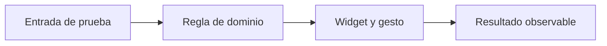
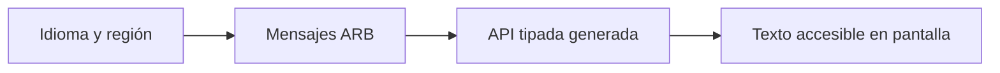
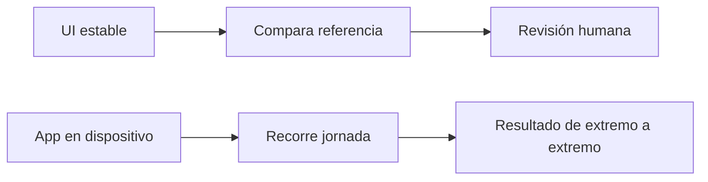
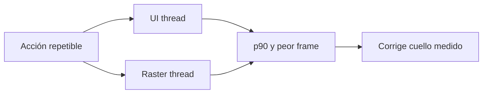
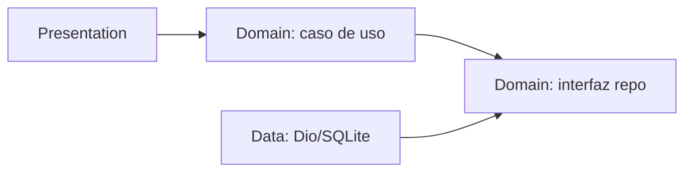
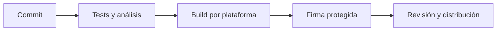

# Módulo 20: Flutter Master: pruebas, arquitectura y release

## Aprende construyendo

Este módulo convierte `rutaflow_driver` en una app que un equipo puede cambiar y entregar con confianza. Vas a probar lógica e interfaz, fijar una pantalla con golden, recorrer un flujo de integración, medir profile, separar reglas del dominio, localizar textos y generar artefactos por plataforma. Los firmados requieren certificados y cuentas del equipo; un build local no es una publicación.

---


### Tema 1: pruebas unitarias y de widget con Flutter Test · Intermedio · 30 min

<details open>
<summary><strong>Capa 1 — Lectura</strong></summary>

#### ► DE QUÉ TRATA
Al finalizar escribirás pruebas que protegen una regla de entrega y su resultado en pantalla. Prerrequisitos: Dart, widgets, callbacks y futures. Crea un proyecto nuevo con flutter create flutter_master_lab y ejecuta flutter test para confirmar la plantilla.

#### ► LA IDEA EN UNA FRASE
**Al finalizar escribirás pruebas que protegen una regla de entrega y su resultado en pantalla.**

#### ► POR QUÉ EXISTE ESTO
Resuelve un problema real de diseño o implementación y evita decisiones a ciegas.

#### ► LA ANALOGÍA
Piensa en pruebas unitarias y de widget con flutter test como una herramienta de taller: útil cuando conoces su propósito y sus límites.
**Dónde se rompe la analogía:** en software, los efectos dependen del contexto, la escala y los trade-offs.

#### ► CÓMO FUNCIONA


#### ► LO QUE PUEDE SALIR MAL
| Síntoma | Causa probable | Arreglo |
|---|---|---|
| pruebas unitarias y de widget con Flutter Test se aplica pero el resultado no mejora | Se usó sin medir el problema real | Mide antes y compara contra la alternativa simple |
| Aparece complejidad inesperada | Se adoptó la técnica sin comprender sus trade-offs | Vuelve a la sección de trade-offs y reduce el alcance |
| Falla en un caso límite | Se asumió un contexto que no se cumple | Prueba el caso límite y documenta cuándo NO usarlo |

#### ► TRADE-OFFS
| Opción | Cuándo usarla | Cuándo NO usarla |
|---|---|---|
| Usar pruebas unitarias y de widget con Flutter Test | Cuando el problema coincide con su propósito y el beneficio es observable | Cuando agrega complejidad sin resolver un problema real |
| Alternativa más simple | Cuando el contexto es pequeño, estable o fácil de razonar | Cuando ya demostró no escalar o no cumplir el requisito |
| Postergar la decisión | Cuando falta evidencia del problema | Cuando el costo de esperar es mayor que el costo de probar |

#### ► CUÁNDO NO USAR ESTO
No uses pruebas unitarias y de widget con flutter test por defecto. Aplícalo cuando el problema lo justifique y puedas verificar el beneficio; si una alternativa más simple resuelve igual, prefiérela.

#### ► DE VUELTA A LA ANALOGÍA
Volviendo a la analogía: pruebas unitarias y de widget con flutter test funciona como el modelo inicial, pero recuerda dónde se rompe: en producción importan la evidencia, la escala y el costo de equivocarte.

#### ► LO QUE DEBES RECORDAR
- pruebas unitarias y de widget con Flutter Test existe para resolver un problema específico.
- Mide antes de adoptar complejidad.
- Conoce el caso donde NO usarlo.
- Verifica con evidencia observable.

#### ► PREGUNTAS PARA PENSAR
1. ¿Qué problema concreto resuelve pruebas unitarias y de widget con flutter test en tu contexto?
2. ¿Cómo sabrías que pruebas unitarias y de widget con flutter test no está funcionando bien?
3. ¿Qué alternativa más simple considerarías antes de usar pruebas unitarias y de widget con flutter test?

</details>

<details>
<summary><strong>Capa 2 — Construcción</strong></summary>

#### Código y verificación
```dart
bool canComplete({required bool hasPhoto, required bool hasSignature}) =>
    hasPhoto && hasSignature;
```

```dart
import 'package:flutter_test/flutter_test.dart';
import 'package:flutter_master_lab/domain/delivery_policy.dart';

void main() {
  test('requires photo and signature', () {
    expect(canComplete(hasPhoto: true, hasSignature: true), isTrue);
    expect(canComplete(hasPhoto: true, hasSignature: false), isFalse);
  });
}
```

```bash
flutter test test/domain/delivery_policy_test.dart test/widgets/complete_button_test.dart
```


</details>

### Tema 2: internacionalización y formatos locales · Intermedio · 35 min

<details open>
<summary><strong>Capa 1 — Lectura</strong></summary>

#### ► DE QUÉ TRATA
Al finalizar mostrarás textos y números del flujo de entrega según el idioma configurado. Prerrequisitos: MaterialApp, locale y assets. Crea un proyecto nuevo con flutter create localized_delivery_lab; configura flutter_localizations e intl desde pubspec.yaml; crea lib/l10n/app_e…

#### ► LA IDEA EN UNA FRASE
**Al finalizar mostrarás textos y números del flujo de entrega según el idioma configurado.**

#### ► POR QUÉ EXISTE ESTO
Resuelve un problema real de diseño o implementación y evita decisiones a ciegas.

#### ► LA ANALOGÍA
Piensa en internacionalización y formatos locales como una herramienta de taller: útil cuando conoces su propósito y sus límites.
**Dónde se rompe la analogía:** en software, los efectos dependen del contexto, la escala y los trade-offs.

#### ► CÓMO FUNCIONA


#### ► LO QUE PUEDE SALIR MAL
| Síntoma | Causa probable | Arreglo |
|---|---|---|
| internacionalización y formatos locales se aplica pero el resultado no mejora | Se usó sin medir el problema real | Mide antes y compara contra la alternativa simple |
| Aparece complejidad inesperada | Se adoptó la técnica sin comprender sus trade-offs | Vuelve a la sección de trade-offs y reduce el alcance |
| Falla en un caso límite | Se asumió un contexto que no se cumple | Prueba el caso límite y documenta cuándo NO usarlo |

#### ► TRADE-OFFS
| Opción | Cuándo usarla | Cuándo NO usarla |
|---|---|---|
| Usar internacionalización y formatos locales | Cuando el problema coincide con su propósito y el beneficio es observable | Cuando agrega complejidad sin resolver un problema real |
| Alternativa más simple | Cuando el contexto es pequeño, estable o fácil de razonar | Cuando ya demostró no escalar o no cumplir el requisito |
| Postergar la decisión | Cuando falta evidencia del problema | Cuando el costo de esperar es mayor que el costo de probar |

#### ► CUÁNDO NO USAR ESTO
No uses internacionalización y formatos locales por defecto. Aplícalo cuando el problema lo justifique y puedas verificar el beneficio; si una alternativa más simple resuelve igual, prefiérela.

#### ► DE VUELTA A LA ANALOGÍA
Volviendo a la analogía: internacionalización y formatos locales funciona como el modelo inicial, pero recuerda dónde se rompe: en producción importan la evidencia, la escala y el costo de equivocarte.

#### ► LO QUE DEBES RECORDAR
- internacionalización y formatos locales existe para resolver un problema específico.
- Mide antes de adoptar complejidad.
- Conoce el caso donde NO usarlo.
- Verifica con evidencia observable.

#### ► PREGUNTAS PARA PENSAR
1. ¿Qué problema concreto resuelve internacionalización y formatos locales en tu contexto?
2. ¿Cómo sabrías que internacionalización y formatos locales no está funcionando bien?
3. ¿Qué alternativa más simple considerarías antes de usar internacionalización y formatos locales?

</details>

<details>
<summary><strong>Capa 2 — Construcción</strong></summary>

#### Código y verificación
```yaml
flutter:
  generate: true
```

```yaml
arb-dir: lib/l10n
template-arb-file: app_en.arb
output-localization-file: app_localizations.dart
```

```bash
flutter gen-l10n
flutter analyze
```


</details>

### Tema 3: golden e integración de un flujo real · Avanzado · 35 min

<details open>
<summary><strong>Capa 1 — Lectura</strong></summary>

#### ► DE QUÉ TRATA
Al finalizar revisarás un cambio visual y simularás el recorrido de confirmar parada. Prerrequisitos: widget tests, themes y navegación. Crea un proyecto nuevo con flutter create delivery_integration_lab; crea test/goldens/stop_card_test.dart y integration_test/complete_delivery_…

#### ► LA IDEA EN UNA FRASE
**Al finalizar revisarás un cambio visual y simularás el recorrido de confirmar parada.**

#### ► POR QUÉ EXISTE ESTO
Resuelve un problema real de diseño o implementación y evita decisiones a ciegas.

#### ► LA ANALOGÍA
Piensa en golden e integración de un flujo real como una herramienta de taller: útil cuando conoces su propósito y sus límites.
**Dónde se rompe la analogía:** en software, los efectos dependen del contexto, la escala y los trade-offs.

#### ► CÓMO FUNCIONA


#### ► LO QUE PUEDE SALIR MAL
| Síntoma | Causa probable | Arreglo |
|---|---|---|
| golden e integración de un flujo real se aplica pero el resultado no mejora | Se usó sin medir el problema real | Mide antes y compara contra la alternativa simple |
| Aparece complejidad inesperada | Se adoptó la técnica sin comprender sus trade-offs | Vuelve a la sección de trade-offs y reduce el alcance |
| Falla en un caso límite | Se asumió un contexto que no se cumple | Prueba el caso límite y documenta cuándo NO usarlo |

#### ► TRADE-OFFS
| Opción | Cuándo usarla | Cuándo NO usarla |
|---|---|---|
| Usar golden e integración de un flujo real | Cuando el problema coincide con su propósito y el beneficio es observable | Cuando agrega complejidad sin resolver un problema real |
| Alternativa más simple | Cuando el contexto es pequeño, estable o fácil de razonar | Cuando ya demostró no escalar o no cumplir el requisito |
| Postergar la decisión | Cuando falta evidencia del problema | Cuando el costo de esperar es mayor que el costo de probar |

#### ► CUÁNDO NO USAR ESTO
No uses golden e integración de un flujo real por defecto. Aplícalo cuando el problema lo justifique y puedas verificar el beneficio; si una alternativa más simple resuelve igual, prefiérela.

#### ► DE VUELTA A LA ANALOGÍA
Volviendo a la analogía: golden e integración de un flujo real funciona como el modelo inicial, pero recuerda dónde se rompe: en producción importan la evidencia, la escala y el costo de equivocarte.

#### ► LO QUE DEBES RECORDAR
- golden e integración de un flujo real existe para resolver un problema específico.
- Mide antes de adoptar complejidad.
- Conoce el caso donde NO usarlo.
- Verifica con evidencia observable.

#### ► PREGUNTAS PARA PENSAR
1. ¿Qué problema concreto resuelve golden e integración de un flujo real en tu contexto?
2. ¿Cómo sabrías que golden e integración de un flujo real no está funcionando bien?
3. ¿Qué alternativa más simple considerarías antes de usar golden e integración de un flujo real?

</details>

<details>
<summary><strong>Capa 2 — Construcción</strong></summary>

#### Código y verificación
```bash
flutter test test/goldens/stop_card_test.dart
flutter test integration_test/complete_delivery_test.dart -d <device-id>
```


</details>

### Tema 4: perfilado y presupuesto de rendimiento · Avanzado · 30 min

<details open>
<summary><strong>Capa 1 — Lectura</strong></summary>

#### ► DE QUÉ TRATA
Al finalizar medirás una interacción repetible en profile y decidirás qué corregir primero. Prerrequisitos: DevTools, ListView.builder y timing UI/raster. Crea un proyecto nuevo con flutter create performance_review_lab; agrega lib/performance/route_benchmark.dart y un recorrido…

#### ► LA IDEA EN UNA FRASE
**Al finalizar medirás una interacción repetible en profile y decidirás qué corregir primero.**

#### ► POR QUÉ EXISTE ESTO
Resuelve un problema real de diseño o implementación y evita decisiones a ciegas.

#### ► LA ANALOGÍA
Piensa en perfilado y presupuesto de rendimiento como una herramienta de taller: útil cuando conoces su propósito y sus límites.
**Dónde se rompe la analogía:** en software, los efectos dependen del contexto, la escala y los trade-offs.

#### ► CÓMO FUNCIONA


#### ► LO QUE PUEDE SALIR MAL
| Síntoma | Causa probable | Arreglo |
|---|---|---|
| perfilado y presupuesto de rendimiento se aplica pero el resultado no mejora | Se usó sin medir el problema real | Mide antes y compara contra la alternativa simple |
| Aparece complejidad inesperada | Se adoptó la técnica sin comprender sus trade-offs | Vuelve a la sección de trade-offs y reduce el alcance |
| Falla en un caso límite | Se asumió un contexto que no se cumple | Prueba el caso límite y documenta cuándo NO usarlo |

#### ► TRADE-OFFS
| Opción | Cuándo usarla | Cuándo NO usarla |
|---|---|---|
| Usar perfilado y presupuesto de rendimiento | Cuando el problema coincide con su propósito y el beneficio es observable | Cuando agrega complejidad sin resolver un problema real |
| Alternativa más simple | Cuando el contexto es pequeño, estable o fácil de razonar | Cuando ya demostró no escalar o no cumplir el requisito |
| Postergar la decisión | Cuando falta evidencia del problema | Cuando el costo de esperar es mayor que el costo de probar |

#### ► CUÁNDO NO USAR ESTO
No uses perfilado y presupuesto de rendimiento por defecto. Aplícalo cuando el problema lo justifique y puedas verificar el beneficio; si una alternativa más simple resuelve igual, prefiérela.

#### ► DE VUELTA A LA ANALOGÍA
Volviendo a la analogía: perfilado y presupuesto de rendimiento funciona como el modelo inicial, pero recuerda dónde se rompe: en producción importan la evidencia, la escala y el costo de equivocarte.

#### ► LO QUE DEBES RECORDAR
- perfilado y presupuesto de rendimiento existe para resolver un problema específico.
- Mide antes de adoptar complejidad.
- Conoce el caso donde NO usarlo.
- Verifica con evidencia observable.

#### ► PREGUNTAS PARA PENSAR
1. ¿Qué problema concreto resuelve perfilado y presupuesto de rendimiento en tu contexto?
2. ¿Cómo sabrías que perfilado y presupuesto de rendimiento no está funcionando bien?
3. ¿Qué alternativa más simple considerarías antes de usar perfilado y presupuesto de rendimiento?

</details>

<details>
<summary><strong>Capa 2 — Construcción</strong></summary>

#### Código y verificación
```bash
flutter run --profile -d <device-id>
```


</details>

### Tema 5: Clean Architecture y sustitución de dependencias · Avanzado · 35 min

<details open>
<summary><strong>Capa 1 — Lectura</strong></summary>

#### ► DE QUÉ TRATA
Al finalizar separarás la regla de completar entrega del cliente HTTP y la pantalla. Prerrequisitos: clases, interfaces, tests y módulos Dart. Crea un proyecto nuevo con flutter create architecture_delivery_lab; en lib/features/delivery/, crea domain, data y presentation con un c…

#### ► LA IDEA EN UNA FRASE
**Al finalizar separarás la regla de completar entrega del cliente HTTP y la pantalla.**

#### ► POR QUÉ EXISTE ESTO
Resuelve un problema real de diseño o implementación y evita decisiones a ciegas.

#### ► LA ANALOGÍA
Piensa en clean architecture y sustitución de dependencias como una herramienta de taller: útil cuando conoces su propósito y sus límites.
**Dónde se rompe la analogía:** en software, los efectos dependen del contexto, la escala y los trade-offs.

#### ► CÓMO FUNCIONA


#### ► LO QUE PUEDE SALIR MAL
| Síntoma | Causa probable | Arreglo |
|---|---|---|
| Clean Architecture y sustitución de dependencias se aplica pero el resultado no mejora | Se usó sin medir el problema real | Mide antes y compara contra la alternativa simple |
| Aparece complejidad inesperada | Se adoptó la técnica sin comprender sus trade-offs | Vuelve a la sección de trade-offs y reduce el alcance |
| Falla en un caso límite | Se asumió un contexto que no se cumple | Prueba el caso límite y documenta cuándo NO usarlo |

#### ► TRADE-OFFS
| Opción | Cuándo usarla | Cuándo NO usarla |
|---|---|---|
| Usar Clean Architecture y sustitución de dependencias | Cuando el problema coincide con su propósito y el beneficio es observable | Cuando agrega complejidad sin resolver un problema real |
| Alternativa más simple | Cuando el contexto es pequeño, estable o fácil de razonar | Cuando ya demostró no escalar o no cumplir el requisito |
| Postergar la decisión | Cuando falta evidencia del problema | Cuando el costo de esperar es mayor que el costo de probar |

#### ► CUÁNDO NO USAR ESTO
No uses clean architecture y sustitución de dependencias por defecto. Aplícalo cuando el problema lo justifique y puedas verificar el beneficio; si una alternativa más simple resuelve igual, prefiérela.

#### ► DE VUELTA A LA ANALOGÍA
Volviendo a la analogía: clean architecture y sustitución de dependencias funciona como el modelo inicial, pero recuerda dónde se rompe: en producción importan la evidencia, la escala y el costo de equivocarte.

#### ► LO QUE DEBES RECORDAR
- Clean Architecture y sustitución de dependencias existe para resolver un problema específico.
- Mide antes de adoptar complejidad.
- Conoce el caso donde NO usarlo.
- Verifica con evidencia observable.

#### ► PREGUNTAS PARA PENSAR
1. ¿Qué problema concreto resuelve clean architecture y sustitución de dependencias en tu contexto?
2. ¿Cómo sabrías que clean architecture y sustitución de dependencias no está funcionando bien?
3. ¿Qué alternativa más simple considerarías antes de usar clean architecture y sustitución de dependencias?

</details>

<details>
<summary><strong>Capa 2 — Construcción</strong></summary>

#### Código y verificación
```dart
abstract interface class DeliveryRepository {
  Future<void> complete(String stopId);
}
```

```dart
import 'delivery_repository.dart';

class CompleteDelivery {
  CompleteDelivery(this._repository);
  final DeliveryRepository _repository;
  Future<void> call(String stopId) {
    if (stopId.trim().isEmpty) throw ArgumentError('stopId vacío');
    return _repository.complete(stopId);
  }
}
```

```bash
flutter test test/features/delivery/domain/complete_delivery_test.dart
flutter analyze
```


</details>

#### Caso real: la app móvil de Immich

La app de [Immich](https://github.com/immich-app/immich) está hecha en Flutter y es un buen ejemplo de capas sustituibles en una app grande:

- **Estado:** Riverpod.
- **Base local:** Drift (SQLite) en el dispositivo, para trabajar sin conexión.
- **Red:** el cliente REST **se genera** desde la especificación OpenAPI del servidor, igual que los clientes web y CLI. Si cambia la API, se regenera el cliente en vez de editarlo a mano.

La propia documentación del proyecto reconoce que el código aún no sigue del todo la arquitectura objetivo: en una app real la arquitectura se migra por partes, no de golpe.

**Ejercicio.** Clona el repo, abre `mobile/` y localiza el cliente OpenAPI generado. Propón dónde pondrías una interfaz de repositorio para poder sustituir ese cliente en las pruebas.

Fuente: [arquitectura de Immich](https://docs.immich.app/developer/architecture).

### Tema 6: builds por plataforma, firma y entrega · Avanzado · 35 min

<details open>
<summary><strong>Capa 1 — Lectura</strong></summary>

#### ► DE QUÉ TRATA
Al finalizar generarás un artefacto de desarrollo y una release adecuada a un target disponible, identificando lo que falta para distribuir. Prerrequisitos: builds Flutter, flavors y secretos/configuración. Crea un proyecto nuevo con flutter create release_delivery_lab; crea docs…

#### ► LA IDEA EN UNA FRASE
**Al finalizar generarás un artefacto de desarrollo y una release adecuada a un target disponible, identificando lo que falta para distribuir.**

#### ► POR QUÉ EXISTE ESTO
Resuelve un problema real de diseño o implementación y evita decisiones a ciegas.

#### ► LA ANALOGÍA
Piensa en builds por plataforma, firma y entrega como una herramienta de taller: útil cuando conoces su propósito y sus límites.
**Dónde se rompe la analogía:** en software, los efectos dependen del contexto, la escala y los trade-offs.

#### ► CÓMO FUNCIONA


#### ► LO QUE PUEDE SALIR MAL
| Síntoma | Causa probable | Arreglo |
|---|---|---|
| builds por plataforma, firma y entrega se aplica pero el resultado no mejora | Se usó sin medir el problema real | Mide antes y compara contra la alternativa simple |
| Aparece complejidad inesperada | Se adoptó la técnica sin comprender sus trade-offs | Vuelve a la sección de trade-offs y reduce el alcance |
| Falla en un caso límite | Se asumió un contexto que no se cumple | Prueba el caso límite y documenta cuándo NO usarlo |

#### ► TRADE-OFFS
| Opción | Cuándo usarla | Cuándo NO usarla |
|---|---|---|
| Usar builds por plataforma, firma y entrega | Cuando el problema coincide con su propósito y el beneficio es observable | Cuando agrega complejidad sin resolver un problema real |
| Alternativa más simple | Cuando el contexto es pequeño, estable o fácil de razonar | Cuando ya demostró no escalar o no cumplir el requisito |
| Postergar la decisión | Cuando falta evidencia del problema | Cuando el costo de esperar es mayor que el costo de probar |

#### ► CUÁNDO NO USAR ESTO
No uses builds por plataforma, firma y entrega por defecto. Aplícalo cuando el problema lo justifique y puedas verificar el beneficio; si una alternativa más simple resuelve igual, prefiérela.

#### ► DE VUELTA A LA ANALOGÍA
Volviendo a la analogía: builds por plataforma, firma y entrega funciona como el modelo inicial, pero recuerda dónde se rompe: en producción importan la evidencia, la escala y el costo de equivocarte.

#### ► LO QUE DEBES RECORDAR
- builds por plataforma, firma y entrega existe para resolver un problema específico.
- Mide antes de adoptar complejidad.
- Conoce el caso donde NO usarlo.
- Verifica con evidencia observable.

#### ► PREGUNTAS PARA PENSAR
1. ¿Qué problema concreto resuelve builds por plataforma, firma y entrega en tu contexto?
2. ¿Cómo sabrías que builds por plataforma, firma y entrega no está funcionando bien?
3. ¿Qué alternativa más simple considerarías antes de usar builds por plataforma, firma y entrega?

</details>

<details>
<summary><strong>Capa 2 — Construcción</strong></summary>

#### Código y verificación
```bash
flutter test
flutter analyze
flutter build appbundle --release --flavor production -t lib/main_production.dart
```


</details>
