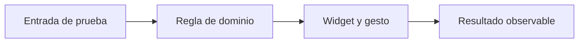
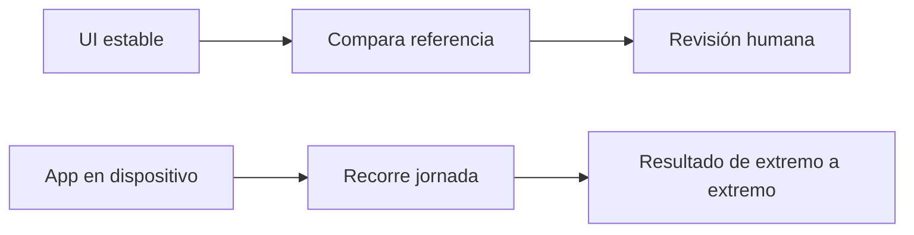
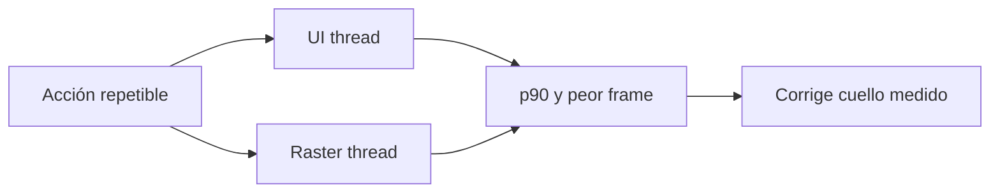
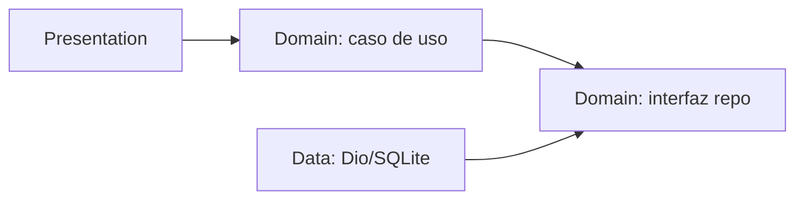
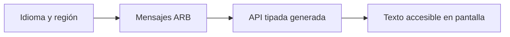
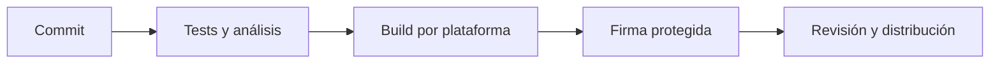

# Módulo 20: Flutter Master: pruebas, arquitectura y release

## Aprende construyendo

Este módulo convierte `rutaflow_driver` en una app que un equipo puede cambiar y entregar con confianza. Vas a probar lógica e interfaz, fijar una pantalla con golden, recorrer un flujo de integración, medir profile, separar reglas del dominio, localizar textos y generar artefactos por plataforma. Los firmados requieren certificados y cuentas del equipo; un build local no es una publicación.

---

### Tema 1: pruebas unitarias y de widget con Flutter Test

#### Paso 1 · Objetivo y preparación
Al finalizar escribirás pruebas que protegen una regla de entrega y su resultado en pantalla. **Prerrequisitos:** Dart, widgets, callbacks y futures. Crea un proyecto nuevo con `flutter create flutter_master_lab` y ejecuta `flutter test` para confirmar la plantilla.

#### Paso 2 · Contexto y caso real
Un cambio de diseño puede hacer que el botón “Entregada” deje de guardar la confirmación. La prueba de lógica localiza la regla; la de widget confirma que quien usa la app ve el resultado después de tocar.

#### ¿Por qué es importante?
Sin una prueba corta, el equipo depende de repetir manualmente todos los pasos tras cada cambio. Las pruebas hacen visible la regla esperada y reducen regresiones en una función que afecta el cierre de cada parada.

#### Paso 3 · Teoría, modelo mental y analogía
Una prueba unitaria revisa una decisión con entradas conocidas. Una prueba de widget monta parte de la interfaz en un árbol controlado y simula gestos. `pumpWidget` crea el árbol; `pump` avanza un frame; `pumpAndSettle` espera estabilidad y puede no terminar con animaciones infinitas.

#### Paso 4 · Demostración guiada
Crea `lib/domain/delivery_policy.dart`:

```dart
bool canComplete({required bool hasPhoto, required bool hasSignature}) =>
    hasPhoto && hasSignature;
```

Crea `test/domain/delivery_policy_test.dart`:

```dart
import 'package:flutter_test/flutter_test.dart';
import 'package:flutter_master_lab/domain/delivery_policy.dart';

void main() {
  test('requires photo and signature', () {
    expect(canComplete(hasPhoto: true, hasSignature: true), isTrue);
    expect(canComplete(hasPhoto: true, hasSignature: false), isFalse);
  });
}
```

Ejecuta `flutter test test/domain/delivery_policy_test.dart`. Luego crea `test/widgets/complete_button_test.dart`: monta el widget, toca el botón y verifica el texto “Entrega guardada”.

#### Paso 5 · Práctica guiada
Inyecta un fake repository al widget; confirma que no llame al servidor si falta foto. **Pista:** `find.text`, `find.byType` y `tester.tap` distinguen texto de interacción.

#### Paso 6 · Práctica independiente
Añade los casos de rechazo de foto, error de red y segundo tap. Define la respuesta del widget ante `loading`, `success` y `failure` sin repetir pruebas que solo comprueban detalles internos.

#### Paso 7 · Cierre y evidencia
Entrega `delivery_policy_test.dart` y `complete_button_test.dart`; el siguiente tema guardará una referencia visual estable.

**Prueba de diagnóstico.** Provoca deliberadamente un error cambiando `&&` por `||`; la prueba debe señalar el caso con firma ausente. **Resultado esperado:** ambas pruebas pasan al restaurar la regla.

```bash
flutter test test/domain/delivery_policy_test.dart test/widgets/complete_button_test.dart
```

**Errores comunes:** probar solo el texto sin activar el botón y usar `pumpAndSettle` en animaciones infinitas. Diagrama: `regla pura -> unit test; widget -> gesto -> estado visible`. Fuente oficial: [pruebas Flutter](https://docs.flutter.dev/testing).

**Proyecto propio:** `flutter_master_lab`. **Cuándo usar widget test:** si un gesto y su resultado visible forman parte del contrato de la pantalla. Evidencia de aprendizaje: entrega el log de ambas pruebas y explica una regresión que detectan.



---

### Tema 2: golden e integración de un flujo real

#### Paso 1 · Objetivo y preparación
Al finalizar revisarás un cambio visual y simularás el recorrido de confirmar parada. **Prerrequisitos:** widget tests, themes y navegación. Crea un proyecto nuevo con `flutter create delivery_integration_lab`; crea `test/goldens/stop_card_test.dart` y `integration_test/complete_delivery_test.dart`.

#### Paso 2 · Contexto y caso real
Una actualización de tipografía puede cortar la dirección en teléfonos pequeños. Un golden compara una imagen esperada; un integration test usa la app instalada y recorre pantallas, permisos simulados y repositorio de prueba.

#### ¿Por qué es importante?
Un golden encuentra diferencias de píxeles, pero no prueba que un flujo funcione. La integración encuentra interacciones entre piezas, aunque sea más lenta. Usarlos por propósito ayuda a que cada fallo dé una pista concreta.

#### Paso 3 · Teoría, modelo mental y analogía
El golden es una foto bajo tamaño, escala y fonts conocidos: cualquier cambio exige revisar si fue intencional antes de actualizar. La integración es un ensayo de principio a fin en dispositivo/emulador; no debe depender de cuentas de producción ni de datos reales.

#### Paso 4 · Demostración guiada
En `test/goldens/stop_card_test.dart`, fija `ThemeData`, tamaño del `Surface` y locale; monta `StopCard` y usa `await expectLater(find.byType(StopCard), matchesGoldenFile('goldens/stop_card.png'))`. Genera o revisa la referencia con `flutter test --update-goldens test/goldens/stop_card_test.dart`; luego ejecuta `flutter test test/goldens/stop_card_test.dart` sin actualizar.

En `integration_test/complete_delivery_test.dart`, usa `IntegrationTestWidgetsFlutterBinding.ensureInitialized()`, inyecta un backend fake, toca la parada y comprueba confirmación. Ejecuta `flutter test integration_test/complete_delivery_test.dart -d <device-id>` en emulador/dispositivo disponible.

#### Paso 5 · Práctica guiada
Cambia deliberadamente el ancho de la card y compara la imagen. Acepta el nuevo golden solo si el cambio visual era esperado. **Pista:** una fuente o versión de sistema distinta también cambia píxeles.

#### Paso 6 · Práctica independiente
Prueba el flujo con respuesta exitosa y error `503`. Separa fixtures del proyecto para no guardar IDs o datos personales en capturas.

#### Paso 7 · Cierre y evidencia
Entrega el golden revisado y log de integración. El siguiente tema perfilará la misma pantalla para revisar costo, no su apariencia.

**Prueba de diagnóstico.** Provoca deliberadamente un diff de golden cambiando padding; obsérvalo con `flutter test`, inspecciona el diff y decide si se restaura o actualiza. **Resultado esperado:** la prueba no se actualiza sola.

```bash
flutter test test/goldens/stop_card_test.dart
flutter test integration_test/complete_delivery_test.dart -d <device-id>
```

**Errores comunes:** actualizar golden para silenciar cualquier diff y llamar prueba de integración a una prueba que monta solo un widget. Diagrama: `golden = imagen; integration_test = flujo`. Fuente oficial: [pruebas de integración Flutter](https://docs.flutter.dev/testing/integration-tests).

**Proyecto propio:** `delivery_integration_lab`. **Cuándo ejecutar en emulador:** para validar navegación y comportamiento de plataforma; el test de widget no reemplaza esta pasada. Evidencia de aprendizaje: entrega diff antes/después y reporte del flujo.



---

### Tema 3: perfilado y presupuesto de rendimiento

#### Paso 1 · Objetivo y preparación
Al finalizar medirás una interacción repetible en `profile` y decidirás qué corregir primero. **Prerrequisitos:** DevTools, `ListView.builder` y timing UI/raster. Crea un proyecto nuevo con `flutter create performance_review_lab`; agrega `lib/performance/route_benchmark.dart` y un recorrido con 500 paradas de fixture.

#### Paso 2 · Contexto y caso real
La jornada puede sentirse bien en el equipo de desarrollo y fallar en un teléfono económico. Debug mode añade trabajo de diagnóstico; el modo profile se acerca más al comportamiento de release y permite inspeccionar frames.

#### ¿Por qué es importante?
Medir evita quitar animaciones o rehacer arquitectura por intuición. Registrar equipo, modo, recorrido y percentiles permite comparar dos commits sin prometer que una sola medición represente a todas las personas.

#### Paso 3 · Teoría, modelo mental y analogía
DevTools separa la preparación de frames en UI y el raster. Un pico en UI dirige a lógica/build/layout; en raster, a pintura, imágenes o efectos. En 60 Hz busca frames dentro del presupuesto aproximado de 16 ms; dispositivos de mayor frecuencia requieren menos.

#### Paso 4 · Demostración guiada
Abre la app y ejecuta `flutter run --profile -d <device-id>`. En DevTools Performance graba: abrir jornada, desplazar la lista de 500 paradas y abrir detalle. Guarda `docs/performance-baseline.md` con versión Flutter, modelo de equipo, frecuencia de pantalla, modo, promedio, p90, p99 y peor frame.

En `lib/performance/route_benchmark.dart`, guarda filtros fuera de `build`, prefiere listas lazy y divide widgets según qué estado cambia. Cambia una sola cosa y graba el mismo recorrido otra vez.

#### Paso 5 · Práctica guiada
Compara la pista UI y raster. Si UI va lenta, desactiva temporalmente la búsqueda/sort dentro de `build`; si raster va lento, prueba retirar una capa `saveLayer`/blur. **Pista:** conserva la misma cantidad de filas.

#### Paso 6 · Práctica independiente
Fija un presupuesto de regresión que el equipo pueda reproducir y prueba al menos un dispositivo modesto. Incluye un caso con scroll y otro con actualización Socket.IO.

#### Paso 7 · Cierre y evidencia
Entrega `docs/performance-baseline.md`, dos capturas del timeline y el cambio medido. El siguiente tema ordenará la app en capas que facilitan esos tests.

**Prueba de diagnóstico.** Provoca deliberadamente un fallo de rendimiento agregando cálculo CPU caro en `build()`; localiza la barra UI lenta y quita ese cálculo. **Resultado esperado:** la pista UI mejora sin afirmar un porcentaje fuera de la medición hecha.

```bash
flutter run --profile -d <device-id>
```

**Errores comunes:** comparar debug con profile o equipos distintos. Diagrama: `misma acción -> UI/raster -> percentiles -> decisión`. Fuente oficial: [perfil de rendimiento Flutter](https://docs.flutter.dev/perf/ui-performance).

**Proyecto propio:** `rutaflow_driver`. **Cuándo extraer a isolate:** si la medición confirma trabajo CPU que bloquea UI y no se puede reducir o parcelar. Evidencia de aprendizaje: entrega baseline y repite el recorrido con un único cambio.



---

### Tema 4: Clean Architecture y sustitución de dependencias

#### Paso 1 · Objetivo y preparación
Al finalizar separarás la regla de completar entrega del cliente HTTP y la pantalla. **Prerrequisitos:** clases, interfaces, tests y módulos Dart. Crea un proyecto nuevo con `flutter create architecture_delivery_lab`; en `lib/features/delivery/`, crea `domain`, `data` y `presentation` con un caso de uso concreto.

#### Paso 2 · Contexto y caso real
El equipo quiere cambiar Dio por otro transporte y añadir una regla nueva de firma obligatoria. Si los widgets llaman directamente al cliente HTTP, cada cambio afecta navegación, pruebas y dominio a la vez.

#### ¿Por qué es importante?
Las capas ayudan a cambiar una parte sin romper todas las demás. No son carpetas decorativas: valen cuando protegen una regla de negocio o permiten probar una frontera sin red.

#### Paso 3 · Teoría, modelo mental y analogía
Domain define entidades, reglas e interfaces. Data implementa esas interfaces con API/base local. Presentation traduce acciones a estado de pantalla. Las dependencias apuntan hacia la regla central; el dominio no importa Flutter, Dio, Firebase ni SQL.

#### Paso 4 · Demostración guiada
Crea `lib/features/delivery/domain/delivery_repository.dart`:

```dart
abstract interface class DeliveryRepository {
  Future<void> complete(String stopId);
}
```

Crea `lib/features/delivery/domain/complete_delivery.dart`:

```dart
import 'delivery_repository.dart';

class CompleteDelivery {
  CompleteDelivery(this._repository);
  final DeliveryRepository _repository;
  Future<void> call(String stopId) {
    if (stopId.trim().isEmpty) throw ArgumentError('stopId vacío');
    return _repository.complete(stopId);
  }
}
```

Prueba el caso de uso con un fake sin importar Flutter. En `data/dio_delivery_repository.dart` implementa la interfaz; en Presentation llama al caso de uso y traduce estados a `loading/success/error`.

#### Paso 5 · Práctica guiada
Sustituye el fake por `DioDeliveryRepository` mediante constructor o provider override. **Pista:** no instancies Dio dentro del caso de uso.

#### Paso 6 · Práctica independiente
Agrega una regla de firma requerida. La regla debe poder probarse sin plugin de cámara ni cuenta remota; la presentación decide cómo obtener la firma.

#### Paso 7 · Cierre y evidencia
Entrega los archivos domain/data/presentation y un test del caso de uso. El siguiente tema añade idiomas sin mezclar textos con esas reglas.

**Prueba de diagnóstico.** Provoca deliberadamente una importación de Dio desde domain y ejecuta `flutter analyze`; corrige la dirección de dependencia. **Resultado esperado:** el caso de uso opera con fake y el adaptador real es sustituible.

```bash
flutter test test/features/delivery/domain/complete_delivery_test.dart
flutter analyze
```

**Errores comunes:** crear una clase por archivo sin una frontera útil y dejar llamadas HTTP dentro del widget. Diagrama: `Presentation -> Domain <- Data`. Fuente oficial: [arquitectura Flutter](https://docs.flutter.dev/app-architecture).

**Proyecto propio:** `lib/features/delivery`. **Cuándo usar una capa:** si aísla una regla o infraestructura que cambia por separado. Evidencia de aprendizaje: entrega el fake, test y adaptador que implementa la interfaz.



---

### Tema 5: internacionalización y formatos locales

#### Paso 1 · Objetivo y preparación
Al finalizar mostrarás textos y números del flujo de entrega según el idioma configurado. **Prerrequisitos:** MaterialApp, locale y assets. Crea un proyecto nuevo con `flutter create localized_delivery_lab`; configura `flutter_localizations` e `intl` desde `pubspec.yaml`; crea `lib/l10n/app_en.arb` y `lib/l10n/app_es.arb`.

#### Paso 2 · Contexto y caso real
La app incluye contadores, moneda, dirección y estados. Traducir solo los botones deja frases partidas y cantidades con formato incorrecto. Las reglas de moneda también pueden variar por país; el usuario debe ver claramente el total y su moneda.

#### ¿Por qué es importante?
El idioma influye en cuánto texto cabe y en cómo se entiende un precio o una hora. Centralizar mensajes evita traducciones inconsistentes y prepara lectores de pantalla para cada locale.

#### Paso 3 · Teoría, modelo mental y analogía
ARB guarda claves y mensajes, `gen-l10n` genera una API tipada y `Localizations` elige el idioma. Los placeholders y plurales evitan concatenar palabras por idioma. Fechas y cantidades se formatean con locale; no se traducen manualmente con `if` en cada widget.

#### Paso 4 · Demostración guiada
En `pubspec.yaml` activa:

```yaml
flutter:
  generate: true
```

Crea `l10n.yaml`:

```yaml
arb-dir: lib/l10n
template-arb-file: app_en.arb
output-localization-file: app_localizations.dart
```

Añade la misma clave `deliveriesCount` en ambos ARB, con plural y placeholder. Configura `localizationsDelegates`, `supportedLocales: [Locale('en'), Locale('es')]` y usa `AppLocalizations.of(context)!.deliveriesCount(count)`. Ejecuta `flutter gen-l10n` y `flutter analyze`.

#### Paso 5 · Práctica guiada
Prueba plural 0, 1 y 2; cambia locale a español. **Pista:** completa ambas traducciones y evita usar el idioma del dispositivo como único test.

#### Paso 6 · Práctica independiente
Revisa texto largo en ancho móvil, lector de pantalla, formato de importe y fecha. Documenta el locale regional que asume la app y qué hace si llega uno no admitido.

#### Paso 7 · Cierre y evidencia
Entrega los dos ARB, `l10n.yaml` y capturas en ambos idiomas. El siguiente tema generará builds con los assets y configuración por target.

**Prueba de diagnóstico.** Provoca deliberadamente un error quitando `deliveriesCount` de `app_es.arb`; la generación debe fallar o revelar el mensaje faltante antes de compilar la app. **Resultado esperado:** Flutter resuelve la frase por clave y plural en ambos idiomas.

```bash
flutter gen-l10n
flutter analyze
```

**Errores comunes:** armar frases concatenando literales y probar solo el caso singular. Diagrama: `locale -> ARB -> API generada -> widget`. Fuentes oficiales: [internacionalización Flutter](https://docs.flutter.dev/ui/internationalization), [intl](https://pub.dev/packages/intl).

**Proyecto propio:** `lib/l10n/`. **Cuándo agregar locale:** cuando existe traducción revisada para las claves visibles y formatos de región definidos. Evidencia de aprendizaje: entrega capturas de 0/1/2 en español e inglés.



---

### Tema 6: builds por plataforma, firma y entrega

#### Paso 1 · Objetivo y preparación
Al finalizar generarás un artefacto de desarrollo y una release adecuada a un target disponible, identificando lo que falta para distribuir. **Prerrequisitos:** builds Flutter, flavors y secretos/configuración. Crea un proyecto nuevo con `flutter create release_delivery_lab`; crea `docs/release-checklist.md` para `rutaflow_driver`.

#### Paso 2 · Contexto y caso real
Android, iOS y web comparten Dart, pero firma, identificador, permisos, credenciales y proceso de tienda son distintos. Una build local no comprueba el acceso a Play Console, App Store Connect ni una publicación.

#### ¿Por qué es importante?
Una app puede pasar tests y fallar al iniciarse si un permiso, asset o configuración de release falta. La checklist registra quién puede generar y aprobar el artefacto sin incluir llaves privadas en el repositorio.

#### Paso 3 · Teoría, modelo mental y analogía
El build transforma fuentes y configuración en un paquete; la firma identifica al equipo propietario. Un flavor separa endpoints e identificadores de desarrollo y producción. Los secretos de firma permanecen en el gestor seguro/CI del equipo.

#### Paso 4 · Demostración guiada
En `docs/release-checklist.md` registra: commit, versión Flutter, flavor, target, tests, firma y destino. Ejecuta primero `flutter test` y `flutter analyze`. Para Android usa `flutter build appbundle --release --flavor production -t lib/main_production.dart`; para iOS `flutter build ipa --release --flavor production -t lib/main_production.dart` (requiere macOS/Xcode, perfiles y certificados); para web `flutter build web --release -t lib/main_production.dart`.

Comprueba que existe el artefacto en `build/app/outputs/bundle/productionRelease/`, `build/ios/ipa/` o `build/web/`. Registra cuál se produjo; no marques targets que no ejecutaste.

#### Paso 5 · Práctica guiada
Genera release Android si el SDK y credenciales están instalados. Si falta signing config, detente en el error, documenta el paso necesario y deja secrets fuera del git. **Pista:** `--flavor` requiere flavors y entrypoint definidos por el proyecto.

#### Paso 6 · Práctica independiente
Define un pipeline que compile y ejecute tests por target, guarde artefactos con versionado y exija aprobación humana antes de subir a tienda. Prueba rollback de una release con una versión anterior ya disponible.

#### Paso 7 · Cierre y evidencia
Entrega `docs/release-checklist.md`, resultado del target compilado y lista de firmas/targets pendientes. Este inventario se usa en la siguiente actualización del proyecto.

**Prueba de diagnóstico.** Provoca deliberadamente un error seleccionando un flavor inexistente; observa el fallo y corrige al flavor definido. **Resultado esperado:** los tests pasan y se registra el artefacto del target probado.

```bash
flutter test
flutter analyze
flutter build appbundle --release --flavor production -t lib/main_production.dart
```

**Errores comunes:** subir keystore, perfil o API secreta a Git y decir “publicada” después de compilar localmente. Diagrama: `commit -> checks -> build firmado -> revisión -> distribución`. Fuente oficial: [despliegue Flutter](https://docs.flutter.dev/deployment).

**Proyecto propio:** `docs/release-checklist.md`. **Cuándo publicar:** después de validar el artefacto, firmas, permisos, privacidad y aprobación del equipo. Evidencia de aprendizaje: entrega checksum/target y captura de la build; tienda y firma real se marcan pendientes si no hay cuenta.



---

## Referencias oficiales consultadas

- [Testing Flutter](https://docs.flutter.dev/testing) y [integration tests](https://docs.flutter.dev/testing/integration-tests)
- [Performance Flutter](https://docs.flutter.dev/perf/ui-performance)
- [Arquitectura Flutter](https://docs.flutter.dev/app-architecture)
- [Internacionalización Flutter](https://docs.flutter.dev/ui/internationalization) e [intl](https://pub.dev/packages/intl)
- [Deployment Flutter](https://docs.flutter.dev/deployment)
