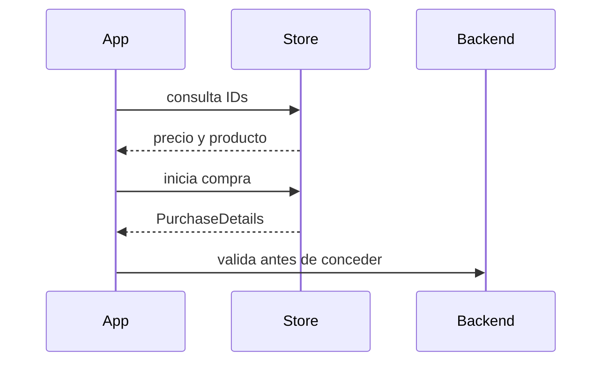
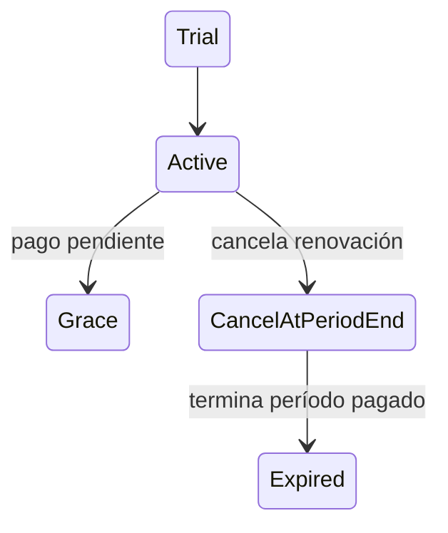
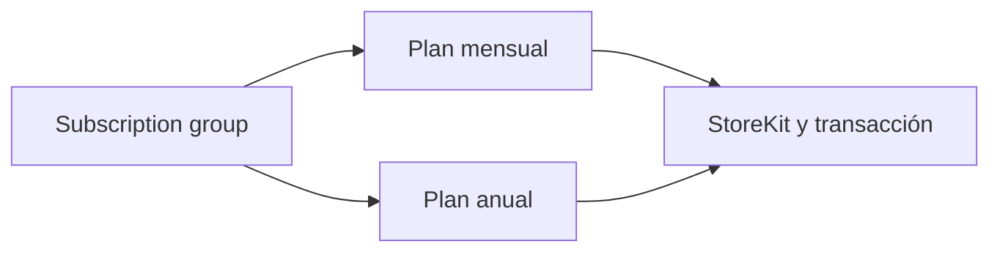
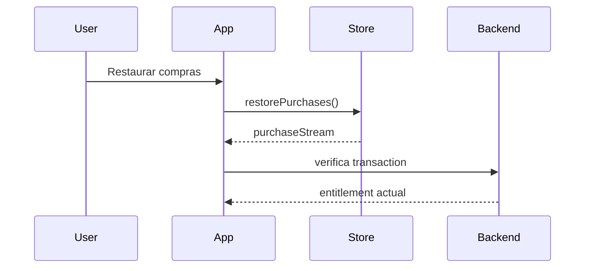
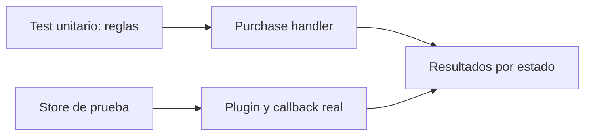
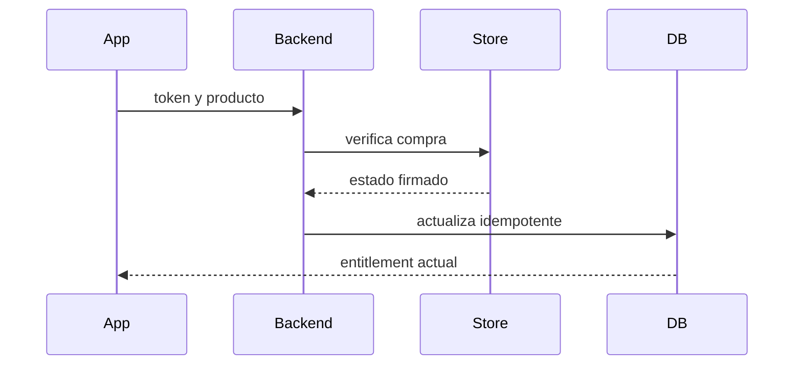

# Módulo 21: compras dentro de Flutter (IAP)

## Aprende construyendo

Vas a ofrecer un plan premium para RutaFlow, leer productos de las tiendas, procesar compras, restaurar acceso, probar sandbox y validar transacciones en backend. Apple y Google mantienen sus propios catálogos, estados y reglas. El plugin Flutter unifica llamadas comunes, pero no elimina esa configuración de plataforma.

---

### Tema 1: catálogo y flujo con `in_app_purchase`

#### Paso 1 · Objetivo y preparación
Al finalizar mostrarás productos del store y procesarás las actualizaciones con un listener activo. **Prerrequisitos:** futures, streams y configuración de aplicaciones Android/iOS. Crea un proyecto nuevo con `flutter create rutaflow_iap_lab`; agrega `in_app_purchase` con `flutter pub add in_app_purchase`.

**Ejemplo independiente:** parte de una carpeta vacía con `flutter create flutter_iap_1` y aplica solo los archivos de este tema; ejecuta después `cd flutter_iap_1` y `flutter analyze`.

#### Paso 2 · Contexto y caso real
La pantalla RutaFlow ofrece “RutaFlow Plus mensual” y “Quitar anuncios”. Los IDs de producto son contratos que se registran por separado en Play Console y App Store Connect. Si el catálogo no está listo o un ID no coincide, la tienda no devolverá ese producto.

#### ¿Por qué es importante?
El equipo necesita distinguir catálogo vacío, compra cancelada y pago aprobado. Si todos se muestran como error o éxito, puede perderse una compra o activarse contenido que no fue pagado.

#### Paso 3 · Teoría, modelo mental y analogía
La tienda es el registro del producto y el procesador de transacciones; Flutter pide productos y escucha cambios. No asumas que `buy...()` significa “ya pagó”. La compra llega por `purchaseStream`, se valida y, si corresponde, se confirma con `completePurchase`.

#### Paso 4 · Demostración guiada
Crea `lib/features/purchases/store.dart` y empieza a escuchar antes de solicitar productos:

```dart
import 'dart:async';
import 'package:in_app_purchase/in_app_purchase.dart';

class Store {
  Store(this._iap);
  final InAppPurchase _iap;
  StreamSubscription<List<PurchaseDetails>>? _subscription;

  void listen(Future<void> Function(PurchaseDetails) handle) {
    _subscription = _iap.purchaseStream.listen((purchases) async {
      for (final purchase in purchases) {
        await handle(purchase);
        if (purchase.pendingCompletePurchase) {
          await _iap.completePurchase(purchase);
        }
      }
    });
  }

  Future<List<ProductDetails>> products(Set<String> ids) async {
    final response = await _iap.queryProductDetails(ids);
    if (response.error != null) throw StateError(response.error!.message);
    if (response.notFoundIDs.isNotEmpty) {
      throw StateError('IDs no registrados: ${response.notFoundIDs.join(', ')}');
    }
    return response.productDetails;
  }

  Future<void> close() async => _subscription?.cancel();
}
```

Registra `iap.plus.monthly` y `iap.remove_ads` en las tiendas de prueba. Ejecuta `flutter run` en dispositivo/emulador con store configurado; observa título y precio localizados devueltos por `ProductDetails`.

#### Paso 5 · Práctica guiada

**Pista:** `purchaseStream` puede emitir después de cerrar el diálogo; compara cada `PurchaseStatus` y no dependas del resultado inmediato de `buyNonConsumable`.
Agrega un botón de compra no consumible con `buyNonConsumable` y revisa `PurchaseStatus` en el stream. **Pista:** `pending` debe mostrar espera, `canceled` volver a la pantalla y `error` mostrar un mensaje recuperable.

#### Paso 6 · Práctica independiente
Añade un consumible de créditos usando la API correspondiente; no lo modeles como una suscripción. Maneja stream errors y cierra la suscripción en `dispose`.


**Fallo deliberado:** Desregistra un ID de producto y observa `notFoundIDs` antes de corregirlo. Diagnostica el mensaje y corrige la causa antes de continuar.
#### Paso 7 · Cierre y evidencia

**Evidencia de aprendizaje:** entrega el archivo y el resultado observado de las variantes correcta y fallida. El siguiente tema amplía esta habilidad hacia el siguiente punto del flujo.
Entrega `store.dart`, IDs de sandbox y captura del producto leído; el siguiente tema configura suscripciones propias de Android.

**Prueba de diagnóstico.** Registra deliberadamente `iap.plus.montly` en el código con una letra faltante; la consulta debe mostrarlo en `notFoundIDs`.

```bash
flutter analyze
flutter test
```

**Resultado esperado:** un producto encontrado incluye nombre/precio de la tienda; el ID mal escrito no aparece. **Errores comunes:** empezar a escuchar después de iniciar compra y no completar transacción procesada. Diagrama: `catálogo -> purchaseStream -> validación -> entitlement -> completePurchase`. Fuentes oficiales: [plugin Flutter](https://pub.dev/packages/in_app_purchase), [in-app purchase Apple/Google](https://docs.flutter.dev/platform-integration/ios/ios-faq).

**Proyecto propio:** `rutaflow_iap_lab`. **Cuándo llamar éxito:** cuando la transacción llegó y se verificó; no al cerrar la hoja de pago. Evidencia de aprendizaje: entrega el log con estados pending, canceled y purchased usando sandbox.



---

### Tema 2: suscripciones Android, planes base y cambios

#### Paso 1 · Objetivo y preparación
Al finalizar separarás una suscripción de su plan base y comprobarás los estados que afectan al acceso. **Prerrequisitos:** Tema 1, catálogo Play y conceptos de backend. Crea un proyecto nuevo con `flutter create play_subscription_lab` y el archivo `docs/play-subscription-catalog.md`.

**Ejemplo independiente:** parte de una carpeta vacía con `flutter create flutter_iap_2` y aplica solo los archivos de este tema; ejecuta después `cd flutter_iap_2` y `flutter analyze`.

#### Paso 2 · Contexto y caso real
RutaFlow vende un plan mensual y uno anual con renovación automática. Google Play organiza una suscripción en base plans y ofertas; el usuario puede estar en prueba, activo, en grace period, pausado, cancelado al final o vencido. “Canceló” no siempre significa que el acceso terminó hoy.

#### ¿Por qué es importante?
Mostrar acceso revocado antes del vencimiento produce una mala experiencia; mantenerlo después de expirar deja el contenido sin entitlement. La app consulta la fuente de estado de la compra y aplica fechas/estados de Play.

#### Paso 3 · Teoría, modelo mental y analogía
El product ID identifica la suscripción. El base plan define precio/período y auto-renovación; offer puede definir prueba o precio introductorio. El token de compra identifica la transacción. Cambios entre planes usan el dato de suscripción anterior y el modo de reemplazo que corresponda.

#### Paso 4 · Demostración guiada
En Play Console de prueba crea `rutaflow_plus` con base plans mensual y anual y publica una versión en track interno. En `docs/play-subscription-catalog.md` anota IDs, región, período y política de reemplazo. Desde Flutter carga `ProductDetails` y revisa `productId`, precio localizado y datos específicos de Google Play sin fijar un precio en el código.

Cuando el stream informa compra aprobada, envía `purchaseToken` y `productId` al backend autenticado. El backend consulta Google Play Developer API; solo después decide si activa premium y registra la fecha de expiración.

#### Paso 5 · Práctica guiada

**Pista:** representa por separado renovación automática y vigencia actual; una cancelación puede dejar días de acceso pendientes.
Usa un usuario tester de licencia y verifica estados de compra, renovación, cancelación y vencimiento en sandbox. **Pista:** distinguir “auto-renew off” de “expired”; conserva entitlement hasta la fecha de vigencia indicada por Google.

#### Paso 6 · Práctica independiente
Prueba upgrade mensual→anual, reintento de pago y grace period. Documenta qué pantalla ve el usuario y cuál es el sistema responsable de cada estado.


**Fallo deliberado:** Repite deliberadamente una transacción/evento y comprueba que el estado no se duplica. Diagnostica el mensaje y corrige la causa antes de continuar.
#### Paso 7 · Cierre y evidencia

**Evidencia de aprendizaje:** entrega el archivo y el resultado observado de las variantes correcta y fallida. El siguiente tema amplía esta habilidad hacia el siguiente punto del flujo.
Entrega `play-subscription-catalog.md`, respuesta backend de verificación y un registro de los estados probados. El siguiente tema modela el catálogo Apple.

**Prueba de diagnóstico.** Configura deliberadamente un plan base con período equivocado; compara precio mostrado y duración recibida del backend antes de habilitar compra.

```bash
flutter test test/features/purchases/play_entitlement_test.dart
```

**Resultado esperado:** acceso continúa hasta el vencimiento validado, incluso si se canceló la renovación. **Errores comunes:** confiar en estado local, reconocer una compra sin verificación o tratar todos los cambios como compra nueva. Diagrama: `Product -> base plan -> offer -> purchaseToken -> estado backend`. Fuentes oficiales: [Play Billing integration](https://developer.android.com/google/play/billing/integrate), [verificación y prevención de fraude](https://developer.android.com/google/play/billing/security).

**Proyecto propio:** `play_subscription_lab`. **Cuándo usar una oferta:** cuando el producto y sus términos están explicados en la tienda y la elegibilidad se comprueba del lado correspondiente. Evidencia: entrega estado activo, cancelado aún vigente y expirado.



---

### Tema 3: suscripciones iOS con StoreKit

#### Paso 1 · Objetivo y preparación
Al finalizar organizarás planes de iOS y mostrarás el estado de la suscripción sin confundirlo con la configuración Android. **Prerrequisitos:** Tema 1, App Store Connect y Xcode/macOS. En un proyecto nuevo `flutter create ios_subscription_lab`, crea `docs/app-store-subscriptions.md`.

**Ejemplo independiente:** parte de una carpeta vacía con `flutter create flutter_iap_3` y aplica solo los archivos de este tema; ejecuta después `cd flutter_iap_3` y `flutter analyze`.

#### Paso 2 · Contexto y caso real
Apple agrupa planes relacionados en una subscription group. Una persona solo puede tener un producto activo de ese grupo a la vez; los niveles ordenados permiten cambios y prorrateo del plan. StoreKit puede enviar transacciones renovadas o actualizadas cuando la app ya estaba abierta.

#### ¿Por qué es importante?
Un plan visible con duración o precio incorrectos incumple expectativas y puede causar rechazo de revisión. La configuración de App Store Connect, las cadenas de producto y la presentación en Flutter tienen que coincidir.

#### Paso 3 · Teoría, modelo mental y analogía
El subscription group agrupa opciones que compiten entre sí. Product ID es una clave permanente; el nombre y precio dependen de la tienda/región. StoreKit 2 usa transacciones firmadas y estado actual; el plugin `in_app_purchase` las presenta en una API común y ofrece detalles específicos cuando hacen falta.

#### Paso 4 · Demostración guiada
En App Store Connect crea el grupo `RutaFlow Plus` con mensual y anual; prepara localizaciones, descripción, condiciones y screenshot de revisión. En Flutter consulta ambos IDs con `queryProductDetails`, muestra `ProductDetails.price` y llama `buyNonConsumable` para el plan seleccionado. Conserva los IDs como constantes no sensibles en `lib/features/purchases/product_ids.dart`.

Prueba en un dispositivo con StoreKit sandbox y observa el stream para compra, renovación y cancelación. El acceso persistente se deriva de entitlement vigente, no de que el botón haya regresado sin excepción.

#### Paso 5 · Práctica guiada

**Pista:** mensual y anual del mismo nivel suelen pertenecer al mismo grupo de suscripción; revisa el estado de la transacción en sandbox.
Prueba cambio entre niveles del mismo grupo, período de prueba y vencimiento acelerado de sandbox. **Pista:** verifica disponibilidad por storefront; un producto no disponible no es un precio de cero.

#### Paso 6 · Práctica independiente
Revisa texto de precio, período, renovación automática, condiciones y cómo cancelar desde ajustes. Documenta qué datos Apple proporciona en cada actualización y cuáles se consultan en backend.


**Fallo deliberado:** Repite deliberadamente una transacción/evento y comprueba que el estado no se duplica. Diagnostica el mensaje y corrige la causa antes de continuar.
#### Paso 7 · Cierre y evidencia

**Evidencia de aprendizaje:** entrega el archivo y el resultado observado de las variantes correcta y fallida. El siguiente tema amplía esta habilidad hacia el siguiente punto del flujo.
Entrega `app-store-subscriptions.md`, capturas del catálogo sandbox y estados procesados. El siguiente tema implementa restauración accesible desde cualquier dispositivo.

**Prueba de diagnóstico.** Provoca deliberadamente un error de catálogo cambiando el Product ID una letra; verifica que `notFoundIDs` lo identifique y no se muestre un plan falso.

```bash
flutter test test/features/purchases/product_catalog_test.dart
```

**Resultado esperado:** mensual/anual muestran importe localizado y grupo; sandbox publica la transacción en `purchaseStream`. **Errores comunes:** reutilizar ID de Android y ocultar los términos de renovación. Diagrama: `App Store Connect -> grupo -> producto -> StoreKit -> stream`. Fuentes oficiales: [StoreKit para compras](https://developer.apple.com/documentation/storekit/in-app-purchase), [gestión de compras](https://developer.apple.com/in-app-purchase/).

**Proyecto propio:** `ios_subscription_lab`. **Cuándo crear grupo nuevo:** cuando los productos no sean niveles alternativos del mismo servicio. Evidencia: entrega los dos IDs y recorrido sandbox en iOS.



---

### Tema 4: restauración de compras y entitlement

#### Paso 1 · Objetivo y preparación
Al finalizar recuperarás compras restaurables cuando la persona reinstala o cambia de dispositivo. **Prerrequisitos:** listener de compra, backend y diferencias entre consumible/no consumible. Crea `lib/features/purchases/restore_controller.dart` y un botón visible “Restaurar compras”.

**Ejemplo independiente:** parte de una carpeta vacía con `flutter create flutter_iap_4` y aplica solo los archivos de este tema; ejecuta después `cd flutter_iap_4` y `flutter analyze`.

#### Paso 2 · Contexto y caso real
Una persona pagó “Quitar anuncios” en su iPhone nuevo. Si el acceso dependía de `SharedPreferences`, la app muestra un bloqueo incorrecto. Un consumible ya gastado no vuelve del store como compra propia restaurable; el saldo se guarda en el backend.

#### ¿Por qué es importante?
Restaurar acceso protege la compra y reduce solicitudes a soporte. También evita conceder compras a otro usuario solo porque cambió una bandera local o porque una notificación se repitió.

#### Paso 3 · Teoría, modelo mental y analogía
`restorePurchases()` pide al store republicar transacciones restaurables en `purchaseStream`. La restauración no es un endpoint para leer inventario consumible. Procesa cada evento como una notificación nueva: valida y actualiza entitlement de forma idempotente en servidor.

#### Paso 4 · Demostración guiada
En `lib/features/purchases/restore_controller.dart`, llama:

```dart
import 'package:in_app_purchase/in_app_purchase.dart';

Future<void> restore(InAppPurchase iap) async {
  await iap.restorePurchases();
}
```

Usa el listener del Tema 1 para recibir objetos con estado restaurado, enviar su token al backend y pedir el entitlement vigente. Si no hay resultados, muestra “No encontramos compras para restaurar”; no infieras que falló el store.

#### Paso 5 · Práctica guiada

**Pista:** el backend manda sobre el entitlement; restaura productos no consumibles, pero conserva saldo consumible en tu propio registro.
Elimina datos locales, inicia sesión con el mismo usuario, pulsa restaurar y comprueba el producto no consumible. **Pista:** combina resultado de store con backend, porque algunos consumibles se gestionan fuera del store.

#### Paso 6 · Práctica independiente
Prueba usuario sin compras, transacción revocada y usuario diferente en el mismo dispositivo. Añade logs con transaction id opaco, sin guardar tokens o recibos en texto visible.


**Fallo deliberado:** Repite deliberadamente una transacción/evento y comprueba que el estado no se duplica. Diagnostica el mensaje y corrige la causa antes de continuar.
#### Paso 7 · Cierre y evidencia

**Evidencia de aprendizaje:** entrega el archivo y el resultado observado de las variantes correcta y fallida. El siguiente tema amplía esta habilidad hacia el siguiente punto del flujo.
Entrega botón, estado vacío y confirmación de entitlement restaurado. El siguiente tema construirá una prueba repetible de tienda.

**Prueba de diagnóstico.** Llama restaurar dos veces y provoca deliberadamente un evento duplicado; el backend debe conservar un solo entitlement.

```bash
flutter test test/features/purchases/restore_controller_test.dart
```

**Resultado esperado:** compra no consumible restituye acceso; saldo consumible depende del registro de RutaFlow. **Errores comunes:** usar restauración como chequeo de permisos en cada frame o sobreescribir estado del servidor con caché local. Diagrama: `botón -> store stream -> validación backend -> entitlement`. Fuente oficial: [in_app_purchase: restore](https://pub.dev/packages/in_app_purchase).

**Proyecto propio:** `lib/features/purchases/restore_controller.dart`. **Cuándo restaurar:** tras acción explícita y también al reconciliar una sesión, con límites para no duplicar peticiones. Evidencia: entrega tests de restaurado, vacío y repetido.



---

### Tema 5: pruebas de IAP en sandbox

#### Paso 1 · Objetivo y preparación
Al finalizar ejecutarás escenarios de compra sin cobrar a una cuenta de producción. **Prerrequisitos:** productos creados, app id correcto y listener. Crea `docs/iap-test-matrix.md` con un proyecto nuevo `flutter create iap_test_lab`.

**Ejemplo independiente:** parte de una carpeta vacía con `flutter create flutter_iap_5` y aplica solo los archivos de este tema; ejecuta después `cd flutter_iap_5` y `flutter analyze`.

#### Paso 2 · Contexto y caso real
La compra puede completarse, cancelarse, quedar pendiente por aprobación familiar, fallar o reembolsarse. Probar solo el estado de éxito deja rutas que usuarios reales sí recorren.

#### ¿Por qué es importante?
Un flujo de pago que duplica un crédito o se cierra mientras está pendiente afecta dinero y confianza. Sandbox/licencia permite comprobar estados antes de operar en producción.

#### Paso 3 · Teoría, modelo mental y analogía
Un test unitario usa un fake de interfaz de tienda para las reglas; sandbox/track interno conecta al proveedor y verifica producto, permisos y callback reales. Son niveles de evidencia distintos. No se debe probar clickeando anuncios o compras reales desde una cuenta de usuario.

#### Paso 4 · Demostración guiada
Escribe `docs/iap-test-matrix.md` con filas: purchased, pending, canceled, error, restored, duplicate, refund/expiry. Para cada caso apunta preparación, señal de `PurchaseStatus`, llamada backend y entitlement esperado. Añade test de widget con fake `PurchaseRepository` que reproduzca purchased y canceled.

En Android agrega un license tester y usa la app publicada en un track de prueba. En Apple usa usuario Sandbox de App Store Connect o StoreKit Testing en Xcode; verifica que el bundle ID y los product IDs coinciden. Ejecuta `flutter test` para lógica y realiza el recorrido sandbox en dispositivo designado.

#### Paso 5 · Práctica guiada

**Pista:** anota sistema operativo, tipo de cuenta y track; una prueba fake no demuestra que la tienda sandbox complete una transacción.
Comprueba que el producto sigue bloqueado mientras la compra está pending y no se cobra en sandbox. **Pista:** conserva logs que separen cancelación de excepción.

#### Paso 6 · Práctica independiente
Prueba doble emisión, timeout de backend después de aprobación del store y transacción que llega al siguiente arranque. El flujo debe reconciliar estado sin cobrar dos veces ni perder la compra.


**Fallo deliberado:** Repite deliberadamente una transacción/evento y comprueba que el estado no se duplica. Diagnostica el mensaje y corrige la causa antes de continuar.
#### Paso 7 · Cierre y evidencia

**Evidencia de aprendizaje:** entrega el archivo y el resultado observado de las variantes correcta y fallida. El siguiente tema amplía esta habilidad hacia el siguiente punto del flujo.
Entrega matriz con resultado y target por fila. El siguiente tema conecta validación de store al backend.

**Prueba de diagnóstico.** Inyecta deliberadamente un `purchaseStream` repetido; la clave de transacción debe evitar una segunda entrega del producto.

```bash
flutter test test/features/purchases
```

**Resultado esperado:** los tests fake pasan; Android/iOS sandbox se reporta por separado con su sistema operativo. **Errores comunes:** contar prueba de widget como prueba de Play/App Store y omitir el estado pending. Fuentes oficiales: [Flutter in_app_purchase](https://pub.dev/packages/in_app_purchase), [Play test tracks](https://developer.android.com/google/play/billing/test), [StoreKit testing](https://developer.apple.com/documentation/storekit/in-app_purchase/testing-in-app-purchases-with-sandbox).

**Proyecto propio:** `iap_test_lab`. **Cuándo promover a producción:** después de reconciliar todas las filas de la matriz y la revisión de pricing/políticas. Evidencia de aprendizaje: entrega tests fake y capturas de sandbox.



---

### Tema 6: validación de transacciones en servidor

#### Paso 1 · Objetivo y preparación
Al finalizar verificarás una transacción con la tienda antes de habilitar premium y conciliarás renovaciones y reembolsos. **Prerrequisitos:** backend HTTP autenticado, storage transaccional y Módulo 10 de producción. Crea `docs/iap-server-contract.md`.

**Ejemplo independiente:** parte de una carpeta vacía con `flutter create flutter_iap_6` y aplica solo los archivos de este tema; ejecuta después `cd flutter_iap_6` y `flutter analyze`.

#### Paso 2 · Contexto y caso real
El cliente puede modificarse o repetir una petición. Una respuesta “purchased” del dispositivo es dato que validar, no prueba suficiente. Google recomienda enviar `purchaseToken` a backend y consultar Play Developer API; Apple ofrece transacciones firmadas, App Store Server API y notificaciones.

#### ¿Por qué es importante?
Un entitlement falso permite acceso no pagado; una renovación o reembolso no aplicado deja acceso incorrecto. Validar y reconciliar del lado servidor protege la cuenta incluso después de reinstalación.

#### Paso 3 · Teoría, modelo mental y analogía
El servidor recibe una referencia de compra y el usuario autenticado; consulta a la tienda, valida estado, producto, app/bundle y usuario, y escribe entitlement con clave idempotente. El secreto de Google service account y llaves de App Store Server se mantienen en infraestructura servidor.

#### Paso 4 · Demostración guiada
Define `POST /api/iap/verify` en el backend: entrada `{store, productId, purchaseTokenOrTransaction, transactionId}`; autentica sesión; valida formato; consulta Google Play Developer API o verifica la transacción Apple firmada; guarda el resultado una sola vez; devuelve entitlement y expiry. En Flutter crea `lib/features/purchases/verification_client.dart` y envía datos de compra más token de sesión.

Registra notificaciones de servidor (Google RTDN y App Store Server Notifications) para renovación, cancelación, revocación y reembolso. Concílialas de forma idempotente; no uses el webhook como petición del cliente.

#### Paso 5 · Práctica guiada

**Pista:** usa el identificador de transacción como clave idempotente y verifica el recibo/token en el servidor antes de cambiar el entitlement.
Envía token inválido, token de otra app y transacción duplicada. **Pista:** una respuesta negativa no llama a `completePurchase` como si la app hubiera entregado contenido; define recuperación/reintento por el estado actual.

#### Paso 6 · Práctica independiente
Diseña rotación de credenciales servidor, monitoreo de webhook retrasado, replay protection y panel de soporte que busca por transaction id. Evita guardar recibos completos más tiempo del necesario.


**Fallo deliberado:** Entrega un token no válido al backend de sandbox y confirma que no se concede acceso. Diagnostica el mensaje y corrige la causa antes de continuar.
#### Paso 7 · Cierre y evidencia

**Evidencia de aprendizaje:** entrega el archivo y el resultado observado de las variantes correcta y fallida. El siguiente tema amplía esta habilidad hacia el siguiente punto del flujo.
Entrega contrato, test con respuestas fixture firmada/sintética y trazabilidad de cambios de entitlement. Sin credenciales reales documenta que la integración remota está pendiente.

**Prueba de diagnóstico.** Repite deliberadamente la misma transacción con el mismo usuario; el servidor debe responder el entitlement existente sin crear una segunda concesión.

```bash
curl -i -X POST http://localhost:3000/api/iap/verify -H 'Authorization: Bearer demo-session' -H 'Content-Type: application/json' --data '{"store":"test","productId":"iap.plus.monthly","transactionId":"tx-demo-1"}'
```

**Resultado esperado:** el fixture aceptado devuelve entitlement; token inválido no lo activa y replay no duplica. **Errores comunes:** poner credencial de servicio en Flutter y confiar en el payload del cliente. Diagrama: `app -> API -> Apple/Google -> DB entitlement -> app`. Fuentes oficiales: [Play Billing security](https://developer.android.com/google/play/billing/security), [App Store Server API](https://developer.apple.com/documentation/appstoreserverapi), [App Store Server Notifications](https://developer.apple.com/documentation/appstoreservernotifications).

**Proyecto propio:** `docs/iap-server-contract.md`. **Cuándo activar entitlement:** después de verificación de tienda y controles de cuenta; la interfaz puede mostrar “validando” hasta entonces. Evidencia de aprendizaje: entrega prueba inválida, duplicada y aceptada.



---

## Referencias oficiales consultadas

- Flutter `in_app_purchase` [paquete y API](https://pub.dev/packages/in_app_purchase) y [cambios](https://pub.dev/packages/in_app_purchase/changelog)
- Android [integración Play Billing](https://developer.android.com/google/play/billing/integrate), [seguridad](https://developer.android.com/google/play/billing/security) y [pruebas](https://developer.android.com/google/play/billing/test)
- Apple [StoreKit](https://developer.apple.com/documentation/storekit/in-app-purchase), [App Store Server API](https://developer.apple.com/documentation/appstoreserverapi) y [Sandbox](https://developer.apple.com/documentation/storekit/in-app_purchase/testing-in-app-purchases-with-sandbox)
- Google Play [política de pagos](https://support.google.com/googleplay/android-developer/answer/9858738?hl=en)
