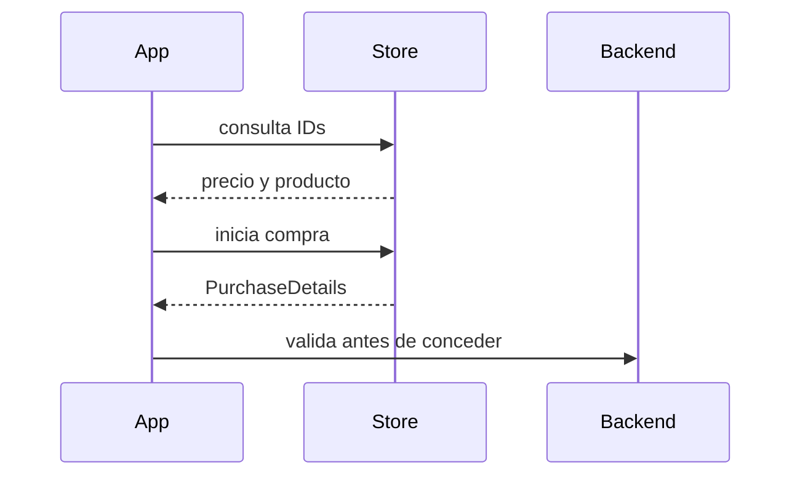
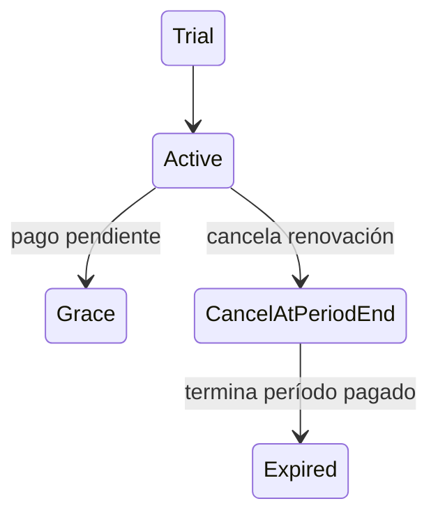
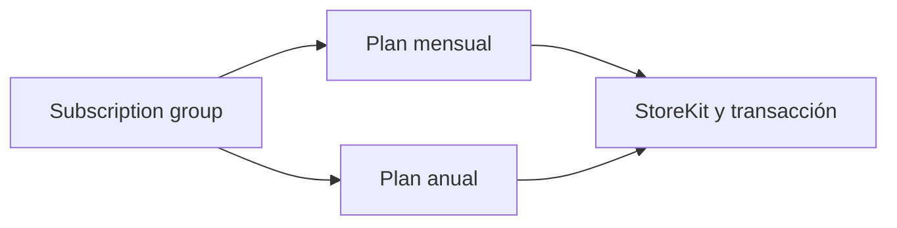
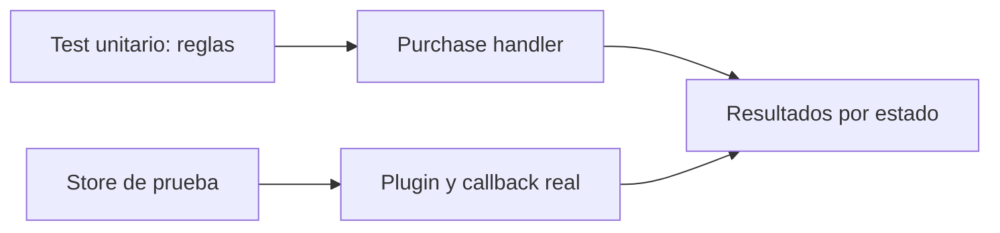
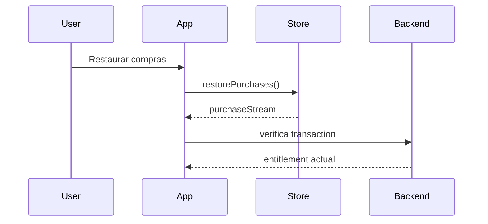
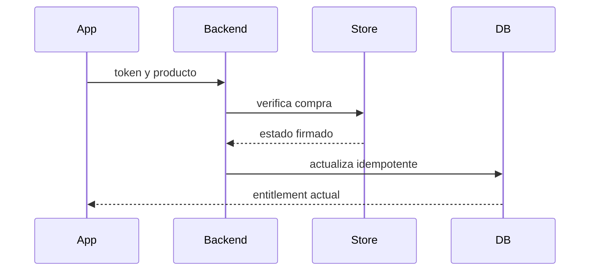

# Módulo 21: compras dentro de Flutter (IAP)

## Aprende construyendo

Vas a ofrecer un plan premium para RutaFlow, leer productos de las tiendas, procesar compras, restaurar acceso, probar sandbox y validar transacciones en backend. Apple y Google mantienen sus propios catálogos, estados y reglas. El plugin Flutter unifica llamadas comunes, pero no elimina esa configuración de plataforma.

---


### Tema 1: catálogo y flujo con `in_app_purchase` · Intermedio · 40 min

<details open>
<summary><strong>Capa 1 — Lectura</strong></summary>

#### ► DE QUÉ TRATA
Al finalizar mostrarás productos del store y procesarás las actualizaciones con un listener activo. Prerrequisitos: futures, streams y configuración de aplicaciones Android/iOS. Crea un proyecto nuevo con flutter create rutaflow_iap_lab; agrega in_app_purchase con flutter pub add…

#### ► LA IDEA EN UNA FRASE
**Al finalizar mostrarás productos del store y procesarás las actualizaciones con un listener activo.**

#### ► POR QUÉ EXISTE ESTO
Resuelve un problema real de diseño o implementación y evita decisiones a ciegas.

#### ► LA ANALOGÍA
Piensa en catálogo y flujo con `in_app_purchase` como una herramienta de taller: útil cuando conoces su propósito y sus límites.
**Dónde se rompe la analogía:** en software, los efectos dependen del contexto, la escala y los trade-offs.

#### ► CÓMO FUNCIONA


#### ► LO QUE PUEDE SALIR MAL
| Síntoma | Causa probable | Arreglo |
|---|---|---|
| catálogo y flujo con `in_app_purchase` se aplica pero el resultado no mejora | Se usó sin medir el problema real | Mide antes y compara contra la alternativa simple |
| Aparece complejidad inesperada | Se adoptó la técnica sin comprender sus trade-offs | Vuelve a la sección de trade-offs y reduce el alcance |
| Falla en un caso límite | Se asumió un contexto que no se cumple | Prueba el caso límite y documenta cuándo NO usarlo |

#### ► TRADE-OFFS
| Opción | Cuándo usarla | Cuándo NO usarla |
|---|---|---|
| Usar catálogo y flujo con `in_app_purchase` | Cuando el problema coincide con su propósito y el beneficio es observable | Cuando agrega complejidad sin resolver un problema real |
| Alternativa más simple | Cuando el contexto es pequeño, estable o fácil de razonar | Cuando ya demostró no escalar o no cumplir el requisito |
| Postergar la decisión | Cuando falta evidencia del problema | Cuando el costo de esperar es mayor que el costo de probar |

#### ► CUÁNDO NO USAR ESTO
No uses catálogo y flujo con `in_app_purchase` por defecto. Aplícalo cuando el problema lo justifique y puedas verificar el beneficio; si una alternativa más simple resuelve igual, prefiérela.

#### ► DE VUELTA A LA ANALOGÍA
Volviendo a la analogía: catálogo y flujo con `in_app_purchase` funciona como el modelo inicial, pero recuerda dónde se rompe: en producción importan la evidencia, la escala y el costo de equivocarte.

#### ► LO QUE DEBES RECORDAR
- catálogo y flujo con `in_app_purchase` existe para resolver un problema específico.
- Mide antes de adoptar complejidad.
- Conoce el caso donde NO usarlo.
- Verifica con evidencia observable.

#### ► PREGUNTAS PARA PENSAR
1. ¿Qué problema concreto resuelve catálogo y flujo con `in_app_purchase` en tu contexto?
2. ¿Cómo sabrías que catálogo y flujo con `in_app_purchase` no está funcionando bien?
3. ¿Qué alternativa más simple considerarías antes de usar catálogo y flujo con `in_app_purchase`?

</details>

<details>
<summary><strong>Capa 2 — Construcción</strong></summary>

#### Código y verificación
```dart
import 'dart:async';
import 'package:in_app_purchase/in_app_purchase.dart';

class Store {
  Store(this._iap);
  final InAppPurchase _iap;
  StreamSubscription<List<PurchaseDetails>>? _subscription;

  void listen(Future<void> Function(PurchaseDetails) handle) {
    _subscription = _iap.purchaseStream.listen((purchases) async {
      for (final purchase in purchases) {
        await handle(purchase);
        if (purchase.pendingCompletePurchase) {
          await _iap.completePurchase(purchase);
        }
      }
    });
  }

  Future<List<ProductDetails>> products(Set<String> ids) async {
    final response = await _iap.queryProductDetails(ids);
    if (response.error != null) throw StateError(response.error!.message);
    if (response.notFoundIDs.isNotEmpty) {
      throw StateError('IDs no registrados: ${response.notFoundIDs.join(', ')}');
    }
    return response.productDetails;
  }

  Future<void> close() async => _subscription?.cancel();
}
```

```bash
flutter analyze
flutter test
```


</details>

### Tema 2: suscripciones Android, planes base y cambios · Intermedio · 35 min

<details open>
<summary><strong>Capa 1 — Lectura</strong></summary>

#### ► DE QUÉ TRATA
Al finalizar separarás una suscripción de su plan base y comprobarás los estados que afectan al acceso. Prerrequisitos: Tema 1, catálogo Play y conceptos de backend. Crea un proyecto nuevo con flutter create play_subscription_lab y el archivo docs/play-subscription-catalog.md.

#### ► LA IDEA EN UNA FRASE
**Al finalizar separarás una suscripción de su plan base y comprobarás los estados que afectan al acceso.**

#### ► POR QUÉ EXISTE ESTO
Resuelve un problema real de diseño o implementación y evita decisiones a ciegas.

#### ► LA ANALOGÍA
Piensa en suscripciones android, planes base y cambios como una herramienta de taller: útil cuando conoces su propósito y sus límites.
**Dónde se rompe la analogía:** en software, los efectos dependen del contexto, la escala y los trade-offs.

#### ► CÓMO FUNCIONA


#### ► LO QUE PUEDE SALIR MAL
| Síntoma | Causa probable | Arreglo |
|---|---|---|
| suscripciones Android, planes base y cambios se aplica pero el resultado no mejora | Se usó sin medir el problema real | Mide antes y compara contra la alternativa simple |
| Aparece complejidad inesperada | Se adoptó la técnica sin comprender sus trade-offs | Vuelve a la sección de trade-offs y reduce el alcance |
| Falla en un caso límite | Se asumió un contexto que no se cumple | Prueba el caso límite y documenta cuándo NO usarlo |

#### ► TRADE-OFFS
| Opción | Cuándo usarla | Cuándo NO usarla |
|---|---|---|
| Usar suscripciones Android, planes base y cambios | Cuando el problema coincide con su propósito y el beneficio es observable | Cuando agrega complejidad sin resolver un problema real |
| Alternativa más simple | Cuando el contexto es pequeño, estable o fácil de razonar | Cuando ya demostró no escalar o no cumplir el requisito |
| Postergar la decisión | Cuando falta evidencia del problema | Cuando el costo de esperar es mayor que el costo de probar |

#### ► CUÁNDO NO USAR ESTO
No uses suscripciones android, planes base y cambios por defecto. Aplícalo cuando el problema lo justifique y puedas verificar el beneficio; si una alternativa más simple resuelve igual, prefiérela.

#### ► DE VUELTA A LA ANALOGÍA
Volviendo a la analogía: suscripciones android, planes base y cambios funciona como el modelo inicial, pero recuerda dónde se rompe: en producción importan la evidencia, la escala y el costo de equivocarte.

#### ► LO QUE DEBES RECORDAR
- suscripciones Android, planes base y cambios existe para resolver un problema específico.
- Mide antes de adoptar complejidad.
- Conoce el caso donde NO usarlo.
- Verifica con evidencia observable.

#### ► PREGUNTAS PARA PENSAR
1. ¿Qué problema concreto resuelve suscripciones android, planes base y cambios en tu contexto?
2. ¿Cómo sabrías que suscripciones android, planes base y cambios no está funcionando bien?
3. ¿Qué alternativa más simple considerarías antes de usar suscripciones android, planes base y cambios?

</details>

<details>
<summary><strong>Capa 2 — Construcción</strong></summary>

#### Código y verificación
```bash
flutter test test/features/purchases/play_entitlement_test.dart
```


</details>

### Tema 3: suscripciones iOS con StoreKit · Intermedio · 35 min

<details open>
<summary><strong>Capa 1 — Lectura</strong></summary>

#### ► DE QUÉ TRATA
Al finalizar organizarás planes de iOS y mostrarás el estado de la suscripción sin confundirlo con la configuración Android. Prerrequisitos: Tema 1, App Store Connect y Xcode/macOS. En un proyecto nuevo flutter create ios_subscription_lab, crea docs/app-store-subscriptions.md.

#### ► LA IDEA EN UNA FRASE
**Al finalizar organizarás planes de iOS y mostrarás el estado de la suscripción sin confundirlo con la configuración Android.**

#### ► POR QUÉ EXISTE ESTO
Resuelve un problema real de diseño o implementación y evita decisiones a ciegas.

#### ► LA ANALOGÍA
Piensa en suscripciones ios con storekit como una herramienta de taller: útil cuando conoces su propósito y sus límites.
**Dónde se rompe la analogía:** en software, los efectos dependen del contexto, la escala y los trade-offs.

#### ► CÓMO FUNCIONA


#### ► LO QUE PUEDE SALIR MAL
| Síntoma | Causa probable | Arreglo |
|---|---|---|
| suscripciones iOS con StoreKit se aplica pero el resultado no mejora | Se usó sin medir el problema real | Mide antes y compara contra la alternativa simple |
| Aparece complejidad inesperada | Se adoptó la técnica sin comprender sus trade-offs | Vuelve a la sección de trade-offs y reduce el alcance |
| Falla en un caso límite | Se asumió un contexto que no se cumple | Prueba el caso límite y documenta cuándo NO usarlo |

#### ► TRADE-OFFS
| Opción | Cuándo usarla | Cuándo NO usarla |
|---|---|---|
| Usar suscripciones iOS con StoreKit | Cuando el problema coincide con su propósito y el beneficio es observable | Cuando agrega complejidad sin resolver un problema real |
| Alternativa más simple | Cuando el contexto es pequeño, estable o fácil de razonar | Cuando ya demostró no escalar o no cumplir el requisito |
| Postergar la decisión | Cuando falta evidencia del problema | Cuando el costo de esperar es mayor que el costo de probar |

#### ► CUÁNDO NO USAR ESTO
No uses suscripciones ios con storekit por defecto. Aplícalo cuando el problema lo justifique y puedas verificar el beneficio; si una alternativa más simple resuelve igual, prefiérela.

#### ► DE VUELTA A LA ANALOGÍA
Volviendo a la analogía: suscripciones ios con storekit funciona como el modelo inicial, pero recuerda dónde se rompe: en producción importan la evidencia, la escala y el costo de equivocarte.

#### ► LO QUE DEBES RECORDAR
- suscripciones iOS con StoreKit existe para resolver un problema específico.
- Mide antes de adoptar complejidad.
- Conoce el caso donde NO usarlo.
- Verifica con evidencia observable.

#### ► PREGUNTAS PARA PENSAR
1. ¿Qué problema concreto resuelve suscripciones ios con storekit en tu contexto?
2. ¿Cómo sabrías que suscripciones ios con storekit no está funcionando bien?
3. ¿Qué alternativa más simple considerarías antes de usar suscripciones ios con storekit?

</details>

<details>
<summary><strong>Capa 2 — Construcción</strong></summary>

#### Código y verificación
```bash
flutter test test/features/purchases/product_catalog_test.dart
```


</details>

### Tema 4: pruebas de IAP en sandbox · Intermedio · 30 min

<details open>
<summary><strong>Capa 1 — Lectura</strong></summary>

#### ► DE QUÉ TRATA
Al finalizar ejecutarás escenarios de compra sin cobrar a una cuenta de producción. Prerrequisitos: productos creados, app id correcto y listener. Crea docs/iap-test-matrix.md con un proyecto nuevo flutter create iap_test_lab.

#### ► LA IDEA EN UNA FRASE
**Al finalizar ejecutarás escenarios de compra sin cobrar a una cuenta de producción.**

#### ► POR QUÉ EXISTE ESTO
Resuelve un problema real de diseño o implementación y evita decisiones a ciegas.

#### ► LA ANALOGÍA
Piensa en pruebas de iap en sandbox como una herramienta de taller: útil cuando conoces su propósito y sus límites.
**Dónde se rompe la analogía:** en software, los efectos dependen del contexto, la escala y los trade-offs.

#### ► CÓMO FUNCIONA


#### ► LO QUE PUEDE SALIR MAL
| Síntoma | Causa probable | Arreglo |
|---|---|---|
| pruebas de IAP en sandbox se aplica pero el resultado no mejora | Se usó sin medir el problema real | Mide antes y compara contra la alternativa simple |
| Aparece complejidad inesperada | Se adoptó la técnica sin comprender sus trade-offs | Vuelve a la sección de trade-offs y reduce el alcance |
| Falla en un caso límite | Se asumió un contexto que no se cumple | Prueba el caso límite y documenta cuándo NO usarlo |

#### ► TRADE-OFFS
| Opción | Cuándo usarla | Cuándo NO usarla |
|---|---|---|
| Usar pruebas de IAP en sandbox | Cuando el problema coincide con su propósito y el beneficio es observable | Cuando agrega complejidad sin resolver un problema real |
| Alternativa más simple | Cuando el contexto es pequeño, estable o fácil de razonar | Cuando ya demostró no escalar o no cumplir el requisito |
| Postergar la decisión | Cuando falta evidencia del problema | Cuando el costo de esperar es mayor que el costo de probar |

#### ► CUÁNDO NO USAR ESTO
No uses pruebas de iap en sandbox por defecto. Aplícalo cuando el problema lo justifique y puedas verificar el beneficio; si una alternativa más simple resuelve igual, prefiérela.

#### ► DE VUELTA A LA ANALOGÍA
Volviendo a la analogía: pruebas de iap en sandbox funciona como el modelo inicial, pero recuerda dónde se rompe: en producción importan la evidencia, la escala y el costo de equivocarte.

#### ► LO QUE DEBES RECORDAR
- pruebas de IAP en sandbox existe para resolver un problema específico.
- Mide antes de adoptar complejidad.
- Conoce el caso donde NO usarlo.
- Verifica con evidencia observable.

#### ► PREGUNTAS PARA PENSAR
1. ¿Qué problema concreto resuelve pruebas de iap en sandbox en tu contexto?
2. ¿Cómo sabrías que pruebas de iap en sandbox no está funcionando bien?
3. ¿Qué alternativa más simple considerarías antes de usar pruebas de iap en sandbox?

</details>

<details>
<summary><strong>Capa 2 — Construcción</strong></summary>

#### Código y verificación
```bash
flutter test test/features/purchases
```


</details>

### Tema 5: restauración de compras y entitlement · Avanzado · 35 min

<details open>
<summary><strong>Capa 1 — Lectura</strong></summary>

#### ► DE QUÉ TRATA
Al finalizar recuperarás compras restaurables cuando la persona reinstala o cambia de dispositivo. Prerrequisitos: listener de compra, backend y diferencias entre consumible/no consumible. Crea lib/features/purchases/restore_controller.dart y un botón visible “Restaurar compras”.

#### ► LA IDEA EN UNA FRASE
**Al finalizar recuperarás compras restaurables cuando la persona reinstala o cambia de dispositivo.**

#### ► POR QUÉ EXISTE ESTO
Resuelve un problema real de diseño o implementación y evita decisiones a ciegas.

#### ► LA ANALOGÍA
Piensa en restauración de compras y entitlement como una herramienta de taller: útil cuando conoces su propósito y sus límites.
**Dónde se rompe la analogía:** en software, los efectos dependen del contexto, la escala y los trade-offs.

#### ► CÓMO FUNCIONA


#### ► LO QUE PUEDE SALIR MAL
| Síntoma | Causa probable | Arreglo |
|---|---|---|
| restauración de compras y entitlement se aplica pero el resultado no mejora | Se usó sin medir el problema real | Mide antes y compara contra la alternativa simple |
| Aparece complejidad inesperada | Se adoptó la técnica sin comprender sus trade-offs | Vuelve a la sección de trade-offs y reduce el alcance |
| Falla en un caso límite | Se asumió un contexto que no se cumple | Prueba el caso límite y documenta cuándo NO usarlo |

#### ► TRADE-OFFS
| Opción | Cuándo usarla | Cuándo NO usarla |
|---|---|---|
| Usar restauración de compras y entitlement | Cuando el problema coincide con su propósito y el beneficio es observable | Cuando agrega complejidad sin resolver un problema real |
| Alternativa más simple | Cuando el contexto es pequeño, estable o fácil de razonar | Cuando ya demostró no escalar o no cumplir el requisito |
| Postergar la decisión | Cuando falta evidencia del problema | Cuando el costo de esperar es mayor que el costo de probar |

#### ► CUÁNDO NO USAR ESTO
No uses restauración de compras y entitlement por defecto. Aplícalo cuando el problema lo justifique y puedas verificar el beneficio; si una alternativa más simple resuelve igual, prefiérela.

#### ► DE VUELTA A LA ANALOGÍA
Volviendo a la analogía: restauración de compras y entitlement funciona como el modelo inicial, pero recuerda dónde se rompe: en producción importan la evidencia, la escala y el costo de equivocarte.

#### ► LO QUE DEBES RECORDAR
- restauración de compras y entitlement existe para resolver un problema específico.
- Mide antes de adoptar complejidad.
- Conoce el caso donde NO usarlo.
- Verifica con evidencia observable.

#### ► PREGUNTAS PARA PENSAR
1. ¿Qué problema concreto resuelve restauración de compras y entitlement en tu contexto?
2. ¿Cómo sabrías que restauración de compras y entitlement no está funcionando bien?
3. ¿Qué alternativa más simple considerarías antes de usar restauración de compras y entitlement?

</details>

<details>
<summary><strong>Capa 2 — Construcción</strong></summary>

#### Código y verificación
```dart
import 'package:in_app_purchase/in_app_purchase.dart';

Future<void> restore(InAppPurchase iap) async {
  await iap.restorePurchases();
}
```

```bash
flutter test test/features/purchases/restore_controller_test.dart
```


</details>

### Tema 6: validación de transacciones en servidor · Experto · 40 min

<details open>
<summary><strong>Capa 1 — Lectura</strong></summary>

#### ► DE QUÉ TRATA
Al finalizar verificarás una transacción con la tienda antes de habilitar premium y conciliarás renovaciones y reembolsos. Prerrequisitos: backend HTTP autenticado, storage transaccional y los dos módulos de producción de este curso (13 y 18). Crea docs/iap-server-contract.md.

#### ► LA IDEA EN UNA FRASE
**Al finalizar verificarás una transacción con la tienda antes de habilitar premium y conciliarás renovaciones y reembolsos.**

#### ► POR QUÉ EXISTE ESTO
Resuelve un problema real de diseño o implementación y evita decisiones a ciegas.

#### ► LA ANALOGÍA
Piensa en validación de transacciones en servidor como una herramienta de taller: útil cuando conoces su propósito y sus límites.
**Dónde se rompe la analogía:** en software, los efectos dependen del contexto, la escala y los trade-offs.

#### ► CÓMO FUNCIONA


#### ► LO QUE PUEDE SALIR MAL
| Síntoma | Causa probable | Arreglo |
|---|---|---|
| validación de transacciones en servidor se aplica pero el resultado no mejora | Se usó sin medir el problema real | Mide antes y compara contra la alternativa simple |
| Aparece complejidad inesperada | Se adoptó la técnica sin comprender sus trade-offs | Vuelve a la sección de trade-offs y reduce el alcance |
| Falla en un caso límite | Se asumió un contexto que no se cumple | Prueba el caso límite y documenta cuándo NO usarlo |

#### ► TRADE-OFFS
| Opción | Cuándo usarla | Cuándo NO usarla |
|---|---|---|
| Usar validación de transacciones en servidor | Cuando el problema coincide con su propósito y el beneficio es observable | Cuando agrega complejidad sin resolver un problema real |
| Alternativa más simple | Cuando el contexto es pequeño, estable o fácil de razonar | Cuando ya demostró no escalar o no cumplir el requisito |
| Postergar la decisión | Cuando falta evidencia del problema | Cuando el costo de esperar es mayor que el costo de probar |

#### ► CUÁNDO NO USAR ESTO
No uses validación de transacciones en servidor por defecto. Aplícalo cuando el problema lo justifique y puedas verificar el beneficio; si una alternativa más simple resuelve igual, prefiérela.

#### ► DE VUELTA A LA ANALOGÍA
Volviendo a la analogía: validación de transacciones en servidor funciona como el modelo inicial, pero recuerda dónde se rompe: en producción importan la evidencia, la escala y el costo de equivocarte.

#### ► LO QUE DEBES RECORDAR
- validación de transacciones en servidor existe para resolver un problema específico.
- Mide antes de adoptar complejidad.
- Conoce el caso donde NO usarlo.
- Verifica con evidencia observable.

#### ► PREGUNTAS PARA PENSAR
1. ¿Qué problema concreto resuelve validación de transacciones en servidor en tu contexto?
2. ¿Cómo sabrías que validación de transacciones en servidor no está funcionando bien?
3. ¿Qué alternativa más simple considerarías antes de usar validación de transacciones en servidor?

</details>

<details>
<summary><strong>Capa 2 — Construcción</strong></summary>

#### Código y verificación
```bash
curl -i -X POST http://localhost:3000/api/iap/verify -H 'Authorization: Bearer demo-session' -H 'Content-Type: application/json' --data '{"store":"test","productId":"iap.plus.monthly","transactionId":"tx-demo-1"}'
```


</details>
