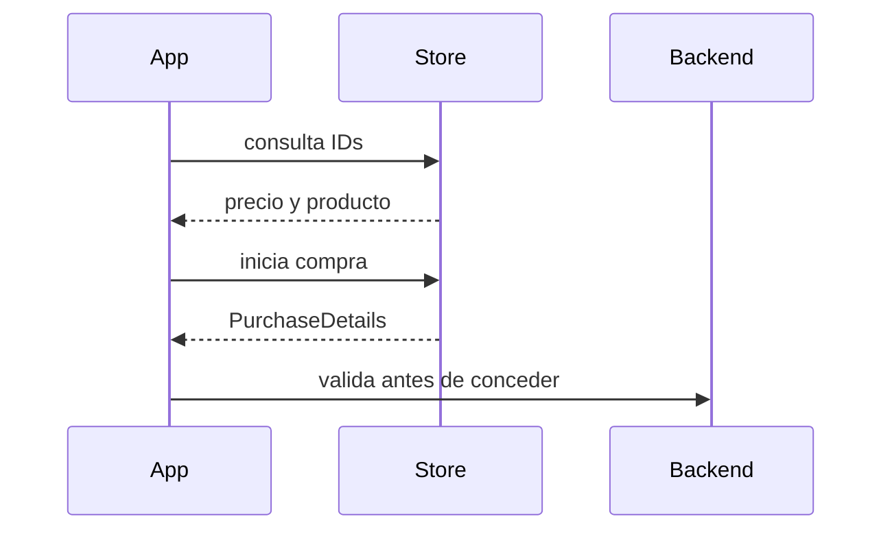
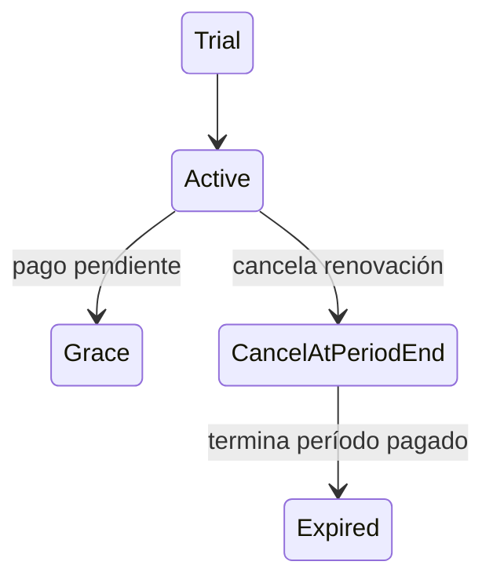
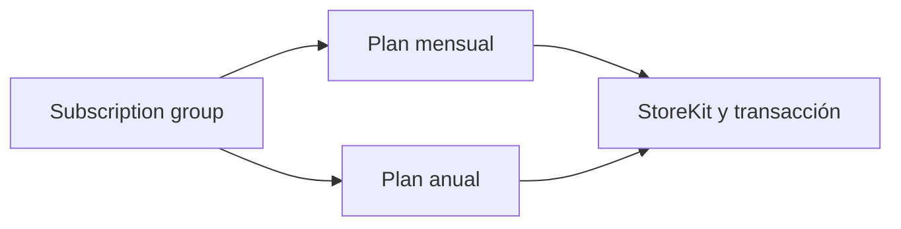
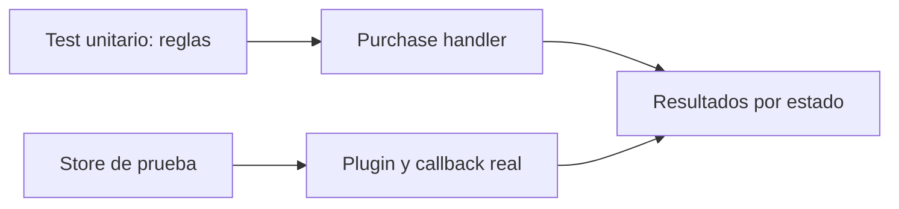
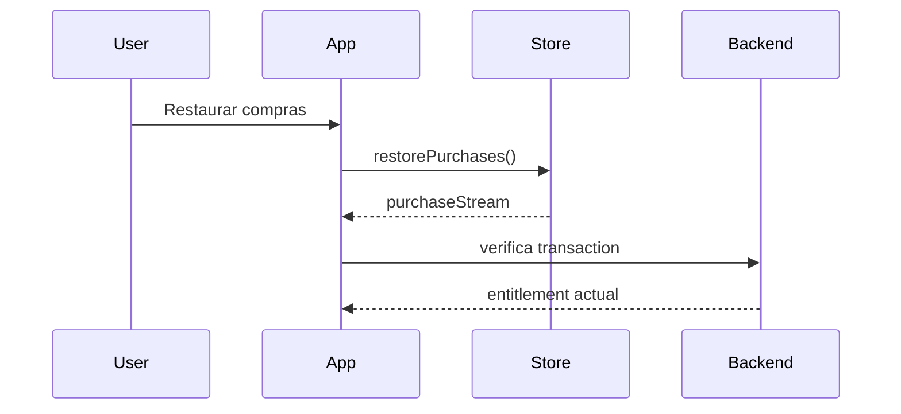
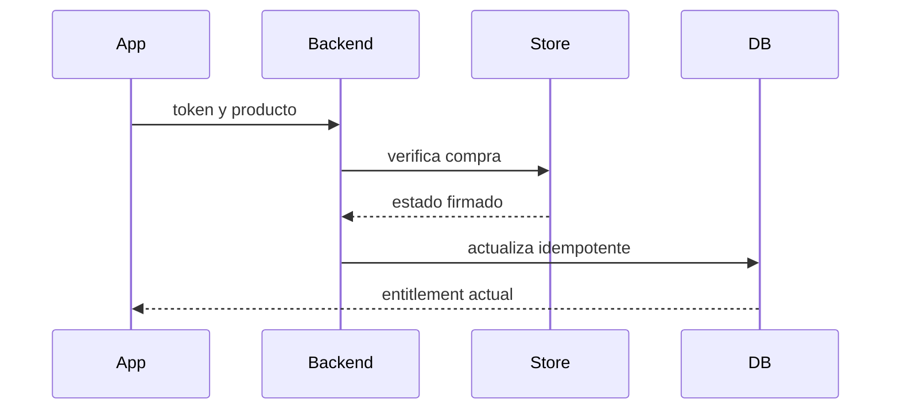

# Módulo 21: compras dentro de Flutter (IAP)

## Aprende construyendo

Vas a ofrecer un plan premium para RutaFlow, leer productos de las tiendas, procesar compras, restaurar acceso, probar sandbox y validar transacciones en backend. Apple y Google mantienen sus propios catálogos, estados y reglas. El plugin Flutter unifica llamadas comunes, pero no elimina esa configuración de plataforma.

---


### Tema 1: catálogo y flujo con `in_app_purchase` · Intermedio · 40 min

<details open>
<summary><strong>Capa 1 — Lectura</strong></summary>

#### ► DE QUÉ TRATA
Al finalizar mostrarás productos del store y procesarás las actualizaciones con un listener activo. Prerrequisitos: futures, streams y configuración de aplicaciones Android/iOS. Crea un proyecto nuevo con flutter create rutaflow_iap_lab; agrega in_app_purchase con flutter pub add…

#### ► CÓMO FUNCIONA


</details>

<details>
<summary><strong>Capa 2 — Construcción</strong></summary>

#### Código y verificación
```dart
import 'dart:async';
import 'package:in_app_purchase/in_app_purchase.dart';

class Store {
  Store(this._iap);
  final InAppPurchase _iap;
  StreamSubscription<List<PurchaseDetails>>? _subscription;

  void listen(Future<void> Function(PurchaseDetails) handle) {
    _subscription = _iap.purchaseStream.listen((purchases) async {
      for (final purchase in purchases) {
        await handle(purchase);
        if (purchase.pendingCompletePurchase) {
          await _iap.completePurchase(purchase);
        }
      }
    });
  }

  Future<List<ProductDetails>> products(Set<String> ids) async {
    final response = await _iap.queryProductDetails(ids);
    if (response.error != null) throw StateError(response.error!.message);
    if (response.notFoundIDs.isNotEmpty) {
      throw StateError('IDs no registrados: ${response.notFoundIDs.join(', ')}');
    }
    return response.productDetails;
  }

  Future<void> close() async => _subscription?.cancel();
}
```

```bash
flutter analyze
flutter test
```


</details>

### Tema 2: suscripciones Android, planes base y cambios · Intermedio · 35 min

<details open>
<summary><strong>Capa 1 — Lectura</strong></summary>

#### ► DE QUÉ TRATA
Al finalizar separarás una suscripción de su plan base y comprobarás los estados que afectan al acceso. Prerrequisitos: Tema 1, catálogo Play y conceptos de backend. Crea un proyecto nuevo con flutter create play_subscription_lab y el archivo docs/play-subscription-catalog.md.

#### ► CÓMO FUNCIONA


</details>

<details>
<summary><strong>Capa 2 — Construcción</strong></summary>

#### Código y verificación
```bash
flutter test test/features/purchases/play_entitlement_test.dart
```


</details>

### Tema 3: suscripciones iOS con StoreKit · Intermedio · 35 min

<details open>
<summary><strong>Capa 1 — Lectura</strong></summary>

#### ► DE QUÉ TRATA
Al finalizar organizarás planes de iOS y mostrarás el estado de la suscripción sin confundirlo con la configuración Android. Prerrequisitos: Tema 1, App Store Connect y Xcode/macOS. En un proyecto nuevo flutter create ios_subscription_lab, crea docs/app-store-subscriptions.md.

#### ► CÓMO FUNCIONA


</details>

<details>
<summary><strong>Capa 2 — Construcción</strong></summary>

#### Código y verificación
```bash
flutter test test/features/purchases/product_catalog_test.dart
```


</details>

### Tema 4: pruebas de IAP en sandbox · Intermedio · 30 min

<details open>
<summary><strong>Capa 1 — Lectura</strong></summary>

#### ► DE QUÉ TRATA
Al finalizar ejecutarás escenarios de compra sin cobrar a una cuenta de producción. Prerrequisitos: productos creados, app id correcto y listener. Crea docs/iap-test-matrix.md con un proyecto nuevo flutter create iap_test_lab.

#### ► CÓMO FUNCIONA


</details>

<details>
<summary><strong>Capa 2 — Construcción</strong></summary>

#### Código y verificación
```bash
flutter test test/features/purchases
```


</details>

### Tema 5: restauración de compras y entitlement · Avanzado · 35 min

<details open>
<summary><strong>Capa 1 — Lectura</strong></summary>

#### ► DE QUÉ TRATA
Al finalizar recuperarás compras restaurables cuando la persona reinstala o cambia de dispositivo. Prerrequisitos: listener de compra, backend y diferencias entre consumible/no consumible. Crea lib/features/purchases/restore_controller.dart y un botón visible “Restaurar compras”.

#### ► CÓMO FUNCIONA


</details>

<details>
<summary><strong>Capa 2 — Construcción</strong></summary>

#### Código y verificación
```dart
import 'package:in_app_purchase/in_app_purchase.dart';

Future<void> restore(InAppPurchase iap) async {
  await iap.restorePurchases();
}
```

```bash
flutter test test/features/purchases/restore_controller_test.dart
```


</details>

### Tema 6: validación de transacciones en servidor · Experto · 40 min

<details open>
<summary><strong>Capa 1 — Lectura</strong></summary>

#### ► DE QUÉ TRATA
Al finalizar verificarás una transacción con la tienda antes de habilitar premium y conciliarás renovaciones y reembolsos. Prerrequisitos: backend HTTP autenticado, storage transaccional y los dos módulos de producción de este curso (13 y 18). Crea docs/iap-server-contract.md.

#### ► CÓMO FUNCIONA


</details>

<details>
<summary><strong>Capa 2 — Construcción</strong></summary>

#### Código y verificación
```bash
curl -i -X POST http://localhost:3000/api/iap/verify -H 'Authorization: Bearer demo-session' -H 'Content-Type: application/json' --data '{"store":"test","productId":"iap.plus.monthly","transactionId":"tx-demo-1"}'
```


</details>
