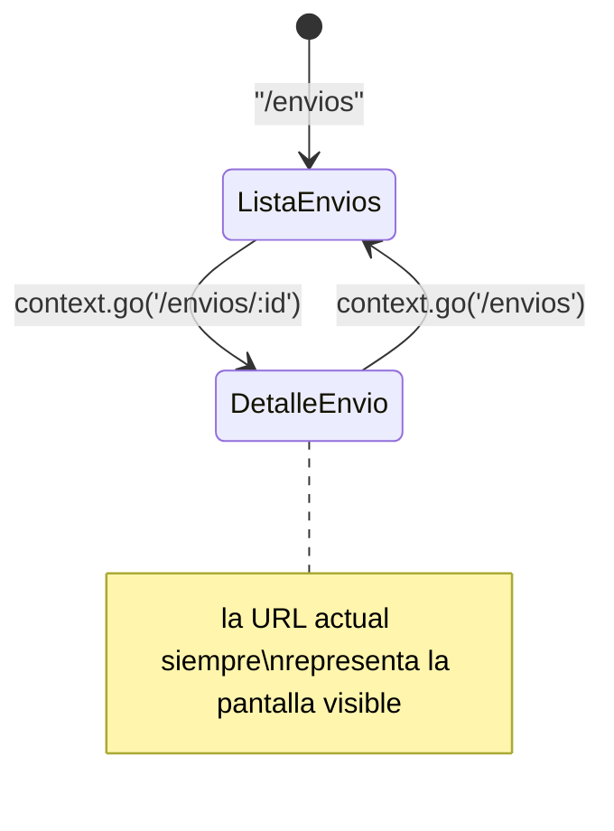
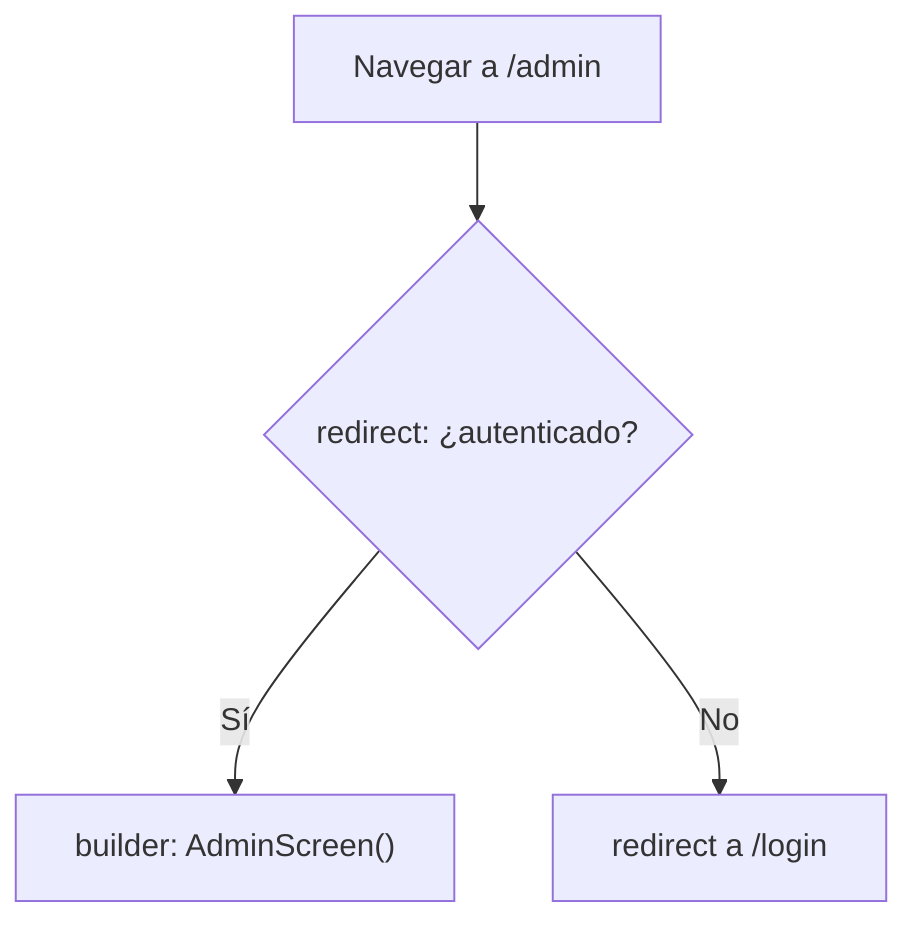
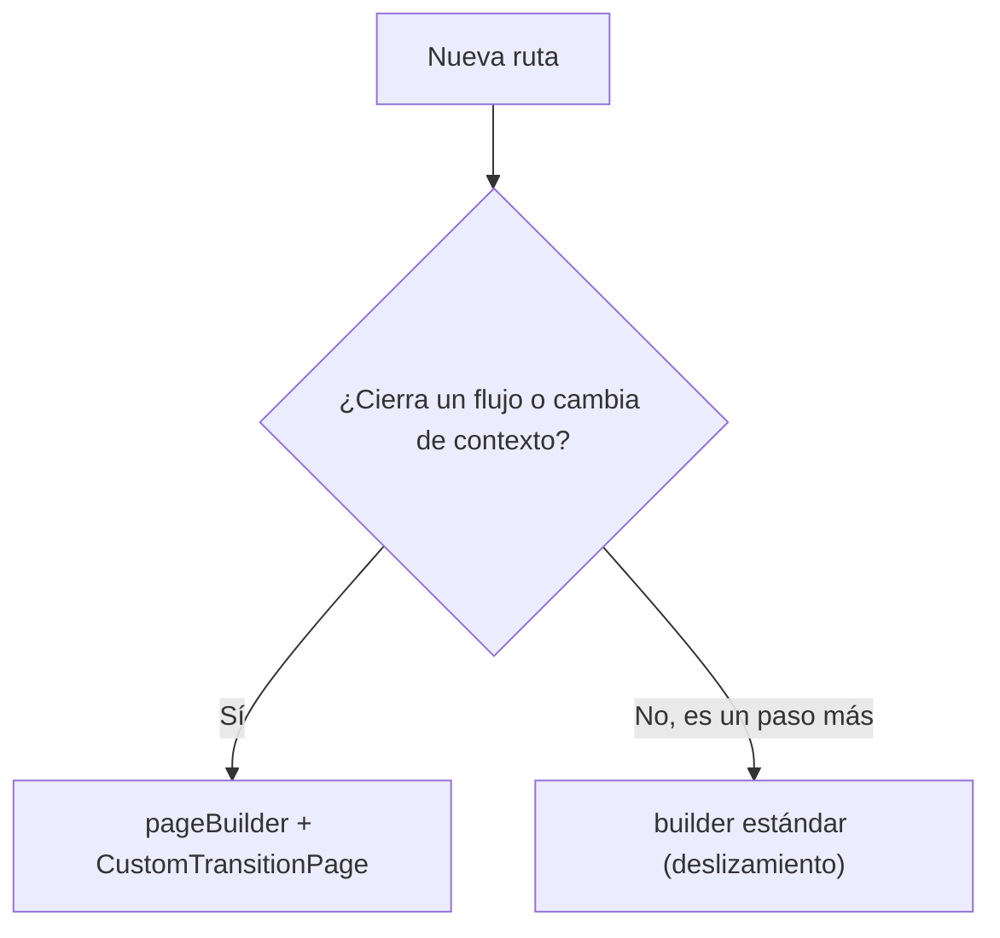

# Módulo 3: Navegación y rutas


## Aprende construyendo


### Tema 1: go_router: navegación como función de la URL · Intermedio · 35 min

<details open>
<summary><strong>Capa 1 — Lectura</strong></summary>

#### ► DE QUÉ TRATA
Al finalizar vas a reemplazar la navegación imperativa de RutaFlow (Navigator.push/pop) por go_router, donde /envios/:id sea la fuente de verdad de qué envío se muestra. Prerrequisitos: Módulo 2 completo.

#### ► CÓMO FUNCIONA


</details>

<details>
<summary><strong>Capa 2 — Construcción</strong></summary>

#### Código y verificación
```dart
final router = GoRouter(routes: [
  GoRoute(path: '/', builder: (context, state) => ListaTareasScreen()),
  GoRoute(
    path: '/tareas/:id',
    builder: (context, state) => DetalleTareaScreen(id: state.pathParameters['id']!),
  ),
]);
```

```dart
context.go('/tareas/42'); // navegación declarativa, la URL es la fuente de verdad
```


```dart
import 'package:flutter/material.dart';
import 'package:go_router/go_router.dart';

final router = GoRouter(initialLocation: '/envios', routes: [
  GoRoute(path: '/envios', builder: (context, state) => const ListaEnvios()),
  GoRoute(
    path: '/envios/:id',
    builder: (context, state) => DetalleEnvio(id: state.pathParameters['id']!),
  ),
]);

void main() => runApp(MaterialApp.router(routerConfig: router));

class ListaEnvios extends StatelessWidget {
  const ListaEnvios({super.key});

  @override
  Widget build(BuildContext context) => Scaffold(
        appBar: AppBar(title: const Text('Envíos')),
        body: ListTile(
          title: const Text('RF-4471'),
          // navegación declarativa, la URL es la fuente de verdad
          onTap: () => context.go('/envios/RF-4471'),
        ),
      );
}

class DetalleEnvio extends StatelessWidget {
  const DetalleEnvio({required this.id, super.key});
  final String id;

  @override
  Widget build(BuildContext context) => Scaffold(
        appBar: AppBar(title: Text('Envío $id')),
        body: Center(child: Text('Detalle de $id')),
      );
}
```

```bash
flutter create demo_flutter
cd demo_flutter
flutter pub add go_router
flutter run
```

</details>

### Tema 2: Guards y deep linking · Intermedio · 35 min

<details open>
<summary><strong>Capa 1 — Lectura</strong></summary>

#### ► DE QUÉ TRATA
Al finalizar vas a proteger /admin de RutaFlow con un redirect declarativo, y a confirmar que un deep link externo a /envios/RF-4471 abre directamente ese envío sin pasos manuales. Prerrequisitos: Tema 1 de este módulo.

#### ► CÓMO FUNCIONA


</details>

<details>
<summary><strong>Capa 2 — Construcción</strong></summary>

#### Código y verificación
```dart
GoRoute(
  path: '/admin',
  redirect: (context, state) => estaAutenticado ? null : '/login',
  builder: (context, state) => AdminScreen(),
)
```


```dart
import 'package:flutter/material.dart';
import 'package:go_router/go_router.dart';

bool estaAutenticadoComoSupervisor = false;

final router = GoRouter(initialLocation: '/admin', routes: [
  GoRoute(
    path: '/admin',
    redirect: (context, state) => estaAutenticadoComoSupervisor ? null : '/login',
    builder: (context, state) => const AdminScreen(),
  ),
  GoRoute(path: '/login', builder: (context, state) => const LoginScreen()),
  GoRoute(
    path: '/envios/:id',
    builder: (context, state) => Scaffold(body: Center(child: Text('Envío ${state.pathParameters['id']}'))),
  ),
]);

void main() => runApp(MaterialApp.router(routerConfig: router));

class AdminScreen extends StatelessWidget {
  const AdminScreen({super.key});

  @override
  Widget build(BuildContext context) => const Scaffold(body: Center(child: Text('Panel de supervisor')));
}

class LoginScreen extends StatelessWidget {
  const LoginScreen({super.key});

  @override
  Widget build(BuildContext context) => Scaffold(
        appBar: AppBar(title: const Text('Ingreso')),
        body: Center(
          child: FilledButton(
            onPressed: () {
              estaAutenticadoComoSupervisor = true;
              context.go('/admin');
            },
            child: const Text('Entrar como supervisor'),
          ),
        ),
      );
}
```

```bash
flutter create demo_flutter
cd demo_flutter
flutter pub add go_router
flutter run
```

</details>

### Tema 3: Transiciones personalizadas · Intermedio · 40 min

<details open>
<summary><strong>Capa 1 — Lectura</strong></summary>

#### ► DE QUÉ TRATA
Al finalizar vas a aplicar un fundido (FadeTransition) específicamente a la transición hacia la pantalla de confirmación exitosa, comunicando "este flujo terminó" en vez del deslizamiento estándar. Prerrequisitos: Tema 2 de este módulo.

#### ► LA ANALOGÍA
`pageBuilder` con `CustomTransitionPage` permite especificar explícitamente la animación de una ruta — un fundido comunica "esto reemplaza el contexto anterior" mejor que un deslizamiento lateral.
**Conceptos clave:** control explícito sobre la animación de transición entre pantallas.

```dart
GoRoute(
  path: '/detalle',
  pageBuilder: (context, state) => CustomTransitionPage(
    child: DetalleScreen(),
    transitionsBuilder: (context, animation, _, child) => FadeTransition(opacity: animation, child: child),
  ),
)
```

`pageBuilder` en vez del `builder` simple permite envolver la pantalla de destino en un `CustomTransitionPage`, especificando explícitamente cómo debe animarse la transición de entrada y salida de esa ruta (aquí, un fundido de opacidad en vez de la transición de deslizamiento estándar por defecto); esto es apropiado cuando la transición predeterminada de la plataforma no comunica correctamente la relación semántica entre dos pantallas (por ejemplo, un fundido puede comunicar mejor "esto reemplaza completamente el contexto anterior" que un deslizamiento lateral, que sugiere más bien "esto es un paso más profundo dentro del mismo flujo").

Personalizar transiciones de forma consistente en puntos clave de la app (no en absolutamente todas las rutas, lo que podría resultar en una experiencia inconsistente y confusa) refuerza la comunicación visual de la estructura de navegación percibida por el usuario, un detalle de pulido que distingue una app cuidadosamente diseñada de una que simplemente usa las transiciones por defecto sin ninguna consideración deliberada.

**Analogía:** una transición personalizada es como elegir deliberadamente el tipo de puerta apropiado para cada tipo de tránsito en un edificio (una puerta giratoria para tránsito continuo casual, una puerta de seguridad con verificación para un área restringida), comunicando visualmente la naturaleza de cada transición específica en vez de usar el mismo tipo de puerta genérica en todas partes sin ninguna distinción.

**¿Por qué es importante?** Las transiciones personalizadas, aplicadas deliberadamente en puntos clave, comunican mejor la relación semántica entre pantallas que la transición por defecto genérica, un detalle de pulido perceptible por el usuario aunque sutil.

**Diagrama: cuándo personalizar una transición**



En el proyecto integrador RutaFlow, la transición de confirmación vive en `lib/features/deliveries/presentation/confirmacion_exitosa.dart`. Practicá este criterio como ejercicio: identificá en tu proyecto propio una sola pantalla donde la transición por defecto comunique mal la relación entre pantallas, y aplicá ahí `CustomTransitionPage`.

---

#### ► CÓMO FUNCIONA


</details>

<details>
<summary><strong>Capa 2 — Construcción</strong></summary>

#### Código y verificación
```dart
GoRoute(
  path: '/detalle',
  pageBuilder: (context, state) => CustomTransitionPage(
    child: DetalleScreen(),
    transitionsBuilder: (context, animation, _, child) => FadeTransition(opacity: animation, child: child),
  ),
)
```


```dart
import 'package:flutter/material.dart';
import 'package:go_router/go_router.dart';

final router = GoRouter(initialLocation: '/envios/RF-4471', routes: [
  GoRoute(
    path: '/envios/:id',
    builder: (context, state) => DetalleEnvio(id: state.pathParameters['id']!),
  ),
  GoRoute(
    path: '/envios/:id/confirmado',
    pageBuilder: (context, state) => CustomTransitionPage(
      key: state.pageKey,
      child: const ConfirmacionExitosa(),
      transitionsBuilder: (context, animation, _, child) => FadeTransition(opacity: animation, child: child),
    ),
  ),
]);

void main() => runApp(MaterialApp.router(routerConfig: router));

class DetalleEnvio extends StatelessWidget {
  const DetalleEnvio({required this.id, super.key});
  final String id;

  @override
  Widget build(BuildContext context) => Scaffold(
        appBar: AppBar(title: Text('Envío $id')),
        body: Center(
          child: FilledButton(
            onPressed: () => context.go('/envios/$id/confirmado'),
            child: const Text('Confirmar entrega'),
          ),
        ),
      );
}

class ConfirmacionExitosa extends StatelessWidget {
  const ConfirmacionExitosa({super.key});

  @override
  Widget build(BuildContext context) => const Scaffold(
        body: Center(child: Icon(Icons.check_circle, size: 96, color: Colors.green)),
      );
}
```

```bash
flutter create demo_flutter
cd demo_flutter
flutter pub add go_router
flutter run
```

</details>
