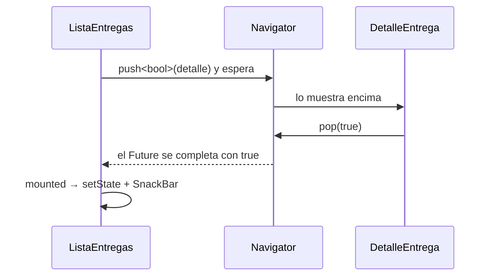
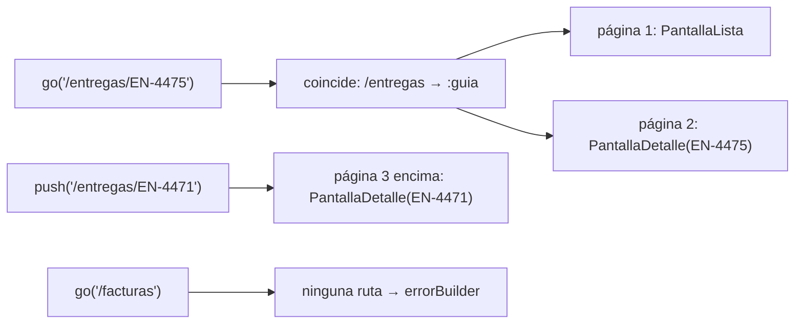
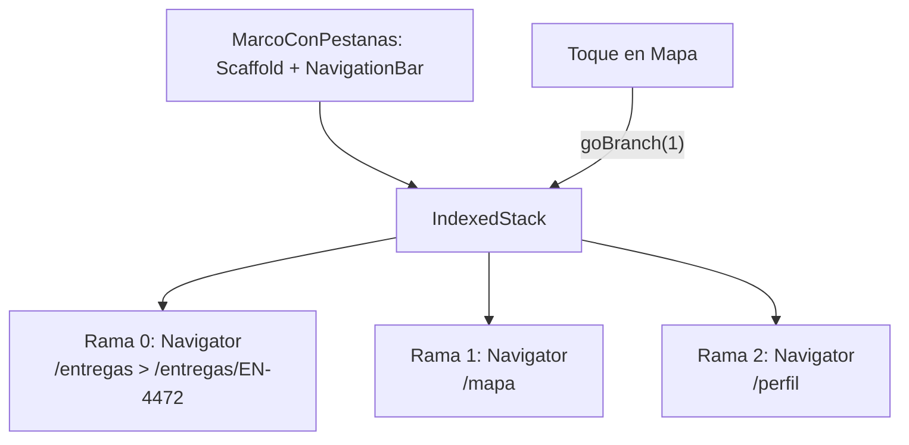
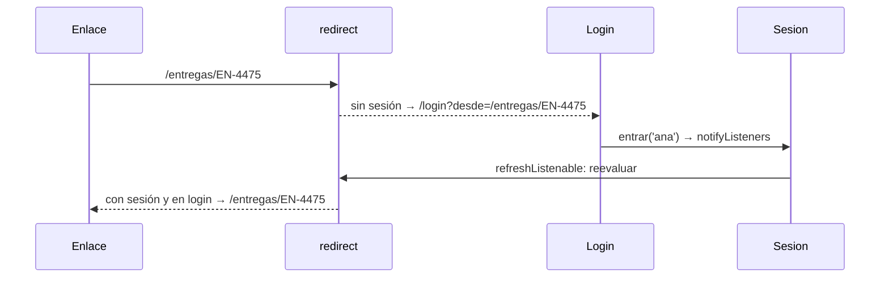
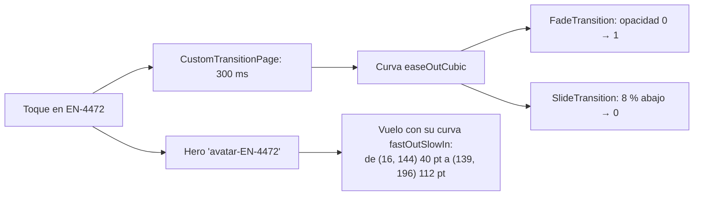
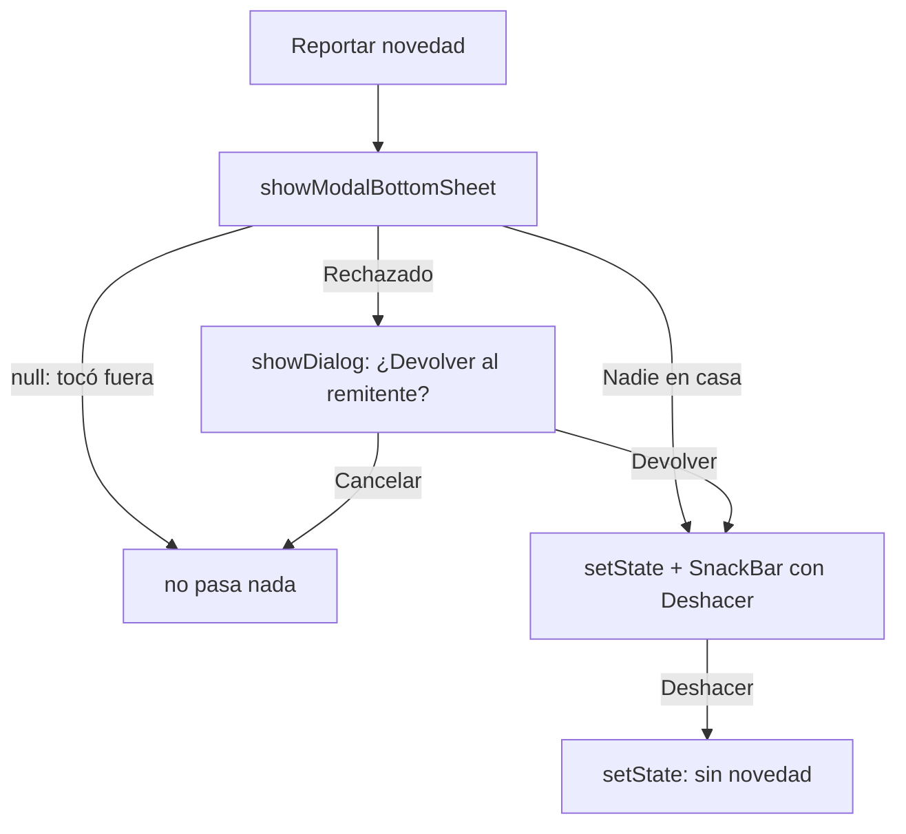

# Módulo 3: Navegación: pilas de pantallas, rutas con dirección y flujos con diseño

**Entorno comprobado para esta edición (2026-11-24):** Flutter 3.50.1 (canal estable) con Dart 3.14.0 en Linux
x86_64, con `material_ui` 1.11.1 y `go_router` 18.1.4. Todo el código se analizó con `flutter analyze` (`No issues
found!`) y se ejecutó con `flutter test` ese día, en `/home/estudiante/labs/flutter/m3` (tu `~/labs/flutter/m3`).
**Los pantallazos los dibujó Flutter** con la herramienta del Módulo 1 (`test/pantallazo.dart`); cuando una figura
muestra varios pasos de un mismo flujo, son pantallazos separados puestos uno al lado del otro. Las salidas de texto
son literales; los tiempos (`00:01`) cambian en tu equipo.

Una app de entregas no es una pantalla: es un recorrido. El conductor abre la lista, entra a una guía, reporta una
novedad, cambia al mapa y vuelve sin perder lo que estaba viendo; el despachador abre un enlace que le enviaron y llega
directo a la guía, pero solo después de iniciar sesión. Navegar bien es decidir qué pantalla se muestra, cómo llega
el usuario a ella, qué ocurre al volver y cómo se ve el paso de una a otra. Este módulo construye ese recorrido con
pantallazos de cada paso.

**Al terminar este módulo podrás:**
- abrir y cerrar pantallas con `Navigator`, pasarles datos y recibir un resultado;
- dar a cada pantalla una dirección con `go_router`, con parámetros y una pantalla de «no encontrada»;
- construir pestañas que conservan su propia pila con `StatefulShellRoute`;
- proteger rutas con `redirect` y llevar al usuario a donde iba después del login;
- diseñar la transición entre pantallas y animar un elemento compartido con `Hero`;
- elegir entre hoja inferior, diálogo y `SnackBar`, y usar sus resultados.

**Esquema del módulo:** Tema 1 (`Navigator`) → Tema 2 (`go_router`) → Tema 3 (pestañas con pila propia) → Tema 4
(guardias y enlaces directos) → Tema 5 (transiciones y `Hero`) → Tema 6 (hojas, diálogos y `SnackBar`) →
Proyecto 20.

**Qué necesitas saber antes:** el Módulo 2 completo, en especial **clases de ventana y `NavigationBar`** (Tema 4) y
**`SafeArea`** (Tema 5); del Módulo 1, **`StatefulWidget`**, **`mounted`** y **`dispose`** (Tema 4); del Módulo 0,
**`async` y `await`** (Tema 3).

**Qué no se repite:** crear el proyecto y la herramienta de pantallazos (Módulo 1); el diseño adaptable con
`NavigationRail` (Módulo 2, Tema 4), que aquí se combina con las rutas en el Proyecto 20. El estado compartido entre
pantallas (la sesión, las entregas) se trata a fondo en el Módulo 4; aquí se usa un `ChangeNotifier` mínimo.

**Prepara el proyecto.** Crea el proyecto como en el Módulo 1, agrega `go_router` y copia `test/pantallazo.dart`:

```text
$ cd ~/labs/flutter
$ flutter create --org com.academia --platforms=web,linux --empty m3
$ cd m3
$ flutter pub add go_router
```

Los datos de ejemplo de todos los temas están en un solo archivo:

```dart
// lib/datos.dart — datos de ejemplo compartidos por los temas del módulo
class Entrega {
  const Entrega(this.guia, this.destinatario, this.direccion);
  final String guia;
  final String destinatario;
  final String direccion;
}

const entregas = [
  Entrega('EN-4471', 'Marta Gómez', 'Calle 80 # 68-45'),
  Entrega('EN-4472', 'Luis Pardo', 'Carrera 15 # 93-20'),
  Entrega('EN-4475', 'Ana Ríos', 'Avenida 68 # 22-10'),
];

Entrega? buscarEntrega(String guia) {
  for (final e in entregas) {
    if (e.guia == guia) return e;
  }
  return null;
}
```

`lib/main.dart` abre la app con pestañas del Tema 3. Ejecútala con `flutter run -d chrome` y mira la barra de
direcciones del navegador mientras navegas.

```dart
// lib/main.dart — la app con pestañas del Tema 3; en el navegador, la barra de direcciones muestra cada ruta
import 'package:material_ui/material_ui.dart';

import 'tema3/pestanas.dart';

final _router = crearRouterConPestanas();

void main() => runApp(
      MaterialApp.router(
        debugShowCheckedModeBanner: false,
        theme: ThemeData(colorSchemeSeed: Colors.indigo),
        routerConfig: _router,
      ),
    );
```


## Aprende construyendo


### Tema 1: Navigator: abrir una pantalla, pasar datos y recibir un resultado · Básico · 40 min

<details open>
<summary><strong>Capa 1 — Lectura</strong></summary>

#### Objetivos
Al terminar este tema podrás:
- abrir una pantalla encima de otra con `Navigator.push` y cerrarla con `pop`;
- pasar datos a la pantalla nueva por su constructor;
- devolver un resultado al cerrar y esperarlo con `await`;
- comprobar `mounted` antes de usar el `context` después de esperar.

**Conceptos clave:** pila de navegación, ruta, `Navigator.push`, `Navigator.pop`, resultado de una ruta,
`NavigatorObserver`

#### El problema
El conductor toca una guía, ve el detalle y la marca como entregada. Al volver, la lista debe mostrar la marca y un
aviso. Si en cambio vuelve con la flecha, no debe pasar nada. ¿Cómo sabe la lista qué ocurrió en otra pantalla?

Este tema usa **`StatefulWidget`**, **`setState`** y **`mounted`** (Módulo 1, Tema 4) y **`Future` y `await`**
(Módulo 0, Tema 3).

#### Glosario del tema

**pila de navegación**
- **Definición técnica:** lista ordenada de rutas que mantiene un `Navigator`; la última es la visible y `pop` la quita.
- **En palabras sencillas:** una pila de hojas: ves la de arriba y, al quitarla, aparece la de abajo.
- **Dónde se rompe la comparación:** las rutas de abajo siguen vivas (con su estado), aunque no se vean.
- **Ejemplo:** `push: /` (la lista) y después `push: MaterialPageRoute<bool>` (el detalle).
- **Error típico:** creer que la lista se destruye al abrir el detalle; su `State` sigue ahí, por eso conserva `_entregadas`.

**ruta**
- **Definición técnica:** objeto (`Route`) que el `Navigator` pone en la pila; define qué pantalla construir y cómo animar su entrada y salida.
- **En palabras sencillas:** la pantalla más su forma de aparecer.
- **Dónde se rompe la comparación:** un diálogo o una hoja inferior también son rutas (Tema 6).
- **Ejemplo:** `MaterialPageRoute(builder: (_) => DetalleEntrega(entrega))`.
- **Error típico:** construir la pantalla fuera del `builder` y reutilizarla en otra ruta.

**`Navigator.push`**
- **Definición técnica:** método que agrega una ruta a la pila y devuelve un `Future` que se completa cuando esa ruta sale.
- **En palabras sencillas:** abrir una pantalla y quedarse esperando a que la cierren.
- **Dónde se rompe la comparación:** la espera no bloquea la app; el código después del `await` corre más tarde.
- **Ejemplo:** `await Navigator.of(context).push<bool>(...)`.
- **Error típico:** no indicar el tipo del resultado (`push<bool>`) y recibir `Object?`.

**`Navigator.pop`**
- **Definición técnica:** método que quita la ruta de arriba y completa su `Future` con el valor que se le pasa.
- **En palabras sencillas:** cerrar la pantalla y, si quieres, entregar una respuesta.
- **Dónde se rompe la comparación:** la flecha del `AppBar` y el botón «atrás» del sistema también llaman a `pop`, sin valor.
- **Ejemplo:** `Navigator.of(context).pop(true)`.
- **Error típico:** asumir que siempre llega un valor; con la flecha llega `null`.

**resultado de una ruta**
- **Definición técnica:** valor con el que se completa el `Future` de `push`: el que se pasó a `pop`, o `null`.
- **En palabras sencillas:** la respuesta que trae la pantalla al cerrarse.
- **Dónde se rompe la comparación:** cuando llega, la pantalla que preguntó puede ya no existir; por eso se comprueba `mounted`.
- **Ejemplo:** `if (entregada != true || !mounted) return;`.
- **Error típico:** usar `context` después del `await` sin comprobar `mounted`.

**`NavigatorObserver`**
- **Definición técnica:** clase que recibe avisos de cada cambio de la pila (`didPush`, `didPop`...); se registra en `navigatorObservers`.
- **En palabras sencillas:** un registro de entradas y salidas.
- **Dónde se rompe la comparación:** observa, no decide: no puede impedir una navegación.
- **Ejemplo:** la `Bitacora` de la prueba imprime cada `push` y `pop`.
- **Error típico:** usarlo para lógica de la app; sirve para analítica y diagnóstico.

#### ► CÓMO FUNCIONA
La lista llama a `push` y espera. El detalle aparece encima. Cuando el usuario toca el botón, `pop(true)` quita el
detalle y completa la espera con `true`; la lista vuelve a ejecutarse después del `await`, comprueba `mounted`,
actualiza su estado y muestra el aviso.



#### Problema resuelto 1.1
Abre el detalle de una guía, márcala como entregada y muestra el resultado en la lista. Comprueba que volver con la
flecha no marca nada.

**Razonamiento:**
1. La guía viaja al detalle por su constructor: `DetalleEntrega(entrega)`.
2. El detalle no sabe qué hará la lista con el resultado; solo devuelve `true`.
3. La lista guarda las guías entregadas en un `Set` dentro de su `State`.
4. La prueba registra la pila con un `NavigatorObserver` y usa `pageBack()` para simular la flecha.

```dart
// lib/tema1/pila.dart — Navigator imperativo: abrir una pantalla, pasarle datos y recibir un resultado
import 'package:material_ui/material_ui.dart';

import '../datos.dart';

class ListaEntregas extends StatefulWidget {
  const ListaEntregas({super.key});

  @override
  State<ListaEntregas> createState() => _ListaEntregasState();
}

class _ListaEntregasState extends State<ListaEntregas> {
  final _entregadas = <String>{};

  Future<void> _abrir(Entrega entrega) async {
    final entregada = await Navigator.of(context).push<bool>(       // espera hasta que el detalle se cierre
      MaterialPageRoute(builder: (_) => DetalleEntrega(entrega)),
    );
    if (entregada != true || !mounted) return;                    // volvió con «atrás» o la pantalla ya no existe
    setState(() => _entregadas.add(entrega.guia));
    ScaffoldMessenger.of(context).showSnackBar(SnackBar(content: Text('${entrega.guia} entregada')));
  }

  @override
  Widget build(BuildContext context) {
    return Scaffold(
      appBar: AppBar(title: const Text('Entregas')),
      body: ListView(
        children: [
          for (final e in entregas)
            ListTile(
              leading: Icon(_entregadas.contains(e.guia) ? Icons.check_circle : Icons.inventory_2_outlined),
              title: Text(e.guia),
              subtitle: Text(e.direccion),
              trailing: const Icon(Icons.chevron_right),
              onTap: () => _abrir(e),
            ),
        ],
      ),
    );
  }
}

class DetalleEntrega extends StatelessWidget {
  const DetalleEntrega(this.entrega, {super.key});
  final Entrega entrega;

  @override
  Widget build(BuildContext context) {
    final texto = Theme.of(context).textTheme;
    return Scaffold(
      appBar: AppBar(title: Text(entrega.guia)),                  // la flecha de volver la pone el AppBar
      body: Padding(
        padding: const EdgeInsets.all(16),
        child: Column(
          crossAxisAlignment: CrossAxisAlignment.start,
          children: [
            Text(entrega.destinatario, style: texto.titleLarge),
            const SizedBox(height: 4),
            Text(entrega.direccion, style: texto.bodyLarge),
            const SizedBox(height: 24),
            FilledButton.icon(
              onPressed: () => Navigator.of(context).pop(true),     // cierra y devuelve el resultado
              icon: const Icon(Icons.check),
              label: const Text('Marcar entregada'),
            ),
          ],
        ),
      ),
    );
  }
}
```

```dart
import 'package:flutter_test/flutter_test.dart';
import 'package:m3/tema1/pila.dart';
import 'package:material_ui/material_ui.dart';

import 'pantallazo.dart';

/// Observador que anota cada cambio de la pila de pantallas.
class Bitacora extends NavigatorObserver {
  @override
  void didPush(Route<dynamic> route, Route<dynamic>? previousRoute) =>
      debugPrint('push: ${route.settings.name ?? route.runtimeType}');
  @override
  void didPop(Route<dynamic> route, Route<dynamic>? previousRoute) =>
      debugPrint('pop:  ${route.runtimeType}');
}

void main() {
  setUpAll(cargarFuentes);

  testWidgets('abrir el detalle y volver con un resultado', (tester) async {
    tamanoPantalla(tester, tamano: const Size(390, 420));
    await tester.pumpWidget(MaterialApp(
      debugShowCheckedModeBanner: false,
      theme: ThemeData(colorSchemeSeed: Colors.indigo),
      navigatorObservers: [Bitacora()],
      home: const ListaEntregas(),
    ));
    await pantallazo('m3-t1-lista');

    await tester.tap(find.text('EN-4472'));
    await tester.pumpAndSettle();                                  // espera a que termine la animación
    await pantallazo('m3-t1-detalle');

    await tester.tap(find.text('Marcar entregada'));
    await tester.pumpAndSettle();
    debugPrint('SnackBar: ${find.text('EN-4472 entregada').evaluate().length}');
    await pantallazo('m3-t1-resultado');

    await tester.tap(find.text('EN-4475'));
    await tester.pumpAndSettle();
    await tester.pageBack();                                       // la flecha del AppBar: sin resultado
    await tester.pumpAndSettle();
    debugPrint('íconos de entregada: ${find.byIcon(Icons.check_circle).evaluate().length}');
  });
}
```

```text
$ flutter test test/tema1_test.dart
00:00 +0: loading /home/estudiante/labs/flutter/m3/test/tema1_test.dart
00:00 +0: (setUpAll)
00:00 +0: abrir el detalle y volver con un resultado
push: /
push: MaterialPageRoute<bool>
pop:  MaterialPageRoute<bool>
SnackBar: 1
push: MaterialPageRoute<bool>
pop:  MaterialPageRoute<bool>
íconos de entregada: 1
00:01 +1: (tearDownAll)
00:01 +1: All tests passed!
```


**Explicación por partes.**
- Línea 17: `push<bool>` declara el tipo del resultado; el `await` deja la función en pausa hasta que el detalle se
  cierre.
- Línea 20: `entregada != true` cubre los dos casos sin resultado (flecha y gesto de volver); `!mounted` cubre el caso
  en que la lista ya no existe.
- Línea 64: el detalle solo entrega la respuesta; la decisión de qué hacer es de la lista.
- En la salida, el segundo `push`/`pop` es el de `EN-4475` con la flecha: la lista sigue con un solo ícono de
  entregada.

> **Error común.** Pasar al detalle un objeto que el detalle modifica directamente (`entrega.estado = ...`). Funciona
> hasta que la lista no se reconstruye y muestra datos viejos. Devuelve un resultado o usa el estado compartido del
> Módulo 4.

> **Error común.** Llamar a `ScaffoldMessenger.of(context)` después de un `await` sin comprobar `mounted`. Si el
> usuario salió de la lista mientras tanto, el `context` ya no sirve y Flutter lanza un error.

> **Buena práctica.** El botón principal de una pantalla que se abre para tomar una decisión debe cerrarla y devolver
> la decisión. Quien la abrió muestra la confirmación (el `SnackBar`), porque es la pantalla que el usuario verá.

> **Prevenir errores.** Activa la regla `use_build_context_synchronously` (ya está en `flutter_lints`): el analizador
> avisa cuando usas un `context` después de un `await` sin comprobar `mounted`.

#### Checkpoint 1.1
Si el detalle llamara a `Navigator.of(context).pop('sí')`, ¿qué pasaría?

Respuesta: un error en ejecución: `A request was made to pop a route with a result of type String, but the route
expected a value of type bool.` La ruta se creó con `push<bool>`, y Flutter comprueba el tipo del resultado al
cerrarla.

</details>

<details>
<summary><strong>Capa 2 — Construcción</strong></summary>

#### Paso 1 · Crea los archivos
Crea `lib/datos.dart`, `lib/tema1/pila.dart` y `test/tema1_test.dart`.

#### Paso 2 · Ejecuta la prueba
Ejecuta `flutter test --update-goldens test/tema1_test.dart` y abre los tres pantallazos.

#### Paso 3 · Devuelve más información
Cambia el resultado a un `String?`: `'entregada'` o `'novedad'`, con un segundo botón «Reportar novedad» en el
detalle. Muestra un ícono distinto en la lista para cada caso.

#### Paso 4 · Cuenta las pantallas
Agrega a la `Bitacora` un contador que suba en `didPush` y baje en `didPop`, imprímelo en cada cambio y comprueba que
al final de la prueba vale 1 (solo la lista).

#### Paso 5 · Prueba el botón del sistema
Reemplaza `tester.pageBack()` por `tester.binding.handlePopRoute()` (el botón «atrás» de Android) y verifica que el
resultado es el mismo.

#### Resumen
- La **pila de navegación** guarda las **rutas** abiertas; la de arriba es la visible.
- **`Navigator.push`** abre y devuelve un `Future`; **`Navigator.pop`** cierra y entrega el **resultado de una ruta**.
- Después de esperar, comprueba `mounted` antes de usar el `context`.
- Un **`NavigatorObserver`** registra la navegación para diagnóstico y analítica.

#### Ejercicio verificable 1
Básico. ¿Qué imprime la prueba como resultado si el usuario abre `EN-4471` y vuelve con la flecha?

Respuesta esperada: `push: MaterialPageRoute<bool>` y `pop:  MaterialPageRoute<bool>`, sin cambios en la lista: el
resultado es `null` y la función sale en la línea 20.

#### Ejercicio verificable 2
Intermedio. Con el Paso 3, ¿qué tipo debe tener el `push` y qué devuelve la flecha?

Respuesta esperada: `push<String>`, y la flecha devuelve `null`. La lista debe tratar `null` como «no pasó nada».

#### Ejercicio verificable 3
Reto. Con el Paso 5, ¿qué devuelve `await tester.binding.handlePopRoute()` cuando estás en el detalle y cuando estás
en la lista?

Respuesta esperada: `true` en el detalle (el `Navigator` cerró una ruta) y `false` en la lista (no había nada que
cerrar; en un teléfono Android, el sistema cerraría la app).

#### En el trabajo
`Navigator.push` con resultado es la forma más simple de un flujo «elige y vuelve» (un selector, una confirmación,
una cámara), y sigue siendo útil dentro de apps con `go_router` para pantallas temporales que no necesitan dirección.
En una revisión de código se pregunta siempre: «¿qué pasa si el usuario vuelve sin elegir?».

</details>

### Tema 2: go_router: cada pantalla con su dirección · Intermedio · 45 min

<details open>
<summary><strong>Capa 1 — Lectura</strong></summary>

#### Objetivos
Al terminar este tema podrás:
- declarar las rutas de la app con `GoRouter`, `GoRoute` y rutas anidadas;
- leer parámetros de la dirección (`/entregas/:guia`);
- distinguir `go` (ir a una dirección) de `push` (apilar encima);
- mostrar una pantalla de «no encontrada» útil para direcciones inválidas.

**Conceptos clave:** enrutamiento declarativo, `GoRouter`, `GoRoute`, parámetro de ruta, `go` y `push`,
`errorBuilder`

#### El problema
Con `Navigator.push`, una pantalla solo existe si alguien la abrió desde otra. Pero en la web el usuario escribe la
dirección, en el teléfono llega un enlace desde un mensaje y en el soporte técnico alguien pregunta «¿en qué pantalla
estabas?». Las pantallas necesitan una dirección, y la app debe saber construir la pila completa a partir de ella.

Este tema usa **pila de navegación** y **ruta** (Tema 1).

#### Glosario del tema

**enrutamiento declarativo**
- **Definición técnica:** forma de navegar en la que la pila de pantallas se calcula a partir de un estado (aquí, la dirección actual), en lugar de construirse con llamadas sucesivas a `push`.
- **En palabras sencillas:** dices «quiero estar aquí» y la app arma el camino.
- **Dónde se rompe la comparación:** `go_router` también permite `push`, que agrega encima sin cambiar la idea base.
- **Ejemplo:** `go('/entregas/EN-4472')` produce la pila `/entregas > :guia`.
- **Error típico:** mezclar `Navigator.push` y `go_router` para pantallas con dirección; la dirección deja de reflejar lo que se ve.

**`GoRouter`**
- **Definición técnica:** objeto de configuración que traduce direcciones en pilas de páginas y que se entrega a `MaterialApp.router` como `routerConfig`.
- **En palabras sencillas:** el mapa de la app: qué pantalla corresponde a cada dirección.
- **Dónde se rompe la comparación:** también decide redirecciones (Tema 4), no solo traduce.
- **Ejemplo:** `GoRouter(initialLocation: '/entregas', routes: [...])`.
- **Error típico:** crearlo dentro de `build`: cada reconstrucción crea un router nuevo y se pierde la navegación.

**`GoRoute`**
- **Definición técnica:** una entrada del mapa: un patrón de ruta, un `builder` (o `pageBuilder`) y, opcionalmente, rutas hijas cuya pantalla se apila sobre la del padre.
- **En palabras sencillas:** «para esta dirección, esta pantalla».
- **Dónde se rompe la comparación:** las rutas hijas escriben su `path` sin `/` inicial, relativo al padre.
- **Ejemplo:** `GoRoute(path: ':guia', ...)` dentro de `/entregas`.
- **Error típico:** poner el detalle como ruta hermana (`/entregas/:guia` al mismo nivel): al abrirlo no hay lista debajo y la flecha de volver no aparece.

**parámetro de ruta**
- **Definición técnica:** segmento variable del patrón, escrito con dos puntos, que llega a la pantalla en `state.pathParameters`.
- **En palabras sencillas:** la parte de la dirección que cambia.
- **Dónde se rompe la comparación:** siempre llega como `String`; convertir y validar es tu trabajo.
- **Ejemplo:** `state.pathParameters['guia']` vale `EN-4472`.
- **Error típico:** asumir que el valor existe en los datos: `/entregas/EN-9999` coincide con la ruta, pero la guía no existe.

**`go` y `push`**
- **Definición técnica:** `go` reemplaza la ubicación y reconstruye la pila según las rutas; `push` agrega la pantalla de la dirección encima de la pila actual.
- **En palabras sencillas:** `go` es «llévame a esta dirección»; `push` es «ábrela encima».
- **Dónde se rompe la comparación:** después de `push`, la dirección muestra la de arriba, pero la pila no es la que produciría un `go` a esa dirección.
- **Ejemplo:** dos `go` seguidos dejan dos páginas; un `push` después deja tres.
- **Error típico:** usar `push` para todo y terminar con pilas de diez detalles.

**`errorBuilder`**
- **Definición técnica:** función de `GoRouter` que construye la pantalla cuando ninguna ruta coincide con la dirección.
- **En palabras sencillas:** la página de «esto no existe».
- **Dónde se rompe la comparación:** no cubre las direcciones que coinciden con una ruta pero apuntan a un dato inexistente; esas se resuelven en el `builder`.
- **Ejemplo:** `/facturas` usa `errorBuilder`; `/entregas/EN-9999`, el `builder` de `:guia`.
- **Error típico:** una pantalla de error sin salida; debe tener al menos un botón para volver a un lugar conocido.

#### ► CÓMO FUNCIONA
Cada vez que cambia la dirección, `GoRouter` busca la ruta que coincide, recorre sus padres y construye una página por
cada nivel. `go` recalcula toda la pila; `push` agrega una página encima de la actual.



#### Problema resuelto 2.1
Declara las rutas de la lista y el detalle, navega con `go` y con `push`, y comprueba qué pila queda en cada caso.
Muestra una pantalla de «no encontrada» para una guía que no existe y para una dirección que no existe.

**Razonamiento:**
1. El detalle es ruta hija de la lista: al abrirlo, la lista queda debajo y aparece la flecha de volver.
2. El `builder` del detalle busca la guía y, si no existe, muestra la misma pantalla que `errorBuilder`.
3. La prueba imprime `router.state.uri` (la dirección actual) y los nombres de las páginas del `Navigator`;
   `go_router` nombra cada página con el patrón de su ruta.
4. La pantalla de «no encontrada» repite la dirección y ofrece un camino de regreso.

```dart
// lib/tema2/rutas.dart — go_router: cada pantalla tiene una dirección (URL)
import 'package:go_router/go_router.dart';
import 'package:material_ui/material_ui.dart';

import '../datos.dart';

GoRouter crearRouter() => GoRouter(
      initialLocation: '/entregas',
      routes: [
        GoRoute(
          path: '/entregas',
          builder: (context, state) => const PantallaLista(),
          routes: [
            GoRoute(
              path: ':guia',                                         // /entregas/EN-4472
              builder: (context, state) {
                final entrega = buscarEntrega(state.pathParameters['guia']!);
                return entrega == null
                    ? PantallaNoEncontrada(state.uri.toString())     // la URL existe, la guía no
                    : PantallaDetalle(entrega);
              },
            ),
          ],
        ),
      ],
      errorBuilder: (context, state) => PantallaNoEncontrada(state.uri.toString()),   // ninguna ruta coincide
    );

class PantallaLista extends StatelessWidget {
  const PantallaLista({super.key});

  @override
  Widget build(BuildContext context) => Scaffold(
        appBar: AppBar(title: const Text('Entregas')),
        body: ListView(
          children: [
            for (final e in entregas)
              ListTile(
                title: Text(e.guia),
                subtitle: Text(e.direccion),
                trailing: const Icon(Icons.chevron_right),
                onTap: () => context.go('/entregas/${e.guia}'),
              ),
          ],
        ),
      );
}

class PantallaDetalle extends StatelessWidget {
  const PantallaDetalle(this.entrega, {super.key});
  final Entrega entrega;

  @override
  Widget build(BuildContext context) => Scaffold(
        appBar: AppBar(title: Text(entrega.guia)),
        body: ListTile(title: Text(entrega.destinatario), subtitle: Text(entrega.direccion)),
      );
}

class PantallaNoEncontrada extends StatelessWidget {
  const PantallaNoEncontrada(this.direccion, {super.key});
  final String direccion;

  @override
  Widget build(BuildContext context) {
    final texto = Theme.of(context).textTheme;
    return Scaffold(
      appBar: AppBar(title: const Text('No encontrada')),
      body: Center(
        child: Padding(
          padding: const EdgeInsets.all(24),
          child: Column(
            mainAxisSize: MainAxisSize.min,
            children: [
              Icon(Icons.search_off, size: 64, color: Theme.of(context).colorScheme.outline),
              const SizedBox(height: 16),
              Text('No encontramos esta página', style: texto.titleLarge),
              const SizedBox(height: 8),
              Text(direccion, style: texto.bodyMedium),
              const SizedBox(height: 24),
              FilledButton(onPressed: () => context.go('/entregas'), child: const Text('Ir a mis entregas')),
            ],
          ),
        ),
      ),
    );
  }
}
```

```dart
import 'package:flutter_test/flutter_test.dart';
import 'package:go_router/go_router.dart';
import 'package:m3/tema2/rutas.dart';
import 'package:material_ui/material_ui.dart';

import 'pantallazo.dart';

Future<GoRouter> abrir(WidgetTester tester) async {
  final router = crearRouter();
  addTearDown(router.dispose);
  await tester.pumpWidget(MaterialApp.router(
    debugShowCheckedModeBanner: false,
    theme: ThemeData(colorSchemeSeed: Colors.indigo),
    routerConfig: router,
  ));
  return router;
}

String pila(WidgetTester tester) =>
    tester.state<NavigatorState>(find.byType(Navigator).first).widget.pages.map((p) => p.name ?? '?').join(' > ');

void main() {
  setUpAll(cargarFuentes);

  testWidgets('go y push', (tester) async {
    final router = await abrir(tester);
    debugPrint('al abrir: ${router.state.uri}');

    router.go('/entregas/EN-4472');
    await tester.pumpAndSettle();
    debugPrint('go → ${router.state.uri}; páginas: ${pila(tester)}');

    router.go('/entregas/EN-4475');
    await tester.pumpAndSettle();
    debugPrint('go → ${router.state.uri}; páginas: ${pila(tester)}');

    router.push('/entregas/EN-4471');
    await tester.pumpAndSettle();
    debugPrint('push → ${router.state.uri}; páginas: ${pila(tester)}');

    router.pop();
    await tester.pumpAndSettle();
    debugPrint('pop → ${router.state.uri}');
  });

  testWidgets('direcciones que no existen', (tester) async {
    tamanoPantalla(tester, tamano: const Size(390, 520));
    final router = await abrir(tester);
    for (final destino in ['/entregas/EN-9999', '/facturas']) {
      router.go(destino);
      await tester.pumpAndSettle();
      debugPrint('$destino → ${find.text('No encontramos esta página').evaluate().length == 1 ? 'pantalla de no encontrada' : '¿?'}');
    }
    await pantallazo('m3-t2-no-encontrada');
  });
}
```

```text
$ flutter test test/tema2_test.dart
00:00 +0: loading /home/estudiante/labs/flutter/m3/test/tema2_test.dart
00:00 +0: (setUpAll)
00:00 +0: go y push
al abrir: /entregas
go → /entregas/EN-4472; páginas: /entregas > :guia
go → /entregas/EN-4475; páginas: /entregas > :guia
push → /entregas/EN-4471; páginas: /entregas > :guia > :guia
pop → /entregas/EN-4475
00:01 +1: direcciones que no existen
/entregas/EN-9999 → pantalla de no encontrada
/facturas → pantalla de no encontrada
00:01 +2: (tearDownAll)
00:01 +2: All tests passed!
```


**Explicación por partes.**
- Líneas 13–23: la ruta hija `:guia` hace que `/entregas/EN-4472` produzca dos páginas: la lista y el detalle.
- Línea 26: `errorBuilder` atiende `/facturas`, que no coincide con ninguna ruta.
- Línea 42: la lista navega con `go`. Dos `go` seguidos dejan siempre dos páginas: el segundo reemplaza al primero.
- El `push` agregó una tercera página; al hacer `pop`, la dirección volvió a `/entregas/EN-4475`.
- La pantalla de «no encontrada» sigue el sistema de diseño del Módulo 2: ícono en `outline`, título, explicación y
  una acción principal.

> **Error común.** Construir direcciones concatenando texto del usuario sin codificar (`'/buscar/$texto'`). Un espacio o
> una barra rompen la ruta. Usa parámetros de consulta (`Uri(path: ..., queryParameters: ...)`), como en el Tema 4.

> **Error común.** Crear el `GoRouter` en el `build` de la app. Cada reconstrucción (por ejemplo, al cambiar el tema)
> devuelve la app a `initialLocation`. Créalo una vez, fuera de `build`, como en `main.dart`.

> **Buena práctica.** Diseña las direcciones como si fueran públicas: cortas, legibles y estables
> (`/entregas/EN-4472`, no `/pantalla2?id=17`). Aparecen en enlaces, en la analítica y en los reportes de errores.

> **Prevenir errores.** Prueba en el CI las direcciones de los enlaces que envía la empresa (correos, mensajes): una
> prueba por enlace, que haga `go` y compruebe que no se muestra la pantalla de «no encontrada».

#### Checkpoint 2.1
Si escribes en el navegador `/entregas/EN-4472` y tocas la flecha de volver, ¿a dónde llegas?

Respuesta: a `/entregas`. Aunque el usuario nunca abrió la lista, la ruta hija hace que `go_router` la ponga debajo
del detalle.

</details>

<details>
<summary><strong>Capa 2 — Construcción</strong></summary>

#### Paso 1 · Agrega el paquete
Ejecuta `flutter pub add go_router` y crea `lib/tema2/rutas.dart` y `test/tema2_test.dart`.

#### Paso 2 · Ejecuta
Ejecuta `flutter test --update-goldens test/tema2_test.dart` y abre el pantallazo.

#### Paso 3 · Míralo en el navegador
Cambia temporalmente `main.dart` para usar `crearRouter()` y ejecuta `flutter run -d chrome`. Escribe
`/entregas/EN-4475` en la barra de direcciones.

#### Paso 4 · Agrega una ruta
Agrega `/entregas/:guia/evidencia` con una pantalla «Evidencia de EN-4472». Comprueba en una prueba qué páginas
produce.

#### Paso 5 · Usa nombres
Agrega `name: 'detalle'` a la ruta `:guia` y navega con `context.goNamed('detalle', pathParameters: {'guia': ...})`.

#### Resumen
- El **enrutamiento declarativo** construye la pila a partir de la dirección.
- **`GoRouter`** es el mapa; cada **`GoRoute`** asocia un patrón con una pantalla, y las rutas hijas se apilan.
- Un **parámetro de ruta** llega como texto y hay que validarlo.
- **`go` y `push`** se diferencian en si recalculan la pila o apilan encima; **`errorBuilder`** cubre las direcciones
  sin ruta.

#### Ejercicio verificable 1
Básico. ¿Qué pila produce `router.go('/entregas')`?

Respuesta esperada: una sola página, `/entregas`, porque la dirección coincide con la ruta raíz.

#### Ejercicio verificable 2
Intermedio. Con el Paso 4, ¿cuántas páginas produce `go('/entregas/EN-4472/evidencia')`?

Respuesta esperada: tres: la lista, el detalle y la evidencia, una por cada nivel de rutas anidadas.

#### Ejercicio verificable 3
Reto. Después de `push('/entregas/EN-4471')`, ¿qué muestra la dirección y qué muestra la pantalla si llamas a
`router.refresh()`?

Respuesta esperada: la dirección sigue en `/entregas/EN-4471` y la pila sigue con tres páginas: `refresh` vuelve a
evaluar las rutas con la configuración actual (incluidas las páginas apiladas con `push`), no reemplaza la pila por la
que produciría un `go`.

#### En el trabajo
`go_router` es el paquete de enrutamiento que mantiene el equipo de Flutter, y es el más usado en apps profesionales.
Las direcciones permiten enlaces profundos, analítica por pantalla y apps web con botón «atrás» del navegador. En las
entrevistas se pregunta con frecuencia la diferencia entre `go` y `push`.

</details>

### Tema 3: Pestañas que recuerdan: StatefulShellRoute y NavigationBar · Intermedio · 45 min

<details open>
<summary><strong>Capa 1 — Lectura</strong></summary>

#### Objetivos
Al terminar este tema podrás:
- mantener una barra de navegación fija mientras cambian las pantallas de encima;
- dar a cada pestaña su propia pila, que se conserva al cambiar de pestaña;
- volver al inicio de una pestaña al tocarla de nuevo;
- comprobar en una prueba que la pila de una pestaña sobrevive a la visita a otra.

**Conceptos clave:** ruta contenedora (*shell*), `StatefulShellRoute`, rama, `goBranch`, `IndexedStack`

#### El problema
El conductor abre el detalle de `EN-4472`, cambia al mapa para ver la calle y vuelve a «Entregas». Con un
`NavigationBar` que solo hace `go('/entregas')`, vuelve a la lista y tiene que buscar la guía otra vez. Cada pestaña
debe recordar dónde estaba, como en las apps de mensajes o de bancos.

Este tema usa **`NavigationBar`** (Módulo 2, Tema 4), **`go_router`** y **rutas hijas** (Tema 2).

#### Glosario del tema

**ruta contenedora (*shell*)**
- **Definición técnica:** ruta de `go_router` que envuelve a otras con una interfaz común (una barra, un riel) y les da su propio `Navigator`.
- **En palabras sencillas:** el marco fijo de la app, con las pantallas cambiando dentro.
- **Dónde se rompe la comparación:** el marco también se puede reconstruir (por ejemplo, para marcar la pestaña activa); lo que no se pierde es el estado de las pantallas.
- **Ejemplo:** `MarcoConPestanas` con el `NavigationBar`.
- **Error típico:** repetir el `NavigationBar` en cada pantalla: al navegar, la barra se anima junto con la pantalla.

**`StatefulShellRoute`**
- **Definición técnica:** ruta contenedora con varias ramas, cada una con su `Navigator` y su pila, que se conservan al cambiar de rama.
- **En palabras sencillas:** un marco con varias pilas independientes, una por pestaña.
- **Dónde se rompe la comparación:** las pilas se conservan mientras el marco exista; al cerrar la app, se reconstruyen desde la dirección.
- **Ejemplo:** `StatefulShellRoute.indexedStack(branches: [...])`.
- **Error típico:** usar `ShellRoute` (sin *Stateful*): el marco se comparte, pero las pestañas no recuerdan su pila.

**rama**
- **Definición técnica:** `StatefulShellBranch`: grupo de rutas con su propio `Navigator`; corresponde a una pestaña.
- **En palabras sencillas:** una pestaña con su historial.
- **Dónde se rompe la comparación:** una rama puede tener varias rutas raíz, aunque lo usual es una.
- **Ejemplo:** rama 0 con `/entregas` y `/entregas/:guia`.
- **Error típico:** poner el detalle en otra rama: al abrirlo, la app salta de pestaña.

**`goBranch`**
- **Definición técnica:** método de `StatefulNavigationShell` que activa una rama por índice; con `initialLocation: true`, la lleva a su ubicación inicial.
- **En palabras sencillas:** cambiar de pestaña, opcionalmente volviendo a su inicio.
- **Dónde se rompe la comparación:** no es un `go` con dirección: restaura la última dirección de esa rama.
- **Ejemplo:** tocar «Entregas» estando en «Mapa» vuelve a `/entregas/EN-4472`; tocarla otra vez, a `/entregas`.
- **Error típico:** navegar entre pestañas con `context.go('/entregas')`: se pierde la pila guardada.

**`IndexedStack`**
- **Definición técnica:** widget que mantiene construidos a todos sus hijos y muestra solo uno, según un índice.
- **En palabras sencillas:** varias hojas apiladas, todas vivas, con una sola a la vista.
- **Dónde se rompe la comparación:** que las pestañas sigan vivas consume memoria; con pestañas muy pesadas se evalúan alternativas.
- **Ejemplo:** `StatefulShellRoute.indexedStack` lo usa por dentro.
- **Error típico:** iniciar trabajo costoso (un temporizador, una descarga) en una pestaña oculta sin pausarlo.

#### ► CÓMO FUNCIONA
`StatefulShellRoute.indexedStack` crea un `Navigator` por rama y los pone en un `IndexedStack` dentro del marco. Al
tocar una pestaña, `goBranch` cambia el índice visible y la dirección pasa a la última ubicación de esa rama; las
otras ramas siguen con su pila intacta.



#### Problema resuelto 3.1
Construye la app con tres pestañas, abre un detalle en «Entregas», cambia a «Mapa» y vuelve. Comprueba la dirección en
cada paso y que tocar la pestaña activa vuelve a su inicio.

**Razonamiento:**
1. La lista y el detalle del Tema 2 se reutilizan dentro de la rama 0, con la misma ruta hija.
2. El marco recibe `navegacion` (el `StatefulNavigationShell`) y lo pone como cuerpo del `Scaffold`.
3. `initialLocation: i == navegacion.currentIndex` implementa «tocar la pestaña activa vuelve al inicio».
4. La prueba imprime `router.state.uri` después de cada toque.

```dart
// lib/tema3/pestanas.dart — pestañas con su propia pila: StatefulShellRoute y NavigationBar
import 'package:go_router/go_router.dart';
import 'package:material_ui/material_ui.dart';

import '../datos.dart';
import '../tema2/rutas.dart' show PantallaDetalle, PantallaLista;

GoRouter crearRouterConPestanas() => GoRouter(
      initialLocation: '/entregas',
      routes: [
        StatefulShellRoute.indexedStack(
          builder: (context, state, navegacion) => MarcoConPestanas(navegacion),
          branches: [
            StatefulShellBranch(routes: [                               // rama 0: entregas y su detalle
              GoRoute(
                path: '/entregas',
                builder: (context, state) => const PantallaLista(),
                routes: [
                  GoRoute(
                    path: ':guia',
                    builder: (context, state) => PantallaDetalle(buscarEntrega(state.pathParameters['guia']!)!),
                  ),
                ],
              ),
            ]),
            StatefulShellBranch(routes: [                               // rama 1: mapa
              GoRoute(path: '/mapa', builder: (context, state) => const PantallaSimple('Mapa', Icons.map_outlined)),
            ]),
            StatefulShellBranch(routes: [                               // rama 2: perfil
              GoRoute(path: '/perfil', builder: (context, state) => const PantallaSimple('Perfil', Icons.person_outline)),
            ]),
          ],
        ),
      ],
    );

/// El marco que no cambia: la barra inferior. Cada rama dibuja su pila encima.
class MarcoConPestanas extends StatelessWidget {
  const MarcoConPestanas(this.navegacion, {super.key});
  final StatefulNavigationShell navegacion;

  @override
  Widget build(BuildContext context) => Scaffold(
        body: navegacion,
        bottomNavigationBar: NavigationBar(
          selectedIndex: navegacion.currentIndex,
          onDestinationSelected: (i) => navegacion.goBranch(
            i,
            initialLocation: i == navegacion.currentIndex,           // tocar la pestaña activa vuelve a su inicio
          ),
          destinations: const [
            NavigationDestination(icon: Icon(Icons.local_shipping_outlined), label: 'Entregas'),
            NavigationDestination(icon: Icon(Icons.map_outlined), label: 'Mapa'),
            NavigationDestination(icon: Icon(Icons.person_outline), label: 'Perfil'),
          ],
        ),
      );
}

class PantallaSimple extends StatelessWidget {
  const PantallaSimple(this.titulo, this.icono, {super.key});
  final String titulo;
  final IconData icono;

  @override
  Widget build(BuildContext context) => Scaffold(
        appBar: AppBar(title: Text(titulo)),
        body: Center(child: Icon(icono, size: 96, color: Theme.of(context).colorScheme.outlineVariant)),
      );
}
```

```dart
import 'package:flutter_test/flutter_test.dart';
import 'package:m3/tema3/pestanas.dart';
import 'package:material_ui/material_ui.dart';

import 'pantallazo.dart';

void main() {
  setUpAll(cargarFuentes);

  testWidgets('cada pestaña conserva su pila', (tester) async {
    tamanoPantalla(tester, tamano: const Size(390, 520));
    final router = crearRouterConPestanas();
    addTearDown(router.dispose);
    await tester.pumpWidget(MaterialApp.router(
      debugShowCheckedModeBanner: false,
      theme: ThemeData(colorSchemeSeed: Colors.indigo),
      routerConfig: router,
    ));
    Future<void> paso(String accion, Future<void> Function() hacer) async {
      await hacer();
      await tester.pumpAndSettle();
      debugPrint('$accion → ${router.state.uri}');
    }

    await paso('tocar EN-4472', () => tester.tap(find.text('EN-4472')));
    await pantallazo('m3-t3-detalle-en-pestana');
    await paso('pestaña Mapa', () => tester.tap(find.text('Mapa').last));
    await pantallazo('m3-t3-mapa');
    await paso('pestaña Entregas', () => tester.tap(find.text('Entregas').last));
    await paso('Entregas otra vez', () => tester.tap(find.text('Entregas').last));
  });
}
```

```text
$ flutter test test/tema3_test.dart
00:00 +0: loading /home/estudiante/labs/flutter/m3/test/tema3_test.dart
00:00 +0: (setUpAll)
00:00 +0: cada pestaña conserva su pila
tocar EN-4472 → /entregas/EN-4472
pestaña Mapa → /mapa
pestaña Entregas → /entregas/EN-4472
Entregas otra vez → /entregas
00:01 +1: (tearDownAll)
00:01 +1: All tests passed!
```


**Explicación por partes.**
- Líneas 11–33: tres ramas; la primera tiene la lista y su detalle anidado.
- Líneas 47–50: `goBranch` cambia de rama; al volver a «Entregas», la dirección es `/entregas/EN-4472`, porque la rama
  conservó su pila.
- El segundo toque en «Entregas» llevó a `/entregas`: la pestaña ya estaba activa, así que volvió a su inicio. Es el
  comportamiento que esperan los usuarios de iOS y Android.
- El detalle tiene flecha de volver y la barra sigue abajo: la barra pertenece al marco, no a la pantalla.

> **Error común.** Esconder la barra inferior en pantallas internas sin intención. Si el detalle debe ocupar toda la
> pantalla (un formulario largo, la cámara), defínelo como ruta fuera del `StatefulShellRoute`, con
> `parentNavigatorKey` apuntando al `Navigator` raíz.

> **Error común.** Más de cinco pestañas. La barra se vuelve ilegible en pantallas compactas; agrupa destinos o usa
> un menú.

> **Buena práctica.** Cada pestaña debe ser un destino de primer nivel (Entregas, Mapa, Perfil), no un paso de un
> flujo. Los pasos van como rutas hijas dentro de una rama.

> **Prevenir errores.** Prueba siempre la secuencia «abrir detalle → otra pestaña → volver»: es donde se notan las
> pilas perdidas, y no aparece si solo pruebas cada pantalla por separado.

#### Checkpoint 3.1
Si en el marco cambias `goBranch(i, initialLocation: i == navegacion.currentIndex)` por `goBranch(i)`, ¿qué imprime el
último paso de la prueba?

Respuesta: `Entregas otra vez → /entregas/EN-4472`: sin `initialLocation`, tocar la pestaña activa no hace nada.

</details>

<details>
<summary><strong>Capa 2 — Construcción</strong></summary>

#### Paso 1 · Crea los archivos
Crea `lib/tema3/pestanas.dart` y `test/tema3_test.dart`.

#### Paso 2 · Ejecuta
Ejecuta `flutter test --update-goldens test/tema3_test.dart` y compara los dos pantallazos.

#### Paso 3 · Pruébala en vivo
Con el `main.dart` del módulo, ejecuta `flutter run -d chrome`, abre una guía, cambia de pestaña y usa el botón
«atrás» del navegador.

#### Paso 4 · Adapta el marco
Usa la `ClaseVentana` del Módulo 2 en `MarcoConPestanas`: `NavigationBar` en la compacta y `NavigationRail` con
`navegacion` a la derecha en las demás.

#### Paso 5 · Agrega una pantalla a pantalla completa
Crea una ruta `/camara` fuera del `StatefulShellRoute` y ábrela con `context.push('/camara')` desde el detalle.
Comprueba que la barra no aparece.

#### Resumen
- Una **ruta contenedora** mantiene el marco fijo; **`StatefulShellRoute`** le da una pila a cada **rama**.
- **`goBranch`** cambia de pestaña conservando su pila; con `initialLocation`, vuelve a su inicio.
- **`IndexedStack`** mantiene vivas las pestañas ocultas.

#### Ejercicio verificable 1
Básico. Desde `/mapa`, ¿a qué dirección lleva `goBranch(0)` si la rama 0 nunca se abrió?

Respuesta esperada: `/entregas`, la ubicación inicial de esa rama.

#### Ejercicio verificable 2
Intermedio. Con el Paso 4, ¿qué cambia en la prueba de este tema si la ventana mide 1100 de ancho?

Respuesta esperada: las direcciones son las mismas; solo cambia el componente de navegación (riel en lugar de barra).
La prueba debe tocar los destinos del riel: `find.text('Mapa').last` sigue funcionando porque el riel extendido
también muestra las etiquetas.

#### Ejercicio verificable 3
Reto. Con el Paso 5, ¿qué páginas tiene el `Navigator` raíz y qué tiene el de la rama 0 cuando la cámara está
abierta?

Respuesta esperada: el raíz tiene el marco y la cámara encima; el de la rama 0 conserva la lista y el detalle debajo.
Al cerrar la cámara se vuelve al detalle con la barra.

#### En el trabajo
Casi todas las apps con barra inferior usan este patrón, y es una de las primeras cosas que un usuario nota cuando
falla («cada vez que cambio de pestaña pierdo lo que estaba viendo»). En los equipos se documenta qué es pestaña y qué
es ruta hija como parte de la arquitectura de navegación.

</details>

### Tema 4: Guardias y enlaces directos: redirect, login y volver a donde ibas · Intermedio · 45 min

<details open>
<summary><strong>Capa 1 — Lectura</strong></summary>

#### Objetivos
Al terminar este tema podrás:
- impedir el acceso a rutas sin sesión con `redirect`;
- llevar al usuario, después del login, a la dirección que pidió;
- reevaluar las rutas cuando cambia la sesión con `refreshListenable`;
- diseñar una pantalla de login que se vea bien en teléfono y en computador.

**Conceptos clave:** `redirect`, guardia de ruta, enlace directo (*deep link*), `refreshListenable`, parámetro de
consulta

#### El problema
Al despachador le llega por mensaje el enlace `/entregas/EN-4475`. Si no tiene sesión, no debe ver la guía; debe ver
el login. Pero después de ingresar no quiere empezar desde la lista: quiere la guía que abrió. Y si la sesión vence
mientras trabaja, la app debe sacarlo sin que cada pantalla lo compruebe por su cuenta.

Este tema usa **`go_router`** (Tema 2), **`ChangeNotifier`** (se presenta aquí y se profundiza en el Módulo 4) y
**`ConstrainedBox`** (Módulo 2, Tema 1).

#### Glosario del tema

**`redirect`**
- **Definición técnica:** función de `GoRouter` que se ejecuta antes de cada navegación y devuelve otra dirección (para redirigir) o `null` (para seguir).
- **En palabras sencillas:** el portero que revisa a dónde vas antes de dejarte pasar.
- **Dónde se rompe la comparación:** se ejecuta también después de redirigir, así que debe evitar los ciclos.
- **Ejemplo:** sin sesión y fuera de `/login`, devuelve `/login?desde=...`.
- **Error típico:** redirigir a `/login` también cuando ya estás en `/login`: ciclo infinito de redirecciones.

**guardia de ruta**
- **Definición técnica:** regla que decide si una ruta se puede mostrar; en `go_router` se implementa con `redirect`, global o por ruta.
- **En palabras sencillas:** «esta puerta solo se abre con credencial».
- **Dónde se rompe la comparación:** la guardia protege la interfaz, no los datos; el servidor debe rechazar igual las peticiones sin permiso.
- **Ejemplo:** el `redirect` global de `crearRouterProtegido`.
- **Error típico:** confiar en la guardia como seguridad: alguien puede llamar a la API sin pasar por la app.

**enlace directo (*deep link*)**
- **Definición técnica:** dirección que abre la app (o la web) directamente en una pantalla interna, desde fuera: un mensaje, un correo, una notificación.
- **En palabras sencillas:** un atajo a una pantalla concreta.
- **Dónde se rompe la comparación:** en Android e iOS necesita configuración de la plataforma (*App Links*, *Universal Links*); la parte de Flutter es la misma que aquí.
- **Ejemplo:** `router.go('/entregas/EN-4475')` simula su llegada.
- **Error típico:** probar los enlaces solo con sesión iniciada.

**`refreshListenable`**
- **Definición técnica:** objeto `Listenable` que `GoRouter` escucha; cada vez que avisa un cambio, el router vuelve a ejecutar `redirect` con la ubicación actual.
- **En palabras sencillas:** el timbre que avisa al portero que algo cambió.
- **Dónde se rompe la comparación:** no navega por sí mismo; solo provoca que `redirect` decida de nuevo.
- **Ejemplo:** `Sesion` llama a `notifyListeners()` al entrar y al salir.
- **Error típico:** olvidarlo y ver que, tras el login, la app se queda en la pantalla de login.

**parámetro de consulta**
- **Definición técnica:** pares clave-valor después del `?` de una dirección (`?desde=...`), que llegan en `state.uri.queryParameters`.
- **En palabras sencillas:** datos extra que viajan en la dirección sin ser parte del camino.
- **Dónde se rompe la comparación:** se codifican: la barra `/` viaja como `%2F`.
- **Ejemplo:** `/login?desde=%2Fentregas%2FEN-4475`.
- **Error típico:** armar la dirección con texto (`'/login?desde=$destino'`) y romperla con caracteres especiales; `Uri(...)` codifica por ti.

#### ► CÓMO FUNCIONA
Cada navegación pasa por `redirect`. Sin sesión, cualquier dirección distinta del login se convierte en
`/login?desde=<la dirección pedida>`. Al ingresar, `Sesion` avisa; el router reevalúa `redirect` en `/login`, ve que
ya hay sesión y devuelve la dirección guardada en `desde`.



#### Problema resuelto 4.1
Protege las rutas de entregas, simula la llegada de un enlace sin sesión, ingresa y comprueba que llegas a la guía.
Cierra la sesión y comprueba que la app vuelve al login. Diseña el login para que no se estire en pantallas anchas.

**Razonamiento:**
1. `Sesion` es un `ChangeNotifier` mínimo con `entrar` y `salir`.
2. El `redirect` tiene dos reglas y un `null`; la condición `enLogin` evita el ciclo.
3. La dirección de destino viaja en `desde`, construida con `Uri` para codificarla.
4. El login centra un formulario con ancho máximo de 400 (`ConstrainedBox`), dentro de `SafeArea`.

```dart
// lib/tema4/guardia.dart — redirect: nadie entra sin sesión, y después del login vuelve a donde iba
import 'package:go_router/go_router.dart';
import 'package:material_ui/material_ui.dart';

import '../datos.dart';
import '../tema2/rutas.dart' show PantallaDetalle, PantallaLista, PantallaNoEncontrada;

class Sesion extends ChangeNotifier {
  String? usuario;
  bool get activa => usuario != null;

  void entrar(String nombre) {
    usuario = nombre;
    notifyListeners();                                    // avisa al router para que reevalúe el redirect
  }

  void salir() {
    usuario = null;
    notifyListeners();
  }
}

GoRouter crearRouterProtegido(Sesion sesion) => GoRouter(
      initialLocation: '/entregas',
      refreshListenable: sesion,
      redirect: (context, state) {
        final enLogin = state.matchedLocation == '/login';
        if (!sesion.activa && !enLogin) {
          return Uri(path: '/login', queryParameters: {'desde': state.uri.toString()}).toString();
        }
        if (sesion.activa && enLogin) return state.uri.queryParameters['desde'] ?? '/entregas';
        return null;                                      // null: seguir a donde iba
      },
      routes: [
        GoRoute(path: '/login', builder: (context, state) => PantallaLogin(sesion)),
        GoRoute(
          path: '/entregas',
          builder: (context, state) => const PantallaLista(),
          routes: [
            GoRoute(
              path: ':guia',
              builder: (context, state) {
                final entrega = buscarEntrega(state.pathParameters['guia']!);
                return entrega == null ? PantallaNoEncontrada(state.uri.toString()) : PantallaDetalle(entrega);
              },
            ),
          ],
        ),
      ],
    );

class PantallaLogin extends StatelessWidget {
  const PantallaLogin(this.sesion, {super.key});
  final Sesion sesion;

  @override
  Widget build(BuildContext context) {
    final texto = Theme.of(context).textTheme;
    final colores = Theme.of(context).colorScheme;
    return Scaffold(
      body: SafeArea(
        child: Center(
          child: ConstrainedBox(
            constraints: const BoxConstraints(maxWidth: 400),        // en pantallas anchas no se estira
            child: Padding(
              padding: const EdgeInsets.all(24),
              child: Column(
                mainAxisSize: MainAxisSize.min,
                crossAxisAlignment: CrossAxisAlignment.stretch,
                children: [
                  Icon(Icons.local_shipping, size: 56, color: colores.primary),
                  const SizedBox(height: 16),
                  Text('Entregas', style: texto.headlineMedium, textAlign: TextAlign.center),
                  const SizedBox(height: 8),
                  Text('Ingresa para ver tu ruta de hoy', style: texto.bodyMedium, textAlign: TextAlign.center),
                  const SizedBox(height: 32),
                  const TextField(decoration: InputDecoration(labelText: 'Usuario', border: OutlineInputBorder())),
                  const SizedBox(height: 16),
                  const TextField(
                    obscureText: true,
                    decoration: InputDecoration(labelText: 'Clave', border: OutlineInputBorder()),
                  ),
                  const SizedBox(height: 24),
                  FilledButton(onPressed: () => sesion.entrar('ana'), child: const Text('Ingresar')),
                ],
              ),
            ),
          ),
        ),
      ),
    );
  }
}
```

```dart
import 'package:flutter_test/flutter_test.dart';
import 'package:m3/tema4/guardia.dart';
import 'package:material_ui/material_ui.dart';

import 'pantallazo.dart';

void main() {
  setUpAll(cargarFuentes);

  testWidgets('enlace directo sin sesión', (tester) async {
    tamanoPantalla(tester, tamano: const Size(390, 640));
    final sesion = Sesion();
    final router = crearRouterProtegido(sesion);
    addTearDown(router.dispose);
    await tester.pumpWidget(MaterialApp.router(
      debugShowCheckedModeBanner: false,
      theme: ThemeData(colorSchemeSeed: Colors.indigo),
      routerConfig: router,
    ));

    router.go('/entregas/EN-4475');                        // como si llegara un enlace desde un mensaje
    await tester.pumpAndSettle();
    debugPrint('sin sesión: pidió /entregas/EN-4475 y quedó en ${router.state.uri}');
    await pantallazo('m3-t4-login');

    await tester.tap(find.text('Ingresar'));
    await tester.pumpAndSettle();
    debugPrint('después de ingresar: ${router.state.uri}; muestra ${find.text('Ana Ríos').evaluate().length == 1 ? 'el detalle de Ana Ríos' : '¿?'}');

    sesion.salir();
    await tester.pumpAndSettle();
    debugPrint('al cerrar sesión: ${router.state.uri}');
  });

  testWidgets('el login en una ventana ancha', (tester) async {
    tamanoPantalla(tester, tamano: const Size(1000, 640), densidad: 1);
    final router = crearRouterProtegido(Sesion());
    addTearDown(router.dispose);
    await tester.pumpWidget(MaterialApp.router(
      debugShowCheckedModeBanner: false,
      theme: ThemeData(colorSchemeSeed: Colors.indigo),
      routerConfig: router,
    ));
    debugPrint('ancho del botón: ${tester.getSize(find.byType(FilledButton)).width}');
  });
}
```

```text
$ flutter test test/tema4_test.dart
00:00 +0: loading /home/estudiante/labs/flutter/m3/test/tema4_test.dart
00:00 +0: (setUpAll)
00:00 +0: enlace directo sin sesión
sin sesión: pidió /entregas/EN-4475 y quedó en /login?desde=%2Fentregas%2FEN-4475
después de ingresar: /entregas/EN-4475; muestra el detalle de Ana Ríos
al cerrar sesión: /login?desde=%2Fentregas%2FEN-4475
00:01 +1: el login en una ventana ancha
ancho del botón: 352.0
00:01 +2: (tearDownAll)
00:01 +2: All tests passed!
```


**Explicación por partes.**
- Líneas 26–33: el `redirect` completo. Sin sesión, guarda en `desde` la dirección pedida; con sesión en el login,
  la devuelve.
- Línea 25: `refreshListenable` es lo que hace que el login avance solo después de `entrar`, y que la app vuelva al
  login después de `salir`, sin que ninguna pantalla llame a `go`.
- Al cerrar sesión, la dirección vuelve a llevar `desde`: si la persona ingresa otra vez, retoma la guía.
- Líneas 63–64: con el tope de 400, el botón mide 352 en una ventana de 1000 (400 − 2 × 24 de relleno). Un
  formulario de login estirado a 1000 puntos se ve vacío y es incómodo de leer.

> **Error común.** Guardar en `desde` cualquier dirección y redirigir a ella sin validar. Si llega de fuera, puede
> apuntar a una ruta que no corresponde; comprueba que empiece con `/` y que sea una ruta de la app.

> **Error común.** Comprobar la sesión en el `initState` de cada pantalla y llamar a `go('/login')`. Se ve un parpadeo
> de la pantalla protegida y es fácil olvidar una. El `redirect` lo hace en un solo lugar y antes de construir.

> **Buena práctica.** En el login, pide solo lo necesario, pon la acción principal al ancho del formulario y limita el
> ancho del formulario en pantallas grandes. Es la primera pantalla que ve el usuario.

> **Prevenir errores.** Prueba cada enlace que envía la empresa en dos estados: con sesión (llega a la pantalla) y sin
> sesión (llega al login y, después, a la pantalla), como hace este tema.

#### Checkpoint 4.1
Si quitas la condición `!enLogin` de la primera regla del `redirect`, ¿qué pasa al abrir la app sin sesión?

Respuesta: un ciclo. `/login` vuelve a redirigir a `/login?desde=/login...` una y otra vez, hasta que `go_router`
se detiene con `GoException: too many redirects` y muestra su pantalla de error («Page Not Found»), con el error en
`state.error` si definiste `errorBuilder`.

</details>

<details>
<summary><strong>Capa 2 — Construcción</strong></summary>

#### Paso 1 · Crea los archivos
Crea `lib/tema4/guardia.dart` y `test/tema4_test.dart`.

#### Paso 2 · Ejecuta
Ejecuta `flutter test --update-goldens test/tema4_test.dart` y abre el pantallazo.

#### Paso 3 · Mira el login ancho
Agrega `await pantallazo('m3-t4-login-ancho');` a la segunda prueba y compara con el teléfono.

#### Paso 4 · Agrega un rol
Agrega a `Sesion` un campo `rol` (`'conductor'` o `'despachador'`) y una ruta `/despacho` que solo pueda ver el
despachador. Un conductor que la pida debe ir a `/entregas`.

#### Paso 5 · Valida el destino
Haz que la segunda regla use `desde` solo si empieza con `/entregas`; si no, `/entregas`.

#### Resumen
- **`redirect`** decide antes de cada navegación; con él se implementa la **guardia de ruta**.
- Un **enlace directo** debe funcionar con y sin sesión.
- **`refreshListenable`** hace que el router reevalúe al cambiar la sesión.
- La dirección de destino viaja en un **parámetro de consulta**, construido con `Uri`.

#### Ejercicio verificable 1
Básico. Sin sesión, ¿a qué dirección lleva `router.go('/entregas')`?

Respuesta esperada: `/login?desde=%2Fentregas`.

#### Ejercicio verificable 2
Intermedio. Con el Paso 4, un conductor con sesión pide `/despacho`. ¿Dónde queda?

Respuesta esperada: en `/entregas`. La regla nueva va después de la de sesión: `if (state.matchedLocation ==
'/despacho' && sesion.rol != 'despachador') return '/entregas';`.

#### Ejercicio verificable 3
Reto. Con el Paso 5, ¿a dónde llega alguien que ingresa con `/login?desde=https://otro.sitio`?

Respuesta esperada: a `/entregas`. El valor no empieza con `/entregas`, así que se descarta; sin la validación,
`go_router` intentaría navegar a una dirección que no es de la app.

#### En el trabajo
Todas las apps con cuentas tienen esta lógica, y los errores típicos (ciclos, parpadeos, perder el destino) aparecen
en los reportes de usuarios que abren enlaces de notificaciones. En el Módulo 5 la sesión tendrá un token real que
vence, y este mismo `redirect` sacará al usuario cuando el servidor lo rechace.

</details>

### Tema 5: Transiciones con intención: CustomTransitionPage y Hero · Intermedio · 45 min

<details open>
<summary><strong>Capa 1 — Lectura</strong></summary>

#### Objetivos
Al terminar este tema podrás:
- definir la animación de entrada y salida de una ruta con `CustomTransitionPage`;
- combinar opacidad y desplazamiento con una curva de aceleración;
- hacer que un elemento «viaje» de una pantalla a otra con `Hero`;
- avanzar el reloj de una prueba cuadro a cuadro y capturar la pantalla a mitad de la animación.

**Conceptos clave:** transición de ruta, curva de animación, `CustomTransitionPage`, `Hero`, reloj de la prueba

#### El problema
El detalle aparece con la transición por defecto de la plataforma. Funciona, pero el usuario no ve la relación entre
la fila que tocó y la pantalla que se abrió. Una transición bien diseñada responde «¿de dónde salió esto?»: el ícono
de la guía crece desde la fila hasta el centro del detalle, y el resto de la pantalla aparece suavemente detrás.

Este tema usa **`go_router`** y **rutas hijas** (Tema 2) y el **reloj de las pruebas** con `pump` (Módulo 1, Tema 4).

#### Glosario del tema

**transición de ruta**
- **Definición técnica:** animación que una ruta aplica a su pantalla al entrar (`animation` de 0 a 1) y al salir (de 1 a 0); la ruta de abajo recibe una `secondaryAnimation`.
- **En palabras sencillas:** cómo aparece y desaparece una pantalla.
- **Dónde se rompe la comparación:** la misma transición se ejecuta al revés al volver, salvo que se defina otra.
- **Ejemplo:** opacidad de 0 a 1 y desplazamiento desde un 8 % más abajo.
- **Error típico:** transiciones largas (más de 400 ms) que hacen sentir lenta la app.

**curva de animación**
- **Definición técnica:** función que transforma el avance lineal del tiempo en avance de la animación; `Curves.easeOutCubic` avanza rápido al principio y frena al final.
- **En palabras sencillas:** el ritmo del movimiento: arrancar, frenar, rebotar.
- **Dónde se rompe la comparación:** no cambia la duración, solo cómo se reparte el movimiento dentro de ella.
- **Ejemplo:** `CurvedAnimation(parent: animacion, curve: Curves.easeOutCubic)`.
- **Error típico:** movimiento lineal: se percibe mecánico, porque nada real arranca y frena a velocidad constante.

**`CustomTransitionPage`**
- **Definición técnica:** página de `go_router` que recibe un `transitionsBuilder` para envolver la pantalla en widgets animados; se devuelve desde `pageBuilder` en lugar de `builder`.
- **En palabras sencillas:** la forma de decirle a una ruta de `go_router` cómo aparecer.
- **Dónde se rompe la comparación:** necesita `key: state.pageKey` para que `go_router` reconozca la página entre reconstrucciones.
- **Ejemplo:** `pageBuilder: (context, state) => CustomTransitionPage(...)`.
- **Error típico:** olvidar la `key` y ver la transición repetirse sin motivo.

**`Hero`**
- **Definición técnica:** widget que, cuando una ruta cambia y las dos pantallas tienen un `Hero` con la misma `tag`, dibuja un vuelo del widget desde su posición y tamaño en una pantalla hasta los de la otra.
- **En palabras sencillas:** el mismo objeto que se mueve de una pantalla a la otra.
- **Dónde se rompe la comparación:** no se mueve el widget original: durante el vuelo se dibuja una copia en una capa superior.
- **Ejemplo:** `Hero(tag: 'avatar-EN-4472', ...)` en la fila y en el detalle.
- **Error típico:** dos `Hero` con la misma `tag` en una pantalla (por ejemplo, la guía repetida en la lista): Flutter lanza un error.

**reloj de la prueba**
- **Definición técnica:** en las pruebas de widgets el tiempo es simulado; `pump(duración)` lo avanza y dibuja un cuadro, y `pumpAndSettle` avanza hasta que no queden animaciones.
- **En palabras sencillas:** un control remoto para el tiempo.
- **Dónde se rompe la comparación:** el tiempo no avanza solo; sin `pump`, la animación queda congelada.
- **Ejemplo:** pantallazo a los 150 ms de una transición de 300 ms.
- **Error típico:** usar `pumpAndSettle` con una animación que se repite para siempre: la prueba se queda esperando y falla.

#### ► CÓMO FUNCIONA
Al tocar la fila, `go_router` crea la página con `CustomTransitionPage`. Durante 300 ms la animación de la ruta va de
0 a 1, y la curva la convierte en opacidad y desplazamiento. Al mismo tiempo, `Hero` encuentra la misma `tag` en las
dos pantallas y dibuja el avatar volando de la fila al centro, mientras crece de 40 a 112 puntos.



#### Problema resuelto 5.1
Diseña la transición del detalle y un `Hero` para el avatar de la guía. En la prueba, avanza el reloj y mide dónde está
el avatar en 0, 100, 150 y 300 ms; guarda el pantallazo a mitad del camino y al final.

**Razonamiento:**
1. El avatar es un widget propio (`Avatar`) con el `Hero` dentro, para que la `tag` sea la misma en las dos pantallas.
2. La transición combina `FadeTransition` y `SlideTransition` con una sola curva.
3. La prueba avanza el reloj de a poco con `pump(Duration(...))` y lee el rectángulo del último `CircleAvatar`, que
   durante el vuelo es la copia del `Hero`.
4. El pantallazo de los 150 ms muestra las dos pantallas superpuestas, algo imposible de ver a simple vista.

```dart
// lib/tema5/transiciones.dart — una transición propia y un Hero que «viaja» de la lista al detalle
import 'package:go_router/go_router.dart';
import 'package:material_ui/material_ui.dart';

import '../datos.dart';

const duracion = Duration(milliseconds: 300);

GoRouter crearRouterAnimado() => GoRouter(
      initialLocation: '/entregas',
      routes: [
        GoRoute(
          path: '/entregas',
          builder: (context, state) => const ListaConHero(),
          routes: [
            GoRoute(
              path: ':guia',
              pageBuilder: (context, state) => CustomTransitionPage(     // página con transición propia
                key: state.pageKey,
                transitionDuration: duracion,
                reverseTransitionDuration: duracion,
                child: DetalleConHero(buscarEntrega(state.pathParameters['guia']!)!),
                transitionsBuilder: (context, animacion, secundaria, hijo) {
                  final curva = CurvedAnimation(parent: animacion, curve: Curves.easeOutCubic);
                  return FadeTransition(
                    opacity: curva,
                    child: SlideTransition(
                      position: Tween(begin: const Offset(0, 0.08), end: Offset.zero).animate(curva),
                      child: hijo,
                    ),
                  );
                },
              ),
            ),
          ],
        ),
      ],
    );

class Avatar extends StatelessWidget {
  const Avatar(this.guia, {super.key, required this.radio});
  final String guia;
  final double radio;

  @override
  Widget build(BuildContext context) => Hero(
        tag: 'avatar-$guia',                                   // la misma etiqueta en las dos pantallas
        child: CircleAvatar(radius: radio, child: Icon(Icons.inventory_2_outlined, size: radio)),
      );
}

class ListaConHero extends StatelessWidget {
  const ListaConHero({super.key});

  @override
  Widget build(BuildContext context) => Scaffold(
        appBar: AppBar(title: const Text('Entregas')),
        body: ListView(
          children: [
            for (final e in entregas)
              ListTile(
                leading: Avatar(e.guia, radio: 20),
                title: Text(e.guia),
                subtitle: Text(e.direccion),
                onTap: () => context.go('/entregas/${e.guia}'),
              ),
          ],
        ),
      );
}

class DetalleConHero extends StatelessWidget {
  const DetalleConHero(this.entrega, {super.key});
  final Entrega entrega;

  @override
  Widget build(BuildContext context) {
    final texto = Theme.of(context).textTheme;
    return Scaffold(
      appBar: AppBar(title: Text(entrega.guia)),
      body: Center(
        child: Column(
          mainAxisSize: MainAxisSize.min,
          children: [
            Avatar(entrega.guia, radio: 56),
            const SizedBox(height: 16),
            Text(entrega.destinatario, style: texto.headlineSmall),
            Text(entrega.direccion, style: texto.bodyLarge),
          ],
        ),
      ),
    );
  }
}
```

```dart
import 'package:flutter_test/flutter_test.dart';
import 'package:m3/tema5/transiciones.dart';
import 'package:material_ui/material_ui.dart';

import 'pantallazo.dart';

void main() {
  setUpAll(cargarFuentes);

  testWidgets('la transición cuadro a cuadro', (tester) async {
    tamanoPantalla(tester, tamano: const Size(390, 520));
    final router = crearRouterAnimado();
    addTearDown(router.dispose);
    await tester.pumpWidget(MaterialApp.router(
      debugShowCheckedModeBanner: false,
      theme: ThemeData(colorSchemeSeed: Colors.indigo),
      routerConfig: router,
    ));

    await tester.tap(find.text('EN-4472'));
    await tester.pump();                                       // arranca la transición
    var transcurrido = 0;
    for (final ms in [0, 100, 150, 300]) {
      await tester.pump(Duration(milliseconds: ms - transcurrido));   // avanza el reloj de la prueba
      transcurrido = ms;
      final avatar = find.byType(CircleAvatar).last;
      final caja = tester.getRect(avatar);
      debugPrint('${ms.toString().padLeft(3)} ms: avatar en (${caja.left.toStringAsFixed(0)}, '
          '${caja.top.toStringAsFixed(0)}) de ${caja.width.toStringAsFixed(0)} puntos');
      if (ms == 150) await pantallazo('m3-t5-a-mitad');
    }
    await tester.pumpAndSettle();
    await pantallazo('m3-t5-final');
  });
}
```

```text
$ flutter test test/tema5_test.dart
00:00 +0: loading /home/estudiante/labs/flutter/m3/test/tema5_test.dart
00:00 +0: (setUpAll)
00:00 +0: la transición cuadro a cuadro
  0 ms: avatar en (16, 144) de 40 puntos
100 ms: avatar en (78, 155) de 85 puntos
150 ms: avatar en (116, 176) de 106 puntos
300 ms: avatar en (139, 196) de 112 puntos
00:01 +1: (tearDownAll)
00:01 +1: All tests passed!
```


**Explicación por partes.**
- Líneas 18–33: la página con transición propia; la duración de ida y de vuelta es la misma.
- Línea 24: una sola curva para la opacidad y el desplazamiento; así se mueven juntos.
- Líneas 46–49: la `tag` incluye la guía; cada fila tiene su propio `Hero`.
- En la salida, a los 100 ms (un tercio del tiempo) el avatar ya creció de 40 a 85 puntos, más de la mitad del
  camino. El vuelo no usa la curva de la línea 24: el `Hero` sigue la animación de la ruta con su propia curva,
  `Curves.fastOutSlowIn`, que también acelera al principio. La altura no avanza en línea recta (155, 176, 196) porque
  el vuelo de Material sigue un arco.

> **Error común.** Animar todo: cada botón, cada texto, cada lista. El usuario ve movimiento, no información. Anima lo
> que explica un cambio de lugar (la guía que se abre) y deja quieto lo demás.

> **Error común.** Transiciones distintas en cada pantalla de la app. Elige una o dos y úsalas siempre; la coherencia
> también es parte del sistema de diseño (Módulo 2, Tema 6).

> **Buena práctica.** Mantén las transiciones de pantalla entre 200 y 350 ms. Respeta la opción de accesibilidad
> «reducir movimiento» (`MediaQuery.disableAnimationsOf(context)`), que se estudia en el Módulo 10.

> **Prevenir errores.** Prueba también la vuelta (`router.pop()` y `pump` de a poco): un `Hero` mal configurado suele
> fallar solo en una dirección.

#### Checkpoint 5.1
Si cambias la `tag` del `Hero` del detalle a `'detalle-$guia'`, ¿qué pasa en la transición?

Respuesta: no hay vuelo. Las `tag` no coinciden: el avatar de la fila desaparece con la lista y el del detalle aparece
con la transición, ya en su tamaño final.

</details>

<details>
<summary><strong>Capa 2 — Construcción</strong></summary>

#### Paso 1 · Crea los archivos
Crea `lib/tema5/transiciones.dart` y `test/tema5_test.dart`.

#### Paso 2 · Ejecuta
Ejecuta `flutter test --update-goldens test/tema5_test.dart` y abre los dos pantallazos.

#### Paso 3 · Cambia la curva
Cambia `Curves.easeOutCubic` por `Curves.linear` y compara el tamaño del avatar a los 100 ms.

#### Paso 4 · Agrega la vuelta
Al final de la prueba, llama a `router.pop()` y mide el avatar a los 0, 150 y 300 ms del regreso.

#### Paso 5 · Míralo despacio
En `main.dart`, usa `crearRouterAnimado()` y agrega `timeDilation = 5;` (de `package:flutter/scheduler.dart`) antes de
`runApp`. Ejecuta en Chrome y observa la transición cinco veces más lenta.

#### Resumen
- Una **transición de ruta** se define con **`CustomTransitionPage`** y una **curva de animación**.
- **`Hero`** une visualmente un elemento de dos pantallas con la misma `tag`.
- El **reloj de la prueba** permite ver y medir cada cuadro de una animación.

#### Ejercicio verificable 1
Básico. ¿Qué tamaño tiene el avatar a los 0 ms y a los 300 ms, y por qué?

Respuesta esperada: 40 y 112 puntos: el diámetro del `CircleAvatar` de la fila (radio 20) y el del detalle (radio 56).

#### Ejercicio verificable 2
Intermedio. Con el Paso 3, ¿el avatar a los 100 ms es más grande o más pequeño que 85?

Respuesta esperada: ni una cosa ni la otra: sigue en 85 puntos, y las cuatro líneas de la salida son idénticas. La
curva de `transitionsBuilder` solo afecta a la opacidad y al desplazamiento de la página; el `Hero` vuela con la
animación de la ruta y su propia curva (`Curves.fastOutSlowIn`). Para cambiar la del vuelo se usa
`createRectTween` en el `Hero`. Lo que sí cambia con la curva lineal es cuánto se ve el detalle a los 100 ms.

#### Ejercicio verificable 3
Reto. Pon la guía `EN-4472` dos veces en `entregas`, cambia en la prueba el toque a `find.text('EN-4472').first` y
ejecútala. ¿Qué error aparece?

Respuesta esperada: `There are multiple heroes that share the same tag within a subtree.` Dos filas tienen la `tag`
`avatar-EN-4472`. La `tag` debe identificar un elemento único en cada pantalla.

#### En el trabajo
Las transiciones con `Hero` son de las primeras cosas que se notan en una demostración de producto, y las revisiones de
diseño las discuten con videos o capturas a mitad de animación como la de este tema. En el Módulo 8 se estudian las
animaciones a fondo y cómo medir que no traben la interfaz.

</details>

### Tema 6: Hojas inferiores, diálogos y SnackBar: elegir, confirmar e informar · Intermedio · 40 min

<details open>
<summary><strong>Capa 1 — Lectura</strong></summary>

#### Objetivos
Al terminar este tema podrás:
- pedir una elección con una hoja inferior y recibir el valor elegido;
- confirmar una acción difícil de revertir con un diálogo;
- informar el resultado con un `SnackBar` que permite deshacer;
- elegir cuál de los tres corresponde a cada situación.

**Conceptos clave:** hoja inferior modal, diálogo de confirmación, `SnackBar`, acción de deshacer, ruta modal

#### El problema
Al reportar una novedad, el conductor elige un motivo entre varios. Si el motivo es «rechazado», el paquete vuelve a
la bodega, y eso no se debe hacer por un toque accidental. Al final necesita saber que la novedad quedó registrada y
poder corregir si se equivocó. Son tres momentos distintos de un mismo flujo, y cada uno tiene su componente.

Este tema usa **`Navigator.pop` con resultado** y **`mounted`** (Tema 1) y **`SafeArea`** (Módulo 2, Tema 5).

#### Glosario del tema

**hoja inferior modal**
- **Definición técnica:** ruta modal que sube desde el borde inferior (`showModalBottomSheet`), bloquea la pantalla de atrás y devuelve un valor al cerrarse.
- **En palabras sencillas:** un panel desde abajo para elegir una opción, cerca del pulgar.
- **Dónde se rompe la comparación:** se cierra al tocar fuera o al deslizarla hacia abajo, y entonces devuelve `null`.
- **Ejemplo:** la lista de tres motivos con su asa (`showDragHandle: true`).
- **Error típico:** usarla para una confirmación de sí o no; para eso es el diálogo.

**diálogo de confirmación**
- **Definición técnica:** ruta modal centrada (`showDialog` con `AlertDialog`) que interrumpe el flujo para una decisión con consecuencias.
- **En palabras sencillas:** «¿seguro?», pero diciendo exactamente qué va a pasar.
- **Dónde se rompe la comparación:** interrumpir tiene un costo: si se usa para todo, el usuario aprende a aceptar sin leer.
- **Ejemplo:** «¿Devolver al remitente?» con «Cancelar» y «Devolver».
- **Error típico:** botones «Sí» y «No»: el usuario tiene que releer la pregunta. El botón debe decir la acción.

**`SnackBar`**
- **Definición técnica:** mensaje breve que aparece en la parte inferior, mostrado con `ScaffoldMessenger`, que desaparece solo y puede tener una acción.
- **En palabras sencillas:** un aviso que no interrumpe.
- **Dónde se rompe la comparación:** no es una ruta: no bloquea la pantalla ni devuelve un valor.
- **Ejemplo:** «Novedad: Nadie en casa» con «Deshacer».
- **Error típico:** poner en un `SnackBar` un error que el usuario debe resolver; desaparece antes de que lo lea.

**acción de deshacer**
- **Definición técnica:** acción (`SnackBarAction`) que revierte la operación recién hecha mientras el aviso está visible.
- **En palabras sencillas:** una salida por si se equivocó.
- **Dónde se rompe la comparación:** solo sirve si la operación se puede revertir; si ya se envió al servidor, deshacer necesita otra petición.
- **Ejemplo:** `SnackBarAction(label: 'Deshacer', onPressed: ...)`.
- **Error típico:** pedir confirmación para todo en lugar de ofrecer deshacer: más pasos para el caso común.

**ruta modal**
- **Definición técnica:** ruta que se pone encima de la pila sin reemplazar la pantalla de atrás y que bloquea los toques fuera de ella.
- **En palabras sencillas:** algo que tienes que atender o cerrar antes de seguir.
- **Dónde se rompe la comparación:** la hoja y el diálogo son rutas modales; por eso se cierran con `Navigator.pop`.
- **Ejemplo:** el `await showDialog<bool>(...)` funciona igual que el `await push<bool>` del Tema 1.
- **Error típico:** cerrar la hoja con `context.go(...)` de `go_router`: cambia la ubicación en lugar de solo cerrar la hoja.

#### ► CÓMO FUNCIONA
Las tres piezas se encadenan con `await`. La hoja devuelve el motivo o `null`; solo si el motivo es el que no se
deshace fácil, se pide confirmación al diálogo; al final, el `SnackBar` informa y ofrece deshacer. Cada `await` va
seguido de la comprobación de `mounted`.



#### Problema resuelto 6.1
Construye el flujo de reportar una novedad con hoja inferior, diálogo y `SnackBar`. En la prueba, recorre los cuatro
caminos: cancelar el diálogo, elegir un motivo, deshacer y cerrar la hoja sin elegir.

**Razonamiento:**
1. `showModalBottomSheet<String>` declara el tipo del resultado, como `push<bool>` en el Tema 1.
2. Solo el último motivo pasa por el diálogo; los otros dos se registran directamente.
3. El diálogo explica la consecuencia en el contenido y nombra la acción en el botón principal.
4. La prueba toca fuera de la hoja con `tapAt` para simular que el usuario la cierra.

```dart
// lib/tema6/modales.dart — hoja inferior para elegir, diálogo para confirmar, SnackBar para informar y deshacer
import 'package:material_ui/material_ui.dart';

const motivos = ['Nadie en casa', 'Dirección incompleta', 'Rechazado por el destinatario'];

class PantallaNovedad extends StatefulWidget {
  const PantallaNovedad({super.key});

  @override
  State<PantallaNovedad> createState() => _PantallaNovedadState();
}

class _PantallaNovedadState extends State<PantallaNovedad> {
  String? novedad;

  Future<void> _reportar() async {
    final motivo = await showModalBottomSheet<String>(            // 1. elegir: hoja inferior
      context: context,
      showDragHandle: true,
      builder: (context) => SafeArea(
        child: Column(
          mainAxisSize: MainAxisSize.min,
          children: [
            const ListTile(title: Text('¿Por qué no se entregó?')),
            for (final m in motivos)
              ListTile(
                leading: const Icon(Icons.report_outlined),
                title: Text(m),
                onTap: () => Navigator.of(context).pop(m),
              ),
          ],
        ),
      ),
    );
    if (motivo == null || !mounted) return;                        // cerró la hoja sin elegir

    if (motivo == motivos.last) {                                  // 2. confirmar lo que no se deshace fácil
      final devolver = await showDialog<bool>(
        context: context,
        builder: (context) => AlertDialog(
          icon: const Icon(Icons.undo),
          title: const Text('¿Devolver al remitente?'),
          content: const Text('El paquete sale de tu ruta y vuelve a la bodega. El destinatario recibe un aviso.'),
          actions: [
            TextButton(onPressed: () => Navigator.of(context).pop(false), child: const Text('Cancelar')),
            FilledButton(onPressed: () => Navigator.of(context).pop(true), child: const Text('Devolver')),
          ],
        ),
      );
      if (devolver != true || !mounted) return;
    }

    setState(() => novedad = motivo);
    ScaffoldMessenger.of(context).showSnackBar(SnackBar(           // 3. informar y permitir deshacer
      content: Text('Novedad: $motivo'),
      action: SnackBarAction(label: 'Deshacer', onPressed: () => setState(() => novedad = null)),
    ));
  }

  @override
  Widget build(BuildContext context) => Scaffold(
        appBar: AppBar(title: const Text('EN-4472')),
        body: ListTile(
          title: const Text('Luis Pardo'),
          subtitle: Text(novedad == null ? 'Carrera 15 # 93-20' : 'Novedad: $novedad'),
        ),
        floatingActionButton: FloatingActionButton.extended(
          onPressed: _reportar,
          icon: const Icon(Icons.report_outlined),
          label: const Text('Reportar novedad'),
        ),
      );
}
```

```dart
import 'package:flutter_test/flutter_test.dart';
import 'package:m3/tema6/modales.dart';
import 'package:material_ui/material_ui.dart';

import 'pantallazo.dart';

Widget app() => MaterialApp(
      debugShowCheckedModeBanner: false,
      theme: ThemeData(colorSchemeSeed: Colors.indigo),
      home: const PantallaNovedad(),
    );

void main() {
  setUpAll(cargarFuentes);

  testWidgets('hoja, diálogo y SnackBar', (tester) async {
    tamanoPantalla(tester, tamano: const Size(390, 600));
    await tester.pumpWidget(app());
    String subtitulo() => (tester.widget<ListTile>(find.byType(ListTile).first).subtitle as Text).data!;

    await tester.tap(find.text('Reportar novedad'));
    await tester.pumpAndSettle();
    await pantallazo('m3-t6-hoja');

    await tester.tap(find.text('Rechazado por el destinatario'));
    await tester.pumpAndSettle();
    await pantallazo('m3-t6-dialogo');

    await tester.tap(find.text('Cancelar'));
    await tester.pumpAndSettle();
    debugPrint('después de Cancelar: ${subtitulo()}');

    await tester.tap(find.text('Reportar novedad'));
    await tester.pumpAndSettle();
    await tester.tap(find.text('Nadie en casa'));
    await tester.pumpAndSettle();
    debugPrint('después de elegir: ${subtitulo()}');
    await pantallazo('m3-t6-snackbar');

    await tester.tap(find.text('Deshacer'));
    await tester.pumpAndSettle();
    debugPrint('después de Deshacer: ${subtitulo()}');

    await tester.tap(find.text('Reportar novedad'));
    await tester.pumpAndSettle();
    await tester.tapAt(const Offset(195, 60));                     // toca fuera de la hoja
    await tester.pumpAndSettle();
    debugPrint('cerró la hoja sin elegir: ${subtitulo()}');
  });
}
```

```text
$ flutter test test/tema6_test.dart
00:00 +0: loading /home/estudiante/labs/flutter/m3/test/tema6_test.dart
00:00 +0: (setUpAll)
00:00 +0: hoja, diálogo y SnackBar
después de Cancelar: Carrera 15 # 93-20
después de elegir: Novedad: Nadie en casa
después de Deshacer: Carrera 15 # 93-20
cerró la hoja sin elegir: Carrera 15 # 93-20
00:01 +1: (tearDownAll)
00:01 +1: All tests passed!
```


**Explicación por partes.**
- Líneas 17–33: la hoja; cada motivo cierra con `pop(m)`. `SafeArea` evita que la última opción quede bajo la barra
  de inicio.
- Línea 35: `null` significa que la persona cerró la hoja sin elegir, y la salida lo confirma: el subtítulo no cambió.
- Líneas 38–50: el diálogo solo aparece para «Rechazado por el destinatario». «Devolver» es un `FilledButton` y
  «Cancelar» un `TextButton`: la jerarquía visual indica cuál es la acción.
- Línea 56: «Deshacer» devuelve el estado anterior; la salida muestra la dirección otra vez.

> **Error común.** Un diálogo de confirmación para cada novedad. A la tercera, el conductor toca «Aceptar» sin leer y
> la confirmación deja de proteger. Confirma solo lo costoso y ofrece deshacer lo demás.

> **Error común.** Textos genéricos: «¿Está seguro?», «Error», «OK». El usuario no sabe qué decide. Di qué pasará:
> «El paquete sale de tu ruta y vuelve a la bodega».

> **Buena práctica.** Regla de bolsillo: elegir entre opciones → hoja inferior; decidir algo con consecuencias →
> diálogo; informar algo hecho → `SnackBar`; un error que hay que resolver → en la propia pantalla, junto al campo.

> **Prevenir errores.** Prueba siempre el camino de «cerrar sin elegir» en hojas y diálogos: devuelven `null`, y es la
> causa más común de errores `Null check operator used on a null value` en flujos modales.

#### Checkpoint 6.1
¿Qué devuelve `showDialog<bool>` si el usuario toca fuera del diálogo?

Respuesta: `null`. Por eso la condición es `devolver != true`: cubre `false` (Cancelar) y `null` (fuera).

</details>

<details>
<summary><strong>Capa 2 — Construcción</strong></summary>

#### Paso 1 · Crea los archivos
Crea `lib/tema6/modales.dart` y `test/tema6_test.dart`.

#### Paso 2 · Ejecuta
Ejecuta `flutter test --update-goldens test/tema6_test.dart` y abre los tres pantallazos.

#### Paso 3 · Prueba la confirmación
Agrega a la prueba el camino «Rechazado por el destinatario» → «Devolver» y comprueba el subtítulo.

#### Paso 4 · Impide cerrar por accidente
Agrega `barrierDismissible: false` al `showDialog` y comprueba que tocar fuera no lo cierra.

#### Paso 5 · Una hoja alta
Agrega diez motivos más y `isScrollControlled: true` a la hoja; envuelve la lista en un `DraggableScrollableSheet`.
Obtén el pantallazo.

#### Resumen
- La **hoja inferior modal** sirve para elegir; el **diálogo de confirmación**, para decidir algo con consecuencias.
- El **`SnackBar`** informa sin interrumpir, y la **acción de deshacer** evita confirmaciones innecesarias.
- Hojas y diálogos son **rutas modales**: se cierran con `pop` y pueden devolver `null`.

#### Ejercicio verificable 1
Básico. ¿Qué imprime la prueba si en lugar de «Nadie en casa» eliges «Dirección incompleta»?

Respuesta esperada: `después de elegir: Novedad: Dirección incompleta`, sin diálogo: solo el último motivo pide
confirmación.

#### Ejercicio verificable 2
Intermedio. Con el Paso 3, ¿qué subtítulo queda?

Respuesta esperada: `Novedad: Rechazado por el destinatario`. El diálogo devolvió `true` y el flujo siguió hasta el
`setState`.

#### Ejercicio verificable 3
Reto. ¿Qué pasa si quitas `|| !mounted` de la línea 35 y la pantalla se cierra mientras la hoja está abierta?

Respuesta esperada: el código sigue después del `await` con una pantalla que ya no existe; el analizador marca el uso
de `context` con `use_build_context_synchronously`, y en ejecución `showDialog` o `setState` fallan con un error de
widget desmontado. Comprobar `mounted` después de cada `await` evita ese caso.

#### En el trabajo
Elegir mal entre estos componentes es uno de los comentarios más frecuentes en las revisiones de diseño («esto debería
ser una hoja», «esto no necesita confirmación»). Las guías de Material 3 y de Apple describen cuándo usar cada uno, y
los equipos lo fijan en su sistema de diseño.

</details>

### Proyecto 20: el recorrido completo del conductor

<details open>
<summary><strong>Capa 1 — Lectura</strong></summary>

Vas a unir los seis temas en la navegación completa de la app de entregas: desde el enlace que abre la app sin sesión
hasta reportar una novedad y volver a la pestaña donde estaba. Cada paso del recorrido debe tener su dirección, su
prueba y su pantallazo.

**Qué debe cumplir:**
- Los flujos temporales de «elige y vuelve» (por ejemplo, escoger una foto de evidencia) usan `Navigator` con
  resultado y comprueban `mounted` (Tema 1).
- Todas las pantallas principales tienen dirección, con parámetros validados y una pantalla de «no encontrada» con
  salida (Tema 2).
- La app tiene tres pestañas con pila propia; en ventanas medianas y expandidas, la barra se convierte en
  `NavigationRail` (Tema 3 y Módulo 2, Tema 4).
- Ninguna ruta de entregas se ve sin sesión, y después del login se llega a la dirección pedida (Tema 4).
- El detalle se abre con una transición propia y un `Hero` (Tema 5).
- La novedad se reporta con hoja inferior, el rechazo se confirma con diálogo y el registro se puede deshacer
  (Tema 6).

</details>

<details>
<summary><strong>Capa 2 — Construcción</strong></summary>

**Pruebas que debes ejecutar y su evidencia esperada:**

| Prueba | Cómo | Evidencia esperada |
|---|---|---|
| Enlace sin sesión | `go('/entregas/EN-4475')` sin sesión, ingresar | el login y después el detalle de `EN-4475`, con la lista debajo |
| Guía inexistente | `go('/entregas/EN-9999')` | la pantalla de «no encontrada» con su botón de regreso |
| Pila por pestaña | detalle → Mapa → Entregas | la dirección vuelve a `/entregas/EN-4472` |
| Navegación adaptable | la misma secuencia en 390 y en 1100 de ancho | `NavigationBar` en 390, `NavigationRail` en 1100, mismas direcciones |
| Transición | pantallazo a los 150 ms | el `Hero` a mitad del vuelo |
| Novedad | los cuatro caminos del Tema 6 | los subtítulos esperados y un pantallazo de cada componente |
| Sesión vencida | `sesion.salir()` estando en un detalle | el login con `desde` apuntando al detalle |

**Entregables:** el proyecto con sus pruebas; `test/pantallazos/` con al menos 10 imágenes del recorrido; y
`navegacion.md` con el mapa de direcciones (qué ruta es pestaña, cuál es ruta hija y cuál es modal) y la regla para
elegir entre hoja, diálogo y `SnackBar`.

</details>
