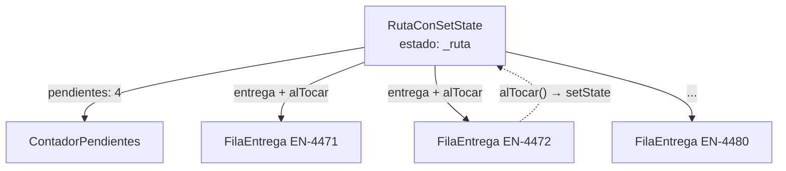
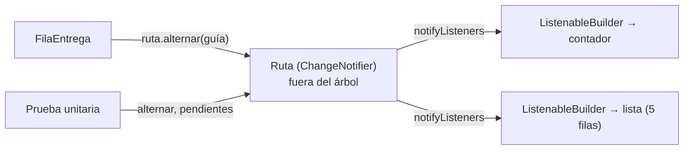
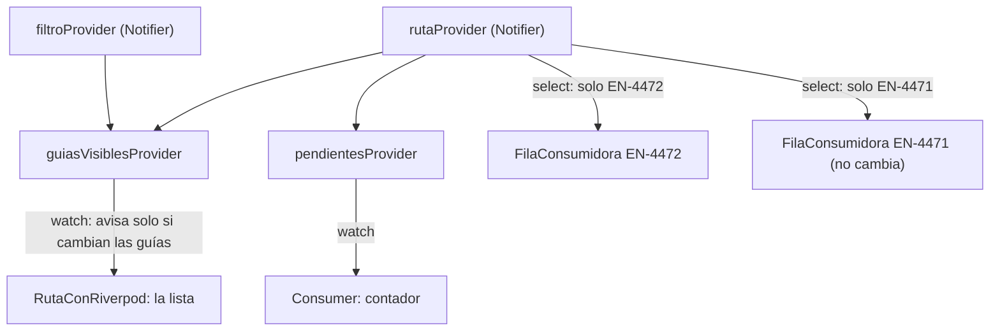
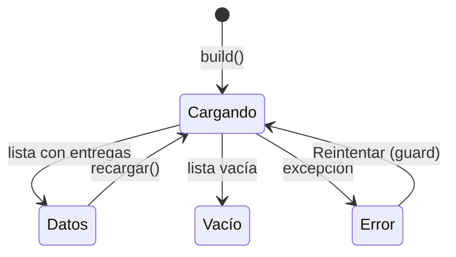
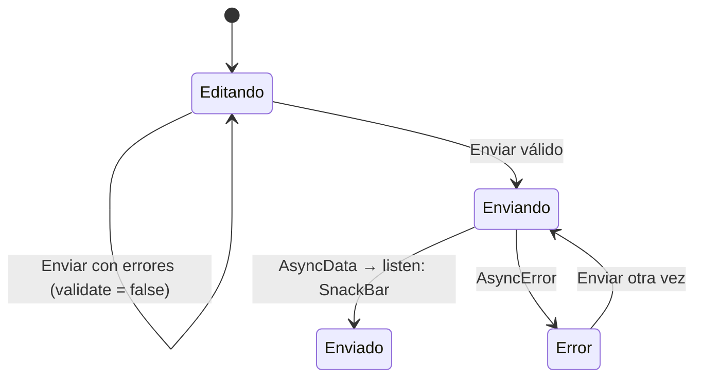
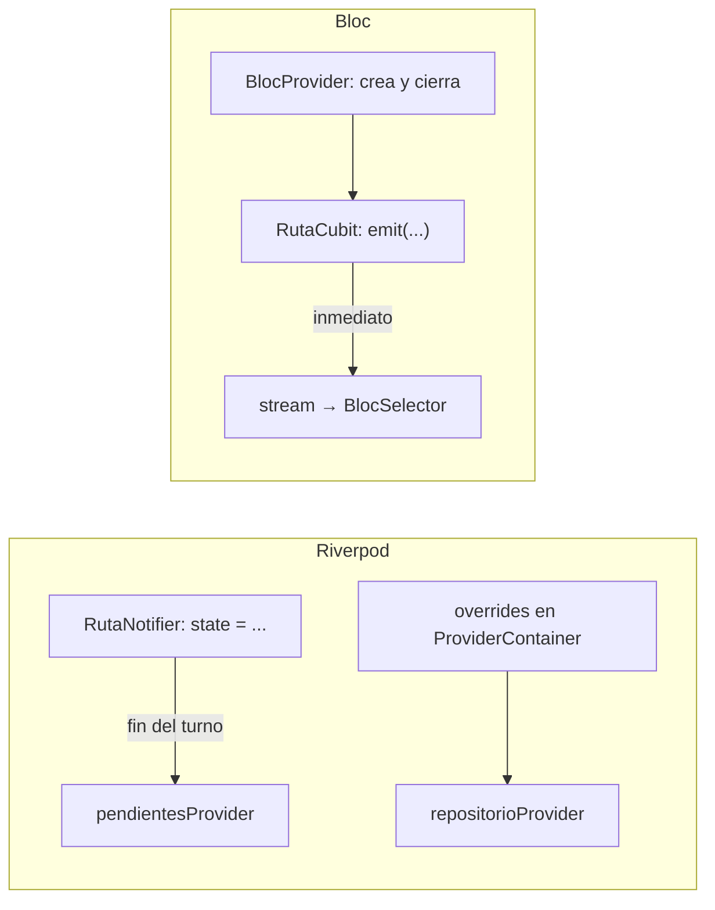

# Módulo 4: Gestión de estado: de setState a Riverpod, con pantallas que muestran cada estado

**Entorno comprobado para esta edición (2026-11-24):** Flutter 3.50.1 (canal estable) con Dart 3.14.0 en Linux
x86_64, con `material_ui` 1.1, `flutter_riverpod` 3.5.0 y `flutter_bloc` 9.1.1. Todo el código se analizó con
`flutter analyze` (`No issues found!`) y se ejecutó con `flutter test` ese día, en
`/home/estudiante/labs/flutter/m4` (tu `~/labs/flutter/m4`). **Los pantallazos los dibujó Flutter** con la
herramienta del Módulo 1; cuando una figura muestra varios estados, son pantallazos separados puestos uno al lado del
otro. Las salidas de texto son literales; los tiempos (`00:01`) cambian en tu equipo.

El estado es todo lo que la pantalla necesita recordar: qué entregas están hechas, qué filtro eligió el conductor, si
la ruta está cargando o falló, qué escribió en el formulario. Mientras vive en un solo widget, `setState` basta. Cuando
lo necesitan varias pantallas, cuando viene de un servidor o cuando hay que probarlo sin abrir la app, hace falta
sacarlo del árbol de widgets y decidir quién se entera de cada cambio. Este módulo recorre ese camino con la misma
lista de entregas, midiendo en cada paso cuántas filas se reconstruyen y mostrando cómo se ve cada estado.

**Al terminar este módulo podrás:**
- subir el estado al ancestro común y reconocer cuándo `setState` deja de alcanzar;
- sacar la lógica a un `ChangeNotifier` y probarla sin pantalla;
- usar Riverpod (`Notifier`, `Provider` derivado, `select`) para que cada widget escuche solo lo que necesita;
- cargar datos con `AsyncNotifier` y diseñar los estados de carga, vacío, error y datos;
- construir un formulario con validación por campo y un envío con estado;
- reemplazar dependencias en las pruebas y comparar Riverpod con Cubit.

**Esquema del módulo:** Tema 1 (`setState` y sus límites) → Tema 2 (`ChangeNotifier`) → Tema 3 (Riverpod) → Tema 4
(datos asíncronos y sus estados) → Tema 5 (formularios) → Tema 6 (pruebas, inyección y Cubit) → Proyecto 21.

**Qué necesitas saber antes:** el Módulo 3 completo, en especial **`ChangeNotifier`** y **`refreshListenable`**
(Tema 4) y **`mounted`** después de `await` (Tema 1); del Módulo 1, **`StatefulWidget`**, **keys** y **los tres
árboles** (Temas 4 a 6); del Módulo 0, **`sealed`**, **patrones** y **`switch` de expresión** (Tema 6).

**Qué no se repite:** el diseño de listas, filas y pantallas de mensaje sigue el sistema del Módulo 2, Tema 6; aquí no
se vuelve a explicar. Las llamadas reales al servidor son del Módulo 5: en este módulo, el «servidor» es una espera
simulada detrás de una interfaz.

**Prepara el proyecto:**

```text
$ cd ~/labs/flutter
$ flutter create --org com.academia --platforms=web,linux --empty m4
$ cd m4
$ flutter pub add flutter_riverpod flutter_bloc
```

Copia `test/pantallazo.dart` del Módulo 1. Todos los temas comparten el modelo:

```dart
// lib/modelo.dart — el modelo compartido por los temas: una entrega con su estado
enum Estado { pendiente, entregada, novedad }

class Entrega {
  const Entrega(this.guia, this.direccion, {this.estado = Estado.pendiente});
  final String guia;
  final String direccion;
  final Estado estado;

  Entrega con(Estado nuevo) => Entrega(guia, direccion, estado: nuevo);   // inmutable: se crea otra
}

const rutaInicial = [
  Entrega('EN-4471', 'Calle 80 # 68-45'),
  Entrega('EN-4472', 'Carrera 15 # 93-20'),
  Entrega('EN-4475', 'Avenida 68 # 22-10'),
  Entrega('EN-4478', 'Calle 26 # 59-41'),
  Entrega('EN-4480', 'Carrera 7 # 72-13'),
];

/// Cuenta cuántas veces se construye cada fila, para comparar las técnicas.
final construcciones = <String, int>{};
void anotarConstruccion(String guia) => construcciones[guia] = (construcciones[guia] ?? 0) + 1;
int totalConstrucciones() => construcciones.values.fold(0, (a, b) => a + b);
```

`Entrega` es inmutable: para cambiar el estado se crea otra con `con(...)`. Las funciones de `construcciones` no son
parte de una app real; cuentan cuántas veces se construye cada fila para comparar las técnicas.

```dart
// lib/main.dart — la ruta con Riverpod del Tema 3; ProviderScope guarda el estado de todos los providers
import 'package:flutter_riverpod/flutter_riverpod.dart';
import 'package:material_ui/material_ui.dart';

import 'tema3/con_riverpod.dart';

void main() => runApp(
      ProviderScope(
        child: MaterialApp(
          debugShowCheckedModeBanner: false,
          theme: ThemeData(colorSchemeSeed: Colors.indigo),
          home: const RutaConRiverpod(),
        ),
      ),
    );
```


## Aprende construyendo


### Tema 1: setState y sus límites: el estado en el ancestro común · Básico · 35 min

<details open>
<summary><strong>Capa 1 — Lectura</strong></summary>

#### Objetivos
Al terminar este tema podrás:
- identificar qué widgets necesitan un mismo dato y subir el estado a su ancestro común;
- pasar el dato hacia abajo por constructores y las acciones hacia arriba con funciones;
- medir cuántos widgets reconstruye un `setState`;
- reconocer las señales de que el estado debe salir del árbol de widgets.

**Conceptos clave:** estado local, subir el estado, ancestro común, *prop drilling*, estado inmutable

#### El problema
La lista de la ruta tiene una casilla por entrega, y la barra superior muestra cuántas quedan pendientes. Las dos
piezas necesitan el mismo dato. Si cada fila guarda su propia casilla, el contador no se entera. ¿Dónde debe vivir el
estado?

Este tema usa **`StatefulWidget`** y **`setState`** (Módulo 1, Tema 4) y **`Badge`** (componente de Material 3).

#### Glosario del tema

**estado local**
- **Definición técnica:** dato guardado en el `State` de un widget y modificado con `setState`; solo ese widget y sus descendientes lo conocen.
- **En palabras sencillas:** algo que una pantalla recuerda para sí misma.
- **Dónde se rompe la comparación:** si otro widget fuera del subárbol lo necesita, no tiene cómo leerlo.
- **Ejemplo:** `_ruta` en `_RutaConSetStateState`.
- **Error típico:** usar estado local para datos que deben sobrevivir al cerrar la pantalla.

**subir el estado**
- **Definición técnica:** mover un dato desde los widgets que lo usan hasta su ancestro común, que lo guarda y lo reparte.
- **En palabras sencillas:** guardar el dato en el lugar donde lo pueden ver todos los que lo necesitan.
- **Dónde se rompe la comparación:** cuanto más arriba vive el estado, más widgets se reconstruyen cuando cambia.
- **Ejemplo:** la ruta vive en la pantalla, no en las filas, para que el contador y la lista coincidan.
- **Error típico:** duplicar el dato en dos lugares y sincronizarlos «a mano».

**ancestro común**
- **Definición técnica:** el widget más bajo del árbol que contiene a todos los widgets que usan un dato.
- **En palabras sencillas:** el jefe común de todos los interesados.
- **Dónde se rompe la comparación:** si los interesados están en pantallas distintas, el ancestro común puede ser la app entera.
- **Ejemplo:** `RutaConSetState`, que contiene al `AppBar` y a la lista.
- **Error típico:** subir el estado a `main.dart` «por si acaso»: toda la app se reconstruye por un cambio pequeño.

***prop drilling***
- **Definición técnica:** pasar un dato o una función por constructores a través de widgets intermedios que no lo usan, solo para que llegue a un descendiente.
- **En palabras sencillas:** pasar un recado de mano en mano.
- **Dónde se rompe la comparación:** con dos niveles está bien; con cinco, cada cambio de firma toca muchos archivos.
- **Ejemplo:** `FilaEntrega(e, alTocar: ...)` recibe el callback por constructor.
- **Error típico:** agregar parámetros a diez widgets para que un dato llegue al último.

**estado inmutable**
- **Definición técnica:** estado que no se modifica: cada cambio crea un valor nuevo, y comparar el viejo con el nuevo indica si hubo cambio.
- **En palabras sencillas:** en lugar de borrar y escribir en la misma hoja, se escribe una hoja nueva.
- **Dónde se rompe la comparación:** crear valores nuevos cuesta poco en Dart para listas como esta, pero no es gratis.
- **Ejemplo:** `_ruta = [for (final e in _ruta) ...]` crea otra lista.
- **Error típico:** modificar la lista en el lugar (`_ruta[1] = ...`) sin `setState`: el dato cambia y la pantalla no.

#### ► CÓMO FUNCIONA
El estado vive en el ancestro común. Baja por constructores hasta el contador y las filas; las acciones suben por
funciones (`alTocar`). Cada `setState` vuelve a ejecutar `build` del ancestro, que crea de nuevo el contador y todas
las filas.



#### Problema resuelto 1.1
Construye la ruta con contador y casillas usando solo `setState`. Mide cuántas filas se reconstruyen al marcar una
entrega.

**Razonamiento:**
1. El estado (`_ruta`) sube a la pantalla, el ancestro común del contador y de la lista.
2. Las filas son `StatelessWidget`: reciben la entrega y una función para avisar el toque.
3. `_alternar` crea una lista nueva con la entrega cambiada.
4. La prueba de los Temas 1 a 3 limpia el contador de construcciones, toca `EN-4472` y lo imprime.

```dart
// lib/tema1/con_setstate.dart — el estado vive en el ancestro común y baja por constructores
import 'package:material_ui/material_ui.dart';

import '../modelo.dart';

class RutaConSetState extends StatefulWidget {
  const RutaConSetState({super.key});

  @override
  State<RutaConSetState> createState() => _RutaConSetStateState();
}

class _RutaConSetStateState extends State<RutaConSetState> {
  var _ruta = rutaInicial;                                          // el estado sube al ancestro común

  void _alternar(String guia) => setState(() {
        _ruta = [
          for (final e in _ruta)
            e.guia == guia ? e.con(e.estado == Estado.entregada ? Estado.pendiente : Estado.entregada) : e,
        ];
      });

  @override
  Widget build(BuildContext context) {
    final pendientes = _ruta.where((e) => e.estado == Estado.pendiente).length;
    return Scaffold(
      appBar: AppBar(
        title: const Text('Ruta de hoy'),
        actions: [ContadorPendientes(pendientes)],                   // baja por constructor
      ),
      body: ListView(
        children: [
          for (final e in _ruta) FilaEntrega(e, alTocar: () => _alternar(e.guia)),   // el callback también baja
        ],
      ),
    );
  }
}

class ContadorPendientes extends StatelessWidget {
  const ContadorPendientes(this.pendientes, {super.key});
  final int pendientes;

  @override
  Widget build(BuildContext context) => Padding(
        padding: const EdgeInsets.only(right: 16),
        child: Badge(
          label: Text('$pendientes'),
          isLabelVisible: pendientes > 0,
          child: const Icon(Icons.local_shipping_outlined),
        ),
      );
}

class FilaEntrega extends StatelessWidget {
  const FilaEntrega(this.entrega, {super.key, required this.alTocar});
  final Entrega entrega;
  final VoidCallback alTocar;

  @override
  Widget build(BuildContext context) {
    anotarConstruccion(entrega.guia);
    final hecha = entrega.estado == Estado.entregada;
    return CheckboxListTile(
      value: hecha,
      onChanged: (_) => alTocar(),
      title: Text(entrega.guia, style: hecha ? const TextStyle(decoration: TextDecoration.lineThrough) : null),
      subtitle: Text(entrega.direccion),
    );
  }
}
```

La misma prueba sirve para los Temas 1, 2 y 3; cada tema mira sus líneas de la salida.

```dart
import 'package:flutter_riverpod/flutter_riverpod.dart';
import 'package:flutter_test/flutter_test.dart';
import 'package:m4/modelo.dart';
import 'package:m4/tema1/con_setstate.dart';
import 'package:m4/tema2/ruta_notifier.dart';
import 'package:m4/tema3/con_riverpod.dart';
import 'package:material_ui/material_ui.dart';

import 'pantallazo.dart';

Widget app(Widget pantalla) => MaterialApp(
      debugShowCheckedModeBanner: false,
      theme: ThemeData(colorSchemeSeed: Colors.indigo),
      home: pantalla,
    );

/// Toca una guía y cuenta cuántas filas se reconstruyeron por ese toque.
Future<void> medir(WidgetTester tester, String tecnica) async {
  construcciones.clear();
  await tester.tap(find.text('EN-4472'));
  await tester.pump();
  final n = totalConstrucciones();
  debugPrint('$tecnica: un toque reconstruyó $n ${n == 1 ? 'fila ' : 'filas'} $construcciones');
}

void main() {
  setUpAll(cargarFuentes);

  testWidgets('tema 1: setState', (tester) async {
    tamanoPantalla(tester, tamano: const Size(390, 460));
    await tester.pumpWidget(app(const RutaConSetState()));
    await medir(tester, 'setState      ');
    await tester.pumpAndSettle();
    await pantallazo('m4-t1-ruta');
  });

  testWidgets('tema 2: ChangeNotifier', (tester) async {
    final ruta = Ruta();
    addTearDown(ruta.dispose);
    await tester.pumpWidget(app(RutaConNotifier(ruta)));
    await medir(tester, 'ChangeNotifier');
  });

  test('tema 2: la lógica se prueba sin widgets', () {
    final ruta = Ruta()
      ..alternar('EN-4471')
      ..alternar('EN-4475');
    debugPrint('sin pantalla: pendientes = ${ruta.pendientes}');
  });

  testWidgets('tema 3: Riverpod con select', (tester) async {
    tamanoPantalla(tester, tamano: const Size(390, 520));
    await tester.pumpWidget(ProviderScope(child: app(const RutaConRiverpod())));
    await medir(tester, 'Riverpod      ');
    await tester.tap(find.text('EN-4478'));
    await tester.tap(find.text('Pendientes'));
    await tester.pumpAndSettle();
    debugPrint('filtro Pendientes: ${find.byType(FilaConsumidora).evaluate().length} filas');
    await pantallazo('m4-t3-filtro');
  });

  test('tema 3: el provider se prueba sin widgets', () {
    final contenedor = ProviderContainer.test();
    contenedor.read(rutaProvider.notifier).alternar('EN-4471');
    contenedor.read(filtroProvider.notifier).elegir(Filtro.entregadas);
    debugPrint('sin pantalla: visibles = ${contenedor.read(guiasVisiblesProvider)}, '
        'pendientes = ${contenedor.read(pendientesProvider)}');
  });
}
```

```text
$ flutter test test/tema123_test.dart
00:00 +0: loading /home/estudiante/labs/flutter/m4/test/tema123_test.dart
00:00 +0: (setUpAll)
00:00 +0: tema 1: setState
setState      : un toque reconstruyó 5 filas {EN-4471: 1, EN-4472: 1, EN-4475: 1, EN-4478: 1, EN-4480: 1}
00:00 +1: tema 2: ChangeNotifier
ChangeNotifier: un toque reconstruyó 5 filas {EN-4471: 1, EN-4472: 1, EN-4475: 1, EN-4478: 1, EN-4480: 1}
00:01 +2: tema 2: la lógica se prueba sin widgets
sin pantalla: pendientes = 3
00:01 +3: tema 3: Riverpod con select
Riverpod      : un toque reconstruyó 1 fila  {EN-4472: 1}
filtro Pendientes: 3 filas
00:01 +4: tema 3: el provider se prueba sin widgets
sin pantalla: visibles = [EN-4471], pendientes = 4
00:01 +5: (tearDownAll)
00:01 +5: All tests passed!
```


**Explicación por partes.**
- Línea 14: el estado vive en la pantalla; es la única fuente de verdad del contador y de las filas.
- Líneas 16–21: la lista nueva cambia solo la entrega tocada; las demás son los mismos objetos.
- Líneas 29 y 33: el dato baja por constructor y la acción sube por la función.
- En la salida, la primera línea: un toque reconstruyó **5 filas**, aunque solo cambió una. Con 5 filas no importa;
  con 300 y una animación, sí.

> **Error común.** Guardar en cada fila su propio `bool` de casilla. El contador nunca coincide con las casillas, y al
> desplazar la lista las filas que salen de pantalla pierden su estado (Módulo 1, Tema 5).

> **Error común.** Llamar a `setState` en un widget alto por un cambio pequeño, como el texto de un buscador. Cada
> letra reconstruye toda la pantalla. Baja ese estado al widget que lo usa.

> **Buena práctica.** Empieza con `setState` y súbelo solo hasta donde haga falta. Pasa a una de las técnicas de los
> temas siguientes cuando aparezcan las señales: el dato cruza pantallas, el *prop drilling* pasa de dos niveles o
> necesitas probar la lógica sin pantalla.

> **Prevenir errores.** Trata el estado como inmutable desde el principio: los Temas 3 y 6 dependen de comparar el
> valor viejo con el nuevo, y una lista modificada en el lugar parece no haber cambiado.

#### Checkpoint 1.1
Si la ruta tuviera 300 entregas, ¿cuántas filas reconstruiría un toque con esta técnica?

Respuesta: todas las que están en pantalla (unas diez). El `build` de la pantalla crea los 300 objetos `FilaEntrega`,
que son baratos, pero la lista solo ejecuta el `build` de las filas visibles. El problema no desaparece: con cada
toque, todas las visibles se rehacen aunque solo cambió una.

</details>

<details>
<summary><strong>Capa 2 — Construcción</strong></summary>

#### Paso 1 · Crea los archivos
Crea `lib/modelo.dart`, `lib/tema1/con_setstate.dart` y `test/tema123_test.dart`.

#### Paso 2 · Ejecuta
Ejecuta `flutter test --update-goldens test/tema123_test.dart` y abre `m4-t1-ruta.png`.

#### Paso 3 · Agrega una pantalla
Agrega un botón en la barra que abra con `Navigator.push` una pantalla «Resumen» con el número de entregadas. Pásale el
dato por constructor.

#### Paso 4 · Marca desde el resumen
Agrega al resumen un botón «Marcar todas». ¿Qué tienes que pasarle por constructor para que funcione?

#### Paso 5 · Rompe la inmutabilidad
Cambia `_alternar` para modificar la lista en el lugar (`_ruta = List.of(_ruta)..[i] = ...`) sin `setState` y observa
qué pasa en la prueba.

#### Resumen
- El **estado local** vive en un `State`; cuando varios widgets lo necesitan, se **sube el estado** al **ancestro
  común**.
- El dato baja por constructores y las acciones suben por funciones; demasiados niveles son ***prop drilling***.
- El **estado inmutable** permite comparar el antes y el después.

#### Ejercicio verificable 1
Básico. ¿Qué número muestra el contador después de marcar `EN-4472` y `EN-4475`?

Respuesta esperada: `3`. Quedan pendientes `EN-4471`, `EN-4478` y `EN-4480`.

#### Ejercicio verificable 2
Intermedio. En el Paso 3, si marcas una entrega mientras el resumen está abierto, ¿se actualiza el número del
resumen?

Respuesta esperada: no. El resumen recibió el número por constructor al abrirse; es una copia. Para verlo actualizado
habría que cerrarlo y abrirlo, o sacar el estado del árbol (Temas 2 y 3).

#### Ejercicio verificable 3
Reto. En el Paso 4, ¿qué necesitas pasar y qué problema de diseño aparece?

Respuesta esperada: una función `marcarTodas` creada en `_RutaConSetStateState`. Aparece el problema del Ejercicio 2
al revés: la lista se actualiza, pero el resumen abierto sigue mostrando el número viejo. Es la señal de que el estado
cruza pantallas y debe salir del árbol.

#### En el trabajo
En las entrevistas de Flutter se pregunta con frecuencia «¿cuándo dejarías de usar `setState`?». La respuesta que se
espera no es «nunca» ni «siempre»: son las señales de este tema. Muchos equipos mantienen `setState` para el estado de
una sola pantalla (una pestaña abierta, una animación) y usan Riverpod o Bloc para el resto.

</details>

### Tema 2: ChangeNotifier: sacar el estado del árbol de widgets · Intermedio · 35 min

<details open>
<summary><strong>Capa 1 — Lectura</strong></summary>

#### Objetivos
Al terminar este tema podrás:
- escribir la lógica de la ruta en un `ChangeNotifier`, fuera de los widgets;
- escuchar sus cambios con `ListenableBuilder` en las partes de la pantalla que lo necesitan;
- probar la lógica con una prueba unitaria, sin construir la pantalla;
- explicar por qué escuchar un objeto completo sigue reconstruyendo de más.

**Conceptos clave:** `ChangeNotifier`, `notifyListeners`, `ListenableBuilder`, separación de lógica y presentación

#### El problema
En el Tema 1, la lógica de la ruta (alternar, contar pendientes) vive mezclada con el `build` de la pantalla. Para
probarla hay que construir la pantalla, y para usarla en otra pantalla hay que pasarla por constructores. Además, la
pantalla de resumen abierta no se entera de los cambios.

Este tema usa **subir el estado** y **estado inmutable** (Tema 1) y **`ChangeNotifier`** (Módulo 3, Tema 4).

#### Glosario del tema

**`ChangeNotifier`**
- **Definición técnica:** clase de Flutter que mantiene una lista de oyentes y les avisa con `notifyListeners()`; es un `Listenable`.
- **En palabras sencillas:** un objeto que guarda datos y avisa cuando cambian.
- **Dónde se rompe la comparación:** avisa «cambié», no «qué cambió»: el oyente vuelve a leer todo.
- **Ejemplo:** `Ruta` con `entregas`, `pendientes` y `alternar`.
- **Error típico:** no llamar a `dispose()` cuando ya no se usa; quedan oyentes registrados.

**`notifyListeners`**
- **Definición técnica:** método de `ChangeNotifier` que llama a todos los oyentes registrados, de forma sincrónica.
- **En palabras sencillas:** tocar la campana.
- **Dónde se rompe la comparación:** no compara valores: aunque el dato no haya cambiado, avisa.
- **Ejemplo:** al final de `alternar`.
- **Error típico:** olvidarlo después de cambiar un dato; la pantalla queda con el valor viejo.

**`ListenableBuilder`**
- **Definición técnica:** widget que escucha un `Listenable` y vuelve a ejecutar su `builder` cada vez que este avisa.
- **En palabras sencillas:** un pedazo de pantalla que se redibuja cuando suena la campana.
- **Dónde se rompe la comparación:** reconstruye todo lo que está dentro de su `builder`, aunque solo haya cambiado una parte.
- **Ejemplo:** uno para el contador y otro para la lista.
- **Error típico:** un solo `ListenableBuilder` alrededor de toda la pantalla: vuelve al problema del Tema 1.

**separación de lógica y presentación**
- **Definición técnica:** principio de diseño que pone las reglas del negocio en clases sin widgets y deja a los widgets solo la tarea de mostrar y reenviar acciones.
- **En palabras sencillas:** quien decide no es quien dibuja.
- **Dónde se rompe la comparación:** algunas decisiones son de presentación (el color de una casilla) y se quedan en el widget.
- **Ejemplo:** `Ruta.pendientes` se calcula en la clase, no en el `build`.
- **Error típico:** calcular reglas en el `build` y no poder probarlas sin pantalla.

#### ► CÓMO FUNCIONA
`Ruta` vive fuera del árbol y se pasa a la pantalla. Dos `ListenableBuilder` la escuchan. Al tocar una fila,
`alternar` crea la lista nueva y llama a `notifyListeners`: los dos `builder` se ejecutan de nuevo y el resto de la
pantalla (el `Scaffold`, el título) no se reconstruye.



#### Problema resuelto 2.1
Pasa la lógica de la ruta a un `ChangeNotifier`, escúchala desde la pantalla y prueba la lógica sin pantalla.

**Razonamiento:**
1. `Ruta` tiene el mismo `alternar` del Tema 1 y calcula `pendientes`.
2. La pantalla recibe la `Ruta` y es un `StatelessWidget`: ya no tiene estado propio.
3. Un `ListenableBuilder` envuelve el contador y otro la lista.
4. La prueba unitaria crea una `Ruta`, llama a `alternar` dos veces y lee `pendientes`.

```dart
// lib/tema2/ruta_notifier.dart — el estado sale del árbol de widgets: un ChangeNotifier
import 'package:material_ui/material_ui.dart';

import '../modelo.dart';
import '../tema1/con_setstate.dart' show ContadorPendientes, FilaEntrega;

class Ruta extends ChangeNotifier {
  List<Entrega> _entregas = rutaInicial;
  List<Entrega> get entregas => _entregas;
  int get pendientes => _entregas.where((e) => e.estado == Estado.pendiente).length;

  void alternar(String guia) {
    _entregas = [
      for (final e in _entregas)
        e.guia == guia ? e.con(e.estado == Estado.entregada ? Estado.pendiente : Estado.entregada) : e,
    ];
    notifyListeners();                                              // avisa a quien escuche
  }
}

class RutaConNotifier extends StatelessWidget {
  const RutaConNotifier(this.ruta, {super.key});
  final Ruta ruta;

  @override
  Widget build(BuildContext context) => Scaffold(
        appBar: AppBar(
          title: const Text('Ruta de hoy'),
          actions: [
            ListenableBuilder(                                      // solo esto se reconstruye para el contador
              listenable: ruta,
              builder: (context, _) => ContadorPendientes(ruta.pendientes),
            ),
          ],
        ),
        body: ListenableBuilder(
          listenable: ruta,
          builder: (context, _) => ListView(
            children: [for (final e in ruta.entregas) FilaEntrega(e, alTocar: () => ruta.alternar(e.guia))],
          ),
        ),
      );
}
```

La prueba está en `test/tema123_test.dart` (Tema 1): son las líneas `ChangeNotifier: ...` y `sin pantalla:
pendientes = 3` de la salida.

**Explicación por partes.**
- Líneas 7–19: la lógica sin widgets. `Ruta` se puede usar en cualquier pantalla y probar sin ninguna.
- Línea 17: `notifyListeners` avisa a los dos `ListenableBuilder`.
- Líneas 30–33: el contador se reconstruye solo, sin rehacer el `AppBar`.
- En la salida, el toque siguió reconstruyendo **5 filas**: el `ListenableBuilder` de la lista no sabe qué entrega
  cambió y rehace todas. Ganamos lógica comprobable, no todavía precisión.
- `sin pantalla: pendientes = 3`: la prueba unitaria no construyó ningún widget.

> **Error común.** Crear el `ChangeNotifier` dentro de `build` (`final ruta = Ruta();`). Cada reconstrucción crea una
> ruta nueva y se pierde el estado. Créalo una vez: en un `State`, en `main` o con un provider (Tema 3).

> **Error común.** Modificar el estado desde el widget (`ruta.entregas.add(...)`) en lugar de llamar a un método.
> Nadie llama a `notifyListeners` y la pantalla no cambia. Expón solo métodos para cambiar el estado.

> **Buena práctica.** Nombra los métodos del notificador como acciones del dominio (`alternar`, `marcarTodas`,
> `reportarNovedad`), no como operaciones técnicas (`setLista`). Así el widget dice qué quiere, no cómo hacerlo.

> **Prevenir errores.** Escribe primero la prueba unitaria del notificador y después la pantalla. Si la lógica no se
> puede probar sin pantalla, todavía está mezclada.

#### Checkpoint 2.1
¿Qué hace falta para que la pantalla de resumen del Ejercicio 2 del Tema 1 se actualice sola?

Respuesta: pasarle la misma `Ruta` y mostrar el número dentro de un `ListenableBuilder`. Al marcar en la lista, la
`Ruta` avisa y el resumen se redibuja.

</details>

<details>
<summary><strong>Capa 2 — Construcción</strong></summary>

#### Paso 1 · Crea el archivo
Crea `lib/tema2/ruta_notifier.dart`.

#### Paso 2 · Ejecuta
Ejecuta `flutter test test/tema123_test.dart` y busca las dos líneas de este tema.

#### Paso 3 · Agrega una regla
Agrega a `Ruta` el método `marcarTodas()` y una prueba unitaria que compruebe que `pendientes` queda en 0.

#### Paso 4 · Avisa sin cambiar
Llama a `ruta.alternar('EN-9999')` (una guía que no existe) en una prueba con un oyente que cuente avisos. ¿Cuántos
avisos llegan?

#### Paso 5 · Evita avisos inútiles
Haz que `alternar` no llame a `notifyListeners` si la guía no existe, y repite el Paso 4.

#### Resumen
- Un **`ChangeNotifier`** guarda la lógica fuera de los widgets y avisa con **`notifyListeners`**.
- **`ListenableBuilder`** redibuja solo la parte que lo escucha, pero toda esa parte.
- La **separación de lógica y presentación** permite probar las reglas sin pantalla.

#### Ejercicio verificable 1
Básico. ¿Qué imprime `(Ruta()..alternar('EN-4471')..alternar('EN-4471')).pendientes`?

Respuesta esperada: `5`. Alternar dos veces la misma guía la deja como estaba.

#### Ejercicio verificable 2
Intermedio. En el Paso 4, ¿cuántos avisos llegan?

Respuesta esperada: uno. `notifyListeners` avisa aunque la lista nueva tenga las mismas entregas: no compara valores.

#### Ejercicio verificable 3
Reto. En el Paso 5, ¿cómo sabes si la guía existe sin recorrer la lista dos veces?

Respuesta esperada: con una bandera dentro del mismo recorrido, por ejemplo `var cambio = false;` y `cambio = true`
cuando `e.guia == guia`, y `if (cambio) notifyListeners();` al final. El aviso queda en 0.

#### En el trabajo
`ChangeNotifier` viene con Flutter y es la base de muchos paquetes (incluido `provider`, el antecesor de Riverpod).
Aparece en código existente de muchas empresas, y su limitación (avisar sin decir qué cambió) es lo que motiva las
técnicas del Tema 3.

</details>

### Tema 3: Riverpod: providers, estado derivado y escuchar solo lo necesario · Intermedio · 55 min

<details open>
<summary><strong>Capa 1 — Lectura</strong></summary>

#### Objetivos
Al terminar este tema podrás:
- declarar el estado con `Notifier` y `NotifierProvider`, y leerlo con `ref.watch` desde un `ConsumerWidget`;
- calcular estado derivado (filtros, conteos) con `Provider`;
- usar `select` para que cada fila se reconstruya solo cuando cambia su entrega;
- probar providers con `ProviderContainer`, sin pantalla.

**Conceptos clave:** provider, `Notifier`, `ref.watch` y `ref.read`, estado derivado, `select`, igualdad por valor

#### El problema
Con `ChangeNotifier` la lógica ya se prueba sola, pero un toque sigue reconstruyendo las cinco filas, y para usar la
ruta en otra pantalla hay que pasarla por constructores. Además, el conductor pidió filtrar por «Pendientes» y
«Entregadas». Cada pieza de la pantalla debería pedir exactamente el dato que usa y enterarse solo cuando ese dato
cambia.

Este tema usa **`ChangeNotifier`** y **separación de lógica y presentación** (Tema 2), **keys** (Módulo 1, Tema 5) y
**`operator ==`** (Módulo 0, Tema 2).

#### Glosario del tema

**provider**
- **Definición técnica:** objeto global e inmutable que declara cómo crear un valor; el valor vive en un contenedor (`ProviderScope` en la app, `ProviderContainer` en pruebas) y se crea la primera vez que alguien lo lee.
- **En palabras sencillas:** una receta con nombre para obtener un dato, que se prepara una vez y se comparte.
- **Dónde se rompe la comparación:** la variable es global, pero el valor no: cada contenedor tiene el suyo, y por eso las pruebas no se mezclan.
- **Ejemplo:** `rutaProvider`, `filtroProvider`, `pendientesProvider`.
- **Error típico:** olvidar el `ProviderScope` en `main`: la app falla al primer `ref.watch`.

**`Notifier`**
- **Definición técnica:** clase de Riverpod con un método `build` que devuelve el estado inicial y métodos que asignan un estado nuevo a `state`; se expone con `NotifierProvider`.
- **En palabras sencillas:** el `ChangeNotifier` de Riverpod, pero que avisa solo si el estado nuevo es distinto.
- **Dónde se rompe la comparación:** no hay `notifyListeners`: asignar `state` es lo que avisa.
- **Ejemplo:** `RutaNotifier.alternar` asigna `state = [...]`.
- **Error típico:** modificar la lista en el lugar (`state.add(...)`): el objeto es el mismo y nadie se entera.

**`ref.watch` y `ref.read`**
- **Definición técnica:** `watch` lee un provider y suscribe al widget (o al provider) para reconstruirse cuando cambie; `read` lee una vez, sin suscribirse.
- **En palabras sencillas:** `watch` es «avísame si cambia»; `read` es «dame el valor ahora».
- **Dónde se rompe la comparación:** dentro de un `onPressed` no tiene sentido suscribirse: ahí va `read`.
- **Ejemplo:** `ref.watch(guiasVisiblesProvider)` en `build`; `ref.read(rutaProvider.notifier).alternar(...)` al tocar.
- **Error típico:** `ref.read` en `build`: la pantalla muestra el primer valor y nunca se actualiza.

**estado derivado**
- **Definición técnica:** valor calculado a partir de otros providers con `Provider((ref) => ...)`; se recalcula cuando cambia alguno de los que observa.
- **En palabras sencillas:** un dato que no se guarda, se deduce.
- **Dónde se rompe la comparación:** se guarda en caché: si nada cambió, no se recalcula.
- **Ejemplo:** `guiasVisiblesProvider` (ruta + filtro) y `pendientesProvider`.
- **Error típico:** guardar el conteo de pendientes en otro `Notifier` y actualizarlo a mano: tarde o temprano no coincide.

**`select`**
- **Definición técnica:** variante de `watch` que observa solo una parte del valor de un provider; el widget se reconstruye solo si esa parte cambia según `==`.
- **En palabras sencillas:** «avísame solo si cambia MI entrega».
- **Dónde se rompe la comparación:** la función se ejecuta en cada cambio del provider; lo que se ahorra es la reconstrucción, no el cálculo.
- **Ejemplo:** `ref.watch(rutaProvider.select((ruta) => ruta.firstWhere((e) => e.guia == guia)))`.
- **Error típico:** devolver en `select` un objeto nuevo cada vez (una lista filtrada): `==` siempre es falso y no se ahorra nada.

**igualdad por valor**
- **Definición técnica:** implementar `operator ==` y `hashCode` para que dos objetos con el mismo contenido sean iguales; Riverpod la usa para decidir si avisar.
- **En palabras sencillas:** dos listas con las mismas guías cuentan como «la misma».
- **Dónde se rompe la comparación:** en Dart, `[1] == [1]` es `false`: las listas comparan identidad.
- **Ejemplo:** `GuiasVisibles` compara con `listEquals`.
- **Error típico:** un provider derivado que devuelve una lista nueva en cada cálculo: todos sus oyentes se reconstruyen siempre.

#### ► CÓMO FUNCIONA
`RutaNotifier` y `FiltroNotifier` guardan el estado; `guiasVisiblesProvider` y `pendientesProvider` se derivan de
ellos. La pantalla observa la lista de guías visibles, el contador observa los pendientes y cada fila observa solo su
entrega con `select`. Al tocar `EN-4472`, cambia la ruta: las guías visibles siguen siendo las mismas (no avisa), los
pendientes cambian (se redibuja el contador) y solo la fila `EN-4472` ve un valor distinto.



#### Problema resuelto 3.1
Haz la ruta con Riverpod y un filtro por estado. Consigue que un toque reconstruya una sola fila y prueba los
providers sin pantalla.

**Razonamiento:**
1. La ruta y el filtro son `Notifier`; las guías visibles y los pendientes son `Provider` derivados.
2. La lista recibe solo las guías (texto), no las entregas: así un cambio de estado no cambia la lista.
3. `GuiasVisibles` implementa la igualdad por valor; sin ella, el derivado avisaría en cada cambio.
4. Cada fila usa `select` sobre su entrega, con una `ValueKey` por guía.
5. El filtro es un `SegmentedButton`, el componente de Material 3 para elegir una opción entre pocas.

```dart
// lib/tema3/con_riverpod.dart — Riverpod: el estado en un provider y cada widget elige qué parte escuchar
import 'package:flutter/foundation.dart' show listEquals;
import 'package:flutter_riverpod/flutter_riverpod.dart';
import 'package:material_ui/material_ui.dart';

import '../modelo.dart';
import '../tema1/con_setstate.dart' show ContadorPendientes;

class RutaNotifier extends Notifier<List<Entrega>> {
  @override
  List<Entrega> build() => rutaInicial;                            // estado inicial

  void alternar(String guia) => state = [
        for (final e in state)
          e.guia == guia ? e.con(e.estado == Estado.entregada ? Estado.pendiente : Estado.entregada) : e,
      ];
}

final rutaProvider = NotifierProvider<RutaNotifier, List<Entrega>>(RutaNotifier.new);

enum Filtro { todas, pendientes, entregadas }

class FiltroNotifier extends Notifier<Filtro> {
  @override
  Filtro build() => Filtro.todas;
  void elegir(Filtro f) => state = f;
}

final filtroProvider = NotifierProvider<FiltroNotifier, Filtro>(FiltroNotifier.new);

/// Lista con igualdad por contenido: dos listas con las mismas guías son «iguales» y no avisan cambio.
@immutable
class GuiasVisibles {
  const GuiasVisibles(this.guias);
  final List<String> guias;

  @override
  bool operator ==(Object other) => other is GuiasVisibles && listEquals(other.guias, guias);

  @override
  int get hashCode => Object.hashAll(guias);

  @override
  String toString() => '$guias';
}

/// Estado derivado: se recalcula cuando cambian la ruta o el filtro, y avisa solo si cambió su valor.
final guiasVisiblesProvider = Provider<GuiasVisibles>((ref) {
  final filtro = ref.watch(filtroProvider);
  return GuiasVisibles([
    for (final e in ref.watch(rutaProvider))
      if (filtro == Filtro.todas ||
          (filtro == Filtro.pendientes && e.estado == Estado.pendiente) ||
          (filtro == Filtro.entregadas && e.estado == Estado.entregada))
        e.guia,
  ]);
});

final pendientesProvider = Provider<int>(
  (ref) => ref.watch(rutaProvider).where((e) => e.estado == Estado.pendiente).length,
);

class RutaConRiverpod extends ConsumerWidget {
  const RutaConRiverpod({super.key});

  @override
  Widget build(BuildContext context, WidgetRef ref) {
    final guias = ref.watch(guiasVisiblesProvider);
    return Scaffold(
      appBar: AppBar(
        title: const Text('Ruta de hoy'),
        actions: [Consumer(builder: (context, ref, _) => ContadorPendientes(ref.watch(pendientesProvider)))],
      ),
      body: Column(
        children: [
          Padding(
            padding: const EdgeInsets.all(16),
            child: SegmentedButton<Filtro>(
              showSelectedIcon: false,                              // el ícono partía «Pendientes» en dos líneas
              segments: const [
                ButtonSegment(value: Filtro.todas, label: Text('Todas')),
                ButtonSegment(value: Filtro.pendientes, label: Text('Pendientes')),
                ButtonSegment(value: Filtro.entregadas, label: Text('Entregadas')),
              ],
              selected: {ref.watch(filtroProvider)},
              onSelectionChanged: (s) => ref.read(filtroProvider.notifier).elegir(s.first),
            ),
          ),
          Expanded(
            child: ListView(children: [for (final g in guias.guias) FilaConsumidora(g, key: ValueKey(g))]),
          ),
        ],
      ),
    );
  }
}

/// Cada fila escucha solo SU entrega: al marcar una, las demás no se reconstruyen.
class FilaConsumidora extends ConsumerWidget {
  const FilaConsumidora(this.guia, {super.key});
  final String guia;

  @override
  Widget build(BuildContext context, WidgetRef ref) {
    final entrega = ref.watch(rutaProvider.select((ruta) => ruta.firstWhere((e) => e.guia == guia)));
    anotarConstruccion(guia);
    final hecha = entrega.estado == Estado.entregada;
    return CheckboxListTile(
      value: hecha,
      onChanged: (_) => ref.read(rutaProvider.notifier).alternar(guia),   // read: para actuar, no para escuchar
      title: Text(guia, style: hecha ? const TextStyle(decoration: TextDecoration.lineThrough) : null),
      subtitle: Text(entrega.direccion),
    );
  }
}
```

La prueba es la de `test/tema123_test.dart` (Tema 1): son las líneas `Riverpod: ...`, `filtro Pendientes: 3 filas` y
la última, `sin pantalla: ...`.


**Explicación por partes.**
- Líneas 9–19: el mismo `alternar` de los Temas 1 y 2, pero asignando `state`. Riverpod avisa solo porque el valor
  cambió.
- Líneas 31–45: la igualdad por valor. **La primera versión de este tema devolvía `List<String>` y la medición dio 5
  filas**, igual que `setState`: cada toque creaba una lista nueva de guías, distinta según `==`, y la pantalla
  reconstruía todas las filas. Con `GuiasVisibles`, el toque reconstruye **1 fila**.
- Línea 105: `select` hace que cada fila ignore los cambios de las demás entregas.
- Línea 110: `ref.read` dentro de `onChanged`: actuar no necesita suscribirse.
- Línea 79: `showSelectedIcon: false`. La primera versión mostraba el ícono de selección y partía «Pendientes» en dos
  líneas en 390 puntos de ancho; el pantallazo lo delató.
- `sin pantalla: visibles = [EN-4471], pendientes = 4`: la prueba unitaria usó un `ProviderContainer`, sin widgets.

> **Error común.** Envolver toda la pantalla en un `Consumer` que observa la ruta completa. Funciona, pero cada cambio
> rehace todo: es el Tema 1 con otra sintaxis.

> **Error común.** Leer un provider con `ref.read` en `build` «para optimizar». La pantalla no se entera de los
> cambios. En `build`, siempre `watch` (o `select`).

> **Buena práctica.** Guarda en `Notifier` solo el estado mínimo (la ruta, el filtro) y deriva todo lo demás. Los
> derivados no se desincronizan porque no se guardan.

> **Prevenir errores.** Mide. La cuenta de construcciones de este módulo detectó un problema (la lista nueva en cada
> cambio) que el código no dejaba ver. DevTools muestra lo mismo en la app real con «Track widget rebuilds».

#### Checkpoint 3.1
Con el filtro «Pendientes» elegido, ¿cuántas filas se reconstruyen al marcar `EN-4471` como entregada?

Respuesta: las cuatro que quedan (`EN-4472`, `EN-4475`, `EN-4478` y `EN-4480`), medido con el mismo contador.
`guiasVisiblesProvider` sí cambia (`EN-4471` sale), la lista se reconstruye y crea objetos `FilaConsumidora` nuevos;
un widget nuevo en la misma posición se vuelve a construir aunque su `select` no haya cambiado. `select` evita las
reconstrucciones que vienen del provider, no las que vienen del padre. Aquí es aceptable: ocurre solo cuando la lista
visible cambia, no en cada toque.

</details>

<details>
<summary><strong>Capa 2 — Construcción</strong></summary>

#### Paso 1 · Crea el archivo
Crea `lib/tema3/con_riverpod.dart`. `lib/main.dart` ya abre esta pantalla.

#### Paso 2 · Ejecuta
Ejecuta `flutter test --update-goldens test/tema123_test.dart` y compara las tres líneas de medición.

#### Paso 3 · Quita la igualdad
Cambia `guiasVisiblesProvider` para que devuelva `List<String>` y ajusta la pantalla. Ejecuta y anota cuántas filas
se reconstruyen.

#### Paso 4 · Agrega un derivado
Crea `progresoProvider` que devuelva la fracción entregada (de 0 a 1) y muéstrala con un `LinearProgressIndicator`
debajo del selector.

#### Paso 5 · Prueba en la app
Ejecuta `flutter run -d chrome`, abre DevTools, activa «Track widget rebuilds» y marca entregas.

#### Resumen
- Un **provider** declara un valor; su contenedor lo guarda.
- Un **`Notifier`** cambia el estado asignando `state`; **`ref.watch`** escucha y **`ref.read`** actúa.
- El **estado derivado** se calcula de otros providers; **`select`** escucha solo una parte.
- Sin **igualdad por valor**, los derivados que crean listas avisan siempre.

#### Ejercicio verificable 1
Básico. Con el Paso 3, ¿cuántas filas reconstruye el toque?

Respuesta esperada: 5, como `setState`. Es exactamente la primera medición que se obtuvo al escribir este tema.

#### Ejercicio verificable 2
Intermedio. ¿Qué imprime la prueba sin pantalla si se marca también `EN-4472` antes de leer?

Respuesta esperada: `sin pantalla: visibles = [EN-4471, EN-4472], pendientes = 3`.

#### Ejercicio verificable 3
Reto. Con el Paso 4, ¿se reconstruye el `LinearProgressIndicator` al cambiar el filtro?

Respuesta esperada: no. `progresoProvider` depende solo de `rutaProvider`; cambiar el filtro no lo recalcula y su
valor no cambia.

#### En el trabajo
Riverpod es una de las soluciones de estado más usadas en apps Flutter nuevas, junto con Bloc (Tema 6). En las
revisiones de código se miran tres cosas: `read` en `build`, providers derivados sin igualdad por valor y `Consumer`
demasiado grandes. Las tres aparecieron en este tema.

</details>

### Tema 4: Datos asíncronos: AsyncNotifier y el diseño de cada estado · Intermedio · 50 min

<details open>
<summary><strong>Capa 1 — Lectura</strong></summary>

#### Objetivos
Al terminar este tema podrás:
- cargar datos con `AsyncNotifier` y leer su estado como `AsyncValue`;
- diseñar las cuatro pantallas de una carga: cargando, datos, vacío y error;
- reintentar una carga fallida con `AsyncValue.guard`;
- reemplazar el origen de los datos en una prueba y controlar los reintentos automáticos de Riverpod 3.

**Conceptos clave:** `AsyncValue`, `AsyncNotifier`, esqueleto de carga, estado vacío, `AsyncValue.guard`,
reintento automático

#### El problema
La ruta del día viene del servidor. Durante un segundo no hay datos; a veces la red falla; algunos días no hay
entregas. Una pantalla que solo diseñó el caso «con datos» muestra un círculo girando sin explicación, un error rojo de
Flutter o una pantalla en blanco que parece rota.

Este tema usa **`Notifier`** y **`ref.watch`** (Tema 3), **`switch` de expresión con patrones** (Módulo 0, Tema 6) y
las **pantallas de mensaje** del sistema de diseño (Módulo 2, Tema 6).

#### Glosario del tema

**`AsyncValue`**
- **Definición técnica:** tipo `sealed` de Riverpod con tres casos: `AsyncLoading`, `AsyncData` (con `value`) y `AsyncError` (con `error` y `stackTrace`).
- **En palabras sencillas:** «todavía no», «aquí está» o «falló», en un solo tipo.
- **Dónde se rompe la comparación:** puede estar cargando y tener un valor anterior a la vez (al recargar); los patrones del `switch` deciden qué mostrar.
- **Ejemplo:** `switch (entregas) { AsyncData(...) => ..., AsyncError() => ..., _ => ... }`.
- **Error típico:** usar `entregas.value!` sin mirar el caso: falla mientras carga.

**`AsyncNotifier`**
- **Definición técnica:** `Notifier` cuyo `build` devuelve un `Future`; su estado empieza en `AsyncLoading` y pasa a `AsyncData` o `AsyncError` cuando el `Future` termina.
- **En palabras sencillas:** un `Notifier` que sabe esperar.
- **Dónde se rompe la comparación:** `build` se vuelve a ejecutar si cambia un provider que observa, y la carga se repite.
- **Ejemplo:** `EntregasDelDia.build` llama al repositorio.
- **Error típico:** guardar `cargando` y `error` en campos aparte: se pueden contradecir (cargando y con error a la vez).

**esqueleto de carga**
- **Definición técnica:** versión gris y sin texto de la interfaz que se está cargando, con la misma forma que tendrá el contenido.
- **En palabras sencillas:** el contorno de la lista antes de la lista.
- **Dónde se rompe la comparación:** si la carga tarda menos de unos 300 ms, el esqueleto parpadea y molesta más que ayuda.
- **Ejemplo:** `EsqueletoLista`: cinco filas con un círculo y dos barras.
- **Error típico:** un círculo girando en el centro de una pantalla vacía: no dice qué va a aparecer ni cuánto falta.

**estado vacío**
- **Definición técnica:** pantalla diseñada para el caso de datos válidos pero sin elementos.
- **En palabras sencillas:** «no hay nada, y eso está bien».
- **Dónde se rompe la comparación:** no es un error: no lleva color de error ni botón de reintentar.
- **Ejemplo:** «No tienes entregas hoy».
- **Error típico:** mostrar una lista vacía: el usuario no distingue «no hay» de «no cargó».

**`AsyncValue.guard`**
- **Definición técnica:** función que ejecuta un `Future` y devuelve `AsyncData` si termina bien o `AsyncError` si lanza, sin dejar escapar la excepción.
- **En palabras sencillas:** un `try/catch` que deja el resultado listo para la pantalla.
- **Dónde se rompe la comparación:** atrapa el error; registrarlo para el equipo (Módulo 13) sigue siendo tu trabajo.
- **Ejemplo:** `state = await AsyncValue.guard(() => ...cargar())`.
- **Error típico:** un `try/catch` que deja el estado en `AsyncLoading` para siempre cuando falla.

**reintento automático**
- **Definición técnica:** en Riverpod 3, cuando un provider falla al construirse, se vuelve a intentar solo con esperas crecientes; se configura con `retry` en `ProviderScope` o en cada provider.
- **En palabras sencillas:** Riverpod insiste antes de rendirse.
- **Dónde se rompe la comparación:** mientras reintenta, el estado sigue en «cargando», así que el usuario no ve el error enseguida.
- **Ejemplo:** `retry: (intento, error) => null` desactiva los reintentos en la prueba.
- **Error típico:** probar el estado de error sin desactivarlos: la pantalla sigue cargando y la prueba no encuentra «Reintentar».

#### ► CÓMO FUNCIONA
La pantalla observa `entregasProvider`. Al abrirla, `build` del `AsyncNotifier` llama al repositorio y el estado es
`AsyncLoading`: se muestra el esqueleto. Cuando el `Future` termina, el estado pasa a `AsyncData` (lista o vacío) o a
`AsyncError` (error con reintento). «Reintentar» vuelve a poner `AsyncLoading` y repite la carga con `guard`.



#### Problema resuelto 4.1
Carga la ruta con un `AsyncNotifier`, diseña los cuatro estados y prueba cada uno con un repositorio falso que
responde lo que la prueba necesita.

**Razonamiento:**
1. El origen de los datos es una interfaz, `RepositorioEntregas`, expuesta por un provider; la app usa la demo y la
   prueba la reemplaza con `overrideWithValue`.
2. La pantalla usa un `switch` con patrones; el caso vacío va antes que el de datos (`when lista.isEmpty`).
3. Vacío y error comparten la misma estructura visual (`_Mensaje`), con distinto ícono y acción.
4. El repositorio falso tarda 500 ms y responde, en orden, lo que se le dio: una lista o un error.
5. La prueba desactiva el reintento automático para ver el error en el primer intento.

```dart
// lib/tema4/carga.dart — AsyncNotifier: cuatro estados de una pantalla que carga datos, cada uno diseñado
import 'package:flutter_riverpod/flutter_riverpod.dart';
import 'package:material_ui/material_ui.dart';

import '../modelo.dart';

/// De dónde salen las entregas. La app real llamará a un servidor (Módulo 5).
abstract interface class RepositorioEntregas {
  Future<List<Entrega>> cargar();
}

class RepositorioDemo implements RepositorioEntregas {
  @override
  Future<List<Entrega>> cargar() async {
    await Future<void>.delayed(const Duration(milliseconds: 800));
    return rutaInicial;
  }
}

final repositorioProvider = Provider<RepositorioEntregas>((ref) => RepositorioDemo());

class EntregasDelDia extends AsyncNotifier<List<Entrega>> {
  @override
  Future<List<Entrega>> build() => ref.watch(repositorioProvider).cargar();   // el estado empieza en «cargando»

  Future<void> recargar() async {
    state = const AsyncLoading();
    state = await AsyncValue.guard(() => ref.read(repositorioProvider).cargar());   // atrapa el error en el estado
  }
}

final entregasProvider = AsyncNotifierProvider<EntregasDelDia, List<Entrega>>(EntregasDelDia.new);

class PantallaCarga extends ConsumerWidget {
  const PantallaCarga({super.key});

  @override
  Widget build(BuildContext context, WidgetRef ref) {
    final entregas = ref.watch(entregasProvider);
    return Scaffold(
      appBar: AppBar(title: const Text('Ruta de hoy')),
      body: switch (entregas) {                                       // un diseño por estado
        AsyncData(value: final lista) when lista.isEmpty => const EstadoVacio(),
        AsyncData(value: final lista) => ListView(
            children: [
              for (final e in lista)
                ListTile(leading: const Icon(Icons.inventory_2_outlined), title: Text(e.guia), subtitle: Text(e.direccion)),
            ],
          ),
        AsyncError() => EstadoError(alReintentar: () => ref.read(entregasProvider.notifier).recargar()),
        _ => const EsqueletoLista(),
      },
    );
  }
}

/// Mientras carga: la forma de la lista, sin datos. El usuario sabe qué va a aparecer.
class EsqueletoLista extends StatelessWidget {
  const EsqueletoLista({super.key});

  @override
  Widget build(BuildContext context) {
    final gris = Theme.of(context).colorScheme.surfaceContainerHighest;
    Widget barra(double ancho, double alto) => Container(
          width: ancho,
          height: alto,
          decoration: BoxDecoration(color: gris, borderRadius: BorderRadius.circular(4)),
        );
    return ListView(
      physics: const NeverScrollableScrollPhysics(),
      children: [
        for (var i = 0; i < 5; i++)
          ListTile(
            leading: CircleAvatar(backgroundColor: gris, radius: 12),
            title: Align(alignment: Alignment.centerLeft, child: barra(90, 14)),
            subtitle: Padding(
              padding: const EdgeInsets.only(top: 8),
              child: Align(alignment: Alignment.centerLeft, child: barra(160, 12)),
            ),
          ),
      ],
    );
  }
}

class _Mensaje extends StatelessWidget {
  const _Mensaje({required this.icono, required this.titulo, required this.texto, this.accion});
  final IconData icono;
  final String titulo;
  final String texto;
  final Widget? accion;

  @override
  Widget build(BuildContext context) {
    final estilos = Theme.of(context).textTheme;
    return Center(
      child: Padding(
        padding: const EdgeInsets.all(32),
        child: Column(
          mainAxisSize: MainAxisSize.min,
          children: [
            Icon(icono, size: 56, color: Theme.of(context).colorScheme.outline),
            const SizedBox(height: 16),
            Text(titulo, style: estilos.titleLarge, textAlign: TextAlign.center),
            const SizedBox(height: 8),
            Text(texto, style: estilos.bodyMedium, textAlign: TextAlign.center),
            if (accion != null) ...[const SizedBox(height: 24), accion!],
          ],
        ),
      ),
    );
  }
}

class EstadoVacio extends StatelessWidget {
  const EstadoVacio({super.key});

  @override
  Widget build(BuildContext context) => const _Mensaje(
        icono: Icons.inbox_outlined,
        titulo: 'No tienes entregas hoy',
        texto: 'Cuando el despacho te asigne una ruta, aparecerá aquí.',
      );
}

class EstadoError extends StatelessWidget {
  const EstadoError({super.key, required this.alReintentar});
  final VoidCallback alReintentar;

  @override
  Widget build(BuildContext context) => _Mensaje(
        icono: Icons.cloud_off_outlined,
        titulo: 'No pudimos cargar tu ruta',
        texto: 'Revisa tu conexión. Tus entregas no se perdieron.',
        accion: FilledButton.icon(onPressed: alReintentar, icon: const Icon(Icons.refresh), label: const Text('Reintentar')),
      );
}
```

```dart
import 'package:flutter_riverpod/flutter_riverpod.dart';
import 'package:flutter_test/flutter_test.dart';
import 'package:m4/modelo.dart';
import 'package:m4/tema4/carga.dart';
import 'package:material_ui/material_ui.dart';

import 'pantallazo.dart';

/// Repositorio de prueba: responde lo que se le indique, después de una espera.
class RepositorioFalso implements RepositorioEntregas {
  RepositorioFalso(this.respuestas);
  final List<Object> respuestas;                    // una por llamada: una lista o un error
  var llamadas = 0;

  @override
  Future<List<Entrega>> cargar() async {
    await Future<void>.delayed(const Duration(milliseconds: 500));
    final r = respuestas[llamadas++];
    if (r is List<Entrega>) return r;
    throw r;
  }
}

Future<void> abrir(WidgetTester tester, RepositorioFalso repo) async {
  tamanoPantalla(tester, tamano: const Size(390, 440));
  await tester.pumpWidget(ProviderScope(
    overrides: [repositorioProvider.overrideWithValue(repo)],      // la pantalla usa el repositorio falso
    retry: (intento, error) => null,                                // sin reintentos automáticos en la prueba
    child: MaterialApp(
      debugShowCheckedModeBanner: false,
      theme: ThemeData(colorSchemeSeed: Colors.indigo),
      home: const PantallaCarga(),
    ),
  ));
}

String visible(WidgetTester tester) => [
      if (find.byType(EsqueletoLista).evaluate().isNotEmpty) 'esqueleto',
      if (find.byType(EstadoError).evaluate().isNotEmpty) 'error',
      if (find.byType(EstadoVacio).evaluate().isNotEmpty) 'vacío',
      if (find.byType(ListTile).evaluate().isNotEmpty && find.byType(EsqueletoLista).evaluate().isEmpty)
        '${find.byType(ListTile).evaluate().length} entregas',
    ].join(', ');

void main() {
  setUpAll(cargarFuentes);

  testWidgets('cargando y después datos', (tester) async {
    await abrir(tester, RepositorioFalso([rutaInicial]));
    debugPrint('al abrir: ${visible(tester)}');
    await pantallazo('m4-t4-cargando');
    await tester.pump(const Duration(milliseconds: 500));
    debugPrint('a los 500 ms: ${visible(tester)}');
    await pantallazo('m4-t4-datos');
  });

  testWidgets('sin entregas', (tester) async {
    await abrir(tester, RepositorioFalso([<Entrega>[]]));
    await tester.pump(const Duration(milliseconds: 500));
    debugPrint('lista vacía: ${visible(tester)}');
    await pantallazo('m4-t4-vacio');
  });

  testWidgets('error y reintento', (tester) async {
    final repo = RepositorioFalso([Exception('sin conexión'), rutaInicial]);
    await abrir(tester, repo);
    await tester.pump(const Duration(milliseconds: 500));
    debugPrint('primer intento: ${visible(tester)}');
    await pantallazo('m4-t4-error');
    await tester.tap(find.text('Reintentar'));
    await tester.pump();
    debugPrint('al tocar Reintentar: ${visible(tester)}');
    await tester.pump(const Duration(milliseconds: 500));
    debugPrint('segundo intento: ${visible(tester)}; llamadas al repositorio: ${repo.llamadas}');
  });
}
```

```text
$ flutter test test/tema4_test.dart
00:00 +0: loading /home/estudiante/labs/flutter/m4/test/tema4_test.dart
00:00 +0: (setUpAll)
00:00 +0: cargando y después datos
al abrir: esqueleto
a los 500 ms: 5 entregas
00:00 +1: sin entregas
lista vacía: vacío
00:01 +2: error y reintento
primer intento: error
al tocar Reintentar: esqueleto
segundo intento: 5 entregas; llamadas al repositorio: 2
00:01 +3: (tearDownAll)
00:01 +3: All tests passed!
```


**Explicación por partes.**
- Líneas 8–20: la interfaz y su provider. Ningún widget sabe de dónde salen las entregas.
- Línea 24: el estado empieza solo en `AsyncLoading`; no hay que asignarlo.
- Líneas 26–29: `recargar` vuelve a «cargando» para que la persona vea que su toque hizo algo, y `guard` convierte la
  excepción en `AsyncError`.
- Líneas 42–51: un caso del `switch` por estado. El orden importa: `when lista.isEmpty` debe ir antes que el caso
  general de datos.
- En la salida, el segundo intento llamó al repositorio por segunda vez (`llamadas al repositorio: 2`).
- Al escribir este tema, la prueba de error falló primero: sin `retry: ... => null`, la pantalla siguió mostrando el
  esqueleto (`primer intento: esqueleto`) porque Riverpod 3 estaba reintentando solo, y «Reintentar» no existía.

> **Error común.** Un solo diseño para «error» y «vacío». El conductor ve una nube tachada un día sin entregas y llama
> a soporte. Son dos mensajes distintos.

> **Error común.** Mostrar el texto de la excepción (`SocketException: Failed host lookup...`). Al usuario le sirve
> qué pasó en sus palabras y qué puede hacer; el detalle técnico va al registro de errores.

> **Buena práctica.** Diseña los cuatro estados antes de la pantalla con datos. Son los que se olvidan, y los que el
> usuario ve en el peor momento (sin red, en la calle).

> **Prevenir errores.** Prueba cada estado con un repositorio falso, como aquí. Probar contra el servidor real hace
> imposible reproducir el error y el vacío a voluntad.

#### Checkpoint 4.1
¿Por qué `EsqueletoLista` usa `NeverScrollableScrollPhysics`?

Respuesta: porque no hay contenido real que desplazar; si el usuario pudiera arrastrar el esqueleto, parecería una
lista que no responde.

</details>

<details>
<summary><strong>Capa 2 — Construcción</strong></summary>

#### Paso 1 · Crea los archivos
Crea `lib/tema4/carga.dart` y `test/tema4_test.dart`.

#### Paso 2 · Ejecuta
Ejecuta `flutter test --update-goldens test/tema4_test.dart` y abre los cuatro pantallazos.

#### Paso 3 · Quita el control de reintentos
Borra la línea `retry: ...` de la prueba y ejecuta solo la prueba de error con
`flutter test test/tema4_test.dart --plain-name "error y reintento"`. Lee qué no encontró.

#### Paso 4 · Recarga deslizando
Envuelve la lista de datos en un `RefreshIndicator(onRefresh: () => ref.read(entregasProvider.notifier).recargar())`.

#### Paso 5 · Conserva los datos al recargar
Cambia `recargar` para usar `state = const AsyncLoading<List<Entrega>>().copyWithPrevious(state)` y muestra la lista
anterior con un indicador arriba mientras recarga.

#### Resumen
- **`AsyncValue`** representa cargando, datos y error en un solo tipo; **`AsyncNotifier`** lo produce.
- Cada estado tiene su diseño: **esqueleto de carga**, lista, **estado vacío** y error con reintento.
- **`AsyncValue.guard`** convierte excepciones en estado; el **reintento automático** de Riverpod 3 se controla con
  `retry`.

#### Ejercicio verificable 1
Básico. ¿Qué muestra la pantalla si el repositorio falso responde `[<Entrega>[]]`?

Respuesta esperada: el estado vacío, como imprime la prueba: `lista vacía: vacío`.

#### Ejercicio verificable 2
Intermedio. En el Paso 3, ¿qué mensaje da la prueba?

Respuesta esperada: `The finder "Found 0 widgets with text "Reintentar": []" (used in a call to "tap()") could not
find any matching widgets.`, después de imprimir `primer intento: esqueleto`.

#### Ejercicio verificable 3
Reto. Si mueves el caso `AsyncData(value: final lista) => ...` antes del caso con `when lista.isEmpty`, ¿qué pasa?

Respuesta esperada: el caso vacío nunca se elige: el primer patrón ya coincide con cualquier lista, también la vacía,
y se muestra una lista en blanco. El analizador avisa que el segundo caso es inalcanzable (`unreachable_switch_case`).

#### En el trabajo
Los estados de carga, vacío y error son parte de cualquier revisión de diseño seria, y en la mayoría de los sistemas
de diseño existen como componentes. En el Módulo 5 el repositorio llamará a un servidor real, y este mismo
`AsyncNotifier` mostrará los errores de red.

</details>

### Tema 5: Formularios: validación por campo y un envío con estado · Intermedio · 50 min

<details open>
<summary><strong>Capa 1 — Lectura</strong></summary>

#### Objetivos
Al terminar este tema podrás:
- validar cada campo con funciones puras y mostrar el error debajo del campo;
- elegir cuándo validar: al enviar y, después del primer error, mientras el usuario escribe;
- representar el envío (inactivo, enviando, enviado, error) en un provider y bloquear el formulario mientras envía;
- separar el estado que se dibuja (`watch`) de los efectos que se disparan una vez (`listen`).

**Conceptos clave:** `Form` y `TextFormField`, validador, modo de validación automática, `TextEditingController`,
efecto con `ref.listen`

#### El problema
El conductor reporta una novedad desde la calle: escribe la guía, un teléfono opcional y qué pasó. Si se equivoca en
el formato de la guía, debe verlo junto al campo, no en un mensaje genérico. Mientras se envía, no debe poder tocar
«Enviar» dos veces, y al terminar necesita una confirmación.

Este tema usa **`Notifier`**, **`ref.watch` y `ref.read`** (Tema 3), **`AsyncValue`** (Tema 4) y **`dispose`**
(Módulo 1, Tema 4).

#### Glosario del tema

**`Form` y `TextFormField`**
- **Definición técnica:** `Form` agrupa campos y expone `FormState` (`validate`, `save`, `reset`) a través de una `GlobalKey<FormState>`; `TextFormField` es un campo de texto que participa en el formulario con su validador.
- **En palabras sencillas:** la planilla y sus casillas, que se revisan juntas.
- **Dónde se rompe la comparación:** el `Form` no guarda los valores; los guardan los controladores o los campos.
- **Ejemplo:** `_clave.currentState!.validate()`.
- **Error típico:** crear la `GlobalKey` dentro de `build`: cada reconstrucción crea un formulario nuevo y se pierden los errores.

**validador**
- **Definición técnica:** función `String? Function(String?)` que devuelve el mensaje de error o `null` si el valor es válido.
- **En palabras sencillas:** la regla de un campo, que contesta «está bien» o «esto falla».
- **Dónde se rompe la comparación:** valida forma, no verdad: `EN-4472` puede tener buen formato y no existir.
- **Ejemplo:** `validarGuia('en-4472')` → `Formato: EN- y de 4 a 6 dígitos`.
- **Error típico:** mensajes como «Campo inválido»: no dicen cómo corregir.

**modo de validación automática**
- **Definición técnica:** `autovalidateMode` del `Form` o del campo; con `onUserInteraction`, cada campo se revalida cuando el usuario cambia su valor.
- **En palabras sencillas:** cuándo se muestran y se borran los errores.
- **Dónde se rompe la comparación:** los campos que el usuario no tocó no muestran error hasta que se llama a `validate()`.
- **Ejemplo:** después de enviar con errores, el error de la guía desaparece al escribir el formato correcto.
- **Error típico:** `always`: el formulario aparece lleno de errores antes de que el usuario escriba nada.

**`TextEditingController`**
- **Definición técnica:** objeto que guarda el texto y la selección de un campo; se crea en el `State` y se libera en `dispose`.
- **En palabras sencillas:** el acceso al texto de un campo desde el código.
- **Dónde se rompe la comparación:** es un `ChangeNotifier`: si no se libera, quedan oyentes registrados.
- **Ejemplo:** `_guia.text.trim()` al enviar.
- **Error típico:** crearlo en `build`: se pierde lo escrito en cada reconstrucción.

**efecto con `ref.listen`**
- **Definición técnica:** `ref.listen(provider, (antes, ahora) {...})` ejecuta una función cuando cambia el provider, sin reconstruir el widget; se usa para acciones de una sola vez.
- **En palabras sencillas:** reaccionar a un cambio en vez de dibujarlo.
- **Dónde se rompe la comparación:** recibe el valor anterior y el nuevo; con ellos se decide si la transición es la que interesa.
- **Ejemplo:** pasar de `AsyncLoading` a `AsyncData` muestra «Novedad enviada».
- **Error típico:** mostrar el `SnackBar` dentro de `build`: aparece cada vez que la pantalla se reconstruye.

#### ► CÓMO FUNCIONA
Al tocar «Enviar», `validate()` ejecuta los validadores y muestra los errores. Si todo es válido, el botón llama al
`Notifier` del envío, que pasa a `AsyncLoading`: la pantalla lo observa con `watch` y deshabilita campos y botón. Al
terminar, el estado pasa a `AsyncData` y `ref.listen` muestra la confirmación una sola vez.



#### Problema resuelto 5.1
Construye el formulario de novedad con tres reglas de validación, un envío simulado de un segundo y su confirmación.
Prueba las reglas sin pantalla y el formulario completo con pantallazos de los errores y del envío.

**Razonamiento:**
1. Las reglas son funciones de nivel superior: se prueban con un `test` simple.
2. El estado del envío es `AsyncValue<void>?`: `null` significa que todavía no se envió.
3. Mientras envía, los campos se deshabilitan y el botón muestra un indicador pequeño en lugar del texto.
4. La prueba avanza el reloj 200 ms antes del pantallazo del envío, para que el indicador ya se vea girando.

```dart
// lib/tema5/formulario.dart — formulario con validación por campo y el estado del envío en un provider
import 'package:flutter_riverpod/flutter_riverpod.dart';
import 'package:material_ui/material_ui.dart';

/// Reglas de validación: funciones puras, fáciles de probar sin pantalla.
String? validarGuia(String? v) {
  if (v == null || v.trim().isEmpty) return 'Escribe la guía';
  if (!RegExp(r'^EN-\d{4,6}$').hasMatch(v.trim())) return 'Formato: EN- y de 4 a 6 dígitos';
  return null;
}

String? validarTelefono(String? v) {
  if (v == null || v.isEmpty) return null;                          // opcional
  if (!RegExp(r'^\d{10}$').hasMatch(v)) return 'Debe tener 10 dígitos';
  return null;
}

String? validarObservacion(String? v) =>
    (v == null || v.trim().length < 10) ? 'Cuéntanos qué pasó (mínimo 10 caracteres)' : null;

/// El envío: inactivo, enviando, enviado o con error.
class EnvioNovedad extends Notifier<AsyncValue<void>?> {
  @override
  AsyncValue<void>? build() => null;                                // null: todavía no se ha enviado

  Future<void> enviar(String guia, String observacion) async {
    state = const AsyncLoading();
    state = await AsyncValue.guard(() => Future<void>.delayed(const Duration(seconds: 1)));   // simula el servidor
  }
}

final envioProvider = NotifierProvider<EnvioNovedad, AsyncValue<void>?>(EnvioNovedad.new);

class FormularioNovedad extends ConsumerStatefulWidget {
  const FormularioNovedad({super.key});

  @override
  ConsumerState<FormularioNovedad> createState() => _FormularioNovedadState();
}

class _FormularioNovedadState extends ConsumerState<FormularioNovedad> {
  final _clave = GlobalKey<FormState>();
  final _guia = TextEditingController();
  final _telefono = TextEditingController();
  final _observacion = TextEditingController();

  @override
  void dispose() {                                                  // los controladores se liberan
    _guia.dispose();
    _telefono.dispose();
    _observacion.dispose();
    super.dispose();
  }

  void _enviar() {
    if (!_clave.currentState!.validate()) return;                   // muestra los errores y no envía
    ref.read(envioProvider.notifier).enviar(_guia.text.trim(), _observacion.text);
  }

  @override
  Widget build(BuildContext context) {
    ref.listen(envioProvider, (antes, ahora) {                      // efectos: avisar, no dibujar
      if (ahora is AsyncData && antes is AsyncLoading) {
        ScaffoldMessenger.of(context).showSnackBar(const SnackBar(content: Text('Novedad enviada')));
      }
    });
    final enviando = ref.watch(envioProvider) is AsyncLoading;
    return Scaffold(
      appBar: AppBar(title: const Text('Reportar novedad')),
      body: Form(
        key: _clave,
        autovalidateMode: AutovalidateMode.onUserInteraction,       // revalida al escribir, después del primer error
        child: ListView(
          padding: const EdgeInsets.all(16),
          children: [
            TextFormField(
              controller: _guia,
              enabled: !enviando,
              decoration: const InputDecoration(labelText: 'Guía', hintText: 'EN-4472', border: OutlineInputBorder()),
              validator: validarGuia,
            ),
            const SizedBox(height: 16),
            TextFormField(
              controller: _telefono,
              enabled: !enviando,
              keyboardType: TextInputType.phone,
              decoration: const InputDecoration(
                labelText: 'Teléfono de quien recibe',
                helperText: 'Opcional',
                border: OutlineInputBorder(),
              ),
              validator: validarTelefono,
            ),
            const SizedBox(height: 16),
            TextFormField(
              controller: _observacion,
              enabled: !enviando,
              maxLines: 3,
              decoration: const InputDecoration(labelText: 'Qué pasó', border: OutlineInputBorder()),
              validator: validarObservacion,
            ),
            const SizedBox(height: 24),
            FilledButton(
              onPressed: enviando ? null : _enviar,                   // deshabilitado mientras envía
              child: enviando
                  ? const SizedBox(width: 20, height: 20, child: CircularProgressIndicator(strokeWidth: 2))
                  : const Text('Enviar novedad'),
            ),
          ],
        ),
      ),
    );
  }
}
```

```dart
import 'package:flutter_riverpod/flutter_riverpod.dart';
import 'package:flutter_test/flutter_test.dart';
import 'package:m4/tema5/formulario.dart';
import 'package:material_ui/material_ui.dart';

import 'pantallazo.dart';

void main() {
  setUpAll(cargarFuentes);

  test('las reglas, sin pantalla', () {
    for (final guia in ['', 'en-4472', 'EN-44', 'EN-4472']) {
      debugPrint('guía «$guia» → ${validarGuia(guia) ?? 'válida'}');
    }
    debugPrint('teléfono «» → ${validarTelefono('') ?? 'válido'}; «31055» → ${validarTelefono('31055')}');
  });

  testWidgets('enviar con errores, corregir y enviar', (tester) async {
    tamanoPantalla(tester, tamano: const Size(390, 600));
    await tester.pumpWidget(ProviderScope(
      child: MaterialApp(
        debugShowCheckedModeBanner: false,
        theme: ThemeData(colorSchemeSeed: Colors.indigo),
        home: const FormularioNovedad(),
      ),
    ));
    final campos = find.byType(TextFormField);

    await tester.enterText(campos.at(0), 'en-4472');
    await tester.enterText(campos.at(1), '31055');
    await tester.tap(find.text('Enviar novedad'));
    await tester.pumpAndSettle();
    final errores = ['Formato: EN- y de 4 a 6 dígitos', 'Debe tener 10 dígitos', 'Cuéntanos qué pasó (mínimo 10 caracteres)'];
    debugPrint('errores visibles: ${errores.where((e) => find.text(e).evaluate().isNotEmpty).length} de 3');
    await pantallazo('m4-t5-errores');

    await tester.enterText(campos.at(0), 'EN-4472');
    await tester.enterText(campos.at(1), '3105551234');
    await tester.enterText(campos.at(2), 'Nadie atendió en la portería');
    await tester.pumpAndSettle();                                  // los errores se desvanecen con una animación
    debugPrint('errores después de corregir: ${errores.where((e) => find.text(e).evaluate().isNotEmpty).length}');

    await tester.tap(find.text('Enviar novedad'));
    await tester.pump();
    final boton = tester.widget<FilledButton>(find.byType(FilledButton));
    debugPrint('enviando: botón ${boton.onPressed == null ? 'deshabilitado' : 'habilitado'}, '
        'indicador ${find.byType(CircularProgressIndicator).evaluate().length}');
    await tester.pump(const Duration(milliseconds: 200));          // el indicador ya giró un poco
    await pantallazo('m4-t5-enviando');

    await tester.pump(const Duration(milliseconds: 800));
    await tester.pump();
    debugPrint('al terminar: ${find.text('Novedad enviada').evaluate().length == 1 ? 'aviso Novedad enviada' : '¿?'}');
  });
}
```

```text
$ flutter test test/tema5_test.dart
00:00 +0: loading /home/estudiante/labs/flutter/m4/test/tema5_test.dart
00:00 +0: (setUpAll)
00:00 +0: las reglas, sin pantalla
guía «» → Escribe la guía
guía «en-4472» → Formato: EN- y de 4 a 6 dígitos
guía «EN-44» → Formato: EN- y de 4 a 6 dígitos
guía «EN-4472» → válida
teléfono «» → válido; «31055» → Debe tener 10 dígitos
00:00 +1: enviar con errores, corregir y enviar
errores visibles: 3 de 3
errores después de corregir: 0
enviando: botón deshabilitado, indicador 1
al terminar: aviso Novedad enviada
00:01 +2: (tearDownAll)
00:01 +2: All tests passed!
```


**Explicación por partes.**
- Líneas 6–19: las reglas. El teléfono es opcional: vacío es válido.
- Líneas 22–32: el envío como estado. `AsyncValue.guard` deja listo el caso de error para cuando el envío sea real.
- Líneas 47–53: los tres controladores se liberan en `dispose`.
- Línea 56: si algo falla, `validate()` muestra los errores y la función termina; no hay envío.
- Líneas 62–66: el efecto. Solo la transición de «enviando» a «enviado» muestra el aviso.
- Al escribir este tema, la prueba contaba **1 error** después de corregir los tres campos. El estado del campo ya no
  tenía error (`errorText` era `null`), pero el texto seguía en pantalla: los errores se desvanecen con una animación,
  y la prueba solo había avanzado un cuadro. Con `pumpAndSettle`, el conteo da 0.

> **Error común.** Validar solo en el servidor. El conductor envía, espera, y recibe «datos inválidos» sin saber cuál.
> Valida el formato en la app y deja al servidor las reglas que solo él conoce (que la guía exista).

> **Error común.** Dejar el botón activo durante el envío. Un segundo toque envía dos novedades iguales.

> **Buena práctica.** Marca los campos opcionales («Opcional») en lugar de marcar con asterisco los obligatorios; en
> formularios cortos, la mayoría son obligatorios y el asterisco se vuelve ruido.

> **Prevenir errores.** Prueba las reglas de validación como funciones puras, con casos límite (vacío, minúsculas,
> longitud justa), antes de probarlas en la pantalla.

#### Checkpoint 5.1
¿Por qué el teléfono `31055` falla, pero un teléfono vacío no?

Respuesta: porque `validarTelefono` devuelve `null` si el valor está vacío (campo opcional) y solo exige 10 dígitos
cuando el usuario escribió algo.

</details>

<details>
<summary><strong>Capa 2 — Construcción</strong></summary>

#### Paso 1 · Crea los archivos
Crea `lib/tema5/formulario.dart` y `test/tema5_test.dart`.

#### Paso 2 · Ejecuta
Ejecuta `flutter test --update-goldens test/tema5_test.dart` y abre los dos pantallazos.

#### Paso 3 · Simula un error de envío
Cambia el envío para que lance `Exception('sin red')` y muestra debajo del botón un texto en `colorScheme.error` cuando
el estado sea `AsyncError`.

#### Paso 4 · Pasa de campo en campo
Agrega `textInputAction: TextInputAction.next` a los dos primeros campos y `onFieldSubmitted: (_) => _enviar()` al
último.

#### Paso 5 · Limpia después de enviar
En el `ref.listen`, cuando el envío termine bien, borra los tres campos con `clear()` y llama a
`_clave.currentState!.reset()`.

#### Resumen
- Un **`Form`** con **`TextFormField`** y un **validador** por campo muestra cada error junto a su campo.
- El **modo de validación automática** `onUserInteraction` borra los errores mientras el usuario corrige.
- Los **`TextEditingController`** se crean en el `State` y se liberan en `dispose`.
- El envío es estado (`watch`); la confirmación es un **efecto con `ref.listen`**.

#### Ejercicio verificable 1
Básico. ¿Qué devuelve `validarGuia(' EN-4472 ')`?

Respuesta esperada: `null` (válida): el validador usa `trim()` antes de comprobar el formato.

#### Ejercicio verificable 2
Intermedio. Con el Paso 3, ¿qué muestra el botón después del error?

Respuesta esperada: vuelve a estar habilitado con el texto «Enviar novedad», porque el estado ya no es `AsyncLoading`;
debajo aparece el mensaje de error y el conductor puede reintentar.

#### Ejercicio verificable 3
Reto. ¿Por qué la condición del `ref.listen` es `ahora is AsyncData && antes is AsyncLoading` y no solo
`ahora is AsyncData`?

Respuesta esperada: para reaccionar solo a la transición de un envío que terminó. Si en el futuro el provider pasa a
`AsyncData` por otra razón (por ejemplo, al restaurar un estado), no debe aparecer «Novedad enviada».

#### En el trabajo
Los formularios son donde más se nota la calidad de una app: errores claros, campos opcionales marcados, botón
bloqueado mientras envía. En las pruebas de usabilidad, los errores mostrados lejos del campo y los envíos dobles
aparecen entre los problemas más frecuentes.

</details>

### Tema 6: Pruebas e inyección: reemplazar dependencias y comparar con Cubit · Avanzado · 45 min

<details open>
<summary><strong>Capa 1 — Lectura</strong></summary>

#### Objetivos
Al terminar este tema podrás:
- reemplazar una dependencia de un provider en una prueba con `overrides`;
- escribir la misma ruta con Cubit (`flutter_bloc`) y reconstruir una fila por toque con `BlocSelector`;
- explicar la diferencia de tiempo entre las notificaciones de Riverpod y las de Cubit;
- elegir entre Riverpod y Bloc con criterios del equipo, no de moda.

**Conceptos clave:** inyección de dependencias, `overrides`, Cubit, `emit`, `BlocSelector`, notificaciones agrupadas

#### El problema
La ruta debe probarse con datos controlados (una bodega de prueba, una red que falla) sin tocar el código de la app.
Y el equipo que se une al proyecto viene de usar Bloc: ¿cuánto cambia el código, y se comporta igual?

Este tema usa **providers** y **`ProviderContainer`** (Tema 3), **`RepositorioEntregas`** y **`overrideWithValue`**
(Tema 4) y **`Stream`** (Módulo 0, Tema 5).

#### Glosario del tema

**inyección de dependencias**
- **Definición técnica:** dar a un componente las piezas que necesita desde fuera, en lugar de que las cree él mismo, para poder cambiarlas sin modificarlo.
- **En palabras sencillas:** enchufar la pieza que corresponda: la real en la app, la de prueba en la prueba.
- **Dónde se rompe la comparación:** en Riverpod no se pasa por constructor; se declara un provider y se reemplaza en el contenedor.
- **Ejemplo:** `repositorioProvider` devuelve la demo, y la prueba lo reemplaza por `RepositorioFijo`.
- **Error típico:** crear el repositorio dentro del `Notifier` (`RepositorioDemo()`): la prueba no puede cambiarlo.

**`overrides`**
- **Definición técnica:** lista de reemplazos que recibe `ProviderScope` o `ProviderContainer`; cada uno cambia el valor de un provider solo dentro de ese contenedor.
- **En palabras sencillas:** «en esta prueba, este provider vale esto».
- **Dónde se rompe la comparación:** los providers que dependen del reemplazado lo usan automáticamente.
- **Ejemplo:** `repositorioProvider.overrideWithValue(RepositorioFijo())`.
- **Error típico:** reemplazar el `AsyncNotifier` completo en lugar de su dependencia: la prueba deja de probar la lógica real.

**Cubit**
- **Definición técnica:** clase de `bloc` con un estado y métodos que publican el estado nuevo con `emit`; los widgets lo escuchan como un `Stream`.
- **En palabras sencillas:** un `Notifier` al estilo Bloc.
- **Dónde se rompe la comparación:** Bloc completo usa eventos en lugar de métodos; Cubit es su versión simple.
- **Ejemplo:** `RutaCubit.alternar`.
- **Error típico:** no cerrar el Cubit (`close()`); `BlocProvider` lo hace solo, pero uno creado a mano no.

**`emit`**
- **Definición técnica:** método de Cubit que reemplaza el estado y avisa a los oyentes, de inmediato, si el estado nuevo es distinto del actual según `==`.
- **En palabras sencillas:** publicar el estado nuevo.
- **Dónde se rompe la comparación:** como en Riverpod, si el estado es igual al anterior, no avisa.
- **Ejemplo:** tres `alternar` seguidos producen tres avisos: `[4, 3, 4]`.
- **Error típico:** modificar la lista y emitir la misma: `==` es verdadero y no pasa nada.

**`BlocSelector`**
- **Definición técnica:** widget que observa un Cubit, extrae una parte del estado con `selector` y reconstruye su `builder` solo si esa parte cambia.
- **En palabras sencillas:** el `select` de Bloc.
- **Dónde se rompe la comparación:** como `select`, no evita las reconstrucciones que vienen del padre.
- **Ejemplo:** cada `FilaCubit` selecciona su entrega.
- **Error típico:** usar `BlocBuilder` con la ruta completa en cada fila: vuelve a reconstruir todas.

**notificaciones agrupadas**
- **Definición técnica:** Riverpod recalcula los providers derivados y avisa a sus oyentes en el siguiente turno de la cola de eventos; varios cambios en el mismo turno producen un solo aviso con el valor final.
- **En palabras sencillas:** Riverpod espera a que termines de cambiar antes de avisar.
- **Dónde se rompe la comparación:** el `state` del `Notifier` cambia en el momento; lo que se demora es el aviso a los derivados.
- **Ejemplo:** tres cambios seguidos: `avisos antes de ceder el turno = []` y `avisos después = [4]`.
- **Error típico:** probar un derivado justo después de cambiar el estado, sin `await`: el oyente todavía no recibió nada.

#### ► CÓMO FUNCIONA
La misma lógica cambia de forma, no de fondo. En Riverpod, el `Notifier` asigna `state` y los derivados se recalculan
al final del turno; en las pruebas, el contenedor acepta reemplazos. En Bloc, el Cubit emite cada estado al momento y
los widgets lo escuchan a través de `BlocProvider`; en las pruebas, se crea el Cubit directamente.



#### Problema resuelto 6.1
Escribe la ruta con Cubit y mide las reconstrucciones. Prueba el Cubit y los providers sin pantalla, reemplazando el
repositorio en Riverpod, y compara cuándo llegan los avisos en cada uno.

**Razonamiento:**
1. `RutaCubit` tiene el mismo `alternar`, con `emit` en lugar de `state =`.
2. `BlocSelector` cumple el papel de `select` en el contador y en cada fila.
3. La prueba de Cubit escucha `stream` y cuenta los pendientes de cada estado emitido.
4. La prueba de Riverpod reemplaza el repositorio, espera la carga con `.future` y escucha `pendientesProvider` antes
   y después de ceder el turno con `await Future.delayed(Duration.zero)`.

```dart
// lib/tema6/con_cubit.dart — la misma ruta con Cubit (flutter_bloc): estado que cambia solo con emit
import 'package:flutter_bloc/flutter_bloc.dart';
import 'package:material_ui/material_ui.dart';

import '../modelo.dart';
import '../tema1/con_setstate.dart' show ContadorPendientes;

class RutaCubit extends Cubit<List<Entrega>> {
  RutaCubit() : super(rutaInicial);

  void alternar(String guia) => emit([                              // emit publica el estado nuevo
        for (final e in state)
          e.guia == guia ? e.con(e.estado == Estado.entregada ? Estado.pendiente : Estado.entregada) : e,
      ]);
}

class RutaConCubit extends StatelessWidget {
  const RutaConCubit({super.key});

  @override
  Widget build(BuildContext context) => BlocProvider(
        create: (_) => RutaCubit(),                                 // crea el Cubit y lo cierra al salir
        child: Scaffold(
          appBar: AppBar(
            title: const Text('Ruta de hoy'),
            actions: [
              BlocSelector<RutaCubit, List<Entrega>, int>(
                selector: (ruta) => ruta.where((e) => e.estado == Estado.pendiente).length,
                builder: (context, pendientes) => ContadorPendientes(pendientes),
              ),
            ],
          ),
          body: ListView(children: [for (final e in rutaInicial) FilaCubit(e.guia)]),
        ),
      );
}

class FilaCubit extends StatelessWidget {
  const FilaCubit(this.guia, {super.key});
  final String guia;

  @override
  Widget build(BuildContext context) => BlocSelector<RutaCubit, List<Entrega>, Entrega>(
        selector: (ruta) => ruta.firstWhere((e) => e.guia == guia),  // como select de Riverpod
        builder: (context, entrega) {
          anotarConstruccion(guia);
          final hecha = entrega.estado == Estado.entregada;
          return CheckboxListTile(
            value: hecha,
            onChanged: (_) => context.read<RutaCubit>().alternar(guia),
            title: Text(guia, style: hecha ? const TextStyle(decoration: TextDecoration.lineThrough) : null),
            subtitle: Text(entrega.direccion),
          );
        },
      );
}
```

```dart
import 'package:flutter_riverpod/flutter_riverpod.dart';
import 'package:flutter_test/flutter_test.dart';
import 'package:m4/modelo.dart';
import 'package:m4/tema3/con_riverpod.dart';
import 'package:m4/tema4/carga.dart';
import 'package:m4/tema6/con_cubit.dart';
import 'package:material_ui/material_ui.dart';

class RepositorioFijo implements RepositorioEntregas {
  @override
  Future<List<Entrega>> cargar() async => const [Entrega('EN-9001', 'Bodega de prueba')];
}

void main() {
  testWidgets('Cubit con BlocSelector', (tester) async {
    await tester.pumpWidget(const MaterialApp(home: RutaConCubit()));
    construcciones.clear();
    await tester.tap(find.text('EN-4472'));
    await tester.pump();
    debugPrint('Cubit: un toque reconstruyó ${totalConstrucciones()} fila $construcciones');
  });

  test('Cubit sin pantalla', () async {
    final cubit = RutaCubit();
    final estados = <int>[];
    final suscripcion = cubit.stream.listen((r) => estados.add(r.where((e) => e.estado == Estado.pendiente).length));
    cubit
      ..alternar('EN-4471')
      ..alternar('EN-4475')
      ..alternar('EN-4471');
    await Future<void>.delayed(Duration.zero);                      // deja pasar los eventos del stream
    debugPrint('Cubit: pendientes en cada emit = $estados');
    await suscripcion.cancel();
    await cubit.close();
  });

  test('Riverpod sin pantalla, con un repositorio reemplazado', () async {
    final contenedor = ProviderContainer.test(
      overrides: [repositorioProvider.overrideWithValue(RepositorioFijo())],   // inyección para la prueba
    );
    final lista = await contenedor.read(entregasProvider.future);
    debugPrint('Riverpod: con el repositorio de prueba carga ${lista.map((e) => e.guia).toList()}');
    final pendientes = <int>[];
    contenedor.listen(pendientesProvider, (_, n) => pendientes.add(n));
    contenedor.read(rutaProvider.notifier)
      ..alternar('EN-4471')
      ..alternar('EN-4475')
      ..alternar('EN-4471');
    debugPrint('Riverpod: avisos antes de ceder el turno = $pendientes');
    await Future<void>.delayed(Duration.zero);                      // Riverpod recalcula los derivados después
    debugPrint('Riverpod: avisos después = $pendientes');
    for (final guia in ['EN-4471', 'EN-4475', 'EN-4471']) {
      contenedor.read(rutaProvider.notifier).alternar(guia);
      await Future<void>.delayed(Duration.zero);
    }
    debugPrint('Riverpod: un cambio por turno = $pendientes');
  });
}
```

```text
$ flutter test test/tema6_test.dart
00:00 +0: loading /home/estudiante/labs/flutter/m4/test/tema6_test.dart
00:00 +0: Cubit con BlocSelector
Cubit: un toque reconstruyó 1 fila {EN-4472: 1}
00:00 +1: Cubit sin pantalla
Cubit: pendientes en cada emit = [4, 3, 4]
00:00 +2: Riverpod sin pantalla, con un repositorio reemplazado
Riverpod: con el repositorio de prueba carga [EN-9001]
Riverpod: avisos antes de ceder el turno = []
Riverpod: avisos después = [4]
Riverpod: un cambio por turno = [4, 3, 4, 5]
00:00 +3: All tests passed!
```

**Explicación por partes.**
- Con `BlocSelector`, un toque reconstruye **1 fila**, igual que Riverpod con `select`.
- Cubit: `[4, 3, 4]`, un aviso por cada `emit`, en el momento.
- Riverpod: los tres cambios en el mismo turno dieron **un solo aviso**, con el valor final (`[4]`). Cuando cada cambio
  cede el turno, llegan todos: `[4, 3, 4, 5]`. Para una pantalla esto es una ventaja: se dibuja una vez, no tres.
- `con el repositorio de prueba carga [EN-9001]`: el `AsyncNotifier` real usó el repositorio reemplazado, sin cambiar
  una línea de la app.

> **Error común.** Mezclar Riverpod y Bloc en la misma app sin una regla. Cada pantalla resuelve el estado distinto y
> el equipo no sabe dónde buscar. Elige uno como predeterminado.

> **Error común.** Probar con el servidor real «porque es más realista». Las pruebas se vuelven lentas, dependen de la
> red y no pueden provocar errores a voluntad. Reemplaza el repositorio.

> **Buena práctica.** Criterio para elegir: Riverpod si quieres estado derivado y reemplazos de dependencias simples;
> Bloc si el equipo ya lo conoce o necesita eventos explícitos y trazables (cada acción como un objeto). Los dos son
> mantenidos y usados en producción.

> **Prevenir errores.** En las pruebas de providers, cede el turno (`await Future<void>.delayed(Duration.zero)`) antes
> de comprobar oyentes de derivados, o lee el derivado con `container.read`, que lo recalcula al momento.

#### Checkpoint 6.1
Si en la prueba de Riverpod lees `contenedor.read(pendientesProvider)` justo después de los tres cambios, sin
`await`, ¿qué valor obtienes?

Respuesta: `4`. `read` recalcula el derivado en ese momento; lo que se demora hasta el final del turno es el aviso a
los oyentes, no el valor.

</details>

<details>
<summary><strong>Capa 2 — Construcción</strong></summary>

#### Paso 1 · Crea los archivos
Crea `lib/tema6/con_cubit.dart` y `test/tema6_test.dart`.

#### Paso 2 · Ejecuta
Ejecuta `flutter test test/tema6_test.dart` y compara las líneas de Cubit y de Riverpod.

#### Paso 3 · Reemplaza con un error
Agrega una prueba que reemplace el repositorio por uno que lance `Exception('sin red')`, con
`ProviderContainer.test(overrides: [...], retry: (_, _) => null)`, y comprueba que `entregasProvider` termina en
`AsyncError`.

#### Paso 4 · Agrega el filtro al Cubit
Crea `FiltroCubit` y combina los dos en la pantalla con dos `BlocSelector`. Compara la cantidad de código con el
`guiasVisiblesProvider` del Tema 3.

#### Paso 5 · Usa `bloc_test`
Agrega `bloc_test` como dependencia de desarrollo y reescribe la prueba del Cubit con `blocTest(build: ..., act: ...,
expect: ...)`.

#### Resumen
- La **inyección de dependencias** con **`overrides`** permite probar la lógica real con datos controlados.
- Un **Cubit** cambia el estado con **`emit`**; **`BlocSelector`** observa una parte.
- Riverpod hace **notificaciones agrupadas**; Cubit avisa en cada `emit`.

#### Ejercicio verificable 1
Básico. ¿Qué imprime la prueba de Cubit si se llama a `alternar('EN-4471')` cuatro veces?

Respuesta esperada: `Cubit: pendientes en cada emit = [4, 5, 4, 5]`.

#### Ejercicio verificable 2
Intermedio. Con el Paso 3, ¿qué valor tiene `contenedor.read(entregasProvider)` después de esperar la carga?

Respuesta esperada: un `AsyncError` cuyo `error` es `Exception: sin red`. Para esperarlo, `await
contenedor.read(entregasProvider.future)` lanza la excepción; se captura con `expectLater(...,
throwsA(isA<Exception>()))`.

#### Ejercicio verificable 3
Reto. ¿Qué pasa si `RutaCubit.alternar` recibe una guía que no existe?

Respuesta esperada: `emit` recibe una lista nueva con las mismas entregas; como las listas de Dart no tienen igualdad
por valor, es distinta según `==` y el Cubit avisa igual. Con una clase de estado con igualdad por valor (como
`GuiasVisibles`), no avisaría.

#### En el trabajo
Riverpod y Bloc son las dos opciones que más aparecen en las ofertas de empleo de Flutter, y muchas empresas tienen
código con las dos. Saber traducir entre ellas y explicar sus diferencias con mediciones, como en este tema, es una
ventaja en las entrevistas.

</details>

### Proyecto 21: la ruta del día con estado completo

<details open>
<summary><strong>Capa 1 — Lectura</strong></summary>

Vas a unir los seis temas en la pantalla principal del conductor: la ruta del día cargada desde un repositorio, con
filtro, contador, marcado de entregas y reporte de novedades, con todos sus estados diseñados y probados sin servidor.

**Qué debe cumplir:**
- El estado de una sola pantalla (una pestaña abierta, un campo con foco) usa `setState`; el estado compartido sale
  del árbol (Temas 1 y 2).
- La ruta, el filtro y los conteos son providers; marcar una entrega reconstruye una sola fila, comprobado con una
  prueba que cuente construcciones (Tema 3).
- La carga tiene sus cuatro estados diseñados, con recarga al deslizar y reintento tras el error (Tema 4).
- El reporte de novedad valida cada campo, bloquea el envío doble y confirma con un efecto (Tema 5).
- Todas las pruebas usan repositorios reemplazados, y una prueba documenta cuándo llegan los avisos (Tema 6).

</details>

<details>
<summary><strong>Capa 2 — Construcción</strong></summary>

**Pruebas que debes ejecutar y su evidencia esperada:**

| Prueba | Cómo | Evidencia esperada |
|---|---|---|
| Una fila por toque | contar construcciones al marcar una entrega con el filtro «Todas» | `1 fila` |
| Cuatro estados | repositorio falso con lista, vacío y error | un pantallazo por estado y el texto de cada uno |
| Reintento | error y después lista, con `retry: null` | dos llamadas al repositorio y la lista al final |
| Formulario | enviar con errores, corregir y enviar | 3 errores, después 0, botón deshabilitado y aviso final |
| Envío doble | tocar «Enviar» dos veces seguidas | una sola llamada al envío |
| Sin pantalla | `ProviderContainer.test` con reemplazos | el conteo de pendientes y la lista visible esperados |

**Entregables:** el proyecto con sus pruebas; `test/pantallazos/` con los cuatro estados de carga y los dos del
formulario; y `estado.md` con la tabla de qué estado vive dónde (`setState`, provider, derivado) y por qué.

</details>
