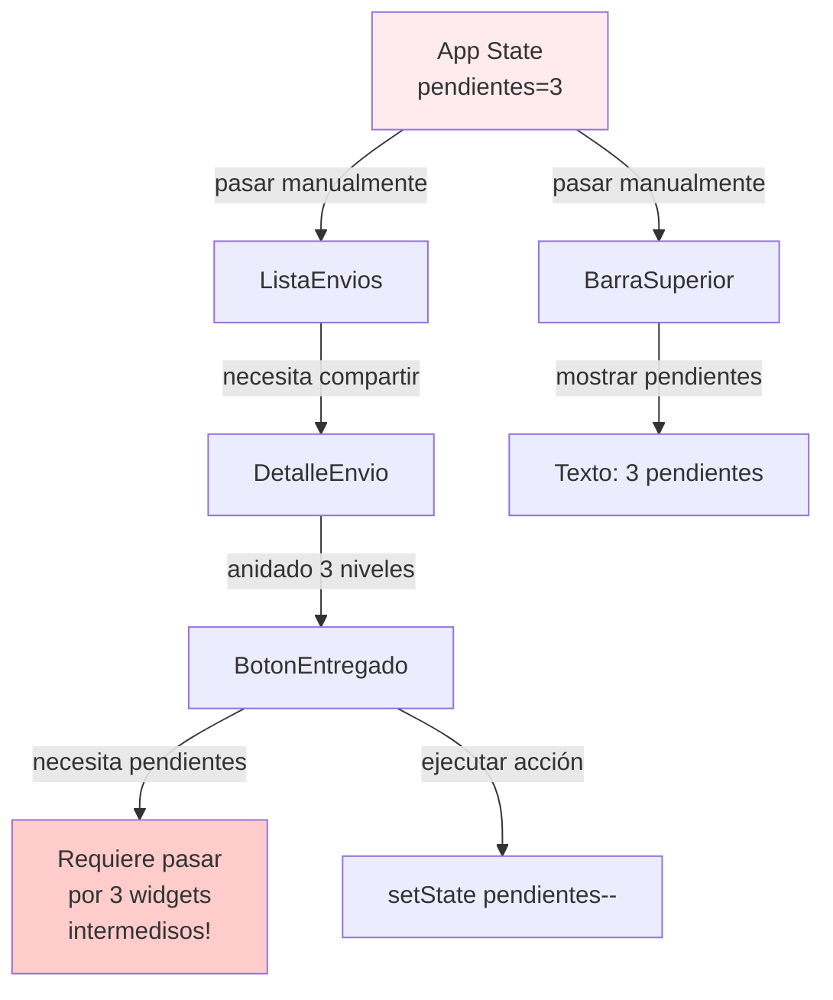
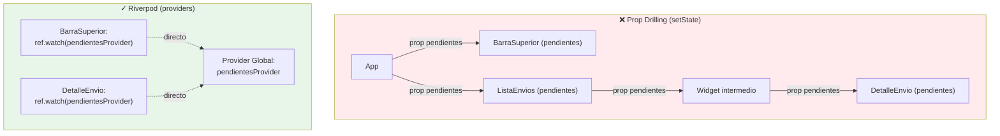
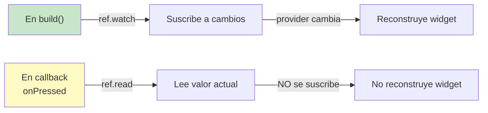
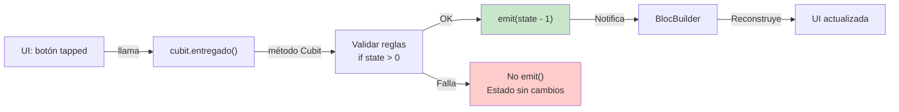
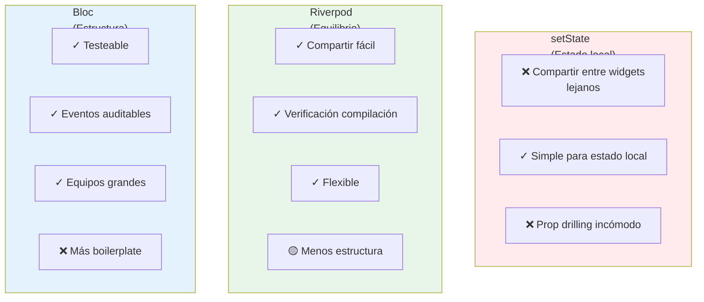
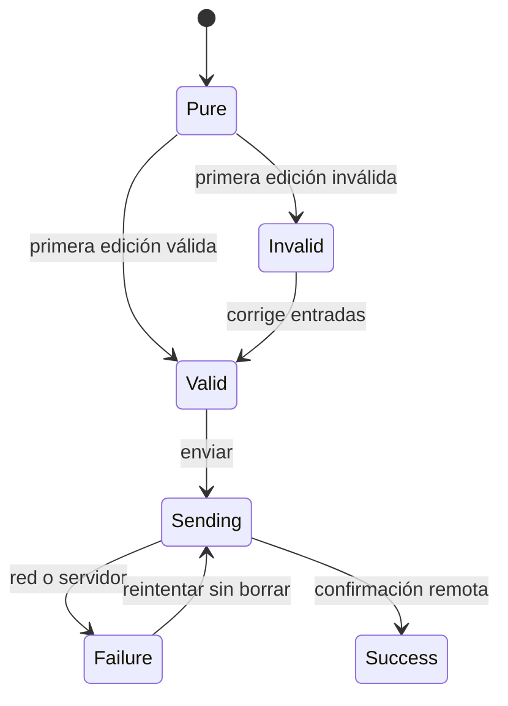
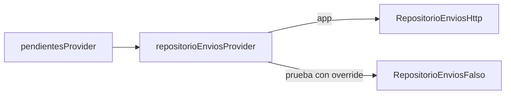

# Módulo 4: Gestión de estado


## Aprende construyendo


### Tema 1: setState y sus límites · Intermedio · 30 min

<details open>
<summary><strong>Capa 1 — Lectura</strong></summary>

#### ► DE QUÉ TRATA
Al finalizar vas a confirmar por qué setState no alcanza para compartir el contador de "envíos pendientes" entre BarraSuperior y ListaEnvios, dos widgets que no son padre-hijo directo. Prerrequisitos: Módulo 3 completo.

#### ► CÓMO FUNCIONA


</details>

<details>
<summary><strong>Capa 2 — Construcción</strong></summary>

#### Código y verificación


```
setState()  → apropiado: estado local a un widget y su subárbol cercano
setState()  → incómodo: estado compartido entre widgets distantes (requiere prop drilling manual)
```

```dart
import 'package:flutter/material.dart';

void main() => runApp(const MaterialApp(home: Scaffold(body: SafeArea(child: App()))));

class App extends StatefulWidget {
  const App({super.key});

  @override
  State<App> createState() => _AppState();
}

class _AppState extends State<App> {
  int pendientes = 3;

  @override
  Widget build(BuildContext context) => Column(children: [
        BarraSuperior(pendientes: pendientes), // prop drilling: pasado manualmente
        ListaEnvios(onEntregado: () => setState(() => pendientes--)),
      ]);
}

class BarraSuperior extends StatelessWidget {
  const BarraSuperior({required this.pendientes, super.key});
  final int pendientes;

  @override
  Widget build(BuildContext context) =>
      Padding(padding: const EdgeInsets.all(16), child: Text('$pendientes pendientes'));
}

class ListaEnvios extends StatelessWidget {
  const ListaEnvios({required this.onEntregado, super.key});
  final VoidCallback onEntregado;

  @override
  Widget build(BuildContext context) =>
      FilledButton(onPressed: onEntregado, child: const Text('Marcar una entrega'));
}
```

```bash
flutter create demo_flutter
cd demo_flutter
flutter run
```

</details>

### Tema 2: Riverpod · Intermedio · 45 min

<details open>
<summary><strong>Capa 1 — Lectura</strong></summary>

#### ► DE QUÉ TRATA
Al finalizar vas a migrar el contador de "envíos pendientes" del Tema 1 a un NotifierProvider de Riverpod, consumido desde BarraSuperior y DetalleEnvio sin ningún prop drilling. Prerrequisitos: Tema 1 de este módulo.

#### ► LA ANALOGÍA
Riverpod declara providers como objetos globales independientes del árbol de widgets, verificados en tiempo de compilación — un directorio centralizado de servicios verificado antes de abrir el edificio.

**Diagrama: Riverpod vs prop drilling**



**Diagrama: ref.watch vs ref.read en Riverpod**



**Conceptos clave:** verificación de providers en tiempo de compilación, no dependiente del árbol de widgets en runtime.

```dart
import 'package:flutter/material.dart';
import 'package:flutter_riverpod/flutter_riverpod.dart';

class Contador extends Notifier<int> {
  @override
  int build() => 0;

  void incrementar() => state++;
}

final contadorProvider = NotifierProvider<Contador, int>(Contador.new);

class PantallaContador extends ConsumerWidget {
  const PantallaContador({super.key});

  @override
  Widget build(BuildContext context, WidgetRef ref) {
    final contador = ref.watch(contadorProvider);
    return ElevatedButton(
      onPressed: () => ref.read(contadorProvider.notifier).incrementar(),
      child: Text('$contador'),
    );
  }
}
```

> **Riverpod 3.** `flutter pub add flutter_riverpod` instala la versión 3. En ella `StateProvider`, `StateNotifierProvider` y `ChangeNotifierProvider` son *legacy*: siguen existiendo, pero solo si importas `package:flutter_riverpod/legacy.dart`. Este curso usa la API principal, `Notifier` + `NotifierProvider` (fuente: https://riverpod.dev/docs/3.0_migration).

Riverpod (evolución de Provider, el paquete de gestión de estado más antiguo del ecosistema Flutter) declara providers como objetos globales independientes del árbol de widgets, verificados en tiempo de **compilación**: intentar leer un provider que no existe o que tiene un tipo incorrecto produce un error de compilación inmediato, a diferencia de Provider (el paquete anterior), donde un provider se busca en runtime recorriendo el árbol de widgets hacia arriba (`context.watch<T>()`), de modo que un error de "provider no encontrado" (porque el widget que lo provee no está en el ancestro esperado en el árbol) solo se manifiesta como una excepción en tiempo de ejecución, potencialmente descubierta tarde durante pruebas manuales o incluso en producción.

`ref.watch(contadorProvider)` suscribe el widget a reconstruirse cuando ese provider cambia; `ref.read(contadorProvider.notifier).incrementar()` modifica el estado sin suscribirse a cambios (apropiado dentro de callbacks de eventos, donde no se necesita observar el propio cambio que se está provocando). Consumir el mismo provider desde dos widgets distintos y distantes entre sí simplemente requiere que ambos llamen `ref.watch(contadorProvider)`, sin ningún prop drilling manual entre ellos, resolviendo directamente el problema descrito en el Tema 1.

**Analogía:** Riverpod es como un directorio centralizado de servicios verificado formalmente antes de la apertura de un edificio, donde cualquier intento de referenciar un servicio inexistente se detecta durante la inspección previa (compilación), en vez de descubrirse recién cuando alguien intenta usar ese servicio en el día a día de operación del edificio ya abierto al público (runtime).

**¿Por qué es importante?** Riverpod verifica providers en tiempo de compilación, detectando errores de "provider no encontrado" antes de ejecutar la app, a diferencia de Provider, que depende del árbol de widgets en runtime y descubre esos errores solo al ejecutar el código afectado.

**Código del ejemplo:**

```dart
final contadorProvider = NotifierProvider<Contador, int>(Contador.new);
// Verificado en COMPILACIÓN, independiente de dónde esté ubicado en el árbol de widgets
```

En el proyecto integrador RutaFlow, `pendientesProvider` vive en `lib/features/deliveries/domain/delivery_providers.dart`. Práctica: extendé ese mismo provider en tu proyecto propio para un segundo contador relacionado.

#### ► CÓMO FUNCIONA


</details>

<details>
<summary><strong>Capa 2 — Construcción</strong></summary>

#### Código y verificación


```dart
import 'package:flutter/material.dart';
import 'package:flutter_riverpod/flutter_riverpod.dart';

class Contador extends Notifier<int> {
  @override
  int build() => 0;

  void incrementar() => state++;
}

final contadorProvider = NotifierProvider<Contador, int>(Contador.new);

class PantallaContador extends ConsumerWidget {
  const PantallaContador({super.key});

  @override
  Widget build(BuildContext context, WidgetRef ref) {
    final contador = ref.watch(contadorProvider);
    return ElevatedButton(
      onPressed: () => ref.read(contadorProvider.notifier).incrementar(),
      child: Text('$contador'),
    );
  }
}
```

```dart
final contadorProvider = NotifierProvider<Contador, int>(Contador.new);
// Verificado en COMPILACIÓN, independiente de dónde esté ubicado en el árbol de widgets
```

```dart
import 'package:flutter/material.dart';
import 'package:flutter_riverpod/flutter_riverpod.dart';

class Pendientes extends Notifier<int> {
  @override
  int build() => 3;

  void entregar() => state--;
}

final pendientesProvider = NotifierProvider<Pendientes, int>(Pendientes.new);

class BarraSuperior extends ConsumerWidget {
  const BarraSuperior({super.key});

  @override
  Widget build(BuildContext context, WidgetRef ref) {
    final pendientes = ref.watch(pendientesProvider);
    return Text('$pendientes pendientes');
  }
}

class DetalleEnvio extends ConsumerWidget {
  const DetalleEnvio({super.key});

  @override
  Widget build(BuildContext context, WidgetRef ref) => ElevatedButton(
        onPressed: () => ref.read(pendientesProvider.notifier).entregar(),
        child: const Text('Entregado'),
      );
}

void main() {
  runApp(
    const ProviderScope(
      child: MaterialApp(
        home: Scaffold(body: Column(children: [BarraSuperior(), DetalleEnvio()])),
      ),
    ),
  );
}
```

```bash
flutter create demo_flutter
cd demo_flutter
flutter pub add flutter_riverpod
flutter run
```

</details>

### Tema 3: Bloc/Cubit y otras alternativas · Intermedio · 40 min

<details open>
<summary><strong>Capa 1 — Lectura</strong></summary>

#### ► DE QUÉ TRATA
Al finalizar vas a reimplementar el contador de "envíos pendientes" con un Cubit, separando explícitamente el evento ("se entregó un envío") del cambio de estado resultante. Prerrequisitos: Tema 2 de este módulo.

#### ► CÓMO FUNCIONA


</details>

<details>
<summary><strong>Capa 2 — Construcción</strong></summary>

#### Código y verificación




```dart
class ContadorCubit extends Cubit<int> {
  ContadorCubit() : super(0);
  void incrementar() => emit(state + 1);
}

BlocBuilder<ContadorCubit, int>(
  builder: (context, contador) => Text("$contador"),
)
```

```
setState  → estado puramente local
Riverpod  → balance simplicidad/robustez, mayoría de apps
Bloc      → equipos grandes, estructura explícita basada en eventos
```

```bash
flutter test test/pendientes_cubit_test.dart
# 00:01 +1: PendientesCubit nunca baja de 0
```

```dart
import 'package:flutter/material.dart';
import 'package:flutter_bloc/flutter_bloc.dart';

class PendientesCubit extends Cubit<int> {
  PendientesCubit() : super(3);
  void entregado() {
    if (state > 0) emit(state - 1);
  }
}

void main() => runApp(MaterialApp(
      home: BlocProvider(create: (_) => PendientesCubit(), child: const PantallaPendientes()),
    ));

class PantallaPendientes extends StatelessWidget {
  const PantallaPendientes({super.key});

  @override
  Widget build(BuildContext context) => Scaffold(
        body: Center(
          child: BlocBuilder<PendientesCubit, int>(
            builder: (context, pendientes) => Text("$pendientes pendientes"),
          ),
        ),
        floatingActionButton: FloatingActionButton(
          onPressed: () => context.read<PendientesCubit>().entregado(),
          child: const Icon(Icons.check),
        ),
      );
}
```

</details>

### Tema 4: Formularios profesionales con Formz y Riverpod · Avanzado · 45 min

<details open>
<summary><strong>Capa 1 — Lectura</strong></summary>

#### ► DE QUÉ TRATA
Al finalizar vas a construir el formulario "No fue posible entregar" con entradas Formz tipadas (ReasonInput, NoteInput) y un Notifier de Riverpod que coordine validación y envío único. Prerrequisitos: módulos 0-3, Riverpod configurado.

#### ► LA ANALOGÍA
Formz distingue `pure` (sin interacción) de `dirty` (ya modificado); el estado del formulario es inmutable y separa validez de estado de red — las entradas son inspectores especializados, el estado del formulario es el tablero de despacho.
**Conceptos clave:** valor `pure`/`dirty`, validación determinista, estado inmutable, feedback progresivo, envío único y error de servidor.

Construiremos el formulario «No fue posible entregar» de nuestra app. El conductor debe elegir un motivo y escribir una observación de 10 a 300 caracteres. Un formulario real no es solamente un conjunto de `TextEditingController`: necesita distinguir lo que el usuario todavía no tocó, una entrada inválida, un envío en curso, un rechazo del backend y una confirmación exitosa.

**Requisitos previos:** Módulos 0–3, proyecto `demo_driver` y Riverpod configurado. Desde la raíz ejecuta:

```bash
flutter pub add flutter_riverpod formz
```

```text
lib/features/delivery_issue/
├── domain/delivery_issue_repository.dart
├── application/report_issue.dart
└── presentation/
    ├── issue_form_inputs.dart
    ├── issue_form_state.dart
    ├── issue_form_notifier.dart
    └── issue_form_page.dart
test/features/delivery_issue/presentation/issue_form_notifier_test.dart
```

En `issue_form_inputs.dart`, cada entrada contiene su valor y su validación. `pure` significa «aún no hubo interacción»; `dirty` significa «el usuario ya la modificó». Esto evita mostrar una pantalla llena de errores antes de escribir.

```dart
import 'package:formz/formz.dart';

enum ReasonError { empty }
final class ReasonInput extends FormzInput<String, ReasonError> {
  const ReasonInput.pure() : super.pure('');
  const ReasonInput.dirty([super.value = '']) : super.dirty();
  @override
  ReasonError? validator(String value) => value.isEmpty ? ReasonError.empty : null;
}

enum NoteError { tooShort, tooLong }
final class NoteInput extends FormzInput<String, NoteError> {
  const NoteInput.pure() : super.pure('');
  const NoteInput.dirty([super.value = '']) : super.dirty();
  @override
  NoteError? validator(String value) {
    final text = value.trim();
    if (text.length < 10) return NoteError.tooShort;
    if (text.length > 300) return NoteError.tooLong;
    return null;
  }
}
```

En `issue_form_state.dart`, el estado es inmutable y separa validez de estado de red:

```dart
enum SubmitStatus { idle, sending, success, failure }

final class IssueFormState {
  const IssueFormState({
    this.reason = const ReasonInput.pure(),
    this.note = const NoteInput.pure(),
    this.submitStatus = SubmitStatus.idle,
    this.serverMessage,
  });

  final ReasonInput reason;
  final NoteInput note;
  final SubmitStatus submitStatus;
  final String? serverMessage;
  bool get isValid => Formz.validate([reason, note]);

  IssueFormState copyWith({ReasonInput? reason, NoteInput? note,
      SubmitStatus? submitStatus, String? serverMessage}) => IssueFormState(
    reason: reason ?? this.reason,
    note: note ?? this.note,
    submitStatus: submitStatus ?? this.submitStatus,
    serverMessage: serverMessage,
  );
}
```

El `Notifier` de `issue_form_notifier.dart` es el único lugar que coordina cambios y envío. La guarda inicial impide doble toque mientras la petición está activa:

```dart
final class IssueFormNotifier extends Notifier<IssueFormState> {
  @override
  IssueFormState build() => const IssueFormState();

  void reasonChanged(String value) {
    state = state.copyWith(reason: ReasonInput.dirty(value));
  }

  void noteChanged(String value) {
    state = state.copyWith(note: NoteInput.dirty(value));
  }

  Future<void> submit() async {
    if (!state.isValid || state.submitStatus == SubmitStatus.sending) return;
    state = state.copyWith(submitStatus: SubmitStatus.sending);
    try {
      await ref.read(deliveryIssueRepositoryProvider).report(
        reason: state.reason.value,
        note: state.note.value.trim(),
      );
      state = state.copyWith(submitStatus: SubmitStatus.success);
    } catch (_) {
      state = state.copyWith(
        submitStatus: SubmitStatus.failure,
        serverMessage: 'No pudimos guardar el reporte. Intenta nuevamente.',
      );
    }
  }
}
```

La página observa el estado, traduce errores tipados a español y anuncia el resultado con `Semantics` o `SnackBar`. El botón se deshabilita si el formulario no es válido o ya está enviando; no borres lo escrito cuando el servidor falla.

```dart
FilledButton(
  onPressed: form.isValid && form.submitStatus != SubmitStatus.sending
      ? notifier.submit
      : null,
  child: form.submitStatus == SubmitStatus.sending
      ? const SizedBox.square(dimension: 20, child: CircularProgressIndicator())
      : const Text('Reportar novedad'),
)
```



**Analogía:** las entradas Formz son inspectores especializados y el estado del formulario es el tablero de despacho. El tablero coordina resultados, pero no repite las reglas de inspección de cada campo.

**Ejecución y resultado esperado:** ejecuta `flutter test test/features/delivery_issue/presentation/issue_form_notifier_test.dart` y luego `flutter run`. El botón permanece inactivo con observación corta, se activa con entradas válidas, muestra progreso durante una única petición y conserva valores ante un error recuperable.

**Fallo deliberado:** toca dos veces rápidamente el botón y configura el repositorio falso para tardar dos segundos. La prueba debe demostrar que `report` se invoca una sola vez. Después haz que el backend responda `422`; conserva un mensaje general y asigna errores de campo solamente si el contrato del servidor los identifica explícitamente.

**Modificación sin copiar:** agrega fotografía obligatoria solo para el motivo `damaged_package`. Decide si esa regla pertenece a una entrada compuesta o al formulario, y prueba las transiciones sin usar `pumpWidget`.

---

**Transferencia al proyecto integrador «Aplicación móvil del repartidor»:** Modela validación y envío del formulario de incidencia en Riverpod. Prueba doble toque, campo inválido y error del servidor; el borrador debe conservarse para corregirlo y reintentar.

**Límites y decisión de uso:** Validar en el formulario mejora la interacción, pero el servidor debe repetir reglas y autorización. No descartes el borrador ante un error recuperable y evita que estado válido se interprete como permiso para confirmar una entrega.

**¿Por qué es importante?** Centralizar validación en tipos puros permite probar reglas sin renderizar widgets; separar `isValid` de `SubmitStatus` evita confundir "datos correctos" con "datos ya guardados" y previene envíos duplicados.

#### ► CÓMO FUNCIONA


</details>

<details>
<summary><strong>Capa 2 — Construcción</strong></summary>

#### Código y verificación
```bash
flutter pub add flutter_riverpod formz
```

```text
lib/features/delivery_issue/
├── domain/delivery_issue_repository.dart
├── application/report_issue.dart
└── presentation/
    ├── issue_form_inputs.dart
    ├── issue_form_state.dart
    ├── issue_form_notifier.dart
    └── issue_form_page.dart
test/features/delivery_issue/presentation/issue_form_notifier_test.dart
```

```dart
import 'package:formz/formz.dart';

enum ReasonError { empty }
final class ReasonInput extends FormzInput<String, ReasonError> {
  const ReasonInput.pure() : super.pure('');
  const ReasonInput.dirty([super.value = '']) : super.dirty();
  @override
  ReasonError? validator(String value) => value.isEmpty ? ReasonError.empty : null;
}

enum NoteError { tooShort, tooLong }
final class NoteInput extends FormzInput<String, NoteError> {
  const NoteInput.pure() : super.pure('');
  const NoteInput.dirty([super.value = '']) : super.dirty();
  @override
  NoteError? validator(String value) {
    final text = value.trim();
    if (text.length < 10) return NoteError.tooShort;
    if (text.length > 300) return NoteError.tooLong;
    return null;
  }
}
```

```dart
enum SubmitStatus { idle, sending, success, failure }

final class IssueFormState {
  const IssueFormState({
    this.reason = const ReasonInput.pure(),
    this.note = const NoteInput.pure(),
    this.submitStatus = SubmitStatus.idle,
    this.serverMessage,
  });

  final ReasonInput reason;
  final NoteInput note;
  final SubmitStatus submitStatus;
  final String? serverMessage;
  bool get isValid => Formz.validate([reason, note]);

  IssueFormState copyWith({ReasonInput? reason, NoteInput? note,
      SubmitStatus? submitStatus, String? serverMessage}) => IssueFormState(
    reason: reason ?? this.reason,
    note: note ?? this.note,
    submitStatus: submitStatus ?? this.submitStatus,
    serverMessage: serverMessage,
  );
}
```

```dart
final class IssueFormNotifier extends Notifier<IssueFormState> {
  @override
  IssueFormState build() => const IssueFormState();

  void reasonChanged(String value) {
    state = state.copyWith(reason: ReasonInput.dirty(value));
  }

  void noteChanged(String value) {
    state = state.copyWith(note: NoteInput.dirty(value));
  }

  Future<void> submit() async {
    if (!state.isValid || state.submitStatus == SubmitStatus.sending) return;
    state = state.copyWith(submitStatus: SubmitStatus.sending);
    try {
      await ref.read(deliveryIssueRepositoryProvider).report(
        reason: state.reason.value,
        note: state.note.value.trim(),
      );
      state = state.copyWith(submitStatus: SubmitStatus.success);
    } catch (_) {
      state = state.copyWith(
        submitStatus: SubmitStatus.failure,
        serverMessage: 'No pudimos guardar el reporte. Intenta nuevamente.',
      );
    }
  }
}
```

```dart
FilledButton(
  onPressed: form.isValid && form.submitStatus != SubmitStatus.sending
      ? notifier.submit
      : null,
  child: form.submitStatus == SubmitStatus.sending
      ? const SizedBox.square(dimension: 20, child: CircularProgressIndicator())
      : const Text('Reportar novedad'),
)
```

</details>

### Tema 5: Inyección de dependencias con Riverpod: reemplazar implementaciones · Avanzado · 45 min

<details open>
<summary><strong>Capa 1 — Lectura</strong></summary>

#### ► DE QUÉ TRATA
Al finalizar podrás depender de abstracciones en vez de implementaciones, inyectarlas con proveedores de Riverpod y reemplazarlas en pruebas con overrides, sin red ni servidores. Prerrequisitos: Temas 2 y 3 de este módulo.

#### ► LA ANALOGÍA
La **inyección de dependencias** (DI) consiste en que un componente **reciba** lo que necesita en lugar de crearlo. En Flutter con Riverpod, cada proveedor es un punto de inyección: `repositorioEnviosProvider` entrega la implementación y quien lo lee solo conoce la interfaz. En pruebas, `ProviderContainer(overrides: [...])` o `ProviderScope(overrides: [...])` reemplaza la implementación. Otras opciones son pasar dependencias por constructor o un localizador de servicios como `get_it`, que es más simple pero esconde las dependencias.

**Analogía:** es el enchufe de la pared: la lámpara no sabe si la electricidad viene de la red o de una batería, solo que llega por el enchufe.

**Diagrama:**



**¿Por qué es importante?** porque sin DI las pruebas son lentas y frágiles, y cambiar de backend obliga a tocar toda la app.
**Fuente oficial:** [Riverpod: Testing](https://riverpod.dev/docs/how_to/testing), [Flutter: App architecture](https://docs.flutter.dev/app-architecture).
**Conceptos clave:** inyección de dependencias, interfaz, proveedor, `ProviderContainer`, `overrides`, `overrideWithValue`, localizador de servicios.
**Cuándo no usarlo:** en un widget pequeño que no tiene dependencias externas no hace falta un proveedor: pasa los datos por constructor.

**Transferencia al proyecto integrador «Aplicación móvil del repartidor»:** inyecta el repositorio de entregas de la app y escribe sus pruebas con una implementación falsa.
Como **siguiente** paso, aplica lo aprendido en el proyecto integrador del track y compara el resultado con lo que esperabas.
**Errores comunes:** olvidar pasar `overrides` al crear el `ProviderContainer` (o al `ProviderScope` en un widget test) y asumir que alcanza con declarar `RepositorioEnviosFalso` — sin la lista `overrides`, el contenedor sigue construyendo `RepositorioEnviosHttp` a través del proveedor original, y la prueba termina llamando a la implementación real que debía evitar.

#### ► CÓMO FUNCIONA


</details>

<details>
<summary><strong>Capa 2 — Construcción</strong></summary>

#### Código y verificación


```bash
mkdir inyeccion && cd inyeccion
flutter create repartidor_di
cd repartidor_di
flutter pub add flutter_riverpod
```

```dart
// test/envios_test.dart
import 'package:flutter_riverpod/flutter_riverpod.dart';
import 'package:flutter_test/flutter_test.dart';
import 'package:repartidor_di/envios.dart';

class RepositorioEnviosFalso implements RepositorioEnvios {
  @override
  Future<List<String>> pendientes(String repartidor) async => ['BO-1', 'BO-2', 'BO-3'];
}

void main() {
  test('cuenta los pendientes usando un repositorio falso inyectado', () async {
    final contenedor = ProviderContainer(
      overrides: [repositorioEnviosProvider.overrideWithValue(RepositorioEnviosFalso())],
    );
    addTearDown(contenedor.dispose);

    expect(await contenedor.read(pendientesProvider('ana').future), 3);
  });
}
```

```dart
// lib/envios.dart — una abstracción, dos implementaciones y un proveedor
import 'package:flutter_riverpod/flutter_riverpod.dart';

abstract interface class RepositorioEnvios {
  Future<List<String>> pendientes(String repartidor);
}

class RepositorioEnviosHttp implements RepositorioEnvios {
  @override
  Future<List<String>> pendientes(String repartidor) =>
      throw UnimplementedError('requiere red: no debe llamarse en pruebas');
}

// El proveedor es el punto de inyección: la app usa la implementación real
final repositorioEnviosProvider = Provider<RepositorioEnvios>((ref) => RepositorioEnviosHttp());

// Quien consume no sabe qué implementación recibe
final pendientesProvider = FutureProvider.family<int, String>((ref, repartidor) async {
  final envios = await ref.watch(repositorioEnviosProvider).pendientes(repartidor);
  return envios.length;
});
```

```bash
rm test/widget_test.dart
flutter test
```

```text
00:02 +1: All tests passed!
```

</details>
