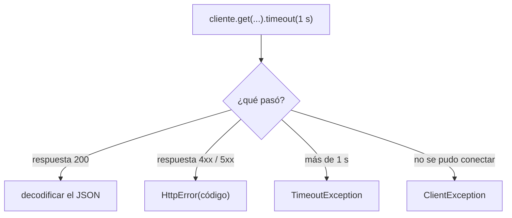
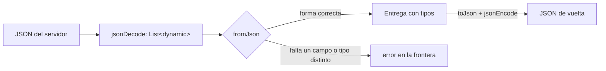
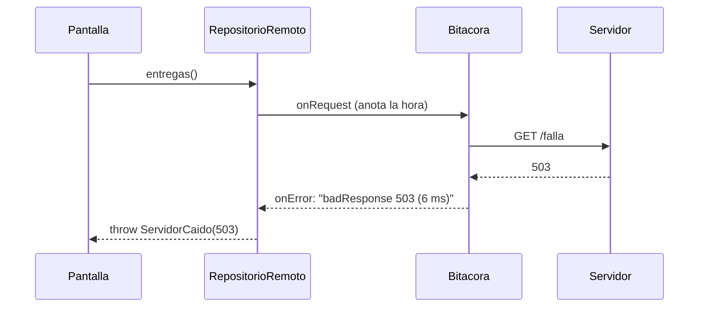
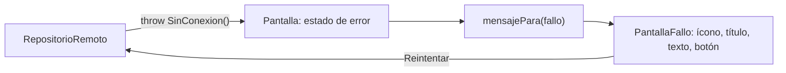
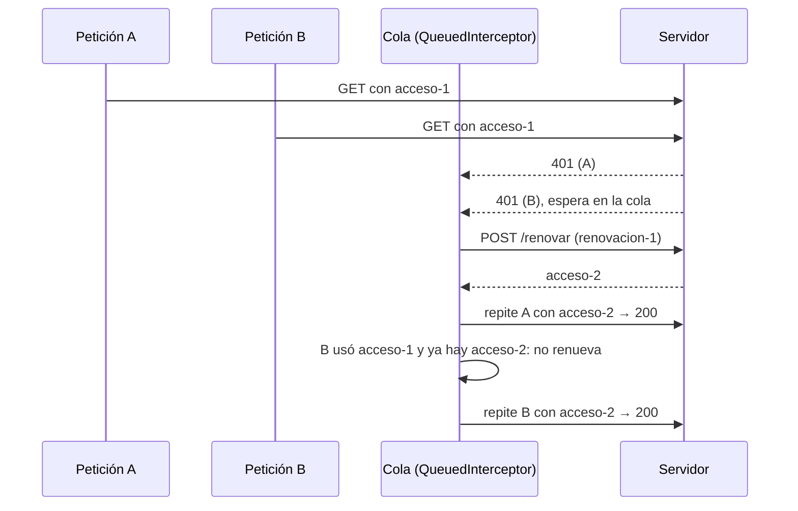

# Módulo 5: Redes: pedir datos, convertirlos, sobrevivir a los fallos y mantener la sesión

**Entorno comprobado para esta edición (2026-11-24):** Flutter 3.50.1 (canal estable) con Dart 3.14.0 en Linux
x86_64, con `http` 1.6.0, `dio` 5.11.1, `json_annotation` 4.12.0, `json_serializable` 6.15.2 y `build_runner`
2.17.1. Todo el código se analizó con `flutter analyze` (`No issues found!`). Las peticiones de los Temas 1, 2, 3 y 5
se hicieron **de verdad**, contra el servidor de práctica de este módulo (`bin/servidor.dart`) en
`http://127.0.0.1:8085`, ese día, en `/home/estudiante/labs/flutter/m5` (tu `~/labs/flutter/m5`). Las salidas son
literales; los milisegundos cambian en tu equipo. El pantallazo del Tema 4 lo dibujó Flutter con la herramienta del
Módulo 1.

Hasta ahora las entregas estaban escritas en el código. En la app real viven en un servidor: hay que pedirlas,
convertir el JSON en objetos, decidir qué hacer cuando la red falla (y en la calle falla a menudo) y demostrar quién
es el conductor en cada petición sin pedirle la clave cada diez minutos. Este módulo hace todo eso contra un servidor
de práctica que puedes ejecutar en tu equipo, con respuestas lentas, caídas y datos malformados a propósito.

**Al terminar este módulo podrás:**
- hacer peticiones con `package:http`, revisar el código de estado y poner límites de tiempo;
- convertir JSON en objetos con patrones de Dart o con `json_serializable`, y detectar datos malformados;
- configurar `dio` con opciones comunes, interceptores y errores traducidos a fallos del dominio;
- mostrar un mensaje distinto, útil y diseñado para cada tipo de fallo;
- implementar el flujo de sesión con tokens: ingresar, enviar el token, renovarlo una sola vez y cerrar sesión.

**Esquema del módulo:** Tema 1 (`http`) → Tema 2 (JSON) → Tema 3 (`dio` e interceptores) → Tema 4 (fallos con
mensaje) → Tema 5 (sesión con tokens) → Proyecto 22.

**Qué necesitas saber antes:** el Módulo 4 completo, en especial **`AsyncNotifier`**, **los estados de carga, vacío y
error** y **reemplazar el repositorio** (Temas 4 y 6); del Módulo 3, **`redirect` y la sesión** (Tema 4); del
Módulo 0, **`Future`**, **clases `sealed`**, **records** y **patrones** (Temas 3 y 6). De Fundamentos, **HTTP y los
códigos de estado** ayudan a leer las salidas.

**Qué no se repite:** el diseño de las pantallas de mensaje es el del Módulo 2, Tema 6, y el del Módulo 4, Tema 4. El
almacenamiento seguro en el teléfono (`flutter_secure_storage`) necesita Android o iOS: aquí se usa una versión en
memoria con la misma interfaz, y el almacenamiento local se estudia en el Módulo 6.

**Prepara el proyecto:**

```text
$ cd ~/labs/flutter
$ flutter create --org com.academia --platforms=web,linux --empty m5
$ cd m5
$ flutter pub add http dio json_annotation flutter_riverpod
$ flutter pub add dev:json_serializable dev:build_runner
```

**El servidor de práctica.** Ejecútalo en otra terminal y déjalo abierto mientras trabajas: `dart run
bin/servidor.dart`. Usa solo la biblioteca estándar de Dart (`dart:io`) y tiene rutas pensadas para cada tema: datos
públicos, una respuesta lenta, una caída, un JSON con errores, el login y la renovación de tokens (que vencen a los
2 segundos, para ver la renovación sin esperar).

```dart
// bin/servidor.dart — servidor de práctica para el módulo: responde en http://127.0.0.1:8085
// Ejecútalo con `dart run bin/servidor.dart` en otra terminal y déjalo abierto.
import 'dart:convert';
import 'dart:io';

const entregas = [
  {'guia': 'EN-4471', 'destinatario': 'Marta Gómez', 'direccion': 'Calle 80 # 68-45', 'pesoGramos': 1200},
  {'guia': 'EN-4472', 'destinatario': 'Luis Pardo', 'direccion': 'Carrera 15 # 93-20', 'pesoGramos': 350},
  {'guia': 'EN-4475', 'destinatario': 'Ana Ríos', 'direccion': 'Avenida 68 # 22-10', 'pesoGramos': 2300},
];

final accesos = <String, DateTime>{};          // token de acceso → vencimiento
final renovaciones = <String>{};
var contador = 0;
var renovacionesHechas = 0;

Future<void> main() async {
  final servidor = await HttpServer.bind(InternetAddress.loopbackIPv4, 8085);
  stdout.writeln('servidor escuchando en http://127.0.0.1:8085');
  await for (final p in servidor) {
    final ruta = p.uri.path;
    stdout.writeln('${p.method} $ruta ${p.headers.value('authorization') ?? ''}'.trim());
    atender(p, ruta).catchError((Object _) => responder(p, 500, {'error': 'interno'}));   // sin await: atiende varias a la vez
  }
}

Future<void> responder(HttpRequest p, int estado, Object cuerpo) async {
  p.response
    ..statusCode = estado
    ..headers.contentType = ContentType.json
    ..write(jsonEncode(cuerpo));
  await p.response.close();
}

bool autorizado(HttpRequest p) {
  final token = p.headers.value('authorization')?.replaceFirst('Bearer ', '');
  final vence = accesos[token];
  return vence != null && DateTime.now().isBefore(vence);
}

Future<void> atender(HttpRequest p, String ruta) async {
  switch ((p.method, ruta)) {
    case ('GET', '/publico/entregas'):
      return responder(p, 200, entregas);
    case ('GET', '/publico/malformada'):
      return responder(p, 200, [
        {'guia': 'EN-4480', 'destinatario': 'Sin dirección', 'pesoGramos': '900'},   // falta direccion; peso es texto
      ]);
    case ('GET', '/lento'):
      await Future<void>.delayed(const Duration(seconds: 3));
      return responder(p, 200, {'ok': true});
    case ('GET', '/falla'):
      return responder(p, 503, {'error': 'mantenimiento'});
    case ('POST', '/login'):
      final datos = jsonDecode(await utf8.decodeStream(p)) as Map<String, dynamic>;
      if (datos['usuario'] != 'ana' || datos['clave'] != 'ruta2026') {
        return responder(p, 401, {'error': 'credenciales'});
      }
      return responder(p, 200, nuevoPar());
    case ('POST', '/renovar'):
      final datos = jsonDecode(await utf8.decodeStream(p)) as Map<String, dynamic>;
      if (!renovaciones.remove(datos['renovacion'])) return responder(p, 401, {'error': 'renovacion'});
      renovacionesHechas++;
      stdout.writeln('  renovación número $renovacionesHechas');
      return responder(p, 200, nuevoPar());
    case ('GET', '/entregas'):
      if (!autorizado(p)) return responder(p, 401, {'error': 'token'});
      return responder(p, 200, entregas);
    case ('GET', final r) when r.startsWith('/entregas/'):
      if (!autorizado(p)) return responder(p, 401, {'error': 'token'});
      final guia = r.substring('/entregas/'.length);
      final e = entregas.where((x) => x['guia'] == guia).firstOrNull;
      return e == null ? responder(p, 404, {'error': 'no existe $guia'}) : responder(p, 200, e);
    default:
      return responder(p, 404, {'error': 'ruta'});
  }
}

Map<String, String> nuevoPar() {
  contador++;
  final acceso = 'acceso-$contador';
  final renovacion = 'renovacion-$contador';
  accesos[acceso] = DateTime.now().add(const Duration(seconds: 2));   // vence rápido para ver la renovación
  renovaciones.add(renovacion);
  return {'acceso': acceso, 'renovacion': renovacion};
}
```

Los programas `bin/temaN.dart` son de consola: imprimen sus resultados. Por eso empiezan con
`// ignore_for_file: avoid_print`; en la app se usa `debugPrint` o un registro de eventos (Módulo 13).


## Aprende construyendo


### Tema 1: package:http: pedir, revisar y poner un límite de tiempo · Básico · 40 min

<details open>
<summary><strong>Capa 1 — Lectura</strong></summary>

#### Objetivos
Al terminar este tema podrás:
- hacer una petición `GET` con un `http.Client` y leer el código de estado y el cuerpo;
- decodificar el cuerpo como UTF-8 para que las tildes se lean bien;
- limitar el tiempo de espera con `timeout`;
- distinguir los tres tipos de fallo: respuesta de error, tiempo agotado y sin conexión.

**Conceptos clave:** cliente HTTP, código de estado, cuerpo de la respuesta, `timeout`, `ClientException`

#### El problema
La app pide las entregas del día. A veces llegan; a veces el servidor responde «en mantenimiento»; a veces la red es
tan lenta que la persona se queda mirando un círculo girando; y a veces no hay red. Con un solo `await http.get(...)`
sin revisar nada, los tres casos de fallo se ven iguales, o peor, la app sigue como si todo hubiera salido bien.

Este tema usa **`Future`, `async` y `await`** (Módulo 0, Tema 3) y **las excepciones de Dart** (Módulo 0, Tema 3).

#### Glosario del tema

**cliente HTTP**
- **Definición técnica:** objeto `http.Client` que envía peticiones y mantiene abiertas las conexiones para reutilizarlas; se cierra con `close()`.
- **En palabras sencillas:** el mensajero que lleva y trae peticiones.
- **Dónde se rompe la comparación:** un mensajero se puede reutilizar para muchas peticiones al mismo servidor, y es más rápido así.
- **Ejemplo:** `final cliente = http.Client();` y `cliente.close()` en el `finally`.
- **Error típico:** usar `http.get(...)` suelto para muchas peticiones: cada una abre y cierra su conexión.

**código de estado**
- **Definición técnica:** número de tres cifras de la respuesta HTTP: 2xx éxito, 4xx error del cliente (401 sin permiso, 404 no existe) y 5xx error del servidor (503 no disponible).
- **En palabras sencillas:** el resumen de la respuesta en un número.
- **Dónde se rompe la comparación:** `package:http` no lanza excepciones por un 4xx o 5xx: la respuesta llega «bien» con un código de error.
- **Ejemplo:** `/falla` responde `503`.
- **Error típico:** usar `respuesta.body` sin mirar `statusCode` y tratar un mensaje de error como si fueran datos.

**cuerpo de la respuesta**
- **Definición técnica:** los bytes que envía el servidor después de las cabeceras; `body` los decodifica según la cabecera `Content-Type`, `bodyBytes` los entrega sin decodificar.
- **En palabras sencillas:** el contenido de la respuesta.
- **Dónde se rompe la comparación:** si el servidor no declara la codificación, `body` puede usar Latin-1 y romper las tildes.
- **Ejemplo:** `utf8.decode(respuesta.bodyBytes)` lee bien «Marta Gómez».
- **Error típico:** ver «Gómez» en la pantalla y corregirlo con reemplazos de texto.

**`timeout`**
- **Definición técnica:** método de `Future` que lo completa con `TimeoutException` si no termina en el tiempo dado.
- **En palabras sencillas:** «si en un segundo no contesta, me rindo».
- **Dónde se rompe la comparación:** no cancela la petición en el servidor; solo deja de esperarla.
- **Ejemplo:** `/lento` tarda 3 s y la app se rinde a 1 s.
- **Error típico:** no poner límite: la espera depende del sistema operativo y puede durar minutos.

**`ClientException`**
- **Definición técnica:** excepción de `package:http` para fallos de transporte: no hay red, el servidor no acepta la conexión, se cortó.
- **En palabras sencillas:** la petición ni siquiera llegó.
- **Dónde se rompe la comparación:** su mensaje viene del sistema operativo («Connection refused»), no es para el usuario.
- **Ejemplo:** el puerto 9 da `Connection refused`.
- **Error típico:** mostrar ese texto en la pantalla.

#### ► CÓMO FUNCIONA
La petición puede terminar de cuatro formas: llega una respuesta 200 (datos), llega una respuesta con otro código
(error del servidor o del cliente), no llega nada antes del límite (tiempo agotado) o no se puede ni conectar (sin
conexión). El código debe distinguirlas porque cada una pide una acción distinta.



#### Problema resuelto 1.1
Pide las entregas públicas y después tres rutas que fallan de formas distintas. Prueba también un servidor que no
existe.

**Razonamiento:**
1. `pedirEntregas` recibe el cliente (para reutilizarlo) y la ruta.
2. Revisa el código de estado y convierte cualquier código distinto de 200 en `HttpError`.
3. Decodifica `bodyBytes` como UTF-8.
4. El programa de consola atrapa cada fallo e imprime su tipo.

```dart
// lib/tema1/cliente_http.dart — package:http: pedir, revisar el código de estado y poner un límite de tiempo
import 'dart:async';
import 'dart:convert';

import 'package:http/http.dart' as http;

const base = 'http://127.0.0.1:8085';

/// Pide las entregas públicas y devuelve la lista decodificada, o lanza un error con un mensaje claro.
Future<List<dynamic>> pedirEntregas(http.Client cliente, {String ruta = '/publico/entregas'}) async {
  final respuesta = await cliente
      .get(Uri.parse('$base$ruta'), headers: {'Accept': 'application/json'})
      .timeout(const Duration(seconds: 1));                         // sin esto, espera lo que diga el sistema
  if (respuesta.statusCode != 200) {                                // http NO lanza error por un 4xx o 5xx
    throw HttpError(respuesta.statusCode, respuesta.body);
  }
  return jsonDecode(utf8.decode(respuesta.bodyBytes)) as List<dynamic>;   // bodyBytes: tildes bien leídas
}

class HttpError implements Exception {
  HttpError(this.estado, this.cuerpo);
  final int estado;
  final String cuerpo;

  @override
  String toString() => 'HttpError($estado): $cuerpo';
}
```

```dart
// bin/tema1.dart — ejecuta las peticiones del Tema 1 contra el servidor de práctica
// ignore_for_file: avoid_print — es un programa de consola: imprimir es su salida
import 'package:http/http.dart' as http;
import 'package:m5/tema1/cliente_http.dart';

Future<void> main() async {
  final cliente = http.Client();                                    // un cliente reutiliza la conexión
  try {
    final lista = await pedirEntregas(cliente);
    print('200: ${lista.length} entregas; la primera es ${lista.first['guia']} para ${lista.first['destinatario']}');
    print('tipo de un elemento: ${lista.first.runtimeType}');

    for (final ruta in ['/falla', '/lento', '/no-existe']) {
      try {
        await pedirEntregas(cliente, ruta: ruta);
      } catch (e) {
        print('$ruta → ${e.runtimeType}: $e');
      }
    }
  } finally {
    cliente.close();                                                // libera las conexiones abiertas
  }

  final sinServidor = http.Client();
  try {
    await sinServidor.get(Uri.parse('http://127.0.0.1:9'));        // un puerto donde nadie escucha
  } catch (e) {
    print('sin servidor → ${e.runtimeType}: ${e.toString().split(',').first}');
  } finally {
    sinServidor.close();
  }
}
```

```text
$ dart run bin/tema1.dart
200: 3 entregas; la primera es EN-4471 para Marta Gómez
tipo de un elemento: _Map<String, dynamic>
/falla → HttpError: HttpError(503): {"error":"mantenimiento"}
/lento → TimeoutException: TimeoutException after 0:00:01.000000: Future not completed
/no-existe → HttpError: HttpError(404): {"error":"ruta"}
sin servidor → _ClientSocketException: ClientException with SocketException: Connection refused (OS Error: Connection refused
```

**Explicación por partes.**
- Línea 13: `.timeout(...)` envuelve el `Future` de la petición.
- Líneas 14–16: sin esta revisión, `/falla` devolvería `{"error":"mantenimiento"}` como si fuera la lista.
- Línea 17: el resultado es `List<dynamic>` de mapas sin tipo (`_Map<String, dynamic>`); el Tema 2 los convierte en
  objetos.
- Las cuatro líneas de fallo son cuatro tipos distintos de problema; el Tema 3 los traduce a un tipo del dominio.
- `/lento` se rindió a 1 s, aunque el servidor iba a responder a los 3 s.
- Al escribir este tema, la primera versión del servidor atendía las peticiones de una en una: `/no-existe` esperó a
  que terminara `/lento` y también se agotó. El servidor actual las atiende a la vez.

> **Error común.** Asumir que `await http.get(...)` lanza una excepción si el servidor falla. Solo lanza si no hay
> respuesta; un 503 llega como respuesta normal.

> **Error común.** No cerrar el cliente. En una app de larga duración, cada cliente olvidado mantiene conexiones
> abiertas.

> **Buena práctica.** Pon siempre un límite de tiempo pensado para el usuario: un conductor en la calle no espera 30
> segundos. Ajusta el límite por tipo de petición (una lista, una foto).

> **Prevenir errores.** Ten un servidor de práctica con rutas que fallan a propósito, como el de este módulo: es la
> única forma de probar los fallos cuando quieras.

#### Checkpoint 1.1
¿Qué imprime el programa para `/no-existe`, y por qué no es `TimeoutException`?

Respuesta: `HttpError(404): {"error":"ruta"}`. El servidor respondió enseguida con 404; el límite de tiempo solo se
aplica cuando no llega ninguna respuesta.

</details>

<details>
<summary><strong>Capa 2 — Construcción</strong></summary>

#### Paso 1 · Arranca el servidor
En una terminal, ejecuta `dart run bin/servidor.dart` y déjala abierta.

#### Paso 2 · Ejecuta el tema
En otra terminal, crea `lib/tema1/cliente_http.dart` y `bin/tema1.dart`, y ejecuta `dart run bin/tema1.dart`.

#### Paso 3 · Mira el servidor
Lee la terminal del servidor: aparece una línea por cada petición recibida.

#### Paso 4 · Rompe las tildes
Cambia `utf8.decode(respuesta.bodyBytes)` por `respuesta.body` y ejecuta. ¿Se ven bien las tildes?

#### Paso 5 · Agrega un parámetro
Agrega a `pedirEntregas` un parámetro opcional de límite de tiempo y llama a `/lento` con 4 segundos.

#### Resumen
- Un **cliente HTTP** se reutiliza y se cierra.
- El **código de estado** se revisa siempre: `http` no lanza por un 4xx o 5xx.
- El **cuerpo de la respuesta** se decodifica como UTF-8.
- **`timeout`** limita la espera; **`ClientException`** indica que no hubo conexión.

#### Ejercicio verificable 1
Básico. ¿Cuántas líneas imprime el servidor por una ejecución de `bin/tema1.dart`?

Respuesta esperada: cuatro (`/publico/entregas`, `/falla`, `/lento` y `/no-existe`). La petición al puerto 9 nunca
llega al servidor de práctica.

#### Ejercicio verificable 2
Intermedio. En el Paso 4, ¿se ven bien las tildes?

Respuesta esperada: sí, en este servidor, porque declara `Content-Type: application/json; charset=utf-8`
(`ContentType.json`). Si un servidor no declara el `charset`, `body` puede leerlo como Latin-1; `bodyBytes` con
`utf8.decode` no depende de eso.

#### Ejercicio verificable 3
Reto. En el Paso 5, ¿qué imprime la llamada a `/lento` con 4 segundos?

Respuesta esperada: no hay fallo: después de unos 3 segundos llega `{ok: true}`. Como `pedirEntregas` espera una
lista, la conversión `as List<dynamic>` falla con un `TypeError`: la ruta `/lento` devuelve un objeto, no una lista.
Es el tipo de error que el Tema 2 enseña a convertir en un fallo claro.

#### En el trabajo
`package:http` es la forma más simple de hacer peticiones y la que usa la documentación oficial de Flutter. Para apps
con muchas peticiones, sesión y registro de eventos, los equipos suelen pasar a `dio` (Tema 3), pero las reglas de
este tema (revisar el código, limitar el tiempo, decodificar bien) son las mismas.

</details>

### Tema 2: JSON a objetos: patrones a mano o json_serializable · Intermedio · 45 min

<details open>
<summary><strong>Capa 1 — Lectura</strong></summary>

#### Objetivos
Al terminar este tema podrás:
- convertir un mapa JSON en un objeto con un patrón de mapa de Dart 3;
- generar la conversión con `json_serializable` y `build_runner`;
- volver a convertir el objeto en JSON con `toJson` y `jsonEncode`;
- detectar un JSON malformado y producir un error que diga qué falló.

**Conceptos clave:** deserialización, patrón de mapa, `json_serializable`, código generado, `FormatException`

#### El problema
El Tema 1 entrega `List<dynamic>` con mapas sin tipo. Usar `e['destinatario']` en toda la app es frágil: un error de
escritura compila y falla en ejecución, y si el servidor cambia un campo, la app falla lejos de donde llegó el dato. Lo
que llega de la red debe convertirse en objetos con tipos en un solo lugar, y fallar ahí mismo si viene mal.

Este tema usa **patrones** y **`switch` de expresión** (Módulo 0, Tema 6) y **`pedirEntregas`** (Tema 1).

#### Glosario del tema

**deserialización**
- **Definición técnica:** convertir datos de un formato de transporte (JSON) en objetos del lenguaje; la operación inversa es la serialización.
- **En palabras sencillas:** pasar del texto que viaja a los objetos que usa la app.
- **Dónde se rompe la comparación:** el JSON no tiene enteros y decimales separados, solo números; hay que decidir el tipo.
- **Ejemplo:** `{"guia": "EN-4471", ...}` → `Entrega(EN-4471, Marta Gómez, 1200g)`.
- **Error típico:** convertir en cada pantalla: cada una lo hace un poco distinto.

**patrón de mapa**
- **Definición técnica:** patrón de Dart 3 que comprueba que un valor es un mapa con ciertas claves y que sus valores coinciden con subpatrones (`'guia': String guia`).
- **En palabras sencillas:** «si tiene esta forma, saca estos datos».
- **Dónde se rompe la comparación:** no dice qué campo falló; solo que la forma no coincide.
- **Ejemplo:** `entregaDesdeJson` con un `switch` y un caso `_` que lanza `FormatException`.
- **Error típico:** olvidar el caso `_` y que el `switch` no compile, o hacerlo devolver un objeto «vacío» que esconde el error.

**`json_serializable`**
- **Definición técnica:** generador de código que lee las clases anotadas con `@JsonSerializable()` y escribe sus funciones `fromJson` y `toJson`.
- **En palabras sencillas:** un ayudante que escribe la conversión por ti.
- **Dónde se rompe la comparación:** el código generado hace conversiones de tipo (`as String`); con datos malos falla con `TypeError` si no se le pide más detalle.
- **Ejemplo:** `Entrega.fromJson(json)` llama a `_$EntregaFromJson`.
- **Error típico:** cambiar la clase y olvidar volver a ejecutar `build_runner`: el código generado queda viejo.

**código generado**
- **Definición técnica:** archivo escrito por una herramienta (`entrega.g.dart`), incluido con `part`, que no se edita a mano.
- **En palabras sencillas:** código que no escribes tú, pero que sí lees.
- **Dónde se rompe la comparación:** se versiona o no según el equipo; lo importante es que el CI lo regenere y compare.
- **Ejemplo:** `pesoGramos: (json['pesoGramos'] as num).toInt()`.
- **Error típico:** corregir un error en el `.g.dart`: la próxima generación lo borra.

**`FormatException`**
- **Definición técnica:** excepción de Dart para datos con un formato inesperado; acepta un mensaje y la fuente que falló.
- **En palabras sencillas:** «esto no tiene la forma que esperaba».
- **Dónde se rompe la comparación:** la fuente puede ser cualquier objeto; solo se imprime si es texto.
- **Ejemplo:** `throw FormatException('entrega con forma inesperada', json)`.
- **Error típico:** atrapar todas las excepciones de la conversión y seguir con una lista vacía: la app muestra «no hay entregas» cuando el problema son los datos.

#### ► CÓMO FUNCIONA
La respuesta decodificada pasa por una sola función de conversión por tipo. Si el mapa tiene la forma esperada, sale
un objeto con tipos; si no, sale un error en ese punto, que la capa de red puede traducir (Tema 3). `toJson` hace el
camino inverso, y `jsonEncode` lo llama solo.



#### Problema resuelto 2.1
Escribe el modelo `Entrega` con `json_serializable`, genera su código y conviértelo en las dos direcciones. Escribe la
misma conversión a mano con un patrón. Prueba las dos con el JSON malformado del servidor (falta `direccion` y el peso
viene como texto).

**Razonamiento:**
1. La clase declara `part 'entrega.g.dart';` y la anotación; `build_runner` crea el archivo.
2. La versión manual usa un patrón de mapa con tipos en cada clave.
3. El programa pide las dos rutas del servidor y prueba los dos convertidores.

```dart
// lib/tema2/entrega.dart — el modelo con json_serializable: el código de conversión lo genera build_runner
import 'package:json_annotation/json_annotation.dart';

part 'entrega.g.dart';                                              // archivo generado

@JsonSerializable()
class Entrega {
  const Entrega({required this.guia, required this.destinatario, required this.direccion, required this.pesoGramos});

  final String guia;
  final String destinatario;
  final String direccion;
  final int pesoGramos;

  factory Entrega.fromJson(Map<String, dynamic> json) => _$EntregaFromJson(json);
  Map<String, dynamic> toJson() => _$EntregaToJson(this);

  @override
  String toString() => 'Entrega($guia, $destinatario, ${pesoGramos}g)';
}
```

Genera el código con `dart run build_runner build`. Este es el archivo resultante:

```dart
// GENERATED CODE - DO NOT MODIFY BY HAND

part of 'entrega.dart';

// **************************************************************************
// JsonSerializableGenerator
// **************************************************************************

Entrega _$EntregaFromJson(Map<String, dynamic> json) => Entrega(
  guia: json['guia'] as String,
  destinatario: json['destinatario'] as String,
  direccion: json['direccion'] as String,
  pesoGramos: (json['pesoGramos'] as num).toInt(),
);

Map<String, dynamic> _$EntregaToJson(Entrega instance) => <String, dynamic>{
  'guia': instance.guia,
  'destinatario': instance.destinatario,
  'direccion': instance.direccion,
  'pesoGramos': instance.pesoGramos,
};
```

```dart
// lib/tema2/entrega_manual.dart — el mismo modelo convertido a mano, con un patrón de mapa
import 'entrega.dart';

Entrega entregaDesdeJson(Object? json) => switch (json) {
      {
        'guia': String guia,
        'destinatario': String destinatario,
        'direccion': String direccion,
        'pesoGramos': int pesoGramos,
      } =>
        Entrega(guia: guia, destinatario: destinatario, direccion: direccion, pesoGramos: pesoGramos),
      _ => throw FormatException('entrega con forma inesperada', json),   // dice qué llegó
    };
```

```dart
// bin/tema2.dart — convierte las respuestas del servidor en objetos Entrega, con datos buenos y malos
// ignore_for_file: avoid_print — es un programa de consola: imprimir es su salida
import 'dart:convert';

import 'package:http/http.dart' as http;
import 'package:m5/tema1/cliente_http.dart';
import 'package:m5/tema2/entrega.dart';
import 'package:m5/tema2/entrega_manual.dart';

Future<void> main() async {
  final cliente = http.Client();
  try {
    final buenas = (await pedirEntregas(cliente)).map((j) => Entrega.fromJson(j as Map<String, dynamic>)).toList();
    print('generado:  $buenas');
    print('de vuelta: ${jsonEncode(buenas.first)}');               // jsonEncode llama a toJson

    final malas = await pedirEntregas(cliente, ruta: '/publico/malformada');
    try {
      Entrega.fromJson(malas.first as Map<String, dynamic>);
    } catch (e) {
      print('generado con datos malos → ${e.runtimeType}: $e');
    }
    try {
      entregaDesdeJson(malas.first);
    } catch (e) {
      print('manual con datos malos  → ${e.runtimeType}: $e');
    }
  } finally {
    cliente.close();
  }
}
```

```text
$ dart run bin/tema2.dart
generado:  [Entrega(EN-4471, Marta Gómez, 1200g), Entrega(EN-4472, Luis Pardo, 350g), Entrega(EN-4475, Ana Ríos, 2300g)]
de vuelta: {"guia":"EN-4471","destinatario":"Marta Gómez","direccion":"Calle 80 # 68-45","pesoGramos":1200}
generado con datos malos → _TypeError: type 'Null' is not a subtype of type 'String' in type cast
manual con datos malos  → FormatException: FormatException: entrega con forma inesperada
```

**Explicación por partes.**
- En `entrega.g.dart`, cada campo es una conversión `as`; `pesoGramos` acepta cualquier número y lo pasa a entero.
- `de vuelta: {...}`: `jsonEncode` llamó a `toJson` de la primera entrega.
- Con el JSON malo, el código generado falla con `_TypeError: type 'Null' is not a subtype of type 'String'`: dice el
  tipo, pero no el campo.
- La versión manual falla con `FormatException`: dice que la forma no coincidió y conserva el mapa que llegó, pero
  tampoco nombra el campo.
- Las dos fallan **en la frontera**, al recibir, que es lo importante: el error no viaja a la pantalla.

> **Error común.** Usar `dynamic` en los modelos «para que no falle». No falla al recibir, falla en la pantalla, en
> producción, con un mensaje que nadie entiende.

> **Error común.** Convertir el peso con `as int` cuando el servidor a veces envía `1200.0`. El JSON no distingue
> enteros de decimales; `json_serializable` usa `(json[...] as num).toInt()` por eso.

> **Buena práctica.** Para modelos con muchos campos, genera la conversión; para dos o tres campos o formas que
> cambian (respuestas con distintos tipos), los patrones de Dart son claros y no necesitan generación.

> **Prevenir errores.** Agrega `dart run build_runner build` al CI y comprueba que no cambia ningún archivo: así nadie
> sube un `.g.dart` desactualizado.

#### Checkpoint 2.1
Si el servidor envía `"pesoGramos": 900.0`, ¿qué hacen las dos versiones?

Respuesta: la generada lo acepta y lo convierte en `900` (`as num` y `toInt()`); la manual lo rechaza, porque el
patrón exige `int` y `900.0` es un `double` en Dart.

</details>

<details>
<summary><strong>Capa 2 — Construcción</strong></summary>

#### Paso 1 · Crea el modelo
Crea `lib/tema2/entrega.dart` y ejecuta `dart run build_runner build`.

#### Paso 2 · Ejecuta
Con el servidor encendido, crea `lib/tema2/entrega_manual.dart` y `bin/tema2.dart`, y ejecuta `dart run
bin/tema2.dart`.

#### Paso 3 · Pide detalle
Cambia la anotación a `@JsonSerializable(checked: true)`, regenera, y en el `catch` del generado imprime
`e.key` y `e.message` cuando `e` sea `CheckedFromJsonException` (de `json_annotation`).

#### Paso 4 · Renombra un campo
El servidor envía `pesoGramos`, pero quieres llamarlo `peso` en Dart. Usa `@JsonKey(name: 'pesoGramos')` y
regenera.

#### Paso 5 · Vigila mientras editas
Ejecuta `dart run build_runner watch` y modifica la clase: el `.g.dart` se regenera al guardar.

#### Resumen
- La **deserialización** convierte JSON en objetos en un solo lugar: la frontera.
- Un **patrón de mapa** valida forma y tipos a mano; **`json_serializable`** genera **código** que no se edita.
- Los datos malos deben fallar al recibir, con un error como **`FormatException`**.

#### Ejercicio verificable 1
Básico. ¿Qué imprime `jsonEncode(Entrega.fromJson({...}).toJson())` para la primera entrega?

Respuesta esperada: `{"guia":"EN-4471","destinatario":"Marta Gómez","direccion":"Calle 80 # 68-45","pesoGramos":1200}`,
como la línea `de vuelta` de la salida.

#### Ejercicio verificable 2
Intermedio. Con el Paso 3, ¿qué campo informa la excepción?

Respuesta esperada: `campo: direccion; mensaje: type 'Null' is not a subtype of type 'String' in type cast`. Con
`checked: true`, el error es `CheckedFromJsonException` y nombra el primer campo que falló.

#### Ejercicio verificable 3
Reto. ¿Por qué el error nombra `direccion` y no `pesoGramos`, si los dos están mal?

Respuesta esperada: porque el código generado convierte los campos en el orden en que están declarados y se detiene en
el primero que falla. `direccion` está antes que `pesoGramos`.

#### En el trabajo
La conversión de JSON es la causa de muchos errores en producción cuando el servidor cambia sin aviso. Los equipos la
concentran en los modelos, usan `checked: true` o patrones con mensajes claros, y registran el JSON que falló para
poder corregir rápido.

</details>

### Tema 3: dio: configuración común, interceptores y fallos traducidos · Intermedio · 50 min

<details open>
<summary><strong>Capa 1 — Lectura</strong></summary>

#### Objetivos
Al terminar este tema podrás:
- crear un `Dio` con dirección base, límites de tiempo y cabeceras comunes;
- escribir un interceptor que registre cada petición con su resultado y su duración;
- traducir cada `DioException` a un tipo `sealed` de fallos del dominio;
- encapsular las peticiones en un repositorio que la app usa sin saber de HTTP.

**Conceptos clave:** `Dio`, `BaseOptions`, interceptor, `DioException`, fallo del dominio, repositorio remoto

#### El problema
Con `http`, cada petición repite la dirección base, las cabeceras, el límite de tiempo y la revisión del código. Y
cada pantalla recibe un error diferente (`HttpError`, `TimeoutException`, `ClientException`, `TypeError`). La app
necesita un solo lugar para la configuración, un registro de lo que pasa en la red y un único tipo de fallo que las
pantallas sepan mostrar.

Este tema usa **los tipos de fallo** (Tema 1), **`Entrega.fromJson`** (Tema 2), **clases `sealed`** y **`switch`
exhaustivo** (Módulo 0, Tema 6) y **el repositorio como interfaz** (Módulo 4, Tema 4).

#### Glosario del tema

**`Dio`**
- **Definición técnica:** cliente HTTP con configuración base, decodificación automática de JSON, interceptores, cancelación y errores tipados (`DioException`).
- **En palabras sencillas:** un mensajero con reglas fijas y un ayudante en cada parada.
- **Dónde se rompe la comparación:** a diferencia de `http`, lanza `DioException` también para respuestas 4xx y 5xx (`badResponse`).
- **Ejemplo:** `crearDio()` con base `http://127.0.0.1:8085`.
- **Error típico:** crear un `Dio` nuevo por petición y perder la configuración y los interceptores.

**`BaseOptions`**
- **Definición técnica:** opciones comunes a todas las peticiones de un `Dio`: `baseUrl`, `connectTimeout`, `receiveTimeout`, `headers`.
- **En palabras sencillas:** las reglas que valen para todos los envíos.
- **Dónde se rompe la comparación:** cada petición puede cambiarlas con `Options`.
- **Ejemplo:** `receiveTimeout: 1 s` hace que `/lento` falle.
- **Error típico:** confundir `connectTimeout` (conectar) con `receiveTimeout` (esperar la respuesta).

**interceptor**
- **Definición técnica:** objeto con `onRequest`, `onResponse` y `onError` que `Dio` llama en orden para cada petición; cada método debe pasarla al siguiente (`handler.next`) o resolverla.
- **En palabras sencillas:** un control en el camino de cada petición.
- **Dónde se rompe la comparación:** si un método no llama a `handler`, la petición se queda esperando para siempre.
- **Ejemplo:** `Bitacora` registra método, ruta, resultado y milisegundos.
- **Error típico:** registrar el cuerpo completo de las respuestas, con datos personales, en el registro de producción.

**`DioException`**
- **Definición técnica:** excepción de `dio` con un `type` (`connectionError`, `connectionTimeout`, `receiveTimeout`, `badResponse`, `cancel`...) y, si hubo respuesta, la `response`.
- **En palabras sencillas:** el informe de qué salió mal en la red.
- **Dónde se rompe la comparación:** es un detalle técnico de `dio`; la pantalla no debería conocerlo.
- **Ejemplo:** `receiveTimeout` para `/lento`, `badResponse` con 503 para `/falla`.
- **Error típico:** preguntar `e.response!.statusCode` sin mirar el tipo: si no hubo respuesta, falla.

**fallo del dominio**
- **Definición técnica:** tipo propio (`sealed class FalloRed`) que expresa los fallos en términos que la app entiende: sin conexión, tiempo agotado, sin permiso, no encontrado, servidor caído, datos inválidos.
- **En palabras sencillas:** los mismos problemas, dichos en el idioma de la app.
- **Dónde se rompe la comparación:** se pierde detalle técnico a propósito; el detalle va al registro.
- **Ejemplo:** `traducir(e)` convierte cada `DioException` en un `FalloRed`.
- **Error típico:** propagar `DioException` hasta los widgets: cambiar de biblioteca obliga a cambiar todas las pantallas.

**repositorio remoto**
- **Definición técnica:** clase que encapsula las peticiones a un recurso y devuelve objetos del dominio o lanza fallos del dominio.
- **En palabras sencillas:** la ventanilla donde la app pide entregas sin saber cómo viajan.
- **Dónde se rompe la comparación:** en las pruebas se reemplaza por uno falso (Módulo 4, Tema 6).
- **Ejemplo:** `RepositorioRemoto.entregas()`.
- **Error típico:** devolver `Response` de `dio` desde el repositorio.

#### ► CÓMO FUNCIONA
La pantalla llama al repositorio. El repositorio usa un `Dio` configurado; la petición pasa por los interceptores,
viaja, y la respuesta o el error vuelve por ellos. El repositorio convierte el JSON en entregas o traduce el error a
un `FalloRed`, y eso es lo único que ve la pantalla.



#### Problema resuelto 3.1
Crea el `Dio` de la app, el interceptor de registro, la traducción de fallos y el repositorio. Ejecútalo contra todas
las rutas del servidor de práctica y contra un servidor apagado.

**Razonamiento:**
1. Los fallos del dominio son una jerarquía `sealed`: el `switch` de la traducción y el de las pantallas (Tema 4) son
   exhaustivos.
2. `Bitacora` guarda la hora en `options.extra` al salir y calcula la duración al volver.
3. La traducción mira primero el tipo de `DioException` y, para `badResponse`, el código.
4. El repositorio atrapa además `TypeError`, que es lo que lanza el código generado con datos malos (Tema 2).

```dart
// lib/tema3/fallos.dart — los fallos de red que la app distingue, en lenguaje del dominio
sealed class FalloRed implements Exception {
  const FalloRed();
}

class SinConexion extends FalloRed {
  const SinConexion();
}

class TiempoAgotado extends FalloRed {
  const TiempoAgotado();
}

class NoAutorizado extends FalloRed {
  const NoAutorizado();
}

class NoEncontrado extends FalloRed {
  const NoEncontrado(this.que);
  final String que;
}

class ServidorCaido extends FalloRed {
  const ServidorCaido(this.estado);
  final int estado;
}

class DatosInvalidos extends FalloRed {
  const DatosInvalidos(this.detalle);
  final String detalle;
}
```

```dart
// lib/tema3/cliente_dio.dart — dio: configuración común, interceptores y errores traducidos
import 'package:dio/dio.dart';

import '../tema2/entrega.dart';
import 'fallos.dart';

/// Anota cada petición con su resultado y su duración.
class Bitacora extends Interceptor {
  Bitacora(this.anotar);
  final void Function(String) anotar;

  @override
  void onRequest(RequestOptions options, RequestInterceptorHandler handler) {
    options.extra['inicio'] = DateTime.now();
    handler.next(options);                                       // hay que dejarla seguir
  }

  @override
  void onResponse(Response<dynamic> response, ResponseInterceptorHandler handler) {
    anotar('${response.requestOptions.method} ${response.requestOptions.path} → ${response.statusCode} '
        '(${_ms(response.requestOptions)} ms)');
    handler.next(response);
  }

  @override
  void onError(DioException err, ErrorInterceptorHandler handler) {
    anotar('${err.requestOptions.method} ${err.requestOptions.path} → ${err.type.name} '
        '${err.response?.statusCode ?? ''} (${_ms(err.requestOptions)} ms)');
    handler.next(err);
  }

  int _ms(RequestOptions o) => DateTime.now().difference(o.extra['inicio'] as DateTime).inMilliseconds;
}

Dio crearDio({void Function(String)? anotar}) => Dio(BaseOptions(
      baseUrl: 'http://127.0.0.1:8085',
      connectTimeout: const Duration(seconds: 2),
      receiveTimeout: const Duration(seconds: 1),                   // el servidor tiene 1 s para responder
      headers: {'Accept': 'application/json'},
    ))
      ..interceptors.add(Bitacora(anotar ?? print));

/// Traduce los errores de dio a fallos que la pantalla entiende.
FalloRed traducir(DioException e) => switch (e.type) {
      DioExceptionType.connectionError => const SinConexion(),
      DioExceptionType.connectionTimeout || DioExceptionType.receiveTimeout => const TiempoAgotado(),
      DioExceptionType.badResponse => switch (e.response!.statusCode!) {
          401 => const NoAutorizado(),
          404 => NoEncontrado(e.requestOptions.path),
          final estado => ServidorCaido(estado),
        },
      _ => ServidorCaido(e.response?.statusCode ?? 0),
    };

class RepositorioRemoto {
  RepositorioRemoto(this.dio);
  final Dio dio;

  Future<List<Entrega>> entregas({String ruta = '/publico/entregas'}) async {
    try {
      final r = await dio.get<List<dynamic>>(ruta);                 // dio decodifica el JSON
      return [for (final j in r.data!) Entrega.fromJson(j as Map<String, dynamic>)];
    } on DioException catch (e) {
      throw traducir(e);
    } on TypeError catch (e) {
      throw DatosInvalidos('$e');                                   // el JSON no tenía la forma esperada
    }
  }
}
```

```dart
// bin/tema3.dart — el repositorio con dio contra el servidor de práctica
// ignore_for_file: avoid_print — es un programa de consola: imprimir es su salida
import 'package:m5/tema3/cliente_dio.dart';
import 'package:m5/tema3/fallos.dart';

Future<void> main() async {
  final repo = RepositorioRemoto(crearDio());
  print('entregas: ${await repo.entregas()}');
  for (final ruta in ['/falla', '/lento', '/no-existe', '/entregas', '/publico/malformada']) {
    try {
      await repo.entregas(ruta: ruta);
    } on FalloRed catch (f) {
      print('  $ruta → ${f.runtimeType}');
    }
  }
  try {
    await RepositorioRemoto(crearDio()..options.baseUrl = 'http://127.0.0.1:9').entregas();
  } on FalloRed catch (f) {
    print('  sin servidor → ${f.runtimeType}');
  }
}
```

```text
$ dart run bin/tema3.dart
GET /publico/entregas → 200 (78 ms)
entregas: [Entrega(EN-4471, Marta Gómez, 1200g), Entrega(EN-4472, Luis Pardo, 350g), Entrega(EN-4475, Ana Ríos, 2300g)]
GET /falla → badResponse 503 (5 ms)
  /falla → ServidorCaido
GET /lento → receiveTimeout  (1007 ms)
  /lento → TiempoAgotado
GET /no-existe → badResponse 404 (3 ms)
  /no-existe → NoEncontrado
GET /entregas → badResponse 401 (2 ms)
  /entregas → NoAutorizado
GET /publico/malformada → 200 (2 ms)
  /publico/malformada → DatosInvalidos
GET /publico/entregas → connectionError  (1 ms)
  sin servidor → SinConexion
```

**Explicación por partes.**
- La bitácora muestra cada petición con su resultado y su tiempo: `/lento` se cortó a los 1008 ms por
  `receiveTimeout`.
- `/entregas` responde 401 porque exige token; queda como `NoAutorizado`, que el Tema 5 resuelve.
- `/publico/malformada` respondió 200, pero la conversión falló: `DatosInvalidos`. Es un fallo que el código de
  estado no revela.
- Sin servidor, `dio` informa `connectionError` y la app lo ve como `SinConexion`.
- Las pantallas solo conocen seis fallos; `DioException` no sale del repositorio.

> **Error común.** Olvidar `handler.next(...)` en un interceptor. La petición nunca termina, y el error es difícil de
> encontrar porque no hay excepción.

> **Error común.** Registrar en producción los encabezados con el token. El registro se vuelve una fuente de robo de
> sesiones. Registra método, ruta, código y duración.

> **Buena práctica.** Un solo `Dio` por servidor, creado en un provider (Módulo 4), con sus interceptores. Las pruebas
> reemplazan el repositorio, no el `Dio`.

> **Prevenir errores.** Prueba la traducción con cada ruta de fallo del servidor de práctica, como hace este tema. Un
> fallo que se traduce mal llega a la pantalla con el mensaje equivocado.

#### Checkpoint 3.1
¿Qué fallo produciría un 500 del servidor, y en qué línea se decide?

Respuesta: `ServidorCaido(500)`. En el `switch` del código de estado, el caso `final estado => ServidorCaido(estado)`
atrapa cualquier código que no sea 401 ni 404.

</details>

<details>
<summary><strong>Capa 2 — Construcción</strong></summary>

#### Paso 1 · Crea los archivos
Crea `lib/tema3/fallos.dart`, `lib/tema3/cliente_dio.dart` y `bin/tema3.dart`.

#### Paso 2 · Ejecuta
Con el servidor encendido, ejecuta `dart run bin/tema3.dart` y compara la bitácora con la terminal del servidor.

#### Paso 3 · Cambia el límite
Sube `receiveTimeout` a 4 segundos y ejecuta. ¿Qué pasa con `/lento`?

#### Paso 4 · Agrega una cabecera
Escribe un interceptor que agregue `X-Version-App: 1.0.0` a todas las peticiones y comprueba en el servidor (imprime
la cabecera) que llega.

#### Paso 5 · Agrega un fallo
Agrega `class Conflicto extends FalloRed` para el código 409. ¿Qué te dice el analizador en el Tema 4?

#### Resumen
- **`Dio`** con **`BaseOptions`** concentra la configuración.
- Un **interceptor** ve cada petición, respuesta y error.
- **`DioException`** se traduce a un **fallo del dominio** dentro del **repositorio remoto**.

#### Ejercicio verificable 1
Básico. ¿Qué tipo de `DioException` produce el servidor apagado?

Respuesta esperada: `connectionError`, como muestra la línea `GET /publico/entregas → connectionError (2 ms)`.

#### Ejercicio verificable 2
Intermedio. Con el Paso 3, ¿qué registra la bitácora para `/lento`?

Respuesta esperada: `GET /lento → 200 (3005 ms)`: ya no se corta. Pero el resultado es `ServidorCaido`, no
`DatosInvalidos`: como la petición pidió `get<List<dynamic>>` y llegó un objeto, el error de tipos ocurre **dentro de
`dio`**, que lo envuelve en un `DioException` de tipo `unknown`, sin respuesta. La traducción lo manda al caso `_` como
`ServidorCaido(0)`. Es un fallo real de esta traducción: una mejora es que el caso `unknown` revise si `e.error` es un
`TypeError` y devuelva `DatosInvalidos`.

#### Ejercicio verificable 3
Reto. Con el Paso 5, ¿qué pasa al compilar?

Respuesta esperada: el `switch` de `mensajePara` (Tema 4) deja de ser exhaustivo y el analizador da un error: `The
type 'FalloRed' isn't exhaustively matched by the switch cases since it doesn't match the pattern 'Conflicto()'`. La
clase `sealed` obliga a que cada fallo tenga su mensaje.

#### En el trabajo
`dio` es el cliente HTTP más usado en apps Flutter profesionales, sobre todo por los interceptores: registro, cabeceras
comunes, sesión (Tema 5) y reintentos. La capa de repositorio con fallos del dominio es la que se encuentra en las
arquitecturas recomendadas por el equipo de Flutter (Módulo 12).

</details>

### Tema 4: Un mensaje para cada fallo: diseño de errores de red · Intermedio · 35 min

<details open>
<summary><strong>Capa 1 — Lectura</strong></summary>

#### Objetivos
Al terminar este tema podrás:
- asignar a cada fallo del dominio un ícono, un título, un texto y una acción;
- usar un `switch` exhaustivo para que ningún fallo quede sin mensaje;
- escribir mensajes que digan qué pasó y qué puede hacer la persona;
- mostrar el mensaje en la pantalla real, con reintento, a partir del repositorio del Tema 3.

**Conceptos clave:** mensaje de error accionable, `switch` exhaustivo sobre una clase `sealed`, record con nombre,
acción de recuperación

#### El problema
El Tema 3 dejó seis fallos con nombre. Si la pantalla muestra «Ocurrió un error» para todos, el conductor sin señal
reintenta sin parar, el que tiene la sesión vencida no sabe que debe volver a ingresar y soporte recibe llamadas que
no puede resolver. Cada fallo pide una acción distinta, y el mensaje debe decirla.

Este tema usa **`FalloRed`** (Tema 3), **records** (Módulo 0, Tema 6) y **la pantalla de mensaje** (Módulo 4,
Tema 4).

#### Glosario del tema

**mensaje de error accionable**
- **Definición técnica:** mensaje que nombra el problema en el lenguaje del usuario y le indica una acción posible, sin detalles técnicos.
- **En palabras sencillas:** qué pasó y qué hago ahora.
- **Dónde se rompe la comparación:** a veces no hay nada que hacer; entonces el mensaje tranquiliza («tus entregas no se perdieron»).
- **Ejemplo:** «Sin conexión. Revisa los datos móviles o el wifi.»
- **Error típico:** mostrar el código o la excepción («SocketException: Connection refused»).

**`switch` exhaustivo sobre una clase `sealed`**
- **Definición técnica:** `switch` de expresión que cubre todas las subclases de una clase `sealed`; si falta una, el analizador da un error.
- **En palabras sencillas:** el compilador comprueba que pensaste en todos los casos.
- **Dónde se rompe la comparación:** un caso `_` (comodín) apaga esa comprobación.
- **Ejemplo:** `mensajePara` no tiene comodín.
- **Error típico:** agregar `_ => mensajeGenerico` para que compile: los fallos nuevos caen ahí sin que nadie lo note.

**record con nombre**
- **Definición técnica:** tipo de Dart que agrupa valores con nombre sin declarar una clase: `({IconData icono, String titulo, ...})`.
- **En palabras sencillas:** un paquete de datos con etiquetas.
- **Dónde se rompe la comparación:** no tiene métodos; si el mensaje necesita comportamiento, conviene una clase.
- **Ejemplo:** `typedef Mensaje = (...)`.
- **Error típico:** usar un record posicional `(IconData, String, String)` y confundir el título con el texto.

**acción de recuperación**
- **Definición técnica:** acción que el mensaje ofrece para salir del fallo: reintentar, volver a ingresar, ir a otro lugar.
- **En palabras sencillas:** la salida.
- **Dónde se rompe la comparación:** «Reintentar» solo tiene sentido si reintentar puede funcionar; con datos inválidos, no.
- **Ejemplo:** `NoAutorizado` ofrece «Ingresar»; `DatosInvalidos`, ninguna.
- **Error típico:** «Reintentar» en todos los mensajes, incluso donde siempre fallará.

#### ► CÓMO FUNCIONA
El repositorio lanza un `FalloRed`; la pantalla lo atrapa (con `FutureBuilder` o con un `AsyncNotifier`) y llama a
`mensajePara`, que devuelve el record con lo que hay que dibujar. `PantallaFallo` lo dibuja con el diseño de los
módulos anteriores y conecta el botón con la acción.



#### Problema resuelto 4.1
Diseña el mensaje de cada fallo y obtén los pantallazos de los cuatro más frecuentes. Conecta la pantalla real con el
repositorio del Tema 3.

**Razonamiento:**
1. `mensajePara` es una función pura: se prueba sin pantalla y el analizador comprueba que cubre todos los fallos.
2. Los textos dicen qué pasó, qué hacer y, cuando ayuda, que nada se perdió.
3. `PantallaFallo` muestra el botón solo si el mensaje tiene acción (`if (m.accion case final accion?)`).
4. `main.dart` usa el repositorio real: con el servidor apagado, se ve el mensaje de «Sin conexión».

```dart
// lib/tema4/mensajes.dart — cada fallo de red con su mensaje, su ícono y su acción
import 'package:material_ui/material_ui.dart';

import '../tema3/fallos.dart';

typedef Mensaje = ({IconData icono, String titulo, String texto, String? accion});

/// El switch es exhaustivo: si mañana se agrega un fallo, el analizador obliga a darle un mensaje.
Mensaje mensajePara(FalloRed fallo) => switch (fallo) {
      SinConexion() => (
          icono: Icons.wifi_off,
          titulo: 'Sin conexión',
          texto: 'Revisa los datos móviles o el wifi. Tus entregas marcadas se guardan en el teléfono.',
          accion: 'Reintentar',
        ),
      TiempoAgotado() => (
          icono: Icons.hourglass_empty,
          titulo: 'La red está lenta',
          texto: 'El servidor no respondió a tiempo. Vuelve a intentarlo en unos segundos.',
          accion: 'Reintentar',
        ),
      NoAutorizado() => (
          icono: Icons.lock_clock,
          titulo: 'Tu sesión venció',
          texto: 'Por seguridad, vuelve a ingresar.',
          accion: 'Ingresar',
        ),
      NoEncontrado(:final que) => (
          icono: Icons.search_off,
          titulo: 'No encontramos lo que buscabas',
          texto: 'Es posible que la entrega se haya reasignado. ($que)',
          accion: null,
        ),
      ServidorCaido(:final estado) => (
          icono: Icons.cloud_off,
          titulo: 'El servicio no está disponible',
          texto: 'Estamos trabajando en ello. Código $estado.',
          accion: 'Reintentar',
        ),
      DatosInvalidos() => (
          icono: Icons.report_problem_outlined,
          titulo: 'Recibimos datos que no entendemos',
          texto: 'Actualiza la app. Si ya está actualizada, avisa a soporte.',
          accion: null,
        ),
    };

class PantallaFallo extends StatelessWidget {
  const PantallaFallo(this.fallo, {super.key, this.alActuar});
  final FalloRed fallo;
  final VoidCallback? alActuar;

  @override
  Widget build(BuildContext context) {
    final m = mensajePara(fallo);
    final estilos = Theme.of(context).textTheme;
    return Center(
      child: Padding(
        padding: const EdgeInsets.all(32),
        child: Column(
          mainAxisSize: MainAxisSize.min,
          children: [
            Icon(m.icono, size: 56, color: Theme.of(context).colorScheme.outline),
            const SizedBox(height: 16),
            Text(m.titulo, style: estilos.titleLarge, textAlign: TextAlign.center),
            const SizedBox(height: 8),
            Text(m.texto, style: estilos.bodyMedium, textAlign: TextAlign.center),
            if (m.accion case final accion?) ...[
              const SizedBox(height: 24),
              FilledButton(onPressed: alActuar, child: Text(accion)),
            ],
          ],
        ),
      ),
    );
  }
}
```

```dart
import 'package:flutter_test/flutter_test.dart';
import 'package:m5/tema3/fallos.dart';
import 'package:m5/tema4/mensajes.dart';
import 'package:material_ui/material_ui.dart';

import 'pantallazo.dart';

void main() {
  setUpAll(cargarFuentes);

  const fallos = <(String, FalloRed)>[
    ('sin-conexion', SinConexion()),
    ('tiempo', TiempoAgotado()),
    ('sesion', NoAutorizado()),
    ('servidor', ServidorCaido(503)),
  ];

  for (final (nombre, fallo) in fallos) {
    testWidgets('mensaje para ${fallo.runtimeType}', (tester) async {
      tamanoPantalla(tester, tamano: const Size(390, 420));
      await tester.pumpWidget(MaterialApp(
        debugShowCheckedModeBanner: false,
        theme: ThemeData(colorSchemeSeed: Colors.indigo),
        home: Scaffold(appBar: AppBar(title: const Text('Ruta de hoy')), body: PantallaFallo(fallo, alActuar: () {})),
      ));
      final m = mensajePara(fallo);
      debugPrint('${fallo.runtimeType.toString().padRight(13)} → «${m.titulo}» · botón: ${m.accion ?? 'ninguno'}');
      await pantallazo('m5-t4-$nombre');
    });
  }
}
```

```text
$ flutter test test/tema4_test.dart
00:00 +0: loading /home/estudiante/labs/flutter/m5/test/tema4_test.dart
00:00 +0: (setUpAll)
00:00 +0: mensaje para SinConexion
SinConexion   → «Sin conexión» · botón: Reintentar
00:00 +1: mensaje para TiempoAgotado
TiempoAgotado → «La red está lenta» · botón: Reintentar
00:00 +2: mensaje para NoAutorizado
NoAutorizado  → «Tu sesión venció» · botón: Ingresar
00:00 +3: mensaje para ServidorCaido
ServidorCaido → «El servicio no está disponible» · botón: Reintentar
00:01 +4: (tearDownAll)
00:01 +4: All tests passed!
```


```dart
// lib/main.dart — la lista real contra el servidor de práctica; apágalo para ver el mensaje de «Sin conexión»
import 'package:material_ui/material_ui.dart';

import 'tema2/entrega.dart';
import 'tema3/cliente_dio.dart';
import 'tema3/fallos.dart';
import 'tema4/mensajes.dart';

void main() => runApp(const MaterialApp(debugShowCheckedModeBanner: false, home: PantallaRuta()));

class PantallaRuta extends StatefulWidget {
  const PantallaRuta({super.key});

  @override
  State<PantallaRuta> createState() => _PantallaRutaState();
}

class _PantallaRutaState extends State<PantallaRuta> {
  final _repo = RepositorioRemoto(crearDio(anotar: debugPrint));
  late Future<List<Entrega>> _carga = _repo.entregas();

  @override
  Widget build(BuildContext context) => Scaffold(
        appBar: AppBar(title: const Text('Ruta de hoy')),
        body: FutureBuilder(
          future: _carga,
          builder: (context, s) => switch (s) {
            AsyncSnapshot(hasData: true, :final data) => ListView(
                children: [for (final e in data!) ListTile(title: Text(e.guia), subtitle: Text(e.direccion))],
              ),
            AsyncSnapshot(error: final FalloRed f) =>
              PantallaFallo(f, alActuar: () => setState(() => _carga = _repo.entregas())),
            _ => const Center(child: CircularProgressIndicator()),
          },
        ),
      );
}
```

**Explicación por partes.**
- Cada caso del `switch` desestructura lo que necesita: `NoEncontrado(:final que)` y `ServidorCaido(:final estado)`.
- «Sesión vencida» cambia la acción a «Ingresar»: reintentar no serviría sin un token nuevo (Tema 5).
- El código 503 aparece en letra pequeña: ayuda a soporte sin asustar a la persona.
- En `main.dart`, el `switch` sobre `AsyncSnapshot` separa datos, fallo del dominio y espera; «Reintentar» crea un
  `Future` nuevo con `setState`.

> **Error común.** Un mensaje rojo y alarmante para fallos normales de la calle (sin señal). El color de error se
> reserva para lo que la persona hizo mal o debe corregir; la falta de red se informa con calma.

> **Error común.** Perder el trabajo hecho porque falló la red. El mensaje debe ser verdad: «tus entregas marcadas se
> guardan en el teléfono» solo se puede escribir si la app las guarda (Módulo 6).

> **Buena práctica.** Escribe los mensajes con el equipo de soporte: saben qué preguntan los usuarios y qué
> respuestas resuelven el problema sin llamar.

> **Prevenir errores.** Mantén `mensajePara` sin comodín. Cada fallo nuevo debe obligar a escribir su mensaje.

#### Checkpoint 4.1
¿Por qué `DatosInvalidos` no ofrece «Reintentar»?

Respuesta: porque el problema no es la red: el servidor envía datos que esta versión de la app no entiende.
Reintentar daría el mismo resultado; la acción útil es actualizar la app o avisar a soporte.

</details>

<details>
<summary><strong>Capa 2 — Construcción</strong></summary>

#### Paso 1 · Crea los archivos
Crea `lib/tema4/mensajes.dart` y `test/tema4_test.dart`.

#### Paso 2 · Genera los pantallazos
Ejecuta `flutter test --update-goldens test/tema4_test.dart`.

#### Paso 3 · Pruébalo en vivo
Con el servidor encendido, ejecuta `flutter run -d linux` (o `-d chrome`). Apaga el servidor y toca «Reintentar».

#### Paso 4 · Agrega los dos que faltan
Agrega a la prueba `NoEncontrado('/entregas/EN-9999')` y `DatosInvalidos('...')` y obtén sus pantallazos.

#### Paso 5 · Escribe para la calle
Reescribe el texto de `TiempoAgotado` para alguien que conduce: máximo 12 palabras.

#### Resumen
- Un **mensaje de error accionable** dice qué pasó y qué hacer.
- El **`switch` exhaustivo sobre una clase `sealed`** garantiza un mensaje por fallo.
- Un **record con nombre** agrupa lo que se dibuja; la **acción de recuperación** aparece solo donde sirve.

#### Ejercicio verificable 1
Básico. ¿Qué botón muestra `NoAutorizado`?

Respuesta esperada: «Ingresar», como imprime la prueba.

#### Ejercicio verificable 2
Intermedio. En el Paso 3, con el servidor apagado, ¿qué mensaje aparece?

Respuesta esperada: «Sin conexión», porque `dio` informa `connectionError` y la traducción lo convierte en
`SinConexion` (Tema 3).

#### Ejercicio verificable 3
Reto. En el Paso 4, ¿se muestra algún botón para `DatosInvalidos`?

Respuesta esperada: no. Su `accion` es `null`, y `if (m.accion case final accion?)` no agrega el botón.

#### En el trabajo
Los mensajes de error son parte del diseño de producto: tienen redacción revisada, se prueban con usuarios y se
traducen. Una pantalla de error bien hecha reduce las llamadas a soporte y las calificaciones bajas en las tiendas.

</details>

### Tema 5: Sesión con tokens: ingresar, renovar una sola vez y cerrar · Avanzado · 60 min

<details open>
<summary><strong>Capa 1 — Lectura</strong></summary>

#### Objetivos
Al terminar este tema podrás:
- ingresar con usuario y clave y guardar el token de acceso y el de renovación;
- enviar el token en cada petición con un interceptor;
- renovar el token al recibir un 401 y repetir la petición, una sola vez aunque fallen varias a la vez;
- cerrar la sesión cuando la renovación falla y llevar a la persona al login.

**Conceptos clave:** token de acceso, token de renovación, cabecera `Authorization`, `QueuedInterceptor`,
renovación única, almacenamiento seguro

#### El problema
El servidor exige un token en cada petición, y el token vence pronto (aquí, a los 2 segundos; en la vida real, en
minutos u horas) para limitar el daño si alguien lo roba. La app no puede pedir la clave cada vez que vence: debe
renovarlo sola. Y cuando tres peticiones fallan juntas con 401, debe renovar **una** vez, no tres, porque el token de
renovación solo sirve una vez.

Este tema usa **interceptores** y **`traducir`** (Tema 3), **`redirect` y la sesión** (Módulo 3, Tema 4) y
**`Future.wait`** (Módulo 0, Tema 3).

#### Glosario del tema

**token de acceso**
- **Definición técnica:** credencial de corta duración que el servidor entrega al ingresar y que se envía en cada petición para identificar al usuario.
- **En palabras sencillas:** la credencial de visitante que vence al final del día.
- **Dónde se rompe la comparación:** el servidor no guarda «quién entró»; confía en el token mientras no venza.
- **Ejemplo:** `acceso-1`, válido 2 segundos.
- **Error típico:** tokens de acceso que duran meses «para no molestar»: si se filtran, sirven meses.

**token de renovación**
- **Definición técnica:** credencial de mayor duración que solo sirve para pedir un token de acceso nuevo; en este servidor, de un solo uso.
- **En palabras sencillas:** el comprobante para que te den una credencial nueva sin volver a la recepción.
- **Dónde se rompe la comparación:** si el servidor lo revoca (cambio de clave, robo), ya no sirve y hay que ingresar de nuevo.
- **Ejemplo:** `renovacion-1` se cambia por `acceso-2` y `renovacion-2`.
- **Error típico:** enviarlo en todas las peticiones como si fuera el de acceso.

**cabecera `Authorization`**
- **Definición técnica:** cabecera HTTP con la credencial; con tokens se usa el esquema `Bearer <token>`.
- **En palabras sencillas:** mostrar la credencial en cada puerta.
- **Dónde se rompe la comparación:** viaja en cada petición; por eso solo debe usarse sobre HTTPS fuera del laboratorio.
- **Ejemplo:** `GET /entregas Bearer acceso-1` en el registro del servidor.
- **Error típico:** escribirla a mano en cada petición en lugar de en un interceptor.

**`QueuedInterceptor`**
- **Definición técnica:** interceptor de `dio` que atiende sus llamadas de a una: mientras una está en curso, las demás esperan en cola.
- **En palabras sencillas:** una sola ventanilla para los errores.
- **Dónde se rompe la comparación:** hace esperar también a las peticiones que no necesitan renovar; por eso el trabajo dentro debe ser corto.
- **Ejemplo:** las tres respuestas 401 pasan por `onError` una después de otra.
- **Error típico:** usar un `Interceptor` normal: los tres `onError` corren a la vez y los tres intentan renovar.

**renovación única**
- **Definición técnica:** técnica que compara el token con que se hizo la petición fallida con el token guardado: si ya cambió, otra petición renovó y solo hay que repetir.
- **En palabras sencillas:** «¿ya alguien pidió la credencial nueva? Entonces uso esa».
- **Dónde se rompe la comparación:** requiere que la renovación y la comparación ocurran en orden, que es lo que asegura la cola.
- **Ejemplo:** `el token ya fue renovado por otra petición`.
- **Error típico:** marcar «estoy renovando» con un `bool` sin cola: dos errores lo leen a la vez.

**almacenamiento seguro**
- **Definición técnica:** almacenamiento cifrado del sistema operativo (Llavero en iOS, Keystore en Android), accesible desde Flutter con `flutter_secure_storage`.
- **En palabras sencillas:** la caja fuerte del teléfono.
- **Dónde se rompe la comparación:** protege el token en el disco, no mientras la app lo usa en memoria.
- **Ejemplo:** `AlmacenTokens` es la interfaz; aquí se usa `AlmacenEnMemoria` para ejecutar en la consola.
- **Error típico:** guardar los tokens en `shared_preferences`, que no está cifrado.

#### ► CÓMO FUNCIONA
Cada petición sale con el token guardado. Si el servidor responde 401, la cola de errores la atiende: si el token de
esa petición es el guardado, renueva con un `Dio` aparte (sin interceptores, para no entrar en un ciclo), guarda el par
nuevo y repite; si el token guardado ya es otro, solo repite. Si la renovación falla, borra los tokens y avisa a la app
para que muestre el login.



#### Problema resuelto 5.1
Implementa la sesión: ingreso con clave mala y buena, una petición protegida, tres peticiones simultáneas con el token
vencido y una renovación revocada. Compara lo que ve la app con lo que registra el servidor.

**Razonamiento:**
1. `AlmacenTokens` es una interfaz: la app usará `flutter_secure_storage`, la consola usa memoria.
2. `InterceptorSesion` es un `QueuedInterceptor` con su propio `Dio` para renovar.
3. La petición repetida se marca con `extra['repetida']` para no renovar en un ciclo si vuelve a dar 401.
4. El interceptor de sesión se inserta primero (`insert(0, ...)`) para que atienda el 401 antes que la bitácora.
5. Los tokens del servidor vencen a los 2 segundos; el programa espera 2,5 para provocarlo.

```dart
// lib/tema5/sesion.dart — tokens: ingresar, enviar el token, renovarlo una sola vez y cerrar sesión si no se puede
import 'package:dio/dio.dart';

import '../tema3/fallos.dart';

/// Dónde se guardan los tokens. En la app es flutter_secure_storage (Llavero de iOS, Keystore de Android);
/// aquí, memoria, para poder ejecutarlo en la consola y en las pruebas.
abstract interface class AlmacenTokens {
  Future<({String acceso, String renovacion})?> leer();
  Future<void> guardar(String acceso, String renovacion);
  Future<void> borrar();
}

class AlmacenEnMemoria implements AlmacenTokens {
  ({String acceso, String renovacion})? _par;
  @override
  Future<({String acceso, String renovacion})?> leer() async => _par;
  @override
  Future<void> guardar(String acceso, String renovacion) async => _par = (acceso: acceso, renovacion: renovacion);
  @override
  Future<void> borrar() async => _par = null;
}

/// Pone el token en cada petición y, ante un 401, renueva una vez y repite la petición.
/// QueuedInterceptor atiende los errores de a uno: si llegan tres 401 juntos, solo el primero renueva.
class InterceptorSesion extends QueuedInterceptor {
  InterceptorSesion(this.almacen, this.dio, this.alCerrarSesion, {required this.anotar});
  final AlmacenTokens almacen;
  final Dio dio;                                                    // el mismo dio, para repetir peticiones
  final void Function() alCerrarSesion;
  final void Function(String) anotar;
  late final _renovador = Dio(BaseOptions(baseUrl: dio.options.baseUrl));   // sin interceptores: evita ciclos

  @override
  Future<void> onRequest(RequestOptions options, RequestInterceptorHandler handler) async {
    final par = await almacen.leer();
    if (par != null) options.headers['Authorization'] = 'Bearer ${par.acceso}';
    handler.next(options);
  }

  @override
  Future<void> onError(DioException err, ErrorInterceptorHandler handler) async {
    if (err.response?.statusCode != 401 || err.requestOptions.extra['repetida'] == true) {
      return handler.next(err);
    }
    final usado = (err.requestOptions.headers['Authorization'] as String?)?.replaceFirst('Bearer ', '');
    var par = await almacen.leer();
    if (par == null) return handler.next(err);
    if (par.acceso == usado) {                                      // nadie lo renovó todavía: renovar
      try {
        final r = await _renovador.post<Map<String, dynamic>>('/renovar', data: {'renovacion': par.renovacion});
        await almacen.guardar(r.data!['acceso'] as String, r.data!['renovacion'] as String);
        par = await almacen.leer();
        anotar('renové el token: ${par!.acceso}');
      } on DioException {
        await almacen.borrar();
        anotar('la renovación falló: cierro la sesión');
        alCerrarSesion();
        return handler.next(err);
      }
    } else {
      anotar('${err.requestOptions.path}: el token ya fue renovado por otra petición');
    }
    final repetir = err.requestOptions
      ..headers['Authorization'] = 'Bearer ${par.acceso}'
      ..extra['repetida'] = true;                                   // no renovar dos veces la misma petición
    try {
      handler.resolve(await dio.fetch<dynamic>(repetir));
    } on DioException catch (e) {
      handler.next(e);
    }
  }
}

class ServicioSesion {
  ServicioSesion(this.dio, this.almacen);
  final Dio dio;
  final AlmacenTokens almacen;

  Future<void> ingresar(String usuario, String clave) async {
    try {
      final r = await dio.post<Map<String, dynamic>>('/login', data: {'usuario': usuario, 'clave': clave});
      await almacen.guardar(r.data!['acceso'] as String, r.data!['renovacion'] as String);
    } on DioException catch (e) {
      throw e.response?.statusCode == 401 ? const NoAutorizado() : const SinConexion();
    }
  }

  Future<void> salir() => almacen.borrar();                         // también se avisa al servidor, si lo soporta
}
```

```dart
// bin/tema5.dart — sesión con tokens que vencen a los 2 segundos
// ignore_for_file: avoid_print — es un programa de consola: imprimir es su salida
import 'package:dio/dio.dart';
import 'package:m5/tema3/cliente_dio.dart';
import 'package:m5/tema3/fallos.dart';
import 'package:m5/tema5/sesion.dart';

Future<void> main() async {
  final almacen = AlmacenEnMemoria();
  final dio = crearDio(anotar: (t) => print('  red: $t'));
  dio.interceptors.insert(
    0,
    InterceptorSesion(almacen, dio, () => print('  app: volver a la pantalla de login'), anotar: (t) => print('  sesión: $t')),
  );
  final sesion = ServicioSesion(dio, almacen);

  try {
    await sesion.ingresar('ana', 'clave-mala');
  } on FalloRed catch (f) {
    print('1. clave mala → ${f.runtimeType}');
  }
  await sesion.ingresar('ana', 'ruta2026');
  print('2. ingresé con ${(await almacen.leer())!.acceso}');
  print('3. ${(await dio.get<List<dynamic>>('/entregas')).data!.length} entregas');

  await Future<void>.delayed(const Duration(milliseconds: 2500));  // el token vence
  print('4. el token venció; pido tres guías a la vez');
  final r = await Future.wait([
    for (final g in ['EN-4471', 'EN-4472', 'EN-4475']) dio.get<Map<String, dynamic>>('/entregas/$g'),
  ]);
  print('   respuestas: ${r.map((x) => '${x.statusCode} ${x.data!['guia']}').join(', ')}');

  await Future<void>.delayed(const Duration(milliseconds: 2500));
  final par = (await almacen.leer())!;
  await almacen.guardar(par.acceso, 'renovacion-falsa');            // como si el servidor la hubiera revocado
  print('5. el token venció y la renovación ya no sirve');
  try {
    await dio.get<List<dynamic>>('/entregas');
  } on DioException catch (e) {
    print('   resultado: ${traducir(e).runtimeType}; tokens guardados: ${await almacen.leer()}');
  }
}
```

```text
$ dart run bin/tema5.dart
  red: POST /login → badResponse 401 (112 ms)
1. clave mala → NoAutorizado
  red: POST /login → 200 (8 ms)
2. ingresé con acceso-1
  red: GET /entregas → 200 (6 ms)
3. 3 entregas
4. el token venció; pido tres guías a la vez
  sesión: renové el token: acceso-2
  red: GET /entregas/EN-4471 → 200 (5 ms)
  sesión: /entregas/EN-4472: el token ya fue renovado por otra petición
  red: GET /entregas/EN-4472 → 200 (4 ms)
  sesión: /entregas/EN-4475: el token ya fue renovado por otra petición
  red: GET /entregas/EN-4475 → 200 (5 ms)
   respuestas: 200 EN-4471, 200 EN-4472, 200 EN-4475
5. el token venció y la renovación ya no sirve
  sesión: la renovación falló: cierro la sesión
  app: volver a la pantalla de login
  red: GET /entregas → badResponse 401 (6 ms)
   resultado: NoAutorizado; tokens guardados: null
```

Lo que registró el servidor en la misma ejecución:

```text
servidor escuchando en http://127.0.0.1:8085
POST /login
POST /login
GET /entregas Bearer acceso-1
GET /entregas/EN-4471 Bearer acceso-1
GET /entregas/EN-4472 Bearer acceso-1
GET /entregas/EN-4475 Bearer acceso-1
POST /renovar
  renovación número 1
GET /entregas/EN-4471 Bearer acceso-2
GET /entregas/EN-4472 Bearer acceso-2
GET /entregas/EN-4475 Bearer acceso-2
GET /entregas Bearer acceso-2
POST /renovar
```

**Explicación por partes.**
- Paso 4 de la salida: tres peticiones con el token vencido, **una sola renovación** (`renovación número 1` en el
  servidor) y tres respuestas 200. Las dos últimas dicen `el token ya fue renovado por otra petición`.
- En el servidor se ven los tres `GET` con `acceso-1` (los que dieron 401), un `POST /renovar` y los tres repetidos con
  `acceso-2`. La bitácora de la app no muestra los 401: el interceptor de sesión, que va primero, los resolvió antes
  de que llegaran a ella.
- Paso 5: el servidor rechaza la renovación, la app borra los tokens (`tokens guardados: null`), avisa (`volver a la
  pantalla de login`) y la pantalla recibe `NoAutorizado`, que muestra «Tu sesión venció» (Tema 4).
- Línea 32: el `Dio` para renovar no tiene interceptores. Si usara el mismo, un 401 de `/renovar` intentaría renovar
  otra vez, en ciclo.

> **Error común.** Renovar con un `Interceptor` normal. Con tres peticiones simultáneas se hacen tres renovaciones; con
> tokens de un solo uso, la segunda falla y la app cierra la sesión sin motivo.

> **Error común.** Guardar la clave del usuario para «reingresar solo». Si el teléfono se pierde, la clave queda
> expuesta. Se guardan tokens, que se pueden revocar.

> **Buena práctica.** Conecta `alCerrarSesion` con la `Sesion` del Módulo 3: al cerrar, `refreshListenable` lleva al
> login y conserva en `desde` la pantalla donde estaba.

> **Prevenir errores.** Prueba la renovación con peticiones simultáneas y con un token de renovación revocado. Son los
> dos casos que fallan en producción y casi nunca en el escritorio del desarrollador.

#### Checkpoint 5.1
Si cambias `QueuedInterceptor` por `Interceptor`, ¿cuántas renovaciones intenta el paso 4?

Respuesta: tres, una por cada 401, porque los tres `onError` corren a la vez y los tres ven `acceso-1` como token
guardado. Se probó: el servidor registró tres `POST /renovar` y una sola `renovación número 1`; las otras dos fueron
rechazadas, la app imprimió dos veces `la renovación falló: cierro la sesión`, dos de las tres guías terminaron en 401
y la sesión se cerró aunque había un token válido.

</details>

<details>
<summary><strong>Capa 2 — Construcción</strong></summary>

#### Paso 1 · Crea los archivos
Crea `lib/tema5/sesion.dart` y `bin/tema5.dart`.

#### Paso 2 · Ejecuta
Reinicia el servidor (para que los contadores empiecen de cero) y ejecuta `dart run bin/tema5.dart`. Compara la
salida con la terminal del servidor.

#### Paso 3 · Quita la cola
Cambia `QueuedInterceptor` por `Interceptor`, reinicia el servidor y ejecuta. Cuenta las líneas `renovación número`
del servidor.

#### Paso 4 · Conecta con el login
En una app con el `redirect` del Módulo 3, pasa `() => sesion.salir()` como `alCerrarSesion` y comprueba que vuelve
al login con `desde`.

#### Paso 5 · Usa el almacenamiento seguro
En un proyecto con Android o iOS, agrega `flutter_secure_storage` e implementa `AlmacenTokens` con `write`, `read` y
`delete`.

#### Resumen
- El **token de acceso** viaja en la **cabecera `Authorization`**; el **token de renovación** solo sirve para pedir
  otro.
- Un **`QueuedInterceptor`** permite la **renovación única** aunque fallen varias peticiones a la vez.
- Los tokens se guardan en el **almacenamiento seguro**; si la renovación falla, se borran y se vuelve al login.

#### Ejercicio verificable 1
Básico. ¿Con qué token sale `GET /entregas` en el paso 3 de la salida?

Respuesta esperada: `acceso-1`, como registra el servidor: `GET /entregas Bearer acceso-1`.

#### Ejercicio verificable 2
Intermedio. ¿Por qué el paso 5 no muestra `renovación número 2` en el servidor?

Respuesta esperada: porque el token de renovación enviado era `renovacion-falsa`; el servidor no lo encontró, respondió
401 antes de contar, y el interceptor cerró la sesión.

#### Ejercicio verificable 3
Reto. ¿Qué pasaría si la petición repetida también diera 401 y no existiera la marca `extra['repetida']`?

Respuesta esperada: el interceptor intentaría renovar otra vez para la misma petición; con un servidor que rechaza el
token por otra razón (por ejemplo, permisos), entraría en un ciclo de renovar y repetir. La marca hace que la segunda
respuesta 401 pase directo como `NoAutorizado`.

#### En el trabajo
La renovación de tokens con peticiones simultáneas es una de las fuentes de errores más difíciles de reproducir en
apps con sesión, y una pregunta frecuente en entrevistas de nivel medio. Este mismo patrón se usa con OAuth 2.0 y
proveedores como Firebase Auth o Auth0, que entregan los dos tokens.

</details>

### Proyecto 22: la ruta del día desde el servidor

<details open>
<summary><strong>Capa 1 — Lectura</strong></summary>

Vas a conectar la app de los módulos anteriores con el servidor de práctica: el login real, la ruta del día con sus
estados y la sesión que se renueva sola. Todo lo que el conductor ve debe venir del servidor, y cada fallo debe tener
su mensaje.

**Qué debe cumplir:**
- Un solo `Dio`, creado en un provider, con límites de tiempo, bitácora y el interceptor de sesión (Temas 1, 3 y 5).
- Modelos con `json_serializable` (`checked: true`) y fallos de datos convertidos en `DatosInvalidos` (Tema 2 y la
  mejora del Ejercicio 2 del Tema 3).
- El `AsyncNotifier` del Módulo 4 usa el repositorio remoto, y cada fallo se muestra con su mensaje (Tema 4).
- El login usa `ServicioSesion`; el `redirect` del Módulo 3 lleva al login cuando la sesión se cierra (Tema 5).
- Las pruebas de pantalla usan repositorios reemplazados; las de red se ejecutan contra el servidor de práctica.

</details>

<details>
<summary><strong>Capa 2 — Construcción</strong></summary>

**Pruebas que debes ejecutar y su evidencia esperada:**

| Prueba | Cómo | Evidencia esperada |
|---|---|---|
| Ingreso | clave mala y después buena | «Tu sesión venció» no aparece; con la mala, un mensaje bajo el campo; con la buena, la ruta |
| Ruta | servidor encendido | las tres entregas del servidor |
| Sin conexión | servidor apagado | el mensaje «Sin conexión» y «Reintentar» que funciona al encenderlo |
| Token vencido | esperar 3 s y recargar | la ruta se carga; el servidor registra una sola renovación |
| Renovación revocada | reiniciar el servidor con la app abierta | la app vuelve al login con `desde` |
| Datos malos | apuntar la ruta a `/publico/malformada` | «Recibimos datos que no entendemos», sin botón |

**Entregables:** el proyecto; la terminal del servidor guardada durante las pruebas; y `red.md` con la tabla de cada
fallo, su mensaje y su acción, y la explicación de la renovación única.

</details>
