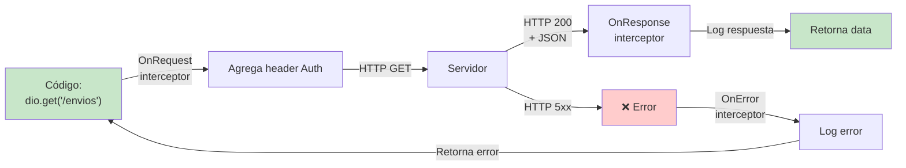
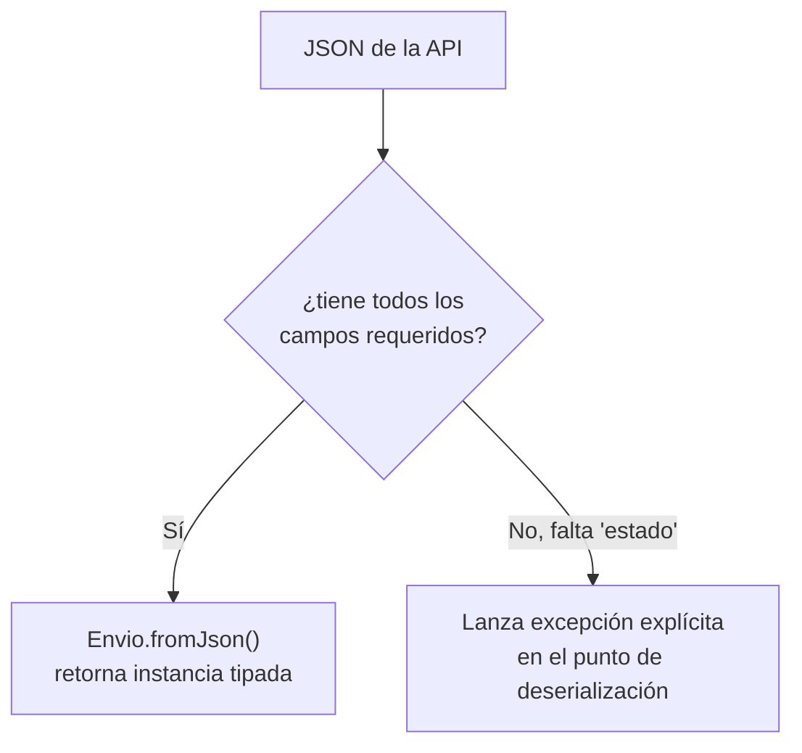
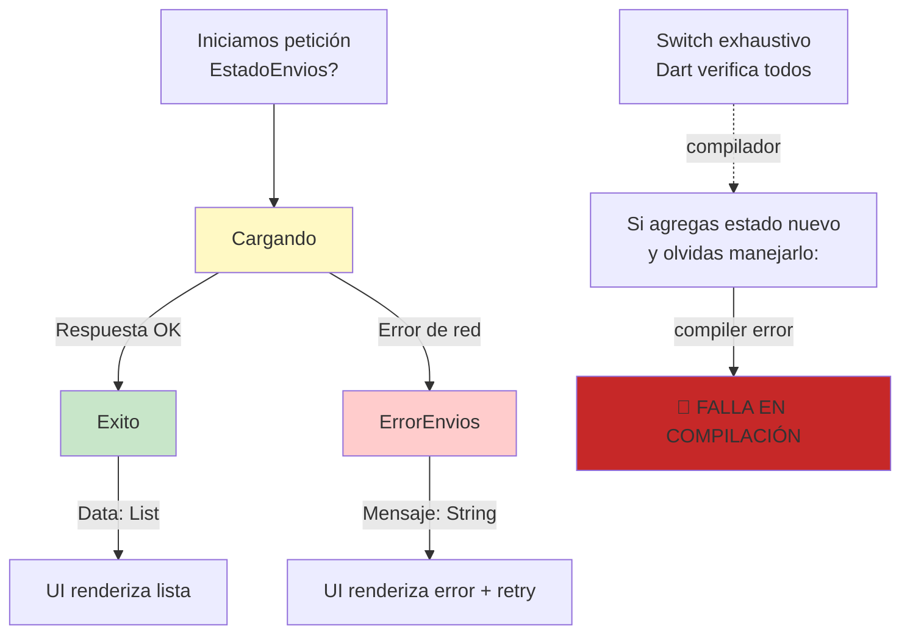
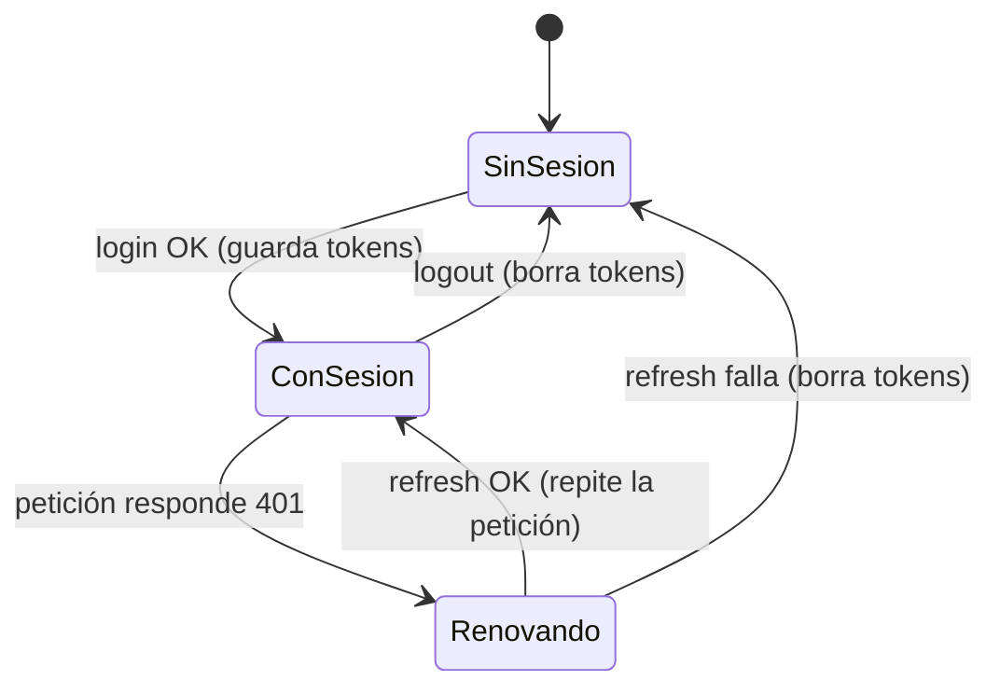

# Módulo 5: Networking


## Aprende construyendo


### Tema 1: http vs dio · Intermedio · 35 min

<details open>
<summary><strong>Capa 1 — Lectura</strong></summary>

#### ► DE QUÉ TRATA
Al finalizar vas a migrar la consulta de envíos de RutaFlow de http a dio, para poder cancelar una búsqueda en curso cuando el operador escribe una guía nueva. Prerrequisitos: Módulo 4 completo.

#### ► CÓMO FUNCIONA


#### ► REGLA PRÁCTICA
Usa `dio` en vez de `http` cuando necesites cancelar peticiones en curso, interceptores para agregar headers o loguear de forma centralizada, o configuración avanzada de timeouts; para una llamada simple sin esos requisitos, `http` es más liviano.

</details>

<details>
<summary><strong>Capa 2 — Construcción</strong></summary>

#### Código y verificación


```dart
// http: simple, suficiente para casos básicos
final respuesta = await http.get(Uri.parse('https://api.miapp.com/tareas'));

// dio: interceptores, cancelación, timeouts configurables, transformación de datos
final dio = Dio();
dio.interceptors.add(LogInterceptor());
final respuesta = await dio.get('/tareas');
```

```dart
import 'package:dio/dio.dart';
import 'package:flutter/material.dart';

// httpbin.org/delay/2 tarda dos segundos: da tiempo a escribir otra guía y cancelar.
final dio = Dio(BaseOptions(baseUrl: 'https://httpbin.org'));

void main() => runApp(const MaterialApp(home: BuscadorEnvios()));

class BuscadorEnvios extends StatefulWidget {
  const BuscadorEnvios({super.key});

  @override
  State<BuscadorEnvios> createState() => _BuscadorEnviosState();
}

class _BuscadorEnviosState extends State<BuscadorEnvios> {
  CancelToken? cancelToken;
  String resultado = 'Escribe una guía';

  Future<void> buscar(String guia) async {
    cancelToken?.cancel('nueva búsqueda'); // la búsqueda anterior ya no importa
    final token = CancelToken();
    cancelToken = token;
    try {
      final respuesta = await dio.get<Map<String, dynamic>>(
        '/delay/2',
        queryParameters: {'guia': guia},
        cancelToken: token,
      );
      final args = respuesta.data?['args'] as Map<String, dynamic>?;
      if (!mounted) return;
      setState(() => resultado = 'Respuesta para ${args?['guia']}');
    } on DioException catch (e) {
      if (CancelToken.isCancel(e)) return; // cancelada a propósito: no es un error
      if (!mounted) return;
      setState(() => resultado = 'Error: ${e.message}');
    }
  }

  @override
  Widget build(BuildContext context) => Scaffold(
        appBar: AppBar(title: const Text('Buscar envío')),
        body: Padding(
          padding: const EdgeInsets.all(16),
          child: Column(children: [
            TextField(decoration: const InputDecoration(labelText: 'Guía'), onChanged: buscar),
            const SizedBox(height: 16),
            Text(resultado),
          ]),
        ),
      );
}
```

```bash
flutter create demo_flutter
cd demo_flutter
flutter pub add dio
flutter run
```

</details>

### Tema 2: json_serializable · Intermedio · 35 min

<details open>
<summary><strong>Capa 1 — Lectura</strong></summary>

#### ► DE QUÉ TRATA
Al finalizar vas a generar el modelo Envio con json_serializable, detectando en tiempo de deserialización si la API devuelve un campo faltante o mal tipado. Prerrequisitos: Tema 1 de este módulo.

#### ► CÓMO FUNCIONA


</details>

<details>
<summary><strong>Capa 2 — Construcción</strong></summary>

#### Código y verificación
```dart
@JsonSerializable()
class Tarea {
  final String id;
  final String titulo;
  Tarea({required this.id, required this.titulo});
  factory Tarea.fromJson(Map<String, dynamic> json) => _$TareaFromJson(json);
}
```


```dart
import 'dart:convert';

import 'package:flutter/material.dart';
import 'package:json_annotation/json_annotation.dart';

part 'main.g.dart'; // lo genera: dart run build_runner build

@JsonSerializable()
class Envio {
  final String guia;
  final String estado;
  Envio({required this.guia, required this.estado});
  factory Envio.fromJson(Map<String, dynamic> json) => _$EnvioFromJson(json);
  Map<String, dynamic> toJson() => _$EnvioToJson(this);
}

String probar(String json) {
  try {
    final envio = Envio.fromJson(jsonDecode(json) as Map<String, dynamic>);
    return '${envio.guia}: ${envio.estado}';
  } on TypeError catch (e) {
    return 'Error al parsear: $e';
  }
}

void main() => runApp(MaterialApp(
      home: Scaffold(
        body: SafeArea(
          child: Column(children: [
            Text(probar('{"guia": "RF-4471", "estado": "en_ruta"}')),
            Text(probar('{"guia": "RF-5002"}')), // falta `estado`
          ]),
        ),
      ),
    ));
```

```bash
flutter create demo_flutter
cd demo_flutter
flutter pub add json_annotation
flutter pub add dev:build_runner dev:json_serializable
dart run build_runner build
flutter run
```

</details>

### Tema 3: Interceptores y estados explícitos · Avanzado · 40 min

<details open>
<summary><strong>Capa 1 — Lectura</strong></summary>

#### ► DE QUÉ TRATA
Al finalizar vas a agregar un interceptor de autenticación a dio que inyecte el token del conductor en cada petición, y a modelar EstadoEnvios como una sealed class con los tres estados posibles. Prerrequisitos: Tema 2 de este módulo.

#### ► CÓMO FUNCIONA


</details>

<details>
<summary><strong>Capa 2 — Construcción</strong></summary>

#### Código y verificación


```dart
dio.interceptors.add(InterceptorsWrapper(
  onRequest: (options, handler) {
    options.headers['Authorization'] = 'Bearer $token';
    handler.next(options);
  },
));
```

```dart
sealed class EstadoTareas {}
class Cargando extends EstadoTareas {}
class Exito extends EstadoTareas { final List<Tarea> tareas; Exito(this.tareas); }
class Error extends EstadoTareas { final String mensaje; Error(this.mensaje); }
```

```dart
import 'package:dio/dio.dart';
import 'package:flutter/material.dart';

const token = 'token-de-laboratorio';

// httpbin.org/headers devuelve los headers recibidos: así se ve el que añadió el interceptor.
final dio = Dio(BaseOptions(baseUrl: 'https://httpbin.org'));

class Envio {
  const Envio(this.guia);
  final String guia;
}

sealed class EstadoEnvios {}
class Cargando extends EstadoEnvios {}
class Exito extends EstadoEnvios { final List<Envio> envios; Exito(this.envios); }
class ErrorEnvios extends EstadoEnvios { final String mensaje; ErrorEnvios(this.mensaje); }

void main() {
  dio.interceptors.add(InterceptorsWrapper(
    onRequest: (options, handler) {
      options.headers['Authorization'] = 'Bearer $token';
      handler.next(options);
    },
  ));
  runApp(const MaterialApp(home: PantallaEnvios()));
}

class PantallaEnvios extends StatefulWidget {
  const PantallaEnvios({super.key});

  @override
  State<PantallaEnvios> createState() => _PantallaEnviosState();
}

class _PantallaEnviosState extends State<PantallaEnvios> {
  EstadoEnvios estado = Cargando();

  @override
  void initState() {
    super.initState();
    cargar();
  }

  Future<void> cargar() async {
    try {
      final respuesta = await dio.get<Map<String, dynamic>>('/headers');
      final headers = respuesta.data?['headers'] as Map<String, dynamic>?;
      if (!mounted) return;
      setState(() => estado = Exito([Envio('RF-4471 · ${headers?['Authorization']}')]));
    } on DioException catch (e) {
      if (!mounted) return;
      setState(() => estado = ErrorEnvios(e.message ?? 'Error de red'));
    }
  }

  @override
  Widget build(BuildContext context) => Scaffold(
        body: Center(
          child: switch (estado) {
            Cargando() => const CircularProgressIndicator(),
            Exito(:final envios) => Column(
                mainAxisSize: MainAxisSize.min,
                children: [for (final e in envios) Text(e.guia)],
              ),
            ErrorEnvios(:final mensaje) => Text('Error: $mensaje'),
          },
        ),
      );
}
```

```bash
flutter create demo_flutter
cd demo_flutter
flutter pub add dio
flutter run
```

</details>

### Tema 4: Flujo de autenticación con tokens: login, almacenamiento seguro, renovación y cierre de sesión · Avanzado · 40 min

<details open>
<summary><strong>Capa 1 — Lectura</strong></summary>

#### ► DE QUÉ TRATA
Al finalizar vas a implementar el inicio de sesión del conductor, guardar sus tokens de forma segura, renovar el token vencido sin que el usuario lo note y cerrar la sesión limpiando todo. Prerrequisitos: Tema 3 de este módulo (interceptores de dio) y un backend con /auth/login y…

#### ► CÓMO FUNCIONA


</details>

<details>
<summary><strong>Capa 2 — Construcción</strong></summary>

#### Código y verificación


```bash
flutter pub add dio flutter_secure_storage
```

```dart
import 'package:flutter_secure_storage/flutter_secure_storage.dart';

class AlmacenTokens {
  const AlmacenTokens([this._storage = const FlutterSecureStorage()]);
  final FlutterSecureStorage _storage;

  Future<void> guardar(String acceso, String renovacion) async {
    await _storage.write(key: 'acceso', value: acceso);
    await _storage.write(key: 'renovacion', value: renovacion);
  }

  Future<String?> acceso() => _storage.read(key: 'acceso');
  Future<String?> renovacion() => _storage.read(key: 'renovacion');
  Future<void> borrar() => _storage.deleteAll();
}
```

```dart
import 'package:dio/dio.dart';
import 'almacen_tokens.dart';

// QueuedInterceptor procesa los errores de uno en uno. Para que diez 401 simultáneos renueven una sola vez,
// cada error compara el token con el que salió con el token vigente antes de refrescar.
class InterceptorAuth extends QueuedInterceptor {
  InterceptorAuth(this._dio, this._tokens, {required this.alCerrarSesion});
  final Dio _dio;
  final AlmacenTokens _tokens;
  final void Function() alCerrarSesion;

  @override
  Future<void> onRequest(RequestOptions options, RequestInterceptorHandler handler) async {
    final acceso = await _tokens.acceso();
    if (acceso != null) options.headers['Authorization'] = 'Bearer $acceso';
    handler.next(options);
  }

  @override
  Future<void> onError(DioException err, ErrorInterceptorHandler handler) async {
    final esRefresh = err.requestOptions.path.endsWith('/auth/refresh');
    if (err.response?.statusCode != 401 || esRefresh) return handler.next(err);

    // Si otra petición de la cola ya renovó el token, reintenta con el vigente sin volver a refrescar.
    final usado = err.requestOptions.headers['Authorization'];
    final vigente = await _tokens.acceso();
    if (vigente != null && usado != 'Bearer $vigente') {
      final reintento = err.requestOptions..headers['Authorization'] = 'Bearer $vigente';
      try {
        return handler.resolve(await _dio.fetch(reintento));
      } on DioException catch (e) {
        return handler.next(e);
      }
    }

    final renovacion = await _tokens.renovacion();
    if (renovacion == null) return _terminar(err, handler);
    try {
      // Cliente aparte para no volver a pasar por este interceptor.
      final r = await Dio(BaseOptions(baseUrl: _dio.options.baseUrl))
          .post('/auth/refresh', data: {'refreshToken': renovacion});
      await _tokens.guardar(r.data['accessToken'], r.data['refreshToken']);
      final reintento = err.requestOptions..headers['Authorization'] = 'Bearer ${r.data['accessToken']}';
      handler.resolve(await _dio.fetch(reintento)); // repite la petición original
    } on DioException {
      await _terminar(err, handler);
    }
  }

  Future<void> _terminar(DioException err, ErrorInterceptorHandler handler) async {
    await _tokens.borrar();
    alCerrarSesion(); // la UI navega al login
    handler.next(err);
  }
}
```

```dart
import 'package:dio/dio.dart';
import 'almacen_tokens.dart';

class ServicioAuth {
  ServicioAuth(this._dio, this._tokens);
  final Dio _dio;
  final AlmacenTokens _tokens;

  Future<void> iniciarSesion(String usuario, String clave) async {
    final r = await _dio.post('/auth/login', data: {'usuario': usuario, 'clave': clave});
    await _tokens.guardar(r.data['accessToken'], r.data['refreshToken']); // la clave no se guarda
  }

  Future<void> cerrarSesion() => _tokens.borrar();
}
```

```bash
flutter create rutaflow_flutter
cd rutaflow_flutter
flutter pub add dio json_annotation flutter_riverpod
flutter pub add --dev build_runner json_serializable
```

</details>
