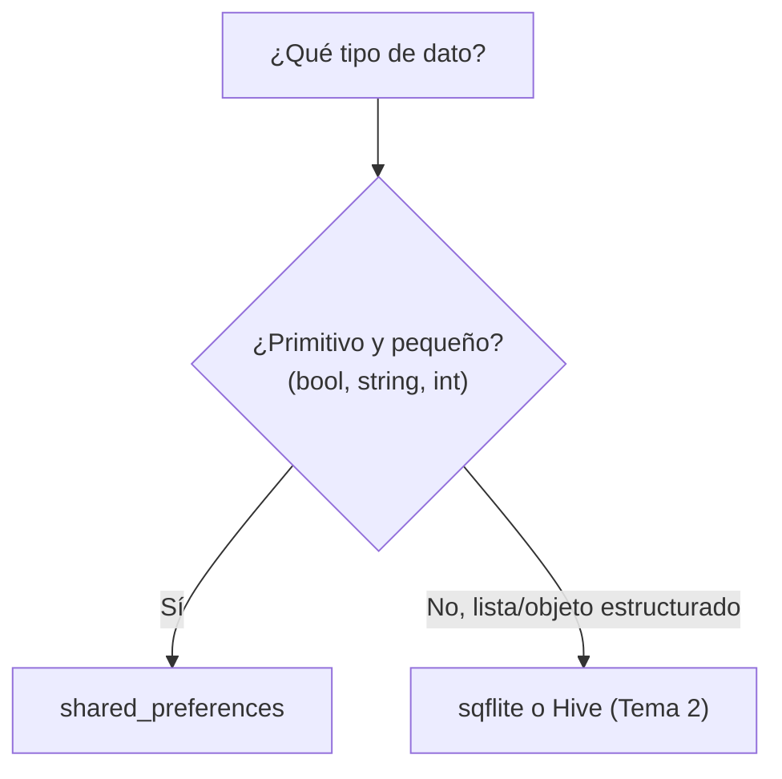
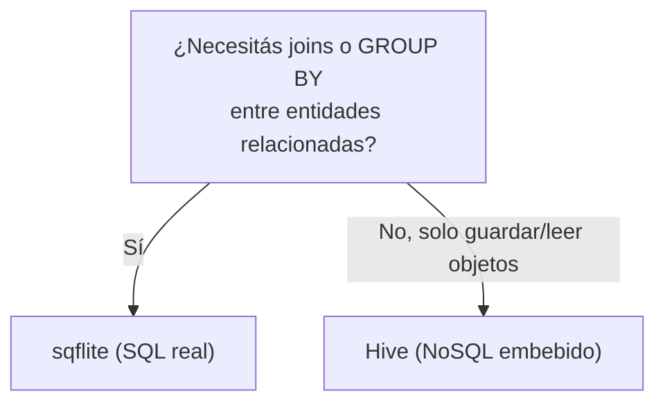
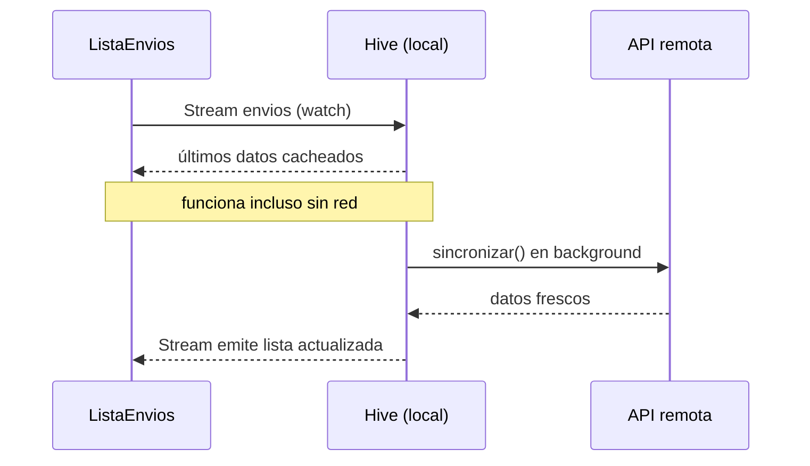
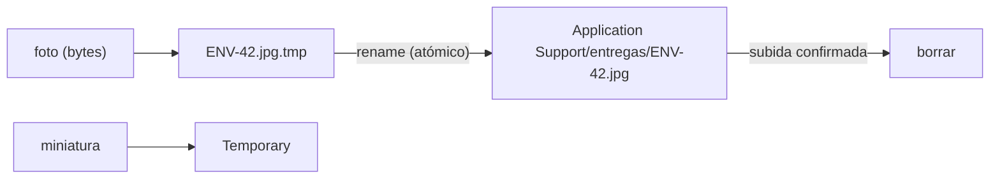

# Módulo 6: Persistencia local


## Aprende construyendo


### Tema 1: shared_preferences · Básico · 30 min

<details open>
<summary><strong>Capa 1 — Lectura</strong></summary>

#### ► DE QUÉ TRATA
Al finalizar vas a persistir el filtro de zona preferido del conductor con shared_preferences, confirmando por qué ese mecanismo no sería apropiado para guardar la lista completa de envíos. Prerrequisitos: Módulo 5 completo.

#### ► LA ANALOGÍA
`shared_preferences` provee almacenamiento clave-valor simple, ideal para configuración pequeña de tipos primitivos; no apropiado para datos estructurados en volumen.
**Conceptos clave:** almacenamiento clave-valor simple, no apropiado para datos estructurados grandes.

```dart
final prefs = SharedPreferencesAsync();
await prefs.setBool('tema_oscuro', true);
final temaOscuro = await prefs.getBool('tema_oscuro') ?? false;
```

> `SharedPreferences.getInstance()` aparece en muchos tutoriales, pero el paquete la declara *legacy* («will be deprecated in the future») y recomienda `SharedPreferencesAsync` o `SharedPreferencesWithCache` para código nuevo. Con `SharedPreferencesAsync` cada lectura es `await` (fuente: https://pub.dev/packages/shared_preferences).

`shared_preferences` provee una API simple de almacenamiento clave-valor persistente, ideal específicamente para configuración pequeña y de tipos primitivos (un booleano de tema oscuro, un string de idioma preferido, un entero de contador de sesiones); no es apropiado para guardar una lista grande de objetos estructurados (como una colección completa de tareas de usuario), dado que su modelo de almacenamiento no está diseñado para consultas eficientes sobre datos relacionales o estructurados en volumen, y forzar ese caso de uso hacia `shared_preferences` (por ejemplo, serializando manualmente una lista completa a un único string JSON gigante) sacrifica tanto el rendimiento como la capacidad de consultar o modificar elementos individuales de forma eficiente.

Esta distinción de "para qué sirve cada mecanismo de persistencia" es análoga a `UserDefaults` en iOS (el equivalente conceptual de `shared_preferences` en el ecosistema Apple, apropiado solo para configuración pequeña, nunca para datos estructurados en volumen) y a `SharedPreferences` de Android nativo (Módulo 6 de ese track, aunque en Android Room reemplaza ese rol para datos relacionales).

**Analogía:** `shared_preferences` es como una pequeña libreta de notas personales apropiada para anotar un par de preferencias simples (recordatorios cortos), pero completamente inadecuada para llevar el inventario completo de un almacén con miles de artículos individuales, para lo cual se necesita un sistema de registro estructurado apropiado.

**¿Por qué es importante?** `shared_preferences` NO es apropiado para guardar una lista grande de objetos estructurados, dado que su modelo de almacenamiento clave-valor simple no está diseñado para consultas eficientes sobre datos relacionales o en volumen, a diferencia de `sqflite` o Hive.

**Código del ejemplo:**

```dart
await prefs.setBool('tema_oscuro', true);   // apropiado: valor simple
// NO apropiado: prefs.setString('lista_tareas', jsonEncode(listaGrandeDeObjetos))
```

**Diagrama: qué guardar en shared_preferences**



En el proyecto integrador RutaFlow, `zona_preferida` vive en `lib/features/deliveries/domain/delivery_providers.dart`. Práctica: identificá en tu proyecto propio una preferencia simple y persistila con `shared_preferences`.

#### ► CÓMO FUNCIONA


</details>

<details>
<summary><strong>Capa 2 — Construcción</strong></summary>

#### Código y verificación
```dart
final prefs = SharedPreferencesAsync();
await prefs.setBool('tema_oscuro', true);
final temaOscuro = await prefs.getBool('tema_oscuro') ?? false;
```

```dart
await prefs.setBool('tema_oscuro', true);   // apropiado: valor simple
// NO apropiado: prefs.setString('lista_tareas', jsonEncode(listaGrandeDeObjetos))
```


```dart
import 'package:flutter/material.dart';
import 'package:shared_preferences/shared_preferences.dart';

Future<void> main() async {
  WidgetsFlutterBinding.ensureInitialized();
  final prefs = SharedPreferencesAsync();
  final zona = await prefs.getString('zona_preferida') ?? 'todas';
  runApp(MaterialApp(home: SelectorZona(prefs: prefs, zonaInicial: zona)));
}

class SelectorZona extends StatefulWidget {
  const SelectorZona({required this.prefs, required this.zonaInicial, super.key});
  final SharedPreferencesAsync prefs;
  final String zonaInicial;

  @override
  State<SelectorZona> createState() => _SelectorZonaState();
}

class _SelectorZonaState extends State<SelectorZona> {
  late String zona = widget.zonaInicial;

  Future<void> elegir(String nueva) async {
    await widget.prefs.setString('zona_preferida', nueva);
    if (!mounted) return;
    setState(() => zona = nueva);
  }

  @override
  Widget build(BuildContext context) => Scaffold(
        appBar: AppBar(title: Text('Zona preferida: $zona')),
        body: ListView(children: [
          for (final opcion in ['todas', 'norte', 'sur'])
            ListTile(
              title: Text(opcion),
              trailing: opcion == zona ? const Icon(Icons.check) : null,
              onTap: () => elegir(opcion),
            ),
        ]),
      );
}
```

```bash
flutter create demo_flutter
cd demo_flutter
flutter pub add shared_preferences
flutter run
```

</details>

### Tema 2: sqflite vs Hive · Intermedio · 35 min

<details open>
<summary><strong>Capa 1 — Lectura</strong></summary>

#### ► DE QUÉ TRATA
Al finalizar vas a decidir entre sqflite y Hive para cachear la lista de envíos de RutaFlow, según si necesitás consultas relacionales o simplemente guardar objetos directos. Prerrequisitos: Tema 1 de este módulo.

#### ► CÓMO FUNCIONA


#### ► REGLA PRÁCTICA
Elige `sqflite` cuando necesites consultas relacionales (joins, `GROUP BY`) entre entidades; elige `Hive` cuando solo necesites guardar y leer objetos directamente, sin relaciones que consultar.

</details>

<details>
<summary><strong>Capa 2 — Construcción</strong></summary>

#### Código y verificación
```dart
final db = await openDatabase('app.db', version: 1, onCreate: (db, version) {
  db.execute('CREATE TABLE tarea(id TEXT PRIMARY KEY, titulo TEXT, completada INTEGER)');
});

await db.insert('tarea', {'id': '1', 'titulo': 'Comprar leche', 'completada': 0});
final tareas = await db.query('tarea');
```

```dart
// lib/tarea.dart
import 'package:hive/hive.dart';

part 'tarea.g.dart'; // lo genera: dart run build_runner build

@HiveType(typeId: 0)
class Tarea extends HiveObject {
  Tarea({required this.titulo, required this.completada});

  @HiveField(0)
  String titulo;

  @HiveField(1)
  bool completada;
}

// En main(), antes de abrir la caja (Hive.initFlutter viene de hive_flutter):
await Hive.initFlutter();
Hive.registerAdapter(TareaAdapter()); // clase generada en tarea.g.dart
final box = await Hive.openBox<Tarea>('tareas');
await box.add(Tarea(titulo: 'Comprar leche', completada: false));
```

```
sqflite  → SQL relacional real, joins, agregaciones complejas
Hive     → NoSQL embebido simple, objetos directos sin relaciones complejas
```


```bash
flutter test test/envio_dao_test.dart
```

```dart
import 'package:flutter/material.dart';
import 'package:sqflite/sqflite.dart';

Future<void> main() async {
  WidgetsFlutterBinding.ensureInitialized();
  final db = await openDatabase('rutaflow.db', version: 1, onCreate: (db, version) async {
    await db.execute('CREATE TABLE envio(id TEXT PRIMARY KEY, zona TEXT, conductor TEXT, estado TEXT)');
  });
  await db.delete('envio'); // la demostración arranca siempre con los mismos datos
  for (final (id, estado) in [('RF-1', 'entregado'), ('RF-2', 'entregado'), ('RF-3', 'en_ruta')]) {
    await db.insert('envio', {'id': id, 'zona': 'norte', 'conductor': 'c-891', 'estado': estado});
  }
  final resumen = await db.rawQuery(
    'SELECT estado, COUNT(*) as total FROM envio WHERE conductor = ? AND zona = ? GROUP BY estado',
    ['c-891', 'norte'],
  );
  runApp(MaterialApp(
    home: Scaffold(
      body: SafeArea(
        child: Column(children: [
          for (final fila in resumen) Text('${fila['estado']}: ${fila['total']}'),
        ]),
      ),
    ),
  ));
}
```

</details>

### Tema 3: Offline-first y Firebase · Intermedio · 40 min

<details open>
<summary><strong>Capa 1 — Lectura</strong></summary>

#### ► DE QUÉ TRATA
Al finalizar vas a hacer que ListaEnvios lea siempre de una caja de Hive local (nunca directamente de la API), con un proceso de sincronización separado que la actualiza en segundo plano. Prerrequisitos: Tema 2 de este módulo.

#### ► CÓMO FUNCIONA


</details>

<details>
<summary><strong>Capa 2 — Construcción</strong></summary>

#### Código y verificación
```dart
Stream<List<Tarea>> get tareas => box.watch().map((_) => box.values.toList());

Future<void> sincronizar() async {
  final remotas = await api.obtenerTareas();
  for (final t in remotas) { box.put(t.id, t); }
}
```

```
UI ← siempre lee de → Hive/sqflite (caché local reactiva)
                          ↑
                   Sincronización en background
                          ↓
                        API remota / Firebase
```


```dart
import 'dart:async';

import 'package:flutter/material.dart';
import 'package:hive_flutter/hive_flutter.dart';

class Envio {
  const Envio(this.id, this.estado);
  final String id;
  final String estado;
}

/// API simulada: en la app real es Dio contra el backend.
class ApiEnvios {
  Future<List<Envio>> obtenerEnvios() async {
    await Future<void>.delayed(const Duration(seconds: 1));
    return const [Envio('RF-4471', 'en_ruta'), Envio('RF-5002', 'entregado')];
  }
}

class RepositorioEnvios {
  RepositorioEnvios(this.box, this.api);
  final Box<String> box; // id -> estado
  final ApiEnvios api;

  List<Envio> get _actuales => [for (final id in box.keys.cast<String>()) Envio(id, box.get(id)!)];

  // La UI siempre lee de la caché local; cada cambio en la caja emite la lista nueva.
  Stream<List<Envio>> get envios async* {
    yield _actuales;
    yield* box.watch().map((_) => _actuales);
  }

  Future<void> sincronizar() async {
    try {
      final remotos = await api.obtenerEnvios();
      for (final e in remotos) {
        await box.put(e.id, e.estado);
      }
    } on Exception {
      // Sin red: la pantalla sigue mostrando la caché local.
    }
  }
}

Future<void> main() async {
  await Hive.initFlutter();
  final box = await Hive.openBox<String>('envios');
  final repo = RepositorioEnvios(box, ApiEnvios());
  runApp(MaterialApp(home: ListaEnvios(repo: repo)));
  unawaited(repo.sincronizar());
}

class ListaEnvios extends StatefulWidget {
  const ListaEnvios({required this.repo, super.key});
  final RepositorioEnvios repo;

  @override
  State<ListaEnvios> createState() => _ListaEnviosState();
}

class _ListaEnviosState extends State<ListaEnvios> {
  late final Stream<List<Envio>> envios = widget.repo.envios;

  @override
  Widget build(BuildContext context) => Scaffold(
        appBar: AppBar(title: const Text('Envíos (caché local)')),
        body: StreamBuilder<List<Envio>>(
          stream: envios,
          builder: (context, snapshot) => ListView(children: [
            for (final e in snapshot.data ?? const <Envio>[])
              ListTile(title: Text(e.id), subtitle: Text(e.estado)),
          ]),
        ),
      );
}
```

```bash
flutter create demo_flutter
cd demo_flutter
flutter pub add hive hive_flutter
flutter run
```

</details>

### Tema 4: Restauración de formularios con RestorationMixin y una prueba de recreación · Intermedio · 35 min

<details open>
<summary><strong>Capa 1 — Lectura</strong></summary>

#### ► DE QUÉ TRATA
Al finalizar conservarás un campo transitorio durante una restauración del framework y lo verificarás con una prueba de widget. Prerrequisitos: StatefulWidget, controladores y dispose. Flutter instalado y flutter doctor revisado. Ejemplo independiente desde una carpeta vacía.

#### ► LA ANALOGÍA
Un scope identifica el árbol restaurable. `RestorationMixin` registra propiedades con identificadores estables. `RestorableTextEditingController` conserva el valor del campo y permite recuperar su controlador. **Analogía:** un guardarropa devuelve cada objeto usando su número de ficha; si cambias o repites identificadores, rompes la relación. El límite es que restauración de UI no sustituye almacenamiento duradero ni sincronización con el servidor.

</details>

<details>
<summary><strong>Capa 2 — Construcción</strong></summary>

#### Código y verificación
```bash
flutter create restauracion_demo
cd restauracion_demo
```

```dart
import 'package:flutter/material.dart';

void main() => runApp(const DraftApp());
class DraftApp extends StatelessWidget {
  const DraftApp({super.key});
  @override
  Widget build(BuildContext context) => const MaterialApp(
    restorationScopeId: 'entregas', home: DraftPage());
}
class DraftPage extends StatefulWidget {
  const DraftPage({super.key});
  @override
  State<DraftPage> createState() => _DraftState();
}
class _DraftState extends State<DraftPage> with RestorationMixin {
  final address = RestorableTextEditingController();
  @override
  String get restorationId => 'borrador';
  @override
  void restoreState(RestorationBucket? oldBucket, bool initialRestore) {
    registerForRestoration(address, 'direccion');
  }
  @override
  void dispose() {
    address.dispose();
    super.dispose();
  }
  @override
  Widget build(BuildContext context) => Scaffold(
    appBar: AppBar(title: const Text('Borrador')),
    body: Padding(padding: const EdgeInsets.all(24), child: TextField(
      controller: address.value,
      decoration: const InputDecoration(labelText: 'Dirección'))));
}
```

```dart
import 'package:flutter/material.dart';
import 'package:flutter_test/flutter_test.dart';
import 'package:restauracion_demo/main.dart';

void main() {
  testWidgets('restaura el texto transitorio', (tester) async {
    await tester.pumpWidget(const DraftApp());
    await tester.enterText(find.byType(TextField), 'Calle 42');
    await tester.pump(); // Serializa el cambio antes de simular la restauración.
    await tester.restartAndRestore();
    expect(find.text('Calle 42'), findsOneWidget);
  });
}
```

```bash
flutter test
flutter run
```

</details>

### Tema 5: Archivos en Flutter: path_provider, carpetas correctas y escritura segura · Intermedio · 35 min

<details open>
<summary><strong>Capa 1 — Lectura</strong></summary>

#### ► DE QUÉ TRATA
Agrega path_provider y path con flutter pub add path_provider path. Ejecuta en Android o iOS (en web no hay sistema de archivos).

#### ► LA ANALOGÍA
**Conceptos clave:** `getApplicationDocumentsDirectory`, `getApplicationSupportDirectory`, `getTemporaryDirectory`, escritura atómica, ruta relativa, limpieza de temporales.

| Función | Carpeta | ¿El sistema la borra? | Úsala para |
|---|---|---|---|
| `getApplicationDocumentsDirectory()` | documentos de la app | no | archivos del usuario |
| `getApplicationSupportDirectory()` | datos internos | no | evidencia pendiente de subir, bases |
| `getTemporaryDirectory()` | temporales | sí, cuando necesita espacio | miniaturas, descargas que se pueden repetir |

**Escritura atómica:** escribe primero en un archivo `.tmp` y luego renómbralo. Renombrar dentro de la misma carpeta es atómico: o existe el archivo completo o no existe.

Guarda en la base solo la **ruta relativa** (`entregas/ENV-42.jpg`): la carpeta absoluta de la app puede cambiar entre instalaciones o actualizaciones en iOS.

**Analogía:** la carpeta temporal es la mesa de trabajo que limpian cada noche; `Application Support` es el archivador con llave. La analogía falla en que no sabes a qué hora limpian la mesa.

**Límite de uso:** no guardes archivos grandes en SharedPreferences ni en la base: guarda el archivo y su ruta. En web, `path_provider` no aplica; usa almacenamiento del navegador o el servidor.



#### ► CÓMO FUNCIONA


</details>

<details>
<summary><strong>Capa 2 — Construcción</strong></summary>

#### Código y verificación

```dart
import 'dart:io';
import 'dart:typed_data';
import 'package:path/path.dart' as p;
import 'package:path_provider/path_provider.dart';

class AlmacenFotos {
  Future<Directory> _carpeta() async {
    final base = await getApplicationSupportDirectory();
    return Directory(p.join(base.path, 'entregas')).create(recursive: true);
  }

  /// Guarda de forma atómica y devuelve la ruta RELATIVA para la base de datos.
  Future<String> guardar(String codigo, Uint8List bytes) async {
    final carpeta = await _carpeta();
    final destino = File(p.join(carpeta.path, '$codigo.jpg'));
    final temporal = File('${destino.path}.tmp');
    await temporal.writeAsBytes(bytes, flush: true);
    await temporal.rename(destino.path); // o queda completo o no queda
    return p.join('entregas', '$codigo.jpg');
  }

  Future<File> abrir(String rutaRelativa) async =>
      File(p.join((await getApplicationSupportDirectory()).path, rutaRelativa));

  Future<int> limpiarTemporales() async {
    final tmp = await getTemporaryDirectory();
    var borrados = 0;
    await for (final f in tmp.list()) {
      if (f is File && f.path.endsWith('.miniatura.jpg')) { await f.delete(); borrados++; }
    }
    return borrados;
  }
}
```

```bash
flutter run
# en Android, revisa el archivo con:
adb shell run-as co.rutaflow.app ls files/entregas
```

```text
Tras guardar ENV-42, `adb shell run-as co.rutaflow.app ls files/entregas` muestra ENV-42.jpg (en Android, Application Support corresponde a files/).
La base guarda «entregas/ENV-42.jpg», no la ruta absoluta.
```

</details>
